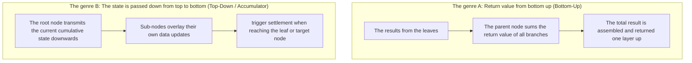

> **English original course**: CS 61A: Structure and Interpretation of Computer Programs (Fall 2024)  
> **Lecturer**: Prof. John DeNero (UC Berkeley)  
> **Text and illustrations**: VideoBook video to image to text technology e-book assembly line  
> **course coverage**: 37 / 37 on 18.2 hour audio/video instruction ⁇ 577 high-level lecture screenshots  
> **Online catalog**: [CS61A Special Catalog](/en/notes/topics/CS61A)

---


> **Lecture**: John DeNero ｜ **duration**: 34:32 ｜ **Video link back**: [B station response unit set (P14)](https://www.bilibili.com/video/BV1sy411z7nA/?p=14)

## 1. Introduction: Two metaphors of tree and world-level model

In computer science, tree structures are everywhere: file directory trees, syntax analysis AST, organizational structure diagrams, decision trees. **The roots are at the top, the leaves are below.**.

Understanding trees is a metaphor for two descriptions of tables:

### 1.1 Botanical recursion metaphors (The Rescursive Metaphor)
> A tree is made of a single **Root Label**  And a group **List of Branches**  The composition.  
> The key conclusions: **And every branch of a tree is a whole tree.**


*⏱ Timestamp: 00:03:13 · 📷 Lecture screenshot · [Watch clip (P14 00:03:13)](https://www.bilibili.com/video/BV1sy411z7nA/?p=14&t=193)*

- **The Leaf Nodule** Tree without branch (the list of branches is empty) is called leaf node.

### 1.2 The Relative / Family Tree Metaphor
Each location in the tree where data is stored is called **The Node**.
- The node stores specific data (called nodes)  **Label**).
- The link between the nodes is at a kinship level: **The Parent**, **Children's Nodes**, **The Siblings**, **The Ancestors**, **The following is a list of the most common causes of death in children:**.
- The level at which a node is located is called the **The first is the "Deepth".**.


*⏱ Timestamp: 00:04:16 · 📷 Lecture screenshot · [Watch clip (P14 00:04:16)](https://www.bilibili.com/video/BV1sy411z7nA/?p=14&t=256)*

---

## The Tree Data Abstraction is a collection of data abstractions.

In keeping with CS61A's consistent data abstraction philosophy, we first define the public interface of trees:


*⏱ Timestamp: 00:05:21 · 📷 Lecture screenshot · [Watch clip (P14 00:05:21)](https://www.bilibili.com/video/BV1sy411z7nA/?p=14&t=321)*

### 2.1 Constructor and selector specifications
- `tree(label, branches=[])` The root node is the root node.  `label` List of sub-trees  `branches`  The tree.  `branches`  The space is formed by a leaf node.
- `label(t)` Selector, back to the tree  `t`  The root label.
- `branches(t)` Selector, back to the tree  `t`  The list of branches (each element is a tree)
- `is_leaf(t)` Judging by the word, when and only when  `branches(t)`  Back in the day  `True`.

### 2.2 Concrete implementation with rigorous error-control testing
```python
def tree(label, branches=[]):
    """树构造器：确保所有分支皆为合法树。"""
    for branch in branches:
        assert is_tree(branch), "branches must be trees"
    return [label] + list(branches)

def label(tree):
    """选择器：返回根节点标签。"""
    return tree[0]

def branches(tree):
    """选择器：返回所有分支构成的列表。"""
    return tree[1:]

def is_leaf(tree):
    """谓词：检查是否为叶子节点。"""
    return not branches(tree)

def is_tree(tree):
    """谓词：递归检查是否为良构树。"""
    if type(tree) != list or len(tree) < 1:
        return False
    for branch in branches(tree):
        if not is_tree(branch):
            return False
    return True
```


*⏱ Timestamp: 00:06:51 · 📷 Lecture screenshot · [Watch clip (P14 00:06:51)](https://www.bilibili.com/video/BV1sy411z7nA/?p=14&t=411)*


*⏱ Timestamp: 00:08:18 · 📷 Lecture screenshot · [Watch clip (P14 00:08:18)](https://www.bilibili.com/video/BV1sy411z7nA/?p=14&t=498)*

> **abstraction block answers** The use of silicon  `for b in branches(t):`  The question is, has the branch broken the barrier of abstraction?  
> **The answer is no!**  The tree abstraction is clearly guaranteed in the open contract: `branches(t)`  The return is a tree made of young trees. **List of Branches** The use of lists across the branches is in full compliance with the contract for this abstraction!


*⏱ Timestamp: 00:10:14 · 📷 Lecture screenshot · [Watch clip (P14 00:10:14)](https://www.bilibili.com/video/BV1sy411z7nA/?p=14&t=614)*

---

## 3. Programmatic tree construction: Fibonacci tree (`fib_tree`)

In actual engineering, trees are often not built by hand-hardcoded nesting but by algorithms. **Programmatic recursion generated** The Epiphonaceae tree is a good example:


*⏱ Timestamp: 00:11:52 · 📷 Lecture screenshot · [Watch clip (P14 00:11:52)](https://www.bilibili.com/video/BV1sy411z7nA/?p=14&t=712)*

```python
def fib_tree(n):
    """递归构造对应 Fibonacci(n) 计算过程的形态树。"""
    if n <= 1:
        return tree(n)
    else:
        left, right = fib_tree(n - 2), fib_tree(n - 1)
        return tree(label(left) + label(right), [left, right])
```
- The main branch:  $n \le 1$  When the single node leaves are returned directly  `tree(n)`.
- Recursion branch: recursion generates left and right subtrees, labeling the roots of both trees as root tags for the current tree.

---

## Standard recursion paradigm of tree processing functions: statistics and developments

The recursion function of all operating trees follows a highly uniform structural framework:
```python
def process_tree(t):
    if is_leaf(t):
        return base_result(t)
    return aggregate([process_tree(b) for b in branches(t)])
```

### 4.1 Calculate the total number of leaf nodes (`count_leaves`)
```python
def count_leaves(t):
    """统计树 t 中所有叶子节点的数量。"""
    if is_leaf(t):
        return 1
    return sum([count_leaves(b) for b in branches(t)])
```


*⏱ Timestamp: 00:13:25 · 📷 Lecture screenshot · [Watch clip (P14 00:13:25)](https://www.bilibili.com/video/BV1sy411z7nA/?p=14&t=805)*

- **Baseline conditions** If the current node is a leaf, it's itself a leaf node, return  `1`.
- **Recursion accumulation** Recursion: through each branch, to get the number of leaves, using a built-in function  `sum` - What?

---

### 4.2 Collect all the label on the leaves: List of flat-out techniques (`leaves`)
If we want to return the horizontal list of all the label nodes in a tree:
```
fib_tree(4) 的叶子为: [0, 1, 1, 0, 1]
```


*⏱ Timestamp: 00:15:23 · 📷 Lecture screenshot · [Watch clip (P14 00:15:23)](https://www.bilibili.com/video/BV1sy411z7nA/?p=14&t=923)*

The first is the story of black magic: `sum([[1, 2], [3]], []) -> [1, 2, 3]` The following are the most commonly used methods of calculating the number of times a table is created:

```python
def leaves(t):
    """返回树 t 的所有叶子标签构成的单层列表。"""
    if is_leaf(t):
        return [label(t)]
    return sum([leaves(b) for b in branches(t)], [])
```


*⏱ Timestamp: 00:16:49 · 📷 Lecture screenshot · [Watch clip (P14 00:16:49)](https://www.bilibili.com/video/BV1sy411z7nA/?p=14&t=1009)*

- If for leaves: return a list of single elements  `[label(t)]`.
- If not leaves: Call for each subtree recursion  `leaves(b)`  The following is a list of  `sum(..., [])`  Putting all the sub-lists together into a flat list!

---

## 5. Structural changes in trees are expressed with compactness: `increment_tree`

Suppose we want to add the tag value of each node in the tree to 1, and create a whole new tree:

```python
def increment_tree(t):
    """返回一棵与 t 结构完全相同、所有节点标签增加 1 的新树。"""
    return tree(label(t) + 1, [increment_tree(b) for b in branches(t)])
```


*⏱ Timestamp: 00:18:47 · 📷 Lecture screenshot · [Watch clip (P14 00:18:47)](https://www.bilibili.com/video/BV1sy411z7nA/?p=14&t=1127)*

> **The very fine mechanism behind the stream** Why not: Why not?  `if is_leaf(t)`  The branch judges?
> - When the knots of leaves are encountered, `branches(t)`  List of empty  `[]`.
> - list comprehension  `[increment_tree(b) for b in []]`  Natural evaluation is a blank list  `[]` The first is the "recursion".
> - Directly generated  `tree(label(t) + 1, [])`  And back again!
> - The short-range features of the list comprehension are built into air clusters, which naturally serve as guards for baseline conditions!

---

## 6. Visualization of tree-shaped structures: shrinking and printing (`print_tree`)

The tree is printed in the form of a nested list, as  `[3, [1], [2, [1], [1]]]` In the context of a recursion, we can print an intuitive layer into a text tree:

```python
def print_tree(t, indent=0):
    """以缩进文本形式直观打印树形结构。"""
    print('  ' * indent + str(label(t)))
    for b in branches(t):
        print_tree(b, indent + 1)
```


*⏱ Timestamp: 00:20:52 · 📷 Lecture screenshot · [Watch clip (P14 00:20:52)](https://www.bilibili.com/video/BV1sy411z7nA/?p=14&t=1252)*

The output is:
```
3
  1
  2
    1
    1
```
The number of enclosed spaces in each layer is proportional to its depth in the tree.  `indent` The first is the "Sweetness of God".

---

## 7. Two Recursive Approaches: Aggregating Return Values and Passing State Downward

There are two fundamental thinking models when dealing with tree structures:


*⏱ Timestamp: 00:22:49 · 📷 Lecture screenshot · [Watch clip (P14 00:22:49)](https://www.bilibili.com/video/BV1sy411z7nA/?p=14&t=1369)*



### Example: print all the way from root to leaf and (`print_sums`)
Print the numerical values of all nodes along the entire path from the root node to each leaf node:
```python
def print_sums(t, so_far=0):
    """自顶向下下传前缀路径和。"""
    so_far = so_far + label(t)
    if is_leaf(t):
        print(so_far)
    else:
        for b in branches(t):
            print_sums(b, so_far)
```


*⏱ Timestamp: 00:26:47 · 📷 Lecture screenshot · [Watch clip (P14 00:26:47)](https://www.bilibili.com/video/BV1sy411z7nA/?p=14&t=1607)*

- State variable  `so_far`  As a parameter, the call is passed to the deep as it goes through recursion.
- When hit  `is_leaf(t)`  When the `so_far`  The resulting text is a summary of the entire path from root to leaf, and it is printed immediately.

---

## 8. The axial problem: paths and statistics of arbitrary nodes (`count_paths`)

### 8.1 Definition of the problem
> **The Goals** Give me a tree  `t`  With a target integer  `total` statistics from **The root node starts and extends to any node in the tree** In all paths (not necessarily to leaf nodes), the value of a node tag is exactly equal to  `total`  The total number of routes.


*⏱ Timestamp: 00:29:46 · 📷 Lecture screenshot · [Watch clip (P14 00:29:46)](https://www.bilibili.com/video/BV1sy411z7nA/?p=14&t=1786)*

**Important features explored**: 
- The node tag may contain a negative number or zero!
- Therefore, **Even if a node has already aligned its target and it can never stop searching for its branch.** Because it's possible that the next one will come.  `+1, -1`  The government has also taken steps to improve the situation in the country.

---

### 8.2 Solving a problem by dividing it into two ways
For a search with the current node as its starting point, there are only two legitimate paths:
1. **The path ends at the current root node.** If you are:  `label(t) == total` The network is a legitimate pathway, and the number of users is limited.  $+1$ Otherwise,  $0$.
2. **The path continues to extend into a branch** For each branch:  $b$ And to look for them  $b$  The starting point and the node are equal to  `total - label(t)`  The sub-path.


*⏱ Timestamp: 00:33:31 · 📷 Lecture screenshot · [Watch clip (P14 00:33:31)](https://www.bilibili.com/video/BV1sy411z7nA/?p=14&t=2011)*

### 8.3 Recursion achievement
```python
def count_paths(t, total):
    """计算以 t 为根节点、路径和等于 total 的路径总数。
    
    >>> t = tree(3, [tree(-1), tree(1, [tree(2, [tree(1)]), tree(3)])])
    >>> count_paths(t, 3)  # [3] 与 [3, -1]
    2
    >>> count_paths(t, 7)  # [3, 1, 2, 1] 与 [3, 1, 3]
    2
    """
    found = 1 if label(t) == total else 0
    branch_paths = sum([count_paths(b, total - label(t)) for b in branches(t)])
    return found + branch_paths
```
- Code doesn't have to be complex  `if-else`  The branch blocks, the two path counts are parallel to each other, and mathematical logic is strictly intertwined!

---

## 9. Core points and thought-provoking topics

### The key rules are refined
1. **Trees are recursion-like structures** Each branch of a tree is itself a tree; the algorithm for treating trees is naturally tree-shaped recursion.
2. **Follow the Tree Abstraction Barrier** Only used:  `label(t)`, `branches(t)`, `is_leaf(t)` The following are the most commonly used names:  `t[0]`, `t[1:]`  Destroying the packaging.
3. **Two types of path search patterns** The results of the above are summarized as follows:  `count_leaves` The first is the "B" and the "C" as opposed to "B".  `count_paths`  in  `total - label(t)`).

---

### Self-testing after school

#### Exercise 1: Ask for the maximum depth of the tree (Height/Depth)
The tree height defining a single leaf node is 0. Write the function  `height(t)`  The maximum height of a tree is calculated:
```python
def height(t):
    """
    >>> height(tree(1))
    0
    >>> height(tree(1, [tree(2), tree(3, [tree(4)])]))
    2
    """
    if is_leaf(t):
        return 0
    return 1 + max([height(b) for b in branches(t)])
```

#### Exercise 2: Find the largest node in a tree
Write a function  `max_label(t)`  Find the largest tag of all nodes in a tree:
```python
def max_label(t):
    """
    >>> max_label(tree(5, [tree(12), tree(3, [tree(7)])]))
    12
    """
    return max([label(t)] + [max_label(b) for b in branches(t)])
```
Use the list to spell out  `max`  The tree is very simple in Python, and it's extremely simple.

---

