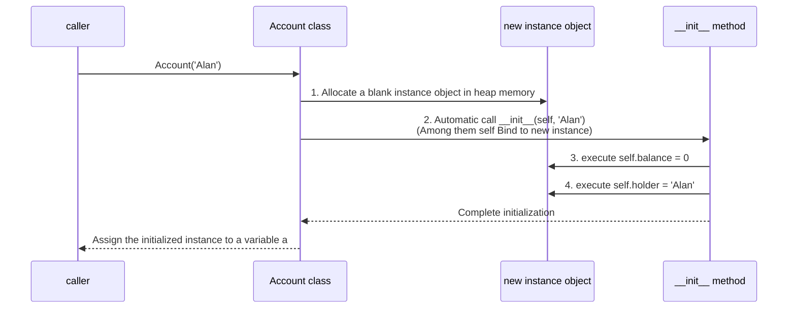

> **Course**: UC Berkeley CS61A (Fall 2024)  
> **Module**: Module 3: Object-oriented and Efficiency (OOP & Efficiency)  
> **Lecturer**: Prof. John DeNero (UC Berkeley)  
> **Video duration**: 17:15 ｜ **Classroom screenshots**: 14 pieces of blackboard writing/code demonstration  
> **Direct video**: [📺Watch the original video of this lecture on Bilibili (P18)](https://www.bilibili.com/video/BV1sy411z7nA/?p=18)  
> **Quick navigation**: [← Previous Lecture (P17 Lecture 17 Generators)](/en/notes/cs61a/lecture-17) ｜ [📚 Return to the full book catalog](/en/notes/topics/CS61A) ｜ [Next lecture (P19 Lecture 19 Attributes) →](/en/notes/cs61a/lecture-19)

---

## Table of Contents
1. [Introduction: The OOP paradigm for coping with software complexity](/en/notes/cs61a/lecture-18#1-introduction-oop-paradigm-for-coping-with-software-complexity)
2. [Conceptual system of classes and objects: molds and entities](/en/notes/cs61a/lecture-18#2-conceptual-system-of-classes-and-objects-molds-and-entities)
3. [Bank account case (`Account`): encapsulation of state and behavior](/en/notes/cs61a/lecture-18#3-bank-account-case-account-encapsulation-of-state-and-behavior)
4. [Class definition and anatomy: `__init__`  and methods](/en/notes/cs61a/lecture-18#4-definition-and-anatomy-of-classes-__init__--and-methods)
5. [Object construction tetralogy: the birth and empowerment of blank instances](/en/notes/cs61a/lecture-18#5-object-construction-tetralogy-the-birth-and-empowerment-of-blank-instances)
6. [Dynamic reading and writing of attributes and reference association between objects](/en/notes/cs61a/lecture-18#6-dynamic-reading-and-writing-of-attributes-and-reference-association-between-objects)
7. [Object Identity and Aliasing Mechanism](/en/notes/cs61a/lecture-18#7-objects-independent-identity-identity-and-alias-mechanism)
8. [Why do we need methods? Polymorphism and type-specific distribution](/en/notes/cs61a/lecture-18#8-why-do-we-need-methods-polymorphism-and-type-specific-distribution)
9. [Key points and thinking questions of this lecture](/en/notes/cs61a/lecture-18#9-core-points-and-thinking-questions-of-this-lecture)

---

### In-depth formal specification and micro-evaluation process (Operational Semantics)
In the "Table of Contents" module, the underlying computer operations rely on strict formal evaluation logic:
1. **Hierarchical parsing of abstract syntax trees (AST)**: 
   - The source code character stream is first divided into terminal symbol tokens (Tokens) by the lexical analyzer (Lexer), and then constructed into a multi-fork syntax tree by the syntax parser (Parser);
   - Operator priority and associativity are solidified during the syntax tree construction phase, eliminating ambiguity at runtime;
2. **Dynamic transitions of environment chains**: 
   - Each function call generates a new frame whose static lexical environment is determined by the function object's  `parent`  Attributes are completely determined;
   - The variable search traces back up the environment chain in one direction until the global environment frame. If it is not found, it will be triggered.  `NameError`  Abnormal;
3. **State Invariants**: 
   - The key to writing robust programs is to clarify loop invariants (Loop Invariants) and function pre/post-conditions (Pre/Post-conditions);
   - In complex control flow jumps, ensure that state variables maintain legal business constraints before each iteration.


## 1. Introduction: OOP paradigm for coping with software complexity

As the scale of software systems expands exponentially, the human brain cannot understand all the details of the whole situation at the same time.
- **process-oriented thinking**: Think of a program as a bunch of global data structures, and a large set of functions that operate on that data in sequence. As variables increase, the system becomes extremely fragile.
- **Object-Oriented Programming (OOP)**: Decompose the complex world into **A set of independent objects (Objects) that cooperate with each other and are autonomous from each other**.

[](https://www.bilibili.com/video/BV1sy411z7nA/?p=18&t=57)
*⏱ Timestamp: 00:00:57 · 📷 Classroom screenshot · [Watch the corresponding clip on Bilibili (P18 00:00:57)](https://www.bilibili.com/video/BV1sy411z7nA/?p=18&t=57)*

#### 📸 In-depth reading of classroom blackboard writing and code demonstration (00:00:57)

**\[On-site blackboard writing/code demonstration restoration\]**:
At this time point, Professor DeNero conducted a core demonstration and key blackboard derivation on the screen:
> *“We need to organize large programs that are very complex into small, modular components that can individually be written and tested and thought about all at once, because humans can only think about so much complexity at a time. We do this with data abstraction, but object-oriented programming takes...”*

**\[Underlying computing model and micro execution mechanism\]**: 
1. **Execution context and timing tracing**: 
   - At the current discussion point "1. Introduction: OOP paradigm to cope with software complexity", the interpreter strictly follows the core evaluation protocol;
   - The expression evaluates the operators first, then evaluates the operands strictly from left to right, and finally applies the function object to the argument list;
   - If the environment model is involved, the local frame strictly records its static lexical parent pointer (Parent Pointer points to the environment where the function is defined), forming an orthogonal architecture with the dynamic call stack at runtime.
2. **Memory topology and object references**: 
   - Variable symbols are just keys in a hash table (environment frame), and pointers point directly to first-class citizen objects in heap memory;
   - Assignment statements are discrete-time snapshots of the state and never create implicit mathematical dependency monitoring.

**\[Guidelines for avoiding pitfalls and guidance on high-frequency test points\]**: 
- **Common misunderstandings**: In "Class object vs instance object, __init__  In the exam questions related to "Constructor and Self Binding Mechanism", beginners can easily guess the results based on the surface form of the code, leading to scope confusion or variable shadowing (Shadowing) misjudgment;
- **The golden rule of debugging**: When encountering nested calls and complex branches, be sure to draw independent partial frames on the scratch paper, indicate the specific binding value of each formal parameter, and derive it step by step.


Each object has **Own local state (Local State)**, and is responsible for maintaining and managing changes in these states. The process of program running is the process of each object cooperating with each other by sending messages (calling methods).

---

### In-depth formal specification and micro-evaluation process (Operational Semantics)
In the "1. Introduction: OOP Paradigm to Cope with Software Complexity" module, the underlying computer operations rely on strict formal evaluation logic:
1. **Hierarchical parsing of abstract syntax trees (AST)**: 
   - The source code character stream is first divided into terminal symbol tokens (Tokens) by the lexical analyzer (Lexer), and then constructed into a multi-fork syntax tree by the syntax parser (Parser);
   - Operator priority and associativity are solidified during the syntax tree construction phase, eliminating ambiguity at runtime;
2. **Dynamic transitions of environment chains**: 
   - Each function call generates a new frame whose static lexical environment is determined by the function object's  `parent`  Attributes are completely determined;
   - The variable search traces back up the environment chain in one direction until the global environment frame. If it is not found, it will be triggered.  `NameError`  Abnormal;
3. **State Invariants**: 
   - The key to writing robust programs is to clarify loop invariants (Loop Invariants) and function pre/post-conditions (Pre/Post-conditions);
   - In complex control flow jumps, ensure that state variables maintain legal business constraints before each iteration.


## 2. Conceptual system of classes and objects: molds and entities

[](https://www.bilibili.com/video/BV1sy411z7nA/?p=18&t=139)
*⏱ Timestamp: 00:02:19 · 📷 Classroom screenshot · [Watch the corresponding clip on Bilibili (P18 00:02:19)](https://www.bilibili.com/video/BV1sy411z7nA/?p=18&t=139)*

#### 📸 In-depth reading of classroom blackboard writing and code demonstration (00:02:19)

**\[On-site blackboard writing/code demonstration restoration\]**:
At this time point, Professor DeNero conducted a core demonstration and key blackboard derivation on the screen:
> *“But when mutation happens, it doesn't happen in some global list that keeps track of all the information in the program. Instead, the information that's changing belongs to a particular object. Each object should know how to manage its local state, meaning that it keeps track of what changes are all...”*

**\[Underlying computing model and micro execution mechanism\]**: 
1. **Execution context and timing tracing**: 
   - At the current discussion point "2. Conceptual system of classes and objects: molds and entities", the interpreter strictly follows the core evaluation protocol;
   - The expression evaluates the operators first, then evaluates the operands strictly from left to right, and finally applies the function object to the argument list;
   - If the environment model is involved, the local frame strictly records its static lexical parent pointer (Parent Pointer points to the environment where the function is defined), forming an orthogonal architecture with the dynamic call stack at runtime.
2. **Memory topology and object references**: 
   - Variable symbols are just keys in a hash table (environment frame), and pointers point directly to first-class citizen objects in heap memory;
   - Assignment statements are discrete-time snapshots of the state and never create implicit mathematical dependency monitoring.

**\[Guidelines for avoiding pitfalls and guidance on high-frequency test points\]**: 
- **Common misunderstandings**: In "Class object vs instance object, __init__  In the exam questions related to "Constructor and Self Binding Mechanism", beginners can easily guess the results based on the surface form of the code, leading to scope confusion or variable shadowing (Shadowing) misjudgment;
- **The golden rule of debugging**: When encountering nested calls and complex branches, be sure to draw independent partial frames on the scratch paper, indicate the specific binding value of each formal parameter, and derive it step by step.


- **Class**: Templates and blueprints of objects, which define objects of this type **All behavioral laws and methods possessed by**.
- **Instance / Object**: A specific entity created based on a class has the behavioral specifications defined by the class, and at the same time saves its own unique attribute data.
- **Method**: A function that belongs to a certain class and must be called through a specific object.

[](https://www.bilibili.com/video/BV1sy411z7nA/?p=18&t=224)
*⏱ Timestamp: 00:03:44 · 📷 Classroom screenshot · [Watch the corresponding clip on Bilibili (P18 00:03:44)](https://www.bilibili.com/video/BV1sy411z7nA/?p=18&t=224)*

#### 📸 In-depth reading of classroom blackboard writing and code demonstration (00:03:44)

**\[On-site blackboard writing/code demonstration restoration\]**:
At this time point, Professor DeNero conducted a core demonstration and key blackboard derivation on the screen:
> *“And what makes methods different from functions is that a function is typically defined in the global frame, and it can be called on any value, whereas a method is specific to a particular object, so I can't just call append on anything, but I can invoke it on S, because S knows how to append. Let's...”*

**\[Underlying computing model and micro execution mechanism\]**: 
1. **Execution context and timing tracing**: 
   - At the current discussion point "2. Conceptual system of classes and objects: molds and entities", the interpreter strictly follows the core evaluation protocol;
   - The expression evaluates the operators first, then evaluates the operands strictly from left to right, and finally applies the function object to the argument list;
   - If the environment model is involved, the local frame strictly records its static lexical parent pointer (Parent Pointer points to the environment where the function is defined), forming an orthogonal architecture with the dynamic call stack at runtime.
2. **Memory topology and object references**: 
   - Variable symbols are just keys in a hash table (environment frame), and pointers point directly to first-class citizen objects in heap memory;
   - Assignment statements are discrete-time snapshots of the state and never create implicit mathematical dependency monitoring.

**\[Guidelines for avoiding pitfalls and guidance on high-frequency test points\]**: 
- **Common misunderstandings**: In "Class object vs instance object, __init__  In the exam questions related to "Constructor and Self Binding Mechanism", beginners can easily guess the results based on the surface form of the code, leading to scope confusion or variable shadowing (Shadowing) misjudgment;
- **The golden rule of debugging**: When encountering nested calls and complex branches, be sure to draw independent partial frames on the scratch paper, indicate the specific binding value of each formal parameter, and derive it step by step.


In Python, **everything is object**. Even if it is built-in  `list`, its essence is also a class. When we call  `list([1, 2])`  When , it is actually instantiating  `list`  class object.

---

### In-depth formal specification and micro-evaluation process (Operational Semantics)
In the "2. Conceptual System of Classes and Objects: Molds and Entities" module, the underlying computer operations rely on strict formal evaluation logic:
1. **Hierarchical parsing of abstract syntax trees (AST)**: 
   - The source code character stream is first divided into terminal symbol tokens (Tokens) by the lexical analyzer (Lexer), and then constructed into a multi-fork syntax tree by the syntax parser (Parser);
   - Operator priority and associativity are solidified during the syntax tree construction phase, eliminating ambiguity at runtime;
2. **Dynamic transitions of environment chains**: 
   - Each function call generates a new frame whose static lexical environment is determined by the function object's  `parent`  Attributes are completely determined;
   - The variable search traces back up the environment chain in one direction until the global environment frame. If it is not found, it will be triggered.  `NameError`  Abnormal;
3. **State Invariants**: 
   - The key to writing robust programs is to clarify loop invariants (Loop Invariants) and function pre/post-conditions (Pre/Post-conditions);
   - In complex control flow jumps, ensure that state variables maintain legal business constraints before each iteration.


## 3. Bank account case (`Account`): encapsulation of state and behavior

In order to implement OOP ideas, Professor DeNero designed the classic bank account class  `Account`.

[](https://www.bilibili.com/video/BV1sy411z7nA/?p=18&t=312)
*⏱ Timestamp: 00:05:12 · 📷 Classroom screenshot · [Watch the corresponding clip on Bilibili (P18 00:05:12)](https://www.bilibili.com/video/BV1sy411z7nA/?p=18&t=312)*

#### 📸 In-depth reading of classroom blackboard writing and code demonstration (00:05:12)

**\[On-site blackboard writing/code demonstration restoration\]**:
At this time point, Professor DeNero conducted a core demonstration and key blackboard derivation on the screen:
> *“Instead of element one. In addition to using built-in classes, we can define our own classes and then create instances of those classes to build new types of objects. A class describes the behavior of its instances. Let's say we want to represent bank accounts and we want to bundle together the info...”*

**\[Underlying computing model and micro execution mechanism\]**: 
1. **Execution context and timing tracing**: 
   - At the current discussion point "3. Bank account case (`Account`): Encapsulation of state and behavior", the interpreter strictly follows the core evaluation protocol;
   - The expression evaluates the operators first, then evaluates the operands strictly from left to right, and finally applies the function object to the argument list;
   - If the environment model is involved, the local frame strictly records its static lexical parent pointer (Parent Pointer points to the environment where the function is defined), forming an orthogonal architecture with the dynamic call stack at runtime.
2. **Memory topology and object references**: 
   - Variable symbols are just keys in a hash table (environment frame), and pointers point directly to first-class citizen objects in heap memory;
   - Assignment statements are discrete-time snapshots of the state and never create implicit mathematical dependency monitoring.

**\[Guidelines for avoiding pitfalls and guidance on high-frequency test points\]**: 
- **Common misunderstandings**: In "Class object vs instance object, __init__  In the exam questions related to "Constructor and Self Binding Mechanism", beginners can easily guess the results based on the surface form of the code, leading to scope confusion or variable shadowing (Shadowing) misjudgment;
- **The golden rule of debugging**: When encountering nested calls and complex branches, be sure to draw independent partial frames on the scratch paper, indicate the specific binding value of each formal parameter, and derive it step by step.


A bank account must have:
- **Attributes**: `holder` (name of holder) and  `balance` (current balance).
- **Methods**: `deposit(amount)` (deposit) vs.  `withdraw(amount)` (Withdrawals).

```python
a = Account('John')
a.holder     # 'John'
a.balance    # 0
a.deposit(15) # 15
a.withdraw(10) # 5
a.balance    # 5
```

[](https://www.bilibili.com/video/BV1sy411z7nA/?p=18&t=418)
*⏱ Timestamp: 00:06:58 · 📷 Classroom screenshot · [Watch the corresponding clip on Bilibili (P18 00:06:58)](https://www.bilibili.com/video/BV1sy411z7nA/?p=18&t=418)*

#### 📸 In-depth reading of classroom blackboard writing and code demonstration (00:06:58)

**\[On-site blackboard writing/code demonstration restoration\]**:
At this time point, Professor DeNero conducted a core demonstration and key blackboard derivation on the screen:
> *“They might have different balances and different holders, but what it means to deposit into a bank account is the same, regardless of which bank account it is. Here we invoke the deposit method, on A, and deposit 15 into it, and that leaves us with the remaining balance of 15 since it was 0 before. ...”*

**\[Underlying computing model and micro execution mechanism\]**: 
1. **Execution context and timing tracing**: 
   - At the current discussion point "3. Bank account case (`Account`): Encapsulation of state and behavior", the interpreter strictly follows the core evaluation protocol;
   - The expression evaluates the operators first, then evaluates the operands strictly from left to right, and finally applies the function object to the argument list;
   - If the environment model is involved, the local frame strictly records its static lexical parent pointer (Parent Pointer points to the environment where the function is defined), forming an orthogonal architecture with the dynamic call stack at runtime.
2. **Memory topology and object references**: 
   - Variable symbols are just keys in a hash table (environment frame), and pointers point directly to first-class citizen objects in heap memory;
   - Assignment statements are discrete-time snapshots of the state and never create implicit mathematical dependency monitoring.

**\[Guidelines for avoiding pitfalls and guidance on high-frequency test points\]**: 
- **Common misunderstandings**: In "Class object vs instance object, __init__  In the exam questions related to "Constructor and Self Binding Mechanism", beginners can easily guess the results based on the surface form of the code, leading to scope confusion or variable shadowing (Shadowing) misjudgment;
- **The golden rule of debugging**: When encountering nested calls and complex branches, be sure to draw independent partial frames on the scratch paper, indicate the specific binding value of each formal parameter, and derive it step by step.


- Deposit and withdrawal operations can directly modify the account's own settings on the spot.  `balance`  local state;
- If the balance is insufficient, the withdrawal is refused and returned  `'Insufficient funds'`, realized **The object has full control over changes in its internal state**.

---

### In-depth formal specification and micro-evaluation process (Operational Semantics)
In "3. Bank Account Case (`Account`): Encapsulation of state and behavior" module, the underlying computer operations rely on strict formal evaluation logic:
1. **Hierarchical parsing of abstract syntax trees (AST)**: 
   - The source code character stream is first divided into terminal symbol tokens (Tokens) by the lexical analyzer (Lexer), and then constructed into a multi-fork syntax tree by the syntax parser (Parser);
   - Operator priority and associativity are solidified during the syntax tree construction phase, eliminating ambiguity at runtime;
2. **Dynamic transitions of environment chains**: 
   - Each function call generates a new frame whose static lexical environment is determined by the function object's  `parent`  Attributes are completely determined;
   - The variable search traces back up the environment chain in one direction until the global environment frame. If it is not found, it will be triggered.  `NameError`  Abnormal;
3. **State Invariants**: 
   - The key to writing robust programs is to clarify loop invariants (Loop Invariants) and function pre/post-conditions (Pre/Post-conditions);
   - In complex control flow jumps, ensure that state variables maintain legal business constraints before each iteration.


## 4. Definition and anatomy of classes: `__init__`  and methods

```python
class Account:
    def __init__(self, account_holder):
        self.balance = 0
        self.holder = account_holder

    def deposit(self, amount):
        self.balance = self.balance + amount
        return self.balance

    def withdraw(self, amount):
        if amount > self.balance:
            return 'Insufficient funds'
        self.balance = self.balance - amount
        return self.balance
```

[](https://www.bilibili.com/video/BV1sy411z7nA/?p=18&t=503)
*⏱ Timestamp: 00:08:23 · 📷 Classroom screenshot · [Watch the corresponding clip on Bilibili (P18 00:08:23)](https://www.bilibili.com/video/BV1sy411z7nA/?p=18&t=503)*

#### 📸 In-depth reading of classroom blackboard writing and code demonstration (00:08:23)

**\[On-site blackboard writing/code demonstration restoration\]**:
At this time point, Professor DeNero conducted a core demonstration and key blackboard derivation on the screen:
> *“So I'm just going to walk through all of it now so that you can see it. And then we'll talk about the details of why it is the way it is. Methods are functions defined in a class statement. So a class statement starts with the keyword class, then you have to name the class. Then you have to define w...”*

**\[Underlying computing model and micro execution mechanism\]**: 
1. **Execution context and timing tracing**: 
   - At the current discussion point "4. Definition and anatomy of classes: `__init__`  and method", the interpreter strictly follows the core evaluation convention;
   - The expression evaluates the operators first, then evaluates the operands strictly from left to right, and finally applies the function object to the argument list;
   - If the environment model is involved, the local frame strictly records its static lexical parent pointer (Parent Pointer points to the environment where the function is defined), forming an orthogonal architecture with the dynamic call stack at runtime.
2. **Memory topology and object references**: 
   - Variable symbols are just keys in a hash table (environment frame), and pointers point directly to first-class citizen objects in heap memory;
   - Assignment statements are discrete-time snapshots of the state and never create implicit mathematical dependency monitoring.

**\[Guidelines for avoiding pitfalls and guidance on high-frequency test points\]**: 
- **Common misunderstandings**: In "Class object vs instance object, __init__  In the exam questions related to "Constructor and Self Binding Mechanism", beginners can easily guess the results based on the surface form of the code, leading to scope confusion or variable shadowing (Shadowing) misjudgment;
- **The golden rule of debugging**: When encountering nested calls and complex branches, be sure to draw independent partial frames on the scratch paper, indicate the specific binding value of each formal parameter, and derive it step by step.


[](https://www.bilibili.com/video/BV1sy411z7nA/?p=18&t=590)
*⏱ Timestamp: 00:09:50 · 📷 Classroom screenshot · [Watch the corresponding clip on Bilibili (P18 00:09:50)](https://www.bilibili.com/video/BV1sy411z7nA/?p=18&t=590)*

#### 📸 In-depth reading of classroom blackboard writing and code demonstration (00:09:50)

**\[On-site blackboard writing/code demonstration restoration\]**:
At this time point, Professor DeNero conducted a core demonstration and key blackboard derivation on the screen:
> *“On which deposit was invoked when I write a dot expression using deposit. So notice that I call deposit on only one argument, but I define it in terms of two so that I have access to all the attributes of the account that I'm depositing into. It's as if A is assigned to self. Now we can look at the ...”*

**\[Underlying computing model and micro execution mechanism\]**: 
1. **Execution context and timing tracing**: 
   - At the current discussion point "4. Definition and anatomy of classes: `__init__`  and method", the interpreter strictly follows the core evaluation convention;
   - The expression evaluates the operators first, then evaluates the operands strictly from left to right, and finally applies the function object to the argument list;
   - If the environment model is involved, the local frame strictly records its static lexical parent pointer (Parent Pointer points to the environment where the function is defined), forming an orthogonal architecture with the dynamic call stack at runtime.
2. **Memory topology and object references**: 
   - Variable symbols are just keys in a hash table (environment frame), and pointers point directly to first-class citizen objects in heap memory;
   - Assignment statements are discrete-time snapshots of the state and never create implicit mathematical dependency monitoring.

**\[Guidelines for avoiding pitfalls and guidance on high-frequency test points\]**: 
- **Common misunderstandings**: In "Class object vs instance object, __init__  In the exam questions related to "Constructor and Self Binding Mechanism", beginners can easily guess the results based on the surface form of the code, leading to scope confusion or variable shadowing (Shadowing) misjudgment;
- **The golden rule of debugging**: When encountering nested calls and complex branches, be sure to draw independent partial frames on the scratch paper, indicate the specific binding value of each formal parameter, and derive it step by step.


### Analysis of core elements
1. **`class <Name>:`  statement**: Declare a new class.
2. **`__init__`  Initializer**: Double-underscore special method, automatically called by the interpreter when creating a new instance.
3. **`self`  parameters**: Points to the specific instance object currently being operated on.

---

### In-depth formal specification and micro-evaluation process (Operational Semantics)
In "4. Definition and Anatomy of Classes: `__init__`  In the "Method" module, the underlying computer operations rely on strict formal evaluation logic:
1. **Hierarchical parsing of abstract syntax trees (AST)**: 
   - The source code character stream is first divided into terminal symbol tokens (Tokens) by the lexical analyzer (Lexer), and then constructed into a multi-fork syntax tree by the syntax parser (Parser);
   - Operator priority and associativity are solidified during the syntax tree construction phase, eliminating ambiguity at runtime;
2. **Dynamic transitions of environment chains**: 
   - Each function call generates a new frame whose static lexical environment is determined by the function object's  `parent`  Attributes are completely determined;
   - The variable search traces back up the environment chain in one direction until the global environment frame. If it is not found, it will be triggered.  `NameError`  Abnormal;
3. **State Invariants**: 
   - The key to writing robust programs is to clarify loop invariants (Loop Invariants) and function pre/post-conditions (Pre/Post-conditions);
   - In complex control flow jumps, ensure that state variables maintain legal business constraints before each iteration.


## 5. Object construction tetralogy: the birth and empowerment of blank instances

When we execute the calling expression  `a = Account('Alan')` , the Python interpreter completes four steps behind the scenes:

[](https://www.bilibili.com/video/BV1sy411z7nA/?p=18&t=669)
*⏱ Timestamp: 00:11:09 · 📷 Classroom screenshot · [Watch the corresponding clip on Bilibili (P18 00:11:09)](https://www.bilibili.com/video/BV1sy411z7nA/?p=18&t=669)*

#### 📸 In-depth reading of classroom blackboard writing and code demonstration (00:11:09)

**\[On-site blackboard writing/code demonstration restoration\]**:
At this time point, Professor DeNero conducted a core demonstration and key blackboard derivation on the screen:
> *“Let's look at a little more detail about what happens when you try to create an instance of a class that you defined. Object construction implements this idea that all bank accounts should have a balance and an account holder. It's got to be up to the account class to add those attributes. And what ...”*

**\[Underlying computing model and micro execution mechanism\]**: 
1. **Execution context and timing tracing**: 
   - At the current discussion point "5. Object Construction Quadrilogy: The Birth and Empowerment of Blank Instances", the interpreter strictly follows the core evaluation protocol;
   - The expression evaluates the operators first, then evaluates the operands strictly from left to right, and finally applies the function object to the argument list;
   - If the environment model is involved, the local frame strictly records its static lexical parent pointer (Parent Pointer points to the environment where the function is defined), forming an orthogonal architecture with the dynamic call stack at runtime.
2. **Memory topology and object references**: 
   - Variable symbols are just keys in a hash table (environment frame), and pointers point directly to first-class citizen objects in heap memory;
   - Assignment statements are discrete-time snapshots of the state and never create implicit mathematical dependency monitoring.

**\[Guidelines for avoiding pitfalls and guidance on high-frequency test points\]**: 
- **Common misunderstandings**: In "Class object vs instance object, __init__  In the exam questions related to "Constructor and Self Binding Mechanism", beginners can easily guess the results based on the surface form of the code, leading to scope confusion or variable shadowing (Shadowing) misjudgment;
- **The golden rule of debugging**: When encountering nested calls and complex branches, be sure to draw independent partial frames on the scratch paper, indicate the specific binding value of each formal parameter, and derive it step by step.




---

### In-depth formal specification and micro-evaluation process (Operational Semantics)
In the module "5. Object Construction Quad: The Birth and Empowerment of Blank Instances", the underlying computer operations rely on strict formal evaluation logic:
1. **Hierarchical parsing of abstract syntax trees (AST)**: 
   - The source code character stream is first divided into terminal symbol tokens (Tokens) by the lexical analyzer (Lexer), and then constructed into a multi-fork syntax tree by the syntax parser (Parser);
   - Operator priority and associativity are solidified during the syntax tree construction phase, eliminating ambiguity at runtime;
2. **Dynamic transitions of environment chains**: 
   - Each function call generates a new frame whose static lexical environment is determined by the function object's  `parent`  Attributes are completely determined;
   - The variable search traces back up the environment chain in one direction until the global environment frame. If it is not found, it will be triggered.  `NameError`  Abnormal;
3. **State Invariants**: 
   - The key to writing robust programs is to clarify loop invariants (Loop Invariants) and function pre/post-conditions (Pre/Post-conditions);
   - In complex control flow jumps, ensure that state variables maintain legal business constraints before each iteration.


## 6. Dynamic reading and writing of attributes and reference association between objects

Python is a highly dynamic language, and the properties of objects have great flexibility:

[](https://www.bilibili.com/video/BV1sy411z7nA/?p=18&t=758)
*⏱ Timestamp: 00:12:38 · 📷 Classroom screenshot · [Watch the corresponding clip on Bilibili (P18 00:12:38)](https://www.bilibili.com/video/BV1sy411z7nA/?p=18&t=758)*

#### 📸 In-depth reading of classroom blackboard writing and code demonstration (00:12:38)

**\[On-site blackboard writing/code demonstration restoration\]**:
At this time point, Professor DeNero conducted a core demonstration and key blackboard derivation on the screen:
> *“We'll add a holder attribute. And now this instance has two attributes. It's ready to be used like an account. The init method is sometimes called a constructor method. And that vocabulary is used in other programming languages as well. This one call expression does all that work, one and two, at wh...”*

**\[Underlying computing model and micro execution mechanism\]**: 
1. **Execution context and timing tracing**: 
   - At the current discussion point "6. Dynamic reading and writing of attributes and reference associations between objects", the interpreter strictly follows the core evaluation protocol;
   - The expression evaluates the operators first, then evaluates the operands strictly from left to right, and finally applies the function object to the argument list;
   - If the environment model is involved, the local frame strictly records its static lexical parent pointer (Parent Pointer points to the environment where the function is defined), forming an orthogonal architecture with the dynamic call stack at runtime.
2. **Memory topology and object references**: 
   - Variable symbols are just keys in a hash table (environment frame), and pointers point directly to first-class citizen objects in heap memory;
   - Assignment statements are discrete-time snapshots of the state and never create implicit mathematical dependency monitoring.

**\[Guidelines for avoiding pitfalls and guidance on high-frequency test points\]**: 
- **Common misunderstandings**: In "Class object vs instance object, __init__  In the exam questions related to "Constructor and Self Binding Mechanism", beginners can easily guess the results based on the surface form of the code, leading to scope confusion or variable shadowing (Shadowing) misjudgment;
- **The golden rule of debugging**: When encountering nested calls and complex branches, be sure to draw independent partial frames on the scratch paper, indicate the specific binding value of each formal parameter, and derive it step by step.


### 6.1 In-place modification of properties at runtime
```python
a = Account('John')
a.balance = 12  # 直接修改现有属性
```

### 6.2 Dynamically inject new attributes at runtime
```python
b = Account('Jack')
b.balance = 20
a.backup = b  # 在 a 上动态新增 backup 属性，指向账户 b！
```

[](https://www.bilibili.com/video/BV1sy411z7nA/?p=18&t=814)
*⏱ Timestamp: 00:13:34 · 📷 Classroom screenshot · [Watch the corresponding clip on Bilibili (P18 00:13:34)](https://www.bilibili.com/video/BV1sy411z7nA/?p=18&t=814)*

#### 📸 In-depth reading of classroom blackboard writing and code demonstration (00:13:34)

**\[On-site blackboard writing/code demonstration restoration\]**:
At this time point, Professor DeNero conducted a core demonstration and key blackboard derivation on the screen:
> *“B is a separate account for a different account holder. It has a balance of zero. Here, we set it to 20. Here, I'm creating an attribute called backup on the A account, which I created earlier, and assigning it the value of the B account, which I also created earlier. It's okay to have the value of ...”*

**\[Underlying computing model and micro execution mechanism\]**: 
1. **Execution context and timing tracing**: 
   - At the current discussion point "6. Dynamic reading and writing of attributes and reference associations between objects", the interpreter strictly follows the core evaluation protocol;
   - The expression evaluates the operators first, then evaluates the operands strictly from left to right, and finally applies the function object to the argument list;
   - If the environment model is involved, the local frame strictly records its static lexical parent pointer (Parent Pointer points to the environment where the function is defined), forming an orthogonal architecture with the dynamic call stack at runtime.
2. **Memory topology and object references**: 
   - Variable symbols are just keys in a hash table (environment frame), and pointers point directly to first-class citizen objects in heap memory;
   - Assignment statements are discrete-time snapshots of the state and never create implicit mathematical dependency monitoring.

**\[Guidelines for avoiding pitfalls and guidance on high-frequency test points\]**: 
- **Common misunderstandings**: In "Class object vs instance object, __init__  In the exam questions related to "Constructor and Self Binding Mechanism", beginners can easily guess the results based on the surface form of the code, leading to scope confusion or variable shadowing (Shadowing) misjudgment;
- **The golden rule of debugging**: When encountering nested calls and complex branches, be sure to draw independent partial frames on the scratch paper, indicate the specific binding value of each formal parameter, and derive it step by step.


At this point we can access through chained dot expressions:
```python
a.backup.balance  # 输出 20
```
Properties of an object can reference another object! This provides endless possibilities for building complex network systems and composite data structures.

---

### In-depth formal specification and micro-evaluation process (Operational Semantics)
In the "6. Dynamic reading and writing of attributes and reference associations between objects" module, the underlying computer operations rely on strict formal evaluation logic:
1. **Hierarchical parsing of abstract syntax trees (AST)**: 
   - The source code character stream is first divided into terminal symbol tokens (Tokens) by the lexical analyzer (Lexer), and then constructed into a multi-fork syntax tree by the syntax parser (Parser);
   - Operator priority and associativity are solidified during the syntax tree construction phase, eliminating ambiguity at runtime;
2. **Dynamic transitions of environment chains**: 
   - Each function call generates a new frame whose static lexical environment is determined by the function object's  `parent`  Attributes are completely determined;
   - The variable search traces back up the environment chain in one direction until the global environment frame. If it is not found, it will be triggered.  `NameError`  Abnormal;
3. **State Invariants**: 
   - The key to writing robust programs is to clarify loop invariants (Loop Invariants) and function pre/post-conditions (Pre/Post-conditions);
   - In complex control flow jumps, ensure that state variables maintain legal business constraints before each iteration.


## 7. Object’s independent identity (Identity) and alias mechanism

Each time the class name constructor is called, a new object instance will be independently opened in the heap memory:

[](https://www.bilibili.com/video/BV1sy411z7nA/?p=18&t=873)
*⏱ Timestamp: 00:14:33 · 📷 Classroom screenshot · [Watch the corresponding clip on Bilibili (P18 00:14:33)](https://www.bilibili.com/video/BV1sy411z7nA/?p=18&t=873)*

#### 📸 In-depth reading of classroom blackboard writing and code demonstration (00:14:33)

**\[On-site blackboard writing/code demonstration restoration\]**:
At this time point, Professor DeNero conducted a core demonstration and key blackboard derivation on the screen:
> *“Let's talk about object identity. This is important because objects attributes can change. So the objects can mutate. And so you have to know whether you happen to have two objects that are different with the same attributes or whether they are in fact the same object. Every object that is an instan...”*

**\[Underlying computing model and micro execution mechanism\]**: 
1. **Execution context and timing tracing**: 
   - At the current discussion point "7. Independent Identity and Aliasing Mechanism of Objects", the interpreter strictly follows the core evaluation protocol;
   - The expression evaluates the operators first, then evaluates the operands strictly from left to right, and finally applies the function object to the argument list;
   - If the environment model is involved, the local frame strictly records its static lexical parent pointer (Parent Pointer points to the environment where the function is defined), forming an orthogonal architecture with the dynamic call stack at runtime.
2. **Memory topology and object references**: 
   - Variable symbols are just keys in a hash table (environment frame), and pointers point directly to first-class citizen objects in heap memory;
   - Assignment statements are discrete-time snapshots of the state and never create implicit mathematical dependency monitoring.

**\[Guidelines for avoiding pitfalls and guidance on high-frequency test points\]**: 
- **Common misunderstandings**: In "Class object vs instance object, __init__  In the exam questions related to "Constructor and Self Binding Mechanism", beginners can easily guess the results based on the surface form of the code, leading to scope confusion or variable shadowing (Shadowing) misjudgment;
- **The golden rule of debugging**: When encountering nested calls and complex branches, be sure to draw independent partial frames on the scratch paper, indicate the specific binding value of each formal parameter, and derive it step by step.


```python
a = Account('John')
b = Account('John')

a == b  # 取决于类的 __eq__ 实现
a is b  # False！独立开辟的两个账户，各自拥有独立账本！
```

[](https://www.bilibili.com/video/BV1sy411z7nA/?p=18&t=904)
*⏱ Timestamp: 00:15:04 · 📷 Classroom screenshot · [Watch the corresponding clip on Bilibili (P18 00:15:04)](https://www.bilibili.com/video/BV1sy411z7nA/?p=18&t=904)*

#### 📸 In-depth reading of classroom blackboard writing and code demonstration (00:15:04)

**\[On-site blackboard writing/code demonstration restoration\]**:
At this time point, Professor DeNero conducted a core demonstration and key blackboard derivation on the screen:
> *“There's only one account class, but many instances. A has a balance and a holder. B has a balance and a holder. The identity operators is and is not test to see if two expressions evaluate to the same object. A is A is true, because both of these are expressions that evaluate to the John account. A ...”*

**\[Underlying computing model and micro execution mechanism\]**: 
1. **Execution context and timing tracing**: 
   - At the current discussion point "7. Independent Identity and Aliasing Mechanism of Objects", the interpreter strictly follows the core evaluation protocol;
   - The expression evaluates the operators first, then evaluates the operands strictly from left to right, and finally applies the function object to the argument list;
   - If the environment model is involved, the local frame strictly records its static lexical parent pointer (Parent Pointer points to the environment where the function is defined), forming an orthogonal architecture with the dynamic call stack at runtime.
2. **Memory topology and object references**: 
   - Variable symbols are just keys in a hash table (environment frame), and pointers point directly to first-class citizen objects in heap memory;
   - Assignment statements are discrete-time snapshots of the state and never create implicit mathematical dependency monitoring.

**\[Guidelines for avoiding pitfalls and guidance on high-frequency test points\]**: 
- **Common misunderstandings**: In "Class object vs instance object, __init__  In the exam questions related to "Constructor and Self Binding Mechanism", beginners can easily guess the results based on the surface form of the code, leading to scope confusion or variable shadowing (Shadowing) misjudgment;
- **The golden rule of debugging**: When encountering nested calls and complex branches, be sure to draw independent partial frames on the scratch paper, indicate the specific binding value of each formal parameter, and derive it step by step.


If performing variable assignment:
```python
c = a
c is a  # True (别名！同一账户的两个代号)
```

---

### In-depth formal specification and micro-evaluation process (Operational Semantics)
In the "7. Object Identity and Alias Mechanism" module, the underlying computer operations rely on strict formal evaluation logic:
1. **Hierarchical parsing of abstract syntax trees (AST)**: 
   - The source code character stream is first divided into terminal symbol tokens (Tokens) by the lexical analyzer (Lexer), and then constructed into a multi-fork syntax tree by the syntax parser (Parser);
   - Operator priority and associativity are solidified during the syntax tree construction phase, eliminating ambiguity at runtime;
2. **Dynamic transitions of environment chains**: 
   - Each function call generates a new frame whose static lexical environment is determined by the function object's  `parent`  Attributes are completely determined;
   - The variable search traces back up the environment chain in one direction until the global environment frame. If it is not found, it will be triggered.  `NameError`  Abnormal;
3. **State Invariants**: 
   - The key to writing robust programs is to clarify loop invariants (Loop Invariants) and function pre/post-conditions (Pre/Post-conditions);
   - In complex control flow jumps, ensure that state variables maintain legal business constraints before each iteration.


## 8. Why do we need methods? Polymorphism and type-specific distribution

Beginners often ask: "Why must we write  `a.deposit(15)`, instead of writing a global function  `deposit(a, 15)`?”

[](https://www.bilibili.com/video/BV1sy411z7nA/?p=18&t=934)
*⏱ Timestamp: 00:15:34 · 📷 Classroom screenshot · [Watch the corresponding clip on Bilibili (P18 00:15:34)](https://www.bilibili.com/video/BV1sy411z7nA/?p=18&t=934)*

#### 📸 In-depth reading of classroom blackboard writing and code demonstration (00:15:34)

**\[On-site blackboard writing/code demonstration restoration\]**:
At this time point, Professor DeNero conducted a core demonstration and key blackboard derivation on the screen:
> *“Binding an object to a new name using assignment does not create a new object. If I say C equals A, it's still the case that C is A. They're just two different names for the same account. The last part of that original class statement that we need to discuss is the method definition. Invoking method...”*

**\[Underlying computing model and micro execution mechanism\]**: 
1. **Execution context and timing tracing**: 
   - At the current discussion point "8. Why do we need methods? Polymorphism and type-specific distribution", the interpreter strictly follows the core evaluation convention;
   - The expression evaluates the operators first, then evaluates the operands strictly from left to right, and finally applies the function object to the argument list;
   - If the environment model is involved, the local frame strictly records its static lexical parent pointer (Parent Pointer points to the environment where the function is defined), forming an orthogonal architecture with the dynamic call stack at runtime.
2. **Memory topology and object references**: 
   - Variable symbols are just keys in a hash table (environment frame), and pointers point directly to first-class citizen objects in heap memory;
   - Assignment statements are discrete-time snapshots of the state and never create implicit mathematical dependency monitoring.

**\[Guidelines for avoiding pitfalls and guidance on high-frequency test points\]**: 
- **Common misunderstandings**: In "Class object vs instance object, __init__  In the exam questions related to "Constructor and Self Binding Mechanism", beginners can easily guess the results based on the surface form of the code, leading to scope confusion or variable shadowing (Shadowing) misjudgment;
- **The golden rule of debugging**: When encountering nested calls and complex branches, be sure to draw independent partial frames on the scratch paper, indicate the specific binding value of each formal parameter, and derive it step by step.


Professor DeNero pointed out that this is the core charm of object-oriented——**Type distribution and polymorphism (Polymorphism)**: 

[](https://www.bilibili.com/video/BV1sy411z7nA/?p=18&t=987)
*⏱ Timestamp: 00:16:27 · 📷 Classroom screenshot · [Watch the corresponding clip on Bilibili (P18 00:16:27)](https://www.bilibili.com/video/BV1sy411z7nA/?p=18&t=987)*

#### 📸 In-depth reading of classroom blackboard writing and code demonstration (00:16:27)

**\[On-site blackboard writing/code demonstration restoration\]**:
At this time point, Professor DeNero conducted a core demonstration and key blackboard derivation on the screen:
> *“Combine them together to get a new balance and assign that to self.balance. This is defined with two parameters, but dot notation automatically supplies the first argument to a method. And so, if I create an account for Tom and I use deposit, even though it's defined with two parameters, it's called...”*

**\[Underlying computing model and micro execution mechanism\]**: 
1. **Execution context and timing tracing**: 
   - At the current discussion point "8. Why do we need methods? Polymorphism and type-specific distribution", the interpreter strictly follows the core evaluation convention;
   - The expression evaluates the operators first, then evaluates the operands strictly from left to right, and finally applies the function object to the argument list;
   - If the environment model is involved, the local frame strictly records its static lexical parent pointer (Parent Pointer points to the environment where the function is defined), forming an orthogonal architecture with the dynamic call stack at runtime.
2. **Memory topology and object references**: 
   - Variable symbols are just keys in a hash table (environment frame), and pointers point directly to first-class citizen objects in heap memory;
   - Assignment statements are discrete-time snapshots of the state and never create implicit mathematical dependency monitoring.

**\[Guidelines for avoiding pitfalls and guidance on high-frequency test points\]**: 
- **Common misunderstandings**: In "Class object vs instance object, __init__  In the exam questions related to "Constructor and Self Binding Mechanism", beginners can easily guess the results based on the surface form of the code, leading to scope confusion or variable shadowing (Shadowing) misjudgment;
- **The golden rule of debugging**: When encountering nested calls and complex branches, be sure to draw independent partial frames on the scratch paper, indicate the specific binding value of each formal parameter, and derive it step by step.


- Assume there are more than just ordinary bank accounts in the system  `Account`, as well as investment and financial management funds  `InvestmentFund`, crypto wallet  `CryptoWallet`.
- The "deposit" business logic for each asset is completely different (investment accounts may need to deduct management fees, crypto wallets may need to verify the block hash).
- via method call  `target.deposit(15)`, **The interpreter will  `target`  The specific type of the type automatically finds and executes the deposit algorithm unique to that type.**! The caller does not need to write lengthy  `if type == ...`  Branching, code scalability reaches a new level.

---

### In-depth formal specification and micro-evaluation process (Operational Semantics)
In the module "8. Why do we need methods? Polymorphism and type-specific distribution", the underlying computer operations rely on strict formal evaluation logic:
1. **Hierarchical parsing of abstract syntax trees (AST)**: 
   - The source code character stream is first divided into terminal symbol tokens (Tokens) by the lexical analyzer (Lexer), and then constructed into a multi-fork syntax tree by the syntax parser (Parser);
   - Operator priority and associativity are solidified during the syntax tree construction phase, eliminating ambiguity at runtime;
2. **Dynamic transitions of environment chains**: 
   - Each function call generates a new frame whose static lexical environment is determined by the function object's  `parent`  Attributes are completely determined;
   - The variable search traces back up the environment chain in one direction until the global environment frame. If it is not found, it will be triggered.  `NameError`  Abnormal;
3. **State Invariants**: 
   - The key to writing robust programs is to clarify loop invariants (Loop Invariants) and function pre/post-conditions (Pre/Post-conditions);
   - In complex control flow jumps, ensure that state variables maintain legal business constraints before each iteration.


## 9. Core points and thinking questions of this lecture

### Refining key rules
1. **OOP encapsulation state and behavior**: Objects not only hold data, but also define the means to legally change these data.
2. **`self`  is the self-reference of the instance**: The first parameter in the method definition  `self`  Automatically and implicitly passed in by the Python interpreter when called with a dot expression.
3. **Dot expression driven polymorphic dispatch**: Methods belong to classes, and methods with the same name in different classes can have different business logic.

---

### After-class self-assessment exercises

#### Exercise 1: Interest-bearing savings account
please for  `Account`  Writing a subclass concept or extension: Add a  `interest`  Property (annual interest rate, e.g. 0.05). add a method  `accrue()`, calculate the current interest and automatically deposit the balance:
```python
class SavingsAccount(Account):
    def __init__(self, holder, interest=0.05):
        Account.__init__(self, holder)
        self.interest = interest

    def accrue(self):
        earned = self.balance * self.interest
        self.deposit(earned)
        return self.balance
```
By reusing existing methods, object-oriented shows the extraordinary magic of code reuse!

### In-depth formal specification and micro-evaluation process (Operational Semantics)
In the "9. Core Key Points and Questions of This Lecture" module, the underlying computer operations rely on strict formal evaluation logic:
1. **Hierarchical parsing of abstract syntax trees (AST)**: 
   - The source code character stream is first divided into terminal symbol tokens (Tokens) by the lexical analyzer (Lexer), and then constructed into a multi-fork syntax tree by the syntax parser (Parser);
   - Operator priority and associativity are solidified during the syntax tree construction phase, eliminating ambiguity at runtime;
2. **Dynamic transitions of environment chains**: 
   - Each function call generates a new frame whose static lexical environment is determined by the function object's  `parent`  Attributes are completely determined;
   - The variable search traces back up the environment chain in one direction until the global environment frame. If it is not found, it will be triggered.  `NameError`  Abnormal;
3. **State Invariants**: 
   - The key to writing robust programs is to clarify loop invariants (Loop Invariants) and function pre/post-conditions (Pre/Post-conditions);
   - In complex control flow jumps, ensure that state variables maintain legal business constraints before each iteration.


---

## Berkeley Midterm/Final classic high-frequency exam questions in-depth practice

### Practical exam questions: Environment topology and microstate tracking (WWPD & Environment Diagrams)
Consider the following microscopic execution of Python code in an interactive environment:

```python
# 经典作用域与高阶函数综合考题
x = 10

def outer(x):
    y = x + 2
    def inner(y):
        return x + y
    return inner

f = outer(5)
result = f(3)
```

#### Complete problem-solving thinking model and multi-frame environment map derivation:
1. **Global Frame initialization**: 
   - global variables  `x`  Bind to integer object  `10`; 
   - global function  `outer`  Binds to the newly created function object whose embedded  `parent = Global`; 
2. **execute  `f = outer(5)`**: 
   - create a local frame  $f_1$, mark  `f1: outer [parent=Global]`; 
   - formal parameters  `x`  Bind to actual parameters  `5`; 
   - local variables  `y`  bind to  `5 + 2 = 7`; 
   - in  $f_1$  internal execution  `def inner(y):`, create a function object  `inner`, its embedded  **`parent = f1`**; 
   - Return function object  `inner`, global variables  `f`  Bind to this object;
3. **execute  `result = f(3)`**: 
   - call function  `f` (i.e.  `inner`), open up a local frame  $f_2$; 
   - **core scoring points**:frame  $f_2$  Who does parent point to?
   - **iron law**: function  `inner`  is in frame  $f_1$  is defined internally, so  $f_2$  of  **`parent = f1`**!
   - formal parameters  `y`  Bind to actual parameters  `3`; 
   - executor  `return x + y`: 
     - in current frame  $f_2$  Find  `y`: Hit local variable  `y = 3`; 
     - in current frame  $f_2$  Find  `x`: miss, trace back along parent  **$f_1$  frame**  Find it!
     - in  $f_1$  hit in frame  `x = 5` (Global  `x = 10`  Partially obscured! );
     - Calculate  `5 + 3 = 8`, as the return value;
4. **Final output conclusion**: 
   - global variables  `result = 8`.

---

## Knowledge Matrix of the core concepts of this lecture

| core knowledge dimension | Formal definition and mechanism | Typical code examples | Core Engineering and Algorithm Value | Common pitfalls |
| :--- | :--- | :--- | :--- | :--- |
| **Basic evaluation semantics** | The expression is evaluated to obtain a value, and the execution of the statement changes the internal state. | `x = 2 + 3` | Build a discrete-time state snapshot mental model | Mistaking the assignment equal sign as a dynamic constraint on an algebraic equation |
| **Environment frame topology** | The environment is an ordered chain of frames | `Global -> f1 -> f2` | Implement safe isolation of lexical scope and variables | Confusing the caller stack frame with the parent environment pointer at the definition point |
| **abstract barrier** | Isolate implementation details and calling logic through functional interfaces | `def square(x): ...` | Reduce cognitive load on large-scale systems | Destroying interfaces directly relies on underlying private data structures |
| **control flow decisions** | Conditional branch short-circuit evaluation and loop iteration progression | `if cond: ... while: ...` | Give programs non-linear decision-making and large-scale data processing capabilities | Missing the loop progression variable causes an infinite loop |
| **higher level abilities** | Functions as first-class citizens (parameter passing, return, assignment) | `make_adder(3)` | Implement factory pattern, closure persistent state and currying | Closure late binding throws loop variable capture error |

---

## Course navigation and jump

| Previous lecture | Directory | Next lecture | Original video |
| :--- | :---: | :--- | :--- |
| [← Previous lecture: Lecture 17 Generators](/en/notes/cs61a/lecture-17) | [📚 Return to CS61A complete book list](/en/notes/topics/CS61A) | [Next lecture: Lecture 19 Attributes →](/en/notes/cs61a/lecture-19) | [🎬Watch this lecture on Bilibili (P18)](https://www.bilibili.com/video/BV1sy411z7nA/?p=18) |
