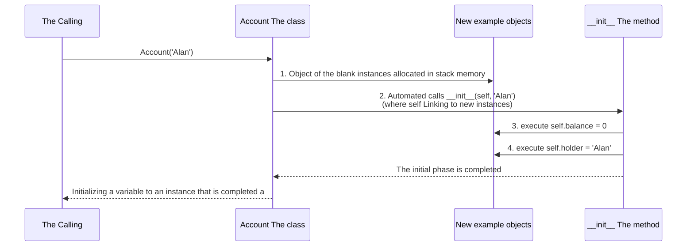

> **English original course**: CS 61A: Structure and Interpretation of Computer Programs (Fall 2024)  
> **Lecturer**: Prof. John DeNero (UC Berkeley)  
> **Text and illustrations**: VideoBook video to image to text technology e-book assembly line  
> **course coverage**: 37 / 37 on 18.2 hour audio/video instruction ⁇ 577 high-level lecture screenshots  
> **Online catalog**: [CS61A Special Catalog](/en/notes/topics/CS61A)

---


> **Lecture**: John DeNero ｜ **duration**: 17:15 ｜ **Video link back**: [B station response unit set (P18)](https://www.bilibili.com/video/BV1sy411z7nA/?p=18)

## 1. Introduction: OOP paradigm for dealing with software complexity

As the software system expands exponentially, the human brain cannot understand all of the details at once.
- **Process-oriented thinking** The program is viewed as a set of universal data structures and functions that operate on a sequential basis. As variables increase, the system becomes extremely vulnerable.
- **Object-oriented programming (OOP)** The complex world is broken down into: **A group of objects that work together, independent of each other.**.


*⏱ Timestamp: 00:00:57 · 📷 Lecture screenshot · [Watch clip (P18 00:00:57)](https://www.bilibili.com/video/BV1sy411z7nA/?p=18&t=57)*

Each object has **Local State of the People** The process of running a program is the process by which objects interact with each other through\*\* sending messages, calling methods, and/or communication.

---

## 2. Conceptual system of classes and objects: moulds and entities


*⏱ Timestamp: 00:02:19 · 📷 Lecture screenshot · [Watch clip (P18 00:02:19)](https://www.bilibili.com/video/BV1sy411z7nA/?p=18&t=139)*

- **Class** Template and blueprint of the object: defining the type of object **All the laws and methods of conduct that we have**.
- **Instant/Object** The specific entity created by a class has the behavior norm defined by the class while preserving its unique property data.
- **The method**: belongs to a class, must be called by a function through a specific object.


*⏱ Timestamp: 00:03:44 · 📷 Lecture screenshot · [Watch clip (P18 00:03:44)](https://www.bilibili.com/video/BV1sy411z7nA/?p=18&t=224)*

In Python, the code is **Everything is an object** Even if it's built in.  `list` The first is that the human brain is not a single thing, but it's also a class.  `list([1, 2])`  The problem is that the government has not yet done anything.  `list`  The object of the class.

---

## 3. Bank account cases (`Account` (ii) the state and behavior of the packaging

To place the idea of OOP in its place, Professor DeNero designed a classic class of bank accounts.  `Account`.


*⏱ Timestamp: 00:05:12 · 📷 Lecture screenshot · [Watch clip (P18 00:05:12)](https://www.bilibili.com/video/BV1sy411z7nA/?p=18&t=312)*

A bank account must have:
- **Attributes**: `holder` (name of holder) and  `balance` (current balance)
- **The methodology**: `deposit(amount)` (deposits) and  `withdraw(amount)` (withdrawal)

```python
a = Account('John')
a.holder     # 'John'
a.balance    # 0
a.deposit(15) # 15
a.withdraw(10) # 5
a.balance    # 5
```


*⏱ Timestamp: 00:06:58 · 📷 Lecture screenshot · [Watch clip (P18 00:06:58)](https://www.bilibili.com/video/BV1sy411z7nA/?p=18&t=418)*

- Directly modify your account on the ground  `balance`  Local status;
- If the balance is insufficient, withdrawal refuses to be executed and returned  `'Insufficient funds'` It's been done. **The total control of the object's internal state changes**.

---

## 4. Definition and anatomy of the class: `__init__`  The Ways

```python
class Account:
    def __init__(self, account_holder):
        self.balance = 0
        self.holder = account_holder

    def deposit(self, amount):
        self.balance = self.balance + amount
        return self.balance

    def withdraw(self, amount):
        if amount > self.balance:
            return 'Insufficient funds'
        self.balance = self.balance - amount
        return self.balance
```


*⏱ Timestamp: 00:08:23 · 📷 Lecture screenshot · [Watch clip (P18 00:08:23)](https://www.bilibili.com/video/BV1sy411z7nA/?p=18&t=503)*


*⏱ Timestamp: 00:09:50 · 📷 Lecture screenshot · [Watch clip (P18 00:09:50)](https://www.bilibili.com/video/BV1sy411z7nA/?p=18&t=590)*

### Key elements dissection
1. **`class <Name>:`  The phrase** The following is a list of the most common types of cancer:
2. **`__init__`  The first is the Initializer.** Double-downline special method, automatically called by the interpreter when creating new instances.
3. **`self`  The parameters** The following is a list of the most commonly used methods for calculating the value of an object.

---

## 5. The four components of the object: the birth and empowerment of vacuum instances

When we run a call expression  `a = Account('Alan')`  Python interpreter performs four steps behind the scenes:


*⏱ Timestamp: 00:11:09 · 📷 Lecture screenshot · [Watch clip (P18 00:11:09)](https://www.bilibili.com/video/BV1sy411z7nA/?p=18&t=669)*



---

## 6. Dynamic attribute reading and writing associated with object-to-object references

Python is a highly dynamic language with strong flexibility in object attributes:


*⏱ Timestamp: 00:12:38 · 📷 Lecture screenshot · [Watch clip (P18 00:12:38)](https://www.bilibili.com/video/BV1sy411z7nA/?p=18&t=758)*

### 6.1 Changes in the properties when running
```python
a = Account('John')
a.balance = 12  # 直接修改现有属性
```

### 6.2 Dynamics injected with new properties when running
```python
b = Account('Jack')
b.balance = 20
a.backup = b  # 在 a 上动态新增 backup 属性，指向账户 b！
```


*⏱ Timestamp: 00:13:34 · 📷 Lecture screenshot · [Watch clip (P18 00:13:34)](https://www.bilibili.com/video/BV1sy411z7nA/?p=18&t=814)*

At this point, we can go through the chain. expression Visits:
```python
a.backup.balance  # 输出 20
```
The properties of an object can refer to another object! This provides endless possibilities for building complex networked systems, complex data structures.

---

## 7. Identity and the mechanism of aliases

Each time a class name construct function is called, it independently opens up an entirely new object instance in stack memory:


*⏱ Timestamp: 00:14:33 · 📷 Lecture screenshot · [Watch clip (P18 00:14:33)](https://www.bilibili.com/video/BV1sy411z7nA/?p=18&t=873)*

```python
a = Account('John')
b = Account('John')

a == b  # 取决于类的 __eq__ 实现
a is b  # False！独立开辟的两个账户，各自拥有独立账本！
```


*⏱ Timestamp: 00:15:04 · 📷 Lecture screenshot · [Watch clip (P18 00:15:04)](https://www.bilibili.com/video/BV1sy411z7nA/?p=18&t=904)*

If you want to perform variable assignments:
```python
c = a
c is a  # True (别名！同一账户的两个代号)
```

---

## 8. Why should methods be needed? Multiple and type-specific distributions

The first question asked by beginners is: why do you have to write?  `a.deposit(15)` So, what is the function of a universal?  `deposit(a, 15)`?”


*⏱ Timestamp: 00:15:34 · 📷 Lecture screenshot · [Watch clip (P18 00:15:34)](https://www.bilibili.com/video/BV1sy411z7nA/?p=18&t=934)*

Professor DeNero points out that this is the core attraction of object-oriented **Type distribution and polymorphism**: 


*⏱ Timestamp: 00:16:27 · 📷 Lecture screenshot · [Watch clip (P18 00:16:27)](https://www.bilibili.com/video/BV1sy411z7nA/?p=18&t=987)*

- Suppose the system is not just a regular bank account  `Account` And the investment finance fund.  `InvestmentFund` Crypto wallets  `CryptoWallet`.
- The logical operation of each asset is quite different: investment accounts may need to deduct management fees, and cryptocurrency wallets may require block hash verification.
- Calling by Method  `target.deposit(15)`, **The interpreter will be based on  `target`  The type of deposit that is specific to the class automatically finds and executes the deposit algorithm specific to the category** The call-up doesn't have to be long.  `if type == ...`  Branch, code expansion reaches a whole new height.

---

## 9. Core points and thought-provoking topics

### The key rules are refined
1. **OOP envelope status and behavior** Objects: not only hold data, but also define the means of legally changing it.
2. **`self`  It's a self-reference of examples.** The first parameter in the method definition  `self`  It is automatically implied by the Python interpreter when calling point expression.
3. **Point expression drives polymorphism distribution** The methodology is classified into different categories, and the names of different classes may have different business logic.

---

### Self-testing after school

#### Exercise 1: Count the savings accounts
Please  `Account`  Write a subclass concept or extension: Add one  `interest`  Attributes: Annual interest rate, such as 0.05)  `accrue()` The interest rate is calculated on the current basis and the balance is automatically deposited:
```python
class SavingsAccount(Account):
    def __init__(self, holder, interest=0.05):
        Account.__init__(self, holder)
        self.interest = interest

    def accrue(self):
        earned = self.balance * self.interest
        self.deposit(earned)
        return self.balance
```
The object-oriented code reuse magic is remarkable by using the method already available!

---

