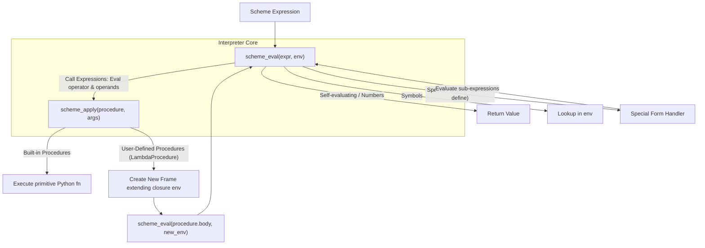

> **Course**: UC Berkeley CS61A (Fall 2024)  
> **Module**: Module 4: Interpreters & Scheme (Interpreters & Scheme)  
> **Lecturer**: Prof. John DeNero (UC Berkeley)  
> **Video duration**: 29:48 ｜ **Classroom screenshots**: 17 pieces of blackboard writing/code demonstration  
> **Direct video**: [📺Watch the original video of this lecture on Bilibili (P29)](https://www.bilibili.com/video/BV1sy411z7nA/?p=29)  
> **Quick navigation**: [← Previous Lecture (P28 Lecture 30 Calculator)](/en/notes/cs61a/lecture-28) ｜ [📚 Return to the full book catalog](/en/notes/topics/CS61A) ｜ [Next lecture (P30 Lecture 32 Tail Calls (Optional)) →](/en/notes/cs61a/lecture-30)

---

## Course Core Objectives and Panorama

In the previous lecture, we built a small calculator language interpreter (Calculator), which only supports raw numerical values and basic four arithmetic function calls. In this lecture, we will enter the core hall of modern programming language implementation——**Build a complete Scheme interpreter (Scheme Interpreter)**.

A general-purpose programming language interpreter not only needs to evaluate arithmetic expressions; **Environment Model**, **Symbol Binding**, **Special Form Dispatch**, **Lexical Scope **and** User-Defined Procedures**.

This lecture will provide an in-depth look at one of the most elegant design patterns in the history of computer science: **`Eval`  with  `Apply`  Mutual Recursion**.



---

### In-depth formal specification and micro-evaluation process (Operational Semantics)
In the "Course Core Goals and Panorama" module, the underlying computer operations rely on strict formal evaluation logic:
1. **Hierarchical parsing of abstract syntax trees (AST)**: 
   - The source code character stream is first divided into terminal symbol tokens (Tokens) by the lexical analyzer (Lexer), and then constructed into a multi-fork syntax tree by the syntax parser (Parser);
   - Operator priority and associativity are solidified during the syntax tree construction phase, eliminating ambiguity at runtime;
2. **Dynamic transitions of environment chains**: 
   - Each function call generates a new frame whose static lexical environment is determined by the function object's  `parent`  Attributes are completely determined;
   - The variable search traces back up the environment chain in one direction until the global environment frame. If it is not found, it will be triggered.  `NameError`  Abnormal;
3. **State Invariants**: 
   - The key to writing robust programs is to clarify loop invariants (Loop Invariants) and function pre/post-conditions (Pre/Post-conditions);
   - In complex control flow jumps, ensure that state variables maintain legal business constraints before each iteration.


## 1. Expression classification and special form dispatch (Special Forms & Eval Dispatch)

In Scheme, all expressions are divided into three main categories based on semantics:
1. **Self-evaluating Expressions**: Such as numbers, Boolean values, empty lists (`nil`), its evaluation result is directly itself.
2. **Symbols**: Find its bound value in the current environment (Environment).
3. **Combinations / Well-formed Scheme Lists**: 
   - **Special Forms**: Determined by the first element (operator symbol) of the list, such as  `if`, `lambda`, `define`, `quote`, `cond`, `and`, `or`. Special forms have custom non-standard evaluation rules, and their subexpressions may not all be evaluated, nor may they be evaluated in the usual order.
   - **Call Expressions**: If the first element of the list is not a known special form, it is called as a regular procedure. The operator is evaluated first to obtain the procedure object, then all operands are evaluated in sequence, and finally the procedure is applied to the argument list.

[](https://www.bilibili.com/video/BV1sy411z7nA/?p=29&t=55)
*⏱ Timestamp: 00:00:55 · 📷 Classroom screenshot · [Watch the corresponding clip on Bilibili (P29 00:00:55)](https://www.bilibili.com/video/BV1sy411z7nA/?p=29&t=55)*

#### 📸 In-depth reading of classroom blackboard writing and code demonstration (00:00:55)

**\[On-site blackboard writing/code demonstration restoration\]**:
At this time point, Professor DeNero conducted a core demonstration and key blackboard derivation on the screen:
> *“Symbols that are bound to values in the current environment. Self-evaluating expressions are returned. Those are things like numbers and the empty list. Everything else is going to be a scheme list called a combination. So we call it a combination just to say that it's a well-formed scheme list that...”*

**\[Underlying computing model and micro execution mechanism\]**: 
1. **Execution context and timing tracing**: 
   - At the current discussion point "1. Expression classification and special form dispatch (Special Forms & Eval Dispatch)", the interpreter strictly follows the core evaluation protocol;
   - The expression evaluates the operators first, then evaluates the operands strictly from left to right, and finally applies the function object to the argument list;
   - If the environment model is involved, the local frame strictly records its static lexical parent pointer (Parent Pointer points to the environment where the function is defined), forming an orthogonal architecture with the dynamic call stack at runtime.
2. **Memory topology and object references**: 
   - Variable symbols are just keys in a hash table (environment frame), and pointers point directly to first-class citizen objects in heap memory;
   - Assignment statements are discrete-time snapshots of the state and never create implicit mathematical dependency monitoring.

**\[Guidelines for avoiding pitfalls and guidance on high-frequency test points\]**: 
- **Common misunderstandings**: In the test questions related to "scheme\_eval, scheme\_apply, and environment frame creation of user-defined processes", beginners can easily guess the results based on the surface form of the code, leading to scope confusion or variable shadowing (Shadowing) misjudgment;
- **The golden rule of debugging**: When encountering nested calls and complex branches, be sure to draw independent partial frames on the scratch paper, indicate the specific binding value of each formal parameter, and derive it step by step.


### Example: Custom Process  `demo`

Professor John DeNero gave a method to append elements to the end of the list  `3`  The recursive process definition:

```scheme
(define (demo s)
  (if (null? s)
      '(3)
      (cons (car s) (demo (cdr s)))))

(demo '(1 2)) ; => (1 2 3)
```

when  `(null? s)`  When true, return the benchmark list directly.  `'(3)`; otherwise pass  `cons`  Construct a new pair whose head is  `(car s)`, tail recursive call  `(demo (cdr s))`.

[](https://www.bilibili.com/video/BV1sy411z7nA/?p=29&t=135)
*⏱ Timestamp: 00:02:15 · 📷 Classroom screenshot · [Watch the corresponding clip on Bilibili (P29 00:02:15)](https://www.bilibili.com/video/BV1sy411z7nA/?p=29&t=135)*

#### 📸 In-depth reading of classroom blackboard writing and code demonstration (00:02:15)

**\[On-site blackboard writing/code demonstration restoration\]**:
At this time point, Professor DeNero conducted a core demonstration and key blackboard derivation on the screen:
> *“One and two is whatever we get back from a recursive call to demo on the rest of the list. And we might call that on, for instance, one and two. Now, what does this do? Think about it for a minute. This function demo puts a three at the end of the list that's passed in. Well, actually, it constructs...”*

**\[Underlying computing model and micro execution mechanism\]**: 
1. **Execution context and timing tracing**: 
   - At the current discussion point "1. Expression classification and special form dispatch (Special Forms & Eval Dispatch)", the interpreter strictly follows the core evaluation protocol;
   - The expression evaluates the operators first, then evaluates the operands strictly from left to right, and finally applies the function object to the argument list;
   - If the environment model is involved, the local frame strictly records its static lexical parent pointer (Parent Pointer points to the environment where the function is defined), forming an orthogonal architecture with the dynamic call stack at runtime.
2. **Memory topology and object references**: 
   - Variable symbols are just keys in a hash table (environment frame), and pointers point directly to first-class citizen objects in heap memory;
   - Assignment statements are discrete-time snapshots of the state and never create implicit mathematical dependency monitoring.

**\[Guidelines for avoiding pitfalls and guidance on high-frequency test points\]**: 
- **Common misunderstandings**: In the test questions related to "scheme\_eval, scheme\_apply, and environment frame creation of user-defined processes", beginners can easily guess the results based on the surface form of the code, leading to scope confusion or variable shadowing (Shadowing) misjudgment;
- **The golden rule of debugging**: When encountering nested calls and complex branches, be sure to draw independent partial frames on the scratch paper, indicate the specific binding value of each formal parameter, and derive it step by step.


---

### In-depth formal specification and micro-evaluation process (Operational Semantics)
In the "1. Expression Classification and Special Forms & Eval Dispatch" module, the underlying computer operations rely on strict formal evaluation logic:
1. **Hierarchical parsing of abstract syntax trees (AST)**: 
   - The source code character stream is first divided into terminal symbol tokens (Tokens) by the lexical analyzer (Lexer), and then constructed into a multi-fork syntax tree by the syntax parser (Parser);
   - Operator priority and associativity are solidified during the syntax tree construction phase, eliminating ambiguity at runtime;
2. **Dynamic transitions of environment chains**: 
   - Each function call generates a new frame whose static lexical environment is determined by the function object's  `parent`  Attributes are completely determined;
   - The variable search traces back up the environment chain in one direction until the global environment frame. If it is not found, it will be triggered.  `NameError`  Abnormal;
3. **State Invariants**: 
   - The key to writing robust programs is to clarify loop invariants (Loop Invariants) and function pre/post-conditions (Pre/Post-conditions);
   - In complex control flow jumps, ensure that state variables maintain legal business constraints before each iteration.


## 2. Tracing Scheme interpreter execution (Tracing  `scheme_eval`)

Start the debug trace mode of the Scheme interpreter in the terminal to clearly observe how the expression is implemented in Python  `scheme_eval`  Expand layer by layer.

[](https://www.bilibili.com/video/BV1sy411z7nA/?p=29&t=225)
*⏱ Timestamp: 00:03:45 · 📷 Classroom screenshot · [Watch the corresponding clip on Bilibili (P29 00:03:45)](https://www.bilibili.com/video/BV1sy411z7nA/?p=29&t=225)*

#### 📸 In-depth reading of classroom blackboard writing and code demonstration (00:03:45)

**\[On-site blackboard writing/code demonstration restoration\]**:
At this time point, Professor DeNero conducted a core demonstration and key blackboard derivation on the screen:
> *“Well, it has eval and apply functions, and scheme eval evaluates a scheme expression, which could be one of a number of types. We could have just a number, or we could have a combination. So let's see what happens when we trace this, and then we start up our scheme interpreter. The number 2 involves...”*

**\[Underlying computing model and micro execution mechanism\]**: 
1. **Execution context and timing tracing**: 
   - At the current discussion point "2. Tracing Scheme interpreter execution (Tracing  `scheme_eval`)", the interpreter strictly follows the core evaluation convention;
   - The expression evaluates the operators first, then evaluates the operands strictly from left to right, and finally applies the function object to the argument list;
   - If the environment model is involved, the local frame strictly records its static lexical parent pointer (Parent Pointer points to the environment where the function is defined), forming an orthogonal architecture with the dynamic call stack at runtime.
2. **Memory topology and object references**: 
   - Variable symbols are just keys in a hash table (environment frame), and pointers point directly to first-class citizen objects in heap memory;
   - Assignment statements are discrete-time snapshots of the state and never create implicit mathematical dependency monitoring.

**\[Guidelines for avoiding pitfalls and guidance on high-frequency test points\]**: 
- **Common misunderstandings**: In the test questions related to "scheme\_eval, scheme\_apply, and environment frame creation of user-defined processes", beginners can easily guess the results based on the surface form of the code, leading to scope confusion or variable shadowing (Shadowing) misjudgment;
- **The golden rule of debugging**: When encountering nested calls and complex branches, be sure to draw independent partial frames on the scratch paper, indicate the specific binding value of each formal parameter, and derive it step by step.


Evaluate value  `2`  when, `scheme_eval`  receive expression  `2`  and global frame (Global Frame), return directly  `2`. Evaluate  `(- 2)`  When:
1. Recognized as a calling expression;
2. Operator found in environment  `-`  Corresponding built-in negative/subtraction function;
3. Evaluation operands  `2`  get  `2`; 
4. Calculated by calling the built-in function  `-2`.

when calling  `(demo '(1 2))` , the interpreter goes through complete frame creation and recursive tracing:

[](https://www.bilibili.com/video/BV1sy411z7nA/?p=29&t=345)
*⏱ Timestamp: 00:05:45 · 📷 Classroom screenshot · [Watch the corresponding clip on Bilibili (P29 00:05:45)](https://www.bilibili.com/video/BV1sy411z7nA/?p=29&t=345)*

#### 📸 In-depth reading of classroom blackboard writing and code demonstration (00:05:45)

**\[On-site blackboard writing/code demonstration restoration\]**:
At this time point, Professor DeNero conducted a core demonstration and key blackboard derivation on the screen:
> *“I called demo on list12, which means I'm evaluating this expression, which is a call expression. We figure out what demo means. Demo is a function that has the body that we wrote down before. And we figure out what list12 means after a bit of work. We find out that it's the list12. So now we're goin...”*

**\[Underlying computing model and micro execution mechanism\]**: 
1. **Execution context and timing tracing**: 
   - At the current discussion point "2. Tracing Scheme interpreter execution (Tracing  `scheme_eval`)", the interpreter strictly follows the core evaluation convention;
   - The expression evaluates the operators first, then evaluates the operands strictly from left to right, and finally applies the function object to the argument list;
   - If the environment model is involved, the local frame strictly records its static lexical parent pointer (Parent Pointer points to the environment where the function is defined), forming an orthogonal architecture with the dynamic call stack at runtime.
2. **Memory topology and object references**: 
   - Variable symbols are just keys in a hash table (environment frame), and pointers point directly to first-class citizen objects in heap memory;
   - Assignment statements are discrete-time snapshots of the state and never create implicit mathematical dependency monitoring.

**\[Guidelines for avoiding pitfalls and guidance on high-frequency test points\]**: 
- **Common misunderstandings**: In the test questions related to "scheme\_eval, scheme\_apply, and environment frame creation of user-defined processes", beginners can easily guess the results based on the surface form of the code, leading to scope confusion or variable shadowing (Shadowing) misjudgment;
- **The golden rule of debugging**: When encountering nested calls and complex branches, be sure to draw independent partial frames on the scratch paper, indicate the specific binding value of each formal parameter, and derive it step by step.


- Initial call creates local frame  $F_1$, formal parameters  `s`  bind to list  `(1 2)`; 
- Recursive calls create local frames  $F_2$, formal parameters  `s`  bind to  `(2)`; 
- Baseline calls create local frames  $F_3$, formal parameters  `s`  bind to  `nil`; 
- baseline hit return  `(3)`, execute in the reverse direction along the call chain  `cons`, assembled in turn into  `(2 3)`  with  `(1 2 3)`.

---

### In-depth formal specification and micro-evaluation process (Operational Semantics)
In "2. Tracing Scheme interpreter execution (Tracing  `scheme_eval`)" module, the underlying computer operations rely on strict formal evaluation logic:
1. **Hierarchical parsing of abstract syntax trees (AST)**: 
   - The source code character stream is first divided into terminal symbol tokens (Tokens) by the lexical analyzer (Lexer), and then constructed into a multi-fork syntax tree by the syntax parser (Parser);
   - Operator priority and associativity are solidified during the syntax tree construction phase, eliminating ambiguity at runtime;
2. **Dynamic transitions of environment chains**: 
   - Each function call generates a new frame whose static lexical environment is determined by the function object's  `parent`  Attributes are completely determined;
   - The variable search traces back up the environment chain in one direction until the global environment frame. If it is not found, it will be triggered.  `NameError`  Abnormal;
3. **State Invariants**: 
   - The key to writing robust programs is to clarify loop invariants (Loop Invariants) and function pre/post-conditions (Pre/Post-conditions);
   - In complex control flow jumps, ensure that state variables maintain legal business constraints before each iteration.


## 3. Special forms of citation (Quotation & `SchemeReader`)

In Lisp/Scheme, **Data and code have the same physical representation (Homoiconicity)**. To prevent the interpreter from executing the list as code and instead keep it as pure data, we need to use  `quote`  special form.

```scheme
(quote (+ 1 2)) ; => (+ 1 2) 列表数据，而非数值 3
'(+ 1 2)        ; => (+ 1 2) 单引号语法糖
```

single quote  `'expr`  It's just Syntactic Sugar, which is expanded into a standard binary list in the Reader stage.  `(quote expr)`.

[](https://www.bilibili.com/video/BV1sy411z7nA/?p=29&t=465)
*⏱ Timestamp: 00:07:45 · 📷 Classroom screenshot · [Watch the corresponding clip on Bilibili (P29 00:07:45)](https://www.bilibili.com/video/BV1sy411z7nA/?p=29&t=465)*

#### 📸 In-depth reading of classroom blackboard writing and code demonstration (00:07:45)

**\[On-site blackboard writing/code demonstration restoration\]**:
At this time point, Professor DeNero conducted a core demonstration and key blackboard derivation on the screen:
> *“So, the quote special form evaluates to the quoted expression. That expression is not evaluated. So, if I quote an expression, that is a quote special form. And, for example, quoting plus one two evaluates to the scheme list, which contains the symbol plus, followed by the number one, followed by th...”*

**\[Underlying computing model and micro execution mechanism\]**: 
1. **Execution context and timing tracing**: 
   - At the current discussion point "3. Quotation special form (Quotation & `SchemeReader`)", the interpreter strictly follows the core evaluation convention;
   - The expression evaluates the operators first, then evaluates the operands strictly from left to right, and finally applies the function object to the argument list;
   - If the environment model is involved, the local frame strictly records its static lexical parent pointer (Parent Pointer points to the environment where the function is defined), forming an orthogonal architecture with the dynamic call stack at runtime.
2. **Memory topology and object references**: 
   - Variable symbols are just keys in a hash table (environment frame), and pointers point directly to first-class citizen objects in heap memory;
   - Assignment statements are discrete-time snapshots of the state and never create implicit mathematical dependency monitoring.

**\[Guidelines for avoiding pitfalls and guidance on high-frequency test points\]**: 
- **Common misunderstandings**: In the test questions related to "scheme\_eval, scheme\_apply, and environment frame creation of user-defined processes", beginners can easily guess the results based on the surface form of the code, leading to scope confusion or variable shadowing (Shadowing) misjudgment;
- **The golden rule of debugging**: When encountering nested calls and complex branches, be sure to draw independent partial frames on the scratch paper, indicate the specific binding value of each formal parameter, and derive it step by step.


### `SchemeReader`  workflow

in  `scheme_reader.py`  In , the lexical analyzer (Tokenizer) splits the text into a stream of tokens, and the syntactic analyzer (Syntactic Analyzer) constructs nested brackets and indents into nested  `Pair`  Linked list:

[](https://www.bilibili.com/video/BV1sy411z7nA/?p=29&t=565)
*⏱ Timestamp: 00:09:25 · 📷 Classroom screenshot · [Watch the corresponding clip on Bilibili (P29 00:09:25)](https://www.bilibili.com/video/BV1sy411z7nA/?p=29&t=565)*

#### 📸 In-depth reading of classroom blackboard writing and code demonstration (00:09:25)

**\[On-site blackboard writing/code demonstration restoration\]**:
At this time point, Professor DeNero conducted a core demonstration and key blackboard derivation on the screen:
> *“That starts with the word quote. So what am I talking about? Well, there's a file called SchemeReader. And what SchemeReader does is it just reads expressions. It doesn't actually do any sort of summing. And we looked at this before. This is called the Syntactic Analyzer. And it's also running the L...”*

**\[Underlying computing model and micro execution mechanism\]**: 
1. **Execution context and timing tracing**: 
   - At the current discussion point "3. Quotation special form (Quotation & `SchemeReader`)", the interpreter strictly follows the core evaluation convention;
   - The expression evaluates the operators first, then evaluates the operands strictly from left to right, and finally applies the function object to the argument list;
   - If the environment model is involved, the local frame strictly records its static lexical parent pointer (Parent Pointer points to the environment where the function is defined), forming an orthogonal architecture with the dynamic call stack at runtime.
2. **Memory topology and object references**: 
   - Variable symbols are just keys in a hash table (environment frame), and pointers point directly to first-class citizen objects in heap memory;
   - Assignment statements are discrete-time snapshots of the state and never create implicit mathematical dependency monitoring.

**\[Guidelines for avoiding pitfalls and guidance on high-frequency test points\]**: 
- **Common misunderstandings**: In the test questions related to "scheme\_eval, scheme\_apply, and environment frame creation of user-defined processes", beginners can easily guess the results based on the surface form of the code, leading to scope confusion or variable shadowing (Shadowing) misjudgment;
- **The golden rule of debugging**: When encountering nested calls and complex branches, be sure to draw independent partial frames on the scratch paper, indicate the specific binding value of each formal parameter, and derive it step by step.


evaluator core  `scheme_eval`  Never directly confront single quotes in text format  `'x`, what it receives is always the parsed Pair structure: `Pair('quote', Pair('x', nil))`.

---

### In-depth formal specification and micro-evaluation process (Operational Semantics)
In "3. Quotation Special Forms (Quotation & `SchemeReader`)" module, the underlying computer operations rely on strict formal evaluation logic:
1. **Hierarchical parsing of abstract syntax trees (AST)**: 
   - The source code character stream is first divided into terminal symbol tokens (Tokens) by the lexical analyzer (Lexer), and then constructed into a multi-fork syntax tree by the syntax parser (Parser);
   - Operator priority and associativity are solidified during the syntax tree construction phase, eliminating ambiguity at runtime;
2. **Dynamic transitions of environment chains**: 
   - Each function call generates a new frame whose static lexical environment is determined by the function object's  `parent`  Attributes are completely determined;
   - The variable search traces back up the environment chain in one direction until the global environment frame. If it is not found, it will be triggered.  `NameError`  Abnormal;
3. **State Invariants**: 
   - The key to writing robust programs is to clarify loop invariants (Loop Invariants) and function pre/post-conditions (Pre/Post-conditions);
   - In complex control flow jumps, ensure that state variables maintain legal business constraints before each iteration.


## 4. Logical Special Forms & Short-Circuit Evaluation (Logical Special Forms & `do_if_form`)

Logical Forms such as  `if`, `and`, `or`, `cond`  The core features are: **Subexpression on-demand conditional evaluation (Short-circuit Evaluation)**.

```scheme
(if <predicate> <consequent> <alternative>)
```

In Python implementation, the corresponding processing function is  `do_if_form(expressions, env)`: 
1. call  `scheme_eval(expressions.first, env)`  Evaluate predicate;
2. Depending on whether the predicate is true or false, decide whether to evaluate the consequent (Consequent) or the antecedent (Alternative);
3. **Unselected branches will never be evaluated**!

[](https://www.bilibili.com/video/BV1sy411z7nA/?p=29&t=645)
*⏱ Timestamp: 00:10:45 · 📷 Classroom screenshot · [Watch the corresponding clip on Bilibili (P29 00:10:45)](https://www.bilibili.com/video/BV1sy411z7nA/?p=29&t=645)*

#### 📸 In-depth reading of classroom blackboard writing and code demonstration (00:10:45)

**\[On-site blackboard writing/code demonstration restoration\]**:
At this time point, Professor DeNero conducted a core demonstration and key blackboard derivation on the screen:
> *“So, when the schema-evaluator actually deals with quotation, it never sees this. It only sees that. Next, we'll talk about logical forms. So, logical-special forms are things that involve conditions, and they only evaluate some sub-expressions. So, an if-expression is one of these. Its evaluation pr...”*

**\[Underlying computing model and micro execution mechanism\]**: 
1. **Execution context and timing tracing**: 
   - At the current discussion point "4. Logical Special Forms & Short-Circuit Evaluation (Logical Special Forms & `do_if_form`)", the interpreter strictly follows the core evaluation convention;
   - The expression evaluates the operators first, then evaluates the operands strictly from left to right, and finally applies the function object to the argument list;
   - If the environment model is involved, the local frame strictly records its static lexical parent pointer (Parent Pointer points to the environment where the function is defined), forming an orthogonal architecture with the dynamic call stack at runtime.
2. **Memory topology and object references**: 
   - Variable symbols are just keys in a hash table (environment frame), and pointers point directly to first-class citizen objects in heap memory;
   - Assignment statements are discrete-time snapshots of the state and never create implicit mathematical dependency monitoring.

**\[Guidelines for avoiding pitfalls and guidance on high-frequency test points\]**: 
- **Common misunderstandings**: In the test questions related to "scheme\_eval, scheme\_apply, and environment frame creation of user-defined processes", beginners can easily guess the results based on the surface form of the code, leading to scope confusion or variable shadowing (Shadowing) misjudgment;
- **The golden rule of debugging**: When encountering nested calls and complex branches, be sure to draw independent partial frames on the scratch paper, indicate the specific binding value of each formal parameter, and derive it step by step.


### Short-circuit evaluation demonstration and divide-by-zero protection

Consider the expression:
```scheme
(if #t 1 (/ 1 0)) ; => 1 （不会触发除零异常）
(if #f 1 (/ 1 0)) ; => ZeroDivisionError!
```

[](https://www.bilibili.com/video/BV1sy411z7nA/?p=29&t=735)
*⏱ Timestamp: 00:12:15 · 📷 Classroom screenshot · [Watch the corresponding clip on Bilibili (P29 00:12:15)](https://www.bilibili.com/video/BV1sy411z7nA/?p=29&t=735)*

#### 📸 In-depth reading of classroom blackboard writing and code demonstration (00:12:15)

**\[On-site blackboard writing/code demonstration restoration\]**:
At this time point, Professor DeNero conducted a core demonstration and key blackboard derivation on the screen:
> *“And that's a Python function that gets called every time. Your interpreter encounters an if expression. And all it does is it evaluates the predicate and chooses a subexpression to be evaluated next. We already have a function that evaluates a subexpression. And so we just use that scheme eval in or...”*

**\[Underlying computing model and micro execution mechanism\]**: 
1. **Execution context and timing tracing**: 
   - At the current discussion point "4. Logical Special Forms & Short-Circuit Evaluation (Logical Special Forms & `do_if_form`)", the interpreter strictly follows the core evaluation convention;
   - The expression evaluates the operators first, then evaluates the operands strictly from left to right, and finally applies the function object to the argument list;
   - If the environment model is involved, the local frame strictly records its static lexical parent pointer (Parent Pointer points to the environment where the function is defined), forming an orthogonal architecture with the dynamic call stack at runtime.
2. **Memory topology and object references**: 
   - Variable symbols are just keys in a hash table (environment frame), and pointers point directly to first-class citizen objects in heap memory;
   - Assignment statements are discrete-time snapshots of the state and never create implicit mathematical dependency monitoring.

**\[Guidelines for avoiding pitfalls and guidance on high-frequency test points\]**: 
- **Common misunderstandings**: In the test questions related to "scheme\_eval, scheme\_apply, and environment frame creation of user-defined processes", beginners can easily guess the results based on the surface form of the code, leading to scope confusion or variable shadowing (Shadowing) misjudgment;
- **The golden rule of debugging**: When encountering nested calls and complex branches, be sure to draw independent partial frames on the scratch paper, indicate the specific binding value of each formal parameter, and derive it step by step.


if  `if`  It is an ordinary function call, and all actual parameters will be evaluated before entering the function, then  `(/ 1 0)`  An error will be reported unconditionally. This is the key reason why special forms must exist as special processing branches.

---

### In-depth formal specification and micro-evaluation process (Operational Semantics)
In "4. Logical Special Forms & Short-Circuit Evaluation (Logical Special Forms & `do_if_form`)" module, the underlying computer operations rely on strict formal evaluation logic:
1. **Hierarchical parsing of abstract syntax trees (AST)**: 
   - The source code character stream is first divided into terminal symbol tokens (Tokens) by the lexical analyzer (Lexer), and then constructed into a multi-fork syntax tree by the syntax parser (Parser);
   - Operator priority and associativity are solidified during the syntax tree construction phase, eliminating ambiguity at runtime;
2. **Dynamic transitions of environment chains**: 
   - Each function call generates a new frame whose static lexical environment is determined by the function object's  `parent`  Attributes are completely determined;
   - The variable search traces back up the environment chain in one direction until the global environment frame. If it is not found, it will be triggered.  `NameError`  Abnormal;
3. **State Invariants**: 
   - The key to writing robust programs is to clarify loop invariants (Loop Invariants) and function pre/post-conditions (Pre/Post-conditions);
   - In complex control flow jumps, ensure that state variables maintain legal business constraints before each iteration.


## 5. Lambda expressions and procedure objects (`LambdaProcedure`)

`lambda`  It is the core soul of functional programming, which is used to create user-defined procedures (User-defined Procedure) at runtime.

```scheme
(lambda (x) (* x x))
```

In the Python host implementation, we define  `LambdaProcedure`  Class, which encapsulates the three key elements that constitute a closure:
1. **Formal parameter list (`formals`)**: Scheme list composed of symbols, specifying parameter names;
2. **function body (`body`)**: A list of one or more Scheme expressions;
3. **Defining environment (`env`)**: one  `Frame`  Instance, records the environment frame in which the function was defined.

[](https://www.bilibili.com/video/BV1sy411z7nA/?p=29&t=815)
*⏱ Timestamp: 00:13:35 · 📷 Classroom screenshot · [Watch the corresponding clip on Bilibili (P29 00:13:35)](https://www.bilibili.com/video/BV1sy411z7nA/?p=29&t=815)*

#### 📸 In-depth reading of classroom blackboard writing and code demonstration (00:13:35)

**\[On-site blackboard writing/code demonstration restoration\]**:
At this time point, Professor DeNero conducted a core demonstration and key blackboard derivation on the screen:
> *“So you have a whole expression that starts with lambda, and when you evaluate it, you get a new procedure that you didn't have before. It has formal parameters and a body. So, for instance, if I write lambda x is x times x. This defines a procedure that squares things. Now, how do we encode this? We...”*

**\[Underlying computing model and micro execution mechanism\]**: 
1. **Execution context and timing tracing**: 
   - At the current discussion point "5. Lambda expressions and procedural objects (`LambdaProcedure`)", the interpreter strictly follows the core evaluation convention;
   - The expression evaluates the operators first, then evaluates the operands strictly from left to right, and finally applies the function object to the argument list;
   - If the environment model is involved, the local frame strictly records its static lexical parent pointer (Parent Pointer points to the environment where the function is defined), forming an orthogonal architecture with the dynamic call stack at runtime.
2. **Memory topology and object references**: 
   - Variable symbols are just keys in a hash table (environment frame), and pointers point directly to first-class citizen objects in heap memory;
   - Assignment statements are discrete-time snapshots of the state and never create implicit mathematical dependency monitoring.

**\[Guidelines for avoiding pitfalls and guidance on high-frequency test points\]**: 
- **Common misunderstandings**: In the test questions related to "scheme\_eval, scheme\_apply, and environment frame creation of user-defined processes", beginners can easily guess the results based on the surface form of the code, leading to scope confusion or variable shadowing (Shadowing) misjudgment;
- **The golden rule of debugging**: When encountering nested calls and complex branches, be sure to draw independent partial frames on the scratch paper, indicate the specific binding value of each formal parameter, and derive it step by step.


```python
class LambdaProcedure:
    def __init__(self, formals, body, env):
        self.formals = formals # Scheme list of symbols
        self.body = body       # Scheme list of expressions
        self.env = env         # Frame instance
```

---

### In-depth formal specification and micro-evaluation process (Operational Semantics)
In "5. Lambda Expressions and Procedure Objects (`LambdaProcedure`)" module, the underlying computer operations rely on strict formal evaluation logic:
1. **Hierarchical parsing of abstract syntax trees (AST)**: 
   - The source code character stream is first divided into terminal symbol tokens (Tokens) by the lexical analyzer (Lexer), and then constructed into a multi-fork syntax tree by the syntax parser (Parser);
   - Operator priority and associativity are solidified during the syntax tree construction phase, eliminating ambiguity at runtime;
2. **Dynamic transitions of environment chains**: 
   - Each function call generates a new frame whose static lexical environment is determined by the function object's  `parent`  Attributes are completely determined;
   - The variable search traces back up the environment chain in one direction until the global environment frame. If it is not found, it will be triggered.  `NameError`  Abnormal;
3. **State Invariants**: 
   - The key to writing robust programs is to clarify loop invariants (Loop Invariants) and function pre/post-conditions (Pre/Post-conditions);
   - In complex control flow jumps, ensure that state variables maintain legal business constraints before each iteration.


## 6. Chain search of environment models and frames (Frames and Environments)

**Environment**  Is the frame sequence (Chain of Frames) used to determine symbol binding.
every  `Frame`  Instance maintenance:
- a local dictionary (`bindings`): Record the mapping of local symbols and values;
- a reference to the parent frame (`parent`): Points to the upper environment; of the global frame  `parent`  for  `None`.

Frames provide two core operation methods:
- `lookup(symbol)`: First search in the current local frame; if not found and the parent frame exists, recurse in  `parent`  Search in the frame; if the global frame is not found yet, throw  `SchemeError`.
- `define(symbol, value)`: directly in **current local frame** Add or override symbol bindings (does not affect the parent frame).

[](https://www.bilibili.com/video/BV1sy411z7nA/?p=29&t=915)
*⏱ Timestamp: 00:15:15 · 📷 Classroom screenshot · [Watch the corresponding clip on Bilibili (P29 00:15:15)](https://www.bilibili.com/video/BV1sy411z7nA/?p=29&t=915)*

#### 📸 In-depth reading of classroom blackboard writing and code demonstration (00:15:15)

**\[On-site blackboard writing/code demonstration restoration\]**:
At this time point, Professor DeNero conducted a core demonstration and key blackboard derivation on the screen:
> *“Frames don't actually hold any return values, they just hold the name value bindings that are used for lookup. So let's do this example in code. We're going to have a global frame with y bound to 3 and z bound to 5, and then another frame, f1, with x bound to 2 and z bound to 4. Okay, so I'm going t...”*

**\[Underlying computing model and micro execution mechanism\]**: 
1. **Execution context and timing tracing**: 
   - At the current discussion point "6. Chained search of environment models and frames (Frames and Environments)", the interpreter strictly follows the core evaluation protocol;
   - The expression evaluates the operators first, then evaluates the operands strictly from left to right, and finally applies the function object to the argument list;
   - If the environment model is involved, the local frame strictly records its static lexical parent pointer (Parent Pointer points to the environment where the function is defined), forming an orthogonal architecture with the dynamic call stack at runtime.
2. **Memory topology and object references**: 
   - Variable symbols are just keys in a hash table (environment frame), and pointers point directly to first-class citizen objects in heap memory;
   - Assignment statements are discrete-time snapshots of the state and never create implicit mathematical dependency monitoring.

**\[Guidelines for avoiding pitfalls and guidance on high-frequency test points\]**: 
- **Common misunderstandings**: In the test questions related to "scheme\_eval, scheme\_apply, and environment frame creation of user-defined processes", beginners can easily guess the results based on the surface form of the code, leading to scope confusion or variable shadowing (Shadowing) misjudgment;
- **The golden rule of debugging**: When encountering nested calls and complex branches, be sure to draw independent partial frames on the scratch paper, indicate the specific binding value of each formal parameter, and derive it step by step.


### Python interactive testing Frame chain

Professor manually builds global frames in Python  $G$  with local frames  $F_1$  And conduct variable shadowing (Shadowing) experiments:

[](https://www.bilibili.com/video/BV1sy411z7nA/?p=29&t=995)
*⏱ Timestamp: 00:16:35 · 📷 Classroom screenshot · [Watch the corresponding clip on Bilibili (P29 00:16:35)](https://www.bilibili.com/video/BV1sy411z7nA/?p=29&t=995)*

#### 📸 In-depth reading of classroom blackboard writing and code demonstration (00:16:35)

**\[On-site blackboard writing/code demonstration restoration\]**:
At this time point, Professor DeNero conducted a core demonstration and key blackboard derivation on the screen:
> *“And starts an environment that's followed by the global frame. I believe I had said I was going to bind Y to 3 and Z to 5. So now if I look up Y, if I look up Y, I'll get 3. And if I look up Z, I'll get 5. Okay, so now we're going to actually define X to be 2 in the F1 frame and define Z. to be 4 in...”*

**\[Underlying computing model and micro execution mechanism\]**: 
1. **Execution context and timing tracing**: 
   - At the current discussion point "6. Chained search of environment models and frames (Frames and Environments)", the interpreter strictly follows the core evaluation protocol;
   - The expression evaluates the operators first, then evaluates the operands strictly from left to right, and finally applies the function object to the argument list;
   - If the environment model is involved, the local frame strictly records its static lexical parent pointer (Parent Pointer points to the environment where the function is defined), forming an orthogonal architecture with the dynamic call stack at runtime.
2. **Memory topology and object references**: 
   - Variable symbols are just keys in a hash table (environment frame), and pointers point directly to first-class citizen objects in heap memory;
   - Assignment statements are discrete-time snapshots of the state and never create implicit mathematical dependency monitoring.

**\[Guidelines for avoiding pitfalls and guidance on high-frequency test points\]**: 
- **Common misunderstandings**: In the test questions related to "scheme\_eval, scheme\_apply, and environment frame creation of user-defined processes", beginners can easily guess the results based on the surface form of the code, leading to scope confusion or variable shadowing (Shadowing) misjudgment;
- **The golden rule of debugging**: When encountering nested calls and complex branches, be sure to draw independent partial frames on the scratch paper, indicate the specific binding value of each formal parameter, and derive it step by step.


- global frame  $G$  Binding: `y = 3`, `z = 5`; 
- partial frame  $F_1$ (The parent frame is  $G$) binding: `x = 2`, `z = 4`; 
- in  $F_1$  Search in  `x`  get  `2`;Find  `z`  Get the value of the local frame  `4` (obscuring the global  `5`); 
- in  $F_1$  Search in  `y`, there is no local problem, but the global one can be found along the parent frame chain.  `3`.

---

### In-depth formal specification and micro-evaluation process (Operational Semantics)
In the "6. Chain search of environment models and frames (Frames and Environments)" module, the underlying computer operations rely on strict formal evaluation logic:
1. **Hierarchical parsing of abstract syntax trees (AST)**: 
   - The source code character stream is first divided into terminal symbol tokens (Tokens) by the lexical analyzer (Lexer), and then constructed into a multi-fork syntax tree by the syntax parser (Parser);
   - Operator priority and associativity are solidified during the syntax tree construction phase, eliminating ambiguity at runtime;
2. **Dynamic transitions of environment chains**: 
   - Each function call generates a new frame whose static lexical environment is determined by the function object's  `parent`  Attributes are completely determined;
   - The variable search traces back up the environment chain in one direction until the global environment frame. If it is not found, it will be triggered.  `NameError`  Abnormal;
3. **State Invariants**: 
   - The key to writing robust programs is to clarify loop invariants (Loop Invariants) and function pre/post-conditions (Pre/Post-conditions);
   - In complex control flow jumps, ensure that state variables maintain legal business constraints before each iteration.


## 7. Lexical vs Dynamic Scope

This is one of the most critical theoretical watersheds in programming language semantics:

| scoping mechanism | The parent frame definition of the new frame | Search by | modern representative language |
| :--- | :--- | :--- | :--- |
| **Lexical/Static Scope** | **Definition-time**  environment | Based on the static nesting structure of the code in the text | Scheme, Python, JavaScript |
| **Dynamic Scope** | **When the procedure is called (Call-time)**  current environment | According to the order in which the call stack is run | Early Lisp, Emacs Lisp (default) |

[](https://www.bilibili.com/video/BV1sy411z7nA/?p=29&t=1085)
*⏱ Timestamp: 00:18:05 · 📷 Classroom screenshot · [Watch the corresponding clip on Bilibili (P29 00:18:05)](https://www.bilibili.com/video/BV1sy411z7nA/?p=29&t=1085)*

#### 📸 In-depth reading of classroom blackboard writing and code demonstration (00:18:05)

**\[On-site blackboard writing/code demonstration restoration\]**:
At this time point, Professor DeNero conducted a core demonstration and key blackboard derivation on the screen:
> *“And remember the rule. The parent of a frame is the environment in which a procedure was defined. So when you create a new frame for applying a procedure, you just look at the procedure, figure out what its environment was when it was created, and use that as the parent of the new frame. Dynamic sco...”*

**\[Underlying computing model and micro execution mechanism\]**: 
1. **Execution context and timing tracing**: 
   - At the current discussion point "7. Lexical vs Dynamic Scope", the interpreter strictly follows the core evaluation convention;
   - The expression evaluates the operators first, then evaluates the operands strictly from left to right, and finally applies the function object to the argument list;
   - If the environment model is involved, the local frame strictly records its static lexical parent pointer (Parent Pointer points to the environment where the function is defined), forming an orthogonal architecture with the dynamic call stack at runtime.
2. **Memory topology and object references**: 
   - Variable symbols are just keys in a hash table (environment frame), and pointers point directly to first-class citizen objects in heap memory;
   - Assignment statements are discrete-time snapshots of the state and never create implicit mathematical dependency monitoring.

**\[Guidelines for avoiding pitfalls and guidance on high-frequency test points\]**: 
- **Common misunderstandings**: In the test questions related to "scheme\_eval, scheme\_apply, and environment frame creation of user-defined processes", beginners can easily guess the results based on the surface form of the code, leading to scope confusion or variable shadowing (Shadowing) misjudgment;
- **The golden rule of debugging**: When encountering nested calls and complex branches, be sure to draw independent partial frames on the scratch paper, indicate the specific binding value of each formal parameter, and derive it step by step.


### Classic contrast example

```scheme
(define (f x) (+ x y))
(define (g x y) (f (+ x x)))
(g 3 7)
```

- **Lexical Scope**: 
  `f`  is defined globally, so no matter where it is called  `f`, the parent frame of its new frame is always the global frame  $G$. when  `f`  trying to find  `y`  when, at  $F_f$  and global frames  $G$  None found in  `y`, error report: `unknown identifier: y`.
- **Dynamic Scope**: 
  `f`  is in  `g`  is called internally, so  $F_f$  The parent frame is  $F_g$. Looking for  `y`  when found directly along the call chain  $F_g$  in  `y = 7`, the calculation result is  `(+ 6 7) = 13`!

Scheme is consistent with Python and strictly followed **lexical scope**.

---

### In-depth formal specification and micro-evaluation process (Operational Semantics)
In the "7. Lexical vs Dynamic Scope" module, the underlying computer operations rely on strict formal evaluation logic:
1. **Hierarchical parsing of abstract syntax trees (AST)**: 
   - The source code character stream is first divided into terminal symbol tokens (Tokens) by the lexical analyzer (Lexer), and then constructed into a multi-fork syntax tree by the syntax parser (Parser);
   - Operator priority and associativity are solidified during the syntax tree construction phase, eliminating ambiguity at runtime;
2. **Dynamic transitions of environment chains**: 
   - Each function call generates a new frame whose static lexical environment is determined by the function object's  `parent`  Attributes are completely determined;
   - The variable search traces back up the environment chain in one direction until the global environment frame. If it is not found, it will be triggered.  `NameError`  Abnormal;
3. **State Invariants**: 
   - The key to writing robust programs is to clarify loop invariants (Loop Invariants) and function pre/post-conditions (Pre/Post-conditions);
   - In complex control flow jumps, ensure that state variables maintain legal business constraints before each iteration.


## 8. Interpreter core: Eval and Apply are mutually recursive (The Core Architecture)

The interpreter's execution engine is built on two mutually recursive core functions:

```python
def scheme_eval(expr, env):
    """求值表达式 expr 在环境 env 中的值。"""
    if is_primitive(expr):
        return expr
    elif is_symbol(expr):
        return env.lookup(expr)
    elif is_special_form(expr):
        return eval_special_form(expr, env)
    else: # 调用表达式
        procedure = scheme_eval(expr.first, env)
        args = expr.rest.map(lambda operand: scheme_eval(operand, env))
        return scheme_apply(procedure, args, env)

def scheme_apply(procedure, args, env):
    """将过程 procedure 应用于实参 args。"""
    if isinstance(procedure, PrimitiveProcedure):
        return procedure.apply(args)
    elif isinstance(procedure, LambdaProcedure):
        new_frame = procedure.env.make_child_frame(procedure.formals, args)
        return eval_all(procedure.body, new_frame)
```

[](https://www.bilibili.com/video/BV1sy411z7nA/?p=29&t=1245)
*⏱ Timestamp: 00:20:45 · 📷 Classroom screenshot · [Watch the corresponding clip on Bilibili (P29 00:20:45)](https://www.bilibili.com/video/BV1sy411z7nA/?p=29&t=1245)*

#### 📸 In-depth reading of classroom blackboard writing and code demonstration (00:20:45)

**\[On-site blackboard writing/code demonstration restoration\]**:
At this time point, Professor DeNero conducted a core demonstration and key blackboard derivation on the screen:
> *“And then apply function. And eval evaluates primitive expressions. It also evaluates combined expressions. But when it finds one of those, then it calls apply to actually apply some procedure to some arguments. So these are both recursive. Here's how. The base cases of eval are for primitive values,...”*

**\[Underlying computing model and micro execution mechanism\]**: 
1. **Execution context and timing tracing**: 
   - At the current discussion point "8. The core of the interpreter: Eval and Apply are mutually recursive (The Core Architecture)", the interpreter strictly follows the core evaluation protocol;
   - The expression evaluates the operators first, then evaluates the operands strictly from left to right, and finally applies the function object to the argument list;
   - If the environment model is involved, the local frame strictly records its static lexical parent pointer (Parent Pointer points to the environment where the function is defined), forming an orthogonal architecture with the dynamic call stack at runtime.
2. **Memory topology and object references**: 
   - Variable symbols are just keys in a hash table (environment frame), and pointers point directly to first-class citizen objects in heap memory;
   - Assignment statements are discrete-time snapshots of the state and never create implicit mathematical dependency monitoring.

**\[Guidelines for avoiding pitfalls and guidance on high-frequency test points\]**: 
- **Common misunderstandings**: In the test questions related to "scheme\_eval, scheme\_apply, and environment frame creation of user-defined processes", beginners can easily guess the results based on the surface form of the code, leading to scope confusion or variable shadowing (Shadowing) misjudgment;
- **The golden rule of debugging**: When encountering nested calls and complex branches, be sure to draw independent partial frames on the scratch paper, indicate the specific binding value of each formal parameter, and derive it step by step.


[](https://www.bilibili.com/video/BV1sy411z7nA/?p=29&t=1365)
*⏱ Timestamp: 00:22:45 · 📷 Classroom screenshot · [Watch the corresponding clip on Bilibili (P29 00:22:45)](https://www.bilibili.com/video/BV1sy411z7nA/?p=29&t=1365)*

#### 📸 In-depth reading of classroom blackboard writing and code demonstration (00:22:45)

**\[On-site blackboard writing/code demonstration restoration\]**:
At this time point, Professor DeNero conducted a core demonstration and key blackboard derivation on the screen:
> *“Procedures that we define, too. So here are the extensions that we'll talk about today. One is that there's a new base case for eval where it will look up a value bound to a symbol. So we can define what symbols mean and look up what those mean in an environment. Another one is that we're going to e...”*

**\[Underlying computing model and micro execution mechanism\]**: 
1. **Execution context and timing tracing**: 
   - At the current discussion point "8. The core of the interpreter: Eval and Apply are mutually recursive (The Core Architecture)", the interpreter strictly follows the core evaluation protocol;
   - The expression evaluates the operators first, then evaluates the operands strictly from left to right, and finally applies the function object to the argument list;
   - If the environment model is involved, the local frame strictly records its static lexical parent pointer (Parent Pointer points to the environment where the function is defined), forming an orthogonal architecture with the dynamic call stack at runtime.
2. **Memory topology and object references**: 
   - Variable symbols are just keys in a hash table (environment frame), and pointers point directly to first-class citizen objects in heap memory;
   - Assignment statements are discrete-time snapshots of the state and never create implicit mathematical dependency monitoring.

**\[Guidelines for avoiding pitfalls and guidance on high-frequency test points\]**: 
- **Common misunderstandings**: In the test questions related to "scheme\_eval, scheme\_apply, and environment frame creation of user-defined processes", beginners can easily guess the results based on the surface form of the code, leading to scope confusion or variable shadowing (Shadowing) misjudgment;
- **The golden rule of debugging**: When encountering nested calls and complex branches, be sure to draw independent partial frames on the scratch paper, indicate the specific binding value of each formal parameter, and derive it step by step.


- **`scheme_eval`  call  `scheme_apply`**: When the evaluation encounters a normal function call, the operator and all operands are first evaluated recursively, and then handed over to  `scheme_apply`; 
- **`scheme_apply`  call  `scheme_eval`**: When applying user-defined  `LambdaProcedure`  when, create a new frame and call  `scheme_eval`  to execute the function body expression.

---

### In-depth formal specification and micro-evaluation process (Operational Semantics)
In the "8. Interpreter Core: Eval and Apply Mutual Recursion (The Core Architecture)" module, the underlying computer operations rely on strict formal evaluation logic:
1. **Hierarchical parsing of abstract syntax trees (AST)**: 
   - The source code character stream is first divided into terminal symbol tokens (Tokens) by the lexical analyzer (Lexer), and then constructed into a multi-fork syntax tree by the syntax parser (Parser);
   - Operator priority and associativity are solidified during the syntax tree construction phase, eliminating ambiguity at runtime;
2. **Dynamic transitions of environment chains**: 
   - Each function call generates a new frame whose static lexical environment is determined by the function object's  `parent`  Attributes are completely determined;
   - The variable search traces back up the environment chain in one direction until the global environment frame. If it is not found, it will be triggered.  `NameError`  Abnormal;
3. **State Invariants**: 
   - The key to writing robust programs is to clarify loop invariants (Loop Invariants) and function pre/post-conditions (Pre/Post-conditions);
   - In complex control flow jumps, ensure that state variables maintain legal business constraints before each iteration.


## 9. Symbol binding and process definition syntactic sugar (Handling  `define` Expressions)

`define`  Expressions come in two forms:
1. **variable definition**: `(define <symbol> <expression>)`  
   Evaluate first  `<expression>`  get the specific value and then  `<symbol>`  Bound with this value in the current frame.
2. **process definition**: `(define (<symbol> <param1> ...) <body>)`  
   This is actually  `define`  cooperate  `lambda`  The exact equivalent syntactic sugar for:
   ```scheme
   (define <symbol> (lambda (<param1> ...) <body>))
   ```

[](https://www.bilibili.com/video/BV1sy411z7nA/?p=29&t=1505)
*⏱ Timestamp: 00:25:05 · 📷 Classroom screenshot · [Watch the corresponding clip on Bilibili (P29 00:25:05)](https://www.bilibili.com/video/BV1sy411z7nA/?p=29&t=1505)*

#### 📸 In-depth reading of classroom blackboard writing and code demonstration (00:25:05)

**\[On-site blackboard writing/code demonstration restoration\]**:
At this time point, Professor DeNero conducted a core demonstration and key blackboard derivation on the screen:
> *“And so when you look something up, you might find it in the parent frame. The defined expression just gives a name and an expression. We evaluate the expression, then bind the name to its value in the current frame. So if I define x to be plus one two, notice that we evaluate plus one two. So we get...”*

**\[Underlying computing model and micro execution mechanism\]**: 
1. **Execution context and timing tracing**: 
   - At the current discussion point "9. Symbol binding and process definition syntax sugar (Handling  `define`  Expressions)", the interpreter strictly follows the core evaluation convention;
   - The expression evaluates the operators first, then evaluates the operands strictly from left to right, and finally applies the function object to the argument list;
   - If the environment model is involved, the local frame strictly records its static lexical parent pointer (Parent Pointer points to the environment where the function is defined), forming an orthogonal architecture with the dynamic call stack at runtime.
2. **Memory topology and object references**: 
   - Variable symbols are just keys in a hash table (environment frame), and pointers point directly to first-class citizen objects in heap memory;
   - Assignment statements are discrete-time snapshots of the state and never create implicit mathematical dependency monitoring.

**\[Guidelines for avoiding pitfalls and guidance on high-frequency test points\]**: 
- **Common misunderstandings**: In the test questions related to "scheme\_eval, scheme\_apply, and environment frame creation of user-defined processes", beginners can easily guess the results based on the surface form of the code, leading to scope confusion or variable shadowing (Shadowing) misjudgment;
- **The golden rule of debugging**: When encountering nested calls and complex branches, be sure to draw independent partial frames on the scratch paper, indicate the specific binding value of each formal parameter, and derive it step by step.


The interpreter encounters  `(define (demo s) ...)` , its equivalent will be automatically converted to  `(define demo (lambda (s) ...))`, thus reusing the common  `lambda`  Evaluation logic.

---

### In-depth formal specification and micro-evaluation process (Operational Semantics)
In "9. Symbol binding and procedure definition syntax sugar (Handling  `define`  Expressions) module, the underlying computer operations rely on strict formal evaluation logic:
1. **Hierarchical parsing of abstract syntax trees (AST)**: 
   - The source code character stream is first divided into terminal symbol tokens (Tokens) by the lexical analyzer (Lexer), and then constructed into a multi-fork syntax tree by the syntax parser (Parser);
   - Operator priority and associativity are solidified during the syntax tree construction phase, eliminating ambiguity at runtime;
2. **Dynamic transitions of environment chains**: 
   - Each function call generates a new frame whose static lexical environment is determined by the function object's  `parent`  Attributes are completely determined;
   - The variable search traces back up the environment chain in one direction until the global environment frame. If it is not found, it will be triggered.  `NameError`  Abnormal;
3. **State Invariants**: 
   - The key to writing robust programs is to clarify loop invariants (Loop Invariants) and function pre/post-conditions (Pre/Post-conditions);
   - In complex control flow jumps, ensure that state variables maintain legal business constraints before each iteration.


## 10. Environment Frame Chains in Action for recursive execution

Review the beginning of this lesson  `demo`  function, executing  `(demo '(1 2))`  Throughout the entire life cycle, the construction process of the environment chain is shown in the figure below:

[](https://www.bilibili.com/video/BV1sy411z7nA/?p=29&t=1635)
*⏱ Timestamp: 00:27:15 · 📷 Classroom screenshot · [Watch the corresponding clip on Bilibili (P29 00:27:15)](https://www.bilibili.com/video/BV1sy411z7nA/?p=29&t=1635)*

#### 📸 In-depth reading of classroom blackboard writing and code demonstration (00:27:15)

**\[On-site blackboard writing/code demonstration restoration\]**:
At this time point, Professor DeNero conducted a core demonstration and key blackboard derivation on the screen:
> *“Let's return to the demonstration that we started with at the very beginning of this lecture. This demo procedure returns a new list, taking in an old list and giving us back something with the same elements, but also the number 3 at the end. So, let's look at the environments that are created. When...”*

**\[Underlying computing model and micro execution mechanism\]**: 
1. **Execution context and timing tracing**: 
   - At the current discussion point "10. Environment Frame Chains in Action for Recursive Execution", the interpreter strictly follows the core evaluation protocol;
   - The expression evaluates the operators first, then evaluates the operands strictly from left to right, and finally applies the function object to the argument list;
   - If the environment model is involved, the local frame strictly records its static lexical parent pointer (Parent Pointer points to the environment where the function is defined), forming an orthogonal architecture with the dynamic call stack at runtime.
2. **Memory topology and object references**: 
   - Variable symbols are just keys in a hash table (environment frame), and pointers point directly to first-class citizen objects in heap memory;
   - Assignment statements are discrete-time snapshots of the state and never create implicit mathematical dependency monitoring.

**\[Guidelines for avoiding pitfalls and guidance on high-frequency test points\]**: 
- **Common misunderstandings**: In the test questions related to "scheme\_eval, scheme\_apply, and environment frame creation of user-defined processes", beginners can easily guess the results based on the surface form of the code, leading to scope confusion or variable shadowing (Shadowing) misjudgment;
- **The golden rule of debugging**: When encountering nested calls and complex branches, be sure to draw independent partial frames on the scratch paper, indicate the specific binding value of each formal parameter, and derive it step by step.


1. global frame  $G$  Contains symbols  `demo`, which is bound to a  `LambdaProcedure`  instance, the closure environment of this instance  `env`  point to  $G$; 
2. first call  `(demo '(1 2))`:Create a new frame  $F_1$, the parent frame is  $G$, binding  `s = (1 2)`; 
3. Second recursive call  `(demo '(2))`:Create a new frame  $F_2$, **The parent frame is also  $G$** (according to lexical scoping rules), binding  `s = (2)`; 
4. The third recursive call  `(demo nil)`:Create a new frame  $F_3$, the parent frame is also  $G$, binding  `s = nil`; Hit the baseline condition and start returning layer by layer.

---

### In-depth formal specification and micro-evaluation process (Operational Semantics)
In the "10. Environment Frame Chains in Action" module, the underlying computer operations rely on strict formal evaluation logic:
1. **Hierarchical parsing of abstract syntax trees (AST)**: 
   - The source code character stream is first divided into terminal symbol tokens (Tokens) by the lexical analyzer (Lexer), and then constructed into a multi-fork syntax tree by the syntax parser (Parser);
   - Operator priority and associativity are solidified during the syntax tree construction phase, eliminating ambiguity at runtime;
2. **Dynamic transitions of environment chains**: 
   - Each function call generates a new frame whose static lexical environment is determined by the function object's  `parent`  Attributes are completely determined;
   - The variable search traces back up the environment chain in one direction until the global environment frame. If it is not found, it will be triggered.  `NameError`  Abnormal;
3. **State Invariants**: 
   - The key to writing robust programs is to clarify loop invariants (Loop Invariants) and function pre/post-conditions (Pre/Post-conditions);
   - In complex control flow jumps, ensure that state variables maintain legal business constraints before each iteration.


## 11. A monument in the history of computer science: Lisp 1.5 Eval-Apply

In the 1960s, Turing Award winner John McCarthy published the "Lisp 1.5 Programmer's Manual" for the first time in less than a page.  `eval`  and  `apply`  formal definition of.

[](https://www.bilibili.com/video/BV1sy411z7nA/?p=29&t=1750)
*⏱ Timestamp: 00:29:10 · 📷 Classroom screenshot · [Watch the corresponding clip on Bilibili (P29 00:29:10)](https://www.bilibili.com/video/BV1sy411z7nA/?p=29&t=1750)*

#### 📸 In-depth reading of classroom blackboard writing and code demonstration (00:29:10)

**\[On-site blackboard writing/code demonstration restoration\]**:
At this time point, Professor DeNero conducted a core demonstration and key blackboard derivation on the screen:
> *“Apply and eval, in the documentation for Lisp 1.5, which was the predecessor to skeet. This is very old, but it has much of the structure that you see today, though in a different syntax. It kept track of things like char and cooter and cons. Those were built-in. There was a check of something was a...”*

**\[Underlying computing model and micro execution mechanism\]**: 
1. **Execution context and timing tracing**: 
   - At the current discussion point "11. Monument in the history of computer science: Lisp 1.5 Eval-Apply", the interpreter strictly follows the core evaluation protocol;
   - The expression evaluates the operators first, then evaluates the operands strictly from left to right, and finally applies the function object to the argument list;
   - If the environment model is involved, the local frame strictly records its static lexical parent pointer (Parent Pointer points to the environment where the function is defined), forming an orthogonal architecture with the dynamic call stack at runtime.
2. **Memory topology and object references**: 
   - Variable symbols are just keys in a hash table (environment frame), and pointers point directly to first-class citizen objects in heap memory;
   - Assignment statements are discrete-time snapshots of the state and never create implicit mathematical dependency monitoring.

**\[Guidelines for avoiding pitfalls and guidance on high-frequency test points\]**: 
- **Common misunderstandings**: In the test questions related to "scheme\_eval, scheme\_apply, and environment frame creation of user-defined processes", beginners can easily guess the results based on the surface form of the code, leading to scope confusion or variable shadowing (Shadowing) misjudgment;
- **The golden rule of debugging**: When encountering nested calls and complex branches, be sure to draw independent partial frames on the scratch paper, indicate the specific binding value of each formal parameter, and derive it step by step.


This historical document demonstrates the most essential unity of programming languages: **A Metacircular Evaluator that interprets its own language**. The core logic of the Project 4 interpreter you implemented in Python is completely consistent in spirit and skeleton with McCarthy’s design more than 60 years ago!

---

### In-depth formal specification and micro-evaluation process (Operational Semantics)
In the "11. Monument in the History of Computer Science: Lisp 1.5 Eval-Apply" module, the underlying computer operations rely on strict formal evaluation logic:
1. **Hierarchical parsing of abstract syntax trees (AST)**: 
   - The source code character stream is first divided into terminal symbol tokens (Tokens) by the lexical analyzer (Lexer), and then constructed into a multi-fork syntax tree by the syntax parser (Parser);
   - Operator priority and associativity are solidified during the syntax tree construction phase, eliminating ambiguity at runtime;
2. **Dynamic transitions of environment chains**: 
   - Each function call generates a new frame whose static lexical environment is determined by the function object's  `parent`  Attributes are completely determined;
   - The variable search traces back up the environment chain in one direction until the global environment frame. If it is not found, it will be triggered.  `NameError`  Abnormal;
3. **State Invariants**: 
   - The key to writing robust programs is to clarify loop invariants (Loop Invariants) and function pre/post-conditions (Pre/Post-conditions);
   - In complex control flow jumps, ensure that state variables maintain legal business constraints before each iteration.


## Key knowledge points and review quick check

| core components | Key responsibilities/logic implementation |
| :--- | :--- |
| **`scheme_eval(expr, env)`** | Expression evaluation entry. Distributed by type (self-evaluation, symbol lookup, special forms, procedure calls). |
| **`scheme_apply(proc, args)`** | Procedure call entry. Distinguish between built-in procedures (which call Python functions) and user-defined procedures (which create new frames and evaluate function bodies). |
| **`Frame`** | Environment chain node. Contains local key-value pairs  `bindings`  and pointing to the parent environment  `parent`. support  `lookup`  and  `define`. |
| **`LambdaProcedure`** | closure object. Encapsulated parameter list  `formals`, function body  `body`  and definition time environment  `env`. |
| **Lexical Scope** | new frame  `parent`  The pointing function is **definition** The environment at the time, not the environment at the time of calling. |
| **Short-circuiting** | Special forms (such as  `if`, `and`, `or`) Selectively evaluate only necessary branches to avoid invalid calculations or exceptions. |

### In-depth formal specification and micro-evaluation process (Operational Semantics)
In the "Key Knowledge Points and Review Quick Check" module, the underlying computer operations rely on strict formal evaluation logic:
1. **Hierarchical parsing of abstract syntax trees (AST)**: 
   - The source code character stream is first divided into terminal symbol tokens (Tokens) by the lexical analyzer (Lexer), and then constructed into a multi-fork syntax tree by the syntax parser (Parser);
   - Operator priority and associativity are solidified during the syntax tree construction phase, eliminating ambiguity at runtime;
2. **Dynamic transitions of environment chains**: 
   - Each function call generates a new frame whose static lexical environment is determined by the function object's  `parent`  Attributes are completely determined;
   - The variable search traces back up the environment chain in one direction until the global environment frame. If it is not found, it will be triggered.  `NameError`  Abnormal;
3. **State Invariants**: 
   - The key to writing robust programs is to clarify loop invariants (Loop Invariants) and function pre/post-conditions (Pre/Post-conditions);
   - In complex control flow jumps, ensure that state variables maintain legal business constraints before each iteration.


---

## Berkeley Midterm/Final classic high-frequency exam questions in-depth practice

### Practical exam questions: Environment topology and microstate tracking (WWPD & Environment Diagrams)
Consider the following microscopic execution of Python code in an interactive environment:

```python
# 经典作用域与高阶函数综合考题
x = 10

def outer(x):
    y = x + 2
    def inner(y):
        return x + y
    return inner

f = outer(5)
result = f(3)
```

#### Complete problem-solving thinking model and multi-frame environment map derivation:
1. **Global Frame initialization**: 
   - global variables  `x`  Bind to integer object  `10`; 
   - global function  `outer`  Binds to the newly created function object whose embedded  `parent = Global`; 
2. **execute  `f = outer(5)`**: 
   - create a local frame  $f_1$, mark  `f1: outer [parent=Global]`; 
   - formal parameters  `x`  Bind to actual parameters  `5`; 
   - local variables  `y`  bind to  `5 + 2 = 7`; 
   - in  $f_1$  internal execution  `def inner(y):`, create a function object  `inner`, its embedded  **`parent = f1`**; 
   - Return function object  `inner`, global variables  `f`  Bind to this object;
3. **execute  `result = f(3)`**: 
   - call function  `f` (i.e.  `inner`), open up a local frame  $f_2$; 
   - **core scoring points**:frame  $f_2$  Who does parent point to?
   - **iron law**: function  `inner`  is in frame  $f_1$  is defined internally, so  $f_2$  of  **`parent = f1`**!
   - formal parameters  `y`  Bind to actual parameters  `3`; 
   - executor  `return x + y`: 
     - in current frame  $f_2$  Find  `y`: Hit local variable  `y = 3`; 
     - in current frame  $f_2$  Find  `x`: miss, trace back along parent  **$f_1$  frame**  Find it!
     - in  $f_1$  hit in frame  `x = 5` (Global  `x = 10`  Partially obscured! );
     - Calculate  `5 + 3 = 8`, as the return value;
4. **Final output conclusion**: 
   - global variables  `result = 8`.

---

## Knowledge Matrix of the core concepts of this lecture

| core knowledge dimension | Formal definition and mechanism | Typical code examples | Core Engineering and Algorithm Value | Common pitfalls |
| :--- | :--- | :--- | :--- | :--- |
| **Basic evaluation semantics** | The expression is evaluated to obtain a value, and the execution of the statement changes the internal state. | `x = 2 + 3` | Build a discrete-time state snapshot mental model | Mistaking the assignment equal sign as a dynamic constraint on an algebraic equation |
| **Environment frame topology** | The environment is an ordered chain of frames | `Global -> f1 -> f2` | Implement safe isolation of lexical scope and variables | Confusing the caller stack frame with the parent environment pointer at the definition point |
| **abstract barrier** | Isolate implementation details and calling logic through functional interfaces | `def square(x): ...` | Reduce cognitive load on large-scale systems | Destroying interfaces directly relies on underlying private data structures |
| **control flow decisions** | Conditional branch short-circuit evaluation and loop iteration progression | `if cond: ... while: ...` | Give programs non-linear decision-making and large-scale data processing capabilities | Missing the loop progression variable causes an infinite loop |
| **higher level abilities** | Functions as first-class citizens (parameter passing, return, assignment) | `make_adder(3)` | Implement factory pattern, closure persistent state and currying | Closure late binding throws loop variable capture error |

---

## Course navigation and jump

| Previous lecture | Directory | Next lecture | Original video |
| :--- | :---: | :--- | :--- |
| [← Previous lecture: Lecture 30 Calculator](/en/notes/cs61a/lecture-28) | [📚 Return to CS61A complete book list](/en/notes/topics/CS61A) | [Next lecture: Lecture 32 Tail Calls (Optional) →](/en/notes/cs61a/lecture-30) | [🎬Watch this lecture on Bilibili (P29)](https://www.bilibili.com/video/BV1sy411z7nA/?p=29) |
