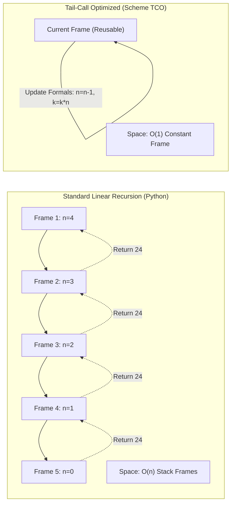

> **Course**: UC Berkeley CS61A (Fall 2024)  
> **Module**: Module 4: Interpreters & Scheme (Interpreters & Scheme)  
> **Lecturer**: Prof. John DeNero (UC Berkeley)  
> **Video duration**: 32:50 ｜ **Classroom screenshots**: 17 pieces of blackboard writing/code demonstration  
> **Direct video**: [📺Watch the original video of this lecture on Bilibili (P30)](https://www.bilibili.com/video/BV1sy411z7nA/?p=30)  
> **Quick navigation**: [← Previous Lecture (P29 Lecture 31 Interpreters)](/en/notes/cs61a/lecture-29) ｜ [📚 Return to the full book catalog](/en/notes/topics/CS61A) ｜ [Next lecture (P31 Lecture 33 Programs as Data) →](/en/notes/cs61a/lecture-31)

---

## Course Core Objectives and Panorama

Functional Programming emphasizes **Pure Functions**, **Referential Transparency **with** Immutability**. in no  `while`  or  `for`  How should the program express loop iteration under the premise that loop statements and variable reassignment are not allowed?

If only recursion can be used, and in standard languages ​​(such as Python), each recursive call will create a new active frame (Active Frame) on the call stack, then linear recursion will inevitably consume  $O(n)$  memory space, eventually leading to stack overflow (Stack Overflow).

**The Scheme language specification requires that all compliant implementations must support tail call optimization (Properly Tail Recursive)**. This means that even if a computation is expressed using a syntactically recursive function, as long as it conforms to the tail recursion specification, the interpreter can **Strictly constant constant space  $O(1)$**  Execute it within!



---

### In-depth formal specification and micro-evaluation process (Operational Semantics)
In the "Course Core Goals and Panorama" module, the underlying computer operations rely on strict formal evaluation logic:
1. **Hierarchical parsing of abstract syntax trees (AST)**: 
   - The source code character stream is first divided into terminal symbol tokens (Tokens) by the lexical analyzer (Lexer), and then constructed into a multi-fork syntax tree by the syntax parser (Parser);
   - Operator priority and associativity are solidified during the syntax tree construction phase, eliminating ambiguity at runtime;
2. **Dynamic transitions of environment chains**: 
   - Each function call generates a new frame whose static lexical environment is determined by the function object's  `parent`  Attributes are completely determined;
   - The variable search traces back up the environment chain in one direction until the global environment frame. If it is not found, it will be triggered.  `NameError`  Abnormal;
3. **State Invariants**: 
   - The key to writing robust programs is to clarify loop invariants (Loop Invariants) and function pre/post-conditions (Pre/Post-conditions);
   - In complex control flow jumps, ensure that state variables maintain legal business constraints before each iteration.


## 1. Functional Programming & Referential Transparency

Functional programming has extraordinary theoretical advantages:
1. **Pure functions have no side effects**: The behavior of the function depends only on the input arguments;
2. **Referential Transparency**: Any subexpression can be directly replaced by its evaluation result without changing the semantics of the program. This is Automatic Parallelization **and** Memoization\*\* lays a solid foundation;
3. **Eliminate mutable state**: There is no variable rebinding, completely eliminating concurrency race conditions.

[](https://www.bilibili.com/video/BV1sy411z7nA/?p=30&t=35)
*⏱ Timestamp: 00:00:35 · 📷 Classroom screenshot · [Watch the corresponding clip on Bilibili (P30 00:00:35)](https://www.bilibili.com/video/BV1sy411z7nA/?p=30&t=35)*

#### 📸 In-depth reading of classroom blackboard writing and code demonstration (00:00:35)

**\[On-site blackboard writing/code demonstration restoration\]**:
At this time point, Professor DeNero conducted a core demonstration and key blackboard derivation on the screen:
> *“Tail recursion. So functional programming is this idea that you can organize entire programs according to pure functions, which are modular, can be combined in interesting ways, and also have other advantages. So functional programming is a very broad term, but often refers to the following properti...”*

**\[Underlying computing model and micro execution mechanism\]**: 
1. **Execution context and timing tracing**: 
   - At the current discussion point "1. Functional Programming & Referential Transparency", the interpreter strictly follows the core evaluation protocol;
   - The expression evaluates the operators first, then evaluates the operands strictly from left to right, and finally applies the function object to the argument list;
   - If the environment model is involved, the local frame strictly records its static lexical parent pointer (Parent Pointer points to the environment where the function is defined), forming an orthogonal architecture with the dynamic call stack at runtime.
2. **Memory topology and object references**: 
   - Variable symbols are just keys in a hash table (environment frame), and pointers point directly to first-class citizen objects in heap memory;
   - Assignment statements are discrete-time snapshots of the state and never create implicit mathematical dependency monitoring.

**\[Guidelines for avoiding pitfalls and guidance on high-frequency test points\]**: 
- **Common misunderstandings**: In the test questions related to "Tail Context identification, tail call optimization to avoid call stack overflow", beginners can easily guess the results based on the surface form of the code, leading to scope confusion or variable shadowing (Shadowing) misjudgment;
- **The golden rule of debugging**: When encountering nested calls and complex branches, be sure to draw independent partial frames on the scratch paper, indicate the specific binding value of each formal parameter, and derive it step by step.


However, the lack of variable loop control flow raises a key question: **No  `for`  and  `while`  Loops, how do functional languages achieve efficient iterative calculations?**  Tail recursion is the perfect answer to this problem.

---

### In-depth formal specification and micro-evaluation process (Operational Semantics)
In the "1. Functional Programming & Referential Transparency" module, the underlying computer operations rely on strict formal evaluation logic:
1. **Hierarchical parsing of abstract syntax trees (AST)**: 
   - The source code character stream is first divided into terminal symbol tokens (Tokens) by the lexical analyzer (Lexer), and then constructed into a multi-fork syntax tree by the syntax parser (Parser);
   - Operator priority and associativity are solidified during the syntax tree construction phase, eliminating ambiguity at runtime;
2. **Dynamic transitions of environment chains**: 
   - Each function call generates a new frame whose static lexical environment is determined by the function object's  `parent`  Attributes are completely determined;
   - The variable search traces back up the environment chain in one direction until the global environment frame. If it is not found, it will be triggered.  `NameError`  Abnormal;
3. **State Invariants**: 
   - The key to writing robust programs is to clarify loop invariants (Loop Invariants) and function pre/post-conditions (Pre/Post-conditions);
   - In complex control flow jumps, ensure that state variables maintain legal business constraints before each iteration.


## 2. Recursion vs Iteration: The Space Complexity Gap (Recursion vs Iteration in Python)

Compute auxiliary function as factorial  $k \times n!$  For example, let's compare recursive and iterative writing methods in Python:

```python
# 递归版本 (Linear Recursive in Python)
def factorial_rec(n, k):
    if n == 0:
        return k
    return factorial_rec(n - 1, k * n)

# 迭代版本 (Iterative with while)
def factorial_iter(n, k):
    while n > 0:
        n, k = n - 1, k * n
    return k
```

[](https://www.bilibili.com/video/BV1sy411z7nA/?p=30&t=152)
*⏱ Timestamp: 00:02:32 · 📷 Classroom screenshot · [Watch the corresponding clip on Bilibili (P30 00:02:32)](https://www.bilibili.com/video/BV1sy411z7nA/?p=30&t=152)*

#### 📸 In-depth reading of classroom blackboard writing and code demonstration (00:02:32)

**\[On-site blackboard writing/code demonstration restoration\]**:
At this time point, Professor DeNero conducted a core demonstration and key blackboard derivation on the screen:
> *“Because we're not allowed to rebind a name to a new value, can we really make basic iterative procedures efficient? Or are we just stuck using recursion and recursion is slow, and so there's no way these languages could ever be fast? Well, it turns out there's an answer to this question. You can mak...”*

**\[Underlying computing model and micro execution mechanism\]**: 
1. **Execution context and timing tracing**: 
   - At the current discussion point "2. Recursion vs Iteration: Space Complexity Gap (Recursion vs Iteration in Python)", the interpreter strictly follows the core evaluation convention;
   - The expression evaluates the operators first, then evaluates the operands strictly from left to right, and finally applies the function object to the argument list;
   - If the environment model is involved, the local frame strictly records its static lexical parent pointer (Parent Pointer points to the environment where the function is defined), forming an orthogonal architecture with the dynamic call stack at runtime.
2. **Memory topology and object references**: 
   - Variable symbols are just keys in a hash table (environment frame), and pointers point directly to first-class citizen objects in heap memory;
   - Assignment statements are discrete-time snapshots of the state and never create implicit mathematical dependency monitoring.

**\[Guidelines for avoiding pitfalls and guidance on high-frequency test points\]**: 
- **Common misunderstandings**: In the test questions related to "Tail Context identification, tail call optimization to avoid call stack overflow", beginners can easily guess the results based on the surface form of the code, leading to scope confusion or variable shadowing (Shadowing) misjudgment;
- **The golden rule of debugging**: When encountering nested calls and complex branches, be sure to draw independent partial frames on the scratch paper, indicate the specific binding value of each formal parameter, and derive it step by step.


- **time complexity**: Both  $O(n)$, performs the same number of multiplications and decrements.
- **space complexity**: 
  - `factorial_iter`  Use only two fixed local variables  `n`  and  `k`, occupy  **$O(1)$  constant space**; 
  - `factorial_rec`  In Python, each call allocates a new frame, occupying  **$O(n)$  linear space**.

---

### In-depth formal specification and micro-evaluation process (Operational Semantics)
In the "2. Recursion vs Iteration: Space Complexity Gap (Recursion vs Iteration in Python)" module, the underlying computer operations rely on strict formal evaluation logic:
1. **Hierarchical parsing of abstract syntax trees (AST)**: 
   - The source code character stream is first divided into terminal symbol tokens (Tokens) by the lexical analyzer (Lexer), and then constructed into a multi-fork syntax tree by the syntax parser (Parser);
   - Operator priority and associativity are solidified during the syntax tree construction phase, eliminating ambiguity at runtime;
2. **Dynamic transitions of environment chains**: 
   - Each function call generates a new frame whose static lexical environment is determined by the function object's  `parent`  Attributes are completely determined;
   - The variable search traces back up the environment chain in one direction until the global environment frame. If it is not found, it will be triggered.  `NameError`  Abnormal;
3. **State Invariants**: 
   - The key to writing robust programs is to clarify loop invariants (Loop Invariants) and function pre/post-conditions (Pre/Post-conditions);
   - In complex control flow jumps, ensure that state variables maintain legal business constraints before each iteration.


## 3. Scheme language specification: mandatory tail recursive requirement (Properly Tail Recursive)

The Scheme language formal standard (Revised^n Report on the Algorithmic Language Scheme) clearly stipulates:
> **The implementation of Scheme must be Properly Tail Recursive.**  
> This allows iterative computations to be expressed as purely recursive procedures that only occupy constant space when executed.

[](https://www.bilibili.com/video/BV1sy411z7nA/?p=30&t=274)
*⏱ Timestamp: 00:04:34 · 📷 Classroom screenshot · [Watch the corresponding clip on Bilibili (P30 00:04:34)](https://www.bilibili.com/video/BV1sy411z7nA/?p=30&t=274)*

#### 📸 In-depth reading of classroom blackboard writing and code demonstration (00:04:34)

**\[On-site blackboard writing/code demonstration restoration\]**:
At this time point, Professor DeNero conducted a core demonstration and key blackboard derivation on the screen:
> *“Because we have a constant number of names that we have to remember, n, nk, and factorial, regardless of how big n is. So how do we bridge this gap between the space that's required for factorial in the recursive sense versus the iterative one? That's the whole idea of what we're talking about today...”*

**\[Underlying computing model and micro execution mechanism\]**: 
1. **Execution context and timing tracing**: 
   - At the current discussion point "3. Scheme language specification: Properly Tail Recursive", the interpreter strictly follows the core evaluation convention;
   - The expression evaluates the operators first, then evaluates the operands strictly from left to right, and finally applies the function object to the argument list;
   - If the environment model is involved, the local frame strictly records its static lexical parent pointer (Parent Pointer points to the environment where the function is defined), forming an orthogonal architecture with the dynamic call stack at runtime.
2. **Memory topology and object references**: 
   - Variable symbols are just keys in a hash table (environment frame), and pointers point directly to first-class citizen objects in heap memory;
   - Assignment statements are discrete-time snapshots of the state and never create implicit mathematical dependency monitoring.

**\[Guidelines for avoiding pitfalls and guidance on high-frequency test points\]**: 
- **Common misunderstandings**: In the test questions related to "Tail Context identification, tail call optimization to avoid call stack overflow", beginners can easily guess the results based on the surface form of the code, leading to scope confusion or variable shadowing (Shadowing) misjudgment;
- **The golden rule of debugging**: When encountering nested calls and complex branches, be sure to draw independent partial frames on the scratch paper, indicate the specific binding value of each formal parameter, and derive it step by step.


Write the following process in Scheme:
```scheme
(define (factorial n k)
  (if (zero? n)
      k
      (factorial (- n 1) (* k n))))
```
The interpreter must ensure that the process is executed with the underlying  `while`  Loops consume the same constant space.

---

### In-depth formal specification and micro-evaluation process (Operational Semantics)
In the "3. Scheme Language Specification: Properly Tail Recursive" module, the underlying computer operations rely on strict formal evaluation logic:
1. **Hierarchical parsing of abstract syntax trees (AST)**: 
   - The source code character stream is first divided into terminal symbol tokens (Tokens) by the lexical analyzer (Lexer), and then constructed into a multi-fork syntax tree by the syntax parser (Parser);
   - Operator priority and associativity are solidified during the syntax tree construction phase, eliminating ambiguity at runtime;
2. **Dynamic transitions of environment chains**: 
   - Each function call generates a new frame whose static lexical environment is determined by the function object's  `parent`  Attributes are completely determined;
   - The variable search traces back up the environment chain in one direction until the global environment frame. If it is not found, it will be triggered.  `NameError`  Abnormal;
3. **State Invariants**: 
   - The key to writing robust programs is to clarify loop invariants (Loop Invariants) and function pre/post-conditions (Pre/Post-conditions);
   - In complex control flow jumps, ensure that state variables maintain legal business constraints before each iteration.


## 4. Eliminating redundant frames in the call stack (Eliminating Redundant Frames)

Why can't Python's recursive calls reuse space? We look at the Environment Model:

[](https://www.bilibili.com/video/BV1sy411z7nA/?p=30&t=338)
*⏱ Timestamp: 00:05:38 · 📷 Classroom screenshot · [Watch the corresponding clip on Bilibili (P30 00:05:38)](https://www.bilibili.com/video/BV1sy411z7nA/?p=30&t=338)*

#### 📸 In-depth reading of classroom blackboard writing and code demonstration (00:05:38)

**\[On-site blackboard writing/code demonstration restoration\]**:
At this time point, Professor DeNero conducted a core demonstration and key blackboard derivation on the screen:
> *“As a scheme procedure, so this says the way you compute k times n factorial is you check and see if n is zero, then you return k, otherwise you make a recursive call. And that should use resources like this. But how do we do that? Well, the answer is that we eliminate the middleman. We eliminate fra...”*

**\[Underlying computing model and micro execution mechanism\]**: 
1. **Execution context and timing tracing**: 
   - At the current discussion point "4. Eliminating Redundant Frames in the call stack", the interpreter strictly follows the core evaluation protocol;
   - The expression evaluates the operators first, then evaluates the operands strictly from left to right, and finally applies the function object to the argument list;
   - If the environment model is involved, the local frame strictly records its static lexical parent pointer (Parent Pointer points to the environment where the function is defined), forming an orthogonal architecture with the dynamic call stack at runtime.
2. **Memory topology and object references**: 
   - Variable symbols are just keys in a hash table (environment frame), and pointers point directly to first-class citizen objects in heap memory;
   - Assignment statements are discrete-time snapshots of the state and never create implicit mathematical dependency monitoring.

**\[Guidelines for avoiding pitfalls and guidance on high-frequency test points\]**: 
- **Common misunderstandings**: In the test questions related to "Tail Context identification, tail call optimization to avoid call stack overflow", beginners can easily guess the results based on the surface form of the code, leading to scope confusion or variable shadowing (Shadowing) misjudgment;
- **The golden rule of debugging**: When encountering nested calls and complex branches, be sure to draw independent partial frames on the scratch paper, indicate the specific binding value of each formal parameter, and derive it step by step.


in  `factorial(4, 1)`  During execution:
- $F_1(n=4, k=1)$  call  $F_2(n=3, k=4)$; 
- $F_2$  call  $F_3(n=2, k=12)$; 
- $F_3$  call  $F_4(n=1, k=24)$; 
- $F_4$  call  $F_5(n=0, k=24)$  Return  `24`.
At this time, $F_4$  In addition to directly  $F_5$  The return value is passed to  $F_3$  outside, **without any subsequent calculations**!$F_3$, $F_2$, $F_1$  He also just acts as a "relay messenger".

At the moment the recursive call is initiated, the historical local variables of the upper frame have no residual value. The core of tail call optimization is **Directly discard or reuse the current active frame**.

---

### In-depth formal specification and micro-evaluation process (Operational Semantics)
In the "4. Eliminating Redundant Frames" module, the underlying computer operations rely on strict formal evaluation logic:
1. **Hierarchical parsing of abstract syntax trees (AST)**: 
   - The source code character stream is first divided into terminal symbol tokens (Tokens) by the lexical analyzer (Lexer), and then constructed into a multi-fork syntax tree by the syntax parser (Parser);
   - Operator priority and associativity are solidified during the syntax tree construction phase, eliminating ambiguity at runtime;
2. **Dynamic transitions of environment chains**: 
   - Each function call generates a new frame whose static lexical environment is determined by the function object's  `parent`  Attributes are completely determined;
   - The variable search traces back up the environment chain in one direction until the global environment frame. If it is not found, it will be triggered.  `NameError`  Abnormal;
3. **State Invariants**: 
   - The key to writing robust programs is to clarify loop invariants (Loop Invariants) and function pre/post-conditions (Pre/Post-conditions);
   - In complex control flow jumps, ensure that state variables maintain legal business constraints before each iteration.


## 5. Formal definition of tail calls and tail contexts (Tail Calls & Tail Contexts)

### What is a Tail Call?

> **Tail Call**  Refers to a procedure call expression located in the Tail Context.

[](https://www.bilibili.com/video/BV1sy411z7nA/?p=30&t=433)
*⏱ Timestamp: 00:07:13 · 📷 Classroom screenshot · [Watch the corresponding clip on Bilibili (P30 00:07:13)](https://www.bilibili.com/video/BV1sy411z7nA/?p=30&t=433)*

#### 📸 In-depth reading of classroom blackboard writing and code demonstration (00:07:13)

**\[On-site blackboard writing/code demonstration restoration\]**:
At this time point, Professor DeNero conducted a core demonstration and key blackboard derivation on the screen:
> *“We'll not do that. The fundamental idea here to make these recursive procedures efficient is that some calls are tail calls and some aren't. It's a distinction that figures out whether when one procedure is calling another procedure, is there more work to do when that called procedure is finished or...”*

**\[Underlying computing model and micro execution mechanism\]**: 
1. **Execution context and timing tracing**: 
   - At the current discussion point "5. Formal definition of tail calls and tail contexts (Tail Calls & Tail Contexts)", the interpreter strictly follows the core evaluation convention;
   - The expression evaluates the operators first, then evaluates the operands strictly from left to right, and finally applies the function object to the argument list;
   - If the environment model is involved, the local frame strictly records its static lexical parent pointer (Parent Pointer points to the environment where the function is defined), forming an orthogonal architecture with the dynamic call stack at runtime.
2. **Memory topology and object references**: 
   - Variable symbols are just keys in a hash table (environment frame), and pointers point directly to first-class citizen objects in heap memory;
   - Assignment statements are discrete-time snapshots of the state and never create implicit mathematical dependency monitoring.

**\[Guidelines for avoiding pitfalls and guidance on high-frequency test points\]**: 
- **Common misunderstandings**: In the test questions related to "Tail Context identification, tail call optimization to avoid call stack overflow", beginners can easily guess the results based on the surface form of the code, leading to scope confusion or variable shadowing (Shadowing) misjudgment;
- **The golden rule of debugging**: When encountering nested calls and complex branches, be sure to draw independent partial frames on the scratch paper, indicate the specific binding value of each formal parameter, and derive it step by step.


If a procedure call is required before the current procedure returns **one last thing** (That is, the return value after the call is completed directly becomes the return value of the current process without any secondary calculation), then the call is a tail call.

### Tail Context Rules

Whether an expression is in tail context depends on its syntactic position within the parent expression:

[](https://www.bilibili.com/video/BV1sy411z7nA/?p=30&t=523)
*⏱ Timestamp: 00:08:43 · 📷 Classroom screenshot · [Watch the corresponding clip on Bilibili (P30 00:08:43)](https://www.bilibili.com/video/BV1sy411z7nA/?p=30&t=523)*

#### 📸 In-depth reading of classroom blackboard writing and code demonstration (00:08:43)

**\[On-site blackboard writing/code demonstration restoration\]**:
At this time point, Professor DeNero conducted a core demonstration and key blackboard derivation on the screen:
> *“It turns out that a lambda expression can have multiple different body expressions. The last one is the one that determines the return value. And so that expression is in a tail context, meaning it's a description of the last thing that this procedure is going to do before it returns. Now, in additi...”*

**\[Underlying computing model and micro execution mechanism\]**: 
1. **Execution context and timing tracing**: 
   - At the current discussion point "5. Formal definition of tail calls and tail contexts (Tail Calls & Tail Contexts)", the interpreter strictly follows the core evaluation convention;
   - The expression evaluates the operators first, then evaluates the operands strictly from left to right, and finally applies the function object to the argument list;
   - If the environment model is involved, the local frame strictly records its static lexical parent pointer (Parent Pointer points to the environment where the function is defined), forming an orthogonal architecture with the dynamic call stack at runtime.
2. **Memory topology and object references**: 
   - Variable symbols are just keys in a hash table (environment frame), and pointers point directly to first-class citizen objects in heap memory;
   - Assignment statements are discrete-time snapshots of the state and never create implicit mathematical dependency monitoring.

**\[Guidelines for avoiding pitfalls and guidance on high-frequency test points\]**: 
- **Common misunderstandings**: In the test questions related to "Tail Context identification, tail call optimization to avoid call stack overflow", beginners can easily guess the results based on the surface form of the code, leading to scope confusion or variable shadowing (Shadowing) misjudgment;
- **The golden rule of debugging**: When encountering nested calls and complex branches, be sure to draw independent partial frames on the scratch paper, indicate the specific binding value of each formal parameter, and derive it step by step.


1. **Lambda function body**: `lambda`  in expression body **last subexpression** in tail context;
2. **If conditional branch**: If the whole  `if`  If an expression is in the tail context, its second subexpression (Consequent) and third subexpression (Alternative) are also in the tail context; (Note: Predicate expressions are never in the tail context!)
3. **Cond branch**: in tail context  `cond`  In the expression, the non-predicate result expression of each clause is in the tail context;
4. **And / Or logical expression**: in tail context  `and`/`or`  Expressive **last subexpression** in tail context;
5. **Begin code block**: in tail context  `begin`  in block **last subexpression** In tail context.

---

### In-depth formal specification and micro-evaluation process (Operational Semantics)
In the "5. Formal Definition of Tail Calls & Tail Contexts" module, the underlying computer operations rely on strict formal evaluation logic:
1. **Hierarchical parsing of abstract syntax trees (AST)**: 
   - The source code character stream is first divided into terminal symbol tokens (Tokens) by the lexical analyzer (Lexer), and then constructed into a multi-fork syntax tree by the syntax parser (Parser);
   - Operator priority and associativity are solidified during the syntax tree construction phase, eliminating ambiguity at runtime;
2. **Dynamic transitions of environment chains**: 
   - Each function call generates a new frame whose static lexical environment is determined by the function object's  `parent`  Attributes are completely determined;
   - The variable search traces back up the environment chain in one direction until the global environment frame. If it is not found, it will be triggered.  `NameError`  Abnormal;
3. **State Invariants**: 
   - The key to writing robust programs is to clarify loop invariants (Loop Invariants) and function pre/post-conditions (Pre/Post-conditions);
   - In complex control flow jumps, ensure that state variables maintain legal business constraints before each iteration.


## 6. Rewriting linear recursion into tail recursion: list length (Rewriting  `length` with Accumulator)

### The classic way of writing non-tail recursion

```scheme
(define (length s)
  (if (null? s)
      0
      (+ 1 (length (cdr s)))))
```

[](https://www.bilibili.com/video/BV1sy411z7nA/?p=30&t=646)
*⏱ Timestamp: 00:10:46 · 📷 Classroom screenshot · [Watch the corresponding clip on Bilibili (P30 00:10:46)](https://www.bilibili.com/video/BV1sy411z7nA/?p=30&t=646)*

#### 📸 In-depth reading of classroom blackboard writing and code demonstration (00:10:46)

**\[On-site blackboard writing/code demonstration restoration\]**:
At this time point, Professor DeNero conducted a core demonstration and key blackboard derivation on the screen:
> *“And the last sub-expression in a tail context began. These aren't terribly important, except that, if you're actually sitting down and writing a scheme program, you need to know what the tail contexts are, so you know what's going to be the space efficiency, or space usage, of your program. So, peop...”*

**\[Underlying computing model and micro execution mechanism\]**: 
1. **Execution context and timing tracing**: 
   - At the current discussion point "6. Rewriting linear recursion into tail recursion: list length (Rewriting  `length`  with Accumulator)", the interpreter strictly follows the core evaluation convention;
   - The expression evaluates the operators first, then evaluates the operands strictly from left to right, and finally applies the function object to the argument list;
   - If the environment model is involved, the local frame strictly records its static lexical parent pointer (Parent Pointer points to the environment where the function is defined), forming an orthogonal architecture with the dynamic call stack at runtime.
2. **Memory topology and object references**: 
   - Variable symbols are just keys in a hash table (environment frame), and pointers point directly to first-class citizen objects in heap memory;
   - Assignment statements are discrete-time snapshots of the state and never create implicit mathematical dependency monitoring.

**\[Guidelines for avoiding pitfalls and guidance on high-frequency test points\]**: 
- **Common misunderstandings**: In the test questions related to "Tail Context identification, tail call optimization to avoid call stack overflow", beginners can easily guess the results based on the surface form of the code, leading to scope confusion or variable shadowing (Shadowing) misjudgment;
- **The golden rule of debugging**: When encountering nested calls and complex branches, be sure to draw independent partial frames on the scratch paper, indicate the specific binding value of each formal parameter, and derive it step by step.


- whole  `if`  is in tail context, so branch  `0`  and  `(+ 1 (length (cdr s)))`  in tail context;
- However, the outermost call is addition  `+`, internal recursive call  `(length (cdr s))`  is the operand of the addition operator, **In a nested call expression, never a tail call**!
- When the remaining length of the list is returned recursively, the current frame must remain on the stack waiting for an increment by one. Therefore the space complexity is  $O(n)$.

### Tail recursive rewrite: Accumulator Pattern

By introducing auxiliary procedures and accumulator parameters, "accumulation when backtracking" is advanced to "accumulation when going forward":

```scheme
(define (length-tail s)
  (define (length-iter s n)
    (if (null? s)
        n
        (length-iter (cdr s) (+ n 1))))
  (length-iter s 0))
```

[](https://www.bilibili.com/video/BV1sy411z7nA/?p=30&t=769)
*⏱ Timestamp: 00:12:49 · 📷 Classroom screenshot · [Watch the corresponding clip on Bilibili (P30 00:12:49)](https://www.bilibili.com/video/BV1sy411z7nA/?p=30&t=769)*

#### 📸 In-depth reading of classroom blackboard writing and code demonstration (00:12:49)

**\[On-site blackboard writing/code demonstration restoration\]**:
At this time point, Professor DeNero conducted a core demonstration and key blackboard derivation on the screen:
> *“We still have more work to do to add one to it. Now, we don't know what work there might be to do left. And so, for instance, maybe there would be a reference to S and so we might need the environment for this function call around because there's more work to do. So in this case, an implementation o...”*

**\[Underlying computing model and micro execution mechanism\]**: 
1. **Execution context and timing tracing**: 
   - At the current discussion point "6. Rewriting linear recursion into tail recursion: list length (Rewriting  `length`  with Accumulator)", the interpreter strictly follows the core evaluation convention;
   - The expression evaluates the operators first, then evaluates the operands strictly from left to right, and finally applies the function object to the argument list;
   - If the environment model is involved, the local frame strictly records its static lexical parent pointer (Parent Pointer points to the environment where the function is defined), forming an orthogonal architecture with the dynamic call stack at runtime.
2. **Memory topology and object references**: 
   - Variable symbols are just keys in a hash table (environment frame), and pointers point directly to first-class citizen objects in heap memory;
   - Assignment statements are discrete-time snapshots of the state and never create implicit mathematical dependency monitoring.

**\[Guidelines for avoiding pitfalls and guidance on high-frequency test points\]**: 
- **Common misunderstandings**: In the test questions related to "Tail Context identification, tail call optimization to avoid call stack overflow", beginners can easily guess the results based on the surface form of the code, leading to scope confusion or variable shadowing (Shadowing) misjudgment;
- **The golden rule of debugging**: When encountering nested calls and complex branches, be sure to draw independent partial frames on the scratch paper, indicate the specific binding value of each formal parameter, and derive it step by step.


in  `length-iter` , recursive call  `(length-iter (cdr s) (+ n 1))`  located in  `if`  The top level of the alternative branch is a complete tail call! Therefore, the space complexity is directly reduced to  $O(1)$.

---

### In-depth formal specification and micro-evaluation process (Operational Semantics)
In "6. Rewriting linear recursion into tail recursion: list length (Rewriting  `length`  with Accumulator)" module, the underlying computer operations rely on strict formal evaluation logic:
1. **Hierarchical parsing of abstract syntax trees (AST)**: 
   - The source code character stream is first divided into terminal symbol tokens (Tokens) by the lexical analyzer (Lexer), and then constructed into a multi-fork syntax tree by the syntax parser (Parser);
   - Operator priority and associativity are solidified during the syntax tree construction phase, eliminating ambiguity at runtime;
2. **Dynamic transitions of environment chains**: 
   - Each function call generates a new frame whose static lexical environment is determined by the function object's  `parent`  Attributes are completely determined;
   - The variable search traces back up the environment chain in one direction until the global environment frame. If it is not found, it will be triggered.  `NameError`  Abnormal;
3. **State Invariants**: 
   - The key to writing robust programs is to clarify loop invariants (Loop Invariants) and function pre/post-conditions (Pre/Post-conditions);
   - In complex control flow jumps, ensure that state variables maintain legal business constraints before each iteration.


## 7. Interpreter practice: Tail call optimization demonstration (`scheme.py`)

In the Extra Credit section of CS61A Project 4 (Scheme interpreter), we need to add tail call optimization support to the interpreter.

[](https://www.bilibili.com/video/BV1sy411z7nA/?p=30&t=926)
*⏱ Timestamp: 00:15:26 · 📷 Classroom screenshot · [Watch the corresponding clip on Bilibili (P30 00:15:26)](https://www.bilibili.com/video/BV1sy411z7nA/?p=30&t=926)*

#### 📸 In-depth reading of classroom blackboard writing and code demonstration (00:15:26)

**\[On-site blackboard writing/code demonstration restoration\]**:
At this time point, Professor DeNero conducted a core demonstration and key blackboard derivation on the screen:
> *“Well, we're going to have to run a demonstration. So it should be that the return value of the tail call is the return value of the current procedure call, meaning we can skip keeping around all the frames that we don't need, because the return values for the last frame can return straight up to the...”*

**\[Underlying computing model and micro execution mechanism\]**: 
1. **Execution context and timing tracing**: 
   - At the current discussion point "7. Practical Interpreter: Tail Call Optimization Demonstration (`scheme.py`)", the interpreter strictly follows the core evaluation convention;
   - The expression evaluates the operators first, then evaluates the operands strictly from left to right, and finally applies the function object to the argument list;
   - If the environment model is involved, the local frame strictly records its static lexical parent pointer (Parent Pointer points to the environment where the function is defined), forming an orthogonal architecture with the dynamic call stack at runtime.
2. **Memory topology and object references**: 
   - Variable symbols are just keys in a hash table (environment frame), and pointers point directly to first-class citizen objects in heap memory;
   - Assignment statements are discrete-time snapshots of the state and never create implicit mathematical dependency monitoring.

**\[Guidelines for avoiding pitfalls and guidance on high-frequency test points\]**: 
- **Common misunderstandings**: In the test questions related to "Tail Context identification, tail call optimization to avoid call stack overflow", beginners can easily guess the results based on the surface form of the code, leading to scope confusion or variable shadowing (Shadowing) misjudgment;
- **The golden rule of debugging**: When encountering nested calls and complex branches, be sure to draw independent partial frames on the scratch paper, indicate the specific binding value of each formal parameter, and derive it step by step.


### Crash test when optimization is not turned on

Run the factorial function in a normal interpreter:
```scheme
(factorial 10)   ; => 3628800
(factorial 100)  ; => 正常返回
(factorial 1000) ; => 报错: RuntimeError: maximum recursion depth exceeded!
```

The default upper limit of the call stack of the Python interpreter is about 1000 layers. When the call reaches about the 673rd layer, an exception will be thrown directly and crash due to stack exhaustion.

[](https://www.bilibili.com/video/BV1sy411z7nA/?p=30&t=1026)
*⏱ Timestamp: 00:17:06 · 📷 Classroom screenshot · [Watch the corresponding clip on Bilibili (P30 00:17:06)](https://www.bilibili.com/video/BV1sy411z7nA/?p=30&t=1026)*

#### 📸 In-depth reading of classroom blackboard writing and code demonstration (00:17:06)

**\[On-site blackboard writing/code demonstration restoration\]**:
At this time point, Professor DeNero conducted a core demonstration and key blackboard derivation on the screen:
> *“We have an interpreter that is not optimized for tail calls. So it's just going to create a frame every time we make a recursive call and that frame will stick around until we return from the call. And that will use a linear amount of space, which means that if we run scheme.py and load in this fact...”*

**\[Underlying computing model and micro execution mechanism\]**: 
1. **Execution context and timing tracing**: 
   - At the current discussion point "7. Practical Interpreter: Tail Call Optimization Demonstration (`scheme.py`)", the interpreter strictly follows the core evaluation convention;
   - The expression evaluates the operators first, then evaluates the operands strictly from left to right, and finally applies the function object to the argument list;
   - If the environment model is involved, the local frame strictly records its static lexical parent pointer (Parent Pointer points to the environment where the function is defined), forming an orthogonal architecture with the dynamic call stack at runtime.
2. **Memory topology and object references**: 
   - Variable symbols are just keys in a hash table (environment frame), and pointers point directly to first-class citizen objects in heap memory;
   - Assignment statements are discrete-time snapshots of the state and never create implicit mathematical dependency monitoring.

**\[Guidelines for avoiding pitfalls and guidance on high-frequency test points\]**: 
- **Common misunderstandings**: In the test questions related to "Tail Context identification, tail call optimization to avoid call stack overflow", beginners can easily guess the results based on the surface form of the code, leading to scope confusion or variable shadowing (Shadowing) misjudgment;
- **The golden rule of debugging**: When encountering nested calls and complex branches, be sure to draw independent partial frames on the scratch paper, indicate the specific binding value of each formal parameter, and derive it step by step.


### Enable unrestricted execution after optimization

After tail call optimization is turned on (through iterative loop trampoline or directly updating the local evaluation environment), even if the calculation  `(factorial 10000 1)`, the interpreter will never add any active stack frames, but will always complete massive recursions instantaneously or smoothly in constant space!

---

### In-depth formal specification and micro-evaluation process (Operational Semantics)
In "7. Interpreter Practice: Tail Call Optimization Demonstration (`scheme.py`)" module, the underlying computer operations rely on strict formal evaluation logic:
1. **Hierarchical parsing of abstract syntax trees (AST)**: 
   - The source code character stream is first divided into terminal symbol tokens (Tokens) by the lexical analyzer (Lexer), and then constructed into a multi-fork syntax tree by the syntax parser (Parser);
   - Operator priority and associativity are solidified during the syntax tree construction phase, eliminating ambiguity at runtime;
2. **Dynamic transitions of environment chains**: 
   - Each function call generates a new frame whose static lexical environment is determined by the function object's  `parent`  Attributes are completely determined;
   - The variable search traces back up the environment chain in one direction until the global environment frame. If it is not found, it will be triggered.  `NameError`  Abnormal;
3. **State Invariants**: 
   - The key to writing robust programs is to clarify loop invariants (Loop Invariants) and function pre/post-conditions (Pre/Post-conditions);
   - In complex control flow jumps, ensure that state variables maintain legal business constraints before each iteration.


## 8. Diagnostic Test: Identify Tail Recursive Process (Diagnostic Exercises)

Please analyze the following four Scheme procedures to determine which ones are truly tail recursive (operating in constant space):

[](https://www.bilibili.com/video/BV1sy411z7nA/?p=30&t=1116)
*⏱ Timestamp: 00:18:36 · 📷 Classroom screenshot · [Watch the corresponding clip on Bilibili (P30 00:18:36)](https://www.bilibili.com/video/BV1sy411z7nA/?p=30&t=1116)*

#### 📸 In-depth reading of classroom blackboard writing and code demonstration (00:18:36)

**\[On-site blackboard writing/code demonstration restoration\]**:
At this time point, Professor DeNero conducted a core demonstration and key blackboard derivation on the screen:
> *“And if I compute the factorial of 10,000, well, sure, it takes a while. I'm not making anything really faster, but I am saving the extra space. So we computed this huge number, 10,000 factorial. Now, eventually, this program will run out of space, not because we create extra frames, but because repr...”*

**\[Underlying computing model and micro execution mechanism\]**: 
1. **Execution context and timing tracing**: 
   - At the current discussion point "8. Diagnostic Test: Diagnostic Tail Recursive Process (Diagnostic Exercises)", the interpreter strictly follows the core evaluation protocol;
   - The expression evaluates the operators first, then evaluates the operands strictly from left to right, and finally applies the function object to the argument list;
   - If the environment model is involved, the local frame strictly records its static lexical parent pointer (Parent Pointer points to the environment where the function is defined), forming an orthogonal architecture with the dynamic call stack at runtime.
2. **Memory topology and object references**: 
   - Variable symbols are just keys in a hash table (environment frame), and pointers point directly to first-class citizen objects in heap memory;
   - Assignment statements are discrete-time snapshots of the state and never create implicit mathematical dependency monitoring.

**\[Guidelines for avoiding pitfalls and guidance on high-frequency test points\]**: 
- **Common misunderstandings**: In the test questions related to "Tail Context identification, tail call optimization to avoid call stack overflow", beginners can easily guess the results based on the surface form of the code, leading to scope confusion or variable shadowing (Shadowing) misjudgment;
- **The golden rule of debugging**: When encountering nested calls and complex branches, be sure to draw independent partial frames on the scratch paper, indicate the specific binding value of each formal parameter, and derive it step by step.


### Case 1: `contains?`

```scheme
(define (contains? s x)
  (cond ((null? s) #f)
        ((= (car s) x) #t)
        (else (contains? (cdr s) x))))
```

[](https://www.bilibili.com/video/BV1sy411z7nA/?p=30&t=1208)
*⏱ Timestamp: 00:20:08 · 📷 Classroom screenshot · [Watch the corresponding clip on Bilibili (P30 00:20:08)](https://www.bilibili.com/video/BV1sy411z7nA/?p=30&t=1208)*

#### 📸 In-depth reading of classroom blackboard writing and code demonstration (00:20:08)

**\[On-site blackboard writing/code demonstration restoration\]**:
At this time point, Professor DeNero conducted a core demonstration and key blackboard derivation on the screen:
> *“If is a tail context, but the sub-expressions of it aren't. So in particular, this if expression is not in a tail context. And that idea that the consequent and alternative sub-expressions of an if are in tail contexts only works if the whole if is in a tail context. So this is not either, which mea...”*

**\[Underlying computing model and micro execution mechanism\]**: 
1. **Execution context and timing tracing**: 
   - At the current discussion point "8. Diagnostic Test: Diagnostic Tail Recursive Process (Diagnostic Exercises)", the interpreter strictly follows the core evaluation protocol;
   - The expression evaluates the operators first, then evaluates the operands strictly from left to right, and finally applies the function object to the argument list;
   - If the environment model is involved, the local frame strictly records its static lexical parent pointer (Parent Pointer points to the environment where the function is defined), forming an orthogonal architecture with the dynamic call stack at runtime.
2. **Memory topology and object references**: 
   - Variable symbols are just keys in a hash table (environment frame), and pointers point directly to first-class citizen objects in heap memory;
   - Assignment statements are discrete-time snapshots of the state and never create implicit mathematical dependency monitoring.

**\[Guidelines for avoiding pitfalls and guidance on high-frequency test points\]**: 
- **Common misunderstandings**: In the test questions related to "Tail Context identification, tail call optimization to avoid call stack overflow", beginners can easily guess the results based on the surface form of the code, leading to scope confusion or variable shadowing (Shadowing) misjudgment;
- **The golden rule of debugging**: When encountering nested calls and complex branches, be sure to draw independent partial frames on the scratch paper, indicate the specific binding value of each formal parameter, and derive it step by step.


- **analysis**: `cond`  of  `else`  The branch directly returns the result of the recursive call without any pending operations.
- **Conclusion**: **is tail recursion**, space complexity  $O(1)$.

### Case 2: `has-repeat?`

```scheme
(define (has-repeat? s)
  (if (null? s)
      #f
      (if (contains? (cdr s) (car s))
          #t
          (has-repeat? (cdr s)))))
```

- **analysis**:Yes  `has-repeat?`  The recursive call is nested  `if`  in the alternative tail context; called  `contains?`  Although it is not a tail call, it  `contains?`  itself as  $O(1)$  space.
- **Conclusion**: **is tail recursion**, space complexity  $O(1)$.

### Case 3: `fib-iter`

```scheme
(define (fib-iter n)
  (define (helper k current prev)
    (if (= k n)
        current
        (helper (+ k 1) (+ current prev) current)))
  (if (zero? n) 0 (helper 1 1 0)))
```

[](https://www.bilibili.com/video/BV1sy411z7nA/?p=30&t=1331)
*⏱ Timestamp: 00:22:11 · 📷 Classroom screenshot · [Watch the corresponding clip on Bilibili (P30 00:22:11)](https://www.bilibili.com/video/BV1sy411z7nA/?p=30&t=1331)*

#### 📸 In-depth reading of classroom blackboard writing and code demonstration (00:22:11)

**\[On-site blackboard writing/code demonstration restoration\]**:
At this time point, Professor DeNero conducted a core demonstration and key blackboard derivation on the screen:
> *“We don't have to worry about that taking up a bunch of room. Finally, we have a procedure to compute the nth Fibonacci number. So let's see how this actually works. Fibidr takes the current Fibonacci number, which is Fibonacci number k, and if we're all the way up to the nth one, which is the one we...”*

**\[Underlying computing model and micro execution mechanism\]**: 
1. **Execution context and timing tracing**: 
   - At the current discussion point "8. Diagnostic Test: Diagnostic Tail Recursive Process (Diagnostic Exercises)", the interpreter strictly follows the core evaluation protocol;
   - The expression evaluates the operators first, then evaluates the operands strictly from left to right, and finally applies the function object to the argument list;
   - If the environment model is involved, the local frame strictly records its static lexical parent pointer (Parent Pointer points to the environment where the function is defined), forming an orthogonal architecture with the dynamic call stack at runtime.
2. **Memory topology and object references**: 
   - Variable symbols are just keys in a hash table (environment frame), and pointers point directly to first-class citizen objects in heap memory;
   - Assignment statements are discrete-time snapshots of the state and never create implicit mathematical dependency monitoring.

**\[Guidelines for avoiding pitfalls and guidance on high-frequency test points\]**: 
- **Common misunderstandings**: In the test questions related to "Tail Context identification, tail call optimization to avoid call stack overflow", beginners can easily guess the results based on the surface form of the code, leading to scope confusion or variable shadowing (Shadowing) misjudgment;
- **The golden rule of debugging**: When encountering nested calls and complex branches, be sure to draw independent partial frames on the scratch paper, indicate the specific binding value of each formal parameter, and derive it step by step.


- **analysis**: All parameter calculations (such as  `(+ current prev)`) are completed before entering the next round of calls, recursive calls  `helper`  In tail context.
- **Conclusion**: **is tail recursion**, space complexity  $O(1)$.

---

### In-depth formal specification and micro-evaluation process (Operational Semantics)
In the "8. Diagnostic Test: Analyze Tail Recursive Process (Diagnostic Exercises)" module, the underlying computer operations rely on strict formal evaluation logic:
1. **Hierarchical parsing of abstract syntax trees (AST)**: 
   - The source code character stream is first divided into terminal symbol tokens (Tokens) by the lexical analyzer (Lexer), and then constructed into a multi-fork syntax tree by the syntax parser (Parser);
   - Operator priority and associativity are solidified during the syntax tree construction phase, eliminating ambiguity at runtime;
2. **Dynamic transitions of environment chains**: 
   - Each function call generates a new frame whose static lexical environment is determined by the function object's  `parent`  Attributes are completely determined;
   - The variable search traces back up the environment chain in one direction until the global environment frame. If it is not found, it will be triggered.  `NameError`  Abnormal;
3. **State Invariants**: 
   - The key to writing robust programs is to clarify loop invariants (Loop Invariants) and function pre/post-conditions (Pre/Post-conditions);
   - In complex control flow jumps, ensure that state variables maintain legal business constraints before each iteration.


## 9. Tail recursive transformation of higher-order functions: `reduce`  with  `map`

### tail recursive  `reduce`

```scheme
(define (reduce fn s start)
  (if (null? s)
      start
      (reduce fn (cdr s) (fn start (car s)))))
```

[](https://www.bilibili.com/video/BV1sy411z7nA/?p=30&t=1421)
*⏱ Timestamp: 00:23:41 · 📷 Classroom screenshot · [Watch the corresponding clip on Bilibili (P30 00:23:41)](https://www.bilibili.com/video/BV1sy411z7nA/?p=30&t=1421)*

#### 📸 In-depth reading of classroom blackboard writing and code demonstration (00:23:41)

**\[On-site blackboard writing/code demonstration restoration\]**:
At this time point, Professor DeNero conducted a core demonstration and key blackboard derivation on the screen:
> *“As soon as we figure out the k-1 Fibonacci number, we still have to combine it with current, in order to finish. And then we have to call fibiter on that. Next, we'll look at two higher-order functions, map and reduce. So let's look at reduce first. Reduce is a procedure that takes another procedure...”*

**\[Underlying computing model and micro execution mechanism\]**: 
1. **Execution context and timing tracing**: 
   - At the current discussion point "9. Tail recursive transformation of higher-order functions: `reduce`  with  `map`”, the interpreter strictly follows the core evaluation convention;
   - The expression evaluates the operators first, then evaluates the operands strictly from left to right, and finally applies the function object to the argument list;
   - If the environment model is involved, the local frame strictly records its static lexical parent pointer (Parent Pointer points to the environment where the function is defined), forming an orthogonal architecture with the dynamic call stack at runtime.
2. **Memory topology and object references**: 
   - Variable symbols are just keys in a hash table (environment frame), and pointers point directly to first-class citizen objects in heap memory;
   - Assignment statements are discrete-time snapshots of the state and never create implicit mathematical dependency monitoring.

**\[Guidelines for avoiding pitfalls and guidance on high-frequency test points\]**: 
- **Common misunderstandings**: In the test questions related to "Tail Context identification, tail call optimization to avoid call stack overflow", beginners can easily guess the results based on the surface form of the code, leading to scope confusion or variable shadowing (Shadowing) misjudgment;
- **The golden rule of debugging**: When encountering nested calls and complex branches, be sure to draw independent partial frames on the scratch paper, indicate the specific binding value of each formal parameter, and derive it step by step.


recursive call  `reduce`  In tail context, new accumulated value  `(fn start (car s))`  Passed in as an actual parameter. Just pass in the process  `fn`  It itself runs in constant space, and the entire  `reduce`  Right there  $O(1)$  operating in space.

---

### In-depth formal specification and micro-evaluation process (Operational Semantics)
In "9. Tail recursive transformation of higher-order functions: `reduce`  with  `map` In the module, the underlying computer operations rely on strict formal evaluation logic:
1. **Hierarchical parsing of abstract syntax trees (AST)**: 
   - The source code character stream is first divided into terminal symbol tokens (Tokens) by the lexical analyzer (Lexer), and then constructed into a multi-fork syntax tree by the syntax parser (Parser);
   - Operator priority and associativity are solidified during the syntax tree construction phase, eliminating ambiguity at runtime;
2. **Dynamic transitions of environment chains**: 
   - Each function call generates a new frame whose static lexical environment is determined by the function object's  `parent`  Attributes are completely determined;
   - The variable search traces back up the environment chain in one direction until the global environment frame. If it is not found, it will be triggered.  `NameError`  Abnormal;
3. **State Invariants**: 
   - The key to writing robust programs is to clarify loop invariants (Loop Invariants) and function pre/post-conditions (Pre/Post-conditions);
   - In complex control flow jumps, ensure that state variables maintain legal business constraints before each iteration.


## 10. Difficult challenge: Tail recursion in constant space  `map` (Tail Recursive `map`)

Standard  `map`  The traditional recursive definition must wait for subsequent sublists to be returned before executing  `cons`, thus occupying  $O(n)$  Linear space:

```scheme
(define (map fn s)
  (if (null? s)
      nil
      (cons (fn (car s)) (map fn (cdr s))))) ; 非尾调用！
```

[](https://www.bilibili.com/video/BV1sy411z7nA/?p=30&t=1580)
*⏱ Timestamp: 00:26:20 · 📷 Classroom screenshot · [Watch the corresponding clip on Bilibili (P30 00:26:20)](https://www.bilibili.com/video/BV1sy411z7nA/?p=30&t=1580)*

#### 📸 In-depth reading of classroom blackboard writing and code demonstration (00:26:20)

**\[On-site blackboard writing/code demonstration restoration\]**:
At this time point, Professor DeNero conducted a core demonstration and key blackboard derivation on the screen:
> *“And this is a higher-order function, so we don't know what procedure will be passed in. So the total space of reduce will depend on whether the procedure requires constant space or not. Hopefully, it just requires constant space, in which case the entire reduce will require only constant space. Okay...”*

**\[Underlying computing model and micro execution mechanism\]**: 
1. **Execution context and timing tracing**: 
   - At the current discussion point "10. High-difficulty challenge: tail recursion in constant space  `map` (Tail Recursive `map`)", the interpreter strictly follows the core evaluation convention;
   - The expression evaluates the operators first, then evaluates the operands strictly from left to right, and finally applies the function object to the argument list;
   - If the environment model is involved, the local frame strictly records its static lexical parent pointer (Parent Pointer points to the environment where the function is defined), forming an orthogonal architecture with the dynamic call stack at runtime.
2. **Memory topology and object references**: 
   - Variable symbols are just keys in a hash table (environment frame), and pointers point directly to first-class citizen objects in heap memory;
   - Assignment statements are discrete-time snapshots of the state and never create implicit mathematical dependency monitoring.

**\[Guidelines for avoiding pitfalls and guidance on high-frequency test points\]**: 
- **Common misunderstandings**: In the test questions related to "Tail Context identification, tail call optimization to avoid call stack overflow", beginners can easily guess the results based on the surface form of the code, leading to scope confusion or variable shadowing (Shadowing) misjudgment;
- **The golden rule of debugging**: When encountering nested calls and complex branches, be sure to draw independent partial frames on the scratch paper, indicate the specific binding value of each formal parameter, and derive it step by step.


How to achieve this without consuming extra frame space  `map`?

### Tip: First accumulate in reverse order, then reverse with tail recursion

[](https://www.bilibili.com/video/BV1sy411z7nA/?p=30&t=1699)
*⏱ Timestamp: 00:28:19 · 📷 Classroom screenshot · [Watch the corresponding clip on Bilibili (P30 00:28:19)](https://www.bilibili.com/video/BV1sy411z7nA/?p=30&t=1699)*

#### 📸 In-depth reading of classroom blackboard writing and code demonstration (00:28:19)

**\[On-site blackboard writing/code demonstration restoration\]**:
At this time point, Professor DeNero conducted a core demonstration and key blackboard derivation on the screen:
> *“Which is an entail context. We have a sub-expression that's not an entail context. It calls map. So here is a tail recursive definition of map, not what you would expect. Define map by computing the reverse of the map, meaning exactly what we want, but in the reverse order. This first checks if S is...”*

**\[Underlying computing model and micro execution mechanism\]**: 
1. **Execution context and timing tracing**: 
   - At the current discussion point "10. High-difficulty challenge: tail recursion in constant space  `map` (Tail Recursive `map`)", the interpreter strictly follows the core evaluation convention;
   - The expression evaluates the operators first, then evaluates the operands strictly from left to right, and finally applies the function object to the argument list;
   - If the environment model is involved, the local frame strictly records its static lexical parent pointer (Parent Pointer points to the environment where the function is defined), forming an orthogonal architecture with the dynamic call stack at runtime.
2. **Memory topology and object references**: 
   - Variable symbols are just keys in a hash table (environment frame), and pointers point directly to first-class citizen objects in heap memory;
   - Assignment statements are discrete-time snapshots of the state and never create implicit mathematical dependency monitoring.

**\[Guidelines for avoiding pitfalls and guidance on high-frequency test points\]**: 
- **Common misunderstandings**: In the test questions related to "Tail Context identification, tail call optimization to avoid call stack overflow", beginners can easily guess the results based on the surface form of the code, leading to scope confusion or variable shadowing (Shadowing) misjudgment;
- **The golden rule of debugging**: When encountering nested calls and complex branches, be sure to draw independent partial frames on the scratch paper, indicate the specific binding value of each formal parameter, and derive it step by step.


```scheme
;; 1. 尾递归的逆序 map
(define (map-reverse fn s acc)
  (if (null? s)
      acc
      (map-reverse fn (cdr s) (cons (fn (car s)) acc))))

;; 2. 尾递归的列表反转
(define (reverse s acc)
  (if (null? s)
      acc
      (reverse (cdr s) (cons (car s) acc))))

;; 3. 组合出真正的尾递归 map
(define (map-tail fn s)
  (reverse (map-reverse fn s nil) nil))
```

While constructing a new list, the accumulator sequentially pushes elements into the head to obtain a reversed list; then tail recursion is used  `reverse`  Turn it over. All recursive calls are in the tail context during the entire process, and the space overhead remains strictly constant!

---

### In-depth formal specification and micro-evaluation process (Operational Semantics)
In "10. High Difficulty Challenge: Tail Recursion in Constant Space  `map` (Tail Recursive `map`)" module, the underlying computer operations rely on strict formal evaluation logic:
1. **Hierarchical parsing of abstract syntax trees (AST)**: 
   - The source code character stream is first divided into terminal symbol tokens (Tokens) by the lexical analyzer (Lexer), and then constructed into a multi-fork syntax tree by the syntax parser (Parser);
   - Operator priority and associativity are solidified during the syntax tree construction phase, eliminating ambiguity at runtime;
2. **Dynamic transitions of environment chains**: 
   - Each function call generates a new frame whose static lexical environment is determined by the function object's  `parent`  Attributes are completely determined;
   - The variable search traces back up the environment chain in one direction until the global environment frame. If it is not found, it will be triggered.  `NameError`  Abnormal;
3. **State Invariants**: 
   - The key to writing robust programs is to clarify loop invariants (Loop Invariants) and function pre/post-conditions (Pre/Post-conditions);
   - In complex control flow jumps, ensure that state variables maintain legal business constraints before each iteration.


## 11. Philosophical sublimation: The program is a special machine, and the interpreter is a universal machine (Universal Computing Machine)

At the end of this lecture, Professor John DeNero gave a very enlightening perspective on the nature of computing:

[](https://www.bilibili.com/video/BV1sy411z7nA/?p=30&t=1858)
*⏱ Timestamp: 00:30:58 · 📷 Classroom screenshot · [Watch the corresponding clip on Bilibili (P30 00:30:58)](https://www.bilibili.com/video/BV1sy411z7nA/?p=30&t=1858)*

#### 📸 In-depth reading of classroom blackboard writing and code demonstration (00:30:58)

**\[On-site blackboard writing/code demonstration restoration\]**:
At this time point, Professor DeNero conducted a core demonstration and key blackboard derivation on the screen:
> *“And then we realized, well, I would build it in the reverse order because as you are building up the recursive list from the back to the front, you're processing the input from the front to the back. And so then we had to define reverse in order to give us exactly the result that we want. Our final ...”*

**\[Underlying computing model and micro execution mechanism\]**: 
1. **Execution context and timing tracing**: 
   - At the current discussion point "11. Philosophical sublimation: the program is a special machine, the interpreter is a universal computing machine (Universal Computing Machine)", the interpreter strictly follows the core evaluation protocol;
   - The expression evaluates the operators first, then evaluates the operands strictly from left to right, and finally applies the function object to the argument list;
   - If the environment model is involved, the local frame strictly records its static lexical parent pointer (Parent Pointer points to the environment where the function is defined), forming an orthogonal architecture with the dynamic call stack at runtime.
2. **Memory topology and object references**: 
   - Variable symbols are just keys in a hash table (environment frame), and pointers point directly to first-class citizen objects in heap memory;
   - Assignment statements are discrete-time snapshots of the state and never create implicit mathematical dependency monitoring.

**\[Guidelines for avoiding pitfalls and guidance on high-frequency test points\]**: 
- **Common misunderstandings**: In the test questions related to "Tail Context identification, tail call optimization to avoid call stack overflow", beginners can easily guess the results based on the surface form of the code, leading to scope confusion or variable shadowing (Shadowing) misjudgment;
- **The golden rule of debugging**: When encountering nested calls and complex branches, be sure to draw independent partial frames on the scratch paper, indicate the specific binding value of each formal parameter, and derive it step by step.


- **Special-Purpose Machine**: Each specific program (such as a function that calculates factorials) is like a physical gear device with a specific function. The input  $5$, internal pipeline operation, output  $120$.
- **Universal Machine/Interpreter**: The interpreter itself does not solidify any specific business logic. it accepts both **Two inputs**: 
  1. Source code programs (blueprints that describe a specific machine);
  2. The input data required by the program.
The interpreter dynamically simulates the physical operation of the machine in memory!

This is the core of the idea of the Universal Turing Machine proposed by Alan Turing in 1936. The Scheme interpreter we wrote ourselves in Project 4 is essentially a general-purpose computer capable of simulating any computable process in the universe.

---

### In-depth formal specification and micro-evaluation process (Operational Semantics)
In the module "11. Philosophical sublimation: the program is a special machine, the interpreter is a universal machine (Universal Computing Machine)", the underlying operations of the computer rely on strict formal evaluation logic:
1. **Hierarchical parsing of abstract syntax trees (AST)**: 
   - The source code character stream is first divided into terminal symbol tokens (Tokens) by the lexical analyzer (Lexer), and then constructed into a multi-fork syntax tree by the syntax parser (Parser);
   - Operator priority and associativity are solidified during the syntax tree construction phase, eliminating ambiguity at runtime;
2. **Dynamic transitions of environment chains**: 
   - Each function call generates a new frame whose static lexical environment is determined by the function object's  `parent`  Attributes are completely determined;
   - The variable search traces back up the environment chain in one direction until the global environment frame. If it is not found, it will be triggered.  `NameError`  Abnormal;
3. **State Invariants**: 
   - The key to writing robust programs is to clarify loop invariants (Loop Invariants) and function pre/post-conditions (Pre/Post-conditions);
   - In complex control flow jumps, ensure that state variables maintain legal business constraints before each iteration.


## Summary of core review points

| core terms | Core Definitions and Key Rules |
| :--- | :--- |
| **Tail Call** | Procedure call in tail context. Its return value is the final return value of the outer process, and no subsequent calculation is required after the call. |
| **Tail Context** | The last statement in the procedure body, in the tail context  `if`  Two branch expressions of expressions, etc. |
| **Tail call optimization (TCO)** | The compiler/interpreter reuses the current call frame and supports unlimited tail calls while only consuming  $O(1)$  constant space. |
| **Accumulator mode (Accumulator)** | Passing the intermediate calculation results as actual parameters to the next round of recursive calls causes the calculation to occur "deeper down", thereby turning linear recursion into tail recursion. |
| **general computing machine** | The interpreter accepts program text and data as input and has the ability to simulate any computing process. |

### In-depth formal specification and micro-evaluation process (Operational Semantics)
In the "Summary of Core Review Key Points" module, the underlying computer operations rely on strict formal evaluation logic:
1. **Hierarchical parsing of abstract syntax trees (AST)**: 
   - The source code character stream is first divided into terminal symbol tokens (Tokens) by the lexical analyzer (Lexer), and then constructed into a multi-fork syntax tree by the syntax parser (Parser);
   - Operator priority and associativity are solidified during the syntax tree construction phase, eliminating ambiguity at runtime;
2. **Dynamic transitions of environment chains**: 
   - Each function call generates a new frame whose static lexical environment is determined by the function object's  `parent`  Attributes are completely determined;
   - The variable search traces back up the environment chain in one direction until the global environment frame. If it is not found, it will be triggered.  `NameError`  Abnormal;
3. **State Invariants**: 
   - The key to writing robust programs is to clarify loop invariants (Loop Invariants) and function pre/post-conditions (Pre/Post-conditions);
   - In complex control flow jumps, ensure that state variables maintain legal business constraints before each iteration.


---

## Berkeley Midterm/Final classic high-frequency exam questions in-depth practice

### Practical exam questions: Environment topology and microstate tracking (WWPD & Environment Diagrams)
Consider the following microscopic execution of Python code in an interactive environment:

```python
# 经典作用域与高阶函数综合考题
x = 10

def outer(x):
    y = x + 2
    def inner(y):
        return x + y
    return inner

f = outer(5)
result = f(3)
```

#### Complete problem-solving thinking model and multi-frame environment map derivation:
1. **Global Frame initialization**: 
   - global variables  `x`  Bind to integer object  `10`; 
   - global function  `outer`  Binds to the newly created function object whose embedded  `parent = Global`; 
2. **execute  `f = outer(5)`**: 
   - create a local frame  $f_1$, mark  `f1: outer [parent=Global]`; 
   - formal parameters  `x`  Bind to actual parameters  `5`; 
   - local variables  `y`  bind to  `5 + 2 = 7`; 
   - in  $f_1$  internal execution  `def inner(y):`, create a function object  `inner`, its embedded  **`parent = f1`**; 
   - Return function object  `inner`, global variables  `f`  Bind to this object;
3. **execute  `result = f(3)`**: 
   - call function  `f` (i.e.  `inner`), open up a local frame  $f_2$; 
   - **core scoring points**:frame  $f_2$  Who does parent point to?
   - **iron law**: function  `inner`  is in frame  $f_1$  is defined internally, so  $f_2$  of  **`parent = f1`**!
   - formal parameters  `y`  Bind to actual parameters  `3`; 
   - executor  `return x + y`: 
     - in current frame  $f_2$  Find  `y`: Hit local variable  `y = 3`; 
     - in current frame  $f_2$  Find  `x`: miss, trace back along parent  **$f_1$  frame**  Find it!
     - in  $f_1$  hit in frame  `x = 5` (Global  `x = 10`  Partially obscured! );
     - Calculate  `5 + 3 = 8`, as the return value;
4. **Final output conclusion**: 
   - global variables  `result = 8`.

---

## Knowledge Matrix of the core concepts of this lecture

| core knowledge dimension | Formal definition and mechanism | Typical code examples | Core Engineering and Algorithm Value | Common pitfalls |
| :--- | :--- | :--- | :--- | :--- |
| **Basic evaluation semantics** | The expression is evaluated to obtain a value, and the execution of the statement changes the internal state. | `x = 2 + 3` | Build a discrete-time state snapshot mental model | Mistaking the assignment equal sign as a dynamic constraint on an algebraic equation |
| **Environment frame topology** | The environment is an ordered chain of frames | `Global -> f1 -> f2` | Implement safe isolation of lexical scope and variables | Confusing the caller stack frame with the parent environment pointer at the definition point |
| **abstract barrier** | Isolate implementation details and calling logic through functional interfaces | `def square(x): ...` | Reduce cognitive load on large-scale systems | Destroying interfaces directly relies on underlying private data structures |
| **control flow decisions** | Conditional branch short-circuit evaluation and loop iteration progression | `if cond: ... while: ...` | Give programs non-linear decision-making and large-scale data processing capabilities | Missing the loop progression variable causes an infinite loop |
| **higher level abilities** | Functions as first-class citizens (parameter passing, return, assignment) | `make_adder(3)` | Implement factory pattern, closure persistent state and currying | Closure late binding throws loop variable capture error |

---

## Course navigation and jump

| Previous lecture | Directory | Next lecture | Original video |
| :--- | :---: | :--- | :--- |
| [← Previous Lecture: Lecture 31 Interpreters](/en/notes/cs61a/lecture-29) | [📚 Return to CS61A complete book list](/en/notes/topics/CS61A) | [Next lecture: Lecture 33 Programs as Data →](/en/notes/cs61a/lecture-31) | [🎬Watch this lecture on Bilibili (P30)](https://www.bilibili.com/video/BV1sy411z7nA/?p=30) |
