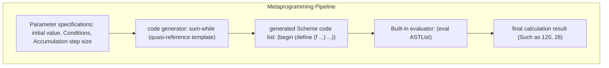

> **Course**: UC Berkeley CS61A (Fall 2024)  
> **Module**: Module 4: Interpreters & Scheme (Interpreters & Scheme)  
> **Lecturer**: Prof. John DeNero (UC Berkeley)  
> **Video duration**: 18:06 ｜ **Classroom screenshots**: 16 pieces of blackboard writing/code demonstration  
> **Direct video**: [📺Watch the original video of this lecture on Bilibili (P31)](https://www.bilibili.com/video/BV1sy411z7nA/?p=31)  
> **Quick navigation**: [← Previous Lecture (P30 Lecture 32 Tail Calls (Optional))](/en/notes/cs61a/lecture-30) ｜ [📚 Return to the full book catalog](/en/notes/topics/CS61A) ｜ [Next lecture (P32 Lecture 34 Macros) →](/en/notes/cs61a/lecture-32)

---

## Course Core Objectives and Panorama

In most classical programming languages, the program source code is a cold plain text string, and the objects when the program is run are numbers, lists, and dictionaries in memory. There is a huge gap between the compiler and the interpreter between the source code and the running data.

However, in the Lisp and Scheme languages, there is an extremely shocking core design philosophy——**Homoiconicity (code is data)**.
- A Scheme statement is essentially a **Scheme linked list (Pair)**; 
- The syntax of a function call is nothing more than a standard list of operator symbols and operand elements;
- Writing a "code-generating program" is as simple and straightforward as manipulating an ordinary list!

This lecture provides an in-depth analysis of how to use Scheme's list operations, Quasi-quotation mechanism and built-in  `eval`  Functions to write general-purpose code generators that can automatically write, assemble, and execute other programs.



---

### In-depth formal specification and micro-evaluation process (Operational Semantics)
In the "Course Core Goals and Panorama" module, the underlying computer operations rely on strict formal evaluation logic:
1. **Hierarchical parsing of abstract syntax trees (AST)**: 
   - The source code character stream is first divided into terminal symbol tokens (Tokens) by the lexical analyzer (Lexer), and then constructed into a multi-fork syntax tree by the syntax parser (Parser);
   - Operator priority and associativity are solidified during the syntax tree construction phase, eliminating ambiguity at runtime;
2. **Dynamic transitions of environment chains**: 
   - Each function call generates a new frame whose static lexical environment is determined by the function object's  `parent`  Attributes are completely determined;
   - The variable search traces back up the environment chain in one direction until the global environment frame. If it is not found, it will be triggered.  `NameError`  Abnormal;
3. **State Invariants**: 
   - The key to writing robust programs is to clarify loop invariants (Loop Invariants) and function pre/post-conditions (Pre/Post-conditions);
   - In complex control flow jumps, ensure that state variables maintain legal business constraints before each iteration.


## 1. Code is data: Programs as Data & Homoiconicity

All non-basic expressions (combinations) of Scheme are represented in memory through standard lists (linked lists):

```scheme
;; 构造一个二元除法代码列表
(list 'quotient 10 2) ; => (quotient 10 2)
```

[](https://www.bilibili.com/video/BV1sy411z7nA/?p=31&t=30)
*⏱ Timestamp: 00:00:30 · 📷 Classroom screenshot · [Watch the corresponding clip on Bilibili (P31 00:00:30)](https://www.bilibili.com/video/BV1sy411z7nA/?p=31&t=30)*

#### 📸 In-depth reading of classroom blackboard writing and code demonstration (00:00:30)

**\[On-site blackboard writing/code demonstration restoration\]**:
At this time point, Professor DeNero conducted a core demonstration and key blackboard derivation on the screen:
> *“Programs are data. Scheme programs consist of expressions. Those expressions can either be primitive expressions, just the number 2, 3.3, true, the symbol plus, the symbol quotient. But everything else is a combination, and each combination is a scheme list. So here we have a list containing the sym...”*

**\[Underlying computing model and micro execution mechanism\]**: 
1. **Execution context and timing tracing**: 
   - At the current discussion point "1. Code is data: Programs as Data & Homoiconicity", the interpreter strictly follows the core evaluation protocol;
   - The expression evaluates the operators first, then evaluates the operands strictly from left to right, and finally applies the function object to the argument list;
   - If the environment model is involved, the local frame strictly records its static lexical parent pointer (Parent Pointer points to the environment where the function is defined), forming an orthogonal architecture with the dynamic call stack at runtime.
2. **Memory topology and object references**: 
   - Variable symbols are just keys in a hash table (environment frame), and pointers point directly to first-class citizen objects in heap memory;
   - Assignment statements are discrete-time snapshots of the state and never create implicit mathematical dependency monitoring.

**\[Guidelines for avoiding pitfalls and guidance on high-frequency test points\]**: 
- **Common misunderstandings**: In the test questions related to "Macro prefix concept: using code as a data list for dynamic splicing and modification", beginners can easily guess the result based on the surface form of the code, leading to scope confusion or variable shadowing (Shadowing) misjudgment;
- **The golden rule of debugging**: When encountering nested calls and complex branches, be sure to draw independent partial frames on the scratch paper, indicate the specific binding value of each formal parameter, and derive it step by step.


Evaluating this list does not immediately perform division, it just generates a three-element (symbol  `quotient`, numbers  `10`, numbers  `2`) of ordinary list data.

---

### In-depth formal specification and micro-evaluation process (Operational Semantics)
In the "1. Code is Data: Programs as Data & Homoiconicity" module, the underlying computer operations rely on strict formal evaluation logic:
1. **Hierarchical parsing of abstract syntax trees (AST)**: 
   - The source code character stream is first divided into terminal symbol tokens (Tokens) by the lexical analyzer (Lexer), and then constructed into a multi-fork syntax tree by the syntax parser (Parser);
   - Operator priority and associativity are solidified during the syntax tree construction phase, eliminating ambiguity at runtime;
2. **Dynamic transitions of environment chains**: 
   - Each function call generates a new frame whose static lexical environment is determined by the function object's  `parent`  Attributes are completely determined;
   - The variable search traces back up the environment chain in one direction until the global environment frame. If it is not found, it will be triggered.  `NameError`  Abnormal;
3. **State Invariants**: 
   - The key to writing robust programs is to clarify loop invariants (Loop Invariants) and function pre/post-conditions (Pre/Post-conditions);
   - In complex control flow jumps, ensure that state variables maintain legal business constraints before each iteration.


## 2. Built-in  `eval`: Any conversion of data and code (The  `eval` Procedure)

If the structure of a list conforms to legal Scheme syntax, we can pass it to the built-in  `eval`  Process:

```scheme
(define expr (list 'quotient 10 2))
(eval expr) ; => 5
```

[](https://www.bilibili.com/video/BV1sy411z7nA/?p=31&t=89)
*⏱ Timestamp: 00:01:29 · 📷 Classroom screenshot · [Watch the corresponding clip on Bilibili (P31 00:01:29)](https://www.bilibili.com/video/BV1sy411z7nA/?p=31&t=89)*

#### 📸 In-depth reading of classroom blackboard writing and code demonstration (00:01:29)

**\[On-site blackboard writing/code demonstration restoration\]**:
At this time point, Professor DeNero conducted a core demonstration and key blackboard derivation on the screen:
> *“A combination that says take the quotient of 10 and 2. Now, notice evaluating this doesn't actually divide 10 by 2. Instead, it just builds a list. But there's a built-in procedure called eval, and eval takes any expression represented as a scheme list or primitive and gives you back its value. So, ...”*

**\[Underlying computing model and micro execution mechanism\]**: 
1. **Execution context and timing tracing**: 
   - At the current discussion point "2. Built-in  `eval`: Any conversion of data and code (The  `eval`  Procedure)", the interpreter strictly follows the core evaluation convention;
   - The expression evaluates the operators first, then evaluates the operands strictly from left to right, and finally applies the function object to the argument list;
   - If the environment model is involved, the local frame strictly records its static lexical parent pointer (Parent Pointer points to the environment where the function is defined), forming an orthogonal architecture with the dynamic call stack at runtime.
2. **Memory topology and object references**: 
   - Variable symbols are just keys in a hash table (environment frame), and pointers point directly to first-class citizen objects in heap memory;
   - Assignment statements are discrete-time snapshots of the state and never create implicit mathematical dependency monitoring.

**\[Guidelines for avoiding pitfalls and guidance on high-frequency test points\]**: 
- **Common misunderstandings**: In the test questions related to "Macro prefix concept: using code as a data list for dynamic splicing and modification", beginners can easily guess the result based on the surface form of the code, leading to scope confusion or variable shadowing (Shadowing) misjudgment;
- **The golden rule of debugging**: When encountering nested calls and complex branches, be sure to draw independent partial frames on the scratch paper, indicate the specific binding value of each formal parameter, and derive it step by step.


- Although Python also has built-in  `eval("10 // 2")`, but Python can only parse unstructured text strings;
- The unique power of Scheme is: **Code is inherently structured linked list data**. You can use all list manipulation functions (`cons`, `car`, `cdr`, `map`, `filter`) Arbitrarily manipulate, assemble and transform the abstract syntax tree (AST) of the program, and then call it with one click  `eval`  Execute it!

---

### In-depth formal specification and micro-evaluation process (Operational Semantics)
In "2. Built-in  `eval`: Any conversion of data and code (The  `eval`  Procedure) module, the underlying computer operations rely on strict formal evaluation logic:
1. **Hierarchical parsing of abstract syntax trees (AST)**: 
   - The source code character stream is first divided into terminal symbol tokens (Tokens) by the lexical analyzer (Lexer), and then constructed into a multi-fork syntax tree by the syntax parser (Parser);
   - Operator priority and associativity are solidified during the syntax tree construction phase, eliminating ambiguity at runtime;
2. **Dynamic transitions of environment chains**: 
   - Each function call generates a new frame whose static lexical environment is determined by the function object's  `parent`  Attributes are completely determined;
   - The variable search traces back up the environment chain in one direction until the global environment frame. If it is not found, it will be triggered.  `NameError`  Abnormal;
3. **State Invariants**: 
   - The key to writing robust programs is to clarify loop invariants (Loop Invariants) and function pre/post-conditions (Pre/Post-conditions);
   - In complex control flow jumps, ensure that state variables maintain legal business constraints before each iteration.


## 3. Symbol reference and expression evaluation mechanism

In the interactive interpreter, we can clearly distinguish the difference between ordinary expression evaluation and constructed code lists:

[](https://www.bilibili.com/video/BV1sy411z7nA/?p=31&t=149)
*⏱ Timestamp: 00:02:29 · 📷 Classroom screenshot · [Watch the corresponding clip on Bilibili (P31 00:02:29)](https://www.bilibili.com/video/BV1sy411z7nA/?p=31&t=149)*

#### 📸 In-depth reading of classroom blackboard writing and code demonstration (00:02:29)

**\[On-site blackboard writing/code demonstration restoration\]**:
At this time point, Professor DeNero conducted a core demonstration and key blackboard derivation on the screen:
> *“Is that it has all this built-in functionality for working with scheme lists, and all the code is just lists. So it's easier to construct programs by writing things like list quotient 10-2. So one of the beautiful things about the scheme language, and this is true of Lisp in general, is that it's st...”*

**\[Underlying computing model and micro execution mechanism\]**: 
1. **Execution context and timing tracing**: 
   - At the current discussion point "3. Symbol reference and expression evaluation mechanism", the interpreter strictly follows the core evaluation protocol;
   - The expression evaluates the operators first, then evaluates the operands strictly from left to right, and finally applies the function object to the argument list;
   - If the environment model is involved, the local frame strictly records its static lexical parent pointer (Parent Pointer points to the environment where the function is defined), forming an orthogonal architecture with the dynamic call stack at runtime.
2. **Memory topology and object references**: 
   - Variable symbols are just keys in a hash table (environment frame), and pointers point directly to first-class citizen objects in heap memory;
   - Assignment statements are discrete-time snapshots of the state and never create implicit mathematical dependency monitoring.

**\[Guidelines for avoiding pitfalls and guidance on high-frequency test points\]**: 
- **Common misunderstandings**: In the test questions related to "Macro prefix concept: using code as a data list for dynamic splicing and modification", beginners can easily guess the result based on the surface form of the code, leading to scope confusion or variable shadowing (Shadowing) misjudgment;
- **The golden rule of debugging**: When encountering nested calls and complex branches, be sure to draw independent partial frames on the scratch paper, indicate the specific binding value of each formal parameter, and derive it step by step.


```scheme
(+ 1 2)         ; => 3 (立即执行加法)
(list '+ 1 2)   ; => (#[primitive:+] 1 2) (直接求值了 + 符号)
(list '+ 1 2)   ; 传递带引用的符号: (list '+ 1 2) => (+ 1 2)
```

Just pass it in single quotes  `'`  By preventing an operator from being evaluated immediately, it can be safely embedded symbolically in a newly created expression list.

---

### In-depth formal specification and micro-evaluation process (Operational Semantics)
In the "3. Symbol Reference and Expression Evaluation Mechanism" module, the underlying computer operations rely on strict formal evaluation logic:
1. **Hierarchical parsing of abstract syntax trees (AST)**: 
   - The source code character stream is first divided into terminal symbol tokens (Tokens) by the lexical analyzer (Lexer), and then constructed into a multi-fork syntax tree by the syntax parser (Parser);
   - Operator priority and associativity are solidified during the syntax tree construction phase, eliminating ambiguity at runtime;
2. **Dynamic transitions of environment chains**: 
   - Each function call generates a new frame whose static lexical environment is determined by the function object's  `parent`  Attributes are completely determined;
   - The variable search traces back up the environment chain in one direction until the global environment frame. If it is not found, it will be triggered.  `NameError`  Abnormal;
3. **State Invariants**: 
   - The key to writing robust programs is to clarify loop invariants (Loop Invariants) and function pre/post-conditions (Pre/Post-conditions);
   - In complex control flow jumps, ensure that state variables maintain legal business constraints before each iteration.


## 4. Computing values vs generating expressions: two perspectives on factorials

Consider the classic recursive factorial function. Not only can we write functions that return the numerical value of a calculation, we can also write **Returns the complete computed expression tree** The metaprogram of:

```scheme
;; 常规版本：返回数值 120
(define (fact n)
  (if (zero? n)
      1
      (* n (fact (- n 1)))))

;; 元编程版本：返回计算表达式树
(define (fact-exp n)
  (if (zero? n)
      1
      (list '* n (fact-exp (- n 1)))))
```

[](https://www.bilibili.com/video/BV1sy411z7nA/?p=31&t=237)
*⏱ Timestamp: 00:03:57 · 📷 Classroom screenshot · [Watch the corresponding clip on Bilibili (P31 00:03:57)](https://www.bilibili.com/video/BV1sy411z7nA/?p=31&t=237)*

#### 📸 In-depth reading of classroom blackboard writing and code demonstration (00:03:57)

**\[On-site blackboard writing/code demonstration restoration\]**:
At this time point, Professor DeNero conducted a core demonstration and key blackboard derivation on the screen:
> *“Where this part had been evaluated already, because it's just part of Scheme, and Scheme evaluates the operator and its operands, and gives me back an expression that's already computed the 5, but hasn't computed the 6 yet. Okay, now let's load this small program on the right. Fact is a procedure th...”*

**\[Underlying computing model and micro execution mechanism\]**: 
1. **Execution context and timing tracing**: 
   - At the current discussion point "4. Computing values vs. generating expressions: two perspectives of factorial", the interpreter strictly follows the core evaluation convention;
   - The expression evaluates the operators first, then evaluates the operands strictly from left to right, and finally applies the function object to the argument list;
   - If the environment model is involved, the local frame strictly records its static lexical parent pointer (Parent Pointer points to the environment where the function is defined), forming an orthogonal architecture with the dynamic call stack at runtime.
2. **Memory topology and object references**: 
   - Variable symbols are just keys in a hash table (environment frame), and pointers point directly to first-class citizen objects in heap memory;
   - Assignment statements are discrete-time snapshots of the state and never create implicit mathematical dependency monitoring.

**\[Guidelines for avoiding pitfalls and guidance on high-frequency test points\]**: 
- **Common misunderstandings**: In the test questions related to "Macro prefix concept: using code as a data list for dynamic splicing and modification", beginners can easily guess the result based on the surface form of the code, leading to scope confusion or variable shadowing (Shadowing) misjudgment;
- **The golden rule of debugging**: When encountering nested calls and complex branches, be sure to draw independent partial frames on the scratch paper, indicate the specific binding value of each formal parameter, and derive it step by step.


Run test comparison:
```scheme
(fact 5)     ; => 120
(fact-exp 5) ; => (* 5 (* 4 (* 3 (* 2 (* 1 1)))))
```

[](https://www.bilibili.com/video/BV1sy411z7nA/?p=31&t=297)
*⏱ Timestamp: 00:04:57 · 📷 Classroom screenshot · [Watch the corresponding clip on Bilibili (P31 00:04:57)](https://www.bilibili.com/video/BV1sy411z7nA/?p=31&t=297)*

#### 📸 In-depth reading of classroom blackboard writing and code demonstration (00:04:57)

**\[On-site blackboard writing/code demonstration restoration\]**:
At this time point, Professor DeNero conducted a core demonstration and key blackboard derivation on the screen:
> *“So, this variant, called fact x, doesn't have the job of returning a number. Instead, it has the job of returning an expression. One is an expression, a perfectly good way of representing the number one. If I want to build an expression out of smaller expressions, I need a list. A list containing mu...”*

**\[Underlying computing model and micro execution mechanism\]**: 
1. **Execution context and timing tracing**: 
   - At the current discussion point "4. Computing values vs. generating expressions: two perspectives of factorial", the interpreter strictly follows the core evaluation convention;
   - The expression evaluates the operators first, then evaluates the operands strictly from left to right, and finally applies the function object to the argument list;
   - If the environment model is involved, the local frame strictly records its static lexical parent pointer (Parent Pointer points to the environment where the function is defined), forming an orthogonal architecture with the dynamic call stack at runtime.
2. **Memory topology and object references**: 
   - Variable symbols are just keys in a hash table (environment frame), and pointers point directly to first-class citizen objects in heap memory;
   - Assignment statements are discrete-time snapshots of the state and never create implicit mathematical dependency monitoring.

**\[Guidelines for avoiding pitfalls and guidance on high-frequency test points\]**: 
- **Common misunderstandings**: In the test questions related to "Macro prefix concept: using code as a data list for dynamic splicing and modification", beginners can easily guess the result based on the surface form of the code, leading to scope confusion or variable shadowing (Shadowing) misjudgment;
- **The golden rule of debugging**: When encountering nested calls and complex branches, be sure to draw independent partial frames on the scratch paper, indicate the specific binding value of each formal parameter, and derive it step by step.


The generated expression intuitively presents the complete calculation of the factorial recursive expansion! If this expression is called  `(eval (fact-exp 5))`, you can get it immediately  `120`.

---

### In-depth formal specification and micro-evaluation process (Operational Semantics)
In the module "4. Calculating values vs generating expressions: two perspectives of factorial", the underlying operations of computers rely on strict formal evaluation logic:
1. **Hierarchical parsing of abstract syntax trees (AST)**: 
   - The source code character stream is first divided into terminal symbol tokens (Tokens) by the lexical analyzer (Lexer), and then constructed into a multi-fork syntax tree by the syntax parser (Parser);
   - Operator priority and associativity are solidified during the syntax tree construction phase, eliminating ambiguity at runtime;
2. **Dynamic transitions of environment chains**: 
   - Each function call generates a new frame whose static lexical environment is determined by the function object's  `parent`  Attributes are completely determined;
   - The variable search traces back up the environment chain in one direction until the global environment frame. If it is not found, it will be triggered.  `NameError`  Abnormal;
3. **State Invariants**: 
   - The key to writing robust programs is to clarify loop invariants (Loop Invariants) and function pre/post-conditions (Pre/Post-conditions);
   - In complex control flow jumps, ensure that state variables maintain legal business constraints before each iteration.


## 5. Tree recursive expression expansion: Fibonacci sequence

The same trick can be applied to tree recursion. we can write  `fib-exp`  To visualize the additive expansion tree of Fibonacci numbers:

```scheme
(define (fib-exp n)
  (if (<= n 1)
      n
      (list '+ (fib-exp (- n 2)) (fib-exp (- n 1)))))
```

[](https://www.bilibili.com/video/BV1sy411z7nA/?p=31&t=360)
*⏱ Timestamp: 00:06:00 · 📷 Classroom screenshot · [Watch the corresponding clip on Bilibili (P31 00:06:00)](https://www.bilibili.com/video/BV1sy411z7nA/?p=31&t=360)*

#### 📸 In-depth reading of classroom blackboard writing and code demonstration (00:06:00)

**\[On-site blackboard writing/code demonstration restoration\]**:
At this time point, Professor DeNero conducted a core demonstration and key blackboard derivation on the screen:
> *“Fibonacci number n. If it's the case that n is 0 or 1, any number less than or equal to 1, then fib n is just n. Otherwise, I have to add together the two previous Fibonacci numbers, fib n minus 2 and fib n minus 1. So, Fibonacci number 2 is 1, Fibonacci number 6 is 8. How did it compute 8 while usi...”*

**\[Underlying computing model and micro execution mechanism\]**: 
1. **Execution context and timing tracing**: 
   - At the current discussion point "5. Tree recursive expression expansion: Fibonacci sequence", the interpreter strictly follows the core evaluation convention;
   - The expression evaluates the operators first, then evaluates the operands strictly from left to right, and finally applies the function object to the argument list;
   - If the environment model is involved, the local frame strictly records its static lexical parent pointer (Parent Pointer points to the environment where the function is defined), forming an orthogonal architecture with the dynamic call stack at runtime.
2. **Memory topology and object references**: 
   - Variable symbols are just keys in a hash table (environment frame), and pointers point directly to first-class citizen objects in heap memory;
   - Assignment statements are discrete-time snapshots of the state and never create implicit mathematical dependency monitoring.

**\[Guidelines for avoiding pitfalls and guidance on high-frequency test points\]**: 
- **Common misunderstandings**: In the test questions related to "Macro prefix concept: using code as a data list for dynamic splicing and modification", beginners can easily guess the result based on the surface form of the code, leading to scope confusion or variable shadowing (Shadowing) misjudgment;
- **The golden rule of debugging**: When encountering nested calls and complex branches, be sure to draw independent partial frames on the scratch paper, indicate the specific binding value of each formal parameter, and derive it step by step.


[](https://www.bilibili.com/video/BV1sy411z7nA/?p=31&t=421)
*⏱ Timestamp: 00:07:01 · 📷 Classroom screenshot · [Watch the corresponding clip on Bilibili (P31 00:07:01)](https://www.bilibili.com/video/BV1sy411z7nA/?p=31&t=421)*

#### 📸 In-depth reading of classroom blackboard writing and code demonstration (00:07:01)

**\[On-site blackboard writing/code demonstration restoration\]**:
At this time point, Professor DeNero conducted a core demonstration and key blackboard derivation on the screen:
> *“Applying that to the result of two smaller expressions that compute fib N minus 2 and fib N minus 1. So, fib 6 is still 8, but the expression that computes fib 6 is that I add together fib 4 and fib 5, where fib 4 is an expression that looks like that. And here is the expression for fib 5. Now, if I...”*

**\[Underlying computing model and micro execution mechanism\]**: 
1. **Execution context and timing tracing**: 
   - At the current discussion point "5. Tree recursive expression expansion: Fibonacci sequence", the interpreter strictly follows the core evaluation convention;
   - The expression evaluates the operators first, then evaluates the operands strictly from left to right, and finally applies the function object to the argument list;
   - If the environment model is involved, the local frame strictly records its static lexical parent pointer (Parent Pointer points to the environment where the function is defined), forming an orthogonal architecture with the dynamic call stack at runtime.
2. **Memory topology and object references**: 
   - Variable symbols are just keys in a hash table (environment frame), and pointers point directly to first-class citizen objects in heap memory;
   - Assignment statements are discrete-time snapshots of the state and never create implicit mathematical dependency monitoring.

**\[Guidelines for avoiding pitfalls and guidance on high-frequency test points\]**: 
- **Common misunderstandings**: In the test questions related to "Macro prefix concept: using code as a data list for dynamic splicing and modification", beginners can easily guess the result based on the surface form of the code, leading to scope confusion or variable shadowing (Shadowing) misjudgment;
- **The golden rule of debugging**: When encountering nested calls and complex branches, be sure to draw independent partial frames on the scratch paper, indicate the specific binding value of each formal parameter, and derive it step by step.


execute  `(fib-exp 6)`  will generate a  `+`  with baseline values  `0`, `1`  A huge nested list of  `(eval (fib-exp 6))`  Then the value of Fibonacci’s sixth term is accurately obtained  `8`.

---

### In-depth formal specification and micro-evaluation process (Operational Semantics)
In the "5. Tree Recursive Expression Expansion: Fibonacci Sequence" module, the underlying computer operations rely on strict formal evaluation logic:
1. **Hierarchical parsing of abstract syntax trees (AST)**: 
   - The source code character stream is first divided into terminal symbol tokens (Tokens) by the lexical analyzer (Lexer), and then constructed into a multi-fork syntax tree by the syntax parser (Parser);
   - Operator priority and associativity are solidified during the syntax tree construction phase, eliminating ambiguity at runtime;
2. **Dynamic transitions of environment chains**: 
   - Each function call generates a new frame whose static lexical environment is determined by the function object's  `parent`  Attributes are completely determined;
   - The variable search traces back up the environment chain in one direction until the global environment frame. If it is not found, it will be triggered.  `NameError`  Abnormal;
3. **State Invariants**: 
   - The key to writing robust programs is to clarify loop invariants (Loop Invariants) and function pre/post-conditions (Pre/Post-conditions);
   - In complex control flow jumps, ensure that state variables maintain legal business constraints before each iteration.


## 6. Quasi-quotation syntax: Backtick and Unquote (Quasi-quotation)

Manual use  `list`  and  `'`  Splicing complex code can easily cause bracket confusion. For this purpose, Scheme provides powerful template syntax -**Quasi-quotation**: 

| Grammar symbols | Name | Semantics |
| :--- | :--- | :--- |
| **backtick \`** | Quasi-quote (quasi-quote) | Similar to ordinary single quote quotes, but allows local evaluation insertion inside |
| **comma,** | Unquote | Valid only within quasi-references, forcing the interpreter to immediately evaluate and replace subsequent subexpressions |

[](https://www.bilibili.com/video/BV1sy411z7nA/?p=31&t=481)
*⏱ Timestamp: 00:08:01 · 📷 Classroom screenshot · [Watch the corresponding clip on Bilibili (P31 00:08:01)](https://www.bilibili.com/video/BV1sy411z7nA/?p=31&t=481)*

#### 📸 In-depth reading of classroom blackboard writing and code demonstration (00:08:01)

**\[On-site blackboard writing/code demonstration restoration\]**:
At this time point, Professor DeNero conducted a core demonstration and key blackboard derivation on the screen:
> *“You could actually write a program that generates programs. Before we do that, I'm going to teach you one more feature called quasi-quotation, which is a lot like the quotation you already know, but there's an important difference, which is that you can unquote parts of a quoted expression. So there...”*

**\[Underlying computing model and micro execution mechanism\]**: 
1. **Execution context and timing tracing**: 
   - At the current discussion point "6. Quasi-quotation syntax: Backtick and Unquote (Quasi-quotation)", the interpreter strictly follows the core evaluation convention;
   - The expression evaluates the operators first, then evaluates the operands strictly from left to right, and finally applies the function object to the argument list;
   - If the environment model is involved, the local frame strictly records its static lexical parent pointer (Parent Pointer points to the environment where the function is defined), forming an orthogonal architecture with the dynamic call stack at runtime.
2. **Memory topology and object references**: 
   - Variable symbols are just keys in a hash table (environment frame), and pointers point directly to first-class citizen objects in heap memory;
   - Assignment statements are discrete-time snapshots of the state and never create implicit mathematical dependency monitoring.

**\[Guidelines for avoiding pitfalls and guidance on high-frequency test points\]**: 
- **Common misunderstandings**: In the test questions related to "Macro prefix concept: using code as a data list for dynamic splicing and modification", beginners can easily guess the result based on the surface form of the code, leading to scope confusion or variable shadowing (Shadowing) misjudgment;
- **The golden rule of debugging**: When encountering nested calls and complex branches, be sure to draw independent partial frames on the scratch paper, indicate the specific binding value of each formal parameter, and derive it step by step.


### Static reference vs quasi-reference comparison

Assume that it is bound in the environment first  `(define b 4)`: 

```scheme
'(a (+ b 1))  ; => (a (+ b 1)) (全部视为字面符号，不求值)
`(a ,(+ b 1)) ; => (a 5)       (a 保持字面符号，(+ b 1) 被动态求值替换为 5!)
```

[](https://www.bilibili.com/video/BV1sy411z7nA/?p=31&t=566)
*⏱ Timestamp: 00:09:26 · 📷 Classroom screenshot · [Watch the corresponding clip on Bilibili (P31 00:09:26)](https://www.bilibili.com/video/BV1sy411z7nA/?p=31&t=566)*

#### 📸 In-depth reading of classroom blackboard writing and code demonstration (00:09:26)

**\[On-site blackboard writing/code demonstration restoration\]**:
At this time point, Professor DeNero conducted a core demonstration and key blackboard derivation on the screen:
> *“So here we have a list within a list within a list. But writing the same expression started with a quasi-quote will give me something that I think is more useful, a list A5, where 5 is the value of evaluating the expression B plus 1. Why did this expression get evaluated, whereas A did not? Because ...”*

**\[Underlying computing model and micro execution mechanism\]**: 
1. **Execution context and timing tracing**: 
   - At the current discussion point "6. Quasi-quotation syntax: Backtick and Unquote (Quasi-quotation)", the interpreter strictly follows the core evaluation convention;
   - The expression evaluates the operators first, then evaluates the operands strictly from left to right, and finally applies the function object to the argument list;
   - If the environment model is involved, the local frame strictly records its static lexical parent pointer (Parent Pointer points to the environment where the function is defined), forming an orthogonal architecture with the dynamic call stack at runtime.
2. **Memory topology and object references**: 
   - Variable symbols are just keys in a hash table (environment frame), and pointers point directly to first-class citizen objects in heap memory;
   - Assignment statements are discrete-time snapshots of the state and never create implicit mathematical dependency monitoring.

**\[Guidelines for avoiding pitfalls and guidance on high-frequency test points\]**: 
- **Common misunderstandings**: In the test questions related to "Macro prefix concept: using code as a data list for dynamic splicing and modification", beginners can easily guess the result based on the surface form of the code, leading to scope confusion or variable shadowing (Shadowing) misjudgment;
- **The golden rule of debugging**: When encountering nested calls and complex branches, be sure to draw independent partial frames on the scratch paper, indicate the specific binding value of each formal parameter, and derive it step by step.


### Code template factory: `make-add-procedure`

Using quasi-references, we can dynamically generate function definition code for specific parameters:

```scheme
(define (make-add-procedure n)
  `(lambda (d) (+ d ,n)))

(make-add-procedure 2) ; => (lambda (d) (+ d 2))
```

[](https://www.bilibili.com/video/BV1sy411z7nA/?p=31&t=654)
*⏱ Timestamp: 00:10:54 · 📷 Classroom screenshot · [Watch the corresponding clip on Bilibili (P31 00:10:54)](https://www.bilibili.com/video/BV1sy411z7nA/?p=31&t=654)*

#### 📸 In-depth reading of classroom blackboard writing and code demonstration (00:10:54)

**\[On-site blackboard writing/code demonstration restoration\]**:
At this time point, Professor DeNero conducted a core demonstration and key blackboard derivation on the screen:
> *“That says lambda D plus Dn for whatever n is. And then I call make add procedure on 2. What I get back is a list. A list whose first element is the symbol lambda. Second element is a list containing just one element D. And the third is a list containing the symbol plus the symbol D and the number 2....”*

**\[Underlying computing model and micro execution mechanism\]**: 
1. **Execution context and timing tracing**: 
   - At the current discussion point "6. Quasi-quotation syntax: Backtick and Unquote (Quasi-quotation)", the interpreter strictly follows the core evaluation convention;
   - The expression evaluates the operators first, then evaluates the operands strictly from left to right, and finally applies the function object to the argument list;
   - If the environment model is involved, the local frame strictly records its static lexical parent pointer (Parent Pointer points to the environment where the function is defined), forming an orthogonal architecture with the dynamic call stack at runtime.
2. **Memory topology and object references**: 
   - Variable symbols are just keys in a hash table (environment frame), and pointers point directly to first-class citizen objects in heap memory;
   - Assignment statements are discrete-time snapshots of the state and never create implicit mathematical dependency monitoring.

**\[Guidelines for avoiding pitfalls and guidance on high-frequency test points\]**: 
- **Common misunderstandings**: In the test questions related to "Macro prefix concept: using code as a data list for dynamic splicing and modification", beginners can easily guess the result based on the surface form of the code, leading to scope confusion or variable shadowing (Shadowing) misjudgment;
- **The golden rule of debugging**: When encountering nested calls and complex branches, be sure to draw independent partial frames on the scratch paper, indicate the specific binding value of each formal parameter, and derive it step by step.


The parameters here  `n`  is replaced exactly by a constant during the code generation phase  `2`, thus generating a dedicated single-parameter auto-increment process source code!

---

### In-depth formal specification and micro-evaluation process (Operational Semantics)
In the "6. Quasi-quote syntax: Backtick and Unquote (Quasi-quotation)" module, the underlying computer operations rely on strict formal evaluation logic:
1. **Hierarchical parsing of abstract syntax trees (AST)**: 
   - The source code character stream is first divided into terminal symbol tokens (Tokens) by the lexical analyzer (Lexer), and then constructed into a multi-fork syntax tree by the syntax parser (Parser);
   - Operator priority and associativity are solidified during the syntax tree construction phase, eliminating ambiguity at runtime;
2. **Dynamic transitions of environment chains**: 
   - Each function call generates a new frame whose static lexical environment is determined by the function object's  `parent`  Attributes are completely determined;
   - The variable search traces back up the environment chain in one direction until the global environment frame. If it is not found, it will be triggered.  `NameError`  Abnormal;
3. **State Invariants**: 
   - The key to writing robust programs is to clarify loop invariants (Loop Invariants) and function pre/post-conditions (Pre/Post-conditions);
   - In complex control flow jumps, ensure that state variables maintain legal business constraints before each iteration.


## 7. Practical Challenge: Use code generation to fill in missing language features (Simulating While Loops)

In order to maintain a minimalist core, Scheme language does not provide  `while`  Loop statement. Suppose we need to calculate the sum of the squares of the first few even numbers:

```python
# Python 原生写法
x, total = 2, 0
while x < 10:
    total += x * x
    x += 2
# total => 120
```

[](https://www.bilibili.com/video/BV1sy411z7nA/?p=31&t=713)
*⏱ Timestamp: 00:11:53 · 📷 Classroom screenshot · [Watch the corresponding clip on Bilibili (P31 00:11:53)](https://www.bilibili.com/video/BV1sy411z7nA/?p=31&t=713)*

#### 📸 In-depth reading of classroom blackboard writing and code demonstration (00:11:53)

**\[On-site blackboard writing/code demonstration restoration\]**:
At this time point, Professor DeNero conducted a core demonstration and key blackboard derivation on the screen:
> *“OK, let's do a longer example. While statements. Well, in Scheme, there aren't a while statements. But while statements are awfully convenient, like let's say you wanted to know what's the sum of the squares of even numbers less than 10, starting with 2. So 2 squared plus 4 squared plus 6 squared pl...”*

**\[Underlying computing model and micro execution mechanism\]**: 
1. **Execution context and timing tracing**: 
   - At the current discussion point "7. Practical Challenge: Fill in the missing language features with code generation (Simulating While Loops)", the interpreter strictly follows the core evaluation protocol;
   - The expression evaluates the operators first, then evaluates the operands strictly from left to right, and finally applies the function object to the argument list;
   - If the environment model is involved, the local frame strictly records its static lexical parent pointer (Parent Pointer points to the environment where the function is defined), forming an orthogonal architecture with the dynamic call stack at runtime.
2. **Memory topology and object references**: 
   - Variable symbols are just keys in a hash table (environment frame), and pointers point directly to first-class citizen objects in heap memory;
   - Assignment statements are discrete-time snapshots of the state and never create implicit mathematical dependency monitoring.

**\[Guidelines for avoiding pitfalls and guidance on high-frequency test points\]**: 
- **Common misunderstandings**: In the test questions related to "Macro prefix concept: using code as a data list for dynamic splicing and modification", beginners can easily guess the result based on the surface form of the code, leading to scope confusion or variable shadowing (Shadowing) misjudgment;
- **The golden rule of debugging**: When encountering nested calls and complex branches, be sure to draw independent partial frames on the scratch paper, indicate the specific binding value of each formal parameter, and derive it step by step.


In Scheme, programmers need to manually write tedious tail-recursive helper functions every time:

```scheme
(define (f x total)
  (if (< x 10)
      (f (+ x 2) (+ total (* x x)))
      total))
(f 2 0) ; => 120
```

If we have hundreds or thousands of different loop calculation needs, handwriting the recursion each time is extremely tedious. Can Scheme automatically generate and execute this boilerplate code for us?

[](https://www.bilibili.com/video/BV1sy411z7nA/?p=31&t=801)
*⏱ Timestamp: 00:13:21 · 📷 Classroom screenshot · [Watch the corresponding clip on Bilibili (P31 00:13:21)](https://www.bilibili.com/video/BV1sy411z7nA/?p=31&t=801)*

#### 📸 In-depth reading of classroom blackboard writing and code demonstration (00:13:21)

**\[On-site blackboard writing/code demonstration restoration\]**:
At this time point, Professor DeNero conducted a core demonstration and key blackboard derivation on the screen:
> *“And now I've written two expressions instead of one. If I wanted to fit it all into one expression, I would need to use begin. Okay, so it can be done in Python. It can be done in Scheme. I find the Python easier to read. There's nothing inherently recursive about this expression. It just happens to...”*

**\[Underlying computing model and micro execution mechanism\]**: 
1. **Execution context and timing tracing**: 
   - At the current discussion point "7. Practical Challenge: Fill in the missing language features with code generation (Simulating While Loops)", the interpreter strictly follows the core evaluation protocol;
   - The expression evaluates the operators first, then evaluates the operands strictly from left to right, and finally applies the function object to the argument list;
   - If the environment model is involved, the local frame strictly records its static lexical parent pointer (Parent Pointer points to the environment where the function is defined), forming an orthogonal architecture with the dynamic call stack at runtime.
2. **Memory topology and object references**: 
   - Variable symbols are just keys in a hash table (environment frame), and pointers point directly to first-class citizen objects in heap memory;
   - Assignment statements are discrete-time snapshots of the state and never create implicit mathematical dependency monitoring.

**\[Guidelines for avoiding pitfalls and guidance on high-frequency test points\]**: 
- **Common misunderstandings**: In the test questions related to "Macro prefix concept: using code as a data list for dynamic splicing and modification", beginners can easily guess the result based on the surface form of the code, leading to scope confusion or variable shadowing (Shadowing) misjudgment;
- **The golden rule of debugging**: When encountering nested calls and complex branches, be sure to draw independent partial frames on the scratch paper, indicate the specific binding value of each formal parameter, and derive it step by step.


---

### In-depth formal specification and micro-evaluation process (Operational Semantics)
In the "7. Practical Challenge: Use Code Generation to Fill in the Lack of Language Features (Simulating While Loops)" module, the underlying computer operations rely on strict formal evaluation logic:
1. **Hierarchical parsing of abstract syntax trees (AST)**: 
   - The source code character stream is first divided into terminal symbol tokens (Tokens) by the lexical analyzer (Lexer), and then constructed into a multi-fork syntax tree by the syntax parser (Parser);
   - Operator priority and associativity are solidified during the syntax tree construction phase, eliminating ambiguity at runtime;
2. **Dynamic transitions of environment chains**: 
   - Each function call generates a new frame whose static lexical environment is determined by the function object's  `parent`  Attributes are completely determined;
   - The variable search traces back up the environment chain in one direction until the global environment frame. If it is not found, it will be triggered.  `NameError`  Abnormal;
3. **State Invariants**: 
   - The key to writing robust programs is to clarify loop invariants (Loop Invariants) and function pre/post-conditions (Pre/Post-conditions);
   - In complex control flow jumps, ensure that state variables maintain legal business constraints before each iteration.


## 8. Universal loop code generator: `sum-while`

With quasi-reference templates, we can write a generic  `sum-while`  Meta-process:

```scheme
(define (sum-while initial-x condition add-term update-x)
  `(begin
     (define (f x total)
       (if ,condition
           (f ,update-x (+ total ,add-term))
           total))
     (f ,initial-x 0)))
```

[](https://www.bilibili.com/video/BV1sy411z7nA/?p=31&t=861)
*⏱ Timestamp: 00:14:21 · 📷 Classroom screenshot · [Watch the corresponding clip on Bilibili (P31 00:14:21)](https://www.bilibili.com/video/BV1sy411z7nA/?p=31&t=861)*

#### 📸 In-depth reading of classroom blackboard writing and code demonstration (00:14:21)

**\[On-site blackboard writing/code demonstration restoration\]**:
At this time point, Professor DeNero conducted a core demonstration and key blackboard derivation on the screen:
> *“Wouldn't it be nice if you could just get schemed to write this whole thing for you? Well, that's exactly what you could do. So I'm going to start us off with that example that you just saw of summing numbers whose square is less than 50, starting with 1. But I want to be able to define a procedure ...”*

**\[Underlying computing model and micro execution mechanism\]**: 
1. **Execution context and timing tracing**: 
   - At the current discussion point "8. Universal loop code generator: `sum-while`”, the interpreter strictly follows the core evaluation convention;
   - The expression evaluates the operators first, then evaluates the operands strictly from left to right, and finally applies the function object to the argument list;
   - If the environment model is involved, the local frame strictly records its static lexical parent pointer (Parent Pointer points to the environment where the function is defined), forming an orthogonal architecture with the dynamic call stack at runtime.
2. **Memory topology and object references**: 
   - Variable symbols are just keys in a hash table (environment frame), and pointers point directly to first-class citizen objects in heap memory;
   - Assignment statements are discrete-time snapshots of the state and never create implicit mathematical dependency monitoring.

**\[Guidelines for avoiding pitfalls and guidance on high-frequency test points\]**: 
- **Common misunderstandings**: In the test questions related to "Macro prefix concept: using code as a data list for dynamic splicing and modification", beginners can easily guess the result based on the surface form of the code, leading to scope confusion or variable shadowing (Shadowing) misjudgment;
- **The golden rule of debugging**: When encountering nested calls and complex branches, be sure to draw independent partial frames on the scratch paper, indicate the specific binding value of each formal parameter, and derive it step by step.


[](https://www.bilibili.com/video/BV1sy411z7nA/?p=31&t=948)
*⏱ Timestamp: 00:15:48 · 📷 Classroom screenshot · [Watch the corresponding clip on Bilibili (P31 00:15:48)](https://www.bilibili.com/video/BV1sy411z7nA/?p=31&t=948)*

#### 📸 In-depth reading of classroom blackboard writing and code demonstration (00:15:48)

**\[On-site blackboard writing/code demonstration restoration\]**:
At this time point, Professor DeNero conducted a core demonstration and key blackboard derivation on the screen:
> *“The reason I unquote this is that I don't want the symbol condition in the result. I want whatever's passed in this expression in the result. Likewise, I want this expression as what we update X with. So I'll unquote and write update X. I always want to add something to total, but what it is depends...”*

**\[Underlying computing model and micro execution mechanism\]**: 
1. **Execution context and timing tracing**: 
   - At the current discussion point "8. Universal loop code generator: `sum-while`”, the interpreter strictly follows the core evaluation convention;
   - The expression evaluates the operators first, then evaluates the operands strictly from left to right, and finally applies the function object to the argument list;
   - If the environment model is involved, the local frame strictly records its static lexical parent pointer (Parent Pointer points to the environment where the function is defined), forming an orthogonal architecture with the dynamic call stack at runtime.
2. **Memory topology and object references**: 
   - Variable symbols are just keys in a hash table (environment frame), and pointers point directly to first-class citizen objects in heap memory;
   - Assignment statements are discrete-time snapshots of the state and never create implicit mathematical dependency monitoring.

**\[Guidelines for avoiding pitfalls and guidance on high-frequency test points\]**: 
- **Common misunderstandings**: In the test questions related to "Macro prefix concept: using code as a data list for dynamic splicing and modification", beginners can easily guess the result based on the surface form of the code, leading to scope confusion or variable shadowing (Shadowing) misjudgment;
- **The golden rule of debugging**: When encountering nested calls and complex branches, be sure to draw independent partial frames on the scratch paper, indicate the specific binding value of each formal parameter, and derive it step by step.


### Code generation and dynamic evaluation run

Test 1: Calculate  $1 + 2 + \dots + 7 = 28$ (in  $x^2 < 50$  sum of integers within a range):
```scheme
(define code (sum-while 1 '(< (* x x) 50) 'x '(+ x 1)))
(eval code) ; => 28
```

Test 2: Calculate the sum of even squares  $2^2 + 4^2 + 6^2 + 8^2 = 120$: 
```scheme
(define code2 (sum-while 2 '(< x 10) '(* x x) '(+ x 2)))
(eval code2) ; => 120
```

[](https://www.bilibili.com/video/BV1sy411z7nA/?p=31&t=1008)
*⏱ Timestamp: 00:16:48 · 📷 Classroom screenshot · [Watch the corresponding clip on Bilibili (P31 00:16:48)](https://www.bilibili.com/video/BV1sy411z7nA/?p=31&t=1008)*

#### 📸 In-depth reading of classroom blackboard writing and code demonstration (00:16:48)

**\[On-site blackboard writing/code demonstration restoration\]**:
At this time point, Professor DeNero conducted a core demonstration and key blackboard derivation on the screen:
> *“But I still need to close the parenthesis for the procedure that I'm defining. Okay, I've rearranged a bit so that I can load this file and make this call. And look what it did. It built for me something. Let's give this thing a name. Result of evaluating this expression. This result is a list. It b...”*

**\[Underlying computing model and micro execution mechanism\]**: 
1. **Execution context and timing tracing**: 
   - At the current discussion point "8. Universal loop code generator: `sum-while`”, the interpreter strictly follows the core evaluation convention;
   - The expression evaluates the operators first, then evaluates the operands strictly from left to right, and finally applies the function object to the argument list;
   - If the environment model is involved, the local frame strictly records its static lexical parent pointer (Parent Pointer points to the environment where the function is defined), forming an orthogonal architecture with the dynamic call stack at runtime.
2. **Memory topology and object references**: 
   - Variable symbols are just keys in a hash table (environment frame), and pointers point directly to first-class citizen objects in heap memory;
   - Assignment statements are discrete-time snapshots of the state and never create implicit mathematical dependency monitoring.

**\[Guidelines for avoiding pitfalls and guidance on high-frequency test points\]**: 
- **Common misunderstandings**: In the test questions related to "Macro prefix concept: using code as a data list for dynamic splicing and modification", beginners can easily guess the result based on the surface form of the code, leading to scope confusion or variable shadowing (Shadowing) misjudgment;
- **The golden rule of debugging**: When encountering nested calls and complex branches, be sure to draw independent partial frames on the scratch paper, indicate the specific binding value of each formal parameter, and derive it step by step.


The interpreter receives  `sum-while`  Generated list code structure, using  `eval`  Dynamically define local tail recursive functions  `f`  and initiates the initial call, ultimately returning exactly  `120`!

---

### In-depth formal specification and micro-evaluation process (Operational Semantics)
In "8. Universal loop code generator: `sum-while` In the module, the underlying computer operations rely on strict formal evaluation logic:
1. **Hierarchical parsing of abstract syntax trees (AST)**: 
   - The source code character stream is first divided into terminal symbol tokens (Tokens) by the lexical analyzer (Lexer), and then constructed into a multi-fork syntax tree by the syntax parser (Parser);
   - Operator priority and associativity are solidified during the syntax tree construction phase, eliminating ambiguity at runtime;
2. **Dynamic transitions of environment chains**: 
   - Each function call generates a new frame whose static lexical environment is determined by the function object's  `parent`  Attributes are completely determined;
   - The variable search traces back up the environment chain in one direction until the global environment frame. If it is not found, it will be triggered.  `NameError`  Abnormal;
3. **State Invariants**: 
   - The key to writing robust programs is to clarify loop invariants (Loop Invariants) and function pre/post-conditions (Pre/Post-conditions);
   - In complex control flow jumps, ensure that state variables maintain legal business constraints before each iteration.


## 9. Summary: The Power of Metaprogramming

The reason why Lisp and Scheme occupy a sacred position in the history of computer science stems from the ultimate expressiveness of this "program that can write programs."

[](https://www.bilibili.com/video/BV1sy411z7nA/?p=31&t=1070)
*⏱ Timestamp: 00:17:50 · 📷 Classroom screenshot · [Watch the corresponding clip on Bilibili (P31 00:17:50)](https://www.bilibili.com/video/BV1sy411z7nA/?p=31&t=1070)*

#### 📸 In-depth reading of classroom blackboard writing and code demonstration (00:17:50)

**\[On-site blackboard writing/code demonstration restoration\]**:
At this time point, Professor DeNero conducted a core demonstration and key blackboard derivation on the screen:
> *“What I add to total in this case is not x, but x squared, and I update x to go to the next even number. This should give me 2 squared plus 4 squared plus 6 squared plus 8 squared is 120. And the way that it did it was to actually produce the code that results in 120, including defining a new recursi...”*

**\[Underlying computing model and micro execution mechanism\]**: 
1. **Execution context and timing tracing**: 
   - At the current discussion point "9. Summary: The Power of Metaprogramming", the interpreter strictly follows the core evaluation protocol;
   - The expression evaluates the operators first, then evaluates the operands strictly from left to right, and finally applies the function object to the argument list;
   - If the environment model is involved, the local frame strictly records its static lexical parent pointer (Parent Pointer points to the environment where the function is defined), forming an orthogonal architecture with the dynamic call stack at runtime.
2. **Memory topology and object references**: 
   - Variable symbols are just keys in a hash table (environment frame), and pointers point directly to first-class citizen objects in heap memory;
   - Assignment statements are discrete-time snapshots of the state and never create implicit mathematical dependency monitoring.

**\[Guidelines for avoiding pitfalls and guidance on high-frequency test points\]**: 
- **Common misunderstandings**: In the test questions related to "Macro prefix concept: using code as a data list for dynamic splicing and modification", beginners can easily guess the result based on the surface form of the code, leading to scope confusion or variable shadowing (Shadowing) misjudgment;
- **The golden rule of debugging**: When encountering nested calls and complex branches, be sure to draw independent partial frames on the scratch paper, indicate the specific binding value of each formal parameter, and derive it step by step.


- Programs can examine themselves, reconstruct themselves, and generate new abstractions just like processing ordinary data;
- This code generation pattern is exactly what we will learn in the next lesson about macros (**Macros**) basis;
- It completely liberates programmers from mechanical repetitive work and gives us the creator ability to create new language constructs in existing languages.

---

### In-depth formal specification and micro-evaluation process (Operational Semantics)
In the module "9. Summary: The Power of Metaprogramming", the underlying computer operations rely on strict formal evaluation logic:
1. **Hierarchical parsing of abstract syntax trees (AST)**: 
   - The source code character stream is first divided into terminal symbol tokens (Tokens) by the lexical analyzer (Lexer), and then constructed into a multi-fork syntax tree by the syntax parser (Parser);
   - Operator priority and associativity are solidified during the syntax tree construction phase, eliminating ambiguity at runtime;
2. **Dynamic transitions of environment chains**: 
   - Each function call generates a new frame whose static lexical environment is determined by the function object's  `parent`  Attributes are completely determined;
   - The variable search traces back up the environment chain in one direction until the global environment frame. If it is not found, it will be triggered.  `NameError`  Abnormal;
3. **State Invariants**: 
   - The key to writing robust programs is to clarify loop invariants (Loop Invariants) and function pre/post-conditions (Pre/Post-conditions);
   - In complex control flow jumps, ensure that state variables maintain legal business constraints before each iteration.


## Quick check on key knowledge points

| concept | Core functionality and syntax | Typical usage scenarios |
| :--- | :--- | :--- |
| **Code is data (Homoiconicity)** | The combination is Scheme linked list data | Allows direct use of linked list operation functions to construct and analyze AST |
| **`eval`  process** | `(eval expr)` | Execute dynamically built or generated Scheme list expressions |
| **Quasi-quote** | Syntax symbol \` | Declare a code template that allows local dynamic interpolation |
| **Unquote** | Grammar symbols  `,` | Forcibly evaluate the specified subexpression in the template and fill in the result |
| **Code Generation** | Accept parameters to generate syntax tree | Automatically eliminate boilerplate recursive code and build advanced syntax structures |

### In-depth formal specification and micro-evaluation process (Operational Semantics)
In the "Key Knowledge Points Quick Check" module, the underlying computer operations rely on strict formal evaluation logic:
1. **Hierarchical parsing of abstract syntax trees (AST)**: 
   - The source code character stream is first divided into terminal symbol tokens (Tokens) by the lexical analyzer (Lexer), and then constructed into a multi-fork syntax tree by the syntax parser (Parser);
   - Operator priority and associativity are solidified during the syntax tree construction phase, eliminating ambiguity at runtime;
2. **Dynamic transitions of environment chains**: 
   - Each function call generates a new frame whose static lexical environment is determined by the function object's  `parent`  Attributes are completely determined;
   - The variable search traces back up the environment chain in one direction until the global environment frame. If it is not found, it will be triggered.  `NameError`  Abnormal;
3. **State Invariants**: 
   - The key to writing robust programs is to clarify loop invariants (Loop Invariants) and function pre/post-conditions (Pre/Post-conditions);
   - In complex control flow jumps, ensure that state variables maintain legal business constraints before each iteration.


---

## Berkeley Midterm/Final classic high-frequency exam questions in-depth practice

### Practical exam questions: Environment topology and microstate tracking (WWPD & Environment Diagrams)
Consider the following microscopic execution of Python code in an interactive environment:

```python
# 经典作用域与高阶函数综合考题
x = 10

def outer(x):
    y = x + 2
    def inner(y):
        return x + y
    return inner

f = outer(5)
result = f(3)
```

#### Complete problem-solving thinking model and multi-frame environment map derivation:
1. **Global Frame initialization**: 
   - global variables  `x`  Bind to integer object  `10`; 
   - global function  `outer`  Binds to the newly created function object whose embedded  `parent = Global`; 
2. **execute  `f = outer(5)`**: 
   - create a local frame  $f_1$, mark  `f1: outer [parent=Global]`; 
   - formal parameters  `x`  Bind to actual parameters  `5`; 
   - local variables  `y`  bind to  `5 + 2 = 7`; 
   - in  $f_1$  internal execution  `def inner(y):`, create a function object  `inner`, its embedded  **`parent = f1`**; 
   - Return function object  `inner`, global variables  `f`  Bind to this object;
3. **execute  `result = f(3)`**: 
   - call function  `f` (i.e.  `inner`), open up a local frame  $f_2$; 
   - **core scoring points**:frame  $f_2$  Who does parent point to?
   - **iron law**: function  `inner`  is in frame  $f_1$  is defined internally, so  $f_2$  of  **`parent = f1`**!
   - formal parameters  `y`  Bind to actual parameters  `3`; 
   - executor  `return x + y`: 
     - in current frame  $f_2$  Find  `y`: Hit local variable  `y = 3`; 
     - in current frame  $f_2$  Find  `x`: miss, trace back along parent  **$f_1$  frame**  Find it!
     - in  $f_1$  hit in frame  `x = 5` (Global  `x = 10`  Partially obscured! );
     - Calculate  `5 + 3 = 8`, as the return value;
4. **Final output conclusion**: 
   - global variables  `result = 8`.

---

## Knowledge Matrix of the core concepts of this lecture

| core knowledge dimension | Formal definition and mechanism | Typical code examples | Core Engineering and Algorithm Value | Common pitfalls |
| :--- | :--- | :--- | :--- | :--- |
| **Basic evaluation semantics** | The expression is evaluated to obtain a value, and the execution of the statement changes the internal state. | `x = 2 + 3` | Build a discrete-time state snapshot mental model | Mistaking the assignment equal sign as a dynamic constraint on an algebraic equation |
| **Environment frame topology** | The environment is an ordered chain of frames | `Global -> f1 -> f2` | Implement safe isolation of lexical scope and variables | Confusing the caller stack frame with the parent environment pointer at the definition point |
| **abstract barrier** | Isolate implementation details and calling logic through functional interfaces | `def square(x): ...` | Reduce cognitive load on large-scale systems | Destroying interfaces directly relies on underlying private data structures |
| **control flow decisions** | Conditional branch short-circuit evaluation and loop iteration progression | `if cond: ... while: ...` | Give programs non-linear decision-making and large-scale data processing capabilities | Missing the loop progression variable causes an infinite loop |
| **higher level abilities** | Functions as first-class citizens (parameter passing, return, assignment) | `make_adder(3)` | Implement factory pattern, closure persistent state and currying | Closure late binding throws loop variable capture error |

---

## Course navigation and jump

| Previous lecture | Directory | Next lecture | Original video |
| :--- | :---: | :--- | :--- |
| [← Previous Lecture: Lecture 32 Tail Calls (Optional)](/en/notes/cs61a/lecture-30) | [📚 Return to CS61A complete book list](/en/notes/topics/CS61A) | [Next lecture: Lecture 34 Macros →](/en/notes/cs61a/lecture-32) | [🎬Watch this lecture on Bilibili (P31)](https://www.bilibili.com/video/BV1sy411z7nA/?p=31) |
