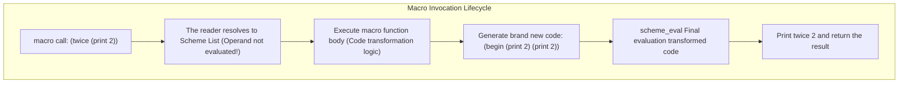

> **Course**: UC Berkeley CS61A (Fall 2024)  
> **Module**: Module 4: Interpreters & Scheme (Interpreters & Scheme)  
> **Lecturer**: Prof. John DeNero (UC Berkeley)  
> **Video duration**: 28:53 ｜ **Classroom screenshots**: 17 pieces of blackboard writing/code demonstration  
> **Direct video**: [📺Watch the original video of this lecture on Bilibili (P32)](https://www.bilibili.com/video/BV1sy411z7nA/?p=32)  
> **Quick navigation**: [← Previous Lecture (P31 Lecture 33 Programs as Data)](/en/notes/cs61a/lecture-31) ｜ [📚 Return to the full book catalog](/en/notes/topics/CS61A) ｜ [Next lecture (P33 Lecture 35 SQL) →](/en/notes/cs61a/lecture-33)

---

## Course Core Objectives and Panorama

In almost all mainstream programming languages, the language's \*\* syntax (Syntax) **with** Special Forms are a core prerogative of language designers that are fixed in compilers. The average programmer cannot define new control flow statements, such as adding a custom  `unless`  or similar  `do-while`  syntax.

In the Lisp/Scheme system, **Macros **It breaks the boundary between language designers and language users. Macros allow programmers to evaluate code in the interpreter** before**, directly intercepting and rewriting the abstract syntax tree (AST), thereby empowering programmers to work within the existing language **Freely define new special forms** of supreme power!



---

### In-depth formal specification and micro-evaluation process (Operational Semantics)
In the "Course Core Goals and Panorama" module, the underlying computer operations rely on strict formal evaluation logic:
1. **Hierarchical parsing of abstract syntax trees (AST)**: 
   - The source code character stream is first divided into terminal symbol tokens (Tokens) by the lexical analyzer (Lexer), and then constructed into a multi-fork syntax tree by the syntax parser (Parser);
   - Operator priority and associativity are solidified during the syntax tree construction phase, eliminating ambiguity at runtime;
2. **Dynamic transitions of environment chains**: 
   - Each function call generates a new frame whose static lexical environment is determined by the function object's  `parent`  Attributes are completely determined;
   - The variable search traces back up the environment chain in one direction until the global environment frame. If it is not found, it will be triggered.  `NameError`  Abnormal;
3. **State Invariants**: 
   - The key to writing robust programs is to clarify loop invariants (Loop Invariants) and function pre/post-conditions (Pre/Post-conditions);
   - In complex control flow jumps, ensure that state variables maintain legal business constraints before each iteration.


## 1. Quasi-quotation warm-up and symbolic expression manipulation (Quasi-quotation Practice)

Before formally exploring macros, you must master the precise control of quasi-reference (\`) and dereference (,).

[](https://www.bilibili.com/video/BV1sy411z7nA/?p=32&t=27)
*⏱ Timestamp: 00:00:27 · 📷 Classroom screenshot · [Watch the corresponding clip on Bilibili (P32 00:00:27)](https://www.bilibili.com/video/BV1sy411z7nA/?p=32&t=27)*

#### 📸 In-depth reading of classroom blackboard writing and code demonstration (00:00:27)

**\[On-site blackboard writing/code demonstration restoration\]**:
At this time point, Professor DeNero conducted a core demonstration and key blackboard derivation on the screen:
> *“Let's practice writing procedures that return expressions, which are scheme lists. Here's a discussion question that we'll go through. First, a quick quasi-quotation review. This is the quasi-quote symbol. What it does is quote the next expression, but allow for unquoting. The comma is the unquote s...”*

**\[Underlying computing model and micro execution mechanism\]**: 
1. **Execution context and timing tracing**: 
   - At the current discussion point "1. Quasi-quotation warm-up and symbolic expression manipulation (Quasi-quotation Practice)", the interpreter strictly follows the core evaluation convention;
   - The expression evaluates the operators first, then evaluates the operands strictly from left to right, and finally applies the function object to the argument list;
   - If the environment model is involved, the local frame strictly records its static lexical parent pointer (Parent Pointer points to the environment where the function is defined), forming an orthogonal architecture with the dynamic call stack at runtime.
2. **Memory topology and object references**: 
   - Variable symbols are just keys in a hash table (environment frame), and pointers point directly to first-class citizen objects in heap memory;
   - Assignment statements are discrete-time snapshots of the state and never create implicit mathematical dependency monitoring.

**\[Guidelines for avoiding pitfalls and guidance on high-frequency test points\]**: 
- **Common misunderstandings**: In the test questions related to "define-macro mechanism: absolute separation between macro expansion phase vs runtime execution phase", beginners can easily guess the results based on the surface form of the code, leading to scope confusion or variable shadowing (Shadowing) misjudgment;
- **The golden rule of debugging**: When encountering nested calls and complex branches, be sure to draw independent partial frames on the scratch paper, indicate the specific binding value of each formal parameter, and derive it step by step.


### Comprehensive thinking question: Constructing a sum of squares expression

Goal: Complete the quasi-reference and dereference symbols in the blanks so that the representation can be accurately generated after the call  $a^2 + b^2$  List of Scheme codes  `(+ (* a a) (* b b))`: 

```scheme
;; 目标：定义 square-expr 并生成代码列表
(define (square-expr term)
  `(* ,term ,term))

`(+ ,(square-expr 'a) ,(square-expr 'b))
;; => (+ (* a a) (* b b))
```

[](https://www.bilibili.com/video/BV1sy411z7nA/?p=32&t=110)
*⏱ Timestamp: 00:01:50 · 📷 Classroom screenshot · [Watch the corresponding clip on Bilibili (P32 00:01:50)](https://www.bilibili.com/video/BV1sy411z7nA/?p=32&t=110)*

#### 📸 In-depth reading of classroom blackboard writing and code demonstration (00:01:50)

**\[On-site blackboard writing/code demonstration restoration\]**:
At this time point, Professor DeNero conducted a core demonstration and key blackboard derivation on the screen:
> *“We're going to call it twice on A and B, so that's going to generate the times AA and the times BB, and then we're going to add in the symbol plus in order to get A squared plus B squared. So each blank here can either be empty or contain quasi-quote or unquote. I'd recommend that you pause the vide...”*

**\[Underlying computing model and micro execution mechanism\]**: 
1. **Execution context and timing tracing**: 
   - At the current discussion point "1. Quasi-quotation warm-up and symbolic expression manipulation (Quasi-quotation Practice)", the interpreter strictly follows the core evaluation convention;
   - The expression evaluates the operators first, then evaluates the operands strictly from left to right, and finally applies the function object to the argument list;
   - If the environment model is involved, the local frame strictly records its static lexical parent pointer (Parent Pointer points to the environment where the function is defined), forming an orthogonal architecture with the dynamic call stack at runtime.
2. **Memory topology and object references**: 
   - Variable symbols are just keys in a hash table (environment frame), and pointers point directly to first-class citizen objects in heap memory;
   - Assignment statements are discrete-time snapshots of the state and never create implicit mathematical dependency monitoring.

**\[Guidelines for avoiding pitfalls and guidance on high-frequency test points\]**: 
- **Common misunderstandings**: In the test questions related to "define-macro mechanism: absolute separation between macro expansion phase vs runtime execution phase", beginners can easily guess the results based on the surface form of the code, leading to scope confusion or variable shadowing (Shadowing) misjudgment;
- **The golden rule of debugging**: When encountering nested calls and complex branches, be sure to draw independent partial frames on the scratch paper, indicate the specific binding value of each formal parameter, and derive it step by step.


[](https://www.bilibili.com/video/BV1sy411z7nA/?p=32&t=224)
*⏱ Timestamp: 00:03:44 · 📷 Classroom screenshot · [Watch the corresponding clip on Bilibili (P32 00:03:44)](https://www.bilibili.com/video/BV1sy411z7nA/?p=32&t=224)*

#### 📸 In-depth reading of classroom blackboard writing and code demonstration (00:03:44)

**\[On-site blackboard writing/code demonstration restoration\]**:
At this time point, Professor DeNero conducted a core demonstration and key blackboard derivation on the screen:
> *“And this could be a regular quote or a quasi-quote, it doesn't matter which, because there's no unquoting inside. But since the direction set just used these two, I left it as a quasi-quote. And that's the answer. Let's see what some different answers do. So here's the correct answer as it was on th...”*

**\[Underlying computing model and micro execution mechanism\]**: 
1. **Execution context and timing tracing**: 
   - At the current discussion point "1. Quasi-quotation warm-up and symbolic expression manipulation (Quasi-quotation Practice)", the interpreter strictly follows the core evaluation convention;
   - The expression evaluates the operators first, then evaluates the operands strictly from left to right, and finally applies the function object to the argument list;
   - If the environment model is involved, the local frame strictly records its static lexical parent pointer (Parent Pointer points to the environment where the function is defined), forming an orthogonal architecture with the dynamic call stack at runtime.
2. **Memory topology and object references**: 
   - Variable symbols are just keys in a hash table (environment frame), and pointers point directly to first-class citizen objects in heap memory;
   - Assignment statements are discrete-time snapshots of the state and never create implicit mathematical dependency monitoring.

**\[Guidelines for avoiding pitfalls and guidance on high-frequency test points\]**: 
- **Common misunderstandings**: In the test questions related to "define-macro mechanism: absolute separation between macro expansion phase vs runtime execution phase", beginners can easily guess the results based on the surface form of the code, leading to scope confusion or variable shadowing (Shadowing) misjudgment;
- **The golden rule of debugging**: When encountering nested calls and complex branches, be sure to draw independent partial frames on the scratch paper, indicate the specific binding value of each formal parameter, and derive it step by step.


- **Key analysis**: 
  1. `square-expr`  Need to return something like  `(* a a)`  list, so the outer layer must be added with quasi-reference \`;
  2. formal parameters  `term`  Cannot be retained as a literal symbol, must be dereferenced  `,term`, the actual parameter symbols can be filled in the multiplication expression;
  3. outer layer  `+`  The expression must be a quasi-reference as a whole, and the internal call  `(square-expr 'a)`  then you must dereference the evaluation to obtain the resulting list of multiplication expressions.

---

### In-depth formal specification and micro-evaluation process (Operational Semantics)
In the module "1. Quasi-quotation Warm-up and Symbolic Expression Manipulation (Quasi-quotation Practice)", the underlying computer operations rely on strict formal evaluation logic:
1. **Hierarchical parsing of abstract syntax trees (AST)**: 
   - The source code character stream is first divided into terminal symbol tokens (Tokens) by the lexical analyzer (Lexer), and then constructed into a multi-fork syntax tree by the syntax parser (Parser);
   - Operator priority and associativity are solidified during the syntax tree construction phase, eliminating ambiguity at runtime;
2. **Dynamic transitions of environment chains**: 
   - Each function call generates a new frame whose static lexical environment is determined by the function object's  `parent`  Attributes are completely determined;
   - The variable search traces back up the environment chain in one direction until the global environment frame. If it is not found, it will be triggered.  `NameError`  Abnormal;
3. **State Invariants**: 
   - The key to writing robust programs is to clarify loop invariants (Loop Invariants) and function pre/post-conditions (Pre/Post-conditions);
   - In complex control flow jumps, ensure that state variables maintain legal business constraints before each iteration.


## 2. What are macros? Inventing new special forms for language (What Are Macros?)

In a normal function call, the interpreter follows **Applicative-Order Evaluation**: The operator and all operands are evaluated first, and then the function body is entered. This determines that ordinary functions cannot control the evaluation timing and number of evaluations of parameters.

[](https://www.bilibili.com/video/BV1sy411z7nA/?p=32&t=335)
*⏱ Timestamp: 00:05:35 · 📷 Classroom screenshot · [Watch the corresponding clip on Bilibili (P32 00:05:35)](https://www.bilibili.com/video/BV1sy411z7nA/?p=32&t=335)*

#### 📸 In-depth reading of classroom blackboard writing and code demonstration (00:05:35)

**\[On-site blackboard writing/code demonstration restoration\]**:
At this time point, Professor DeNero conducted a core demonstration and key blackboard derivation on the screen:
> *“If you don't quote A, then you're within a context that's being evaluated because it's unquoted, and so Scheme tries to evaluate the symbol A, but this is an unknown identifier, and so you get an error, which is why you need that quasi-quote symbol there. Macros are a feature of Scheme that allow yo...”*

**\[Underlying computing model and micro execution mechanism\]**: 
1. **Execution context and timing tracing**: 
   - At the current discussion point "2. What are macros? Inventing new special forms for languages (What Are Macros?)", the interpreter strictly follows the core evaluation convention;
   - The expression evaluates the operators first, then evaluates the operands strictly from left to right, and finally applies the function object to the argument list;
   - If the environment model is involved, the local frame strictly records its static lexical parent pointer (Parent Pointer points to the environment where the function is defined), forming an orthogonal architecture with the dynamic call stack at runtime.
2. **Memory topology and object references**: 
   - Variable symbols are just keys in a hash table (environment frame), and pointers point directly to first-class citizen objects in heap memory;
   - Assignment statements are discrete-time snapshots of the state and never create implicit mathematical dependency monitoring.

**\[Guidelines for avoiding pitfalls and guidance on high-frequency test points\]**: 
- **Common misunderstandings**: In the test questions related to "define-macro mechanism: absolute separation between macro expansion phase vs runtime execution phase", beginners can easily guess the results based on the surface form of the code, leading to scope confusion or variable shadowing (Shadowing) misjudgment;
- **The golden rule of debugging**: When encountering nested calls and complex branches, be sure to draw independent partial frames on the scratch paper, indicate the specific binding value of each formal parameter, and derive it step by step.


[](https://www.bilibili.com/video/BV1sy411z7nA/?p=32&t=426)
*⏱ Timestamp: 00:07:06 · 📷 Classroom screenshot · [Watch the corresponding clip on Bilibili (P32 00:07:06)](https://www.bilibili.com/video/BV1sy411z7nA/?p=32&t=426)*

#### 📸 In-depth reading of classroom blackboard writing and code demonstration (00:07:06)

**\[On-site blackboard writing/code demonstration restoration\]**:
At this time point, Professor DeNero conducted a core demonstration and key blackboard derivation on the screen:
> *“So the way that we'll invent new special forms is to describe how to take the parts of a special form and construct a regular piece of scheme code out of them and then evaluate that scheme code. So a macro is an operation performed on the source code of a program before that source code is evaluated...”*

**\[Underlying computing model and micro execution mechanism\]**: 
1. **Execution context and timing tracing**: 
   - At the current discussion point "2. What are macros? Inventing new special forms for languages (What Are Macros?)", the interpreter strictly follows the core evaluation convention;
   - The expression evaluates the operators first, then evaluates the operands strictly from left to right, and finally applies the function object to the argument list;
   - If the environment model is involved, the local frame strictly records its static lexical parent pointer (Parent Pointer points to the environment where the function is defined), forming an orthogonal architecture with the dynamic call stack at runtime.
2. **Memory topology and object references**: 
   - Variable symbols are just keys in a hash table (environment frame), and pointers point directly to first-class citizen objects in heap memory;
   - Assignment statements are discrete-time snapshots of the state and never create implicit mathematical dependency monitoring.

**\[Guidelines for avoiding pitfalls and guidance on high-frequency test points\]**: 
- **Common misunderstandings**: In the test questions related to "define-macro mechanism: absolute separation between macro expansion phase vs runtime execution phase", beginners can easily guess the results based on the surface form of the code, leading to scope confusion or variable shadowing (Shadowing) misjudgment;
- **The golden rule of debugging**: When encountering nested calls and complex branches, be sure to draw independent partial frames on the scratch paper, indicate the specific binding value of each formal parameter, and derive it step by step.


**Macro is a transformation process that acts on the program source code itself**: 
1. macro receive **List of unevaluated expressions** as a parameter;
2. The macro generates a new Scheme expression code through code splicing;
3. The interpreter performs a second evaluation of the generated code.

---

### In-depth formal specification and micro-evaluation process (Operational Semantics)
In the module "2. What are macros? Inventing new special forms for languages (What Are Macros?)", the underlying operations of computers rely on strict formal evaluation logic:
1. **Hierarchical parsing of abstract syntax trees (AST)**: 
   - The source code character stream is first divided into terminal symbol tokens (Tokens) by the lexical analyzer (Lexer), and then constructed into a multi-fork syntax tree by the syntax parser (Parser);
   - Operator priority and associativity are solidified during the syntax tree construction phase, eliminating ambiguity at runtime;
2. **Dynamic transitions of environment chains**: 
   - Each function call generates a new frame whose static lexical environment is determined by the function object's  `parent`  Attributes are completely determined;
   - The variable search traces back up the environment chain in one direction until the global environment frame. If it is not found, it will be triggered.  `NameError`  Abnormal;
3. **State Invariants**: 
   - The key to writing robust programs is to clarify loop invariants (Loop Invariants) and function pre/post-conditions (Pre/Post-conditions);
   - In complex control flow jumps, ensure that state variables maintain legal business constraints before each iteration.


## 3. Classic macro case 1: executed twice  `twice`  Macro

Suppose we need a syntactic structure that can perform any operation twice. If implemented using ordinary procedures:

```scheme
;; 错误尝试：普通过程
(define (twice expr)
  (begin expr expr))

(twice (print 2))
```

[](https://www.bilibili.com/video/BV1sy411z7nA/?p=32&t=483)
*⏱ Timestamp: 00:08:03 · 📷 Classroom screenshot · [Watch the corresponding clip on Bilibili (P32 00:08:03)](https://www.bilibili.com/video/BV1sy411z7nA/?p=32&t=483)*

#### 📸 In-depth reading of classroom blackboard writing and code demonstration (00:08:03)

**\[On-site blackboard writing/code demonstration restoration\]**:
At this time point, Professor DeNero conducted a core demonstration and key blackboard derivation on the screen:
> *“You build a list that starts with begin and then has that expression twice. Once you've defined this macro, you can twice anything. And here, we're twice-ing the expression print two. What happens behind the scenes because twice is a macro is that it evaluates the body of the macro on the expression...”*

**\[Underlying computing model and micro execution mechanism\]**: 
1. **Execution context and timing tracing**: 
   - At the current discussion point "3. Classic macro case 1: executed twice  `twice`  Macro", the interpreter strictly follows the core evaluation convention;
   - The expression evaluates the operators first, then evaluates the operands strictly from left to right, and finally applies the function object to the argument list;
   - If the environment model is involved, the local frame strictly records its static lexical parent pointer (Parent Pointer points to the environment where the function is defined), forming an orthogonal architecture with the dynamic call stack at runtime.
2. **Memory topology and object references**: 
   - Variable symbols are just keys in a hash table (environment frame), and pointers point directly to first-class citizen objects in heap memory;
   - Assignment statements are discrete-time snapshots of the state and never create implicit mathematical dependency monitoring.

**\[Guidelines for avoiding pitfalls and guidance on high-frequency test points\]**: 
- **Common misunderstandings**: In the test questions related to "define-macro mechanism: absolute separation between macro expansion phase vs runtime execution phase", beginners can easily guess the results based on the surface form of the code, leading to scope confusion or variable shadowing (Shadowing) misjudgment;
- **The golden rule of debugging**: When encountering nested calls and complex branches, be sure to draw independent partial frames on the scratch paper, indicate the specific binding value of each formal parameter, and derive it step by step.


Ordinary procedures will execute the actual parameters immediately before calling  `(print 2)`, only output once on the screen  `2`, and then  `print`  return value  `undefined`  incoming  `twice`, true two executions cannot be achieved.

### Macro solution: `define-macro`

```scheme
(define-macro (twice expr)
  `(begin ,expr ,expr))

(twice (print 2))
```

[](https://www.bilibili.com/video/BV1sy411z7nA/?p=32&t=543)
*⏱ Timestamp: 00:09:03 · 📷 Classroom screenshot · [Watch the corresponding clip on Bilibili (P32 00:09:03)](https://www.bilibili.com/video/BV1sy411z7nA/?p=32&t=543)*

#### 📸 In-depth reading of classroom blackboard writing and code demonstration (00:09:03)

**\[On-site blackboard writing/code demonstration restoration\]**:
At this time point, Professor DeNero conducted a core demonstration and key blackboard derivation on the screen:
> *“So there is something that twice can do that a regular procedure can't do, which is to take this expression and duplicate it before it gets evaluated and then evaluate it twice. So the evaluation procedure of a macro call expression in general, like this one, is that we evaluate the operator sub-exp...”*

**\[Underlying computing model and micro execution mechanism\]**: 
1. **Execution context and timing tracing**: 
   - At the current discussion point "3. Classic macro case 1: executed twice  `twice`  Macro", the interpreter strictly follows the core evaluation convention;
   - The expression evaluates the operators first, then evaluates the operands strictly from left to right, and finally applies the function object to the argument list;
   - If the environment model is involved, the local frame strictly records its static lexical parent pointer (Parent Pointer points to the environment where the function is defined), forming an orthogonal architecture with the dynamic call stack at runtime.
2. **Memory topology and object references**: 
   - Variable symbols are just keys in a hash table (environment frame), and pointers point directly to first-class citizen objects in heap memory;
   - Assignment statements are discrete-time snapshots of the state and never create implicit mathematical dependency monitoring.

**\[Guidelines for avoiding pitfalls and guidance on high-frequency test points\]**: 
- **Common misunderstandings**: In the test questions related to "define-macro mechanism: absolute separation between macro expansion phase vs runtime execution phase", beginners can easily guess the results based on the surface form of the code, leading to scope confusion or variable shadowing (Shadowing) misjudgment;
- **The golden rule of debugging**: When encountering nested calls and complex branches, be sure to draw independent partial frames on the scratch paper, indicate the specific binding value of each formal parameter, and derive it step by step.


[](https://www.bilibili.com/video/BV1sy411z7nA/?p=32&t=630)
*⏱ Timestamp: 00:10:30 · 📷 Classroom screenshot · [Watch the corresponding clip on Bilibili (P32 00:10:30)](https://www.bilibili.com/video/BV1sy411z7nA/?p=32&t=630)*

#### 📸 In-depth reading of classroom blackboard writing and code demonstration (00:10:30)

**\[On-site blackboard writing/code demonstration restoration\]**:
At this time point, Professor DeNero conducted a core demonstration and key blackboard derivation on the screen:
> *“And I wanted to define twice. I'm going to write the same body that I had on the slide. Begin the expression, and then the expression again. Now, twice print two doesn't work. I get two displayed, and then I construct an expression that says begin, none, none, the value of print two. If I wanted to ...”*

**\[Underlying computing model and micro execution mechanism\]**: 
1. **Execution context and timing tracing**: 
   - At the current discussion point "3. Classic macro case 1: executed twice  `twice`  Macro", the interpreter strictly follows the core evaluation convention;
   - The expression evaluates the operators first, then evaluates the operands strictly from left to right, and finally applies the function object to the argument list;
   - If the environment model is involved, the local frame strictly records its static lexical parent pointer (Parent Pointer points to the environment where the function is defined), forming an orthogonal architecture with the dynamic call stack at runtime.
2. **Memory topology and object references**: 
   - Variable symbols are just keys in a hash table (environment frame), and pointers point directly to first-class citizen objects in heap memory;
   - Assignment statements are discrete-time snapshots of the state and never create implicit mathematical dependency monitoring.

**\[Guidelines for avoiding pitfalls and guidance on high-frequency test points\]**: 
- **Common misunderstandings**: In the test questions related to "define-macro mechanism: absolute separation between macro expansion phase vs runtime execution phase", beginners can easily guess the results based on the surface form of the code, leading to scope confusion or variable shadowing (Shadowing) misjudgment;
- **The golden rule of debugging**: When encountering nested calls and complex branches, be sure to draw independent partial frames on the scratch paper, indicate the specific binding value of each formal parameter, and derive it step by step.


- The interpreter encountered a macro call  `twice`  when, **No evaluation at all  `(print 2)`**; 
- received by the macro function body  `expr`  is the original list  `(print 2)`; 
- Macro template generation code: `(begin (print 2) (print 2))`; 
- The interpreter evaluates the code and successfully prints it twice on the screen  `2`!

---

### In-depth formal specification and micro-evaluation process (Operational Semantics)
In "3. Classic macro case 1: executed twice  `twice`  In the "macro" module, the underlying computer operations rely on strict formal evaluation logic:
1. **Hierarchical parsing of abstract syntax trees (AST)**: 
   - The source code character stream is first divided into terminal symbol tokens (Tokens) by the lexical analyzer (Lexer), and then constructed into a multi-fork syntax tree by the syntax parser (Parser);
   - Operator priority and associativity are solidified during the syntax tree construction phase, eliminating ambiguity at runtime;
2. **Dynamic transitions of environment chains**: 
   - Each function call generates a new frame whose static lexical environment is determined by the function object's  `parent`  Attributes are completely determined;
   - The variable search traces back up the environment chain in one direction until the global environment frame. If it is not found, it will be triggered.  `NameError`  Abnormal;
3. **State Invariants**: 
   - The key to writing robust programs is to clarify loop invariants (Loop Invariants) and function pre/post-conditions (Pre/Post-conditions);
   - In complex control flow jumps, ensure that state variables maintain legal business constraints before each iteration.


## 4. Classic macro case 2: Assertion test macro with source code report  `check`

When writing unit test assertions, ordinary functions can only receive boolean values, and there is no way to know which line of expression failed:

```scheme
;; 普通过程测试：失败时仅能输出 "failed"，丢失了上下文
(define (check val)
  (if val 'passed 'failed))
```

[](https://www.bilibili.com/video/BV1sy411z7nA/?p=32&t=750)
*⏱ Timestamp: 00:12:30 · 📷 Classroom screenshot · [Watch the corresponding clip on Bilibili (P32 00:12:30)](https://www.bilibili.com/video/BV1sy411z7nA/?p=32&t=750)*

#### 📸 In-depth reading of classroom blackboard writing and code demonstration (00:12:30)

**\[On-site blackboard writing/code demonstration restoration\]**:
At this time point, Professor DeNero conducted a core demonstration and key blackboard derivation on the screen:
> *“I can write, if the value is true, then I passed the check. Otherwise, I failed the check. And if, for instance, I had x negative 2 and I wanted to check that x is greater than 0, I would have failed that check. So this is a reasonable way to add little tests inside of your scheme program. But unfor...”*

**\[Underlying computing model and micro execution mechanism\]**: 
1. **Execution context and timing tracing**: 
   - At the current discussion point "4. Classic macro case 2: Assertion test macro with source code report  `check`”, the interpreter strictly follows the core evaluation convention;
   - The expression evaluates the operators first, then evaluates the operands strictly from left to right, and finally applies the function object to the argument list;
   - If the environment model is involved, the local frame strictly records its static lexical parent pointer (Parent Pointer points to the environment where the function is defined), forming an orthogonal architecture with the dynamic call stack at runtime.
2. **Memory topology and object references**: 
   - Variable symbols are just keys in a hash table (environment frame), and pointers point directly to first-class citizen objects in heap memory;
   - Assignment statements are discrete-time snapshots of the state and never create implicit mathematical dependency monitoring.

**\[Guidelines for avoiding pitfalls and guidance on high-frequency test points\]**: 
- **Common misunderstandings**: In the test questions related to "define-macro mechanism: absolute separation between macro expansion phase vs runtime execution phase", beginners can easily guess the results based on the surface form of the code, leading to scope confusion or variable shadowing (Shadowing) misjudgment;
- **The golden rule of debugging**: When encountering nested calls and complex branches, be sure to draw independent partial frames on the scratch paper, indicate the specific binding value of each formal parameter, and derive it step by step.


Through macros, we can obtain both **Code to test expression** Instead of **Execution result**: 

```scheme
(define-macro (check expr)
  `(if ,expr
       'passed
       (list 'failed ',expr)))
```

[](https://www.bilibili.com/video/BV1sy411z7nA/?p=32&t=845)
*⏱ Timestamp: 00:14:05 · 📷 Classroom screenshot · [Watch the corresponding clip on Bilibili (P32 00:14:05)](https://www.bilibili.com/video/BV1sy411z7nA/?p=32&t=845)*

#### 📸 In-depth reading of classroom blackboard writing and code demonstration (00:14:05)

**\[On-site blackboard writing/code demonstration restoration\]**:
At this time point, Professor DeNero conducted a core demonstration and key blackboard derivation on the screen:
> *“X to be negative two, and then I check to see, is it the case that X is greater than zero? It will say failed. So I've done all this work to define a macro. It was slightly more complicated than the procedure, and it doesn't do anything new yet. But we could get it to do something new by not only sa...”*

**\[Underlying computing model and micro execution mechanism\]**: 
1. **Execution context and timing tracing**: 
   - At the current discussion point "4. Classic macro case 2: Assertion test macro with source code report  `check`”, the interpreter strictly follows the core evaluation convention;
   - The expression evaluates the operators first, then evaluates the operands strictly from left to right, and finally applies the function object to the argument list;
   - If the environment model is involved, the local frame strictly records its static lexical parent pointer (Parent Pointer points to the environment where the function is defined), forming an orthogonal architecture with the dynamic call stack at runtime.
2. **Memory topology and object references**: 
   - Variable symbols are just keys in a hash table (environment frame), and pointers point directly to first-class citizen objects in heap memory;
   - Assignment statements are discrete-time snapshots of the state and never create implicit mathematical dependency monitoring.

**\[Guidelines for avoiding pitfalls and guidance on high-frequency test points\]**: 
- **Common misunderstandings**: In the test questions related to "define-macro mechanism: absolute separation between macro expansion phase vs runtime execution phase", beginners can easily guess the results based on the surface form of the code, leading to scope confusion or variable shadowing (Shadowing) misjudgment;
- **The golden rule of debugging**: When encountering nested calls and complex branches, be sure to draw independent partial frames on the scratch paper, indicate the specific binding value of each formal parameter, and derive it step by step.


Pay attention to the  `',expr`: 
- Outer single quotes cause the generated code to include the quoted original expression;
- When the assertion fails, the output contains not only  `'failed`, and also directly prints out the original expression where the failure occurred  `(> x 0)`! This is absolutely impossible for ordinary functions to do.

---

### In-depth formal specification and micro-evaluation process (Operational Semantics)
In "4. Classic Macro Case 2: Assertion Test Macro with Source Code Report  `check` In the module, the underlying computer operations rely on strict formal evaluation logic:
1. **Hierarchical parsing of abstract syntax trees (AST)**: 
   - The source code character stream is first divided into terminal symbol tokens (Tokens) by the lexical analyzer (Lexer), and then constructed into a multi-fork syntax tree by the syntax parser (Parser);
   - Operator priority and associativity are solidified during the syntax tree construction phase, eliminating ambiguity at runtime;
2. **Dynamic transitions of environment chains**: 
   - Each function call generates a new frame whose static lexical environment is determined by the function object's  `parent`  Attributes are completely determined;
   - The variable search traces back up the environment chain in one direction until the global environment frame. If it is not found, it will be triggered.  `NameError`  Abnormal;
3. **State Invariants**: 
   - The key to writing robust programs is to clarify loop invariants (Loop Invariants) and function pre/post-conditions (Pre/Post-conditions);
   - In complex control flow jumps, ensure that state variables maintain legal business constraints before each iteration.


## 5. Classic macro case 3: Adding to Scheme  `for`  Loop syntax

The Scheme language itself does not  `for ... in ...`  Grammar. With the help of macros, we can create a new set of functions for Scheme with just a few lines of code.  `for`  Looping language features!

[](https://www.bilibili.com/video/BV1sy411z7nA/?p=32&t=942)
*⏱ Timestamp: 00:15:42 · 📷 Classroom screenshot · [Watch the corresponding clip on Bilibili (P32 00:15:42)](https://www.bilibili.com/video/BV1sy411z7nA/?p=32&t=942)*

#### 📸 In-depth reading of classroom blackboard writing and code demonstration (00:15:42)

**\[On-site blackboard writing/code demonstration restoration\]**:
At this time point, Professor DeNero conducted a core demonstration and key blackboard derivation on the screen:
> *“Is x greater than zero? Constructs the following expression. If x is greater than zero, then it just says passed. Otherwise, it builds this list, failed, and then the expression. If I were to evaluate that, then I would get the fact that it failed. But of course, if instead x were two, and I evaluat...”*

**\[Underlying computing model and micro execution mechanism\]**: 
1. **Execution context and timing tracing**: 
   - At the current discussion point "5. Classic Macro Case 3: Adding to Scheme  `for` "Loop syntax", the interpreter strictly follows the core evaluation convention;
   - The expression evaluates the operators first, then evaluates the operands strictly from left to right, and finally applies the function object to the argument list;
   - If the environment model is involved, the local frame strictly records its static lexical parent pointer (Parent Pointer points to the environment where the function is defined), forming an orthogonal architecture with the dynamic call stack at runtime.
2. **Memory topology and object references**: 
   - Variable symbols are just keys in a hash table (environment frame), and pointers point directly to first-class citizen objects in heap memory;
   - Assignment statements are discrete-time snapshots of the state and never create implicit mathematical dependency monitoring.

**\[Guidelines for avoiding pitfalls and guidance on high-frequency test points\]**: 
- **Common misunderstandings**: In the test questions related to "define-macro mechanism: absolute separation between macro expansion phase vs runtime execution phase", beginners can easily guess the results based on the surface form of the code, leading to scope confusion or variable shadowing (Shadowing) misjudgment;
- **The golden rule of debugging**: When encountering nested calls and complex branches, be sure to draw independent partial frames on the scratch paper, indicate the specific binding value of each formal parameter, and derive it step by step.


Target syntax:
```scheme
(for x in '(2 3 4 5) (* x x))
;; 预期输出 => (4 9 16 25)
```

The underlying equivalent conversion target:
```scheme
(map (lambda (x) (* x x)) '(2 3 4 5))
```

[](https://www.bilibili.com/video/BV1sy411z7nA/?p=32&t=1061)
*⏱ Timestamp: 00:17:41 · 📷 Classroom screenshot · [Watch the corresponding clip on Bilibili (P32 00:17:41)](https://www.bilibili.com/video/BV1sy411z7nA/?p=32&t=1061)*

#### 📸 In-depth reading of classroom blackboard writing and code demonstration (00:17:41)

**\[On-site blackboard writing/code demonstration restoration\]**:
At this time point, Professor DeNero conducted a core demonstration and key blackboard derivation on the screen:
> *“More straightforward to state what I want because I don't have to explicitly write out the word lambda. So, defining the macro means saying what happens when you have four and then a symbol and then some values and then an expression to evaluate for each of those values. What we do is build this exp...”*

**\[Underlying computing model and micro execution mechanism\]**: 
1. **Execution context and timing tracing**: 
   - At the current discussion point "5. Classic Macro Case 3: Adding to Scheme  `for` "Loop syntax", the interpreter strictly follows the core evaluation convention;
   - The expression evaluates the operators first, then evaluates the operands strictly from left to right, and finally applies the function object to the argument list;
   - If the environment model is involved, the local frame strictly records its static lexical parent pointer (Parent Pointer points to the environment where the function is defined), forming an orthogonal architecture with the dynamic call stack at runtime.
2. **Memory topology and object references**: 
   - Variable symbols are just keys in a hash table (environment frame), and pointers point directly to first-class citizen objects in heap memory;
   - Assignment statements are discrete-time snapshots of the state and never create implicit mathematical dependency monitoring.

**\[Guidelines for avoiding pitfalls and guidance on high-frequency test points\]**: 
- **Common misunderstandings**: In the test questions related to "define-macro mechanism: absolute separation between macro expansion phase vs runtime execution phase", beginners can easily guess the results based on the surface form of the code, leading to scope confusion or variable shadowing (Shadowing) misjudgment;
- **The golden rule of debugging**: When encountering nested calls and complex branches, be sure to draw independent partial frames on the scratch paper, indicate the specific binding value of each formal parameter, and derive it step by step.


### `for`  Complete implementation of macro

```scheme
(define-macro (for sym in vals expr)
  `(map (lambda (,sym) ,expr) ,vals))
```

Test execution:
```scheme
(for x in '(2 3 4 5) (* x x)) ; => (4 9 16 25)
```
Just by defining a simple macro, we have extended the advanced loop control structure for the Scheme language without even realizing it!

---

### In-depth formal specification and micro-evaluation process (Operational Semantics)
In "5. Classic Macro Case 3: Adding Scheme  `for`  In the "Loop Grammar" module, the underlying computer operations rely on strict formal evaluation logic:
1. **Hierarchical parsing of abstract syntax trees (AST)**: 
   - The source code character stream is first divided into terminal symbol tokens (Tokens) by the lexical analyzer (Lexer), and then constructed into a multi-fork syntax tree by the syntax parser (Parser);
   - Operator priority and associativity are solidified during the syntax tree construction phase, eliminating ambiguity at runtime;
2. **Dynamic transitions of environment chains**: 
   - Each function call generates a new frame whose static lexical environment is determined by the function object's  `parent`  Attributes are completely determined;
   - The variable search traces back up the environment chain in one direction until the global environment frame. If it is not found, it will be triggered.  `NameError`  Abnormal;
3. **State Invariants**: 
   - The key to writing robust programs is to clarify loop invariants (Loop Invariants) and function pre/post-conditions (Pre/Post-conditions);
   - In complex control flow jumps, ensure that state variables maintain legal business constraints before each iteration.


## 6. Advanced challenge: dynamic tracking macro of recursive process (`trace`)

In Python we can use  `@trace`  The decorator prints the input and return values of each level of the recursive call:

[](https://www.bilibili.com/video/BV1sy411z7nA/?p=32&t=1176)
*⏱ Timestamp: 00:19:36 · 📷 Classroom screenshot · [Watch the corresponding clip on Bilibili (P32 00:19:36)](https://www.bilibili.com/video/BV1sy411z7nA/?p=32&t=1176)*

#### 📸 In-depth reading of classroom blackboard writing and code demonstration (00:19:36)

**\[On-site blackboard writing/code demonstration restoration\]**:
At this time point, Professor DeNero conducted a core demonstration and key blackboard derivation on the screen:
> *“This time about tracing the execution of a recursive function or procedure. We've been tracing recursive calls in this course before. In Python, we did it with a decorator. So here's a decorator called trace. It takes in another function to be traced, defines a version of that function that has the ...”*

**\[Underlying computing model and micro execution mechanism\]**: 
1. **Execution context and timing tracing**: 
   - At the current discussion point "6. Advanced challenge: dynamic tracking macro of recursive process (`trace`)", the interpreter strictly follows the core evaluation convention;
   - The expression evaluates the operators first, then evaluates the operands strictly from left to right, and finally applies the function object to the argument list;
   - If the environment model is involved, the local frame strictly records its static lexical parent pointer (Parent Pointer points to the environment where the function is defined), forming an orthogonal architecture with the dynamic call stack at runtime.
2. **Memory topology and object references**: 
   - Variable symbols are just keys in a hash table (environment frame), and pointers point directly to first-class citizen objects in heap memory;
   - Assignment statements are discrete-time snapshots of the state and never create implicit mathematical dependency monitoring.

**\[Guidelines for avoiding pitfalls and guidance on high-frequency test points\]**: 
- **Common misunderstandings**: In the test questions related to "define-macro mechanism: absolute separation between macro expansion phase vs runtime execution phase", beginners can easily guess the results based on the surface form of the code, leading to scope confusion or variable shadowing (Shadowing) misjudgment;
- **The golden rule of debugging**: When encountering nested calls and complex branches, be sure to draw independent partial frames on the scratch paper, indicate the specific binding value of each formal parameter, and derive it step by step.


[](https://www.bilibili.com/video/BV1sy411z7nA/?p=32&t=1302)
*⏱ Timestamp: 00:21:42 · 📷 Classroom screenshot · [Watch the corresponding clip on Bilibili (P32 00:21:42)](https://www.bilibili.com/video/BV1sy411z7nA/?p=32&t=1302)*

#### 📸 In-depth reading of classroom blackboard writing and code demonstration (00:21:42)

**\[On-site blackboard writing/code demonstration restoration\]**:
At this time point, Professor DeNero conducted a core demonstration and key blackboard derivation on the screen:
> *“Here's something we can do without using a macro. We could define factorial of n as a procedure that has the same logic as the Python version. We could then assign the symbol original to this fact procedure and redefined the fact procedure as a function that first prints and then calls the original....”*

**\[Underlying computing model and micro execution mechanism\]**: 
1. **Execution context and timing tracing**: 
   - At the current discussion point "6. Advanced challenge: dynamic tracking macro of recursive process (`trace`)", the interpreter strictly follows the core evaluation convention;
   - The expression evaluates the operators first, then evaluates the operands strictly from left to right, and finally applies the function object to the argument list;
   - If the environment model is involved, the local frame strictly records its static lexical parent pointer (Parent Pointer points to the environment where the function is defined), forming an orthogonal architecture with the dynamic call stack at runtime.
2. **Memory topology and object references**: 
   - Variable symbols are just keys in a hash table (environment frame), and pointers point directly to first-class citizen objects in heap memory;
   - Assignment statements are discrete-time snapshots of the state and never create implicit mathematical dependency monitoring.

**\[Guidelines for avoiding pitfalls and guidance on high-frequency test points\]**: 
- **Common misunderstandings**: In the test questions related to "define-macro mechanism: absolute separation between macro expansion phase vs runtime execution phase", beginners can easily guess the results based on the surface form of the code, leading to scope confusion or variable shadowing (Shadowing) misjudgment;
- **The golden rule of debugging**: When encountering nested calls and complex branches, be sure to draw independent partial frames on the scratch paper, indicate the specific binding value of each formal parameter, and derive it step by step.


In Scheme, since there is no built-in decorator syntax in the language, macros are the only ultimate tool if you want to track the execution of a recursive function once on demand without permanently modifying the function definition.

### Tracking design ideas

[](https://www.bilibili.com/video/BV1sy411z7nA/?p=32&t=1464)
*⏱ Timestamp: 00:24:24 · 📷 Classroom screenshot · [Watch the corresponding clip on Bilibili (P32 00:24:24)](https://www.bilibili.com/video/BV1sy411z7nA/?p=32&t=1464)*

#### 📸 In-depth reading of classroom blackboard writing and code demonstration (00:24:24)

**\[On-site blackboard writing/code demonstration restoration\]**:
At this time point, Professor DeNero conducted a core demonstration and key blackboard derivation on the screen:
> *“We'd see that before we trace it, it's 120. After we retrace it, it gives us the printing in 120. But then when we go back to the original, it just shows us 120 without the tracing. In order to build this logic into a generic macro, we're going to have to turn it into one expression instead of four....”*

**\[Underlying computing model and micro execution mechanism\]**: 
1. **Execution context and timing tracing**: 
   - At the current discussion point "6. Advanced challenge: dynamic tracking macro of recursive process (`trace`)", the interpreter strictly follows the core evaluation convention;
   - The expression evaluates the operators first, then evaluates the operands strictly from left to right, and finally applies the function object to the argument list;
   - If the environment model is involved, the local frame strictly records its static lexical parent pointer (Parent Pointer points to the environment where the function is defined), forming an orthogonal architecture with the dynamic call stack at runtime.
2. **Memory topology and object references**: 
   - Variable symbols are just keys in a hash table (environment frame), and pointers point directly to first-class citizen objects in heap memory;
   - Assignment statements are discrete-time snapshots of the state and never create implicit mathematical dependency monitoring.

**\[Guidelines for avoiding pitfalls and guidance on high-frequency test points\]**: 
- **Common misunderstandings**: In the test questions related to "define-macro mechanism: absolute separation between macro expansion phase vs runtime execution phase", beginners can easily guess the results based on the surface form of the code, leading to scope confusion or variable shadowing (Shadowing) misjudgment;
- **The golden rule of debugging**: When encountering nested calls and complex branches, be sure to draw independent partial frames on the scratch paper, indicate the specific binding value of each formal parameter, and derive it step by step.


in execution  `(trace (fact 5))`  When, we want to automatically complete the following pipeline:
1. save  `fact`  The original procedure is defined into a temporary variable  `original`; 
2. will  `fact`  Redefined as packaging process with printed log;
3. execute  `(fact 5)` (At this time, internal recursive calls will trigger printing);
4. will  `fact`  Revert to original process  `original`; 
5. Return the calculation result  `120`.

### `trace`  Macro code implementation

```scheme
(define-macro (trace expr)
  (let ((op (car expr)))
    `(begin
       (define original ,op)
       (define ,op (lambda (n)
                     (print (list ',op n))
                     (original n)))
       (define result ,expr)
       (define ,op original)
       result)))
```

[](https://www.bilibili.com/video/BV1sy411z7nA/?p=32&t=1580)
*⏱ Timestamp: 00:26:20 · 📷 Classroom screenshot · [Watch the corresponding clip on Bilibili (P32 00:26:20)](https://www.bilibili.com/video/BV1sy411z7nA/?p=32&t=1580)*

#### 📸 In-depth reading of classroom blackboard writing and code demonstration (00:26:20)

**\[On-site blackboard writing/code demonstration restoration\]**:
At this time point, Professor DeNero conducted a core demonstration and key blackboard derivation on the screen:
> *“We don't want it always to be fact. We want it to be whatever the operator is. And so we use unquote in order to make sure that the operator gets evaluated. Then we redefine whatever the operator is, such as fact, to be a new lambda that prints out list. Instead of always printing fact, we want to p...”*

**\[Underlying computing model and micro execution mechanism\]**: 
1. **Execution context and timing tracing**: 
   - At the current discussion point "6. Advanced challenge: dynamic tracking macro of recursive process (`trace`)", the interpreter strictly follows the core evaluation convention;
   - The expression evaluates the operators first, then evaluates the operands strictly from left to right, and finally applies the function object to the argument list;
   - If the environment model is involved, the local frame strictly records its static lexical parent pointer (Parent Pointer points to the environment where the function is defined), forming an orthogonal architecture with the dynamic call stack at runtime.
2. **Memory topology and object references**: 
   - Variable symbols are just keys in a hash table (environment frame), and pointers point directly to first-class citizen objects in heap memory;
   - Assignment statements are discrete-time snapshots of the state and never create implicit mathematical dependency monitoring.

**\[Guidelines for avoiding pitfalls and guidance on high-frequency test points\]**: 
- **Common misunderstandings**: In the test questions related to "define-macro mechanism: absolute separation between macro expansion phase vs runtime execution phase", beginners can easily guess the results based on the surface form of the code, leading to scope confusion or variable shadowing (Shadowing) misjudgment;
- **The golden rule of debugging**: When encountering nested calls and complex branches, be sure to draw independent partial frames on the scratch paper, indicate the specific binding value of each formal parameter, and derive it step by step.


[](https://www.bilibili.com/video/BV1sy411z7nA/?p=32&t=1660)
*⏱ Timestamp: 00:27:40 · 📷 Classroom screenshot · [Watch the corresponding clip on Bilibili (P32 00:27:40)](https://www.bilibili.com/video/BV1sy411z7nA/?p=32&t=1660)*

#### 📸 In-depth reading of classroom blackboard writing and code demonstration (00:27:40)

**\[On-site blackboard writing/code demonstration restoration\]**:
At this time point, Professor DeNero conducted a core demonstration and key blackboard derivation on the screen:
> *“By quoting that symbol, which generically is called operator. So if we run this again, now we see what we were looking for. Calling fact five gives me 120, tracing fact five. Shows me what happened and gives me 120. But if I call fact five after that, everything is back to normal because I went back...”*

**\[Underlying computing model and micro execution mechanism\]**: 
1. **Execution context and timing tracing**: 
   - At the current discussion point "6. Advanced challenge: dynamic tracking macro of recursive process (`trace`)", the interpreter strictly follows the core evaluation convention;
   - The expression evaluates the operators first, then evaluates the operands strictly from left to right, and finally applies the function object to the argument list;
   - If the environment model is involved, the local frame strictly records its static lexical parent pointer (Parent Pointer points to the environment where the function is defined), forming an orthogonal architecture with the dynamic call stack at runtime.
2. **Memory topology and object references**: 
   - Variable symbols are just keys in a hash table (environment frame), and pointers point directly to first-class citizen objects in heap memory;
   - Assignment statements are discrete-time snapshots of the state and never create implicit mathematical dependency monitoring.

**\[Guidelines for avoiding pitfalls and guidance on high-frequency test points\]**: 
- **Common misunderstandings**: In the test questions related to "define-macro mechanism: absolute separation between macro expansion phase vs runtime execution phase", beginners can easily guess the results based on the surface form of the code, leading to scope confusion or variable shadowing (Shadowing) misjudgment;
- **The golden rule of debugging**: When encountering nested calls and complex branches, be sure to draw independent partial frames on the scratch paper, indicate the specific binding value of each formal parameter, and derive it step by step.


### Why is Scheme's macro tracing more flexible than Python decorators?

- Python decorators are statically bound when the function is defined. Once decorated, all subsequent calls will force the log to be printed;
- Scheme of  `trace`  Hong Zai **Call point dynamic intervention**: 
  - Called when you want to trace  `(trace (fact 5))`, the screen outputs the complete call chain;
  - Write when calling normally  `(fact 5)`, no log overhead at all!

---

### In-depth formal specification and micro-evaluation process (Operational Semantics)
In "6. Advanced Challenge: Dynamic Tracking Macro for Recursive Processes (`trace`)" module, the underlying computer operations rely on strict formal evaluation logic:
1. **Hierarchical parsing of abstract syntax trees (AST)**: 
   - The source code character stream is first divided into terminal symbol tokens (Tokens) by the lexical analyzer (Lexer), and then constructed into a multi-fork syntax tree by the syntax parser (Parser);
   - Operator priority and associativity are solidified during the syntax tree construction phase, eliminating ambiguity at runtime;
2. **Dynamic transitions of environment chains**: 
   - Each function call generates a new frame whose static lexical environment is determined by the function object's  `parent`  Attributes are completely determined;
   - The variable search traces back up the environment chain in one direction until the global environment frame. If it is not found, it will be triggered.  `NameError`  Abnormal;
3. **State Invariants**: 
   - The key to writing robust programs is to clarify loop invariants (Loop Invariants) and function pre/post-conditions (Pre/Post-conditions);
   - In complex control flow jumps, ensure that state variables maintain legal business constraints before each iteration.


## A quick look at the core differences between macros and ordinary procedures

| Dimensions | Ordinary procedures (Procedures) | Macros |
| :--- | :--- | :--- |
| **Definition syntax** | `(define (f x) ...)` | `(define-macro (f x) ...)` |
| **Argument evaluation** | Before entering the function, the actual parameters **Evaluate immediately** | Actual parameters **Passed in as a list of expressions** |
| **Return value semantics** | The return value is the final calculation result | The return value is a segment **new code**, the interpreter immediately evaluates it again |
| **Capability boundary** | Data calculation and logical abstraction | Syntax extension, control flow customization, metaprogramming |
| **Side effect control** | Unable to prevent side effects of parameter expressions | Ability to defer, repeat, or skip expression evaluation entirely |

### In-depth formal specification and micro-evaluation process (Operational Semantics)
In the "Quick Review of Core Differences between Macros and Ordinary Procedures" module, the underlying computer operations rely on strict formal evaluation logic:
1. **Hierarchical parsing of abstract syntax trees (AST)**: 
   - The source code character stream is first divided into terminal symbol tokens (Tokens) by the lexical analyzer (Lexer), and then constructed into a multi-fork syntax tree by the syntax parser (Parser);
   - Operator priority and associativity are solidified during the syntax tree construction phase, eliminating ambiguity at runtime;
2. **Dynamic transitions of environment chains**: 
   - Each function call generates a new frame whose static lexical environment is determined by the function object's  `parent`  Attributes are completely determined;
   - The variable search traces back up the environment chain in one direction until the global environment frame. If it is not found, it will be triggered.  `NameError`  Abnormal;
3. **State Invariants**: 
   - The key to writing robust programs is to clarify loop invariants (Loop Invariants) and function pre/post-conditions (Pre/Post-conditions);
   - In complex control flow jumps, ensure that state variables maintain legal business constraints before each iteration.


---

## Berkeley Midterm/Final classic high-frequency exam questions in-depth practice

### Practical exam questions: Environment topology and microstate tracking (WWPD & Environment Diagrams)
Consider the following microscopic execution of Python code in an interactive environment:

```python
# 经典作用域与高阶函数综合考题
x = 10

def outer(x):
    y = x + 2
    def inner(y):
        return x + y
    return inner

f = outer(5)
result = f(3)
```

#### Complete problem-solving thinking model and multi-frame environment map derivation:
1. **Global Frame initialization**: 
   - global variables  `x`  Bind to integer object  `10`; 
   - global function  `outer`  Binds to the newly created function object whose embedded  `parent = Global`; 
2. **execute  `f = outer(5)`**: 
   - create a local frame  $f_1$, mark  `f1: outer [parent=Global]`; 
   - formal parameters  `x`  Bind to actual parameters  `5`; 
   - local variables  `y`  bind to  `5 + 2 = 7`; 
   - in  $f_1$  internal execution  `def inner(y):`, create a function object  `inner`, its embedded  **`parent = f1`**; 
   - Return function object  `inner`, global variables  `f`  Bind to this object;
3. **execute  `result = f(3)`**: 
   - call function  `f` (i.e.  `inner`), open up a local frame  $f_2$; 
   - **core scoring points**:frame  $f_2$  Who does parent point to?
   - **iron law**: function  `inner`  is in frame  $f_1$  is defined internally, so  $f_2$  of  **`parent = f1`**!
   - formal parameters  `y`  Bind to actual parameters  `3`; 
   - executor  `return x + y`: 
     - in current frame  $f_2$  Find  `y`: Hit local variable  `y = 3`; 
     - in current frame  $f_2$  Find  `x`: miss, trace back along parent  **$f_1$  frame**  Find it!
     - in  $f_1$  hit in frame  `x = 5` (Global  `x = 10`  Partially obscured! );
     - Calculate  `5 + 3 = 8`, as the return value;
4. **Final output conclusion**: 
   - global variables  `result = 8`.

---

## Knowledge Matrix of the core concepts of this lecture

| core knowledge dimension | Formal definition and mechanism | Typical code examples | Core Engineering and Algorithm Value | Common pitfalls |
| :--- | :--- | :--- | :--- | :--- |
| **Basic evaluation semantics** | The expression is evaluated to obtain a value, and the execution of the statement changes the internal state. | `x = 2 + 3` | Build a discrete-time state snapshot mental model | Mistaking the assignment equal sign as a dynamic constraint on an algebraic equation |
| **Environment frame topology** | The environment is an ordered chain of frames | `Global -> f1 -> f2` | Implement safe isolation of lexical scope and variables | Confusing the caller stack frame with the parent environment pointer at the definition point |
| **abstract barrier** | Isolate implementation details and calling logic through functional interfaces | `def square(x): ...` | Reduce cognitive load on large-scale systems | Destroying interfaces directly relies on underlying private data structures |
| **control flow decisions** | Conditional branch short-circuit evaluation and loop iteration progression | `if cond: ... while: ...` | Give programs non-linear decision-making and large-scale data processing capabilities | Missing the loop progression variable causes an infinite loop |
| **higher level abilities** | Functions as first-class citizens (parameter passing, return, assignment) | `make_adder(3)` | Implement factory pattern, closure persistent state and currying | Closure late binding throws loop variable capture error |

---

## Course navigation and jump

| Previous lecture | Directory | Next lecture | Original video |
| :--- | :---: | :--- | :--- |
| [← Previous lecture: Lecture 33 Programs as Data](/en/notes/cs61a/lecture-31) | [📚 Return to CS61A complete book list](/en/notes/topics/CS61A) | [Next lecture: Lecture 35 SQL →](/en/notes/cs61a/lecture-33) | [🎬Watch this lecture on Bilibili (P32)](https://www.bilibili.com/video/BV1sy411z7nA/?p=32) |
