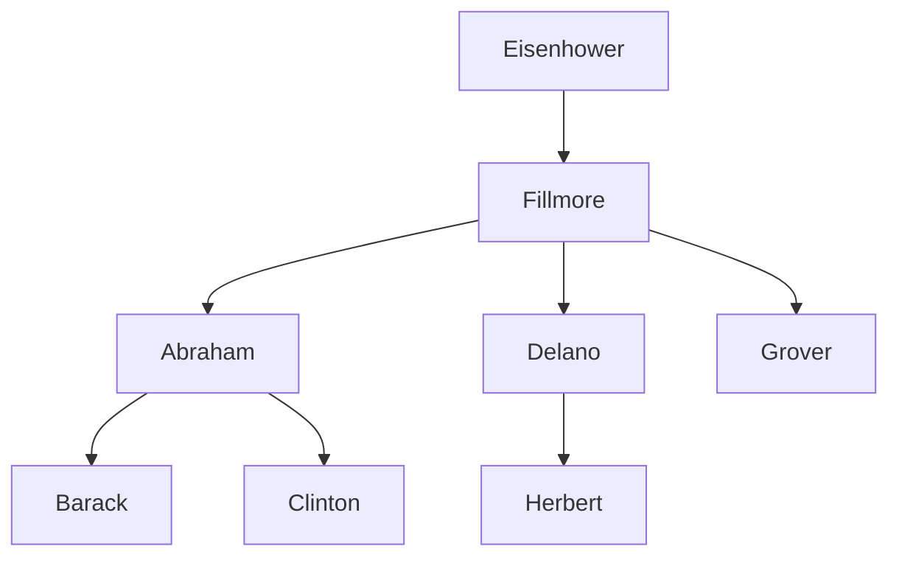

> **English original course**: CS 61A: Structure and Interpretation of Computer Programs (Fall 2024)  
> **Lecturer**: Prof. John DeNero (UC Berkeley)  
> **Text and illustrations**: VideoBook video to image to text technology e-book assembly line  
> **course coverage**: 37 / 37 on 18.2 hour audio/video instruction ⁇ 577 high-level lecture screenshots  
> **Online catalog**: [CS61A Special Catalog](/en/notes/topics/CS61A)

---


> **Lecture**: John DeNero ｜ **duration**: 25:43 ｜ **Video link back**: [B station response unit set (P33)](https://www.bilibili.com/video/BV1sy411z7nA/?p=33)

## 1. Relationship between databases and table structures (Databases, Tables & Records)

Database management systems (DBMS) are one of the most critical system software in today's software infrastructure. The core abstraction of relationship models is that they are not based on a single entity, but rather on a single individual. **The following table lists the countries of the world:**: 
- **The following is a list of the most commonly used terms in the English language:**: has a unique column name and defines the data type of that property (such as integer, string, etc.);
- **The first is the "Row"**: represents a specific entity record containing the entity's specific values in all columns.


*⏱ Timestamp: 00:00:29 · 📷 Lecture screenshot · [Watch clip (P33 00:00:29)](https://www.bilibili.com/video/BV1sy411z7nA/?p=33&t=29)*

---

## 2. Programming paradigm changes: imperative vs declarative


*⏱ Timestamp: 00:01:26 · 📷 Lecture screenshot · [Watch clip (P33 00:01:26)](https://www.bilibili.com/video/BV1sy411z7nA/?p=33&t=86)*

| Programming paradigm | The core ideas | The Programmer's Responsibilities | Responsibilities of the System |
| :--- | :--- | :--- | :--- |
| **The following is a list of the most common types of** | The description of the process | Write algorithmic steps, cyclic conditions and state changes | The machine faithfully executes every step |
| **The following is a list of the official languages of the United States.** | The results of the study are described in the description. | Mathematical pronouns and logical relationships that give the result of a goal | Select the best execution path and return results |

In SQL, execution sequences may be completely different from code-writing sequences because the execution path is entirely determined by a database engine, but this greatly frees up the productivity of programmers.

---

## 3. Create table and line levels projection (Creating Tables & `SELECT`)

Although most of the industry-level data comes from outside writing, in SQL we can directly use literal letters to build data:

```sql
SELECT 38 AS latitude, 122 AS longitude, "Berkeley" AS name;
```


*⏱ Timestamp: 00:03:19 · 📷 Lecture screenshot · [Watch clip (P33 00:03:19)](https://www.bilibili.com/video/BV1sy411z7nA/?p=33&t=199)*

- `SELECT`  The following column description separated from the comma;
- `AS <name>`  The following are the names of the characters used:
- Strings must be enclosed by double quotes or single quotes, and no quotation is required for list names.

### The United States is a country. `UNION`  operator

Use  `UNION`  Multiple single-line results can be spelled into a new multi-line table:

```sql
CREATE TABLE cities AS
  SELECT 38 AS latitude, 122 AS longitude, "Berkeley" AS name UNION
  SELECT 42,             71,               "Cambridge"        UNION
  SELECT 45,             93,               "Minneapolis";
```


*⏱ Timestamp: 00:04:43 · 📷 Lecture screenshot · [Watch clip (P33 00:04:43)](https://www.bilibili.com/video/BV1sy411z7nA/?p=33&t=283)*

By using a query projection of the already existing table with conditions, we can easily generate derivative analysis tables:

```sql
SELECT "West Coast" AS region, name FROM cities WHERE longitude >= 115 UNION
SELECT "Other"      AS region, name FROM cities WHERE longitude < 115;
```

---

## 4. SQL Core: ubiquitous  `SELECT` (The Power of `SELECT`)

SQL standards contain a large number of DML/DDL statements, such as:  `INSERT`, `UPDATE`, `DELETE`, `EXPLAIN`  The most basic, the purest computational kernel is almost entirely contained in the  `SELECT`  The phrase is:


*⏱ Timestamp: 00:06:34 · 📷 Lecture screenshot · [Watch clip (P33 00:06:34)](https://www.bilibili.com/video/BV1sy411z7nA/?p=33&t=394)*

- `SELECT`  The first is to use the word "query" and create a new table. **A purely functional generator**; 
- A small Python interpreter can create a complete code with only 100 lines of code.  `SELECT`  The engine core!

---

## 5. Practice Problem: The Dogs Family Tree

Professor John DeNero, based on his favorite dog pedigree, has created a set of dog pedigrees named in alphabetical order A through H:


*⏱ Timestamp: 00:08:35 · 📷 Lecture screenshot · [Watch clip (P33 00:08:35)](https://www.bilibili.com/video/BV1sy411z7nA/?p=33&t=515)*


*⏱ Timestamp: 00:10:41 · 📷 Lecture screenshot · [Watch clip (P33 00:10:41)](https://www.bilibili.com/video/BV1sy411z7nA/?p=33&t=641)*


*⏱ Timestamp: 00:12:08 · 📷 Lecture screenshot · [Watch clip (P33 00:12:08)](https://www.bilibili.com/video/BV1sy411z7nA/?p=33&t=728)*



### The establishment  `parents`  The relationship

```sql
CREATE TABLE parents AS
  SELECT "abraham" AS parent, "barack" AS child UNION
  SELECT "abraham",           "clinton"         UNION
  SELECT "delano",            "herbert"         UNION
  SELECT "fillmore",          "abraham"         UNION
  SELECT "fillmore",          "delano"          UNION
  SELECT "fillmore",          "grover"          UNION
  SELECT "eisenhower",        "fillmore";
```


*⏱ Timestamp: 00:13:37 · 📷 Lecture screenshot · [Watch clip (P33 00:13:37)](https://www.bilibili.com/video/BV1sy411z7nA/?p=33&t=817)*

---

## 6. Query projection and condition filtering (`FROM`, `WHERE`, `ORDER BY`)

`SELECT`  The complete single-chart query structure of the sentences is as follows:

```sql
SELECT <column_expressions>
FROM <input_table>
WHERE <filter_condition>
ORDER BY <sort_ordering>;
```


*⏱ Timestamp: 00:14:44 · 📷 Lecture screenshot · [Watch clip (P33 00:14:44)](https://www.bilibili.com/video/BV1sy411z7nA/?p=33&t=884)*

### Query examples compared to dictionary sequences

1. Ask all of them  `abraham`  The children of the parents:
   ```sql
   SELECT child FROM parents WHERE parent = "abraham";
   -- 结果: barack, clinton
   ```

2. Find the father's name in the alphabet with a later line than the son's:
   ```sql
   SELECT parent FROM parents WHERE parent > child;
   -- 结果: fillmore (来自 fillmore > abraham)
   --       fillmore (来自 fillmore > delano)
   ```


*⏱ Timestamp: 00:16:17 · 📷 Lecture screenshot · [Watch clip (P33 00:16:17)](https://www.bilibili.com/video/BV1sy411z7nA/?p=33&t=977)*

Note: `fillmore`  The default SQL form is **The first episode of the series was released on DVD.** The same line is allowed to repeat.

---

## 7. SQLite Interactive Shell

In the SQLite interaction environment and command line, execute the following directly:


*⏱ Timestamp: 00:17:50 · 📷 Lecture screenshot · [Watch clip (P33 00:17:50)](https://www.bilibili.com/video/BV1sy411z7nA/?p=33&t=1070)*

Use  `SELECT * FROM parents;`  You can view the entire table, SQLite uses a string by default  `|`  The data column is separated.

---

## 8. Inline arithmetic calculations: analysis of the capacity of skiing cables (Arithmetic in SQL)

In  `SELECT`  In expression, not only can the column name be referenced but also a mathematical calculation is freely performed. The column name is replaced by the specific value of the current input line correspondence:

```sql
-- 表 lift: chair (缆车号), single (单人乘客数), couple (双人乘客数)
SELECT chair, single + 2 * couple AS total FROM lift;
```


*⏱ Timestamp: 00:19:35 · 📷 Lecture screenshot · [Watch clip (P33 00:19:35)](https://www.bilibili.com/video/BV1sy411z7nA/?p=33&t=1175)*

The total number of passengers in each cable chair is calculated independently and simultaneously without interference.

---

## 9. Deep thought: Binary integers represent the behavior of declarative ordering

The given table  `ints` The following is a list of the four binary weight positions 1, 2, 4, 8) that represent each integer:


*⏱ Timestamp: 00:21:06 · 📷 Lecture screenshot · [Watch clip (P33 00:21:06)](https://www.bilibili.com/video/BV1sy411z7nA/?p=33&t=1266)*

```sql
-- 表 ints 列结构: word, one, two, four, eight
-- 如 "seven": 1, 2, 4, 0
```

### Disorder and decentralization of declarative systems

When used  `UNION`  The United Nations  `SELECT`  As a result, many beginners find that the output line order is completely inconsistent with the code writing order:


*⏱ Timestamp: 00:23:08 · 📷 Lecture screenshot · [Watch clip (P33 00:23:08)](https://www.bilibili.com/video/BV1sy411z7nA/?p=33&t=1388)*

> **The core principles**: `UNION`  The requirements for regulation must be **Removing the repeat** Database optimizers often perform dictionary sequencing of data in a certain memory row to detect repetition lines as efficiently as possible. **The resulting sequence of declarative queries is not guaranteed to keep the code inserted in order** If strict order is required, it must be made public.  `ORDER BY`.

---

## 10. Practice Answer: Bit-seeking and the puzzle with screening 2.


*⏱ Timestamp: 00:24:08 · 📷 Lecture screenshot · [Watch clip (P33 00:24:08)](https://www.bilibili.com/video/BV1sy411z7nA/?p=33&t=1448)*


*⏱ Timestamp: 00:25:13 · 📷 Lecture screenshot · [Watch clip (P33 00:25:13)](https://www.bilibili.com/video/BV1sy411z7nA/?p=33&t=1513)*

### Question 1: Calculate the actual integer of each word corresponding to
```sql
SELECT word, one + two + four + eight AS value FROM ints;
```

### Question 2: Select all the numeric words that have an integer of 2
```sql
SELECT word FROM ints
WHERE (one > 0) + (two > 0) + (four > 0) + (eight > 0) = 1;
-- 仅保留恰好只有一个二进制位为 1 的记录！
-- 结果: one, two, four, eight
```

---

## The key points of the review

| Core components / concepts | Grammar and rules | Key Functions |
| :--- | :--- | :--- |
| **Declared pattern** | Focus on the goal, not the process | The algorithm is automatically driven by the database management system |
| **`CREATE TABLE ... AS`** | `CREATE TABLE name AS SELECT ...` | Save the results of the queries and name them as a national persistence list |
| **`SELECT`** | `SELECT expr AS col_name` | projection and transform input lines to generate a new table |
| **`WHERE`** | `WHERE condition` | Filtering of the input tables in a row |
| **`UNION`** | `SELECT ... UNION SELECT ...` | The line is parallel to the merged array and automatically weighs (possibly changing order) |

---

