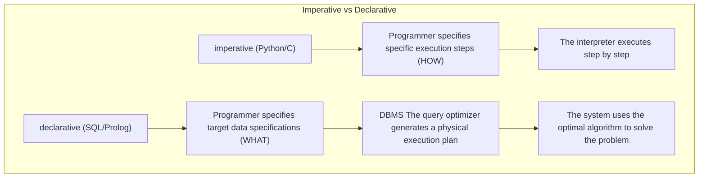
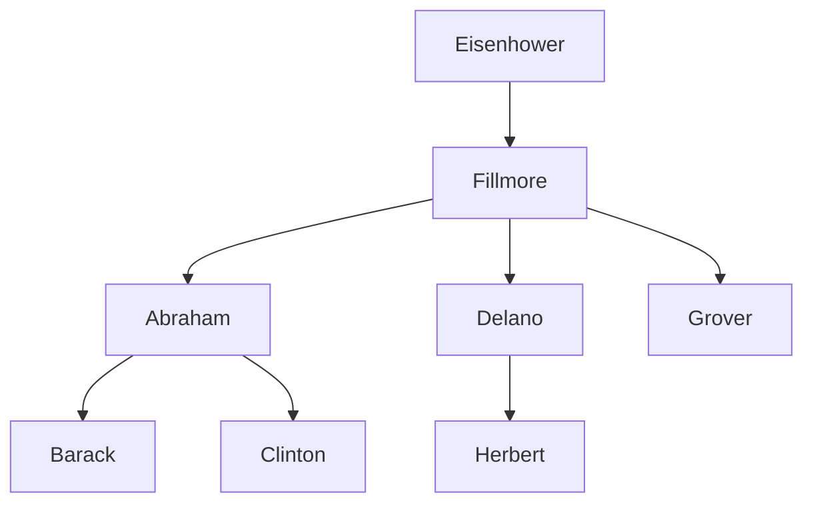

> **Course**: UC Berkeley CS61A (Fall 2024)  
> **Module**: Module 5: Declarative Programming and SQL (Declarative & SQL)  
> **Lecturer**: Prof. John DeNero (UC Berkeley)  
> **Video duration**: 25:43 ｜ **Classroom screenshots**: 17 pieces of blackboard writing/code demonstration  
> **Direct video**: [📺Watch the original video of this lecture on Bilibili (P33)](https://www.bilibili.com/video/BV1sy411z7nA/?p=33)  
> **Quick navigation**: [← Previous Lecture (P32 Lecture 34 Macros)](/en/notes/cs61a/lecture-32) ｜ [📚 Return to the full book catalog](/en/notes/topics/CS61A) ｜ [Next lecture (P34 Lecture 36 Tables) →](/en/notes/cs61a/lecture-34)

---

## Course Core Objectives and Panorama

From the beginning of the course until now, all the programming paradigms we have studied—procedural programming, object-oriented programming, functional programming—are essentially **Imperative Programming**: The programmer needs to describe to the computer in detail "what to do in the first step, what to do in the second step, and how to modify the variables in the loop."

In this lecture we will enter a new world: **Declarative Programming**. The master of its industry is the company that has dominated global data storage for more than half a century. **Structured Query Language (SQL, Structured Query Language)**.

In declarative programming:
- programmer **Just describe the final desired result structure** ("Find all users who spent more than $100 in a week");
- The \*\*Query Optimizer\*\* of the database management system (DBMS) automatically deduce and determine the lowest-level scanning algorithm, index search and sorting execution path!



---

### In-depth formal specification and micro-evaluation process (Operational Semantics)
In the "Course Core Goals and Panorama" module, the underlying computer operations rely on strict formal evaluation logic:
1. **Hierarchical parsing of abstract syntax trees (AST)**: 
   - The source code character stream is first divided into terminal symbol tokens (Tokens) by the lexical analyzer (Lexer), and then constructed into a multi-fork syntax tree by the syntax parser (Parser);
   - Operator priority and associativity are solidified during the syntax tree construction phase, eliminating ambiguity at runtime;
2. **Dynamic transitions of environment chains**: 
   - Each function call generates a new frame whose static lexical environment is determined by the function object's  `parent`  Attributes are completely determined;
   - The variable search traces back up the environment chain in one direction until the global environment frame. If it is not found, it will be triggered.  `NameError`  Abnormal;
3. **State Invariants**: 
   - The key to writing robust programs is to clarify loop invariants (Loop Invariants) and function pre/post-conditions (Pre/Post-conditions);
   - In complex control flow jumps, ensure that state variables maintain legal business constraints before each iteration.


## 1. Relational databases and table structures (Databases, Tables & Records)

Database management systems (DBMS) are one of the most critical system software in today's software infrastructure. The core abstraction of the relational model is **Table**: 
- **Column/Attribute**: Has a unique column name and defines the data type of the attribute (such as integer, string, etc.);
- **Row (Row/Record)**: Represents a specific entity record, including the specific values of the entity in all columns.

[](https://www.bilibili.com/video/BV1sy411z7nA/?p=33&t=29)
*⏱ Timestamp: 00:00:29 · 📷 Classroom screenshot · [Watch the corresponding clip on Bilibili (P33 00:00:29)](https://www.bilibili.com/video/BV1sy411z7nA/?p=33&t=29)*

#### 📸 In-depth reading of classroom blackboard writing and code demonstration (00:00:29)

**\[On-site blackboard writing/code demonstration restoration\]**:
At this time point, Professor DeNero conducted a core demonstration and key blackboard derivation on the screen:
> *“Databases hold data in structured tables, and database management systems are some of the most important, heavily used and interesting large software applications there are. Organizations spend a lot of money on their database management systems, and there are also wonderful open source projects. An...”*

**\[Underlying computing model and micro execution mechanism\]**: 
1. **Execution context and timing tracing**: 
   - At the current discussion point "1. Relational databases and table structures (Databases, Tables & Records)", the interpreter strictly follows the core evaluation protocol;
   - The expression evaluates the operators first, then evaluates the operands strictly from left to right, and finally applies the function object to the argument list;
   - If the environment model is involved, the local frame strictly records its static lexical parent pointer (Parent Pointer points to the environment where the function is defined), forming an orthogonal architecture with the dynamic call stack at runtime.
2. **Memory topology and object references**: 
   - Variable symbols are just keys in a hash table (environment frame), and pointers point directly to first-class citizen objects in heap memory;
   - Assignment statements are discrete-time snapshots of the state and never create implicit mathematical dependency monitoring.

**\[Guidelines for avoiding pitfalls and guidance on high-frequency test points\]**: 
- **Common misunderstandings**: In the exam questions related to "Declarative Thinking (Declarative) vs. Imperative Thinking (Imperative), WHERE Filtering and Projection", beginners can easily guess the results based on the surface form of the code, leading to scope confusion or variable shadowing (Shadowing) misjudgment;
- **The golden rule of debugging**: When encountering nested calls and complex branches, be sure to draw independent partial frames on the scratch paper, indicate the specific binding value of each formal parameter, and derive it step by step.


---

### In-depth formal specification and micro-evaluation process (Operational Semantics)
In the "1. Relational Databases, Tables & Records" module, the underlying computer operations rely on strict formal evaluation logic:
1. **Hierarchical parsing of abstract syntax trees (AST)**: 
   - The source code character stream is first divided into terminal symbol tokens (Tokens) by the lexical analyzer (Lexer), and then constructed into a multi-fork syntax tree by the syntax parser (Parser);
   - Operator priority and associativity are solidified during the syntax tree construction phase, eliminating ambiguity at runtime;
2. **Dynamic transitions of environment chains**: 
   - Each function call generates a new frame whose static lexical environment is determined by the function object's  `parent`  Attributes are completely determined;
   - The variable search traces back up the environment chain in one direction until the global environment frame. If it is not found, it will be triggered.  `NameError`  Abnormal;
3. **State Invariants**: 
   - The key to writing robust programs is to clarify loop invariants (Loop Invariants) and function pre/post-conditions (Pre/Post-conditions);
   - In complex control flow jumps, ensure that state variables maintain legal business constraints before each iteration.


## 2. Changes in programming paradigm: imperative vs declarative (Imperative vs Declarative)

[](https://www.bilibili.com/video/BV1sy411z7nA/?p=33&t=86)
*⏱ Timestamp: 00:01:26 · 📷 Classroom screenshot · [Watch the corresponding clip on Bilibili (P33 00:01:26)](https://www.bilibili.com/video/BV1sy411z7nA/?p=33&t=86)*

#### 📸 In-depth reading of classroom blackboard writing and code demonstration (00:01:26)

**\[On-site blackboard writing/code demonstration restoration\]**:
At this time point, Professor DeNero conducted a core demonstration and key blackboard derivation on the screen:
> *“So this is not a record at the top, this is just the name of the columns, and the name of the column tells you what attribute of the record is contained within that column. Simple enough. It's also typically the case that there is some type of value associated with each column, so these are all stri...”*

**\[Underlying computing model and micro execution mechanism\]**: 
1. **Execution context and timing tracing**: 
   - At the current discussion point "2. Programming paradigm changes: Imperative vs Declarative (Imperative vs Declarative)", the interpreter strictly follows the core evaluation protocol;
   - The expression evaluates the operators first, then evaluates the operands strictly from left to right, and finally applies the function object to the argument list;
   - If the environment model is involved, the local frame strictly records its static lexical parent pointer (Parent Pointer points to the environment where the function is defined), forming an orthogonal architecture with the dynamic call stack at runtime.
2. **Memory topology and object references**: 
   - Variable symbols are just keys in a hash table (environment frame), and pointers point directly to first-class citizen objects in heap memory;
   - Assignment statements are discrete-time snapshots of the state and never create implicit mathematical dependency monitoring.

**\[Guidelines for avoiding pitfalls and guidance on high-frequency test points\]**: 
- **Common misunderstandings**: In the exam questions related to "Declarative Thinking (Declarative) vs. Imperative Thinking (Imperative), WHERE Filtering and Projection", beginners can easily guess the results based on the surface form of the code, leading to scope confusion or variable shadowing (Shadowing) misjudgment;
- **The golden rule of debugging**: When encountering nested calls and complex branches, be sure to draw independent partial frames on the scratch paper, indicate the specific binding value of each formal parameter, and derive it step by step.


| programming paradigm | core idea | Programmer Responsibilities | System Responsibilities |
| :--- | :--- | :--- | :--- |
| **Imperative** | Description of Process | Write algorithm steps, loop conditions and state changes | Mechanically execute every step with fidelity |
| **Declarative** | Description of Result | Mathematical predicates and logical relationships that give the target result | Independently select the optimal execution path and return the results |

In SQL, since the execution path is completely determined by the database engine, the execution order may be completely different from the code writing order, but this greatly liberates the programmer's productivity.

---

### In-depth formal specification and micro-evaluation process (Operational Semantics)
In the module "2. Programming Paradigm Change: Imperative vs Declarative", the underlying computer operations rely on strict formal evaluation logic:
1. **Hierarchical parsing of abstract syntax trees (AST)**: 
   - The source code character stream is first divided into terminal symbol tokens (Tokens) by the lexical analyzer (Lexer), and then constructed into a multi-fork syntax tree by the syntax parser (Parser);
   - Operator priority and associativity are solidified during the syntax tree construction phase, eliminating ambiguity at runtime;
2. **Dynamic transitions of environment chains**: 
   - Each function call generates a new frame whose static lexical environment is determined by the function object's  `parent`  Attributes are completely determined;
   - The variable search traces back up the environment chain in one direction until the global environment frame. If it is not found, it will be triggered.  `NameError`  Abnormal;
3. **State Invariants**: 
   - The key to writing robust programs is to clarify loop invariants (Loop Invariants) and function pre/post-conditions (Pre/Post-conditions);
   - In complex control flow jumps, ensure that state variables maintain legal business constraints before each iteration.


## 3. Creating Tables & Row-Level Projection from Scratch  `SELECT`)

Although most industrial-level data comes from external writing, in SQL we can directly use literals to construct data:

```sql
SELECT 38 AS latitude, 122 AS longitude, "Berkeley" AS name;
```

[](https://www.bilibili.com/video/BV1sy411z7nA/?p=33&t=199)
*⏱ Timestamp: 00:03:19 · 📷 Classroom screenshot · [Watch the corresponding clip on Bilibili (P33 00:03:19)](https://www.bilibili.com/video/BV1sy411z7nA/?p=33&t=199)*

#### 📸 In-depth reading of classroom blackboard writing and code demonstration (00:03:19)

**\[On-site blackboard writing/code demonstration restoration\]**:
At this time point, Professor DeNero conducted a core demonstration and key blackboard derivation on the screen:
> *“Okay, so here's another example of SQL. How do we get the tables in the first place? Well, normally they are built up through some process like some other application, logging information or somebody typing it in. But it is possible to create a table from scratch using the structured query language....”*

**\[Underlying computing model and micro execution mechanism\]**: 
1. **Execution context and timing tracing**: 
   - At the current discussion point "3. Creating Tables & Row-Level Projection from Scratch  `SELECT`)", the interpreter strictly follows the core evaluation convention;
   - The expression evaluates the operators first, then evaluates the operands strictly from left to right, and finally applies the function object to the argument list;
   - If the environment model is involved, the local frame strictly records its static lexical parent pointer (Parent Pointer points to the environment where the function is defined), forming an orthogonal architecture with the dynamic call stack at runtime.
2. **Memory topology and object references**: 
   - Variable symbols are just keys in a hash table (environment frame), and pointers point directly to first-class citizen objects in heap memory;
   - Assignment statements are discrete-time snapshots of the state and never create implicit mathematical dependency monitoring.

**\[Guidelines for avoiding pitfalls and guidance on high-frequency test points\]**: 
- **Common misunderstandings**: In the exam questions related to "Declarative Thinking (Declarative) vs. Imperative Thinking (Imperative), WHERE Filtering and Projection", beginners can easily guess the results based on the surface form of the code, leading to scope confusion or variable shadowing (Shadowing) misjudgment;
- **The golden rule of debugging**: When encountering nested calls and complex branches, be sure to draw independent partial frames on the scratch paper, indicate the specific binding value of each formal parameter, and derive it step by step.


- `SELECT`  Followed by comma-separated column descriptions;
- `AS <name>`  Used to rename column headers;
- Strings must be enclosed in double or single quotes, while column names do not require quotes.

### Union multiple lines: `UNION`  operator

use  `UNION`  Multiple single-row results can be concatenated into a new multi-row table:

```sql
CREATE TABLE cities AS
  SELECT 38 AS latitude, 122 AS longitude, "Berkeley" AS name UNION
  SELECT 42,             71,               "Cambridge"        UNION
  SELECT 45,             93,               "Minneapolis";
```

[](https://www.bilibili.com/video/BV1sy411z7nA/?p=33&t=283)
*⏱ Timestamp: 00:04:43 · 📷 Classroom screenshot · [Watch the corresponding clip on Bilibili (P33 00:04:43)](https://www.bilibili.com/video/BV1sy411z7nA/?p=33&t=283)*

#### 📸 In-depth reading of classroom blackboard writing and code demonstration (00:04:43)

**\[On-site blackboard writing/code demonstration restoration\]**:
At this time point, Professor DeNero conducted a core demonstration and key blackboard derivation on the screen:
> *“We'd like multiple rows. You can do that with union, which takes a description of another one row table and puts that together into a two row table. And you can union multiple times in order to, for example, get a three row table. Like I said, this is an uncommon way of building a table that would o...”*

**\[Underlying computing model and micro execution mechanism\]**: 
1. **Execution context and timing tracing**: 
   - At the current discussion point "3. Creating Tables & Row-Level Projection from Scratch  `SELECT`)", the interpreter strictly follows the core evaluation convention;
   - The expression evaluates the operators first, then evaluates the operands strictly from left to right, and finally applies the function object to the argument list;
   - If the environment model is involved, the local frame strictly records its static lexical parent pointer (Parent Pointer points to the environment where the function is defined), forming an orthogonal architecture with the dynamic call stack at runtime.
2. **Memory topology and object references**: 
   - Variable symbols are just keys in a hash table (environment frame), and pointers point directly to first-class citizen objects in heap memory;
   - Assignment statements are discrete-time snapshots of the state and never create implicit mathematical dependency monitoring.

**\[Guidelines for avoiding pitfalls and guidance on high-frequency test points\]**: 
- **Common misunderstandings**: In the exam questions related to "Declarative Thinking (Declarative) vs. Imperative Thinking (Imperative), WHERE Filtering and Projection", beginners can easily guess the results based on the surface form of the code, leading to scope confusion or variable shadowing (Shadowing) misjudgment;
- **The golden rule of debugging**: When encountering nested calls and complex branches, be sure to draw independent partial frames on the scratch paper, indicate the specific binding value of each formal parameter, and derive it step by step.


By performing conditional query projection on existing tables, we can easily generate derived analysis tables:

```sql
SELECT "West Coast" AS region, name FROM cities WHERE longitude >= 115 UNION
SELECT "Other"      AS region, name FROM cities WHERE longitude < 115;
```

---

### In-depth formal specification and micro-evaluation process (Operational Semantics)
In "3. Creating Tables & Row-Level Projection from Scratch  `SELECT`)" module, the underlying computer operations rely on strict formal evaluation logic:
1. **Hierarchical parsing of abstract syntax trees (AST)**: 
   - The source code character stream is first divided into terminal symbol tokens (Tokens) by the lexical analyzer (Lexer), and then constructed into a multi-fork syntax tree by the syntax parser (Parser);
   - Operator priority and associativity are solidified during the syntax tree construction phase, eliminating ambiguity at runtime;
2. **Dynamic transitions of environment chains**: 
   - Each function call generates a new frame whose static lexical environment is determined by the function object's  `parent`  Attributes are completely determined;
   - The variable search traces back up the environment chain in one direction until the global environment frame. If it is not found, it will be triggered.  `NameError`  Abnormal;
3. **State Invariants**: 
   - The key to writing robust programs is to clarify loop invariants (Loop Invariants) and function pre/post-conditions (Pre/Post-conditions);
   - In complex control flow jumps, ensure that state variables maintain legal business constraints before each iteration.


## 4. SQL Language Core: Ubiquitous  `SELECT` (The Power of `SELECT`)

Although the SQL standard contains a large number of DML/DDL statements (such as  `INSERT`, `UPDATE`, `DELETE`, `EXPLAIN`  etc.), but its most essential and pure computing core is almost entirely contained in  `SELECT`  In the sentence:

[](https://www.bilibili.com/video/BV1sy411z7nA/?p=33&t=394)
*⏱ Timestamp: 00:06:34 · 📷 Classroom screenshot · [Watch the corresponding clip on Bilibili (P33 00:06:34)](https://www.bilibili.com/video/BV1sy411z7nA/?p=33&t=394)*

#### 📸 In-depth reading of classroom blackboard writing and code demonstration (00:06:34)

**\[On-site blackboard writing/code demonstration restoration\]**:
At this time point, Professor DeNero conducted a core demonstration and key blackboard derivation on the screen:
> *“But being able to manipulate data in this way is incredibly useful. So we will now learn the details of the SQL language so that you can see the breadth of things that it's able to do. Time to learn a new programming language, the structured query language. SQL is standardized based on a specificati...”*

**\[Underlying computing model and micro execution mechanism\]**: 
1. **Execution context and timing tracing**: 
   - At the current discussion point "4. SQL language core: ubiquitous  `SELECT` (The Power of `SELECT`)", the interpreter strictly follows the core evaluation convention;
   - The expression evaluates the operators first, then evaluates the operands strictly from left to right, and finally applies the function object to the argument list;
   - If the environment model is involved, the local frame strictly records its static lexical parent pointer (Parent Pointer points to the environment where the function is defined), forming an orthogonal architecture with the dynamic call stack at runtime.
2. **Memory topology and object references**: 
   - Variable symbols are just keys in a hash table (environment frame), and pointers point directly to first-class citizen objects in heap memory;
   - Assignment statements are discrete-time snapshots of the state and never create implicit mathematical dependency monitoring.

**\[Guidelines for avoiding pitfalls and guidance on high-frequency test points\]**: 
- **Common misunderstandings**: In the exam questions related to "Declarative Thinking (Declarative) vs. Imperative Thinking (Imperative), WHERE Filtering and Projection", beginners can easily guess the results based on the surface form of the code, leading to scope confusion or variable shadowing (Shadowing) misjudgment;
- **The golden rule of debugging**: When encountering nested calls and complex branches, be sure to draw independent partial frames on the scratch paper, indicate the specific binding value of each formal parameter, and derive it step by step.


- `SELECT`  It is both a query statement and a way to build a new table. **Pure functional generator**; 
- A small Python interpreter can implement a complete  `SELECT`  Engine core!

---

### In-depth formal specification and micro-evaluation process (Operational Semantics)
In "4. SQL Language Core: Ubiquitous  `SELECT` (The Power of `SELECT`)" module, the underlying computer operations rely on strict formal evaluation logic:
1. **Hierarchical parsing of abstract syntax trees (AST)**: 
   - The source code character stream is first divided into terminal symbol tokens (Tokens) by the lexical analyzer (Lexer), and then constructed into a multi-fork syntax tree by the syntax parser (Parser);
   - Operator priority and associativity are solidified during the syntax tree construction phase, eliminating ambiguity at runtime;
2. **Dynamic transitions of environment chains**: 
   - Each function call generates a new frame whose static lexical environment is determined by the function object's  `parent`  Attributes are completely determined;
   - The variable search traces back up the environment chain in one direction until the global environment frame. If it is not found, it will be triggered.  `NameError`  Abnormal;
3. **State Invariants**: 
   - The key to writing robust programs is to clarify loop invariants (Loop Invariants) and function pre/post-conditions (Pre/Post-conditions);
   - In complex control flow jumps, ensure that state variables maintain legal business constraints before each iteration.


## 5. Classic practical theme: The Dogs Family Tree

Professor John DeNero used his favorite dog family tree as the background and established a set of dog pedigree data named alphabetically from A to H:

[](https://www.bilibili.com/video/BV1sy411z7nA/?p=33&t=515)
*⏱ Timestamp: 00:08:35 · 📷 Classroom screenshot · [Watch the corresponding clip on Bilibili (P33 00:08:35)](https://www.bilibili.com/video/BV1sy411z7nA/?p=33&t=515)*

#### 📸 In-depth reading of classroom blackboard writing and code demonstration (00:08:35)

**\[On-site blackboard writing/code demonstration restoration\]**:
At this time point, Professor DeNero conducted a core demonstration and key blackboard derivation on the screen:
> *“Quite easily, using Python, and we'll go over the details of that in the next lecture. But first, we have to learn how to use the language. We're going to take a break from Fibonacci sequences and integer sequences and all of that, and instead focus on a theme for the day, and that theme is dogs. I ...”*

**\[Underlying computing model and micro execution mechanism\]**: 
1. **Execution context and timing tracing**: 
   - At the current discussion node "5. Classic practical topic: The Dogs Family Tree", the interpreter strictly follows the core evaluation protocol;
   - The expression evaluates the operators first, then evaluates the operands strictly from left to right, and finally applies the function object to the argument list;
   - If the environment model is involved, the local frame strictly records its static lexical parent pointer (Parent Pointer points to the environment where the function is defined), forming an orthogonal architecture with the dynamic call stack at runtime.
2. **Memory topology and object references**: 
   - Variable symbols are just keys in a hash table (environment frame), and pointers point directly to first-class citizen objects in heap memory;
   - Assignment statements are discrete-time snapshots of the state and never create implicit mathematical dependency monitoring.

**\[Guidelines for avoiding pitfalls and guidance on high-frequency test points\]**: 
- **Common misunderstandings**: In the exam questions related to "Declarative Thinking (Declarative) vs. Imperative Thinking (Imperative), WHERE Filtering and Projection", beginners can easily guess the results based on the surface form of the code, leading to scope confusion or variable shadowing (Shadowing) misjudgment;
- **The golden rule of debugging**: When encountering nested calls and complex branches, be sure to draw independent partial frames on the scratch paper, indicate the specific binding value of each formal parameter, and derive it step by step.


[](https://www.bilibili.com/video/BV1sy411z7nA/?p=33&t=641)
*⏱ Timestamp: 00:10:41 · 📷 Classroom screenshot · [Watch the corresponding clip on Bilibili (P33 00:10:41)](https://www.bilibili.com/video/BV1sy411z7nA/?p=33&t=641)*

#### 📸 In-depth reading of classroom blackboard writing and code demonstration (00:10:41)

**\[On-site blackboard writing/code demonstration restoration\]**:
At this time point, Professor DeNero conducted a core demonstration and key blackboard derivation on the screen:
> *“So this would create a two-column table. As and the name are optional. You can have more of these. Whenever you're done declaring different columns, you should put a semicolon at the end. All SQL statements end in a semicolon. If you select literals, which are expressions like the number two or the ...”*

**\[Underlying computing model and micro execution mechanism\]**: 
1. **Execution context and timing tracing**: 
   - At the current discussion node "5. Classic practical topic: The Dogs Family Tree", the interpreter strictly follows the core evaluation protocol;
   - The expression evaluates the operators first, then evaluates the operands strictly from left to right, and finally applies the function object to the argument list;
   - If the environment model is involved, the local frame strictly records its static lexical parent pointer (Parent Pointer points to the environment where the function is defined), forming an orthogonal architecture with the dynamic call stack at runtime.
2. **Memory topology and object references**: 
   - Variable symbols are just keys in a hash table (environment frame), and pointers point directly to first-class citizen objects in heap memory;
   - Assignment statements are discrete-time snapshots of the state and never create implicit mathematical dependency monitoring.

**\[Guidelines for avoiding pitfalls and guidance on high-frequency test points\]**: 
- **Common misunderstandings**: In the exam questions related to "Declarative Thinking (Declarative) vs. Imperative Thinking (Imperative), WHERE Filtering and Projection", beginners can easily guess the results based on the surface form of the code, leading to scope confusion or variable shadowing (Shadowing) misjudgment;
- **The golden rule of debugging**: When encountering nested calls and complex branches, be sure to draw independent partial frames on the scratch paper, indicate the specific binding value of each formal parameter, and derive it step by step.


[](https://www.bilibili.com/video/BV1sy411z7nA/?p=33&t=728)
*⏱ Timestamp: 00:12:08 · 📷 Classroom screenshot · [Watch the corresponding clip on Bilibili (P33 00:12:08)](https://www.bilibili.com/video/BV1sy411z7nA/?p=33&t=728)*

#### 📸 In-depth reading of classroom blackboard writing and code demonstration (00:12:08)

**\[On-site blackboard writing/code demonstration restoration\]**:
At this time point, Professor DeNero conducted a core demonstration and key blackboard derivation on the screen:
> *“So a select statement with literals Abraham and Barack will create a one-row table with two columns, a parent column, and a child column. And the values that go in those are the values of the literals, Abraham the string and Barack the string. Now, if I have more dogs, which I do, then I'll need to ...”*

**\[Underlying computing model and micro execution mechanism\]**: 
1. **Execution context and timing tracing**: 
   - At the current discussion node "5. Classic practical topic: The Dogs Family Tree", the interpreter strictly follows the core evaluation protocol;
   - The expression evaluates the operators first, then evaluates the operands strictly from left to right, and finally applies the function object to the argument list;
   - If the environment model is involved, the local frame strictly records its static lexical parent pointer (Parent Pointer points to the environment where the function is defined), forming an orthogonal architecture with the dynamic call stack at runtime.
2. **Memory topology and object references**: 
   - Variable symbols are just keys in a hash table (environment frame), and pointers point directly to first-class citizen objects in heap memory;
   - Assignment statements are discrete-time snapshots of the state and never create implicit mathematical dependency monitoring.

**\[Guidelines for avoiding pitfalls and guidance on high-frequency test points\]**: 
- **Common misunderstandings**: In the exam questions related to "Declarative Thinking (Declarative) vs. Imperative Thinking (Imperative), WHERE Filtering and Projection", beginners can easily guess the results based on the surface form of the code, leading to scope confusion or variable shadowing (Shadowing) misjudgment;
- **The golden rule of debugging**: When encountering nested calls and complex branches, be sure to draw independent partial frames on the scratch paper, indicate the specific binding value of each formal parameter, and derive it step by step.




### Create  `parents`  relational table

```sql
CREATE TABLE parents AS
  SELECT "abraham" AS parent, "barack" AS child UNION
  SELECT "abraham",           "clinton"         UNION
  SELECT "delano",            "herbert"         UNION
  SELECT "fillmore",          "abraham"         UNION
  SELECT "fillmore",          "delano"          UNION
  SELECT "fillmore",          "grover"          UNION
  SELECT "eisenhower",        "fillmore";
```

[](https://www.bilibili.com/video/BV1sy411z7nA/?p=33&t=817)
*⏱ Timestamp: 00:13:37 · 📷 Classroom screenshot · [Watch the corresponding clip on Bilibili (P33 00:13:37)](https://www.bilibili.com/video/BV1sy411z7nA/?p=33&t=817)*

#### 📸 In-depth reading of classroom blackboard writing and code demonstration (00:13:37)

**\[On-site blackboard writing/code demonstration restoration\]**:
At this time point, Professor DeNero conducted a core demonstration and key blackboard derivation on the screen:
> *“SQL is often used as an interactive language. You just want to see within the database. And so, by default, the result of a SELECT statement, or a bunch of SELECT statements unioned together, won't be stored. The result of a SELECT statement is displayed to the user instead. If you want to store it,...”*

**\[Underlying computing model and micro execution mechanism\]**: 
1. **Execution context and timing tracing**: 
   - At the current discussion node "5. Classic practical topic: The Dogs Family Tree", the interpreter strictly follows the core evaluation protocol;
   - The expression evaluates the operators first, then evaluates the operands strictly from left to right, and finally applies the function object to the argument list;
   - If the environment model is involved, the local frame strictly records its static lexical parent pointer (Parent Pointer points to the environment where the function is defined), forming an orthogonal architecture with the dynamic call stack at runtime.
2. **Memory topology and object references**: 
   - Variable symbols are just keys in a hash table (environment frame), and pointers point directly to first-class citizen objects in heap memory;
   - Assignment statements are discrete-time snapshots of the state and never create implicit mathematical dependency monitoring.

**\[Guidelines for avoiding pitfalls and guidance on high-frequency test points\]**: 
- **Common misunderstandings**: In the exam questions related to "Declarative Thinking (Declarative) vs. Imperative Thinking (Imperative), WHERE Filtering and Projection", beginners can easily guess the results based on the surface form of the code, leading to scope confusion or variable shadowing (Shadowing) misjudgment;
- **The golden rule of debugging**: When encountering nested calls and complex branches, be sure to draw independent partial frames on the scratch paper, indicate the specific binding value of each formal parameter, and derive it step by step.


---

### In-depth formal specification and micro-evaluation process (Operational Semantics)
In the "5. Classic Practical Theme: The Dogs Family Tree" module, the underlying computer operations rely on strict formal evaluation logic:
1. **Hierarchical parsing of abstract syntax trees (AST)**: 
   - The source code character stream is first divided into terminal symbol tokens (Tokens) by the lexical analyzer (Lexer), and then constructed into a multi-fork syntax tree by the syntax parser (Parser);
   - Operator priority and associativity are solidified during the syntax tree construction phase, eliminating ambiguity at runtime;
2. **Dynamic transitions of environment chains**: 
   - Each function call generates a new frame whose static lexical environment is determined by the function object's  `parent`  Attributes are completely determined;
   - The variable search traces back up the environment chain in one direction until the global environment frame. If it is not found, it will be triggered.  `NameError`  Abnormal;
3. **State Invariants**: 
   - The key to writing robust programs is to clarify loop invariants (Loop Invariants) and function pre/post-conditions (Pre/Post-conditions);
   - In complex control flow jumps, ensure that state variables maintain legal business constraints before each iteration.


## 6. Query projection and conditional filtering (`FROM`, `WHERE`, `ORDER BY`)

`SELECT`  The complete single-table query syntax structure of the statement is as follows:

```sql
SELECT <column_expressions>
FROM <input_table>
WHERE <filter_condition>
ORDER BY <sort_ordering>;
```

[](https://www.bilibili.com/video/BV1sy411z7nA/?p=33&t=884)
*⏱ Timestamp: 00:14:44 · 📷 Classroom screenshot · [Watch the corresponding clip on Bilibili (P33 00:14:44)](https://www.bilibili.com/video/BV1sy411z7nA/?p=33&t=884)*

#### 📸 In-depth reading of classroom blackboard writing and code demonstration (00:14:44)

**\[On-site blackboard writing/code demonstration restoration\]**:
At this time point, Professor DeNero conducted a core demonstration and key blackboard derivation on the screen:
> *“And if we wanted to draw that out explicitly, we might write something like parents with a parent column and a child column and all this stuff inside. Now that we know how to create tables from scratch, let's talk about projecting tables. So select statements can project existing tables into new tab...”*

**\[Underlying computing model and micro execution mechanism\]**: 
1. **Execution context and timing tracing**: 
   - At the current discussion point "6. Query projection and conditional filtering (`FROM`, `WHERE`, `ORDER BY`)", the interpreter strictly follows the core evaluation convention;
   - The expression evaluates the operators first, then evaluates the operands strictly from left to right, and finally applies the function object to the argument list;
   - If the environment model is involved, the local frame strictly records its static lexical parent pointer (Parent Pointer points to the environment where the function is defined), forming an orthogonal architecture with the dynamic call stack at runtime.
2. **Memory topology and object references**: 
   - Variable symbols are just keys in a hash table (environment frame), and pointers point directly to first-class citizen objects in heap memory;
   - Assignment statements are discrete-time snapshots of the state and never create implicit mathematical dependency monitoring.

**\[Guidelines for avoiding pitfalls and guidance on high-frequency test points\]**: 
- **Common misunderstandings**: In the exam questions related to "Declarative Thinking (Declarative) vs. Imperative Thinking (Imperative), WHERE Filtering and Projection", beginners can easily guess the results based on the surface form of the code, leading to scope confusion or variable shadowing (Shadowing) misjudgment;
- **The golden rule of debugging**: When encountering nested calls and complex branches, be sure to draw independent partial frames on the scratch paper, indicate the specific binding value of each formal parameter, and derive it step by step.


### Query example and lexicographic comparison

1. Query all with  `abraham`  Children of their fathers:
   ```sql
   SELECT child FROM parents WHERE parent = "abraham";
   -- 结果: barack, clinton
   ```

2. Find rows where the parent's name is later in the alphabet than the child's name:
   ```sql
   SELECT parent FROM parents WHERE parent > child;
   -- 结果: fillmore (来自 fillmore > abraham)
   --       fillmore (来自 fillmore > delano)
   ```

[](https://www.bilibili.com/video/BV1sy411z7nA/?p=33&t=977)
*⏱ Timestamp: 00:16:17 · 📷 Classroom screenshot · [Watch the corresponding clip on Bilibili (P33 00:16:17)](https://www.bilibili.com/video/BV1sy411z7nA/?p=33&t=977)*

#### 📸 In-depth reading of classroom blackboard writing and code demonstration (00:16:17)

**\[On-site blackboard writing/code demonstration restoration\]**:
At this time point, Professor DeNero conducted a core demonstration and key blackboard derivation on the screen:
> *“The rows that we choose are here, but the input rows get transformed or projected into the output rows. So imagine I have my parents table, which I already told you about, and then I write another select statement. Select child from parents. Parents is the name of the table that contains these data,...”*

**\[Underlying computing model and micro execution mechanism\]**: 
1. **Execution context and timing tracing**: 
   - At the current discussion point "6. Query projection and conditional filtering (`FROM`, `WHERE`, `ORDER BY`)", the interpreter strictly follows the core evaluation convention;
   - The expression evaluates the operators first, then evaluates the operands strictly from left to right, and finally applies the function object to the argument list;
   - If the environment model is involved, the local frame strictly records its static lexical parent pointer (Parent Pointer points to the environment where the function is defined), forming an orthogonal architecture with the dynamic call stack at runtime.
2. **Memory topology and object references**: 
   - Variable symbols are just keys in a hash table (environment frame), and pointers point directly to first-class citizen objects in heap memory;
   - Assignment statements are discrete-time snapshots of the state and never create implicit mathematical dependency monitoring.

**\[Guidelines for avoiding pitfalls and guidance on high-frequency test points\]**: 
- **Common misunderstandings**: In the exam questions related to "Declarative Thinking (Declarative) vs. Imperative Thinking (Imperative), WHERE Filtering and Projection", beginners can easily guess the results based on the surface form of the code, leading to scope confusion or variable shadowing (Shadowing) misjudgment;
- **The golden rule of debugging**: When encountering nested calls and complex branches, be sure to draw independent partial frames on the scratch paper, indicate the specific binding value of each formal parameter, and derive it step by step.


Note: `fillmore`  Appeared twice! SQL table default is **Multiset/Bag**, allowing the same row to appear repeatedly.

---

### In-depth formal specification and micro-evaluation process (Operational Semantics)
In "6. Query projection and conditional filtering (`FROM`, `WHERE`, `ORDER BY`)" module, the underlying computer operations rely on strict formal evaluation logic:
1. **Hierarchical parsing of abstract syntax trees (AST)**: 
   - The source code character stream is first divided into terminal symbol tokens (Tokens) by the lexical analyzer (Lexer), and then constructed into a multi-fork syntax tree by the syntax parser (Parser);
   - Operator priority and associativity are solidified during the syntax tree construction phase, eliminating ambiguity at runtime;
2. **Dynamic transitions of environment chains**: 
   - Each function call generates a new frame whose static lexical environment is determined by the function object's  `parent`  Attributes are completely determined;
   - The variable search traces back up the environment chain in one direction until the global environment frame. If it is not found, it will be triggered.  `NameError`  Abnormal;
3. **State Invariants**: 
   - The key to writing robust programs is to clarify loop invariants (Loop Invariants) and function pre/post-conditions (Pre/Post-conditions);
   - In complex control flow jumps, ensure that state variables maintain legal business constraints before each iteration.


## 7. SQLite Practical Exercise (SQLite Interactive Shell)

Execute the above statement directly in the SQLite interactive environment and command line:

[](https://www.bilibili.com/video/BV1sy411z7nA/?p=33&t=1070)
*⏱ Timestamp: 00:17:50 · 📷 Classroom screenshot · [Watch the corresponding clip on Bilibili (P33 00:17:50)](https://www.bilibili.com/video/BV1sy411z7nA/?p=33&t=1070)*

#### 📸 In-depth reading of classroom blackboard writing and code demonstration (00:17:50)

**\[On-site blackboard writing/code demonstration restoration\]**:
At this time point, Professor DeNero conducted a core demonstration and key blackboard derivation on the screen:
> *“Let's actually execute these different statements and watch how they work. I'm going to use the online SQL interpreter. Here's the create table statement for parents. If I execute it, then parents is defined. I could select all of the columns, that's shorthand for all of the columns, from parents in...”*

**\[Underlying computing model and micro execution mechanism\]**: 
1. **Execution context and timing tracing**: 
   - At the current discussion point "7. SQLite Practical Exercise (SQLite Interactive Shell)", the interpreter strictly follows the core evaluation protocol;
   - The expression evaluates the operators first, then evaluates the operands strictly from left to right, and finally applies the function object to the argument list;
   - If the environment model is involved, the local frame strictly records its static lexical parent pointer (Parent Pointer points to the environment where the function is defined), forming an orthogonal architecture with the dynamic call stack at runtime.
2. **Memory topology and object references**: 
   - Variable symbols are just keys in a hash table (environment frame), and pointers point directly to first-class citizen objects in heap memory;
   - Assignment statements are discrete-time snapshots of the state and never create implicit mathematical dependency monitoring.

**\[Guidelines for avoiding pitfalls and guidance on high-frequency test points\]**: 
- **Common misunderstandings**: In the exam questions related to "Declarative Thinking (Declarative) vs. Imperative Thinking (Imperative), WHERE Filtering and Projection", beginners can easily guess the results based on the surface form of the code, leading to scope confusion or variable shadowing (Shadowing) misjudgment;
- **The golden rule of debugging**: When encountering nested calls and complex branches, be sure to draw independent partial frames on the scratch paper, indicate the specific binding value of each formal parameter, and derive it step by step.


use  `SELECT * FROM parents;`  You can view the entire table. SQLite uses vertical bars by default.  `|`  Separate each column of data.

---

### In-depth formal specification and micro-evaluation process (Operational Semantics)
In the "7. SQLite Practical Exercise (SQLite Interactive Shell)" module, the underlying computer operations rely on strict formal evaluation logic:
1. **Hierarchical parsing of abstract syntax trees (AST)**: 
   - The source code character stream is first divided into terminal symbol tokens (Tokens) by the lexical analyzer (Lexer), and then constructed into a multi-fork syntax tree by the syntax parser (Parser);
   - Operator priority and associativity are solidified during the syntax tree construction phase, eliminating ambiguity at runtime;
2. **Dynamic transitions of environment chains**: 
   - Each function call generates a new frame whose static lexical environment is determined by the function object's  `parent`  Attributes are completely determined;
   - The variable search traces back up the environment chain in one direction until the global environment frame. If it is not found, it will be triggered.  `NameError`  Abnormal;
3. **State Invariants**: 
   - The key to writing robust programs is to clarify loop invariants (Loop Invariants) and function pre/post-conditions (Pre/Post-conditions);
   - In complex control flow jumps, ensure that state variables maintain legal business constraints before each iteration.


## 8. Inline Arithmetic Calculation: Ski Resort Lift Capacity Analysis (Arithmetic in SQL)

in  `SELECT`  In expressions, not only can column names be referenced, but polynomial mathematical operations can also be performed freely. The column names will be replaced with the specific values corresponding to the current input row:

```sql
-- 表 lift: chair (缆车号), single (单人乘客数), couple (双人乘客数)
SELECT chair, single + 2 * couple AS total FROM lift;
```

[](https://www.bilibili.com/video/BV1sy411z7nA/?p=33&t=1175)
*⏱ Timestamp: 00:19:35 · 📷 Classroom screenshot · [Watch the corresponding clip on Bilibili (P33 00:19:35)](https://www.bilibili.com/video/BV1sy411z7nA/?p=33&t=1175)*

#### 📸 In-depth reading of classroom blackboard writing and code demonstration (00:19:35)

**\[On-site blackboard writing/code demonstration restoration\]**:
At this time point, Professor DeNero conducted a core demonstration and key blackboard derivation on the screen:
> *“In a select expression, column names evaluate to row values, and arithmetic expressions can combine row values and constants together to create new values. We're going to do an example based on chairlifts at ski resorts. Let's say that every lift chair has a number, and it also has the number of sin...”*

**\[Underlying computing model and micro execution mechanism\]**: 
1. **Execution context and timing tracing**: 
   - At the current discussion point "8. Inline Arithmetic Computation: Ski Resort Lift Capacity Analysis (Arithmetic in SQL)", the interpreter strictly follows the core evaluation protocol;
   - The expression evaluates the operators first, then evaluates the operands strictly from left to right, and finally applies the function object to the argument list;
   - If the environment model is involved, the local frame strictly records its static lexical parent pointer (Parent Pointer points to the environment where the function is defined), forming an orthogonal architecture with the dynamic call stack at runtime.
2. **Memory topology and object references**: 
   - Variable symbols are just keys in a hash table (environment frame), and pointers point directly to first-class citizen objects in heap memory;
   - Assignment statements are discrete-time snapshots of the state and never create implicit mathematical dependency monitoring.

**\[Guidelines for avoiding pitfalls and guidance on high-frequency test points\]**: 
- **Common misunderstandings**: In the exam questions related to "Declarative Thinking (Declarative) vs. Imperative Thinking (Imperative), WHERE Filtering and Projection", beginners can easily guess the results based on the surface form of the code, leading to scope confusion or variable shadowing (Shadowing) misjudgment;
- **The golden rule of debugging**: When encountering nested calls and complex branches, be sure to draw independent partial frames on the scratch paper, indicate the specific binding value of each formal parameter, and derive it step by step.


The total number of passengers carried by each chairlift is directly calculated through in-row arithmetic operations. Each row is calculated independently and concurrently without interfering with each other.

---

### In-depth formal specification and micro-evaluation process (Operational Semantics)
In the "8. Inline Arithmetic Calculation: Ski Resort Lift Capacity Analysis (Arithmetic in SQL)" module, the underlying computer operations rely on strict formal evaluation logic:
1. **Hierarchical parsing of abstract syntax trees (AST)**: 
   - The source code character stream is first divided into terminal symbol tokens (Tokens) by the lexical analyzer (Lexer), and then constructed into a multi-fork syntax tree by the syntax parser (Parser);
   - Operator priority and associativity are solidified during the syntax tree construction phase, eliminating ambiguity at runtime;
2. **Dynamic transitions of environment chains**: 
   - Each function call generates a new frame whose static lexical environment is determined by the function object's  `parent`  Attributes are completely determined;
   - The variable search traces back up the environment chain in one direction until the global environment frame. If it is not found, it will be triggered.  `NameError`  Abnormal;
3. **State Invariants**: 
   - The key to writing robust programs is to clarify loop invariants (Loop Invariants) and function pre/post-conditions (Pre/Post-conditions);
   - In complex control flow jumps, ensure that state variables maintain legal business constraints before each iteration.


## 9. In-depth thinking questions: Binary integer representation and declarative sorting behavior

given table  `ints`, using 4 binary weight bits (1, 2, 4, 8) to represent each integer:

[](https://www.bilibili.com/video/BV1sy411z7nA/?p=33&t=1266)
*⏱ Timestamp: 00:21:06 · 📷 Classroom screenshot · [Watch the corresponding clip on Bilibili (P33 00:21:06)](https://www.bilibili.com/video/BV1sy411z7nA/?p=33&t=1266)*

#### 📸 In-depth reading of classroom blackboard writing and code demonstration (00:21:06)

**\[On-site blackboard writing/code demonstration restoration\]**:
At this time point, Professor DeNero conducted a core demonstration and key blackboard derivation on the screen:
> *“Instead, I computed this output row from this input row, this output row from this input row, etc. And I used the names of columns to select the values in each row and then combine them here with a constant and do some multiplication and addition. Here's a discussion question. Given the table ints t...”*

**\[Underlying computing model and micro execution mechanism\]**: 
1. **Execution context and timing tracing**: 
   - At the current discussion point "9. In-depth thinking question: Binary integer representation and declarative sorting behavior", the interpreter strictly follows the core evaluation protocol;
   - The expression evaluates the operators first, then evaluates the operands strictly from left to right, and finally applies the function object to the argument list;
   - If the environment model is involved, the local frame strictly records its static lexical parent pointer (Parent Pointer points to the environment where the function is defined), forming an orthogonal architecture with the dynamic call stack at runtime.
2. **Memory topology and object references**: 
   - Variable symbols are just keys in a hash table (environment frame), and pointers point directly to first-class citizen objects in heap memory;
   - Assignment statements are discrete-time snapshots of the state and never create implicit mathematical dependency monitoring.

**\[Guidelines for avoiding pitfalls and guidance on high-frequency test points\]**: 
- **Common misunderstandings**: In the exam questions related to "Declarative Thinking (Declarative) vs. Imperative Thinking (Imperative), WHERE Filtering and Projection", beginners can easily guess the results based on the surface form of the code, leading to scope confusion or variable shadowing (Shadowing) misjudgment;
- **The golden rule of debugging**: When encountering nested calls and complex branches, be sure to draw independent partial frames on the scratch paper, indicate the specific binding value of each formal parameter, and derive it step by step.


```sql
-- 表 ints 列结构: word, one, two, four, eight
-- 如 "seven": 1, 2, 4, 0
```

### The disorder and deduplication mechanism of declarative systems

when using  `UNION`  Combine multiple  `SELECT`  As a result, many beginners will find that the output line order is completely inconsistent with the code writing order:

[](https://www.bilibili.com/video/BV1sy411z7nA/?p=33&t=1388)
*⏱ Timestamp: 00:23:08 · 📷 Classroom screenshot · [Watch the corresponding clip on Bilibili (P33 00:23:08)](https://www.bilibili.com/video/BV1sy411z7nA/?p=33&t=1388)*

#### 📸 In-depth reading of classroom blackboard writing and code demonstration (00:23:08)

**\[On-site blackboard writing/code demonstration restoration\]**:
At this time point, Professor DeNero conducted a core demonstration and key blackboard derivation on the screen:
> *“Here's the table of ints. If I start SQLite, I can load that table and look at it using select star from ints. Notice something quite interesting. These rows don't appear in the order that I wrote them out in the first place. When you union together a bunch of select statements, you get no guarantee...”*

**\[Underlying computing model and micro execution mechanism\]**: 
1. **Execution context and timing tracing**: 
   - At the current discussion point "9. In-depth thinking question: Binary integer representation and declarative sorting behavior", the interpreter strictly follows the core evaluation protocol;
   - The expression evaluates the operators first, then evaluates the operands strictly from left to right, and finally applies the function object to the argument list;
   - If the environment model is involved, the local frame strictly records its static lexical parent pointer (Parent Pointer points to the environment where the function is defined), forming an orthogonal architecture with the dynamic call stack at runtime.
2. **Memory topology and object references**: 
   - Variable symbols are just keys in a hash table (environment frame), and pointers point directly to first-class citizen objects in heap memory;
   - Assignment statements are discrete-time snapshots of the state and never create implicit mathematical dependency monitoring.

**\[Guidelines for avoiding pitfalls and guidance on high-frequency test points\]**: 
- **Common misunderstandings**: In the exam questions related to "Declarative Thinking (Declarative) vs. Imperative Thinking (Imperative), WHERE Filtering and Projection", beginners can easily guess the results based on the surface form of the code, leading to scope confusion or variable shadowing (Shadowing) misjudgment;
- **The golden rule of debugging**: When encountering nested calls and complex branches, be sure to draw independent partial frames on the scratch paper, indicate the specific binding value of each formal parameter, and derive it step by step.


> **Core principles**: `UNION`  Specification requirements must **Remove duplicate rows**. In order to detect duplicate rows most efficiently, the database optimizer often first sorts the data in memory by a certain column in lexicographic order. Therefore, **The result row order of declarative queries is not guaranteed to maintain the order of code insertion.**! If strict order is required, it must be explicitly declared  `ORDER BY`.

---

### In-depth formal specification and micro-evaluation process (Operational Semantics)
In the module "9. In-depth Thinking Questions: Binary Integer Representation and Declarative Sorting Column Behavior", the underlying computer operations rely on strict formal evaluation logic:
1. **Hierarchical parsing of abstract syntax trees (AST)**: 
   - The source code character stream is first divided into terminal symbol tokens (Tokens) by the lexical analyzer (Lexer), and then constructed into a multi-fork syntax tree by the syntax parser (Parser);
   - Operator priority and associativity are solidified during the syntax tree construction phase, eliminating ambiguity at runtime;
2. **Dynamic transitions of environment chains**: 
   - Each function call generates a new frame whose static lexical environment is determined by the function object's  `parent`  Attributes are completely determined;
   - The variable search traces back up the environment chain in one direction until the global environment frame. If it is not found, it will be triggered.  `NameError`  Abnormal;
3. **State Invariants**: 
   - The key to writing robust programs is to clarify loop invariants (Loop Invariants) and function pre/post-conditions (Pre/Post-conditions);
   - In complex control flow jumps, ensure that state variables maintain legal business constraints before each iteration.


## 10. Exercise solutions: Bit-weighted summation and screening of powers of 2

[](https://www.bilibili.com/video/BV1sy411z7nA/?p=33&t=1448)
*⏱ Timestamp: 00:24:08 · 📷 Classroom screenshot · [Watch the corresponding clip on Bilibili (P33 00:24:08)](https://www.bilibili.com/video/BV1sy411z7nA/?p=33&t=1448)*

#### 📸 In-depth reading of classroom blackboard writing and code demonstration (00:24:08)

**\[On-site blackboard writing/code demonstration restoration\]**:
At this time point, Professor DeNero conducted a core demonstration and key blackboard derivation on the screen:
> *“There's no particular procedure that's defined in advance that tells me how to compute the result of unioning together a bunch of select statements. Instead, it's up to the system to create the correct result, and this is the correct result in whatever way it chooses. And that might involve building...”*

**\[Underlying computing model and micro execution mechanism\]**: 
1. **Execution context and timing tracing**: 
   - At the current discussion point "10. Exercise solution: Bit-weighted summation and screening of powers of 2", the interpreter strictly follows the core evaluation protocol;
   - The expression evaluates the operators first, then evaluates the operands strictly from left to right, and finally applies the function object to the argument list;
   - If the environment model is involved, the local frame strictly records its static lexical parent pointer (Parent Pointer points to the environment where the function is defined), forming an orthogonal architecture with the dynamic call stack at runtime.
2. **Memory topology and object references**: 
   - Variable symbols are just keys in a hash table (environment frame), and pointers point directly to first-class citizen objects in heap memory;
   - Assignment statements are discrete-time snapshots of the state and never create implicit mathematical dependency monitoring.

**\[Guidelines for avoiding pitfalls and guidance on high-frequency test points\]**: 
- **Common misunderstandings**: In the exam questions related to "Declarative Thinking (Declarative) vs. Imperative Thinking (Imperative), WHERE Filtering and Projection", beginners can easily guess the results based on the surface form of the code, leading to scope confusion or variable shadowing (Shadowing) misjudgment;
- **The golden rule of debugging**: When encountering nested calls and complex branches, be sure to draw independent partial frames on the scratch paper, indicate the specific binding value of each formal parameter, and derive it step by step.


[](https://www.bilibili.com/video/BV1sy411z7nA/?p=33&t=1513)
*⏱ Timestamp: 00:25:13 · 📷 Classroom screenshot · [Watch the corresponding clip on Bilibili (P33 00:25:13)](https://www.bilibili.com/video/BV1sy411z7nA/?p=33&t=1513)*

#### 📸 In-depth reading of classroom blackboard writing and code demonstration (00:25:13)

**\[On-site blackboard writing/code demonstration restoration\]**:
At this time point, Professor DeNero conducted a core demonstration and key blackboard derivation on the screen:
> *“These 1, 2, 4, and 8 appear. The second question was, how do I select only the words from the ints table that are powers of 2? Well, in order to do that, I need to write a where clause that's true only for the rows that are powers of 2. And I can find those rows by finding rows where one of these nu...”*

**\[Underlying computing model and micro execution mechanism\]**: 
1. **Execution context and timing tracing**: 
   - At the current discussion point "10. Exercise solution: Bit-weighted summation and screening of powers of 2", the interpreter strictly follows the core evaluation protocol;
   - The expression evaluates the operators first, then evaluates the operands strictly from left to right, and finally applies the function object to the argument list;
   - If the environment model is involved, the local frame strictly records its static lexical parent pointer (Parent Pointer points to the environment where the function is defined), forming an orthogonal architecture with the dynamic call stack at runtime.
2. **Memory topology and object references**: 
   - Variable symbols are just keys in a hash table (environment frame), and pointers point directly to first-class citizen objects in heap memory;
   - Assignment statements are discrete-time snapshots of the state and never create implicit mathematical dependency monitoring.

**\[Guidelines for avoiding pitfalls and guidance on high-frequency test points\]**: 
- **Common misunderstandings**: In the exam questions related to "Declarative Thinking (Declarative) vs. Imperative Thinking (Imperative), WHERE Filtering and Projection", beginners can easily guess the results based on the surface form of the code, leading to scope confusion or variable shadowing (Shadowing) misjudgment;
- **The golden rule of debugging**: When encountering nested calls and complex branches, be sure to draw independent partial frames on the scratch paper, indicate the specific binding value of each formal parameter, and derive it step by step.


### Question 1: Calculate the actual integer value corresponding to each word
```sql
SELECT word, one + two + four + eight AS value FROM ints;
```

### Question 2: Filter out all numeric words that are integer powers of 2
```sql
SELECT word FROM ints
WHERE (one > 0) + (two > 0) + (four > 0) + (eight > 0) = 1;
-- 仅保留恰好只有一个二进制位为 1 的记录！
-- 结果: one, two, four, eight
```

---

### In-depth formal specification and micro-evaluation process (Operational Semantics)
In the module "10. Exercise Answers: Bit-weighted Summation and Screening of Powers of 2", the underlying computer operations rely on strict formal evaluation logic:
1. **Hierarchical parsing of abstract syntax trees (AST)**: 
   - The source code character stream is first divided into terminal symbol tokens (Tokens) by the lexical analyzer (Lexer), and then constructed into a multi-fork syntax tree by the syntax parser (Parser);
   - Operator priority and associativity are solidified during the syntax tree construction phase, eliminating ambiguity at runtime;
2. **Dynamic transitions of environment chains**: 
   - Each function call generates a new frame whose static lexical environment is determined by the function object's  `parent`  Attributes are completely determined;
   - The variable search traces back up the environment chain in one direction until the global environment frame. If it is not found, it will be triggered.  `NameError`  Abnormal;
3. **State Invariants**: 
   - The key to writing robust programs is to clarify loop invariants (Loop Invariants) and function pre/post-conditions (Pre/Post-conditions);
   - In complex control flow jumps, ensure that state variables maintain legal business constraints before each iteration.


## Summary of core review points

| Core Components/Concepts | Grammar and rules | Core functions |
| :--- | :--- | :--- |
| **declarative paradigm** | Only focus on goals, not on processes | The underlying execution algorithm is automatically derived by the database management system |
| **`CREATE TABLE ... AS`** | `CREATE TABLE name AS SELECT ...` | Save the query results and name it as a global persistent table |
| **`SELECT`** | `SELECT expr AS col_name` | Project and transform input rows to generate new tables |
| **`WHERE`** | `WHERE condition` | Boolean predicate filtering of input table row by row |
| **`UNION`** | `SELECT ... UNION SELECT ...` | Merge rowsets vertically and automatically remove duplicates (possibly changing row order) |

### In-depth formal specification and micro-evaluation process (Operational Semantics)
In the "Summary of Core Review Key Points" module, the underlying computer operations rely on strict formal evaluation logic:
1. **Hierarchical parsing of abstract syntax trees (AST)**: 
   - The source code character stream is first divided into terminal symbol tokens (Tokens) by the lexical analyzer (Lexer), and then constructed into a multi-fork syntax tree by the syntax parser (Parser);
   - Operator priority and associativity are solidified during the syntax tree construction phase, eliminating ambiguity at runtime;
2. **Dynamic transitions of environment chains**: 
   - Each function call generates a new frame whose static lexical environment is determined by the function object's  `parent`  Attributes are completely determined;
   - The variable search traces back up the environment chain in one direction until the global environment frame. If it is not found, it will be triggered.  `NameError`  Abnormal;
3. **State Invariants**: 
   - The key to writing robust programs is to clarify loop invariants (Loop Invariants) and function pre/post-conditions (Pre/Post-conditions);
   - In complex control flow jumps, ensure that state variables maintain legal business constraints before each iteration.


---

## Berkeley Midterm/Final classic high-frequency exam questions in-depth practice

### Practical exam questions: Environment topology and microstate tracking (WWPD & Environment Diagrams)
Consider the following microscopic execution of Python code in an interactive environment:

```python
# 经典作用域与高阶函数综合考题
x = 10

def outer(x):
    y = x + 2
    def inner(y):
        return x + y
    return inner

f = outer(5)
result = f(3)
```

#### Complete problem-solving thinking model and multi-frame environment map derivation:
1. **Global Frame initialization**: 
   - global variables  `x`  Bind to integer object  `10`; 
   - global function  `outer`  Binds to the newly created function object whose embedded  `parent = Global`; 
2. **execute  `f = outer(5)`**: 
   - create a local frame  $f_1$, mark  `f1: outer [parent=Global]`; 
   - formal parameters  `x`  Bind to actual parameters  `5`; 
   - local variables  `y`  bind to  `5 + 2 = 7`; 
   - in  $f_1$  internal execution  `def inner(y):`, create a function object  `inner`, its embedded  **`parent = f1`**; 
   - Return function object  `inner`, global variables  `f`  Bind to this object;
3. **execute  `result = f(3)`**: 
   - call function  `f` (i.e.  `inner`), open up a local frame  $f_2$; 
   - **core scoring points**:frame  $f_2$  Who does parent point to?
   - **iron law**: function  `inner`  is in frame  $f_1$  is defined internally, so  $f_2$  of  **`parent = f1`**!
   - formal parameters  `y`  Bind to actual parameters  `3`; 
   - executor  `return x + y`: 
     - in current frame  $f_2$  Find  `y`: Hit local variable  `y = 3`; 
     - in current frame  $f_2$  Find  `x`: miss, trace back along parent  **$f_1$  frame**  Find it!
     - in  $f_1$  hit in frame  `x = 5` (Global  `x = 10`  Partially obscured! );
     - Calculate  `5 + 3 = 8`, as the return value;
4. **Final output conclusion**: 
   - global variables  `result = 8`.

---

## Knowledge Matrix of the core concepts of this lecture

| core knowledge dimension | Formal definition and mechanism | Typical code examples | Core Engineering and Algorithm Value | Common pitfalls |
| :--- | :--- | :--- | :--- | :--- |
| **Basic evaluation semantics** | The expression is evaluated to obtain a value, and the execution of the statement changes the internal state. | `x = 2 + 3` | Build a discrete-time state snapshot mental model | Mistaking the assignment equal sign as a dynamic constraint on an algebraic equation |
| **Environment frame topology** | The environment is an ordered chain of frames | `Global -> f1 -> f2` | Implement safe isolation of lexical scope and variables | Confusing the caller stack frame with the parent environment pointer at the definition point |
| **abstract barrier** | Isolate implementation details and calling logic through functional interfaces | `def square(x): ...` | Reduce cognitive load on large-scale systems | Destroying interfaces directly relies on underlying private data structures |
| **control flow decisions** | Conditional branch short-circuit evaluation and loop iteration progression | `if cond: ... while: ...` | Give programs non-linear decision-making and large-scale data processing capabilities | Missing the loop progression variable causes an infinite loop |
| **higher level abilities** | Functions as first-class citizens (parameter passing, return, assignment) | `make_adder(3)` | Implement factory pattern, closure persistent state and currying | Closure late binding throws loop variable capture error |

---

## Course navigation and jump

| Previous lecture | Directory | Next lecture | Original video |
| :--- | :---: | :--- | :--- |
| [← Previous Lecture: Lecture 34 Macros](/en/notes/cs61a/lecture-32) | [📚 Return to CS61A complete book list](/en/notes/topics/CS61A) | [Next lecture: Lecture 36 Tables →](/en/notes/cs61a/lecture-34) | [🎬Watch this lecture on Bilibili (P33)](https://www.bilibili.com/video/BV1sy411z7nA/?p=33) |
