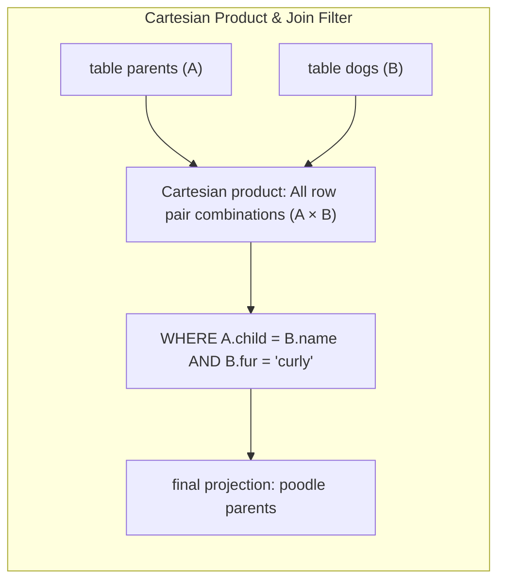

> **Course**: UC Berkeley CS61A (Fall 2024)  
> **Module**: Module 5: Declarative Programming and SQL (Declarative & SQL)  
> **Lecturer**: Prof. John DeNero (UC Berkeley)  
> **Video duration**: 24:54 ｜ **Classroom screenshots**: 17 pieces of blackboard writing/code demonstration  
> **Direct video**: [📺Watch the original video of this lecture on Bilibili (P34)](https://www.bilibili.com/video/BV1sy411z7nA/?p=34)  
> **Quick navigation**: [← Previous lecture (P33 Lecture 35 SQL)](/en/notes/cs61a/lecture-33) ｜ [📚 Return to the full book catalog](/en/notes/topics/CS61A) ｜ [Next lecture (P35 Lecture 37 Aggregation) →](/en/notes/cs61a/lecture-35)

---

## Course Core Objectives and Panorama

In the previous lecture, we mastered row-level filtering of a single table (`WHERE`) and projection (`SELECT`). However, information in the real world is by no means stored in isolation in a single large flat table, but is scattered in multiple entity relationship tables following Database Normalization.

The most powerful core weapon of relational database is exactly **Table joins (Joins)**: 
- By horizontally matching multiple tables by relational fields, unprecedented panoramic information can be dynamically reorganized;
- No matter how complex the relationship is (such as finding "grandparents' dogs with the same hair type as their grandchildren"), they can be elegantly solved in a flash using purely declarative join queries!



---

### In-depth formal specification and micro-evaluation process (Operational Semantics)
In the "Course Core Goals and Panorama" module, the underlying computer operations rely on strict formal evaluation logic:
1. **Hierarchical parsing of abstract syntax trees (AST)**: 
   - The source code character stream is first divided into terminal symbol tokens (Tokens) by the lexical analyzer (Lexer), and then constructed into a multi-fork syntax tree by the syntax parser (Parser);
   - Operator priority and associativity are solidified during the syntax tree construction phase, eliminating ambiguity at runtime;
2. **Dynamic transitions of environment chains**: 
   - Each function call generates a new frame whose static lexical environment is determined by the function object's  `parent`  Attributes are completely determined;
   - The variable search traces back up the environment chain in one direction until the global environment frame. If it is not found, it will be triggered.  `NameError`  Abnormal;
3. **State Invariants**: 
   - The key to writing robust programs is to clarify loop invariants (Loop Invariants) and function pre/post-conditions (Pre/Post-conditions);
   - In complex control flow jumps, ensure that state variables maintain legal business constraints before each iteration.


## 1. The Fundamentals of Joins: Cartesian Product and Row Pair Combination (The Fundamentals of Joins)

In SQL, the most basic connection syntax is in  `FROM`  Use commas in clauses  `,`  Separate multiple tables:

```sql
SELECT * FROM table_a, table_b;
```

[](https://www.bilibili.com/video/BV1sy411z7nA/?p=34&t=32)
*⏱ Timestamp: 00:00:32 · 📷 Classroom screenshot · [Watch the corresponding clip on Bilibili (P34 00:00:32)](https://www.bilibili.com/video/BV1sy411z7nA/?p=34&t=32)*

#### 📸 In-depth reading of classroom blackboard writing and code demonstration (00:00:32)

**\[On-site blackboard writing/code demonstration restoration\]**:
At this time point, Professor DeNero conducted a core demonstration and key blackboard derivation on the screen:
> *“So far, we've been projecting just one table. But we can do much more powerful operations by joining tables together. Now, if you ask someone what a join is among two tables, they may tell you which kind of join. There are so many. And in fact, database people have been thinking about this problem s...”*

**\[Underlying computing model and micro execution mechanism\]**: 
1. **Execution context and timing tracing**: 
   - At the current discussion point "1. The essence of table joins: Cartesian products and row pair combinations (The Fundamentals of Joins)", the interpreter strictly follows the core evaluation protocol;
   - The expression evaluates the operators first, then evaluates the operands strictly from left to right, and finally applies the function object to the argument list;
   - If the environment model is involved, the local frame strictly records its static lexical parent pointer (Parent Pointer points to the environment where the function is defined), forming an orthogonal architecture with the dynamic call stack at runtime.
2. **Memory topology and object references**: 
   - Variable symbols are just keys in a hash table (environment frame), and pointers point directly to first-class citizen objects in heap memory;
   - Assignment statements are discrete-time snapshots of the state and never create implicit mathematical dependency monitoring.

**\[Guidelines for avoiding pitfalls and guidance on high-frequency test points\]**: 
- **Common misunderstandings**: In the exam questions related to "Multi-table join filtering, Self-Join and recursive CTE", beginners can easily guess the results based on the surface form of the code, leading to scope confusion or variable shadowing misjudgments;
- **The golden rule of debugging**: When encountering nested calls and complex branches, be sure to draw independent partial frames on the scratch paper, indicate the specific binding value of each formal parameter, and derive it step by step.


Its underlying mathematical essence is **Cartesian Product**: 
- if table  $A$  Yes  $M$  row, table  $B$  Yes  $N$  line, the connection will be generated containing  $M \times N$  A huge set of intermediate combinations of rows;
- Each result row contains a horizontal line from the table  $A$  sum of all columns from table  $B$  all columns.

---

### In-depth formal specification and micro-evaluation process (Operational Semantics)
In the module "1. The Essence of Table Joins: Cartesian Products and Row Pair Combinations (The Fundamentals of Joins)", the underlying computer operations rely on strict formal evaluation logic:
1. **Hierarchical parsing of abstract syntax trees (AST)**: 
   - The source code character stream is first divided into terminal symbol tokens (Tokens) by the lexical analyzer (Lexer), and then constructed into a multi-fork syntax tree by the syntax parser (Parser);
   - Operator priority and associativity are solidified during the syntax tree construction phase, eliminating ambiguity at runtime;
2. **Dynamic transitions of environment chains**: 
   - Each function call generates a new frame whose static lexical environment is determined by the function object's  `parent`  Attributes are completely determined;
   - The variable search traces back up the environment chain in one direction until the global environment frame. If it is not found, it will be triggered.  `NameError`  Abnormal;
3. **State Invariants**: 
   - The key to writing robust programs is to clarify loop invariants (Loop Invariants) and function pre/post-conditions (Pre/Post-conditions);
   - In complex control flow jumps, ensure that state variables maintain legal business constraints before each iteration.


## 2. Case study: combination of dog characteristics table and family tree table (The Dogs & Parents Tables)

Introduce the second table  `dogs`, record the hair characteristics of each dog (`fur`): 

```sql
CREATE TABLE dogs AS
  SELECT "abraham" AS name, "long"  AS fur UNION
  SELECT "barack",          "short"        UNION
  SELECT "clinton",         "long"         UNION
  SELECT "delano",          "long"         UNION
  SELECT "eisenhower",      "short"        UNION
  SELECT "fillmore",        "curly"        UNION
  SELECT "grover",          "short"        UNION
  SELECT "herbert",         "curly";
```

[](https://www.bilibili.com/video/BV1sy411z7nA/?p=34&t=92)
*⏱ Timestamp: 00:01:32 · 📷 Classroom screenshot · [Watch the corresponding clip on Bilibili (P34 00:01:32)](https://www.bilibili.com/video/BV1sy411z7nA/?p=34&t=92)*

#### 📸 In-depth reading of classroom blackboard writing and code demonstration (00:01:32)

**\[On-site blackboard writing/code demonstration restoration\]**:
At this time point, Professor DeNero conducted a core demonstration and key blackboard derivation on the screen:
> *“In order to do anything interesting, let's create a table called dogs that has a name for each dog and what kind of fur it has. Abraham has long fur. Barack has short fur, which will indicate using dots instead of dashes. Clinton has long fur. Delano has long fur. Eisenhower has short fur. Fillmore ...”*

**\[Underlying computing model and micro execution mechanism\]**: 
1. **Execution context and timing tracing**: 
   - At the current discussion point "2. Case practice: dog characteristic table and family tree table union (The Dogs & Parents Tables)", the interpreter strictly follows the core evaluation protocol;
   - The expression evaluates the operators first, then evaluates the operands strictly from left to right, and finally applies the function object to the argument list;
   - If the environment model is involved, the local frame strictly records its static lexical parent pointer (Parent Pointer points to the environment where the function is defined), forming an orthogonal architecture with the dynamic call stack at runtime.
2. **Memory topology and object references**: 
   - Variable symbols are just keys in a hash table (environment frame), and pointers point directly to first-class citizen objects in heap memory;
   - Assignment statements are discrete-time snapshots of the state and never create implicit mathematical dependency monitoring.

**\[Guidelines for avoiding pitfalls and guidance on high-frequency test points\]**: 
- **Common misunderstandings**: In the exam questions related to "Multi-table join filtering, Self-Join and recursive CTE", beginners can easily guess the results based on the surface form of the code, leading to scope confusion or variable shadowing misjudgments;
- **The golden rule of debugging**: When encountering nested calls and complex branches, be sure to draw independent partial frames on the scratch paper, indicate the specific binding value of each formal parameter, and derive it step by step.


Genealogy information is now available in  `parents`  In the table, the hair information is in  `dogs`  table. We wish to query: **Who are the parents of all curly dogs?**

```sql
SELECT parent FROM parents, dogs
WHERE child = name AND fur = "curly";
```

[](https://www.bilibili.com/video/BV1sy411z7nA/?p=34&t=152)
*⏱ Timestamp: 00:02:32 · 📷 Classroom screenshot · [Watch the corresponding clip on Bilibili (P34 00:02:32)](https://www.bilibili.com/video/BV1sy411z7nA/?p=34&t=152)*

#### 📸 In-depth reading of classroom blackboard writing and code demonstration (00:02:32)

**\[On-site blackboard writing/code demonstration restoration\]**:
At this time point, Professor DeNero conducted a core demonstration and key blackboard derivation on the screen:
> *“f and h are the curly ones, their parents are Eisenhower and Delano. The following select statement will pull those two out. Select the parent from parents joined with dogs, where the child equals name and the fur equals curly. That's the join. What's going on in the where clause? Well, fur equals c...”*

**\[Underlying computing model and micro execution mechanism\]**: 
1. **Execution context and timing tracing**: 
   - At the current discussion point "2. Case practice: dog characteristic table and family tree table union (The Dogs & Parents Tables)", the interpreter strictly follows the core evaluation protocol;
   - The expression evaluates the operators first, then evaluates the operands strictly from left to right, and finally applies the function object to the argument list;
   - If the environment model is involved, the local frame strictly records its static lexical parent pointer (Parent Pointer points to the environment where the function is defined), forming an orthogonal architecture with the dynamic call stack at runtime.
2. **Memory topology and object references**: 
   - Variable symbols are just keys in a hash table (environment frame), and pointers point directly to first-class citizen objects in heap memory;
   - Assignment statements are discrete-time snapshots of the state and never create implicit mathematical dependency monitoring.

**\[Guidelines for avoiding pitfalls and guidance on high-frequency test points\]**: 
- **Common misunderstandings**: In the exam questions related to "Multi-table join filtering, Self-Join and recursive CTE", beginners can easily guess the results based on the surface form of the code, leading to scope confusion or variable shadowing misjudgments;
- **The golden rule of debugging**: When encountering nested calls and complex branches, be sure to draw independent partial frames on the scratch paper, indicate the specific binding value of each formal parameter, and derive it step by step.


[](https://www.bilibili.com/video/BV1sy411z7nA/?p=34&t=240)
*⏱ Timestamp: 00:04:00 · 📷 Classroom screenshot · [Watch the corresponding clip on Bilibili (P34 00:04:00)](https://www.bilibili.com/video/BV1sy411z7nA/?p=34&t=240)*

#### 📸 In-depth reading of classroom blackboard writing and code demonstration (00:04:00)

**\[On-site blackboard writing/code demonstration restoration\]**:
At this time point, Professor DeNero conducted a core demonstration and key blackboard derivation on the screen:
> *“To execute all the statements in dogs.sql. So it's loaded those resources, which means I can select star from dogs and get all the different options. Now, if I select all of the columns from parents comma dogs, that's a join over these two tables and we'll see many results. These results are all the...”*

**\[Underlying computing model and micro execution mechanism\]**: 
1. **Execution context and timing tracing**: 
   - At the current discussion point "2. Case practice: dog characteristic table and family tree table union (The Dogs & Parents Tables)", the interpreter strictly follows the core evaluation protocol;
   - The expression evaluates the operators first, then evaluates the operands strictly from left to right, and finally applies the function object to the argument list;
   - If the environment model is involved, the local frame strictly records its static lexical parent pointer (Parent Pointer points to the environment where the function is defined), forming an orthogonal architecture with the dynamic call stack at runtime.
2. **Memory topology and object references**: 
   - Variable symbols are just keys in a hash table (environment frame), and pointers point directly to first-class citizen objects in heap memory;
   - Assignment statements are discrete-time snapshots of the state and never create implicit mathematical dependency monitoring.

**\[Guidelines for avoiding pitfalls and guidance on high-frequency test points\]**: 
- **Common misunderstandings**: In the exam questions related to "Multi-table join filtering, Self-Join and recursive CTE", beginners can easily guess the results based on the surface form of the code, leading to scope confusion or variable shadowing misjudgments;
- **The golden rule of debugging**: When encountering nested calls and complex branches, be sure to draw independent partial frames on the scratch paper, indicate the specific binding value of each formal parameter, and derive it step by step.


[](https://www.bilibili.com/video/BV1sy411z7nA/?p=34&t=304)
*⏱ Timestamp: 00:05:04 · 📷 Classroom screenshot · [Watch the corresponding clip on Bilibili (P34 00:05:04)](https://www.bilibili.com/video/BV1sy411z7nA/?p=34&t=304)*

#### 📸 In-depth reading of classroom blackboard writing and code demonstration (00:05:04)

**\[On-site blackboard writing/code demonstration restoration\]**:
At this time point, Professor DeNero conducted a core demonstration and key blackboard derivation on the screen:
> *“Dog's name is the same as the child. So we'd write just child equals name in order to get those cases. Okay. We still have four columns, two columns from the parents, two columns from the dogs, but it's always the case that the child and the name column have the same value. So Abraham is Barack's pa...”*

**\[Underlying computing model and micro execution mechanism\]**: 
1. **Execution context and timing tracing**: 
   - At the current discussion point "2. Case practice: dog characteristic table and family tree table union (The Dogs & Parents Tables)", the interpreter strictly follows the core evaluation protocol;
   - The expression evaluates the operators first, then evaluates the operands strictly from left to right, and finally applies the function object to the argument list;
   - If the environment model is involved, the local frame strictly records its static lexical parent pointer (Parent Pointer points to the environment where the function is defined), forming an orthogonal architecture with the dynamic call stack at runtime.
2. **Memory topology and object references**: 
   - Variable symbols are just keys in a hash table (environment frame), and pointers point directly to first-class citizen objects in heap memory;
   - Assignment statements are discrete-time snapshots of the state and never create implicit mathematical dependency monitoring.

**\[Guidelines for avoiding pitfalls and guidance on high-frequency test points\]**: 
- **Common misunderstandings**: In the exam questions related to "Multi-table join filtering, Self-Join and recursive CTE", beginners can easily guess the results based on the surface form of the code, leading to scope confusion or variable shadowing misjudgments;
- **The golden rule of debugging**: When encountering nested calls and complex branches, be sure to draw independent partial frames on the scratch paper, indicate the specific binding value of each formal parameter, and derive it step by step.


- `child = name`: Join Condition, aligning the children in the parent table with the names in the dog table;
- `fur = "curly"`: Attribute filtering conditions, only retaining curly hair varieties;
- Query results are output accurately: `delano` (Herbert's father) and  `eisenhower` (Fillmore's father).

---

### In-depth formal specification and micro-evaluation process (Operational Semantics)
In the module "2. Practical Case Study: Combination of Dog Characteristics Table and Family Tree Tables (The Dogs & Parents Tables)", the underlying computer operations rely on strict formal evaluation logic:
1. **Hierarchical parsing of abstract syntax trees (AST)**: 
   - The source code character stream is first divided into terminal symbol tokens (Tokens) by the lexical analyzer (Lexer), and then constructed into a multi-fork syntax tree by the syntax parser (Parser);
   - Operator priority and associativity are solidified during the syntax tree construction phase, eliminating ambiguity at runtime;
2. **Dynamic transitions of environment chains**: 
   - Each function call generates a new frame whose static lexical environment is determined by the function object's  `parent`  Attributes are completely determined;
   - The variable search traces back up the environment chain in one direction until the global environment frame. If it is not found, it will be triggered.  `NameError`  Abnormal;
3. **State Invariants**: 
   - The key to writing robust programs is to clarify loop invariants (Loop Invariants) and function pre/post-conditions (Pre/Post-conditions);
   - In complex control flow jumps, ensure that state variables maintain legal business constraints before each iteration.


## 3. Table aliases and dot expressions: Self-Join & Aliases

When two tables have the same column names, or \*\*join the same table to itself (Self-Join) **, column names will produce naming conflicts. Must be used at this time** Table Aliases **and** Dot Expressions\*\* are used to disambiguate.

[](https://www.bilibili.com/video/BV1sy411z7nA/?p=34&t=370)
*⏱ Timestamp: 00:06:10 · 📷 Classroom screenshot · [Watch the corresponding clip on Bilibili (P34 00:06:10)](https://www.bilibili.com/video/BV1sy411z7nA/?p=34&t=370)*

#### 📸 In-depth reading of classroom blackboard writing and code demonstration (00:06:10)

**\[On-site blackboard writing/code demonstration restoration\]**:
At this time point, Professor DeNero conducted a core demonstration and key blackboard derivation on the screen:
> *“Which are Eisenhower and Delano. Then we're done. Now we'll have to deal with the interesting case when two different tables have the same column name, and we want to be able to pick out one column in one particular table. For that we have aliases and dot expressions. We can even join a table with i...”*

**\[Underlying computing model and micro execution mechanism\]**: 
1. **Execution context and timing tracing**: 
   - At the current discussion point "3. Table Aliases and Dot Expressions: Self-Join & Aliases", the interpreter strictly follows the core evaluation convention;
   - The expression evaluates the operators first, then evaluates the operands strictly from left to right, and finally applies the function object to the argument list;
   - If the environment model is involved, the local frame strictly records its static lexical parent pointer (Parent Pointer points to the environment where the function is defined), forming an orthogonal architecture with the dynamic call stack at runtime.
2. **Memory topology and object references**: 
   - Variable symbols are just keys in a hash table (environment frame), and pointers point directly to first-class citizen objects in heap memory;
   - Assignment statements are discrete-time snapshots of the state and never create implicit mathematical dependency monitoring.

**\[Guidelines for avoiding pitfalls and guidance on high-frequency test points\]**: 
- **Common misunderstandings**: In the exam questions related to "Multi-table join filtering, Self-Join and recursive CTE", beginners can easily guess the results based on the surface form of the code, leading to scope confusion or variable shadowing misjudgments;
- **The golden rule of debugging**: When encountering nested calls and complex branches, be sure to draw independent partial frames on the scratch paper, indicate the specific binding value of each formal parameter, and derive it step by step.


### Find all sibling pairs (Siblings)

Two dogs are brothers and sisters if they have the same parents. Since all parent information is on the same page  `parents`  table, we must put  `parents`  Connect to yourself:

```sql
SELECT a.child AS first, b.child AS second
FROM parents AS a, parents AS b
WHERE a.parent = b.parent AND a.child < b.child;
```

[](https://www.bilibili.com/video/BV1sy411z7nA/?p=34&t=437)
*⏱ Timestamp: 00:07:17 · 📷 Classroom screenshot · [Watch the corresponding clip on Bilibili (P34 00:07:17)](https://www.bilibili.com/video/BV1sy411z7nA/?p=34&t=437)*

#### 📸 In-depth reading of classroom blackboard writing and code demonstration (00:07:17)

**\[On-site blackboard writing/code demonstration restoration\]**:
At this time point, Professor DeNero conducted a core demonstration and key blackboard derivation on the screen:
> *“Select A.child as first, B.child as second, from parents as A, parents as B, where A.parent is the same as B.parent, and A.child is less than B.child. Here, we're not only joining parents with parents, but we're also giving an alias to this parent as A, and this parent as B. Now, what does this mean...”*

**\[Underlying computing model and micro execution mechanism\]**: 
1. **Execution context and timing tracing**: 
   - At the current discussion point "3. Table Aliases and Dot Expressions: Self-Join & Aliases", the interpreter strictly follows the core evaluation convention;
   - The expression evaluates the operators first, then evaluates the operands strictly from left to right, and finally applies the function object to the argument list;
   - If the environment model is involved, the local frame strictly records its static lexical parent pointer (Parent Pointer points to the environment where the function is defined), forming an orthogonal architecture with the dynamic call stack at runtime.
2. **Memory topology and object references**: 
   - Variable symbols are just keys in a hash table (environment frame), and pointers point directly to first-class citizen objects in heap memory;
   - Assignment statements are discrete-time snapshots of the state and never create implicit mathematical dependency monitoring.

**\[Guidelines for avoiding pitfalls and guidance on high-frequency test points\]**: 
- **Common misunderstandings**: In the exam questions related to "Multi-table join filtering, Self-Join and recursive CTE", beginners can easily guess the results based on the surface form of the code, leading to scope confusion or variable shadowing misjudgments;
- **The golden rule of debugging**: When encountering nested calls and complex branches, be sure to draw independent partial frames on the scratch paper, indicate the specific binding value of each formal parameter, and derive it step by step.


[](https://www.bilibili.com/video/BV1sy411z7nA/?p=34&t=530)
*⏱ Timestamp: 00:08:50 · 📷 Classroom screenshot · [Watch the corresponding clip on Bilibili (P34 00:08:50)](https://www.bilibili.com/video/BV1sy411z7nA/?p=34&t=530)*

#### 📸 In-depth reading of classroom blackboard writing and code demonstration (00:08:50)

**\[On-site blackboard writing/code demonstration restoration\]**:
At this time point, Professor DeNero conducted a core demonstration and key blackboard derivation on the screen:
> *“And the second column, contents, is the child from B. We join together parents with parents in order to get all pairs of parents. And the where clause says that in the first parent's row, I want the parent to be equal to the parent in the second parent's row. And that makes sure that we only get tog...”*

**\[Underlying computing model and micro execution mechanism\]**: 
1. **Execution context and timing tracing**: 
   - At the current discussion point "3. Table Aliases and Dot Expressions: Self-Join & Aliases", the interpreter strictly follows the core evaluation convention;
   - The expression evaluates the operators first, then evaluates the operands strictly from left to right, and finally applies the function object to the argument list;
   - If the environment model is involved, the local frame strictly records its static lexical parent pointer (Parent Pointer points to the environment where the function is defined), forming an orthogonal architecture with the dynamic call stack at runtime.
2. **Memory topology and object references**: 
   - Variable symbols are just keys in a hash table (environment frame), and pointers point directly to first-class citizen objects in heap memory;
   - Assignment statements are discrete-time snapshots of the state and never create implicit mathematical dependency monitoring.

**\[Guidelines for avoiding pitfalls and guidance on high-frequency test points\]**: 
- **Common misunderstandings**: In the exam questions related to "Multi-table join filtering, Self-Join and recursive CTE", beginners can easily guess the results based on the surface form of the code, leading to scope confusion or variable shadowing misjudgments;
- **The golden rule of debugging**: When encountering nested calls and complex branches, be sure to draw independent partial frames on the scratch paper, indicate the specific binding value of each formal parameter, and derive it step by step.


### why it is necessary to write  `a.child < b.child`?
1. **Prevent yourself from pairing with yourself**: If left unchecked, every dog will become his own brother (`barack`  with  `barack`); 
2. **Eliminate symmetrical duplications**: If only write  `a.child != b.child`, will appear simultaneously in the results  `(barack, clinton)`  and  `(clinton, barack)`; 
3. **forced lexicographic order**: Pass strict less than sign  `<`, ensuring that each pair of siblings appears only once, and the names are neatly arranged in ascending order of the alphabet!

---

### In-depth formal specification and micro-evaluation process (Operational Semantics)
In the "3. Table Aliases and Point Expressions: Self-Join & Aliases" module, the underlying computer operations rely on strict formal evaluation logic:
1. **Hierarchical parsing of abstract syntax trees (AST)**: 
   - The source code character stream is first divided into terminal symbol tokens (Tokens) by the lexical analyzer (Lexer), and then constructed into a multi-fork syntax tree by the syntax parser (Parser);
   - Operator priority and associativity are solidified during the syntax tree construction phase, eliminating ambiguity at runtime;
2. **Dynamic transitions of environment chains**: 
   - Each function call generates a new frame whose static lexical environment is determined by the function object's  `parent`  Attributes are completely determined;
   - The variable search traces back up the environment chain in one direction until the global environment frame. If it is not found, it will be triggered.  `NameError`  Abnormal;
3. **State Invariants**: 
   - The key to writing robust programs is to clarify loop invariants (Loop Invariants) and function pre/post-conditions (Pre/Post-conditions);
   - In complex control flow jumps, ensure that state variables maintain legal business constraints before each iteration.


## 4. Multi-table and multi-level associations: constructing ancestor and grandchild tables and three-table joins (Multi-Table Joins)

### Step 1: Construct an ancestor-grandson relationship table  `grandparents`

Grandfather is father’s father. we will  `parents`  Tables are self-joined twice:

```sql
CREATE TABLE grandparents AS
  SELECT a.parent AS grandog, b.child AS grandpup
  FROM parents AS a, parents AS b
  WHERE a.child = b.parent;
```

[](https://www.bilibili.com/video/BV1sy411z7nA/?p=34&t=624)
*⏱ Timestamp: 00:10:24 · 📷 Classroom screenshot · [Watch the corresponding clip on Bilibili (P34 00:10:24)](https://www.bilibili.com/video/BV1sy411z7nA/?p=34&t=624)*

#### 📸 In-depth reading of classroom blackboard writing and code demonstration (00:10:24)

**\[On-site blackboard writing/code demonstration restoration\]**:
At this time point, Professor DeNero conducted a core demonstration and key blackboard derivation on the screen:
> *“The sub rows within there are either from the parents A or the parents B, and you want to know which child column or which parent column you want to compare. You can even join multiple tables together. And when you join together multiple tables, you get all possible combinations of a row from each t...”*

**\[Underlying computing model and micro execution mechanism\]**: 
1. **Execution context and timing tracing**: 
   - At the current discussion point "4. Multi-table and multi-level associations: constructing grandchild tables and three-table joins (Multi-Table Joins)", the interpreter strictly follows the core evaluation protocol;
   - The expression evaluates the operators first, then evaluates the operands strictly from left to right, and finally applies the function object to the argument list;
   - If the environment model is involved, the local frame strictly records its static lexical parent pointer (Parent Pointer points to the environment where the function is defined), forming an orthogonal architecture with the dynamic call stack at runtime.
2. **Memory topology and object references**: 
   - Variable symbols are just keys in a hash table (environment frame), and pointers point directly to first-class citizen objects in heap memory;
   - Assignment statements are discrete-time snapshots of the state and never create implicit mathematical dependency monitoring.

**\[Guidelines for avoiding pitfalls and guidance on high-frequency test points\]**: 
- **Common misunderstandings**: In the exam questions related to "Multi-table join filtering, Self-Join and recursive CTE", beginners can easily guess the results based on the surface form of the code, leading to scope confusion or variable shadowing misjudgments;
- **The golden rule of debugging**: When encountering nested calls and complex branches, be sure to draw independent partial frames on the scratch paper, indicate the specific binding value of each formal parameter, and derive it step by step.


For example  `eisenhower`  Yes  `fillmore` 's father, and  `fillmore`  Yes  `abraham` 's father, it follows that  `(eisenhower, abraham)`  It's the grandfather-grandson pair.

### Step 2: Three-table connection - looking for pairs of ancestors and grandsons with the same hair

**challenge**: Find all combinations in which the grandfather's hair type is exactly the same as his grandchild's hair type.

We need to get both the grandfather's hair and the grandchild's hair, so we need to  `grandparents`  with two  `dogs`  Table join:

```sql
SELECT grandog, grandpup
FROM grandparents, dogs AS c, dogs AS d
WHERE grandog = c.name AND grandpup = d.name AND c.fur = d.fur;
```

[](https://www.bilibili.com/video/BV1sy411z7nA/?p=34&t=716)
*⏱ Timestamp: 00:11:56 · 📷 Classroom screenshot · [Watch the corresponding clip on Bilibili (P34 00:11:56)](https://www.bilibili.com/video/BV1sy411z7nA/?p=34&t=716)*

#### 📸 In-depth reading of classroom blackboard writing and code demonstration (00:11:56)

**\[On-site blackboard writing/code demonstration restoration\]**:
At this time point, Professor DeNero conducted a core demonstration and key blackboard derivation on the screen:
> *“Which tables do you need to join together in order to get that result? And the answer should be that Fillmore is the grandparent of Herbert, and Eisenhower is the grandparent of Grover. Here's a select statement that will do the work. Select the grand dog, the grandparent. From three different table...”*

**\[Underlying computing model and micro execution mechanism\]**: 
1. **Execution context and timing tracing**: 
   - At the current discussion point "4. Multi-table and multi-level associations: constructing grandchild tables and three-table joins (Multi-Table Joins)", the interpreter strictly follows the core evaluation protocol;
   - The expression evaluates the operators first, then evaluates the operands strictly from left to right, and finally applies the function object to the argument list;
   - If the environment model is involved, the local frame strictly records its static lexical parent pointer (Parent Pointer points to the environment where the function is defined), forming an orthogonal architecture with the dynamic call stack at runtime.
2. **Memory topology and object references**: 
   - Variable symbols are just keys in a hash table (environment frame), and pointers point directly to first-class citizen objects in heap memory;
   - Assignment statements are discrete-time snapshots of the state and never create implicit mathematical dependency monitoring.

**\[Guidelines for avoiding pitfalls and guidance on high-frequency test points\]**: 
- **Common misunderstandings**: In the exam questions related to "Multi-table join filtering, Self-Join and recursive CTE", beginners can easily guess the results based on the surface form of the code, leading to scope confusion or variable shadowing misjudgments;
- **The golden rule of debugging**: When encountering nested calls and complex branches, be sure to draw independent partial frames on the scratch paper, indicate the specific binding value of each formal parameter, and derive it step by step.


[](https://www.bilibili.com/video/BV1sy411z7nA/?p=34&t=815)
*⏱ Timestamp: 00:13:35 · 📷 Classroom screenshot · [Watch the corresponding clip on Bilibili (P34 00:13:35)](https://www.bilibili.com/video/BV1sy411z7nA/?p=34&t=815)*

#### 📸 In-depth reading of classroom blackboard writing and code demonstration (00:13:35)

**\[On-site blackboard writing/code demonstration restoration\]**:
At this time point, Professor DeNero conducted a core demonstration and key blackboard derivation on the screen:
> *“Next, we wanted to join three tables together, which involves selecting the grand dog from the first table is the grandparents table. The second is the dogs and the third is more dogs. And the reason why we joined all three together is so that we could express that the fur was the same for a dog nam...”*

**\[Underlying computing model and micro execution mechanism\]**: 
1. **Execution context and timing tracing**: 
   - At the current discussion point "4. Multi-table and multi-level associations: constructing grandchild tables and three-table joins (Multi-Table Joins)", the interpreter strictly follows the core evaluation protocol;
   - The expression evaluates the operators first, then evaluates the operands strictly from left to right, and finally applies the function object to the argument list;
   - If the environment model is involved, the local frame strictly records its static lexical parent pointer (Parent Pointer points to the environment where the function is defined), forming an orthogonal architecture with the dynamic call stack at runtime.
2. **Memory topology and object references**: 
   - Variable symbols are just keys in a hash table (environment frame), and pointers point directly to first-class citizen objects in heap memory;
   - Assignment statements are discrete-time snapshots of the state and never create implicit mathematical dependency monitoring.

**\[Guidelines for avoiding pitfalls and guidance on high-frequency test points\]**: 
- **Common misunderstandings**: In the exam questions related to "Multi-table join filtering, Self-Join and recursive CTE", beginners can easily guess the results based on the surface form of the code, leading to scope confusion or variable shadowing misjudgments;
- **The golden rule of debugging**: When encountering nested calls and complex branches, be sure to draw independent partial frames on the scratch paper, indicate the specific binding value of each formal parameter, and derive it step by step.


The database engine scans the three tables together and accurately matches two pairs of family members that meet the conditions:
- `eisenhower`  with  `grover` (Both are short-haired shorts);
- `fillmore`  with  `herbert` (Both are curly).

---

### In-depth formal specification and micro-evaluation process (Operational Semantics)
In the module "4. Multi-table and multi-level associations: constructing ancestor-grandson tables and three-table joins (Multi-Table Joins)", the underlying computer operations rely on strict formal evaluation logic:
1. **Hierarchical parsing of abstract syntax trees (AST)**: 
   - The source code character stream is first divided into terminal symbol tokens (Tokens) by the lexical analyzer (Lexer), and then constructed into a multi-fork syntax tree by the syntax parser (Parser);
   - Operator priority and associativity are solidified during the syntax tree construction phase, eliminating ambiguity at runtime;
2. **Dynamic transitions of environment chains**: 
   - Each function call generates a new frame whose static lexical environment is determined by the function object's  `parent`  Attributes are completely determined;
   - The variable search traces back up the environment chain in one direction until the global environment frame. If it is not found, it will be triggered.  `NameError`  Abnormal;
3. **State Invariants**: 
   - The key to writing robust programs is to clarify loop invariants (Loop Invariants) and function pre/post-conditions (Pre/Post-conditions);
   - In complex control flow jumps, ensure that state variables maintain legal business constraints before each iteration.


## 5. Numerical Expressions in Joins

SQL support in  `SELECT`, `WHERE`, `ORDER BY`  Freely use a rich set of mathematical functions and arithmetic operators:

[](https://www.bilibili.com/video/BV1sy411z7nA/?p=34&t=916)
*⏱ Timestamp: 00:15:16 · 📷 Classroom screenshot · [Watch the corresponding clip on Bilibili (P34 00:15:16)](https://www.bilibili.com/video/BV1sy411z7nA/?p=34&t=916)*

#### 📸 In-depth reading of classroom blackboard writing and code demonstration (00:15:16)

**\[On-site blackboard writing/code demonstration restoration\]**:
At this time point, Professor DeNero conducted a core demonstration and key blackboard derivation on the screen:
> *“They can also use arithmetic operators such as plus and minus and times. Now, these can occur in any expression within a select statement. There's a where expression, there's an order by expression, and within the columns description, which is a comma separated list, there are expressions there as w...”*

**\[Underlying computing model and micro execution mechanism\]**: 
1. **Execution context and timing tracing**: 
   - At the current discussion point "5. Numerical Expressions in Joins", the interpreter strictly follows the core evaluation protocol;
   - The expression evaluates the operators first, then evaluates the operands strictly from left to right, and finally applies the function object to the argument list;
   - If the environment model is involved, the local frame strictly records its static lexical parent pointer (Parent Pointer points to the environment where the function is defined), forming an orthogonal architecture with the dynamic call stack at runtime.
2. **Memory topology and object references**: 
   - Variable symbols are just keys in a hash table (environment frame), and pointers point directly to first-class citizen objects in heap memory;
   - Assignment statements are discrete-time snapshots of the state and never create implicit mathematical dependency monitoring.

**\[Guidelines for avoiding pitfalls and guidance on high-frequency test points\]**: 
- **Common misunderstandings**: In the exam questions related to "Multi-table join filtering, Self-Join and recursive CTE", beginners can easily guess the results based on the surface form of the code, leading to scope confusion or variable shadowing misjudgments;
- **The golden rule of debugging**: When encountering nested calls and complex branches, be sure to draw independent partial frames on the scratch paper, indicate the specific binding value of each formal parameter, and derive it step by step.


### Analysis of the distance between north and south latitudes of cities

One degree of latitude is equal to approximately 60 nautical miles. we will  `cities`  The table is self-joined to calculate the northward sailing distance from the starting city to the destination city:

```sql
CREATE TABLE distances AS
  SELECT a.name AS first, b.name AS second,
         60 * (b.latitude - a.latitude) AS distance
  FROM cities AS a, cities AS b;
```

[](https://www.bilibili.com/video/BV1sy411z7nA/?p=34&t=1047)
*⏱ Timestamp: 00:17:27 · 📷 Classroom screenshot · [Watch the corresponding clip on Bilibili (P34 00:17:27)](https://www.bilibili.com/video/BV1sy411z7nA/?p=34&t=1047)*

#### 📸 In-depth reading of classroom blackboard writing and code demonstration (00:17:27)

**\[On-site blackboard writing/code demonstration restoration\]**:
At this time point, Professor DeNero conducted a core demonstration and key blackboard derivation on the screen:
> *“Chicago is also cold, so I can use a union in order to get Minneapolis, North Pole, and Chicago all in one table. Now, what about arithmetic? Well, let's say I want to compute the north-south distance between cities. North and south really matters because that affects climate more than east and west...”*

**\[Underlying computing model and micro execution mechanism\]**: 
1. **Execution context and timing tracing**: 
   - At the current discussion point "5. Numerical Expressions in Joins", the interpreter strictly follows the core evaluation protocol;
   - The expression evaluates the operators first, then evaluates the operands strictly from left to right, and finally applies the function object to the argument list;
   - If the environment model is involved, the local frame strictly records its static lexical parent pointer (Parent Pointer points to the environment where the function is defined), forming an orthogonal architecture with the dynamic call stack at runtime.
2. **Memory topology and object references**: 
   - Variable symbols are just keys in a hash table (environment frame), and pointers point directly to first-class citizen objects in heap memory;
   - Assignment statements are discrete-time snapshots of the state and never create implicit mathematical dependency monitoring.

**\[Guidelines for avoiding pitfalls and guidance on high-frequency test points\]**: 
- **Common misunderstandings**: In the exam questions related to "Multi-table join filtering, Self-Join and recursive CTE", beginners can easily guess the results based on the surface form of the code, leading to scope confusion or variable shadowing misjudgments;
- **The golden rule of debugging**: When encountering nested calls and complex branches, be sure to draw independent partial frames on the scratch paper, indicate the specific binding value of each formal parameter, and derive it step by step.


From wintry Minneapolis, sorted by furthest south:
```sql
SELECT second FROM distances
WHERE first = "Minneapolis"
ORDER BY distance;
```

[](https://www.bilibili.com/video/BV1sy411z7nA/?p=34&t=1112)
*⏱ Timestamp: 00:18:32 · 📷 Classroom screenshot · [Watch the corresponding clip on Bilibili (P34 00:18:32)](https://www.bilibili.com/video/BV1sy411z7nA/?p=34&t=1112)*

#### 📸 In-depth reading of classroom blackboard writing and code demonstration (00:18:32)

**\[On-site blackboard writing/code demonstration restoration\]**:
At this time point, Professor DeNero conducted a core demonstration and key blackboard derivation on the screen:
> *“B.latitude and A.latitude. And we'll call that the distance. We have our column descriptions, but we still have to say what we're selecting from. We've referred to A and B so far. Those are different versions of the cities table, which we'll have to join with itself in order to compute the latitude ...”*

**\[Underlying computing model and micro execution mechanism\]**: 
1. **Execution context and timing tracing**: 
   - At the current discussion point "5. Numerical Expressions in Joins", the interpreter strictly follows the core evaluation protocol;
   - The expression evaluates the operators first, then evaluates the operands strictly from left to right, and finally applies the function object to the argument list;
   - If the environment model is involved, the local frame strictly records its static lexical parent pointer (Parent Pointer points to the environment where the function is defined), forming an orthogonal architecture with the dynamic call stack at runtime.
2. **Memory topology and object references**: 
   - Variable symbols are just keys in a hash table (environment frame), and pointers point directly to first-class citizen objects in heap memory;
   - Assignment statements are discrete-time snapshots of the state and never create implicit mathematical dependency monitoring.

**\[Guidelines for avoiding pitfalls and guidance on high-frequency test points\]**: 
- **Common misunderstandings**: In the exam questions related to "Multi-table join filtering, Self-Join and recursive CTE", beginners can easily guess the results based on the surface form of the code, leading to scope confusion or variable shadowing misjudgments;
- **The golden rule of debugging**: When encountering nested calls and complex branches, be sure to draw independent partial frames on the scratch paper, indicate the specific binding value of each formal parameter, and derive it step by step.


At the top of the list are warm and sunny Miami and San Diego, which perfectly demonstrate the real-life power of relationship projection and sequencing.

---

### In-depth formal specification and micro-evaluation process (Operational Semantics)
In the "5. Numerical Expressions in Joins" module, the underlying computer operations rely on strict formal evaluation logic:
1. **Hierarchical parsing of abstract syntax trees (AST)**: 
   - The source code character stream is first divided into terminal symbol tokens (Tokens) by the lexical analyzer (Lexer), and then constructed into a multi-fork syntax tree by the syntax parser (Parser);
   - Operator priority and associativity are solidified during the syntax tree construction phase, eliminating ambiguity at runtime;
2. **Dynamic transitions of environment chains**: 
   - Each function call generates a new frame whose static lexical environment is determined by the function object's  `parent`  Attributes are completely determined;
   - The variable search traces back up the environment chain in one direction until the global environment frame. If it is not found, it will be triggered.  `NameError`  Abnormal;
3. **State Invariants**: 
   - The key to writing robust programs is to clarify loop invariants (Loop Invariants) and function pre/post-conditions (Pre/Post-conditions);
   - In complex control flow jumps, ensure that state variables maintain legal business constraints before each iteration.


## 6. String Expressions & Anti-Patterns

SQL provides double vertical bars  `||`  String concatenation operator:

```sql
SELECT "hello" || ", " || "world"; -- => "hello, world"
```

[](https://www.bilibili.com/video/BV1sy411z7nA/?p=34&t=1180)
*⏱ Timestamp: 00:19:40 · 📷 Classroom screenshot · [Watch the corresponding clip on Bilibili (P34 00:19:40)](https://www.bilibili.com/video/BV1sy411z7nA/?p=34&t=1180)*

#### 📸 In-depth reading of classroom blackboard writing and code demonstration (00:19:40)

**\[On-site blackboard writing/code demonstration restoration\]**:
At this time point, Professor DeNero conducted a core demonstration and key blackboard derivation on the screen:
> *“People from Minneapolis really like to go to Miami and San Diego, not so much the North Pole. So here's an expression that does some sort of manipulation of numerical values, and that's very typical in a SQL expression. There are also combinations involving string values, string expressions. So stri...”*

**\[Underlying computing model and micro execution mechanism\]**: 
1. **Execution context and timing tracing**: 
   - At the current discussion point "6. String Expressions & Anti-Patterns", the interpreter strictly follows the core evaluation convention;
   - The expression evaluates the operators first, then evaluates the operands strictly from left to right, and finally applies the function object to the argument list;
   - If the environment model is involved, the local frame strictly records its static lexical parent pointer (Parent Pointer points to the environment where the function is defined), forming an orthogonal architecture with the dynamic call stack at runtime.
2. **Memory topology and object references**: 
   - Variable symbols are just keys in a hash table (environment frame), and pointers point directly to first-class citizen objects in heap memory;
   - Assignment statements are discrete-time snapshots of the state and never create implicit mathematical dependency monitoring.

**\[Guidelines for avoiding pitfalls and guidance on high-frequency test points\]**: 
- **Common misunderstandings**: In the exam questions related to "Multi-table join filtering, Self-Join and recursive CTE", beginners can easily guess the results based on the surface form of the code, leading to scope confusion or variable shadowing misjudgments;
- **The golden rule of debugging**: When encountering nested calls and complex branches, be sure to draw independent partial frames on the scratch paper, indicate the specific binding value of each formal parameter, and derive it step by step.


### Architecture warning: Using strings to store complex data structures in relational databases is a serious anti-pattern

[](https://www.bilibili.com/video/BV1sy411z7nA/?p=34&t=1300)
*⏱ Timestamp: 00:21:40 · 📷 Classroom screenshot · [Watch the corresponding clip on Bilibili (P34 00:21:40)](https://www.bilibili.com/video/BV1sy411z7nA/?p=34&t=1300)*

#### 📸 In-depth reading of classroom blackboard writing and code demonstration (00:21:40)

**\[On-site blackboard writing/code demonstration restoration\]**:
At this time point, Professor DeNero conducted a core demonstration and key blackboard derivation on the screen:
> *“You could think each row is actually going to represent a linked list in a table called lists, where I'll have one column for the car or the first element in the linked list. And in this case, it's just a string 1. And then the coulder column will have comma-separated elements for the rest of the li...”*

**\[Underlying computing model and micro execution mechanism\]**: 
1. **Execution context and timing tracing**: 
   - At the current discussion point "6. String Expressions & Anti-Patterns", the interpreter strictly follows the core evaluation convention;
   - The expression evaluates the operators first, then evaluates the operands strictly from left to right, and finally applies the function object to the argument list;
   - If the environment model is involved, the local frame strictly records its static lexical parent pointer (Parent Pointer points to the environment where the function is defined), forming an orthogonal architecture with the dynamic call stack at runtime.
2. **Memory topology and object references**: 
   - Variable symbols are just keys in a hash table (environment frame), and pointers point directly to first-class citizen objects in heap memory;
   - Assignment statements are discrete-time snapshots of the state and never create implicit mathematical dependency monitoring.

**\[Guidelines for avoiding pitfalls and guidance on high-frequency test points\]**: 
- **Common misunderstandings**: In the exam questions related to "Multi-table join filtering, Self-Join and recursive CTE", beginners can easily guess the results based on the surface form of the code, leading to scope confusion or variable shadowing misjudgments;
- **The golden rule of debugging**: When encountering nested calls and complex branches, be sure to draw independent partial frames on the scratch paper, indicate the specific binding value of each formal parameter, and derive it step by step.


Some beginners will try to use comma delimiters to store linked list or array-like data in a single string column (such as  `"1,2,3,4"`), and then use the complex  `substr`  and  `instr`  Manual parsing:
- This completely destroys the first normal form (1NF, atomicity of columns) of relational databases;
- As a result, effective indexes cannot be established and query performance drops off a cliff;
- The right thing to do is always **Split multiple elements into independent multiple rows in a relational table (Records)**!

---

### In-depth formal specification and micro-evaluation process (Operational Semantics)
In the "6. String Expressions & Anti-Patterns" module, the underlying computer operations rely on strict formal evaluation logic:
1. **Hierarchical parsing of abstract syntax trees (AST)**: 
   - The source code character stream is first divided into terminal symbol tokens (Tokens) by the lexical analyzer (Lexer), and then constructed into a multi-fork syntax tree by the syntax parser (Parser);
   - Operator priority and associativity are solidified during the syntax tree construction phase, eliminating ambiguity at runtime;
2. **Dynamic transitions of environment chains**: 
   - Each function call generates a new frame whose static lexical environment is determined by the function object's  `parent`  Attributes are completely determined;
   - The variable search traces back up the environment chain in one direction until the global environment frame. If it is not found, it will be triggered.  `NameError`  Abnormal;
3. **State Invariants**: 
   - The key to writing robust programs is to clarify loop invariants (Loop Invariants) and function pre/post-conditions (Pre/Post-conditions);
   - In complex control flow jumps, ensure that state variables maintain legal business constraints before each iteration.


## 7. Interesting practice: Use Cartesian product to automatically generate natural language sentences (Generating Sentences)

Taking advantage of the property of Cartesian product to enumerate all possibilities, we can use SQL to automatically generate grammatically correct verb-object sentences:

```sql
CREATE TABLE nouns AS
  SELECT "the dog" AS word UNION
  SELECT "the cat"         UNION
  SELECT "the bird";

SELECT a.word || " chased " || b.word
FROM nouns AS a, nouns AS b
WHERE a.word != b.word;
```

[](https://www.bilibili.com/video/BV1sy411z7nA/?p=34&t=1399)
*⏱ Timestamp: 00:23:19 · 📷 Classroom screenshot · [Watch the corresponding clip on Bilibili (P34 00:23:19)](https://www.bilibili.com/video/BV1sy411z7nA/?p=34&t=1399)*

#### 📸 In-depth reading of classroom blackboard writing and code demonstration (00:23:19)

**\[On-site blackboard writing/code demonstration restoration\]**:
At this time point, Professor DeNero conducted a core demonstration and key blackboard derivation on the screen:
> *“How about a cat? And why not a bird? Okay, now that we have some nouns, we can select a whole sentence by getting the subject phrase concatenated with chased and concatenated with the object phrase. Where are we getting these subjects and objects? Well, those are just nouns. We'll need to join two n...”*

**\[Underlying computing model and micro execution mechanism\]**: 
1. **Execution context and timing tracing**: 
   - At the current discussion point "7. Interesting practice: automatically generate natural language sentences (Generating Sentences) using Cartesian products", the interpreter strictly follows the core evaluation protocol;
   - The expression evaluates the operators first, then evaluates the operands strictly from left to right, and finally applies the function object to the argument list;
   - If the environment model is involved, the local frame strictly records its static lexical parent pointer (Parent Pointer points to the environment where the function is defined), forming an orthogonal architecture with the dynamic call stack at runtime.
2. **Memory topology and object references**: 
   - Variable symbols are just keys in a hash table (environment frame), and pointers point directly to first-class citizen objects in heap memory;
   - Assignment statements are discrete-time snapshots of the state and never create implicit mathematical dependency monitoring.

**\[Guidelines for avoiding pitfalls and guidance on high-frequency test points\]**: 
- **Common misunderstandings**: In the exam questions related to "Multi-table join filtering, Self-Join and recursive CTE", beginners can easily guess the results based on the surface form of the code, leading to scope confusion or variable shadowing misjudgments;
- **The golden rule of debugging**: When encountering nested calls and complex branches, be sure to draw independent partial frames on the scratch paper, indicate the specific binding value of each formal parameter, and derive it step by step.


The output neatly enumerates all possible chase scenarios:
- "the bird chased the cat"
- "the dog chased the bird"
- "the cat chased the dog" ...

Further introduction of conjunction list  `ands`, and you can create unlimited combinations of long and complex sentences like "the dog and the bird chased the cat and the dog"!

---

### In-depth formal specification and micro-evaluation process (Operational Semantics)
In the module "7. Interesting Practice: Using Cartesian Product to Automatically Generate Natural Language Sentences (Generating Sentences)", the underlying computer operations rely on strict formal evaluation logic:
1. **Hierarchical parsing of abstract syntax trees (AST)**: 
   - The source code character stream is first divided into terminal symbol tokens (Tokens) by the lexical analyzer (Lexer), and then constructed into a multi-fork syntax tree by the syntax parser (Parser);
   - Operator priority and associativity are solidified during the syntax tree construction phase, eliminating ambiguity at runtime;
2. **Dynamic transitions of environment chains**: 
   - Each function call generates a new frame whose static lexical environment is determined by the function object's  `parent`  Attributes are completely determined;
   - The variable search traces back up the environment chain in one direction until the global environment frame. If it is not found, it will be triggered.  `NameError`  Abnormal;
3. **State Invariants**: 
   - The key to writing robust programs is to clarify loop invariants (Loop Invariants) and function pre/post-conditions (Pre/Post-conditions);
   - In complex control flow jumps, ensure that state variables maintain legal business constraints before each iteration.


## Summary of core review points

| core technology | Syntax example | Key considerations |
| :--- | :--- | :--- |
| **Table join (Join)** | `FROM A, B WHERE A.id = B.id` | The bottom layer generates the Cartesian product, which must be passed  `WHERE`  Provide matching primary and foreign keys |
| **Self-Join** | `FROM T AS A, T AS B` | Different aliases must be given to tables with the same name, through  `<`  Avoid self-pairing and symmetric redundancy |
| **Multiple table join** | `FROM T1, T2 AS A, T2 AS B` | Allow multiple references to multiple or even the same entity tables |
| **ORDER BY** | `ORDER BY expr ASC/DESC` | Can be sorted directly based on calculated derived columns or expressions |
| **String concatenation** | `str1 \|\| str2` | Dedicated to splicing text, string encoding of composite relational data is strictly prohibited. |

### In-depth formal specification and micro-evaluation process (Operational Semantics)
In the "Summary of Core Review Key Points" module, the underlying computer operations rely on strict formal evaluation logic:
1. **Hierarchical parsing of abstract syntax trees (AST)**: 
   - The source code character stream is first divided into terminal symbol tokens (Tokens) by the lexical analyzer (Lexer), and then constructed into a multi-fork syntax tree by the syntax parser (Parser);
   - Operator priority and associativity are solidified during the syntax tree construction phase, eliminating ambiguity at runtime;
2. **Dynamic transitions of environment chains**: 
   - Each function call generates a new frame whose static lexical environment is determined by the function object's  `parent`  Attributes are completely determined;
   - The variable search traces back up the environment chain in one direction until the global environment frame. If it is not found, it will be triggered.  `NameError`  Abnormal;
3. **State Invariants**: 
   - The key to writing robust programs is to clarify loop invariants (Loop Invariants) and function pre/post-conditions (Pre/Post-conditions);
   - In complex control flow jumps, ensure that state variables maintain legal business constraints before each iteration.


---

## Berkeley Midterm/Final classic high-frequency exam questions in-depth practice

### Practical exam questions: Environment topology and microstate tracking (WWPD & Environment Diagrams)
Consider the following microscopic execution of Python code in an interactive environment:

```python
# 经典作用域与高阶函数综合考题
x = 10

def outer(x):
    y = x + 2
    def inner(y):
        return x + y
    return inner

f = outer(5)
result = f(3)
```

#### Complete problem-solving thinking model and multi-frame environment map derivation:
1. **Global Frame initialization**: 
   - global variables  `x`  Bind to integer object  `10`; 
   - global function  `outer`  Binds to the newly created function object whose embedded  `parent = Global`; 
2. **execute  `f = outer(5)`**: 
   - create a local frame  $f_1$, mark  `f1: outer [parent=Global]`; 
   - formal parameters  `x`  Bind to actual parameters  `5`; 
   - local variables  `y`  bind to  `5 + 2 = 7`; 
   - in  $f_1$  internal execution  `def inner(y):`, create a function object  `inner`, its embedded  **`parent = f1`**; 
   - Return function object  `inner`, global variables  `f`  Bind to this object;
3. **execute  `result = f(3)`**: 
   - call function  `f` (i.e.  `inner`), open up a local frame  $f_2$; 
   - **core scoring points**:frame  $f_2$  Who does parent point to?
   - **iron law**: function  `inner`  is in frame  $f_1$  is defined internally, so  $f_2$  of  **`parent = f1`**!
   - formal parameters  `y`  Bind to actual parameters  `3`; 
   - executor  `return x + y`: 
     - in current frame  $f_2$  Find  `y`: Hit local variable  `y = 3`; 
     - in current frame  $f_2$  Find  `x`: miss, trace back along parent  **$f_1$  frame**  Find it!
     - in  $f_1$  hit in frame  `x = 5` (Global  `x = 10`  Partially obscured! );
     - Calculate  `5 + 3 = 8`, as the return value;
4. **Final output conclusion**: 
   - global variables  `result = 8`.

---

## Knowledge Matrix of the core concepts of this lecture

| core knowledge dimension | Formal definition and mechanism | Typical code examples | Core Engineering and Algorithm Value | Common pitfalls |
| :--- | :--- | :--- | :--- | :--- |
| **Basic evaluation semantics** | The expression is evaluated to obtain a value, and the execution of the statement changes the internal state. | `x = 2 + 3` | Build a discrete-time state snapshot mental model | Mistaking the assignment equal sign as a dynamic constraint on an algebraic equation |
| **Environment frame topology** | The environment is an ordered chain of frames | `Global -> f1 -> f2` | Implement safe isolation of lexical scope and variables | Confusing the caller stack frame with the parent environment pointer at the definition point |
| **abstract barrier** | Isolate implementation details and calling logic through functional interfaces | `def square(x): ...` | Reduce cognitive load on large-scale systems | Destroying interfaces directly relies on underlying private data structures |
| **control flow decisions** | Conditional branch short-circuit evaluation and loop iteration progression | `if cond: ... while: ...` | Give programs non-linear decision-making and large-scale data processing capabilities | Missing the loop progression variable causes an infinite loop |
| **higher level abilities** | Functions as first-class citizens (parameter passing, return, assignment) | `make_adder(3)` | Implement factory pattern, closure persistent state and currying | Closure late binding throws loop variable capture error |

---

## Course navigation and jump

| Previous lecture | Directory | Next lecture | Original video |
| :--- | :---: | :--- | :--- |
| [← Previous lecture: Lecture 35 SQL](/en/notes/cs61a/lecture-33) | [📚 Return to CS61A complete book list](/en/notes/topics/CS61A) | [Next lecture: Lecture 37 Aggregation →](/en/notes/cs61a/lecture-35) | [🎬Watch this lecture on Bilibili (P34)](https://www.bilibili.com/video/BV1sy411z7nA/?p=34) |
