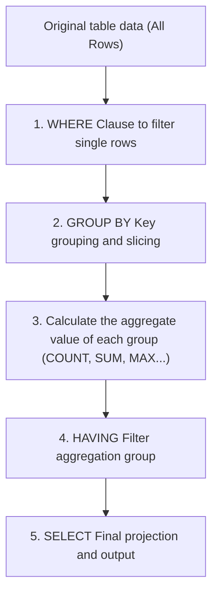

> **Course**: UC Berkeley CS61A (Fall 2024)  
> **Module**: Module 5: Declarative Programming and SQL (Declarative & SQL)  
> **Lecturer**: Prof. John DeNero (UC Berkeley)  
> **Video duration**: 17:30 ｜ **Classroom screenshots**: 17 pieces of blackboard writing/code demonstration  
> **Direct video**: [📺Watch the original video of this lecture on Bilibili (P35)](https://www.bilibili.com/video/BV1sy411z7nA/?p=35)  
> **Quick navigation**: [← Previous Lecture (P34 Lecture 36 Tables)](/en/notes/cs61a/lecture-34) ｜ [📚 Return to the full book catalog](/en/notes/topics/CS61A) ｜ [Next lecture (P36 Lecture 38 Databases (Optional)) →](/en/notes/cs61a/lecture-36)

---

## Course Core Objectives and Panorama

In previous database operations, all expression evaluations were performed \*\*Per-Row\*\*: whether performing arithmetic operations or using  `WHERE`  Filtering, the context of calculation is always limited to the current row.

However, the core soul of data analysis is **Aggregation Statistics**: 
- How to find the maximum, average or sum among hundreds of millions of records?
- How to classify and slice data according to specific attributes (`GROUP BY`), and perform statistics separately for each subcategory?
- How to apply threshold condition filtering to statistical results (`HAVING`)?

This lecture will systematically analyze the underlying operating model of the SQL aggregation engine.



---

### In-depth formal specification and micro-evaluation process (Operational Semantics)
In the "Course Core Goals and Panorama" module, the underlying computer operations rely on strict formal evaluation logic:
1. **Hierarchical parsing of abstract syntax trees (AST)**: 
   - The source code character stream is first divided into terminal symbol tokens (Tokens) by the lexical analyzer (Lexer), and then constructed into a multi-fork syntax tree by the syntax parser (Parser);
   - Operator priority and associativity are solidified during the syntax tree construction phase, eliminating ambiguity at runtime;
2. **Dynamic transitions of environment chains**: 
   - Each function call generates a new frame whose static lexical environment is determined by the function object's  `parent`  Attributes are completely determined;
   - The variable search traces back up the environment chain in one direction until the global environment frame. If it is not found, it will be triggered.  `NameError`  Abnormal;
3. **State Invariants**: 
   - The key to writing robust programs is to clarify loop invariants (Loop Invariants) and function pre/post-conditions (Pre/Post-conditions);
   - In complex control flow jumps, ensure that state variables maintain legal business constraints before each iteration.


## 1. Single row evaluation vs aggregate functions (Row-Level vs Aggregate Functions)

Regular SQL expressions run independently on each row:

[](https://www.bilibili.com/video/BV1sy411z7nA/?p=35&t=32)
*⏱ Timestamp: 00:00:32 · 📷 Classroom screenshot · [Watch the corresponding clip on Bilibili (P35 00:00:32)](https://www.bilibili.com/video/BV1sy411z7nA/?p=35&t=32)*

#### 📸 In-depth reading of classroom blackboard writing and code demonstration (00:00:32)

**\[On-site blackboard writing/code demonstration restoration\]**:
At this time point, Professor DeNero conducted a core demonstration and key blackboard derivation on the screen:
> *“In the SQL language, you can perform aggregation over multiple rows, using aggregate functions. So, so far, all SQL expressions have referred to the values in a single row at a time. What do I mean by that? Well, if we look at the structure of a SELECT statement, we see that there are expressions in...”*

**\[Underlying computing model and micro execution mechanism\]**: 
1. **Execution context and timing tracing**: 
   - At the current discussion point "1. Single-row evaluation vs aggregate functions (Row-Level vs Aggregate Functions)", the interpreter strictly follows the core evaluation protocol;
   - The expression evaluates the operators first, then evaluates the operands strictly from left to right, and finally applies the function object to the argument list;
   - If the environment model is involved, the local frame strictly records its static lexical parent pointer (Parent Pointer points to the environment where the function is defined), forming an orthogonal architecture with the dynamic call stack at runtime.
2. **Memory topology and object references**: 
   - Variable symbols are just keys in a hash table (environment frame), and pointers point directly to first-class citizen objects in heap memory;
   - Assignment statements are discrete-time snapshots of the state and never create implicit mathematical dependency monitoring.

**\[Guidelines for avoiding pitfalls and guidance on high-frequency test points\]**: 
- **Common misunderstandings**: In the exam questions related to "Aggregation functions (COUNT, SUM, AVG, MAX, MIN), GROUP BY grouping and HAVING secondary screening", beginners can easily guess the results based on the surface form of the code, leading to scope confusion or variable shadowing (Shadowing) misjudgment;
- **The golden rule of debugging**: When encountering nested calls and complex branches, be sure to draw independent partial frames on the scratch paper, indicate the specific binding value of each formal parameter, and derive it step by step.


The Aggregate Function receives a Group of Rows as input, collapses it and calculates a summary scalar value.

### Practical data set: animal characteristics table  `animals`

Introduce a sheet containing the number of legs (`legs`) and weight (`weight`) animal table:

```sql
CREATE TABLE animals AS
  SELECT "dog"     AS kind, 4 AS legs, 20    AS weight UNION
  SELECT "cat",             4,         10              UNION
  SELECT "ferret",          4,         10              UNION
  SELECT "parrot",          2,         6               UNION
  SELECT "penguin",         2,         10              UNION
  SELECT "t-rex",           2,         12000;
```

[](https://www.bilibili.com/video/BV1sy411z7nA/?p=35&t=94)
*⏱ Timestamp: 00:01:34 · 📷 Classroom screenshot · [Watch the corresponding clip on Bilibili (P35 00:01:34)](https://www.bilibili.com/video/BV1sy411z7nA/?p=35&t=94)*

#### 📸 In-depth reading of classroom blackboard writing and code demonstration (00:01:34)

**\[On-site blackboard writing/code demonstration restoration\]**:
At this time point, Professor DeNero conducted a core demonstration and key blackboard derivation on the screen:
> *“Of the latitude, column, for a particular row is above some number, 38. And if so, you keep that row. Otherwise, you get rid of that row. But the expression itself is evaluated per row. Everything we've seen has looked like that so far. But now we're going to look at what's called an aggregate funct...”*

**\[Underlying computing model and micro execution mechanism\]**: 
1. **Execution context and timing tracing**: 
   - At the current discussion point "1. Single-row evaluation vs aggregate functions (Row-Level vs Aggregate Functions)", the interpreter strictly follows the core evaluation protocol;
   - The expression evaluates the operators first, then evaluates the operands strictly from left to right, and finally applies the function object to the argument list;
   - If the environment model is involved, the local frame strictly records its static lexical parent pointer (Parent Pointer points to the environment where the function is defined), forming an orthogonal architecture with the dynamic call stack at runtime.
2. **Memory topology and object references**: 
   - Variable symbols are just keys in a hash table (environment frame), and pointers point directly to first-class citizen objects in heap memory;
   - Assignment statements are discrete-time snapshots of the state and never create implicit mathematical dependency monitoring.

**\[Guidelines for avoiding pitfalls and guidance on high-frequency test points\]**: 
- **Common misunderstandings**: In the exam questions related to "Aggregation functions (COUNT, SUM, AVG, MAX, MIN), GROUP BY grouping and HAVING secondary screening", beginners can easily guess the results based on the surface form of the code, leading to scope confusion or variable shadowing (Shadowing) misjudgment;
- **The golden rule of debugging**: When encountering nested calls and complex branches, be sure to draw independent partial frames on the scratch paper, indicate the specific binding value of each formal parameter, and derive it step by step.


---

### In-depth formal specification and micro-evaluation process (Operational Semantics)
In the "1. Single-row evaluation vs aggregate function (Row-Level vs Aggregate Functions)" module, the underlying computer operations rely on strict formal evaluation logic:
1. **Hierarchical parsing of abstract syntax trees (AST)**: 
   - The source code character stream is first divided into terminal symbol tokens (Tokens) by the lexical analyzer (Lexer), and then constructed into a multi-fork syntax tree by the syntax parser (Parser);
   - Operator priority and associativity are solidified during the syntax tree construction phase, eliminating ambiguity at runtime;
2. **Dynamic transitions of environment chains**: 
   - Each function call generates a new frame whose static lexical environment is determined by the function object's  `parent`  Attributes are completely determined;
   - The variable search traces back up the environment chain in one direction until the global environment frame. If it is not found, it will be triggered.  `NameError`  Abnormal;
3. **State Invariants**: 
   - The key to writing robust programs is to clarify loop invariants (Loop Invariants) and function pre/post-conditions (Pre/Post-conditions);
   - In complex control flow jumps, ensure that state variables maintain legal business constraints before each iteration.


## 2. Basic aggregate functions and arithmetic combinations (`MAX`, `MIN`, `SUM`, `AVG`)

when  `SELECT`  The aggregate function appears in the statement and there is no  `GROUP BY` , the entire table is treated as **a global group**, the output result is forced to converge to a single line:

```sql
SELECT max(legs) FROM animals; -- => 4
SELECT sum(weight) FROM animals; -- => 12056
```

[](https://www.bilibili.com/video/BV1sy411z7nA/?p=35&t=154)
*⏱ Timestamp: 00:02:34 · 📷 Classroom screenshot · [Watch the corresponding clip on Bilibili (P35 00:02:34)](https://www.bilibili.com/video/BV1sy411z7nA/?p=35&t=154)*

#### 📸 In-depth reading of classroom blackboard writing and code demonstration (00:02:34)

**\[On-site blackboard writing/code demonstration restoration\]**:
At this time point, Professor DeNero conducted a core demonstration and key blackboard derivation on the screen:
> *“Parrot has two legs because it's a bird, and it weighs about 6 pounds. A larger bird would be a penguin, which has two legs and weighs 10 pounds. And then I was trying to think, what's something with two legs and weighs a lot? You might think an ostrich, but I chose a T-Rex, which weighs about 6 ton...”*

**\[Underlying computing model and micro execution mechanism\]**: 
1. **Execution context and timing tracing**: 
   - At the current discussion point "2. Basic aggregate functions and arithmetic combinations (`MAX`, `MIN`, `SUM`, `AVG`)", the interpreter strictly follows the core evaluation convention;
   - The expression evaluates the operators first, then evaluates the operands strictly from left to right, and finally applies the function object to the argument list;
   - If the environment model is involved, the local frame strictly records its static lexical parent pointer (Parent Pointer points to the environment where the function is defined), forming an orthogonal architecture with the dynamic call stack at runtime.
2. **Memory topology and object references**: 
   - Variable symbols are just keys in a hash table (environment frame), and pointers point directly to first-class citizen objects in heap memory;
   - Assignment statements are discrete-time snapshots of the state and never create implicit mathematical dependency monitoring.

**\[Guidelines for avoiding pitfalls and guidance on high-frequency test points\]**: 
- **Common misunderstandings**: In the exam questions related to "Aggregation functions (COUNT, SUM, AVG, MAX, MIN), GROUP BY grouping and HAVING secondary screening", beginners can easily guess the results based on the surface form of the code, leading to scope confusion or variable shadowing (Shadowing) misjudgment;
- **The golden rule of debugging**: When encountering nested calls and complex branches, be sure to draw independent partial frames on the scratch paper, indicate the specific binding value of each formal parameter, and derive it step by step.


[](https://www.bilibili.com/video/BV1sy411z7nA/?p=35&t=207)
*⏱ Timestamp: 00:03:27 · 📷 Classroom screenshot · [Watch the corresponding clip on Bilibili (P35 00:03:27)](https://www.bilibili.com/video/BV1sy411z7nA/?p=35&t=207)*

#### 📸 In-depth reading of classroom blackboard writing and code demonstration (00:03:27)

**\[On-site blackboard writing/code demonstration restoration\]**:
At this time point, Professor DeNero conducted a core demonstration and key blackboard derivation on the screen:
> *“Instead of having a six row output from this six row input, we get only one output row, which takes the maximum value over every value that appears in the legs column. So this thing is called an aggregate function, max. And you can also take the min and the sum and some others. So let's try it out. ...”*

**\[Underlying computing model and micro execution mechanism\]**: 
1. **Execution context and timing tracing**: 
   - At the current discussion point "2. Basic aggregate functions and arithmetic combinations (`MAX`, `MIN`, `SUM`, `AVG`)", the interpreter strictly follows the core evaluation convention;
   - The expression evaluates the operators first, then evaluates the operands strictly from left to right, and finally applies the function object to the argument list;
   - If the environment model is involved, the local frame strictly records its static lexical parent pointer (Parent Pointer points to the environment where the function is defined), forming an orthogonal architecture with the dynamic call stack at runtime.
2. **Memory topology and object references**: 
   - Variable symbols are just keys in a hash table (environment frame), and pointers point directly to first-class citizen objects in heap memory;
   - Assignment statements are discrete-time snapshots of the state and never create implicit mathematical dependency monitoring.

**\[Guidelines for avoiding pitfalls and guidance on high-frequency test points\]**: 
- **Common misunderstandings**: In the exam questions related to "Aggregation functions (COUNT, SUM, AVG, MAX, MIN), GROUP BY grouping and HAVING secondary screening", beginners can easily guess the results based on the surface form of the code, leading to scope confusion or variable shadowing (Shadowing) misjudgment;
- **The golden rule of debugging**: When encountering nested calls and complex branches, be sure to draw independent partial frames on the scratch paper, indicate the specific binding value of each formal parameter, and derive it step by step.


### Arithmetic operations inside and outside aggregate functions

- Complex single-line expressions can be nested inside aggregate functions: `max(legs - weight)`; 
- Four arithmetic operations can be performed directly between multiple aggregate functions:
  ```sql
  SELECT max(legs) - min(weight) FROM animals; -- => 4 - 6 = -2
  ```

[](https://www.bilibili.com/video/BV1sy411z7nA/?p=35&t=270)
*⏱ Timestamp: 00:04:30 · 📷 Classroom screenshot · [Watch the corresponding clip on Bilibili (P35 00:04:30)](https://www.bilibili.com/video/BV1sy411z7nA/?p=35&t=270)*

#### 📸 In-depth reading of classroom blackboard writing and code demonstration (00:04:30)

**\[On-site blackboard writing/code demonstration restoration\]**:
At this time point, Professor DeNero conducted a core demonstration and key blackboard derivation on the screen:
> *“Minus the weight. Then I could add 5 to that, and take all these and animals and I'll get 1. Now where did this 1 come from? Well, I computed what's the legs 2 minus the weight 6 is negative 4, which is the biggest value I can get from any row, plus 5 gives me 1. Okay, it's also possible to combine ...”*

**\[Underlying computing model and micro execution mechanism\]**: 
1. **Execution context and timing tracing**: 
   - At the current discussion point "2. Basic aggregate functions and arithmetic combinations (`MAX`, `MIN`, `SUM`, `AVG`)", the interpreter strictly follows the core evaluation convention;
   - The expression evaluates the operators first, then evaluates the operands strictly from left to right, and finally applies the function object to the argument list;
   - If the environment model is involved, the local frame strictly records its static lexical parent pointer (Parent Pointer points to the environment where the function is defined), forming an orthogonal architecture with the dynamic call stack at runtime.
2. **Memory topology and object references**: 
   - Variable symbols are just keys in a hash table (environment frame), and pointers point directly to first-class citizen objects in heap memory;
   - Assignment statements are discrete-time snapshots of the state and never create implicit mathematical dependency monitoring.

**\[Guidelines for avoiding pitfalls and guidance on high-frequency test points\]**: 
- **Common misunderstandings**: In the exam questions related to "Aggregation functions (COUNT, SUM, AVG, MAX, MIN), GROUP BY grouping and HAVING secondary screening", beginners can easily guess the results based on the surface form of the code, leading to scope confusion or variable shadowing (Shadowing) misjudgment;
- **The golden rule of debugging**: When encountering nested calls and complex branches, be sure to draw independent partial frames on the scratch paper, indicate the specific binding value of each formal parameter, and derive it step by step.


### cooperate  `WHERE`  pre-filter

`WHERE`  clause is always evaluated in aggregate **before** Effective:

```sql
-- 排除霸王龙 (t-rex) 后的最大体重
SELECT max(weight) FROM animals WHERE kind != "t-rex"; -- => 20 (狗)
```

[](https://www.bilibili.com/video/BV1sy411z7nA/?p=35&t=303)
*⏱ Timestamp: 00:05:03 · 📷 Classroom screenshot · [Watch the corresponding clip on Bilibili (P35 00:05:03)](https://www.bilibili.com/video/BV1sy411z7nA/?p=35&t=303)*

#### 📸 In-depth reading of classroom blackboard writing and code demonstration (00:05:03)

**\[On-site blackboard writing/code demonstration restoration\]**:
At this time point, Professor DeNero conducted a core demonstration and key blackboard derivation on the screen:
> *“And the min weight from animals, which would be 4 and 6. Now, there's no animal that has 4 legs and 6 weight, so these are computed independently of each other. I can even combine them. I can take the maximum legs and subtract out the minimum weight, and I'll get negative 2. Now, all of this can be ...”*

**\[Underlying computing model and micro execution mechanism\]**: 
1. **Execution context and timing tracing**: 
   - At the current discussion point "2. Basic aggregate functions and arithmetic combinations (`MAX`, `MIN`, `SUM`, `AVG`)", the interpreter strictly follows the core evaluation convention;
   - The expression evaluates the operators first, then evaluates the operands strictly from left to right, and finally applies the function object to the argument list;
   - If the environment model is involved, the local frame strictly records its static lexical parent pointer (Parent Pointer points to the environment where the function is defined), forming an orthogonal architecture with the dynamic call stack at runtime.
2. **Memory topology and object references**: 
   - Variable symbols are just keys in a hash table (environment frame), and pointers point directly to first-class citizen objects in heap memory;
   - Assignment statements are discrete-time snapshots of the state and never create implicit mathematical dependency monitoring.

**\[Guidelines for avoiding pitfalls and guidance on high-frequency test points\]**: 
- **Common misunderstandings**: In the exam questions related to "Aggregation functions (COUNT, SUM, AVG, MAX, MIN), GROUP BY grouping and HAVING secondary screening", beginners can easily guess the results based on the surface form of the code, leading to scope confusion or variable shadowing (Shadowing) misjudgment;
- **The golden rule of debugging**: When encountering nested calls and complex branches, be sure to draw independent partial frames on the scratch paper, indicate the specific binding value of each formal parameter, and derive it step by step.


---

### In-depth formal specification and micro-evaluation process (Operational Semantics)
In "2. Basic aggregate functions and arithmetic combinations (`MAX`, `MIN`, `SUM`, `AVG`)" module, the underlying computer operations rely on strict formal evaluation logic:
1. **Hierarchical parsing of abstract syntax trees (AST)**: 
   - The source code character stream is first divided into terminal symbol tokens (Tokens) by the lexical analyzer (Lexer), and then constructed into a multi-fork syntax tree by the syntax parser (Parser);
   - Operator priority and associativity are solidified during the syntax tree construction phase, eliminating ambiguity at runtime;
2. **Dynamic transitions of environment chains**: 
   - Each function call generates a new frame whose static lexical environment is determined by the function object's  `parent`  Attributes are completely determined;
   - The variable search traces back up the environment chain in one direction until the global environment frame. If it is not found, it will be triggered.  `NameError`  Abnormal;
3. **State Invariants**: 
   - The key to writing robust programs is to clarify loop invariants (Loop Invariants) and function pre/post-conditions (Pre/Post-conditions);
   - In complex control flow jumps, ensure that state variables maintain legal business constraints before each iteration.


## 3. Counting and deduplication statistics (`COUNT(*)` vs `COUNT(DISTINCT)`)

The most idiomatic syntax when counting rows is  `COUNT(*)`: 

```sql
SELECT count(*) FROM animals; -- => 6
```

[](https://www.bilibili.com/video/BV1sy411z7nA/?p=35&t=370)
*⏱ Timestamp: 00:06:10 · 📷 Classroom screenshot · [Watch the corresponding clip on Bilibili (P35 00:06:10)](https://www.bilibili.com/video/BV1sy411z7nA/?p=35&t=370)*

#### 📸 In-depth reading of classroom blackboard writing and code demonstration (00:06:10)

**\[On-site blackboard writing/code demonstration restoration\]**:
At this time point, Professor DeNero conducted a core demonstration and key blackboard derivation on the screen:
> *“The average value, so the average number of legs from animals, takes an aggregation over all six rows and comes with up with 3.0. You can also count the number of legs. Now, what does count do? Well, it just tells you how many different rows there are. So there are six rows in animals. It doesn't ma...”*

**\[Underlying computing model and micro execution mechanism\]**: 
1. **Execution context and timing tracing**: 
   - At the current discussion point "3. Counting and deduplication statistics (`COUNT(*)` vs `COUNT(DISTINCT)`)", the interpreter strictly follows the core evaluation convention;
   - The expression evaluates the operators first, then evaluates the operands strictly from left to right, and finally applies the function object to the argument list;
   - If the environment model is involved, the local frame strictly records its static lexical parent pointer (Parent Pointer points to the environment where the function is defined), forming an orthogonal architecture with the dynamic call stack at runtime.
2. **Memory topology and object references**: 
   - Variable symbols are just keys in a hash table (environment frame), and pointers point directly to first-class citizen objects in heap memory;
   - Assignment statements are discrete-time snapshots of the state and never create implicit mathematical dependency monitoring.

**\[Guidelines for avoiding pitfalls and guidance on high-frequency test points\]**: 
- **Common misunderstandings**: In the exam questions related to "Aggregation functions (COUNT, SUM, AVG, MAX, MIN), GROUP BY grouping and HAVING secondary screening", beginners can easily guess the results based on the surface form of the code, leading to scope confusion or variable shadowing (Shadowing) misjudgment;
- **The golden rule of debugging**: When encountering nested calls and complex branches, be sure to draw independent partial frames on the scratch paper, indicate the specific binding value of each formal parameter, and derive it step by step.


### `DISTINCT`  Keyword elimination of duplicate values

If you need to eliminate duplicate values before aggregation, you can add  `DISTINCT`: 

```sql
SELECT count(DISTINCT legs) FROM animals; -- => 2 (只有 2 和 4 两种腿数)
SELECT sum(DISTINCT weight) FROM animals; -- => 20 + 10 + 6 + 12000 = 12036 (10 仅计算一次)
```

---

### In-depth formal specification and micro-evaluation process (Operational Semantics)
In "3. Counting and deduplication statistics (`COUNT(*)` vs `COUNT(DISTINCT)`)" module, the underlying computer operations rely on strict formal evaluation logic:
1. **Hierarchical parsing of abstract syntax trees (AST)**: 
   - The source code character stream is first divided into terminal symbol tokens (Tokens) by the lexical analyzer (Lexer), and then constructed into a multi-fork syntax tree by the syntax parser (Parser);
   - Operator priority and associativity are solidified during the syntax tree construction phase, eliminating ambiguity at runtime;
2. **Dynamic transitions of environment chains**: 
   - Each function call generates a new frame whose static lexical environment is determined by the function object's  `parent`  Attributes are completely determined;
   - The variable search traces back up the environment chain in one direction until the global environment frame. If it is not found, it will be triggered.  `NameError`  Abnormal;
3. **State Invariants**: 
   - The key to writing robust programs is to clarify loop invariants (Loop Invariants) and function pre/post-conditions (Pre/Post-conditions);
   - In complex control flow jumps, ensure that state variables maintain legal business constraints before each iteration.


## 4. The semantic trap of mixing aggregate functions and non-aggregate columns (Mixing Columns with Aggregates)

if in  `SELECT`  Requesting both an aggregate value and an ordinary column (such as  `SELECT max(weight), kind FROM animals`), what will happen?

[](https://www.bilibili.com/video/BV1sy411z7nA/?p=35&t=430)
*⏱ Timestamp: 00:07:10 · 📷 Classroom screenshot · [Watch the corresponding clip on Bilibili (P35 00:07:10)](https://www.bilibili.com/video/BV1sy411z7nA/?p=35&t=430)*

#### 📸 In-depth reading of classroom blackboard writing and code demonstration (00:07:10)

**\[On-site blackboard writing/code demonstration restoration\]**:
At this time point, Professor DeNero conducted a core demonstration and key blackboard derivation on the screen:
> *“Four legs, or there's two legs. What about the distinct values for weight? Well, there's four of them. There's 20, 10, 6, and 12,000. This distinct keyword can also be applied to the sum. So this sums up 12,000, 10, 6, and 20, leaving out the repeats. Now, it's possible to... Come up with a column d...”*

**\[Underlying computing model and micro execution mechanism\]**: 
1. **Execution context and timing tracing**: 
   - At the current discussion point "4. Semantic traps of mixing aggregate functions and non-aggregate columns (Mixing Columns with Aggregates)", the interpreter strictly follows the core evaluation protocol;
   - The expression evaluates the operators first, then evaluates the operands strictly from left to right, and finally applies the function object to the argument list;
   - If the environment model is involved, the local frame strictly records its static lexical parent pointer (Parent Pointer points to the environment where the function is defined), forming an orthogonal architecture with the dynamic call stack at runtime.
2. **Memory topology and object references**: 
   - Variable symbols are just keys in a hash table (environment frame), and pointers point directly to first-class citizen objects in heap memory;
   - Assignment statements are discrete-time snapshots of the state and never create implicit mathematical dependency monitoring.

**\[Guidelines for avoiding pitfalls and guidance on high-frequency test points\]**: 
- **Common misunderstandings**: In the exam questions related to "Aggregation functions (COUNT, SUM, AVG, MAX, MIN), GROUP BY grouping and HAVING secondary screening", beginners can easily guess the results based on the surface form of the code, leading to scope confusion or variable shadowing (Shadowing) misjudgment;
- **The golden rule of debugging**: When encountering nested calls and complex branches, be sure to draw independent partial frames on the scratch paper, indicate the specific binding value of each formal parameter, and derive it step by step.


[](https://www.bilibili.com/video/BV1sy411z7nA/?p=35&t=490)
*⏱ Timestamp: 00:08:10 · 📷 Classroom screenshot · [Watch the corresponding clip on Bilibili (P35 00:08:10)](https://www.bilibili.com/video/BV1sy411z7nA/?p=35&t=490)*

#### 📸 In-depth reading of classroom blackboard writing and code demonstration (00:08:10)

**\[On-site blackboard writing/code demonstration restoration\]**:
At this time point, Professor DeNero conducted a core demonstration and key blackboard derivation on the screen:
> *“And then the kind as another column from animals. You end up getting one row. And the row you get has a maximum weight of 12,000. And what kind do you get? Well, you get the kind t-rex. How does that work? Well, what happens is that when you maximize the weight, it selects this weight, but it also s...”*

**\[Underlying computing model and micro execution mechanism\]**: 
1. **Execution context and timing tracing**: 
   - At the current discussion point "4. Semantic traps of mixing aggregate functions and non-aggregate columns (Mixing Columns with Aggregates)", the interpreter strictly follows the core evaluation protocol;
   - The expression evaluates the operators first, then evaluates the operands strictly from left to right, and finally applies the function object to the argument list;
   - If the environment model is involved, the local frame strictly records its static lexical parent pointer (Parent Pointer points to the environment where the function is defined), forming an orthogonal architecture with the dynamic call stack at runtime.
2. **Memory topology and object references**: 
   - Variable symbols are just keys in a hash table (environment frame), and pointers point directly to first-class citizen objects in heap memory;
   - Assignment statements are discrete-time snapshots of the state and never create implicit mathematical dependency monitoring.

**\[Guidelines for avoiding pitfalls and guidance on high-frequency test points\]**: 
- **Common misunderstandings**: In the exam questions related to "Aggregation functions (COUNT, SUM, AVG, MAX, MIN), GROUP BY grouping and HAVING secondary screening", beginners can easily guess the results based on the surface form of the code, leading to scope confusion or variable shadowing (Shadowing) misjudgment;
- **The golden rule of debugging**: When encountering nested calls and complex branches, be sure to draw independent partial frames on the scratch paper, indicate the specific binding value of each formal parameter, and derive it step by step.


[](https://www.bilibili.com/video/BV1sy411z7nA/?p=35&t=588)
*⏱ Timestamp: 00:09:48 · 📷 Classroom screenshot · [Watch the corresponding clip on Bilibili (P35 00:09:48)](https://www.bilibili.com/video/BV1sy411z7nA/?p=35&t=588)*

#### 📸 In-depth reading of classroom blackboard writing and code demonstration (00:09:48)

**\[On-site blackboard writing/code demonstration restoration\]**:
At this time point, Professor DeNero conducted a core demonstration and key blackboard derivation on the screen:
> *“From animals. That gives you something meaningful. 2009. But if you also try to select what kind is that, it tells you it's the T-Rex. And what does that mean? T-Rex is not average in any way. So you have to be careful about selecting single values in conjunction with aggregations. Some aggregations...”*

**\[Underlying computing model and micro execution mechanism\]**: 
1. **Execution context and timing tracing**: 
   - At the current discussion point "4. Semantic traps of mixing aggregate functions and non-aggregate columns (Mixing Columns with Aggregates)", the interpreter strictly follows the core evaluation protocol;
   - The expression evaluates the operators first, then evaluates the operands strictly from left to right, and finally applies the function object to the argument list;
   - If the environment model is involved, the local frame strictly records its static lexical parent pointer (Parent Pointer points to the environment where the function is defined), forming an orthogonal architecture with the dynamic call stack at runtime.
2. **Memory topology and object references**: 
   - Variable symbols are just keys in a hash table (environment frame), and pointers point directly to first-class citizen objects in heap memory;
   - Assignment statements are discrete-time snapshots of the state and never create implicit mathematical dependency monitoring.

**\[Guidelines for avoiding pitfalls and guidance on high-frequency test points\]**: 
- **Common misunderstandings**: In the exam questions related to "Aggregation functions (COUNT, SUM, AVG, MAX, MIN), GROUP BY grouping and HAVING secondary screening", beginners can easily guess the results based on the surface form of the code, leading to scope confusion or variable shadowing (Shadowing) misjudgment;
- **The golden rule of debugging**: When encountering nested calls and complex branches, be sure to draw independent partial frames on the scratch paper, indicate the specific binding value of each formal parameter, and derive it step by step.


1. **deterministic association (`MAX`/`MIN`)**: In SQLite, `max(weight), kind`  will return the entire row of data that obtains the maximum weight (output  `12000, t-rex`), which is semantically clear and meaningful;
2. **Multiple match uncertainty**:Execute  `SELECT max(legs), kind FROM animals`  When there are three animals (dog, cat, ferret) all with 4 legs, the database will randomly/arbitrarily select one, losing clear directionality;
3. **Completely meaningless (`AVG`/`SUM`)**:Execute  `SELECT avg(weight), kind FROM animals` , the average weight is 2009, but the animals returned are  `t-rex`- Because the average is generated by all the rows together, no single animal "represents the average"!

> **best practices**: Unless explicitly taking advantage of extended features of a specific database, otherwise  `SELECT`  The list should only contain aggregate functions or appear in  `GROUP BY`  columns in .

---

### In-depth formal specification and micro-evaluation process (Operational Semantics)
In the module "4. Semantic Traps of Mixing Aggregate Functions and Non-aggregate Columns (Mixing Columns with Aggregates)", the underlying computer operations rely on strict formal evaluation logic:
1. **Hierarchical parsing of abstract syntax trees (AST)**: 
   - The source code character stream is first divided into terminal symbol tokens (Tokens) by the lexical analyzer (Lexer), and then constructed into a multi-fork syntax tree by the syntax parser (Parser);
   - Operator priority and associativity are solidified during the syntax tree construction phase, eliminating ambiguity at runtime;
2. **Dynamic transitions of environment chains**: 
   - Each function call generates a new frame whose static lexical environment is determined by the function object's  `parent`  Attributes are completely determined;
   - The variable search traces back up the environment chain in one direction until the global environment frame. If it is not found, it will be triggered.  `NameError`  Abnormal;
3. **State Invariants**: 
   - The key to writing robust programs is to clarify loop invariants (Loop Invariants) and function pre/post-conditions (Pre/Post-conditions);
   - In complex control flow jumps, ensure that state variables maintain legal business constraints before each iteration.


## 5. Data grouping and slicing: `GROUP BY`  clause

By default, the entire table is one large group. use  `GROUP BY`  Data can be sorted according to the unique value of an expression **Split into multiple independent subgroups**, and perform aggregation separately within each subgroup:

```sql
SELECT legs, max(weight) FROM animals GROUP BY legs;
```

[](https://www.bilibili.com/video/BV1sy411z7nA/?p=35&t=686)
*⏱ Timestamp: 00:11:26 · 📷 Classroom screenshot · [Watch the corresponding clip on Bilibili (P35 00:11:26)](https://www.bilibili.com/video/BV1sy411z7nA/?p=35&t=686)*

#### 📸 In-depth reading of classroom blackboard writing and code demonstration (00:11:26)

**\[On-site blackboard writing/code demonstration restoration\]**:
At this time point, Professor DeNero conducted a core demonstration and key blackboard derivation on the screen:
> *“from all the rows in a group, and does something with them. Takes the max or the sum. Now, by default, all rows that are used to compute the final table, meaning the ones that passed the filter in the where clause, are all in the same group, one big group. And so the result, when you apply an aggreg...”*

**\[Underlying computing model and micro execution mechanism\]**: 
1. **Execution context and timing tracing**: 
   - At the current discussion node "5. Data grouping and slicing: `GROUP BY`  Clause", the interpreter strictly follows the core evaluation convention;
   - The expression evaluates the operators first, then evaluates the operands strictly from left to right, and finally applies the function object to the argument list;
   - If the environment model is involved, the local frame strictly records its static lexical parent pointer (Parent Pointer points to the environment where the function is defined), forming an orthogonal architecture with the dynamic call stack at runtime.
2. **Memory topology and object references**: 
   - Variable symbols are just keys in a hash table (environment frame), and pointers point directly to first-class citizen objects in heap memory;
   - Assignment statements are discrete-time snapshots of the state and never create implicit mathematical dependency monitoring.

**\[Guidelines for avoiding pitfalls and guidance on high-frequency test points\]**: 
- **Common misunderstandings**: In the exam questions related to "Aggregation functions (COUNT, SUM, AVG, MAX, MIN), GROUP BY grouping and HAVING secondary screening", beginners can easily guess the results based on the surface form of the code, leading to scope confusion or variable shadowing (Shadowing) misjudgment;
- **The golden rule of debugging**: When encountering nested calls and complex branches, be sure to draw independent partial frames on the scratch paper, indicate the specific binding value of each formal parameter, and derive it step by step.


[](https://www.bilibili.com/video/BV1sy411z7nA/?p=35&t=751)
*⏱ Timestamp: 00:12:31 · 📷 Classroom screenshot · [Watch the corresponding clip on Bilibili (P35 00:12:31)](https://www.bilibili.com/video/BV1sy411z7nA/?p=35&t=751)*

#### 📸 In-depth reading of classroom blackboard writing and code demonstration (00:12:31)

**\[On-site blackboard writing/code demonstration restoration\]**:
At this time point, Professor DeNero conducted a core demonstration and key blackboard derivation on the screen:
> *“Group by and having are both new. Let's focus on group by. The number of groups is the number of unique values of some expression which you place here. So here's our animals table. And here's a select statement that says, select the number of legs and the maximum weight from animals group by legs. W...”*

**\[Underlying computing model and micro execution mechanism\]**: 
1. **Execution context and timing tracing**: 
   - At the current discussion node "5. Data grouping and slicing: `GROUP BY`  Clause", the interpreter strictly follows the core evaluation convention;
   - The expression evaluates the operators first, then evaluates the operands strictly from left to right, and finally applies the function object to the argument list;
   - If the environment model is involved, the local frame strictly records its static lexical parent pointer (Parent Pointer points to the environment where the function is defined), forming an orthogonal architecture with the dynamic call stack at runtime.
2. **Memory topology and object references**: 
   - Variable symbols are just keys in a hash table (environment frame), and pointers point directly to first-class citizen objects in heap memory;
   - Assignment statements are discrete-time snapshots of the state and never create implicit mathematical dependency monitoring.

**\[Guidelines for avoiding pitfalls and guidance on high-frequency test points\]**: 
- **Common misunderstandings**: In the exam questions related to "Aggregation functions (COUNT, SUM, AVG, MAX, MIN), GROUP BY grouping and HAVING secondary screening", beginners can easily guess the results based on the surface form of the code, leading to scope confusion or variable shadowing (Shadowing) misjudgment;
- **The golden rule of debugging**: When encountering nested calls and complex branches, be sure to draw independent partial frames on the scratch paper, indicate the specific binding value of each formal parameter, and derive it step by step.


Execution process:
1. Extract all rows  `legs`  values, divided into two groups: `legs = 2`  group with  `legs = 4`  group;
2. in  `legs = 4`  Find the maximum weight in the group (dog, cat, ferret): `20`; 
3. in  `legs = 2`  Find the maximum weight in the group (parrot, penguin, t-rex): `12000`; 
4. Output a brand new results table with two rows of aggregated statistics!

[](https://www.bilibili.com/video/BV1sy411z7nA/?p=35&t=809)
*⏱ Timestamp: 00:13:29 · 📷 Classroom screenshot · [Watch the corresponding clip on Bilibili (P35 00:13:29)](https://www.bilibili.com/video/BV1sy411z7nA/?p=35&t=809)*

#### 📸 In-depth reading of classroom blackboard writing and code demonstration (00:13:29)

**\[On-site blackboard writing/code demonstration restoration\]**:
At this time point, Professor DeNero conducted a core demonstration and key blackboard derivation on the screen:
> *“of the legs for that group. It's really giving us the legs value for some arbitrary row, but they're all the same. So we get 4. And then it computes the maximal weight by maximizing over all the rows in this group. So the maximum weight for a four-legged animal is 20. And the maximum rate for a two-...”*

**\[Underlying computing model and micro execution mechanism\]**: 
1. **Execution context and timing tracing**: 
   - At the current discussion node "5. Data grouping and slicing: `GROUP BY`  Clause", the interpreter strictly follows the core evaluation convention;
   - The expression evaluates the operators first, then evaluates the operands strictly from left to right, and finally applies the function object to the argument list;
   - If the environment model is involved, the local frame strictly records its static lexical parent pointer (Parent Pointer points to the environment where the function is defined), forming an orthogonal architecture with the dynamic call stack at runtime.
2. **Memory topology and object references**: 
   - Variable symbols are just keys in a hash table (environment frame), and pointers point directly to first-class citizen objects in heap memory;
   - Assignment statements are discrete-time snapshots of the state and never create implicit mathematical dependency monitoring.

**\[Guidelines for avoiding pitfalls and guidance on high-frequency test points\]**: 
- **Common misunderstandings**: In the exam questions related to "Aggregation functions (COUNT, SUM, AVG, MAX, MIN), GROUP BY grouping and HAVING secondary screening", beginners can easily guess the results based on the surface form of the code, leading to scope confusion or variable shadowing (Shadowing) misjudgment;
- **The golden rule of debugging**: When encountering nested calls and complex branches, be sure to draw independent partial frames on the scratch paper, indicate the specific binding value of each formal parameter, and derive it step by step.


---

### In-depth formal specification and micro-evaluation process (Operational Semantics)
In "5. Data grouping and slicing: `GROUP BY`  In the "Clause" module, the underlying computer operations rely on strict formal evaluation logic:
1. **Hierarchical parsing of abstract syntax trees (AST)**: 
   - The source code character stream is first divided into terminal symbol tokens (Tokens) by the lexical analyzer (Lexer), and then constructed into a multi-fork syntax tree by the syntax parser (Parser);
   - Operator priority and associativity are solidified during the syntax tree construction phase, eliminating ambiguity at runtime;
2. **Dynamic transitions of environment chains**: 
   - Each function call generates a new frame whose static lexical environment is determined by the function object's  `parent`  Attributes are completely determined;
   - The variable search traces back up the environment chain in one direction until the global environment frame. If it is not found, it will be triggered.  `NameError`  Abnormal;
3. **State Invariants**: 
   - The key to writing robust programs is to clarify loop invariants (Loop Invariants) and function pre/post-conditions (Pre/Post-conditions);
   - In complex control flow jumps, ensure that state variables maintain legal business constraints before each iteration.


## 6. Grouping by Multiple Columns & Expressions

### Multiple column composite grouping

```sql
SELECT legs, weight, count(*) FROM animals GROUP BY legs, weight;
```

[](https://www.bilibili.com/video/BV1sy411z7nA/?p=35&t=872)
*⏱ Timestamp: 00:14:32 · 📷 Classroom screenshot · [Watch the corresponding clip on Bilibili (P35 00:14:32)](https://www.bilibili.com/video/BV1sy411z7nA/?p=35&t=872)*

#### 📸 In-depth reading of classroom blackboard writing and code demonstration (00:14:32)

**\[On-site blackboard writing/code demonstration restoration\]**:
At this time point, Professor DeNero conducted a core demonstration and key blackboard derivation on the screen:
> *“OK, so there are three different animals with two legs and three different animals with four legs. And like I said, I could also compute the maximum weight in each of those categories. 12,000 pounds for a two-legged beast, 20 pounds for a four-legged beast. It is possible to group by more than one c...”*

**\[Underlying computing model and micro execution mechanism\]**: 
1. **Execution context and timing tracing**: 
   - At the current discussion point "6. Grouping by Multiple Columns & Expressions", the interpreter strictly follows the core evaluation convention;
   - The expression evaluates the operators first, then evaluates the operands strictly from left to right, and finally applies the function object to the argument list;
   - If the environment model is involved, the local frame strictly records its static lexical parent pointer (Parent Pointer points to the environment where the function is defined), forming an orthogonal architecture with the dynamic call stack at runtime.
2. **Memory topology and object references**: 
   - Variable symbols are just keys in a hash table (environment frame), and pointers point directly to first-class citizen objects in heap memory;
   - Assignment statements are discrete-time snapshots of the state and never create implicit mathematical dependency monitoring.

**\[Guidelines for avoiding pitfalls and guidance on high-frequency test points\]**: 
- **Common misunderstandings**: In the exam questions related to "Aggregation functions (COUNT, SUM, AVG, MAX, MIN), GROUP BY grouping and HAVING secondary screening", beginners can easily guess the results based on the surface form of the code, leading to scope confusion or variable shadowing (Shadowing) misjudgment;
- **The golden rule of debugging**: When encountering nested calls and complex branches, be sure to draw independent partial frames on the scratch paper, indicate the specific binding value of each formal parameter, and derive it step by step.


only if two lines  `legs`  with  `weight`  They are put into the same group only if they are exactly the same (e.g. cat and ferret belong to the same group).

### Grouped by calculated expression: Body to Legs Ratio (Weight/Legs)

```sql
SELECT max(kind), weight / legs FROM animals GROUP BY weight / legs;
```

[](https://www.bilibili.com/video/BV1sy411z7nA/?p=35&t=907)
*⏱ Timestamp: 00:15:07 · 📷 Classroom screenshot · [Watch the corresponding clip on Bilibili (P35 00:15:07)](https://www.bilibili.com/video/BV1sy411z7nA/?p=35&t=907)*

#### 📸 In-depth reading of classroom blackboard writing and code demonstration (00:15:07)

**\[On-site blackboard writing/code demonstration restoration\]**:
At this time point, Professor DeNero conducted a core demonstration and key blackboard derivation on the screen:
> *“By both the legs and the weight. So here's all the unique combinations of a value for legs and a value for weight. Notice there are only five, whereas we had six rows in the beginning, because ferret and cat have both the same attributes. I can actually group by any expression I want. So I could get...”*

**\[Underlying computing model and micro execution mechanism\]**: 
1. **Execution context and timing tracing**: 
   - At the current discussion point "6. Grouping by Multiple Columns & Expressions", the interpreter strictly follows the core evaluation convention;
   - The expression evaluates the operators first, then evaluates the operands strictly from left to right, and finally applies the function object to the argument list;
   - If the environment model is involved, the local frame strictly records its static lexical parent pointer (Parent Pointer points to the environment where the function is defined), forming an orthogonal architecture with the dynamic call stack at runtime.
2. **Memory topology and object references**: 
   - Variable symbols are just keys in a hash table (environment frame), and pointers point directly to first-class citizen objects in heap memory;
   - Assignment statements are discrete-time snapshots of the state and never create implicit mathematical dependency monitoring.

**\[Guidelines for avoiding pitfalls and guidance on high-frequency test points\]**: 
- **Common misunderstandings**: In the exam questions related to "Aggregation functions (COUNT, SUM, AVG, MAX, MIN), GROUP BY grouping and HAVING secondary screening", beginners can easily guess the results based on the surface form of the code, leading to scope confusion or variable shadowing (Shadowing) misjudgment;
- **The golden rule of debugging**: When encountering nested calls and complex branches, be sure to draw independent partial frames on the scratch paper, indicate the specific binding value of each formal parameter, and derive it step by step.


By default, SQLite performs integer division on integers and groups each animal according to a unique ratio of its weight divided by the number of legs.

---

### In-depth formal specification and micro-evaluation process (Operational Semantics)
In the "6. Grouping by Multiple Columns & Expressions" module, the underlying computer operations rely on strict formal evaluation logic:
1. **Hierarchical parsing of abstract syntax trees (AST)**: 
   - The source code character stream is first divided into terminal symbol tokens (Tokens) by the lexical analyzer (Lexer), and then constructed into a multi-fork syntax tree by the syntax parser (Parser);
   - Operator priority and associativity are solidified during the syntax tree construction phase, eliminating ambiguity at runtime;
2. **Dynamic transitions of environment chains**: 
   - Each function call generates a new frame whose static lexical environment is determined by the function object's  `parent`  Attributes are completely determined;
   - The variable search traces back up the environment chain in one direction until the global environment frame. If it is not found, it will be triggered.  `NameError`  Abnormal;
3. **State Invariants**: 
   - The key to writing robust programs is to clarify loop invariants (Loop Invariants) and function pre/post-conditions (Pre/Post-conditions);
   - In complex control flow jumps, ensure that state variables maintain legal business constraints before each iteration.


## 7. Conditional filtering after grouping: `HAVING`  clause (`WHERE` vs `HAVING`)

This is the core SQL test point that beginners are most likely to confuse: **row filter(`WHERE`) and group filtering (`HAVING`) the essential difference**.

[](https://www.bilibili.com/video/BV1sy411z7nA/?p=35&t=970)
*⏱ Timestamp: 00:16:10 · 📷 Classroom screenshot · [Watch the corresponding clip on Bilibili (P35 00:16:10)](https://www.bilibili.com/video/BV1sy411z7nA/?p=35&t=970)*

#### 📸 In-depth reading of classroom blackboard writing and code demonstration (00:16:10)

**\[On-site blackboard writing/code demonstration restoration\]**:
At this time point, Professor DeNero conducted a core demonstration and key blackboard derivation on the screen:
> *“Kind of an animal for each ratio of weight to legs that I can possibly get within the animals table. So here we've seen a grouping by a particular column value, multiple column values, or an arbitrary expression. Now, sometimes when you group rows together, you want to keep some of those groups arou...”*

**\[Underlying computing model and micro execution mechanism\]**: 
1. **Execution context and timing tracing**: 
   - At the current discussion node "7. Conditional filtering after grouping: `HAVING`  clause (`WHERE` vs `HAVING`)", the interpreter strictly follows the core evaluation convention;
   - The expression evaluates the operators first, then evaluates the operands strictly from left to right, and finally applies the function object to the argument list;
   - If the environment model is involved, the local frame strictly records its static lexical parent pointer (Parent Pointer points to the environment where the function is defined), forming an orthogonal architecture with the dynamic call stack at runtime.
2. **Memory topology and object references**: 
   - Variable symbols are just keys in a hash table (environment frame), and pointers point directly to first-class citizen objects in heap memory;
   - Assignment statements are discrete-time snapshots of the state and never create implicit mathematical dependency monitoring.

**\[Guidelines for avoiding pitfalls and guidance on high-frequency test points\]**: 
- **Common misunderstandings**: In the exam questions related to "Aggregation functions (COUNT, SUM, AVG, MAX, MIN), GROUP BY grouping and HAVING secondary screening", beginners can easily guess the results based on the surface form of the code, leading to scope confusion or variable shadowing (Shadowing) misjudgment;
- **The golden rule of debugging**: When encountering nested calls and complex branches, be sure to draw independent partial frames on the scratch paper, indicate the specific binding value of each formal parameter, and derive it step by step.


[](https://www.bilibili.com/video/BV1sy411z7nA/?p=35&t=1000)
*⏱ Timestamp: 00:16:40 · 📷 Classroom screenshot · [Watch the corresponding clip on Bilibili (P35 00:16:40)](https://www.bilibili.com/video/BV1sy411z7nA/?p=35&t=1000)*

#### 📸 In-depth reading of classroom blackboard writing and code demonstration (00:16:40)

**\[On-site blackboard writing/code demonstration restoration\]**:
At this time point, Professor DeNero conducted a core demonstration and key blackboard derivation on the screen:
> *“Now, we also have a where clause to filter individual rows, but a having clause can even include aggregation itself. So here is a select statement where we've said we want to keep the result of weight divided by legs and the count of the number of rows that have that weight to leg ratio from the ani...”*

**\[Underlying computing model and micro execution mechanism\]**: 
1. **Execution context and timing tracing**: 
   - At the current discussion node "7. Conditional filtering after grouping: `HAVING`  clause (`WHERE` vs `HAVING`)", the interpreter strictly follows the core evaluation convention;
   - The expression evaluates the operators first, then evaluates the operands strictly from left to right, and finally applies the function object to the argument list;
   - If the environment model is involved, the local frame strictly records its static lexical parent pointer (Parent Pointer points to the environment where the function is defined), forming an orthogonal architecture with the dynamic call stack at runtime.
2. **Memory topology and object references**: 
   - Variable symbols are just keys in a hash table (environment frame), and pointers point directly to first-class citizen objects in heap memory;
   - Assignment statements are discrete-time snapshots of the state and never create implicit mathematical dependency monitoring.

**\[Guidelines for avoiding pitfalls and guidance on high-frequency test points\]**: 
- **Common misunderstandings**: In the exam questions related to "Aggregation functions (COUNT, SUM, AVG, MAX, MIN), GROUP BY grouping and HAVING secondary screening", beginners can easily guess the results based on the surface form of the code, leading to scope confusion or variable shadowing (Shadowing) misjudgment;
- **The golden rule of debugging**: When encountering nested calls and complex branches, be sure to draw independent partial frames on the scratch paper, indicate the specific binding value of each formal parameter, and derive it step by step.


| Keywords | Effective time | Filter objects | Can I use aggregate functions? |
| :--- | :--- | :--- | :--- |
| **`WHERE`** | Group  **before**  execute | Raw data individual rows (Individual Rows) | **Absolutely not** |
| **`HAVING`** | Grouping and aggregation  **after**  execute | Aggregated Groups | **Can and commonly used** |

### Case: Only keep groups with more than 1 members

```sql
SELECT weight / legs, count(*)
FROM animals
GROUP BY weight / legs
HAVING count(*) > 1;
```

- Calculate for each animal  `weight / legs`  and group;
- Isolated group of single animals (`count(*) = 1`) in  `HAVING`  Stages are directly filtered and discarded;
- Only groups with multiple animals matching this body-to-leg ratio will be retained!

---

### In-depth formal specification and micro-evaluation process (Operational Semantics)
In "7. Conditional filtering after grouping: `HAVING`  clause (`WHERE` vs `HAVING`)" module, the underlying computer operations rely on strict formal evaluation logic:
1. **Hierarchical parsing of abstract syntax trees (AST)**: 
   - The source code character stream is first divided into terminal symbol tokens (Tokens) by the lexical analyzer (Lexer), and then constructed into a multi-fork syntax tree by the syntax parser (Parser);
   - Operator priority and associativity are solidified during the syntax tree construction phase, eliminating ambiguity at runtime;
2. **Dynamic transitions of environment chains**: 
   - Each function call generates a new frame whose static lexical environment is determined by the function object's  `parent`  Attributes are completely determined;
   - The variable search traces back up the environment chain in one direction until the global environment frame. If it is not found, it will be triggered.  `NameError`  Abnormal;
3. **State Invariants**: 
   - The key to writing robust programs is to clarify loop invariants (Loop Invariants) and function pre/post-conditions (Pre/Post-conditions);
   - In complex control flow jumps, ensure that state variables maintain legal business constraints before each iteration.


## Summary of core review points

| core components | Core functions | Typical code examples |
| :--- | :--- | :--- |
| **aggregate function** | Compute multi-line numeric compression to a scalar | `max(x)`, `min(x)`, `sum(x)`, `avg(x)` |
| **`COUNT(*)`** | Total number of rows recorded in the statistics group | `SELECT count(*) FROM table;` |
| **`DISTINCT`** | Eliminate duplicate values before aggregation | `count(DISTINCT col)`, `sum(DISTINCT col)` |
| **`GROUP BY`** | Divide a data set into subgroups by specified columns or expressions | `GROUP BY category, status` |
| **`HAVING`** | Apply Boolean filter to aggregated groupings | `HAVING count(*) > 5 AND avg(score) >= 60` |
| **`WHERE` vs `HAVING`** | Pre-filtering original rows vs filtering aggregated groups | First  `WHERE`, again  `GROUP BY`, after  `HAVING` |

### In-depth formal specification and micro-evaluation process (Operational Semantics)
In the "Summary of Core Review Key Points" module, the underlying computer operations rely on strict formal evaluation logic:
1. **Hierarchical parsing of abstract syntax trees (AST)**: 
   - The source code character stream is first divided into terminal symbol tokens (Tokens) by the lexical analyzer (Lexer), and then constructed into a multi-fork syntax tree by the syntax parser (Parser);
   - Operator priority and associativity are solidified during the syntax tree construction phase, eliminating ambiguity at runtime;
2. **Dynamic transitions of environment chains**: 
   - Each function call generates a new frame whose static lexical environment is determined by the function object's  `parent`  Attributes are completely determined;
   - The variable search traces back up the environment chain in one direction until the global environment frame. If it is not found, it will be triggered.  `NameError`  Abnormal;
3. **State Invariants**: 
   - The key to writing robust programs is to clarify loop invariants (Loop Invariants) and function pre/post-conditions (Pre/Post-conditions);
   - In complex control flow jumps, ensure that state variables maintain legal business constraints before each iteration.


---

## Berkeley Midterm/Final classic high-frequency exam questions in-depth practice

### Practical exam questions: Environment topology and microstate tracking (WWPD & Environment Diagrams)
Consider the following microscopic execution of Python code in an interactive environment:

```python
# 经典作用域与高阶函数综合考题
x = 10

def outer(x):
    y = x + 2
    def inner(y):
        return x + y
    return inner

f = outer(5)
result = f(3)
```

#### Complete problem-solving thinking model and multi-frame environment map derivation:
1. **Global Frame initialization**: 
   - global variables  `x`  Bind to integer object  `10`; 
   - global function  `outer`  Binds to the newly created function object whose embedded  `parent = Global`; 
2. **execute  `f = outer(5)`**: 
   - create a local frame  $f_1$, mark  `f1: outer [parent=Global]`; 
   - formal parameters  `x`  Bind to actual parameters  `5`; 
   - local variables  `y`  bind to  `5 + 2 = 7`; 
   - in  $f_1$  internal execution  `def inner(y):`, create a function object  `inner`, its embedded  **`parent = f1`**; 
   - Return function object  `inner`, global variables  `f`  Bind to this object;
3. **execute  `result = f(3)`**: 
   - call function  `f` (i.e.  `inner`), open up a local frame  $f_2$; 
   - **core scoring points**:frame  $f_2$  Who does parent point to?
   - **iron law**: function  `inner`  is in frame  $f_1$  is defined internally, so  $f_2$  of  **`parent = f1`**!
   - formal parameters  `y`  Bind to actual parameters  `3`; 
   - executor  `return x + y`: 
     - in current frame  $f_2$  Find  `y`: Hit local variable  `y = 3`; 
     - in current frame  $f_2$  Find  `x`: miss, trace back along parent  **$f_1$  frame**  Find it!
     - in  $f_1$  hit in frame  `x = 5` (Global  `x = 10`  Partially obscured! );
     - Calculate  `5 + 3 = 8`, as the return value;
4. **Final output conclusion**: 
   - global variables  `result = 8`.

---

## Knowledge Matrix of the core concepts of this lecture

| core knowledge dimension | Formal definition and mechanism | Typical code examples | Core Engineering and Algorithm Value | Common pitfalls |
| :--- | :--- | :--- | :--- | :--- |
| **Basic evaluation semantics** | The expression is evaluated to obtain a value, and the execution of the statement changes the internal state. | `x = 2 + 3` | Build a discrete-time state snapshot mental model | Mistaking the assignment equal sign as a dynamic constraint on an algebraic equation |
| **Environment frame topology** | The environment is an ordered chain of frames | `Global -> f1 -> f2` | Implement safe isolation of lexical scope and variables | Confusing the caller stack frame with the parent environment pointer at the definition point |
| **abstract barrier** | Isolate implementation details and calling logic through functional interfaces | `def square(x): ...` | Reduce cognitive load on large-scale systems | Destroying interfaces directly relies on underlying private data structures |
| **control flow decisions** | Conditional branch short-circuit evaluation and loop iteration progression | `if cond: ... while: ...` | Give programs non-linear decision-making and large-scale data processing capabilities | Missing the loop progression variable causes an infinite loop |
| **higher level abilities** | Functions as first-class citizens (parameter passing, return, assignment) | `make_adder(3)` | Implement factory pattern, closure persistent state and currying | Closure late binding throws loop variable capture error |

---

## Course navigation and jump

| Previous lecture | Directory | Next lecture | Original video |
| :--- | :---: | :--- | :--- |
| [← Previous lecture: Lecture 36 Tables](/en/notes/cs61a/lecture-34) | [📚 Return to CS61A complete book list](/en/notes/topics/CS61A) | [Next lecture: Lecture 38 Databases (Optional) →](/en/notes/cs61a/lecture-36) | [🎬Watch this lecture on Bilibili (P35)](https://www.bilibili.com/video/BV1sy411z7nA/?p=35) |
