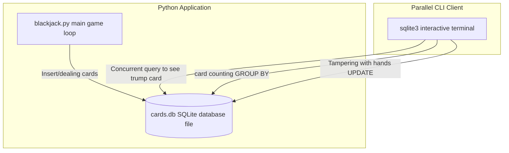

> **Course**: UC Berkeley CS61A (Fall 2024)  
> **Module**: Module 5: Declarative Programming and SQL (Declarative & SQL)  
> **Lecturer**: Prof. John DeNero (UC Berkeley)  
> **Video duration**: 26:22 ｜ **Classroom screenshots**: 17 pieces of blackboard writing/code demonstration  
> **Direct video**: [📺Watch the original video of this lecture on Bilibili (P36)](https://www.bilibili.com/video/BV1sy411z7nA/?p=36)  
> **Quick navigation**: [← Previous Lecture (P35 Lecture 37 Aggregation)](/en/notes/cs61a/lecture-35) ｜ [📚 Return to the full book catalog](/en/notes/topics/CS61A) ｜ [Next Lecture (P37 Lecture 39 Final Examples) →](/en/notes/cs61a/lecture-37)

---

## Course Core Objectives and Panorama

In the previous study, we mainly used  `SELECT`  Query and generate temporary tables. But in actual engineering and distributed software architecture, the core value of the database lies in **Persistence of state**, **Dynamic modification of data (Mutation) **and** Safe concurrent access of multiple clients (Concurrency)**.

In this lecture we will advance from a pure query language to a complete **Database management system (DBMS) full life cycle management**: 
1. Master the four major instructions of table definition (DDL) and data modification (DML): `INSERT`, `UPDATE`, `DELETE`, `DROP`; 
2. Learn how to use the Python standard library  `sqlite3`  Drivers that automate database manipulation within applications;
3. through an extremely wonderful **Blackjack practical simulation**, intuitively experience how two independent programs can achieve status synchronization and real-time intervention through a shared database!



---

### In-depth formal specification and micro-evaluation process (Operational Semantics)
In the "Course Core Goals and Panorama" module, the underlying computer operations rely on strict formal evaluation logic:
1. **Hierarchical parsing of abstract syntax trees (AST)**: 
   - The source code character stream is first divided into terminal symbol tokens (Tokens) by the lexical analyzer (Lexer), and then constructed into a multi-fork syntax tree by the syntax parser (Parser);
   - Operator priority and associativity are solidified during the syntax tree construction phase, eliminating ambiguity at runtime;
2. **Dynamic transitions of environment chains**: 
   - Each function call generates a new frame whose static lexical environment is determined by the function object's  `parent`  Attributes are completely determined;
   - The variable search traces back up the environment chain in one direction until the global environment frame. If it is not found, it will be triggered.  `NameError`  Abnormal;
3. **State Invariants**: 
   - The key to writing robust programs is to clarify loop invariants (Loop Invariants) and function pre/post-conditions (Pre/Post-conditions);
   - In complex control flow jumps, ensure that state variables maintain legal business constraints before each iteration.


## 1. Table definition, constraints and destruction (DDL:  `CREATE TABLE` & `DROP TABLE`)

In a real production environment, we often first define the table structure (Schema) of an empty table and impose column-level constraints:

```sql
CREATE TABLE IF NOT EXISTS primes (
  n INTEGER UNIQUE,
  prime INTEGER DEFAULT 1
);
```

[](https://www.bilibili.com/video/BV1sy411z7nA/?p=36&t=30)
*⏱ Timestamp: 00:00:30 · 📷 Classroom screenshot · [Watch the corresponding clip on Bilibili (P36 00:00:30)](https://www.bilibili.com/video/BV1sy411z7nA/?p=36&t=30)*

#### 📸 In-depth reading of classroom blackboard writing and code demonstration (00:00:30)

**\[On-site blackboard writing/code demonstration restoration\]**:
At this time point, Professor DeNero conducted a core demonstration and key blackboard derivation on the screen:
> *“A table can be given a name with create table, and that name can be forgotten using drop table. We've already seen create table statements, but there is an alternative version that we haven't looked at yet. Here, from the SQLite documentation, is the complete syntax for a create table expression. Yo...”*

**\[Underlying computing model and micro execution mechanism\]**: 
1. **Execution context and timing tracing**: 
   - At the current discussion point "1. Definition, constraints and destruction of tables (DDL:  `CREATE TABLE` & `DROP TABLE`)", the interpreter strictly follows the core evaluation convention;
   - The expression evaluates the operators first, then evaluates the operands strictly from left to right, and finally applies the function object to the argument list;
   - If the environment model is involved, the local frame strictly records its static lexical parent pointer (Parent Pointer points to the environment where the function is defined), forming an orthogonal architecture with the dynamic call stack at runtime.
2. **Memory topology and object references**: 
   - Variable symbols are just keys in a hash table (environment frame), and pointers point directly to first-class citizen objects in heap memory;
   - Assignment statements are discrete-time snapshots of the state and never create implicit mathematical dependency monitoring.

**\[Guidelines for avoiding pitfalls and guidance on high-frequency test points\]**: 
- **Common misunderstandings**: In the exam questions related to "Python sqlite3 module, cursor (Cursor), SQL injection prevention and transaction ACID", beginners can easily guess the results based on the surface form of the code, leading to scope confusion or variable shadowing (Shadowing) misjudgment;
- **The golden rule of debugging**: When encountering nested calls and complex branches, be sure to draw independent partial frames on the scratch paper, indicate the specific binding value of each formal parameter, and derive it step by step.


[](https://www.bilibili.com/video/BV1sy411z7nA/?p=36&t=142)
*⏱ Timestamp: 00:02:22 · 📷 Classroom screenshot · [Watch the corresponding clip on Bilibili (P36 00:02:22)](https://www.bilibili.com/video/BV1sy411z7nA/?p=36&t=142)*

#### 📸 In-depth reading of classroom blackboard writing and code demonstration (00:02:22)

**\[On-site blackboard writing/code demonstration restoration\]**:
At this time point, Professor DeNero conducted a core demonstration and key blackboard derivation on the screen:
> *“By enclosing in parentheses a list of column definitions. A column definition involves naming the column and applying zero or more column constraints. The only column constraints we'll worry about for this course are that you can say the values are unique, and then an error will be raised if you try...”*

**\[Underlying computing model and micro execution mechanism\]**: 
1. **Execution context and timing tracing**: 
   - At the current discussion point "1. Definition, constraints and destruction of tables (DDL:  `CREATE TABLE` & `DROP TABLE`)", the interpreter strictly follows the core evaluation convention;
   - The expression evaluates the operators first, then evaluates the operands strictly from left to right, and finally applies the function object to the argument list;
   - If the environment model is involved, the local frame strictly records its static lexical parent pointer (Parent Pointer points to the environment where the function is defined), forming an orthogonal architecture with the dynamic call stack at runtime.
2. **Memory topology and object references**: 
   - Variable symbols are just keys in a hash table (environment frame), and pointers point directly to first-class citizen objects in heap memory;
   - Assignment statements are discrete-time snapshots of the state and never create implicit mathematical dependency monitoring.

**\[Guidelines for avoiding pitfalls and guidance on high-frequency test points\]**: 
- **Common misunderstandings**: In the exam questions related to "Python sqlite3 module, cursor (Cursor), SQL injection prevention and transaction ACID", beginners can easily guess the results based on the surface form of the code, leading to scope confusion or variable shadowing (Shadowing) misjudgment;
- **The golden rule of debugging**: When encountering nested calls and complex branches, be sure to draw independent partial frames on the scratch paper, indicate the specific binding value of each formal parameter, and derive it step by step.


- `UNIQUE`: Unique constraint to prevent repeated primary key insertion;
- `DEFAULT <value>`: Default value constraint, the default value is automatically filled in when the column is not specified in the inserted record;
- `DROP TABLE IF EXISTS <name>`: Destroy the table safely, and no error will be reported if the table does not exist.

---

### In-depth formal specification and micro-evaluation process (Operational Semantics)
In "1. Table Definition, Constraints and Destruction (DDL:  `CREATE TABLE` & `DROP TABLE`)" module, the underlying computer operations rely on strict formal evaluation logic:
1. **Hierarchical parsing of abstract syntax trees (AST)**: 
   - The source code character stream is first divided into terminal symbol tokens (Tokens) by the lexical analyzer (Lexer), and then constructed into a multi-fork syntax tree by the syntax parser (Parser);
   - Operator priority and associativity are solidified during the syntax tree construction phase, eliminating ambiguity at runtime;
2. **Dynamic transitions of environment chains**: 
   - Each function call generates a new frame whose static lexical environment is determined by the function object's  `parent`  Attributes are completely determined;
   - The variable search traces back up the environment chain in one direction until the global environment frame. If it is not found, it will be triggered.  `NameError`  Abnormal;
3. **State Invariants**: 
   - The key to writing robust programs is to clarify loop invariants (Loop Invariants) and function pre/post-conditions (Pre/Post-conditions);
   - In complex control flow jumps, ensure that state variables maintain legal business constraints before each iteration.


## 2. Insert new records: `INSERT INTO`  Detailed explanation

`INSERT INTO`  Statement is used to append rows to an existing table:

[](https://www.bilibili.com/video/BV1sy411z7nA/?p=36&t=232)
*⏱ Timestamp: 00:03:52 · 📷 Classroom screenshot · [Watch the corresponding clip on Bilibili (P36 00:03:52)](https://www.bilibili.com/video/BV1sy411z7nA/?p=36&t=232)*

#### 📸 In-depth reading of classroom blackboard writing and code demonstration (00:03:52)

**\[On-site blackboard writing/code demonstration restoration\]**:
At this time point, Professor DeNero conducted a core demonstration and key blackboard derivation on the screen:
> *“If without this if exists clause, if you run drop table on a name that doesn't exist, you'll reach an error. Creating an empty table is only useful if we're able to modify it. And in fact, any table can be modified by inserting, deleting, or changing the rows. Here from the SQLite documentation, you...”*

**\[Underlying computing model and micro execution mechanism\]**: 
1. **Execution context and timing tracing**: 
   - At the current discussion node "2. Insert new record: `INSERT INTO`  Detailed explanation", the interpreter strictly follows the core evaluation convention;
   - The expression evaluates the operators first, then evaluates the operands strictly from left to right, and finally applies the function object to the argument list;
   - If the environment model is involved, the local frame strictly records its static lexical parent pointer (Parent Pointer points to the environment where the function is defined), forming an orthogonal architecture with the dynamic call stack at runtime.
2. **Memory topology and object references**: 
   - Variable symbols are just keys in a hash table (environment frame), and pointers point directly to first-class citizen objects in heap memory;
   - Assignment statements are discrete-time snapshots of the state and never create implicit mathematical dependency monitoring.

**\[Guidelines for avoiding pitfalls and guidance on high-frequency test points\]**: 
- **Common misunderstandings**: In the exam questions related to "Python sqlite3 module, cursor (Cursor), SQL injection prevention and transaction ACID", beginners can easily guess the results based on the surface form of the code, leading to scope confusion or variable shadowing (Shadowing) misjudgment;
- **The golden rule of debugging**: When encountering nested calls and complex branches, be sure to draw independent partial frames on the scratch paper, indicate the specific binding value of each formal parameter, and derive it step by step.


[](https://www.bilibili.com/video/BV1sy411z7nA/?p=36&t=322)
*⏱ Timestamp: 00:05:22 · 📷 Classroom screenshot · [Watch the corresponding clip on Bilibili (P36 00:05:22)](https://www.bilibili.com/video/BV1sy411z7nA/?p=36&t=322)*

#### 📸 In-depth reading of classroom blackboard writing and code demonstration (00:05:22)

**\[On-site blackboard writing/code demonstration restoration\]**:
At this time point, Professor DeNero conducted a core demonstration and key blackboard derivation on the screen:
> *“If you want to insert into both columns, then you can say insert into T. You don't specify which columns, so that means all of them. And then you get the values that you're inserting into each of the columns. Both of these insert into statements would insert one row. If you want to insert more rows,...”*

**\[Underlying computing model and micro execution mechanism\]**: 
1. **Execution context and timing tracing**: 
   - At the current discussion node "2. Insert new record: `INSERT INTO`  Detailed explanation", the interpreter strictly follows the core evaluation convention;
   - The expression evaluates the operators first, then evaluates the operands strictly from left to right, and finally applies the function object to the argument list;
   - If the environment model is involved, the local frame strictly records its static lexical parent pointer (Parent Pointer points to the environment where the function is defined), forming an orthogonal architecture with the dynamic call stack at runtime.
2. **Memory topology and object references**: 
   - Variable symbols are just keys in a hash table (environment frame), and pointers point directly to first-class citizen objects in heap memory;
   - Assignment statements are discrete-time snapshots of the state and never create implicit mathematical dependency monitoring.

**\[Guidelines for avoiding pitfalls and guidance on high-frequency test points\]**: 
- **Common misunderstandings**: In the exam questions related to "Python sqlite3 module, cursor (Cursor), SQL injection prevention and transaction ACID", beginners can easily guess the results based on the surface form of the code, leading to scope confusion or variable shadowing (Shadowing) misjudgment;
- **The golden rule of debugging**: When encountering nested calls and complex branches, be sure to draw independent partial frames on the scratch paper, indicate the specific binding value of each formal parameter, and derive it step by step.


### Form 1: Inserting an explicit value tuple
```sql
INSERT INTO primes (n, prime) VALUES (2, 1), (3, 1);
```

### Form 2: Insert partial columns relying on default values
```sql
INSERT INTO primes (n) VALUES (4), (5), (6), (7);
-- 列 prime 自动填充 DEFAULT 1
```

### Form 3: Pass  `SELECT`  Query batch insert
```sql
INSERT INTO primes (n) SELECT n + 6 FROM primes;
```

[](https://www.bilibili.com/video/BV1sy411z7nA/?p=36&t=447)
*⏱ Timestamp: 00:07:27 · 📷 Classroom screenshot · [Watch the corresponding clip on Bilibili (P36 00:07:27)](https://www.bilibili.com/video/BV1sy411z7nA/?p=36&t=447)*

#### 📸 In-depth reading of classroom blackboard writing and code demonstration (00:07:27)

**\[On-site blackboard writing/code demonstration restoration\]**:
At this time point, Professor DeNero conducted a core demonstration and key blackboard derivation on the screen:
> *“Just the prime's end column, then I'll get the default value for the other column. So if I insert the values 4, 5, 6, and 7, now I have 2, 3, 4, 5, 6, and 7 in my table. This claims they're all prime. That's not quite true. 4 and 6 are not. We're going to clean that up later. What's a quick way to g...”*

**\[Underlying computing model and micro execution mechanism\]**: 
1. **Execution context and timing tracing**: 
   - At the current discussion node "2. Insert new record: `INSERT INTO`  Detailed explanation", the interpreter strictly follows the core evaluation convention;
   - The expression evaluates the operators first, then evaluates the operands strictly from left to right, and finally applies the function object to the argument list;
   - If the environment model is involved, the local frame strictly records its static lexical parent pointer (Parent Pointer points to the environment where the function is defined), forming an orthogonal architecture with the dynamic call stack at runtime.
2. **Memory topology and object references**: 
   - Variable symbols are just keys in a hash table (environment frame), and pointers point directly to first-class citizen objects in heap memory;
   - Assignment statements are discrete-time snapshots of the state and never create implicit mathematical dependency monitoring.

**\[Guidelines for avoiding pitfalls and guidance on high-frequency test points\]**: 
- **Common misunderstandings**: In the exam questions related to "Python sqlite3 module, cursor (Cursor), SQL injection prevention and transaction ACID", beginners can easily guess the results based on the surface form of the code, leading to scope confusion or variable shadowing (Shadowing) misjudgment;
- **The golden rule of debugging**: When encountering nested calls and complex branches, be sure to draw independent partial frames on the scratch paper, indicate the specific binding value of each formal parameter, and derive it step by step.


By incrementing data in existing tables and importing them back in batches, large batches of test sequences can be quickly generated.

---

### In-depth formal specification and micro-evaluation process (Operational Semantics)
In "2. Insert new record: `INSERT INTO`  In the "Detailed Explanation" module, the underlying computer operations rely on strict formal evaluation logic:
1. **Hierarchical parsing of abstract syntax trees (AST)**: 
   - The source code character stream is first divided into terminal symbol tokens (Tokens) by the lexical analyzer (Lexer), and then constructed into a multi-fork syntax tree by the syntax parser (Parser);
   - Operator priority and associativity are solidified during the syntax tree construction phase, eliminating ambiguity at runtime;
2. **Dynamic transitions of environment chains**: 
   - Each function call generates a new frame whose static lexical environment is determined by the function object's  `parent`  Attributes are completely determined;
   - The variable search traces back up the environment chain in one direction until the global environment frame. If it is not found, it will be triggered.  `NameError`  Abnormal;
3. **State Invariants**: 
   - The key to writing robust programs is to clarify loop invariants (Loop Invariants) and function pre/post-conditions (Pre/Post-conditions);
   - In complex control flow jumps, ensure that state variables maintain legal business constraints before each iteration.


## 3. Modify and delete data: `UPDATE`  with  `DELETE`  (SQL Sieve of Ehrlich)

### `UPDATE`  Statement: conditional update

```sql
UPDATE <table_name> SET <col> = <expr> WHERE <condition>;
```

[](https://www.bilibili.com/video/BV1sy411z7nA/?p=36&t=505)
*⏱ Timestamp: 00:08:25 · 📷 Classroom screenshot · [Watch the corresponding clip on Bilibili (P36 00:08:25)](https://www.bilibili.com/video/BV1sy411z7nA/?p=36&t=505)*

#### 📸 In-depth reading of classroom blackboard writing and code demonstration (00:08:25)

**\[On-site blackboard writing/code demonstration restoration\]**:
At this time point, Professor DeNero conducted a core demonstration and key blackboard derivation on the screen:
> *“It's also possible to update the contents of existing rows. You write update, a table name, set, which column names you're going to change, followed by an equal sign, and the expression that computes the new value for what you're going to put in that column. Now, you may not want to update all rows ...”*

**\[Underlying computing model and micro execution mechanism\]**: 
1. **Execution context and timing tracing**: 
   - At the current discussion point "3. Modify and delete data: `UPDATE`  with  `DELETE`  (SQL Sieve of Ehrlich)", the interpreter strictly follows the core evaluation convention;
   - The expression evaluates the operators first, then evaluates the operands strictly from left to right, and finally applies the function object to the argument list;
   - If the environment model is involved, the local frame strictly records its static lexical parent pointer (Parent Pointer points to the environment where the function is defined), forming an orthogonal architecture with the dynamic call stack at runtime.
2. **Memory topology and object references**: 
   - Variable symbols are just keys in a hash table (environment frame), and pointers point directly to first-class citizen objects in heap memory;
   - Assignment statements are discrete-time snapshots of the state and never create implicit mathematical dependency monitoring.

**\[Guidelines for avoiding pitfalls and guidance on high-frequency test points\]**: 
- **Common misunderstandings**: In the exam questions related to "Python sqlite3 module, cursor (Cursor), SQL injection prevention and transaction ACID", beginners can easily guess the results based on the surface form of the code, leading to scope confusion or variable shadowing (Shadowing) misjudgment;
- **The golden rule of debugging**: When encountering nested calls and complex branches, be sure to draw independent partial frames on the scratch paper, indicate the specific binding value of each formal parameter, and derive it step by step.


Professor DeNero shows how to use  `UPDATE`  Directly implemented in SQL **Sieve of Eratosthenes**, all the sums of  `prime`  Flag set to 0:

```sql
-- 将所有大于 2 的 2 的倍数标记为合数 (0)
UPDATE primes SET prime = 0 WHERE n > 2 AND n % 2 = 0;

-- 依次筛选 3 和 5 的倍数
UPDATE primes SET prime = 0 WHERE n > 3 AND n % 3 = 0;
UPDATE primes SET prime = 0 WHERE n > 5 AND n % 5 = 0;
```

[](https://www.bilibili.com/video/BV1sy411z7nA/?p=36&t=565)
*⏱ Timestamp: 00:09:25 · 📷 Classroom screenshot · [Watch the corresponding clip on Bilibili (P36 00:09:25)](https://www.bilibili.com/video/BV1sy411z7nA/?p=36&t=565)*

#### 📸 In-depth reading of classroom blackboard writing and code demonstration (00:09:25)

**\[On-site blackboard writing/code demonstration restoration\]**:
At this time point, Professor DeNero conducted a core demonstration and key blackboard derivation on the screen:
> *“Prime, that's a column name, to zero, that's a value to place in the prime column. Now I need to say which rows I want to make this change for. I want to make it for all the rows for n greater than two, where two evenly divides n. Now, if I run the same select statement, I see that the multiples of ...”*

**\[Underlying computing model and micro execution mechanism\]**: 
1. **Execution context and timing tracing**: 
   - At the current discussion point "3. Modify and delete data: `UPDATE`  with  `DELETE`  (SQL Sieve of Ehrlich)", the interpreter strictly follows the core evaluation convention;
   - The expression evaluates the operators first, then evaluates the operands strictly from left to right, and finally applies the function object to the argument list;
   - If the environment model is involved, the local frame strictly records its static lexical parent pointer (Parent Pointer points to the environment where the function is defined), forming an orthogonal architecture with the dynamic call stack at runtime.
2. **Memory topology and object references**: 
   - Variable symbols are just keys in a hash table (environment frame), and pointers point directly to first-class citizen objects in heap memory;
   - Assignment statements are discrete-time snapshots of the state and never create implicit mathematical dependency monitoring.

**\[Guidelines for avoiding pitfalls and guidance on high-frequency test points\]**: 
- **Common misunderstandings**: In the exam questions related to "Python sqlite3 module, cursor (Cursor), SQL injection prevention and transaction ACID", beginners can easily guess the results based on the surface form of the code, leading to scope confusion or variable shadowing (Shadowing) misjudgment;
- **The golden rule of debugging**: When encountering nested calls and complex branches, be sure to draw independent partial frames on the scratch paper, indicate the specific binding value of each formal parameter, and derive it step by step.


### `DELETE`  Statement: Clean data

After screening, use  `DELETE FROM`  Completely remove all summation lines:

```sql
DELETE FROM primes WHERE prime = 0;
SELECT * FROM primes; -- 仅剩纯素数: 2, 3, 5, 7, 11, 13, 17, 19, 23...
```

[](https://www.bilibili.com/video/BV1sy411z7nA/?p=36&t=625)
*⏱ Timestamp: 00:10:25 · 📷 Classroom screenshot · [Watch the corresponding clip on Bilibili (P36 00:10:25)](https://www.bilibili.com/video/BV1sy411z7nA/?p=36&t=625)*

#### 📸 In-depth reading of classroom blackboard writing and code demonstration (00:10:25)

**\[On-site blackboard writing/code demonstration restoration\]**:
At this time point, Professor DeNero conducted a core demonstration and key blackboard derivation on the screen:
> *“You say delete from, and then what table to delete from. You don't have to delete all rows. Instead, you can provide a where expression in order to delete just some of the rows. But without a where expression, you will delete all of the rows in the table. The table will still exist, so this is not e...”*

**\[Underlying computing model and micro execution mechanism\]**: 
1. **Execution context and timing tracing**: 
   - At the current discussion point "3. Modify and delete data: `UPDATE`  with  `DELETE`  (SQL Sieve of Ehrlich)", the interpreter strictly follows the core evaluation convention;
   - The expression evaluates the operators first, then evaluates the operands strictly from left to right, and finally applies the function object to the argument list;
   - If the environment model is involved, the local frame strictly records its static lexical parent pointer (Parent Pointer points to the environment where the function is defined), forming an orthogonal architecture with the dynamic call stack at runtime.
2. **Memory topology and object references**: 
   - Variable symbols are just keys in a hash table (environment frame), and pointers point directly to first-class citizen objects in heap memory;
   - Assignment statements are discrete-time snapshots of the state and never create implicit mathematical dependency monitoring.

**\[Guidelines for avoiding pitfalls and guidance on high-frequency test points\]**: 
- **Common misunderstandings**: In the exam questions related to "Python sqlite3 module, cursor (Cursor), SQL injection prevention and transaction ACID", beginners can easily guess the results based on the surface form of the code, leading to scope confusion or variable shadowing (Shadowing) misjudgment;
- **The golden rule of debugging**: When encountering nested calls and complex branches, be sure to draw independent partial frames on the scratch paper, indicate the specific binding value of each formal parameter, and derive it step by step.


---

### In-depth formal specification and micro-evaluation process (Operational Semantics)
In "3. Modify and delete data: `UPDATE`  with  `DELETE`  (SQL Sieve of Ehrlich)" module, the underlying computer operations rely on strict formal evaluation logic:
1. **Hierarchical parsing of abstract syntax trees (AST)**: 
   - The source code character stream is first divided into terminal symbol tokens (Tokens) by the lexical analyzer (Lexer), and then constructed into a multi-fork syntax tree by the syntax parser (Parser);
   - Operator priority and associativity are solidified during the syntax tree construction phase, eliminating ambiguity at runtime;
2. **Dynamic transitions of environment chains**: 
   - Each function call generates a new frame whose static lexical environment is determined by the function object's  `parent`  Attributes are completely determined;
   - The variable search traces back up the environment chain in one direction until the global environment frame. If it is not found, it will be triggered.  `NameError`  Abnormal;
3. **State Invariants**: 
   - The key to writing robust programs is to clarify loop invariants (Loop Invariants) and function pre/post-conditions (Pre/Post-conditions);
   - In complex control flow jumps, ensure that state variables maintain legal business constraints before each iteration.


## 4. Python and SQLite standard library integration (`sqlite3`)

The Python standard library has built-in seamless support for SQLite, and its core communication process contains four key steps:

[](https://www.bilibili.com/video/BV1sy411z7nA/?p=36&t=690)
*⏱ Timestamp: 00:11:30 · 📷 Classroom screenshot · [Watch the corresponding clip on Bilibili (P36 00:11:30)](https://www.bilibili.com/video/BV1sy411z7nA/?p=36&t=690)*

#### 📸 In-depth reading of classroom blackboard writing and code demonstration (00:11:30)

**\[On-site blackboard writing/code demonstration restoration\]**:
At this time point, Professor DeNero conducted a core demonstration and key blackboard derivation on the screen:
> *“Construct a connection. I pass in the name of a database file. It could be anything. How about n.db? And this connection object can be used to execute SQL statements. So, for example, I can execute, select two union, select three, which would give me a two row, one column table, semicolon. Now, just...”*

**\[Underlying computing model and micro execution mechanism\]**: 
1. **Execution context and timing tracing**: 
   - At the current discussion point "4. Standard library integration of Python and SQLite (`sqlite3`)", the interpreter strictly follows the core evaluation convention;
   - The expression evaluates the operators first, then evaluates the operands strictly from left to right, and finally applies the function object to the argument list;
   - If the environment model is involved, the local frame strictly records its static lexical parent pointer (Parent Pointer points to the environment where the function is defined), forming an orthogonal architecture with the dynamic call stack at runtime.
2. **Memory topology and object references**: 
   - Variable symbols are just keys in a hash table (environment frame), and pointers point directly to first-class citizen objects in heap memory;
   - Assignment statements are discrete-time snapshots of the state and never create implicit mathematical dependency monitoring.

**\[Guidelines for avoiding pitfalls and guidance on high-frequency test points\]**: 
- **Common misunderstandings**: In the exam questions related to "Python sqlite3 module, cursor (Cursor), SQL injection prevention and transaction ACID", beginners can easily guess the results based on the surface form of the code, leading to scope confusion or variable shadowing (Shadowing) misjudgment;
- **The golden rule of debugging**: When encountering nested calls and complex branches, be sure to draw independent partial frames on the scratch paper, indicate the specific binding value of each formal parameter, and derive it step by step.


[](https://www.bilibili.com/video/BV1sy411z7nA/?p=36&t=751)
*⏱ Timestamp: 00:12:31 · 📷 Classroom screenshot · [Watch the corresponding clip on Bilibili (P36 00:12:31)](https://www.bilibili.com/video/BV1sy411z7nA/?p=36&t=751)*

#### 📸 In-depth reading of classroom blackboard writing and code demonstration (00:12:31)

**\[On-site blackboard writing/code demonstration restoration\]**:
At this time point, Professor DeNero conducted a core demonstration and key blackboard derivation on the screen:
> *“Statement. I could explicitly write out the values 4, 5, 6. Or I could write a Python expression that computes the values 4, 5, 6. For example, the range 4 through 7, not including 7. And then I can include in my SQL statement some holes that get filled in by the data passed in as the second argumen...”*

**\[Underlying computing model and micro execution mechanism\]**: 
1. **Execution context and timing tracing**: 
   - At the current discussion point "4. Standard library integration of Python and SQLite (`sqlite3`)", the interpreter strictly follows the core evaluation convention;
   - The expression evaluates the operators first, then evaluates the operands strictly from left to right, and finally applies the function object to the argument list;
   - If the environment model is involved, the local frame strictly records its static lexical parent pointer (Parent Pointer points to the environment where the function is defined), forming an orthogonal architecture with the dynamic call stack at runtime.
2. **Memory topology and object references**: 
   - Variable symbols are just keys in a hash table (environment frame), and pointers point directly to first-class citizen objects in heap memory;
   - Assignment statements are discrete-time snapshots of the state and never create implicit mathematical dependency monitoring.

**\[Guidelines for avoiding pitfalls and guidance on high-frequency test points\]**: 
- **Common misunderstandings**: In the exam questions related to "Python sqlite3 module, cursor (Cursor), SQL injection prevention and transaction ACID", beginners can easily guess the results based on the surface form of the code, leading to scope confusion or variable shadowing (Shadowing) misjudgment;
- **The golden rule of debugging**: When encountering nested calls and complex branches, be sure to draw independent partial frames on the scratch paper, indicate the specific binding value of each formal parameter, and derive it step by step.


```python
import sqlite3

# 1. 建立与数据库文件的物理连接
db = sqlite3.connect("n.db")

# 2. 执行 DDL/DML 语句
db.execute("CREATE TABLE IF NOT EXISTS nums (val INTEGER);")

# 3. 参数化查询 (防御 SQL 注入)
for x in range(4, 7):
    db.execute("INSERT INTO nums VALUES (?);", (x,))

# 4. 执行查询并提取结果
cursor = db.execute("SELECT * FROM nums;")
rows = cursor.fetchall() # 返回元组列表: [(4,), (5,), (6,)]

# 5. 提交事务，物理持久化至磁盘
db.commit()
```

[](https://www.bilibili.com/video/BV1sy411z7nA/?p=36&t=811)
*⏱ Timestamp: 00:13:31 · 📷 Classroom screenshot · [Watch the corresponding clip on Bilibili (P36 00:13:31)](https://www.bilibili.com/video/BV1sy411z7nA/?p=36&t=811)*

#### 📸 In-depth reading of classroom blackboard writing and code demonstration (00:13:31)

**\[On-site blackboard writing/code demonstration restoration\]**:
At this time point, Professor DeNero conducted a core demonstration and key blackboard derivation on the screen:
> *“Which will fetch the contents of the resulting table as a list of tuples. Let's print those out so we can see what happened. And finally, let's clean up the syntax of our SQL statements. Everything else looks okay. Let's see what happens when we run it. All right, here's what Python printed out. Fiv...”*

**\[Underlying computing model and micro execution mechanism\]**: 
1. **Execution context and timing tracing**: 
   - At the current discussion point "4. Standard library integration of Python and SQLite (`sqlite3`)", the interpreter strictly follows the core evaluation convention;
   - The expression evaluates the operators first, then evaluates the operands strictly from left to right, and finally applies the function object to the argument list;
   - If the environment model is involved, the local frame strictly records its static lexical parent pointer (Parent Pointer points to the environment where the function is defined), forming an orthogonal architecture with the dynamic call stack at runtime.
2. **Memory topology and object references**: 
   - Variable symbols are just keys in a hash table (environment frame), and pointers point directly to first-class citizen objects in heap memory;
   - Assignment statements are discrete-time snapshots of the state and never create implicit mathematical dependency monitoring.

**\[Guidelines for avoiding pitfalls and guidance on high-frequency test points\]**: 
- **Common misunderstandings**: In the exam questions related to "Python sqlite3 module, cursor (Cursor), SQL injection prevention and transaction ACID", beginners can easily guess the results based on the surface form of the code, leading to scope confusion or variable shadowing (Shadowing) misjudgment;
- **The golden rule of debugging**: When encountering nested calls and complex branches, be sure to draw independent partial frames on the scratch paper, indicate the specific binding value of each formal parameter, and derive it step by step.


If not called  `db.commit()`, all data modifications only stay in the memory buffer and will not be persisted to the disk file after the process exits.  `n.db`  in.

---

### In-depth formal specification and micro-evaluation process (Operational Semantics)
In "4. Standard library integration of Python and SQLite (`sqlite3`)" module, the underlying computer operations rely on strict formal evaluation logic:
1. **Hierarchical parsing of abstract syntax trees (AST)**: 
   - The source code character stream is first divided into terminal symbol tokens (Tokens) by the lexical analyzer (Lexer), and then constructed into a multi-fork syntax tree by the syntax parser (Parser);
   - Operator priority and associativity are solidified during the syntax tree construction phase, eliminating ambiguity at runtime;
2. **Dynamic transitions of environment chains**: 
   - Each function call generates a new frame whose static lexical environment is determined by the function object's  `parent`  Attributes are completely determined;
   - The variable search traces back up the environment chain in one direction until the global environment frame. If it is not found, it will be triggered.  `NameError`  Abnormal;
3. **State Invariants**: 
   - The key to writing robust programs is to clarify loop invariants (Loop Invariants) and function pre/post-conditions (Pre/Post-conditions);
   - In complex control flow jumps, ensure that state variables maintain legal business constraints before each iteration.


## 5. Multi-client concurrency and shared state (Database Concurrency)

The great thing about databases is: **Allows multiple different independent applications to read and write the same database file at the same time**.

[](https://www.bilibili.com/video/BV1sy411z7nA/?p=36&t=901)
*⏱ Timestamp: 00:15:01 · 📷 Classroom screenshot · [Watch the corresponding clip on Bilibili (P36 00:15:01)](https://www.bilibili.com/video/BV1sy411z7nA/?p=36&t=901)*

#### 📸 In-depth reading of classroom blackboard writing and code demonstration (00:15:01)

**\[On-site blackboard writing/code demonstration restoration\]**:
At this time point, Professor DeNero conducted a core demonstration and key blackboard derivation on the screen:
> *“And similarly, you can write Python programs to interact with lots of different kinds of databases. It happens to be that this one is built into the standard library, whereas other ones you have to install the connections. Multiple programs can be connected to the same database at the same time. The...”*

**\[Underlying computing model and micro execution mechanism\]**: 
1. **Execution context and timing tracing**: 
   - At the current discussion point "5. Multi-client concurrency and shared state (Database Concurrency)", the interpreter strictly follows the core evaluation protocol;
   - The expression evaluates the operators first, then evaluates the operands strictly from left to right, and finally applies the function object to the argument list;
   - If the environment model is involved, the local frame strictly records its static lexical parent pointer (Parent Pointer points to the environment where the function is defined), forming an orthogonal architecture with the dynamic call stack at runtime.
2. **Memory topology and object references**: 
   - Variable symbols are just keys in a hash table (environment frame), and pointers point directly to first-class citizen objects in heap memory;
   - Assignment statements are discrete-time snapshots of the state and never create implicit mathematical dependency monitoring.

**\[Guidelines for avoiding pitfalls and guidance on high-frequency test points\]**: 
- **Common misunderstandings**: In the exam questions related to "Python sqlite3 module, cursor (Cursor), SQL injection prevention and transaction ACID", beginners can easily guess the results based on the surface form of the code, leading to scope confusion or variable shadowing (Shadowing) misjudgment;
- **The golden rule of debugging**: When encountering nested calls and complex branches, be sure to draw independent partial frames on the scratch paper, indicate the specific binding value of each formal parameter, and derive it step by step.


### Case design: Blackjack

Game rules:
- Point calculation: 2-10 is the face value, J/Q/K counts 10 points, A can count 1 point or 11 points;
- Dealer and Player;
- If the score exceeds 21 points, the card will be busted and you will lose directly;
- The dealer hides a hole card and does not reveal it until the player stops, and the dealer must force the card before reaching 17 points.

[](https://www.bilibili.com/video/BV1sy411z7nA/?p=36&t=988)
*⏱ Timestamp: 00:16:28 · 📷 Classroom screenshot · [Watch the corresponding clip on Bilibili (P36 00:16:28)](https://www.bilibili.com/video/BV1sy411z7nA/?p=36&t=988)*

#### 📸 In-depth reading of classroom blackboard writing and code demonstration (00:16:28)

**\[On-site blackboard writing/code demonstration restoration\]**:
At this time point, Professor DeNero conducted a core demonstration and key blackboard derivation on the screen:
> *“All of the face cards, Jack, Queen, King, count for 10. And aces are special. You can choose whether to count them for 1 point or 11 points. So, if 7 and 9 make 16, I might worry that the dealer is going to have more points than me, so I might request an additional card. Oh, I got a 5. Now my total ...”*

**\[Underlying computing model and micro execution mechanism\]**: 
1. **Execution context and timing tracing**: 
   - At the current discussion point "5. Multi-client concurrency and shared state (Database Concurrency)", the interpreter strictly follows the core evaluation protocol;
   - The expression evaluates the operators first, then evaluates the operands strictly from left to right, and finally applies the function object to the argument list;
   - If the environment model is involved, the local frame strictly records its static lexical parent pointer (Parent Pointer points to the environment where the function is defined), forming an orthogonal architecture with the dynamic call stack at runtime.
2. **Memory topology and object references**: 
   - Variable symbols are just keys in a hash table (environment frame), and pointers point directly to first-class citizen objects in heap memory;
   - Assignment statements are discrete-time snapshots of the state and never create implicit mathematical dependency monitoring.

**\[Guidelines for avoiding pitfalls and guidance on high-frequency test points\]**: 
- **Common misunderstandings**: In the exam questions related to "Python sqlite3 module, cursor (Cursor), SQL injection prevention and transaction ACID", beginners can easily guess the results based on the surface form of the code, leading to scope confusion or variable shadowing (Shadowing) misjudgment;
- **The golden rule of debugging**: When encountering nested calls and complex branches, be sure to draw independent partial frames on the scratch paper, indicate the specific binding value of each formal parameter, and derive it step by step.


[](https://www.bilibili.com/video/BV1sy411z7nA/?p=36&t=1104)
*⏱ Timestamp: 00:18:24 · 📷 Classroom screenshot · [Watch the corresponding clip on Bilibili (P36 00:18:24)](https://www.bilibili.com/video/BV1sy411z7nA/?p=36&t=1104)*

#### 📸 In-depth reading of classroom blackboard writing and code demonstration (00:18:24)

**\[On-site blackboard writing/code demonstration restoration\]**:
At this time point, Professor DeNero conducted a core demonstration and key blackboard derivation on the screen:
> *“Points to that update just takes a dictionary and adds more elements to it from another dictionary. Here we have a way of scoring a hand. A hand is a sequence of cards. We get the points for each card using the points dictionary and we sum them up. If it turns out that the total is less than or equa...”*

**\[Underlying computing model and micro execution mechanism\]**: 
1. **Execution context and timing tracing**: 
   - At the current discussion point "5. Multi-client concurrency and shared state (Database Concurrency)", the interpreter strictly follows the core evaluation protocol;
   - The expression evaluates the operators first, then evaluates the operands strictly from left to right, and finally applies the function object to the argument list;
   - If the environment model is involved, the local frame strictly records its static lexical parent pointer (Parent Pointer points to the environment where the function is defined), forming an orthogonal architecture with the dynamic call stack at runtime.
2. **Memory topology and object references**: 
   - Variable symbols are just keys in a hash table (environment frame), and pointers point directly to first-class citizen objects in heap memory;
   - Assignment statements are discrete-time snapshots of the state and never create implicit mathematical dependency monitoring.

**\[Guidelines for avoiding pitfalls and guidance on high-frequency test points\]**: 
- **Common misunderstandings**: In the exam questions related to "Python sqlite3 module, cursor (Cursor), SQL injection prevention and transaction ACID", beginners can easily guess the results based on the surface form of the code, leading to scope confusion or variable shadowing (Shadowing) misjudgment;
- **The golden rule of debugging**: When encountering nested calls and complex branches, be sure to draw independent partial frames on the scratch paper, indicate the specific binding value of each formal parameter, and derive it step by step.


---

### In-depth formal specification and micro-evaluation process (Operational Semantics)
In the "5. Multi-client Concurrency and Shared State (Database Concurrency)" module, the underlying computer operations rely on strict formal evaluation logic:
1. **Hierarchical parsing of abstract syntax trees (AST)**: 
   - The source code character stream is first divided into terminal symbol tokens (Tokens) by the lexical analyzer (Lexer), and then constructed into a multi-fork syntax tree by the syntax parser (Parser);
   - Operator priority and associativity are solidified during the syntax tree construction phase, eliminating ambiguity at runtime;
2. **Dynamic transitions of environment chains**: 
   - Each function call generates a new frame whose static lexical environment is determined by the function object's  `parent`  Attributes are completely determined;
   - The variable search traces back up the environment chain in one direction until the global environment frame. If it is not found, it will be triggered.  `NameError`  Abnormal;
3. **State Invariants**: 
   - The key to writing robust programs is to clarify loop invariants (Loop Invariants) and function pre/post-conditions (Pre/Post-conditions);
   - In complex control flow jumps, ensure that state variables maintain legal business constraints before each iteration.


## 6. Fun practice: Blackjack game from the perspective of a dual-client hacker

Game running architecture:
- Process 1: Python script  `blackjack.py`, responsible for shuffling, dealing and updating the cards  `cards.db`  in  `cards`  table;
- Process 2: Standalone  `sqlite3 cards.db`  Command line client, concurrently accessed by human players.

### Stage 1: Peeping at the dealer’s cards and making decisions behind the scenes

When the Python terminal asks if they want a card (Hit/Stay), the player directly executes:
```sql
SELECT * FROM cards WHERE who != "discard";
```

[](https://www.bilibili.com/video/BV1sy411z7nA/?p=36&t=1305)
*⏱ Timestamp: 00:21:45 · 📷 Classroom screenshot · [Watch the corresponding clip on Bilibili (P36 00:21:45)](https://www.bilibili.com/video/BV1sy411z7nA/?p=36&t=1305)*

#### 📸 In-depth reading of classroom blackboard writing and code demonstration (00:21:45)

**\[On-site blackboard writing/code demonstration restoration\]**:
At this time point, Professor DeNero conducted a core demonstration and key blackboard derivation on the screen:
> *“Using the built-in shuffle function of the random module. And then we'll just start playing hands. So we'll deal, play a hand, and then at the end of the hand, we'll move all of the cards that are in players' hands into the discard pile. And now we have a fully functional game of Blackjack. We've de...”*

**\[Underlying computing model and micro execution mechanism\]**: 
1. **Execution context and timing tracing**: 
   - At the current discussion point "6. Fun practice: Blackjack game from the perspective of a dual-client hacker", the interpreter strictly follows the core evaluation protocol;
   - The expression evaluates the operators first, then evaluates the operands strictly from left to right, and finally applies the function object to the argument list;
   - If the environment model is involved, the local frame strictly records its static lexical parent pointer (Parent Pointer points to the environment where the function is defined), forming an orthogonal architecture with the dynamic call stack at runtime.
2. **Memory topology and object references**: 
   - Variable symbols are just keys in a hash table (environment frame), and pointers point directly to first-class citizen objects in heap memory;
   - Assignment statements are discrete-time snapshots of the state and never create implicit mathematical dependency monitoring.

**\[Guidelines for avoiding pitfalls and guidance on high-frequency test points\]**: 
- **Common misunderstandings**: In the exam questions related to "Python sqlite3 module, cursor (Cursor), SQL injection prevention and transaction ACID", beginners can easily guess the results based on the surface form of the code, leading to scope confusion or variable shadowing (Shadowing) misjudgment;
- **The golden rule of debugging**: When encountering nested calls and complex branches, be sure to draw independent partial frames on the scratch paper, indicate the specific binding value of each formal parameter, and derive it step by step.


Directly check the dealer's hidden card that has not yet been disclosed, and make the suspension decision with the highest winning rate!

### Stage 2: Professional Card Counting with SQL Aggregations

Without violating the rules (only observing the discard pile), calculate the distribution probability of the big cards (10, J, Q, K) among the remaining cards:

```sql
SELECT card, count(*) FROM cards GROUP BY card;
```

[](https://www.bilibili.com/video/BV1sy411z7nA/?p=36&t=1450)
*⏱ Timestamp: 00:24:10 · 📷 Classroom screenshot · [Watch the corresponding clip on Bilibili (P36 00:24:10)](https://www.bilibili.com/video/BV1sy411z7nA/?p=36&t=1450)*

#### 📸 In-depth reading of classroom blackboard writing and code demonstration (00:24:10)

**\[On-site blackboard writing/code demonstration restoration\]**:
At this time point, Professor DeNero conducted a core demonstration and key blackboard derivation on the screen:
> *“And we've dealt another hand. Let's see what I've got now. I've got a 5 and an ace. That's either 6 or 16. I think I'll take a hit and see where I am. Now I have 5, ace, and ace. That's either 7 or 17. I'm curious what will happen next, but I could actually predict what might happen by looking at al...”*

**\[Underlying computing model and micro execution mechanism\]**: 
1. **Execution context and timing tracing**: 
   - At the current discussion point "6. Fun practice: Blackjack game from the perspective of a dual-client hacker", the interpreter strictly follows the core evaluation protocol;
   - The expression evaluates the operators first, then evaluates the operands strictly from left to right, and finally applies the function object to the argument list;
   - If the environment model is involved, the local frame strictly records its static lexical parent pointer (Parent Pointer points to the environment where the function is defined), forming an orthogonal architecture with the dynamic call stack at runtime.
2. **Memory topology and object references**: 
   - Variable symbols are just keys in a hash table (environment frame), and pointers point directly to first-class citizen objects in heap memory;
   - Assignment statements are discrete-time snapshots of the state and never create implicit mathematical dependency monitoring.

**\[Guidelines for avoiding pitfalls and guidance on high-frequency test points\]**: 
- **Common misunderstandings**: In the exam questions related to "Python sqlite3 module, cursor (Cursor), SQL injection prevention and transaction ACID", beginners can easily guess the results based on the surface form of the code, leading to scope confusion or variable shadowing (Shadowing) misjudgment;
- **The golden rule of debugging**: When encountering nested calls and complex branches, be sure to draw independent partial frames on the scratch paper, indicate the specific binding value of each formal parameter, and derive it step by step.


By counting the big cards in the discard pile and consuming very little, we can accurately predict that the dealer's next card will get 10 points and lead to a bust, so we can decisively choose to stop playing and win!

### Stage 3: Directly invade the database to modify the state (The Ultimate Mutation)

When getting a bad card (14 points) and facing the inevitable defeat of the dealer with 9 points, the player directly issues real-time modification instructions to the database on the command line:

```sql
UPDATE cards SET card = "A" WHERE who = "player" AND card = "4";
```

[](https://www.bilibili.com/video/BV1sy411z7nA/?p=36&t=1539)
*⏱ Timestamp: 00:25:39 · 📷 Classroom screenshot · [Watch the corresponding clip on Bilibili (P36 00:25:39)](https://www.bilibili.com/video/BV1sy411z7nA/?p=36&t=1539)*

#### 📸 In-depth reading of classroom blackboard writing and code demonstration (00:25:39)

**\[On-site blackboard writing/code demonstration restoration\]**:
At this time point, Professor DeNero conducted a core demonstration and key blackboard derivation on the screen:
> *“It can help you win. All right, let's look at one more hand. We've got a 4 and a queen. 14 is really not a good hand because the dealer has a 9. That means they could have 19 points with that hidden card. Wouldn't it be nice if instead of a queen and a 4, I had a queen and an ace? Well, then I'd hav...”*

**\[Underlying computing model and micro execution mechanism\]**: 
1. **Execution context and timing tracing**: 
   - At the current discussion point "6. Fun practice: Blackjack game from the perspective of a dual-client hacker", the interpreter strictly follows the core evaluation protocol;
   - The expression evaluates the operators first, then evaluates the operands strictly from left to right, and finally applies the function object to the argument list;
   - If the environment model is involved, the local frame strictly records its static lexical parent pointer (Parent Pointer points to the environment where the function is defined), forming an orthogonal architecture with the dynamic call stack at runtime.
2. **Memory topology and object references**: 
   - Variable symbols are just keys in a hash table (environment frame), and pointers point directly to first-class citizen objects in heap memory;
   - Assignment statements are discrete-time snapshots of the state and never create implicit mathematical dependency monitoring.

**\[Guidelines for avoiding pitfalls and guidance on high-frequency test points\]**: 
- **Common misunderstandings**: In the exam questions related to "Python sqlite3 module, cursor (Cursor), SQL injection prevention and transaction ACID", beginners can easily guess the results based on the surface form of the code, leading to scope confusion or variable shadowing (Shadowing) misjudgment;
- **The golden rule of debugging**: When encountering nested calls and complex branches, be sure to draw independent partial frames on the scratch paper, indicate the specific binding value of each formal parameter, and derive it step by step.


Returning to the Python game at this time, the game logic reads the database and is surprised to find that the player's hand has changed to Ace + Queen (standard Blackjack), which directly determines the player's victory!

This vividly demonstrates the core characteristics of the database as a global single source of truth (Single Source of Truth): any modification submitted by the client will take effect instantly on all other connections.

---

### In-depth formal specification and micro-evaluation process (Operational Semantics)
In the module "6. Interesting Practical Combat: Blackjack Game from the Perspective of a Dual Client Hacker", the underlying computer operations rely on strict formal evaluation logic:
1. **Hierarchical parsing of abstract syntax trees (AST)**: 
   - The source code character stream is first divided into terminal symbol tokens (Tokens) by the lexical analyzer (Lexer), and then constructed into a multi-fork syntax tree by the syntax parser (Parser);
   - Operator priority and associativity are solidified during the syntax tree construction phase, eliminating ambiguity at runtime;
2. **Dynamic transitions of environment chains**: 
   - Each function call generates a new frame whose static lexical environment is determined by the function object's  `parent`  Attributes are completely determined;
   - The variable search traces back up the environment chain in one direction until the global environment frame. If it is not found, it will be triggered.  `NameError`  Abnormal;
3. **State Invariants**: 
   - The key to writing robust programs is to clarify loop invariants (Loop Invariants) and function pre/post-conditions (Pre/Post-conditions);
   - In complex control flow jumps, ensure that state variables maintain legal business constraints before each iteration.


## Summary of core review points

| core components | Key usage and syntax | Core semantics and engineering significance |
| :--- | :--- | :--- |
| **`INSERT INTO`** | `INSERT INTO t VALUES (...);` | Append new rows, support full columns, partial columns and  `SELECT`  Batch import |
| **`UPDATE`** | `UPDATE t SET col = val WHERE cond;` | Conditionally update the specified column in place, be sure to bring  `WHERE`  Prevent accidental damage to the entire watch |
| **`DELETE FROM`** | `DELETE FROM t WHERE cond;` | Conditionally delete specified rows, and the table structure remains intact. |
| **`sqlite3.connect`** | `db = sqlite3.connect('file.db')` | Python and SQLite establish physical file session |
| **`db.commit()`** | `db.commit()` | Persistently flush all modifications in the transaction to disk files |
| **Concurrency and shared state** | Unified database file as global status hub | Support multi-process, multi-network client secure interaction and real-time collaboration |

### In-depth formal specification and micro-evaluation process (Operational Semantics)
In the "Summary of Core Review Key Points" module, the underlying computer operations rely on strict formal evaluation logic:
1. **Hierarchical parsing of abstract syntax trees (AST)**: 
   - The source code character stream is first divided into terminal symbol tokens (Tokens) by the lexical analyzer (Lexer), and then constructed into a multi-fork syntax tree by the syntax parser (Parser);
   - Operator priority and associativity are solidified during the syntax tree construction phase, eliminating ambiguity at runtime;
2. **Dynamic transitions of environment chains**: 
   - Each function call generates a new frame whose static lexical environment is determined by the function object's  `parent`  Attributes are completely determined;
   - The variable search traces back up the environment chain in one direction until the global environment frame. If it is not found, it will be triggered.  `NameError`  Abnormal;
3. **State Invariants**: 
   - The key to writing robust programs is to clarify loop invariants (Loop Invariants) and function pre/post-conditions (Pre/Post-conditions);
   - In complex control flow jumps, ensure that state variables maintain legal business constraints before each iteration.


---

## Berkeley Midterm/Final classic high-frequency exam questions in-depth practice

### Practical exam questions: Environment topology and microstate tracking (WWPD & Environment Diagrams)
Consider the following microscopic execution of Python code in an interactive environment:

```python
# 经典作用域与高阶函数综合考题
x = 10

def outer(x):
    y = x + 2
    def inner(y):
        return x + y
    return inner

f = outer(5)
result = f(3)
```

#### Complete problem-solving thinking model and multi-frame environment map derivation:
1. **Global Frame initialization**: 
   - global variables  `x`  Bind to integer object  `10`; 
   - global function  `outer`  Binds to the newly created function object whose embedded  `parent = Global`; 
2. **execute  `f = outer(5)`**: 
   - create a local frame  $f_1$, mark  `f1: outer [parent=Global]`; 
   - formal parameters  `x`  Bind to actual parameters  `5`; 
   - local variables  `y`  bind to  `5 + 2 = 7`; 
   - in  $f_1$  internal execution  `def inner(y):`, create a function object  `inner`, its embedded  **`parent = f1`**; 
   - Return function object  `inner`, global variables  `f`  Bind to this object;
3. **execute  `result = f(3)`**: 
   - call function  `f` (i.e.  `inner`), open up a local frame  $f_2$; 
   - **core scoring points**:frame  $f_2$  Who does parent point to?
   - **iron law**: function  `inner`  is in frame  $f_1$  is defined internally, so  $f_2$  of  **`parent = f1`**!
   - formal parameters  `y`  Bind to actual parameters  `3`; 
   - executor  `return x + y`: 
     - in current frame  $f_2$  Find  `y`: Hit local variable  `y = 3`; 
     - in current frame  $f_2$  Find  `x`: miss, trace back along parent  **$f_1$  frame**  Find it!
     - in  $f_1$  hit in frame  `x = 5` (Global  `x = 10`  Partially obscured! );
     - Calculate  `5 + 3 = 8`, as the return value;
4. **Final output conclusion**: 
   - global variables  `result = 8`.

---

## Knowledge Matrix of the core concepts of this lecture

| core knowledge dimension | Formal definition and mechanism | Typical code examples | Core Engineering and Algorithm Value | Common pitfalls |
| :--- | :--- | :--- | :--- | :--- |
| **Basic evaluation semantics** | The expression is evaluated to obtain a value, and the execution of the statement changes the internal state. | `x = 2 + 3` | Build a discrete-time state snapshot mental model | Mistaking the assignment equal sign as a dynamic constraint on an algebraic equation |
| **Environment frame topology** | The environment is an ordered chain of frames | `Global -> f1 -> f2` | Implement safe isolation of lexical scope and variables | Confusing the caller stack frame with the parent environment pointer at the definition point |
| **abstract barrier** | Isolate implementation details and calling logic through functional interfaces | `def square(x): ...` | Reduce cognitive load on large-scale systems | Destroying interfaces directly relies on underlying private data structures |
| **control flow decisions** | Conditional branch short-circuit evaluation and loop iteration progression | `if cond: ... while: ...` | Give programs non-linear decision-making and large-scale data processing capabilities | Missing the loop progression variable causes an infinite loop |
| **higher level abilities** | Functions as first-class citizens (parameter passing, return, assignment) | `make_adder(3)` | Implement factory pattern, closure persistent state and currying | Closure late binding throws loop variable capture error |

---

## Course navigation and jump

| Previous lecture | Directory | Next lecture | Original video |
| :--- | :---: | :--- | :--- |
| [← Previous lecture: Lecture 37 Aggregation](/en/notes/cs61a/lecture-35) | [📚 Return to CS61A complete book list](/en/notes/topics/CS61A) | [Next lecture: Lecture 39 Final Examples →](/en/notes/cs61a/lecture-37) | [🎬Watch this lecture on Bilibili (P36)](https://www.bilibili.com/video/BV1sy411z7nA/?p=36) |
