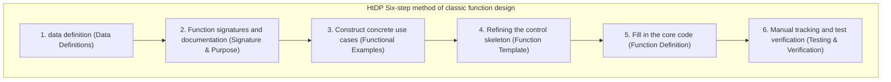

> **Course**: UC Berkeley CS61A (Fall 2024)  
> **Module**: Module 5: Declarative Programming and SQL (Declarative & SQL)  
> **Lecturer**: Prof. John DeNero (UC Berkeley)  
> **Video duration**: 38:48 ｜ **Classroom screenshots**: 17 pieces of blackboard writing/code demonstration  
> **Direct video**: [📺Watch the original video of this lecture on Bilibili (P37)](https://www.bilibili.com/video/BV1sy411z7nA/?p=37)  
> **Quick navigation**: [← Previous Lecture (P36 Lecture 38 Databases (Optional))](/en/notes/cs61a/lecture-36) ｜ [📚 Return to the full book catalog](/en/notes/topics/CS61A) ｜ <span>Next Lecture: None (Complete Book)</span>

---

## Course Core Objectives and Panorama

From Lecture 1 to Lecture 36, we have traversed the magnificent mountains and rivers of computer science: higher-order functions, environment models, recursion and tree recursion, data abstraction, sequences and generators, object-oriented systems, interpreter architecture and Scheme metaprogramming, to declarative databases and SQL.

As the final chapter and graduation ceremony of the whole course, Professor John DeNero not only led us to overcome two extremely difficult and representative classic comprehensive questions on tree recursion (`bigs`  with  `smalls`), and further sublimated and taught the academically renowned **Six-step method of systematic programming (How to Design Programs, HtDP)**.

This is the ultimate thinking method for every outstanding engineer to reduce complexity into simplicity and move from confusion to deterministic solutions when facing any unknown complex system!



---

### In-depth formal specification and micro-evaluation process (Operational Semantics)
In the "Course Core Goals and Panorama" module, the underlying computer operations rely on strict formal evaluation logic:
1. **Hierarchical parsing of abstract syntax trees (AST)**: 
   - The source code character stream is first divided into terminal symbol tokens (Tokens) by the lexical analyzer (Lexer), and then constructed into a multi-fork syntax tree by the syntax parser (Parser);
   - Operator priority and associativity are solidified during the syntax tree construction phase, eliminating ambiguity at runtime;
2. **Dynamic transitions of environment chains**: 
   - Each function call generates a new frame whose static lexical environment is determined by the function object's  `parent`  Attributes are completely determined;
   - The variable search traces back up the environment chain in one direction until the global environment frame. If it is not found, it will be triggered.  `NameError`  Abnormal;
3. **State Invariants**: 
   - The key to writing robust programs is to clarify loop invariants (Loop Invariants) and function pre/post-conditions (Pre/Post-conditions);
   - In complex control flow jumps, ensure that state variables maintain legal business constraints before each iteration.


## 1. The universality and recursive soul of tree abstraction (The Universality of Trees)

Tree data structures are ubiquitous in computer science:
- Python object-oriented implementation  `Tree`  class (`label`  attributes, `branches`  list, `is_leaf()`  method);
- Nested lists and JSON data trees;
- Abstract syntax tree (AST) of a programming language;
- Natural language syntax parse tree;
- The foundation of the modern World Wide Web - the HTML DOM web page node tree.

[](https://www.bilibili.com/video/BV1sy411z7nA/?p=37&t=29)
*⏱ Timestamp: 00:00:29 · 📷 Classroom screenshot · [Watch the corresponding clip on Bilibili (P37 00:00:29)](https://www.bilibili.com/video/BV1sy411z7nA/?p=37&t=29)*

#### 📸 In-depth reading of classroom blackboard writing and code demonstration (00:00:29)

**\[On-site blackboard writing/code demonstration restoration\]**:
At this time point, Professor DeNero conducted a core demonstration and key blackboard derivation on the screen:
> *“In this course, we've discussed trees many times. Tree-structured data could be represented either using a list using the tree data abstraction, which has this constructor and these selectors, and a helper function isLeaf that tells you whether or not a tree is a leaf. Or, later in the course, we di...”*

**\[Underlying computing model and micro execution mechanism\]**: 
1. **Execution context and timing tracing**: 
   - At the current discussion point "1. The universality and recursive soul of tree abstraction (The Universality of Trees)", the interpreter strictly follows the core evaluation convention;
   - The expression evaluates the operators first, then evaluates the operands strictly from left to right, and finally applies the function object to the argument list;
   - If the environment model is involved, the local frame strictly records its static lexical parent pointer (Parent Pointer points to the environment where the function is defined), forming an orthogonal architecture with the dynamic call stack at runtime.
2. **Memory topology and object references**: 
   - Variable symbols are just keys in a hash table (environment frame), and pointers point directly to first-class citizen objects in heap memory;
   - Assignment statements are discrete-time snapshots of the state and never create implicit mathematical dependency monitoring.

**\[Guidelines for avoiding pitfalls and guidance on high-frequency test points\]**: 
- **Common misunderstandings**: In the exam questions related to "Integration of the four major programming paradigms, final panoramic review and ultimate attack on core test points", beginners can easily guess the results based on the surface form of the code, leading to scope confusion or variable shadowing (Shadowing) misjudgments;
- **The golden rule of debugging**: When encountering nested calls and complex branches, be sure to draw independent partial frames on the scratch paper, indicate the specific binding value of each formal parameter, and derive it step by step.


[](https://www.bilibili.com/video/BV1sy411z7nA/?p=37&t=89)
*⏱ Timestamp: 00:01:29 · 📷 Classroom screenshot · [Watch the corresponding clip on Bilibili (P37 00:01:29)](https://www.bilibili.com/video/BV1sy411z7nA/?p=37&t=89)*

#### 📸 In-depth reading of classroom blackboard writing and code demonstration (00:01:29)

**\[On-site blackboard writing/code demonstration restoration\]**:
At this time point, Professor DeNero conducted a core demonstration and key blackboard derivation on the screen:
> *“That's because the notion of a tree in computer science is an abstract one that generalizes over anything that has component parts that are also trees. The key characteristic of a tree is that a tree contains other trees, and importantly, a tree can contain more than one other tree. We see examples ...”*

**\[Underlying computing model and micro execution mechanism\]**: 
1. **Execution context and timing tracing**: 
   - At the current discussion point "1. The universality and recursive soul of tree abstraction (The Universality of Trees)", the interpreter strictly follows the core evaluation convention;
   - The expression evaluates the operators first, then evaluates the operands strictly from left to right, and finally applies the function object to the argument list;
   - If the environment model is involved, the local frame strictly records its static lexical parent pointer (Parent Pointer points to the environment where the function is defined), forming an orthogonal architecture with the dynamic call stack at runtime.
2. **Memory topology and object references**: 
   - Variable symbols are just keys in a hash table (environment frame), and pointers point directly to first-class citizen objects in heap memory;
   - Assignment statements are discrete-time snapshots of the state and never create implicit mathematical dependency monitoring.

**\[Guidelines for avoiding pitfalls and guidance on high-frequency test points\]**: 
- **Common misunderstandings**: In the exam questions related to "Integration of the four major programming paradigms, final panoramic review and ultimate attack on core test points", beginners can easily guess the results based on the surface form of the code, leading to scope confusion or variable shadowing (Shadowing) misjudgments;
- **The golden rule of debugging**: When encountering nested calls and complex branches, be sure to draw independent partial frames on the scratch paper, indicate the specific binding value of each formal parameter, and derive it step by step.


**The core and most irreplaceable mission of learning recursion is to freely manipulate tree-shaped hierarchical data with fractal characteristics!**

---

### In-depth formal specification and micro-evaluation process (Operational Semantics)
In the module "1. The Universality and Recursive Soul of Tree Abstraction (The Universality of Trees)", the underlying computer operations rely on strict formal evaluation logic:
1. **Hierarchical parsing of abstract syntax trees (AST)**: 
   - The source code character stream is first divided into terminal symbol tokens (Tokens) by the lexical analyzer (Lexer), and then constructed into a multi-fork syntax tree by the syntax parser (Parser);
   - Operator priority and associativity are solidified during the syntax tree construction phase, eliminating ambiguity at runtime;
2. **Dynamic transitions of environment chains**: 
   - Each function call generates a new frame whose static lexical environment is determined by the function object's  `parent`  Attributes are completely determined;
   - The variable search traces back up the environment chain in one direction until the global environment frame. If it is not found, it will be triggered.  `NameError`  Abnormal;
3. **State Invariants**: 
   - The key to writing robust programs is to clarify loop invariants (Loop Invariants) and function pre/post-conditions (Pre/Post-conditions);
   - In complex control flow jumps, ensure that state variables maintain legal business constraints before each iteration.


## 2. Problem-solving thinking model: from confusion to progressive solution (The Problem-Solving Process)

Faced with any complex programming problem, you should never start piling up code immediately when you have no clue. The scientific problem-solving process includes:
1. **Read the question thoroughly**: Clarify the input domain (Domain) and output domain (Range);
2. **Draw specific example diagrams**: Concrete the abstract text description into a structural diagram;
3. **Identify boundaries and invariants**; 
4. **Looking for the core gripper (Hook)**.

[](https://www.bilibili.com/video/BV1sy411z7nA/?p=37&t=223)
*⏱ Timestamp: 00:03:43 · 📷 Classroom screenshot · [Watch the corresponding clip on Bilibili (P37 00:03:43)](https://www.bilibili.com/video/BV1sy411z7nA/?p=37&t=223)*

#### 📸 In-depth reading of classroom blackboard writing and code demonstration (00:03:43)

**\[On-site blackboard writing/code demonstration restoration\]**:
At this time point, Professor DeNero conducted a core demonstration and key blackboard derivation on the screen:
> *“To really think about what the process is that you go through when you read a problem and you don't know how to solve it right away. Because let's be honest, for most problems, it's not obvious how to solve them right away. That's true on exams. That's also true when you're building software for ind...”*

**\[Underlying computing model and micro execution mechanism\]**: 
1. **Execution context and timing tracing**: 
   - At the current discussion point "2. Problem-solving thinking model: from confusion to progressive solution (The Problem-Solving Process)", the interpreter strictly follows the core evaluation protocol;
   - The expression evaluates the operators first, then evaluates the operands strictly from left to right, and finally applies the function object to the argument list;
   - If the environment model is involved, the local frame strictly records its static lexical parent pointer (Parent Pointer points to the environment where the function is defined), forming an orthogonal architecture with the dynamic call stack at runtime.
2. **Memory topology and object references**: 
   - Variable symbols are just keys in a hash table (environment frame), and pointers point directly to first-class citizen objects in heap memory;
   - Assignment statements are discrete-time snapshots of the state and never create implicit mathematical dependency monitoring.

**\[Guidelines for avoiding pitfalls and guidance on high-frequency test points\]**: 
- **Common misunderstandings**: In the exam questions related to "Integration of the four major programming paradigms, final panoramic review and ultimate attack on core test points", beginners can easily guess the results based on the surface form of the code, leading to scope confusion or variable shadowing (Shadowing) misjudgments;
- **The golden rule of debugging**: When encountering nested calls and complex branches, be sure to draw independent partial frames on the scratch paper, indicate the specific binding value of each formal parameter, and derive it step by step.


---

### In-depth formal specification and micro-evaluation process (Operational Semantics)
In the "2. Problem-Solving Thinking Model: From Confusion to Progressive Solving (The Problem-Solving Process)" module, the underlying computer operations rely on strict formal evaluation logic:
1. **Hierarchical parsing of abstract syntax trees (AST)**: 
   - The source code character stream is first divided into terminal symbol tokens (Tokens) by the lexical analyzer (Lexer), and then constructed into a multi-fork syntax tree by the syntax parser (Parser);
   - Operator priority and associativity are solidified during the syntax tree construction phase, eliminating ambiguity at runtime;
2. **Dynamic transitions of environment chains**: 
   - Each function call generates a new frame whose static lexical environment is determined by the function object's  `parent`  Attributes are completely determined;
   - The variable search traces back up the environment chain in one direction until the global environment frame. If it is not found, it will be triggered.  `NameError`  Abnormal;
3. **State Invariants**: 
   - The key to writing robust programs is to clarify loop invariants (Loop Invariants) and function pre/post-conditions (Pre/Post-conditions);
   - In complex control flow jumps, ensure that state variables maintain legal business constraints before each iteration.


## 3. Classic Challenge 1: Ancestor Comparison Node Count (`bigs`)

> **Question specifications**: implement function  `bigs(t)`, a tree that receives integer labels  `t`, return to the tree **label is strictly greater than all its ancestor node labels** total number of nodes.

[](https://www.bilibili.com/video/BV1sy411z7nA/?p=37&t=306)
*⏱ Timestamp: 00:05:06 · 📷 Classroom screenshot · [Watch the corresponding clip on Bilibili (P37 00:05:06)](https://www.bilibili.com/video/BV1sy411z7nA/?p=37&t=306)*

#### 📸 In-depth reading of classroom blackboard writing and code demonstration (00:05:06)

**\[On-site blackboard writing/code demonstration restoration\]**:
At this time point, Professor DeNero conducted a core demonstration and key blackboard derivation on the screen:
> *“The first sentence looks pretty straightforward, but the second one, it returns the number of nodes in T whose labels are larger than any labels of their ancestor nodes. That's the heart of the question, and it's less straightforward. It's very abstract to talk about labels and ancestor nodes withou...”*

**\[Underlying computing model and micro execution mechanism\]**: 
1. **Execution context and timing tracing**: 
   - At the current discussion point "3. Classic Challenge 1: Ancestor Comparison Node Count (`bigs`)", the interpreter strictly follows the core evaluation convention;
   - The expression evaluates the operators first, then evaluates the operands strictly from left to right, and finally applies the function object to the argument list;
   - If the environment model is involved, the local frame strictly records its static lexical parent pointer (Parent Pointer points to the environment where the function is defined), forming an orthogonal architecture with the dynamic call stack at runtime.
2. **Memory topology and object references**: 
   - Variable symbols are just keys in a hash table (environment frame), and pointers point directly to first-class citizen objects in heap memory;
   - Assignment statements are discrete-time snapshots of the state and never create implicit mathematical dependency monitoring.

**\[Guidelines for avoiding pitfalls and guidance on high-frequency test points\]**: 
- **Common misunderstandings**: In the exam questions related to "Integration of the four major programming paradigms, final panoramic review and ultimate attack on core test points", beginners can easily guess the results based on the surface form of the code, leading to scope confusion or variable shadowing (Shadowing) misjudgments;
- **The golden rule of debugging**: When encountering nested calls and complex branches, be sure to draw independent partial frames on the scratch paper, indicate the specific binding value of each formal parameter, and derive it step by step.


[](https://www.bilibili.com/video/BV1sy411z7nA/?p=37&t=388)
*⏱ Timestamp: 00:06:28 · 📷 Classroom screenshot · [Watch the corresponding clip on Bilibili (P37 00:06:28)](https://www.bilibili.com/video/BV1sy411z7nA/?p=37&t=388)*

#### 📸 In-depth reading of classroom blackboard writing and code demonstration (00:06:28)

**\[On-site blackboard writing/code demonstration restoration\]**:
At this time point, Professor DeNero conducted a core demonstration and key blackboard derivation on the screen:
> *“Probably on an exam, I would define that for you. And then we can check this property. Is it the case that five is larger than four and one? Yes. So that's actually one of the nodes in this tree that we're looking for. Knowing that the answer is four is really not that helpful. We need to figure out...”*

**\[Underlying computing model and micro execution mechanism\]**: 
1. **Execution context and timing tracing**: 
   - At the current discussion point "3. Classic Challenge 1: Ancestor Comparison Node Count (`bigs`)", the interpreter strictly follows the core evaluation convention;
   - The expression evaluates the operators first, then evaluates the operands strictly from left to right, and finally applies the function object to the argument list;
   - If the environment model is involved, the local frame strictly records its static lexical parent pointer (Parent Pointer points to the environment where the function is defined), forming an orthogonal architecture with the dynamic call stack at runtime.
2. **Memory topology and object references**: 
   - Variable symbols are just keys in a hash table (environment frame), and pointers point directly to first-class citizen objects in heap memory;
   - Assignment statements are discrete-time snapshots of the state and never create implicit mathematical dependency monitoring.

**\[Guidelines for avoiding pitfalls and guidance on high-frequency test points\]**: 
- **Common misunderstandings**: In the exam questions related to "Integration of the four major programming paradigms, final panoramic review and ultimate attack on core test points", beginners can easily guess the results based on the surface form of the code, leading to scope confusion or variable shadowing (Shadowing) misjudgments;
- **The golden rule of debugging**: When encountering nested calls and complex branches, be sure to draw independent partial frames on the scratch paper, indicate the specific binding value of each formal parameter, and derive it step by step.


### Case analysis and discovery of key invariants
In the example tree:
- root node  `1`: Since it does not have any ancestors, **The root node is always trivially greater than all ancestors**, must be counted!
- node  `4` (Child node of 1): $4 > 1$, count;
- node  `4` (Children of 4): no larger than ancestor  `4`, not counted;
- node  `5` (Children of 4): $5 > 4$  and  $5 > 1$, count;
- node  `2` (Children of 0): $2 > 0$  But  $2 < 3$ (3 is its upper ancestor), so it is not counted!

**key hurdles**:Regular tree recursive template (`sum(bigs(b) for b in t.branches)`) when arriving at a leaf node, the leaf node **It is impossible to know the historical maximum value of the ancestors along the way**!

[](https://www.bilibili.com/video/BV1sy411z7nA/?p=37&t=505)
*⏱ Timestamp: 00:08:25 · 📷 Classroom screenshot · [Watch the corresponding clip on Bilibili (P37 00:08:25)](https://www.bilibili.com/video/BV1sy411z7nA/?p=37&t=505)*

#### 📸 In-depth reading of classroom blackboard writing and code demonstration (00:08:25)

**\[On-site blackboard writing/code demonstration restoration\]**:
At this time point, Professor DeNero conducted a core demonstration and key blackboard derivation on the screen:
> *“Like maybe this is one of those problems where you see if t is a leaf, you do one thing. Otherwise, you aggregate recursive calls applied to each of the branches. Well, if I knew how many nodes with this property appeared in all of the branches, then I could just worry about the root node and I'd be...”*

**\[Underlying computing model and micro execution mechanism\]**: 
1. **Execution context and timing tracing**: 
   - At the current discussion point "3. Classic Challenge 1: Ancestor Comparison Node Count (`bigs`)", the interpreter strictly follows the core evaluation convention;
   - The expression evaluates the operators first, then evaluates the operands strictly from left to right, and finally applies the function object to the argument list;
   - If the environment model is involved, the local frame strictly records its static lexical parent pointer (Parent Pointer points to the environment where the function is defined), forming an orthogonal architecture with the dynamic call stack at runtime.
2. **Memory topology and object references**: 
   - Variable symbols are just keys in a hash table (environment frame), and pointers point directly to first-class citizen objects in heap memory;
   - Assignment statements are discrete-time snapshots of the state and never create implicit mathematical dependency monitoring.

**\[Guidelines for avoiding pitfalls and guidance on high-frequency test points\]**: 
- **Common misunderstandings**: In the exam questions related to "Integration of the four major programming paradigms, final panoramic review and ultimate attack on core test points", beginners can easily guess the results based on the surface form of the code, leading to scope confusion or variable shadowing (Shadowing) misjudgments;
- **The golden rule of debugging**: When encountering nested calls and complex branches, be sure to draw independent partial frames on the scratch paper, indicate the specific binding value of each formal parameter, and derive it step by step.


---

### In-depth formal specification and micro-evaluation process (Operational Semantics)
In "3. Classic Challenge 1: Ancestor Comparison Node Count (`bigs`)" module, the underlying computer operations rely on strict formal evaluation logic:
1. **Hierarchical parsing of abstract syntax trees (AST)**: 
   - The source code character stream is first divided into terminal symbol tokens (Tokens) by the lexical analyzer (Lexer), and then constructed into a multi-fork syntax tree by the syntax parser (Parser);
   - Operator priority and associativity are solidified during the syntax tree construction phase, eliminating ambiguity at runtime;
2. **Dynamic transitions of environment chains**: 
   - Each function call generates a new frame whose static lexical environment is determined by the function object's  `parent`  Attributes are completely determined;
   - The variable search traces back up the environment chain in one direction until the global environment frame. If it is not found, it will be triggered.  `NameError`  Abnormal;
3. **State Invariants**: 
   - The key to writing robust programs is to clarify loop invariants (Loop Invariants) and function pre/post-conditions (Pre/Post-conditions);
   - In complex control flow jumps, ensure that state variables maintain legal business constraints before each iteration.


## 4. Pattern breakthrough: auxiliary functions and context state transfer (`bigs`  functional solution)

A two-argument helper function must be defined  `f(a, x)`: 
- `a`: The subtree node currently being inspected;
- `x`: What has been seen before reaching the current node from the root path **Max Ancestor Seen So Far**.

[](https://www.bilibili.com/video/BV1sy411z7nA/?p=37&t=620)
*⏱ Timestamp: 00:10:20 · 📷 Classroom screenshot · [Watch the corresponding clip on Bilibili (P37 00:10:20)](https://www.bilibili.com/video/BV1sy411z7nA/?p=37&t=620)*

#### 📸 In-depth reading of classroom blackboard writing and code demonstration (00:10:20)

**\[On-site blackboard writing/code demonstration restoration\]**:
At this time point, Professor DeNero conducted a core demonstration and key blackboard derivation on the screen:
> *“I would recognize that as a useful hook, and I would try to figure out whether I can build the rest of the implementation around this idea of tracking the largest ancestor so far, comparing that with the node's label, and somehow incrementing the total account whenever that occurs. Now it's time to ...”*

**\[Underlying computing model and micro execution mechanism\]**: 
1. **Execution context and timing tracing**: 
   - At the current discussion point "4. Pattern breakthrough: auxiliary functions and context state transfer (`bigs`  Functional solution)", the interpreter strictly follows the core evaluation convention;
   - The expression evaluates the operators first, then evaluates the operands strictly from left to right, and finally applies the function object to the argument list;
   - If the environment model is involved, the local frame strictly records its static lexical parent pointer (Parent Pointer points to the environment where the function is defined), forming an orthogonal architecture with the dynamic call stack at runtime.
2. **Memory topology and object references**: 
   - Variable symbols are just keys in a hash table (environment frame), and pointers point directly to first-class citizen objects in heap memory;
   - Assignment statements are discrete-time snapshots of the state and never create implicit mathematical dependency monitoring.

**\[Guidelines for avoiding pitfalls and guidance on high-frequency test points\]**: 
- **Common misunderstandings**: In the exam questions related to "Integration of the four major programming paradigms, final panoramic review and ultimate attack on core test points", beginners can easily guess the results based on the surface form of the code, leading to scope confusion or variable shadowing (Shadowing) misjudgments;
- **The golden rule of debugging**: When encountering nested calls and complex branches, be sure to draw independent partial frames on the scratch paper, indicate the specific binding value of each formal parameter, and derive it step by step.


```python
def bigs(t):
    """返回标签大于所有祖先标签的节点数。"""
    def f(a, x):
        n = 1 if a.label > x else 0
        m = max(x, a.label)
        return n + sum([f(b, m) for b in a.branches])
    return f(t, t.label - 1)
```

[](https://www.bilibili.com/video/BV1sy411z7nA/?p=37&t=758)
*⏱ Timestamp: 00:12:38 · 📷 Classroom screenshot · [Watch the corresponding clip on Bilibili (P37 00:12:38)](https://www.bilibili.com/video/BV1sy411z7nA/?p=37&t=758)*

#### 📸 In-depth reading of classroom blackboard writing and code demonstration (00:12:38)

**\[On-site blackboard writing/code demonstration restoration\]**:
At this time point, Professor DeNero conducted a core demonstration and key blackboard derivation on the screen:
> *“If these abstract descriptions don't work for you, then write down an example. A is this subtree, 445, and max-ancestor is 1, the largest ancestor of this subtree. All right. Now we need to implement the pattern where Biggs calls f, and then f computes the answer. And that means Biggs is going to ca...”*

**\[Underlying computing model and micro execution mechanism\]**: 
1. **Execution context and timing tracing**: 
   - At the current discussion point "4. Pattern breakthrough: auxiliary functions and context state transfer (`bigs`  Functional solution)", the interpreter strictly follows the core evaluation convention;
   - The expression evaluates the operators first, then evaluates the operands strictly from left to right, and finally applies the function object to the argument list;
   - If the environment model is involved, the local frame strictly records its static lexical parent pointer (Parent Pointer points to the environment where the function is defined), forming an orthogonal architecture with the dynamic call stack at runtime.
2. **Memory topology and object references**: 
   - Variable symbols are just keys in a hash table (environment frame), and pointers point directly to first-class citizen objects in heap memory;
   - Assignment statements are discrete-time snapshots of the state and never create implicit mathematical dependency monitoring.

**\[Guidelines for avoiding pitfalls and guidance on high-frequency test points\]**: 
- **Common misunderstandings**: In the exam questions related to "Integration of the four major programming paradigms, final panoramic review and ultimate attack on core test points", beginners can easily guess the results based on the surface form of the code, leading to scope confusion or variable shadowing (Shadowing) misjudgments;
- **The golden rule of debugging**: When encountering nested calls and complex branches, be sure to draw independent partial frames on the scratch paper, indicate the specific binding value of each formal parameter, and derive it step by step.


- When the root node initiates a call, pass in  `t.label - 1`, ensuring that the root node must be judged as True;
- Recurse down each branch  `b`  When , pass the updated largest ancestor  `max(x, a.label)`; 
- Finally, the counting results are reported and returned layer by layer through branch summation.

[](https://www.bilibili.com/video/BV1sy411z7nA/?p=37&t=976)
*⏱ Timestamp: 00:16:16 · 📷 Classroom screenshot · [Watch the corresponding clip on Bilibili (P37 00:16:16)](https://www.bilibili.com/video/BV1sy411z7nA/?p=37&t=976)*

#### 📸 In-depth reading of classroom blackboard writing and code demonstration (00:16:16)

**\[On-site blackboard writing/code demonstration restoration\]**:
At this time point, Professor DeNero conducted a core demonstration and key blackboard derivation on the screen:
> *“Or, I could just make it work. For example, I could make it work by passing in some maximal value that's not actually the maximal value, but instead is just something that's less than t.label. That's one way to solve this problem, that the root is different than everything else because we haven't se...”*

**\[Underlying computing model and micro execution mechanism\]**: 
1. **Execution context and timing tracing**: 
   - At the current discussion point "4. Pattern breakthrough: auxiliary functions and context state transfer (`bigs`  Functional solution)", the interpreter strictly follows the core evaluation convention;
   - The expression evaluates the operators first, then evaluates the operands strictly from left to right, and finally applies the function object to the argument list;
   - If the environment model is involved, the local frame strictly records its static lexical parent pointer (Parent Pointer points to the environment where the function is defined), forming an orthogonal architecture with the dynamic call stack at runtime.
2. **Memory topology and object references**: 
   - Variable symbols are just keys in a hash table (environment frame), and pointers point directly to first-class citizen objects in heap memory;
   - Assignment statements are discrete-time snapshots of the state and never create implicit mathematical dependency monitoring.

**\[Guidelines for avoiding pitfalls and guidance on high-frequency test points\]**: 
- **Common misunderstandings**: In the exam questions related to "Integration of the four major programming paradigms, final panoramic review and ultimate attack on core test points", beginners can easily guess the results based on the surface form of the code, leading to scope confusion or variable shadowing (Shadowing) misjudgments;
- **The golden rule of debugging**: When encountering nested calls and complex branches, be sure to draw independent partial frames on the scratch paper, indicate the specific binding value of each formal parameter, and derive it step by step.


---

### In-depth formal specification and micro-evaluation process (Operational Semantics)
In "4. Pattern Breakthrough: Auxiliary Functions and Contextual State Transfer (`bigs`  In the "Functional Solution" module, the underlying computer operations rely on strict formal evaluation logic:
1. **Hierarchical parsing of abstract syntax trees (AST)**: 
   - The source code character stream is first divided into terminal symbol tokens (Tokens) by the lexical analyzer (Lexer), and then constructed into a multi-fork syntax tree by the syntax parser (Parser);
   - Operator priority and associativity are solidified during the syntax tree construction phase, eliminating ambiguity at runtime;
2. **Dynamic transitions of environment chains**: 
   - Each function call generates a new frame whose static lexical environment is determined by the function object's  `parent`  Attributes are completely determined;
   - The variable search traces back up the environment chain in one direction until the global environment frame. If it is not found, it will be triggered.  `NameError`  Abnormal;
3. **State Invariants**: 
   - The key to writing robust programs is to clarify loop invariants (Loop Invariants) and function pre/post-conditions (Pre/Post-conditions);
   - In complex control flow jumps, ensure that state variables maintain legal business constraints before each iteration.


## 5. Solution variant: Mutable Accumulator Pattern

In addition to purely functional return value accumulation, another high-frequency pattern is to maintain a single-element list in the outer closure  `n = [0]`  As a variable counter:

[](https://www.bilibili.com/video/BV1sy411z7nA/?p=37&t=1152)
*⏱ Timestamp: 00:19:12 · 📷 Classroom screenshot · [Watch the corresponding clip on Bilibili (P37 00:19:12)](https://www.bilibili.com/video/BV1sy411z7nA/?p=37&t=1152)*

#### 📸 In-depth reading of classroom blackboard writing and code demonstration (00:19:12)

**\[On-site blackboard writing/code demonstration restoration\]**:
At this time point, Professor DeNero conducted a core demonstration and key blackboard derivation on the screen:
> *“And checking your work is a critical step in solving problems. One thing we've discovered in this course is that there can be multiple ways to solve the same problem, but it's often the case that there are only a few different reasonable ways to deal with an issue that pops up again and again. For e...”*

**\[Underlying computing model and micro execution mechanism\]**: 
1. **Execution context and timing tracing**: 
   - At the current discussion point "5. Solution variant: Mutable Accumulator Pattern", the interpreter strictly follows the core evaluation protocol;
   - The expression evaluates the operators first, then evaluates the operands strictly from left to right, and finally applies the function object to the argument list;
   - If the environment model is involved, the local frame strictly records its static lexical parent pointer (Parent Pointer points to the environment where the function is defined), forming an orthogonal architecture with the dynamic call stack at runtime.
2. **Memory topology and object references**: 
   - Variable symbols are just keys in a hash table (environment frame), and pointers point directly to first-class citizen objects in heap memory;
   - Assignment statements are discrete-time snapshots of the state and never create implicit mathematical dependency monitoring.

**\[Guidelines for avoiding pitfalls and guidance on high-frequency test points\]**: 
- **Common misunderstandings**: In the exam questions related to "Integration of the four major programming paradigms, final panoramic review and ultimate attack on core test points", beginners can easily guess the results based on the surface form of the code, leading to scope confusion or variable shadowing (Shadowing) misjudgments;
- **The golden rule of debugging**: When encountering nested calls and complex branches, be sure to draw independent partial frames on the scratch paper, indicate the specific binding value of each formal parameter, and derive it step by step.


[](https://www.bilibili.com/video/BV1sy411z7nA/?p=37&t=1345)
*⏱ Timestamp: 00:22:25 · 📷 Classroom screenshot · [Watch the corresponding clip on Bilibili (P37 00:22:25)](https://www.bilibili.com/video/BV1sy411z7nA/?p=37&t=1345)*

#### 📸 In-depth reading of classroom blackboard writing and code demonstration (00:22:25)

**\[On-site blackboard writing/code demonstration restoration\]**:
At this time point, Professor DeNero conducted a core demonstration and key blackboard derivation on the screen:
> *“It calls itself in some circumstances. However, it never would get called unless I call it on this line. So this is going to be a call to f. And what is f going to do? It's going to correctly set this element at index 0 of n to the number of nodes in t that are larger than all their ancestors. We wi...”*

**\[Underlying computing model and micro execution mechanism\]**: 
1. **Execution context and timing tracing**: 
   - At the current discussion point "5. Solution variant: Mutable Accumulator Pattern", the interpreter strictly follows the core evaluation protocol;
   - The expression evaluates the operators first, then evaluates the operands strictly from left to right, and finally applies the function object to the argument list;
   - If the environment model is involved, the local frame strictly records its static lexical parent pointer (Parent Pointer points to the environment where the function is defined), forming an orthogonal architecture with the dynamic call stack at runtime.
2. **Memory topology and object references**: 
   - Variable symbols are just keys in a hash table (environment frame), and pointers point directly to first-class citizen objects in heap memory;
   - Assignment statements are discrete-time snapshots of the state and never create implicit mathematical dependency monitoring.

**\[Guidelines for avoiding pitfalls and guidance on high-frequency test points\]**: 
- **Common misunderstandings**: In the exam questions related to "Integration of the four major programming paradigms, final panoramic review and ultimate attack on core test points", beginners can easily guess the results based on the surface form of the code, leading to scope confusion or variable shadowing (Shadowing) misjudgments;
- **The golden rule of debugging**: When encountering nested calls and complex branches, be sure to draw independent partial frames on the scratch paper, indicate the specific binding value of each formal parameter, and derive it step by step.


```python
def bigs_iter(t):
    n = [0]
    def f(a, x):
        if a.label > x:
            n[0] += 1
        m = max(x, a.label)
        for b in a.branches:
            f(b, m)
    f(t, t.label - 1)
    return n[0]
```

By modifying in place  `n[0]`, avoided  `sum()`  Intermediate overhead of list comprehensions. Understanding the interoperability equivalence of these two modes is key to mastering tree traversal.

---

### In-depth formal specification and micro-evaluation process (Operational Semantics)
In the "5. Solution variant: Mutable Accumulator Pattern" module, the underlying computer operations rely on strict formal evaluation logic:
1. **Hierarchical parsing of abstract syntax trees (AST)**: 
   - The source code character stream is first divided into terminal symbol tokens (Tokens) by the lexical analyzer (Lexer), and then constructed into a multi-fork syntax tree by the syntax parser (Parser);
   - Operator priority and associativity are solidified during the syntax tree construction phase, eliminating ambiguity at runtime;
2. **Dynamic transitions of environment chains**: 
   - Each function call generates a new frame whose static lexical environment is determined by the function object's  `parent`  Attributes are completely determined;
   - The variable search traces back up the environment chain in one direction until the global environment frame. If it is not found, it will be triggered.  `NameError`  Abnormal;
3. **State Invariants**: 
   - The key to writing robust programs is to clarify loop invariants (Loop Invariants) and function pre/post-conditions (Pre/Post-conditions);
   - In complex control flow jumps, ensure that state variables maintain legal business constraints before each iteration.


## 6. "How to Design a Program" (HtDP) six-step design method

Professor John DeNero solemnly recommended the six-step method of function design in the classic book "How to Design Programs":

[](https://www.bilibili.com/video/BV1sy411z7nA/?p=37&t=1522)
*⏱ Timestamp: 00:25:22 · 📷 Classroom screenshot · [Watch the corresponding clip on Bilibili (P37 00:25:22)](https://www.bilibili.com/video/BV1sy411z7nA/?p=37&t=1522)*

#### 📸 In-depth reading of classroom blackboard writing and code demonstration (00:25:22)

**\[On-site blackboard writing/code demonstration restoration\]**:
At this time point, Professor DeNero conducted a core demonstration and key blackboard derivation on the screen:
> *“Some first courses focus on applications. Some focus on a programming language. This one focuses on programming paradigms and also programming languages, but with a strong emphasis on problem solving. There's one textbook called How to Design Programs that actually just focuses on the process of cor...”*

**\[Underlying computing model and micro execution mechanism\]**: 
1. **Execution context and timing tracing**: 
   - At the current discussion point "6. "How to Design Programs" (HtDP) six-step design method", the interpreter strictly follows the core evaluation protocol;
   - The expression evaluates the operators first, then evaluates the operands strictly from left to right, and finally applies the function object to the argument list;
   - If the environment model is involved, the local frame strictly records its static lexical parent pointer (Parent Pointer points to the environment where the function is defined), forming an orthogonal architecture with the dynamic call stack at runtime.
2. **Memory topology and object references**: 
   - Variable symbols are just keys in a hash table (environment frame), and pointers point directly to first-class citizen objects in heap memory;
   - Assignment statements are discrete-time snapshots of the state and never create implicit mathematical dependency monitoring.

**\[Guidelines for avoiding pitfalls and guidance on high-frequency test points\]**: 
- **Common misunderstandings**: In the exam questions related to "Integration of the four major programming paradigms, final panoramic review and ultimate attack on core test points", beginners can easily guess the results based on the surface form of the code, leading to scope confusion or variable shadowing (Shadowing) misjudgments;
- **The golden rule of debugging**: When encountering nested calls and complex branches, be sure to draw independent partial frames on the scratch paper, indicate the specific binding value of each formal parameter, and derive it step by step.


[](https://www.bilibili.com/video/BV1sy411z7nA/?p=37&t=1639)
*⏱ Timestamp: 00:27:19 · 📷 Classroom screenshot · [Watch the corresponding clip on Bilibili (P37 00:27:19)](https://www.bilibili.com/video/BV1sy411z7nA/?p=37&t=1639)*

#### 📸 In-depth reading of classroom blackboard writing and code demonstration (00:27:19)

**\[On-site blackboard writing/code demonstration restoration\]**:
At this time point, Professor DeNero conducted a core demonstration and key blackboard derivation on the screen:
> *“We've talked about that in this course. It's domain and range. Formulate a concise answer to the question, what the function computes. That's the one sentence docstring that describes the behavior of the function. And they say define a stub that lives up to the signature that's writing the def state...”*

**\[Underlying computing model and micro execution mechanism\]**: 
1. **Execution context and timing tracing**: 
   - At the current discussion point "6. "How to Design Programs" (HtDP) six-step design method", the interpreter strictly follows the core evaluation protocol;
   - The expression evaluates the operators first, then evaluates the operands strictly from left to right, and finally applies the function object to the argument list;
   - If the environment model is involved, the local frame strictly records its static lexical parent pointer (Parent Pointer points to the environment where the function is defined), forming an orthogonal architecture with the dynamic call stack at runtime.
2. **Memory topology and object references**: 
   - Variable symbols are just keys in a hash table (environment frame), and pointers point directly to first-class citizen objects in heap memory;
   - Assignment statements are discrete-time snapshots of the state and never create implicit mathematical dependency monitoring.

**\[Guidelines for avoiding pitfalls and guidance on high-frequency test points\]**: 
- **Common misunderstandings**: In the exam questions related to "Integration of the four major programming paradigms, final panoramic review and ultimate attack on core test points", beginners can easily guess the results based on the surface form of the code, leading to scope confusion or variable shadowing (Shadowing) misjudgments;
- **The golden rule of debugging**: When encountering nested calls and complex branches, be sure to draw independent partial frames on the scratch paper, indicate the specific binding value of each formal parameter, and derive it step by step.


| steps | Stage goal | Practical Guide |
| :--- | :--- | :--- |
| **1. Data definition** | Determine how information will be represented in the program | Clarify whether to use classes, dictionaries, trees, or scalars to represent real-world concepts |
| **2. Signature and annotation** | Clarify input and output domains and core contracts | Writing a type signature (Signature) and one line of core Docstring |
| **3. Functional use cases** | Design test cases before writing code | Construct typical input and expected output (Doctest) |
| **4. Skeleton template** | Refining the control flow backbone | build  `if-else`  Branches with expected critical subcalls |
| **5. Coding implementation** | Fill in code gaps based on use cases and contracts | Write corresponding logic according to the data structure form |
| **6. Test verification** | Use use cases for rigorous single-step tracing and assertions | Discover hidden boundary defects and ensure code readability |

---

### In-depth formal specification and micro-evaluation process (Operational Semantics)
In the "6. "How to Design Programs" (HtDP) Six-Step Design Method" module, the underlying computer operations rely on strict formal evaluation logic:
1. **Hierarchical parsing of abstract syntax trees (AST)**: 
   - The source code character stream is first divided into terminal symbol tokens (Tokens) by the lexical analyzer (Lexer), and then constructed into a multi-fork syntax tree by the syntax parser (Parser);
   - Operator priority and associativity are solidified during the syntax tree construction phase, eliminating ambiguity at runtime;
2. **Dynamic transitions of environment chains**: 
   - Each function call generates a new frame whose static lexical environment is determined by the function object's  `parent`  Attributes are completely determined;
   - The variable search traces back up the environment chain in one direction until the global environment frame. If it is not found, it will be triggered.  `NameError`  Abnormal;
3. **State Invariants**: 
   - The key to writing robust programs is to clarify loop invariants (Loop Invariants) and function pre/post-conditions (Pre/Post-conditions);
   - In complex control flow jumps, ensure that state variables maintain legal business constraints before each iteration.


## 7. Classic Challenge 2: Collection of all descendant comparison nodes (`smalls`)

> **Question specifications**: implement function  `smalls(t)`, a tree that receives integer labels  `t`, return all **label is strictly smaller than all its descendant node labels** A list of \*\*Non-leaf Nodes\*\*.

[](https://www.bilibili.com/video/BV1sy411z7nA/?p=37&t=1819)
*⏱ Timestamp: 00:30:19 · 📷 Classroom screenshot · [Watch the corresponding clip on Bilibili (P37 00:30:19)](https://www.bilibili.com/video/BV1sy411z7nA/?p=37&t=1819)*

#### 📸 In-depth reading of classroom blackboard writing and code demonstration (00:30:19)

**\[On-site blackboard writing/code demonstration restoration\]**:
At this time point, Professor DeNero conducted a core demonstration and key blackboard derivation on the screen:
> *“To another tree problem. Here's the problem. Implement smalls, which takes a tree instance t containing integer labels. It returns the non-leaf nodes in t whose labels are smaller than any labels of their descendant nodes. And here's a one-line description of the behavior, return the non-leaf nodes ...”*

**\[Underlying computing model and micro execution mechanism\]**: 
1. **Execution context and timing tracing**: 
   - At the current discussion point "7. Classic Challenge 2: Full Comparison Node Collection of Descendants (`smalls`)", the interpreter strictly follows the core evaluation convention;
   - The expression evaluates the operators first, then evaluates the operands strictly from left to right, and finally applies the function object to the argument list;
   - If the environment model is involved, the local frame strictly records its static lexical parent pointer (Parent Pointer points to the environment where the function is defined), forming an orthogonal architecture with the dynamic call stack at runtime.
2. **Memory topology and object references**: 
   - Variable symbols are just keys in a hash table (environment frame), and pointers point directly to first-class citizen objects in heap memory;
   - Assignment statements are discrete-time snapshots of the state and never create implicit mathematical dependency monitoring.

**\[Guidelines for avoiding pitfalls and guidance on high-frequency test points\]**: 
- **Common misunderstandings**: In the exam questions related to "Integration of the four major programming paradigms, final panoramic review and ultimate attack on core test points", beginners can easily guess the results based on the surface form of the code, leading to scope confusion or variable shadowing (Shadowing) misjudgments;
- **The golden rule of debugging**: When encountering nested calls and complex branches, be sure to draw independent partial frames on the scratch paper, indicate the specific binding value of each formal parameter, and derive it step by step.


[](https://www.bilibili.com/video/BV1sy411z7nA/?p=37&t=1938)
*⏱ Timestamp: 00:32:18 · 📷 Classroom screenshot · [Watch the corresponding clip on Bilibili (P37 00:32:18)](https://www.bilibili.com/video/BV1sy411z7nA/?p=37&t=1938)*

#### 📸 In-depth reading of classroom blackboard writing and code demonstration (00:32:18)

**\[On-site blackboard writing/code demonstration restoration\]**:
At this time point, Professor DeNero conducted a core demonstration and key blackboard derivation on the screen:
> *“It is smaller than all of its descendants. It's smaller than four and five. How about four? That's a leaf. I'm looking for non-leaf nodes. Five is a leaf as well. Three is not smaller than zero. Zero is smaller than all of its descendants. And six is a leaf. One important thing to note is that one i...”*

**\[Underlying computing model and micro execution mechanism\]**: 
1. **Execution context and timing tracing**: 
   - At the current discussion point "7. Classic Challenge 2: Full Comparison Node Collection of Descendants (`smalls`)", the interpreter strictly follows the core evaluation convention;
   - The expression evaluates the operators first, then evaluates the operands strictly from left to right, and finally applies the function object to the argument list;
   - If the environment model is involved, the local frame strictly records its static lexical parent pointer (Parent Pointer points to the environment where the function is defined), forming an orthogonal architecture with the dynamic call stack at runtime.
2. **Memory topology and object references**: 
   - Variable symbols are just keys in a hash table (environment frame), and pointers point directly to first-class citizen objects in heap memory;
   - Assignment statements are discrete-time snapshots of the state and never create implicit mathematical dependency monitoring.

**\[Guidelines for avoiding pitfalls and guidance on high-frequency test points\]**: 
- **Common misunderstandings**: In the exam questions related to "Integration of the four major programming paradigms, final panoramic review and ultimate attack on core test points", beginners can easily guess the results based on the surface form of the code, leading to scope confusion or variable shadowing (Shadowing) misjudgments;
- **The golden rule of debugging**: When encountering nested calls and complex branches, be sure to draw independent partial frames on the scratch paper, indicate the specific binding value of each formal parameter, and derive it step by step.


### Comparative analysis of difficulties
- in  `bigs` , the status information is transferred from top to bottom (the maximum value of the ancestor is passed to the descendant);
- in  `smalls` , the status information must be aggregated and returned from bottom-up (each node needs to know the minimum value of all its descendants)!

---

### In-depth formal specification and micro-evaluation process (Operational Semantics)
In "7. Classic Challenge 2: Full Comparison Node Collection of Descendants (`smalls`)" module, the underlying computer operations rely on strict formal evaluation logic:
1. **Hierarchical parsing of abstract syntax trees (AST)**: 
   - The source code character stream is first divided into terminal symbol tokens (Tokens) by the lexical analyzer (Lexer), and then constructed into a multi-fork syntax tree by the syntax parser (Parser);
   - Operator priority and associativity are solidified during the syntax tree construction phase, eliminating ambiguity at runtime;
2. **Dynamic transitions of environment chains**: 
   - Each function call generates a new frame whose static lexical environment is determined by the function object's  `parent`  Attributes are completely determined;
   - The variable search traces back up the environment chain in one direction until the global environment frame. If it is not found, it will be triggered.  `NameError`  Abnormal;
3. **State Invariants**: 
   - The key to writing robust programs is to clarify loop invariants (Loop Invariants) and function pre/post-conditions (Pre/Post-conditions);
   - In complex control flow jumps, ensure that state variables maintain legal business constraints before each iteration.


## 8. Kill two birds with one stone: Design of dual-responsibility auxiliary function (`smalls`  Perfectly realized)

We define a recursive helper function  `process(t)`, it undertakes two key tasks at the same time:
1. **return value**: Return to  `t`  in the entire subtree with the root **absolute minimum label value**; 
2. **Side Effects (Collection)**: if  `t`  is a non-leaf node and  `t.label`  is less than the minimum value of the descendants of all its subtrees, then  `t`  global result list appended to closure  `result`  Hit!

[](https://www.bilibili.com/video/BV1sy411z7nA/?p=37&t=2087)
*⏱ Timestamp: 00:34:47 · 📷 Classroom screenshot · [Watch the corresponding clip on Bilibili (P37 00:34:47)](https://www.bilibili.com/video/BV1sy411z7nA/?p=37&t=2087)*

#### 📸 In-depth reading of classroom blackboard writing and code demonstration (00:34:47)

**\[On-site blackboard writing/code demonstration restoration\]**:
At this time point, Professor DeNero conducted a core demonstration and key blackboard derivation on the screen:
> *“It's possible for a function to do two things. And in this case, while we're processing this node to find its smallest label, we can also figure out whether to add it to the resulting list or not. Because when we find its smallest label, that means we're going to find the smallest labels in its bran...”*

**\[Underlying computing model and micro execution mechanism\]**: 
1. **Execution context and timing tracing**: 
   - At the current discussion point "8. Kill two birds with one stone: the design of dual-responsibility auxiliary functions (`smalls`  Perfect implementation)", the interpreter strictly follows the core evaluation convention;
   - The expression evaluates the operators first, then evaluates the operands strictly from left to right, and finally applies the function object to the argument list;
   - If the environment model is involved, the local frame strictly records its static lexical parent pointer (Parent Pointer points to the environment where the function is defined), forming an orthogonal architecture with the dynamic call stack at runtime.
2. **Memory topology and object references**: 
   - Variable symbols are just keys in a hash table (environment frame), and pointers point directly to first-class citizen objects in heap memory;
   - Assignment statements are discrete-time snapshots of the state and never create implicit mathematical dependency monitoring.

**\[Guidelines for avoiding pitfalls and guidance on high-frequency test points\]**: 
- **Common misunderstandings**: In the exam questions related to "Integration of the four major programming paradigms, final panoramic review and ultimate attack on core test points", beginners can easily guess the results based on the surface form of the code, leading to scope confusion or variable shadowing (Shadowing) misjudgments;
- **The golden rule of debugging**: When encountering nested calls and complex branches, be sure to draw independent partial frames on the scratch paper, indicate the specific binding value of each formal parameter, and derive it step by step.


[](https://www.bilibili.com/video/BV1sy411z7nA/?p=37&t=2237)
*⏱ Timestamp: 00:37:17 · 📷 Classroom screenshot · [Watch the corresponding clip on Bilibili (P37 00:37:17)](https://www.bilibili.com/video/BV1sy411z7nA/?p=37&t=2237)*

#### 📸 In-depth reading of classroom blackboard writing and code demonstration (00:37:17)

**\[On-site blackboard writing/code demonstration restoration\]**:
At this time point, Professor DeNero conducted a core demonstration and key blackboard derivation on the screen:
> *“Otherwise, we know a T has branches. So we need to find the smallest label in those branches. If the root of T is even smaller than the smallest descendant label, then we need to add it to result. And here we see a confirmation of what we described earlier. That the return value should be the smalle...”*

**\[Underlying computing model and micro execution mechanism\]**: 
1. **Execution context and timing tracing**: 
   - At the current discussion point "8. Kill two birds with one stone: the design of dual-responsibility auxiliary functions (`smalls`  Perfect implementation)", the interpreter strictly follows the core evaluation convention;
   - The expression evaluates the operators first, then evaluates the operands strictly from left to right, and finally applies the function object to the argument list;
   - If the environment model is involved, the local frame strictly records its static lexical parent pointer (Parent Pointer points to the environment where the function is defined), forming an orthogonal architecture with the dynamic call stack at runtime.
2. **Memory topology and object references**: 
   - Variable symbols are just keys in a hash table (environment frame), and pointers point directly to first-class citizen objects in heap memory;
   - Assignment statements are discrete-time snapshots of the state and never create implicit mathematical dependency monitoring.

**\[Guidelines for avoiding pitfalls and guidance on high-frequency test points\]**: 
- **Common misunderstandings**: In the exam questions related to "Integration of the four major programming paradigms, final panoramic review and ultimate attack on core test points", beginners can easily guess the results based on the surface form of the code, leading to scope confusion or variable shadowing (Shadowing) misjudgments;
- **The golden rule of debugging**: When encountering nested calls and complex branches, be sure to draw independent partial frames on the scratch paper, indicate the specific binding value of each formal parameter, and derive it step by step.


```python
def smalls(t):
    """返回所有标签小于其所有后代标签的非叶子节点列表。"""
    result = []
    def process(t):
        if t.is_leaf():
            return t.label
        smallest_descendant = min([process(b) for b in t.branches])
        if t.label < smallest_descendant:
            result.append(t)
        return min(t.label, smallest_descendant)
    process(t)
    return result
```

- Baseline conditions: if  `t`  For leaves, return directly  `t.label`, never append to  `result` (The question is limited to non-leaf nodes);
- Induction condition: recursively calculate the minimum value returned by all branches, and get  `smallest_descendant`; 
- Conditional judgment: If the current label is less than the minimum value of the descendants, the target is hit. `result.append(t)`; 
- Postback up: return  `min(t.label, smallest_descendant)`, for the parent node of the upper layer to continue to determine!

The entire solution structure is like a natural creation, seamlessly integrated.

---

### In-depth formal specification and micro-evaluation process (Operational Semantics)
In "8. Kill two birds with one stone: Design of dual-responsibility helper functions (`smalls`  In the "Perfect Implementation" module, the underlying computer operations rely on strict formal evaluation logic:
1. **Hierarchical parsing of abstract syntax trees (AST)**: 
   - The source code character stream is first divided into terminal symbol tokens (Tokens) by the lexical analyzer (Lexer), and then constructed into a multi-fork syntax tree by the syntax parser (Parser);
   - Operator priority and associativity are solidified during the syntax tree construction phase, eliminating ambiguity at runtime;
2. **Dynamic transitions of environment chains**: 
   - Each function call generates a new frame whose static lexical environment is determined by the function object's  `parent`  Attributes are completely determined;
   - The variable search traces back up the environment chain in one direction until the global environment frame. If it is not found, it will be triggered.  `NameError`  Abnormal;
3. **State Invariants**: 
   - The key to writing robust programs is to clarify loop invariants (Loop Invariants) and function pre/post-conditions (Pre/Post-conditions);
   - In complex control flow jumps, ensure that state variables maintain legal business constraints before each iteration.


## Conclusion: Structure and Interpretation of Computer Programs

With the conclusion of Lecture 37, all 37 lectures of CS61A have come to a successful conclusion!

Review the whole book:
- We have witnessed how complex abstract worlds can be constructed using only the simplest combinations of functions;
- We have insight into the truth of the physical operation of the object system and environment frame chain;
- We personally reproduced the Turing-complete interpreter in Scheme and realized the supreme realm of code as data;
- In declarative SQL we learned to use mathematical predicates to govern massive amounts of data.

May this set of refined thinking methods accompany you to overcome obstacles and create calmly in your future journey of computer science and software engineering!

### In-depth formal specification and micro-evaluation process (Operational Semantics)
In the "Conclusion: Structure and Interpretation of Computer Programs" module, the underlying operations of computers rely on strict formal evaluation logic:
1. **Hierarchical parsing of abstract syntax trees (AST)**: 
   - The source code character stream is first divided into terminal symbol tokens (Tokens) by the lexical analyzer (Lexer), and then constructed into a multi-fork syntax tree by the syntax parser (Parser);
   - Operator priority and associativity are solidified during the syntax tree construction phase, eliminating ambiguity at runtime;
2. **Dynamic transitions of environment chains**: 
   - Each function call generates a new frame whose static lexical environment is determined by the function object's  `parent`  Attributes are completely determined;
   - The variable search traces back up the environment chain in one direction until the global environment frame. If it is not found, it will be triggered.  `NameError`  Abnormal;
3. **State Invariants**: 
   - The key to writing robust programs is to clarify loop invariants (Loop Invariants) and function pre/post-conditions (Pre/Post-conditions);
   - In complex control flow jumps, ensure that state variables maintain legal business constraints before each iteration.


---

## Berkeley Midterm/Final classic high-frequency exam questions in-depth practice

### Practical exam questions: Environment topology and microstate tracking (WWPD & Environment Diagrams)
Consider the following microscopic execution of Python code in an interactive environment:

```python
# 经典作用域与高阶函数综合考题
x = 10

def outer(x):
    y = x + 2
    def inner(y):
        return x + y
    return inner

f = outer(5)
result = f(3)
```

#### Complete problem-solving thinking model and multi-frame environment map derivation:
1. **Global Frame initialization**: 
   - global variables  `x`  Bind to integer object  `10`; 
   - global function  `outer`  Binds to the newly created function object whose embedded  `parent = Global`; 
2. **execute  `f = outer(5)`**: 
   - create a local frame  $f_1$, mark  `f1: outer [parent=Global]`; 
   - formal parameters  `x`  Bind to actual parameters  `5`; 
   - local variables  `y`  bind to  `5 + 2 = 7`; 
   - in  $f_1$  internal execution  `def inner(y):`, create a function object  `inner`, its embedded  **`parent = f1`**; 
   - Return function object  `inner`, global variables  `f`  Bind to this object;
3. **execute  `result = f(3)`**: 
   - call function  `f` (i.e.  `inner`), open up a local frame  $f_2$; 
   - **core scoring points**:frame  $f_2$  Who does parent point to?
   - **iron law**: function  `inner`  is in frame  $f_1$  is defined internally, so  $f_2$  of  **`parent = f1`**!
   - formal parameters  `y`  Bind to actual parameters  `3`; 
   - executor  `return x + y`: 
     - in current frame  $f_2$  Find  `y`: Hit local variable  `y = 3`; 
     - in current frame  $f_2$  Find  `x`: miss, trace back along parent  **$f_1$  frame**  Find it!
     - in  $f_1$  hit in frame  `x = 5` (Global  `x = 10`  Partially obscured! );
     - Calculate  `5 + 3 = 8`, as the return value;
4. **Final output conclusion**: 
   - global variables  `result = 8`.

---

## Knowledge Matrix of the core concepts of this lecture

| core knowledge dimension | Formal definition and mechanism | Typical code examples | Core Engineering and Algorithm Value | Common pitfalls |
| :--- | :--- | :--- | :--- | :--- |
| **Basic evaluation semantics** | The expression is evaluated to obtain a value, and the execution of the statement changes the internal state. | `x = 2 + 3` | Build a discrete-time state snapshot mental model | Mistaking the assignment equal sign as a dynamic constraint on an algebraic equation |
| **Environment frame topology** | The environment is an ordered chain of frames | `Global -> f1 -> f2` | Implement safe isolation of lexical scope and variables | Confusing the caller stack frame with the parent environment pointer at the definition point |
| **abstract barrier** | Isolate implementation details and calling logic through functional interfaces | `def square(x): ...` | Reduce cognitive load on large-scale systems | Destroying interfaces directly relies on underlying private data structures |
| **control flow decisions** | Conditional branch short-circuit evaluation and loop iteration progression | `if cond: ... while: ...` | Give programs non-linear decision-making and large-scale data processing capabilities | Missing the loop progression variable causes an infinite loop |
| **higher level abilities** | Functions as first-class citizens (parameter passing, return, assignment) | `make_adder(3)` | Implement factory pattern, closure persistent state and currying | Closure late binding throws loop variable capture error |

---

## Course navigation and jump

| Previous lecture | Directory | Next lecture | Original video |
| :--- | :---: | :--- | :--- |
| [← Previous Lecture: Lecture 38 Databases (Optional)](/en/notes/cs61a/lecture-36) | [📚 Return to CS61A complete book list](/en/notes/topics/CS61A) | Complete book | [🎬Watch this lecture on Bilibili (P37)](https://www.bilibili.com/video/BV1sy411z7nA/?p=37) |
