> **module**: M4 CS61A-objects, including Lecture 15–21 (Mutability, Iterators, Generators, Objects, Attributes, Inheritance, Representation)
> **total duration**: 03:01:48(37:58 + 29:29 + 17:13 + 17:15 + 17:47 + 31:35 + 30:31)
> **Collection**: [CS61A Fall 2024 Chinese subtitles collection](https://www.bilibili.com/video/BV1sy411z7nA), this module corresponds to points P 15–21
> **courseware**: `14-Mutability_1pp.pdf` (11 pages), `15-Iterators_1pp.pdf` (12 pages), `16-Generators_1pp.pdf` (11 pages), `17-Objects.pdf` (7 pages), `18-Attributes.pdf` (15 pages), `19-Inheritance.pdf` (24 pages), `20-Representation_1pp.pdf` (11 pages), 7 official PDFs totaling 91 pages, all rendered page-by-page as text illustrations
> **subtitles**: Original English subtitles at Station B; this article is a written reconstruction of Chinese, not a sentence-by-sentence translation. The sources of several lectures have been edited (the audio track of Lecture 16 starts from the iterator section page, and the classroom exercises of Lecture 21 are not explained). The pages that exist in the courseware but are not taught in the source are retained according to their logical positions and marked in the text.
> **Copyright**: The copyright of the course and courseware belongs to the UC Berkeley CS61A teaching team (Fall 2024); this article is a secondary arrangement for learning purposes and does not replace the original course

## 0. Module Navigation

*(Reference time: 00:00:01 – 00:00:11｜Lecture 15)*

The first three modules build a "stable" technology. Expression evaluation, function calling, and recursive expansion create new values ​​at every step, and the created values ​​never change. The environment graph is just right for this world: it draws frames, draws the names in the frames, and draws the boxes pointed to by the names; because the contents of the boxes do not change, a single graph can represent any moment in the entire calculation process at the same time.

Lecture 15 dismantles this premise. A list can swap out its contents in the middle of a computation without ever changing the name binding. This disassembly removes three things: the value is no longer equal to "what it currently contains", but an additional "which one it is"; the environment diagram degenerates from "one picture represents the entire process" to "it needs to be redrawn every time it is changed"; once the program is full of boxes that maintain their own states, the way of organizing the program must also be changed.

The seventh lecture focuses on the seven-step reconstruction after this demolition. They are not seven parallel topics, but a relay: variability creates state, iterators and generators turn "where to execute" into state, classes package "state + behavior", attribute lookup equips this package with a read protocol, inheritance extends the protocol along the class chain, and finally means that the object can be printed, evaluated, and connected with a plus sign - that is, it can be written and read.

### 0.1 Lecture List

| speak | Topic | duration | Number of courseware pages | points P | What are you responsible for in this module? |
| :--- | :--- | :--- | :--- | :--- | :--- |
| 15 | Mutability Mutability and Object Identity | 37:58 | 11 | [P15](https://www.bilibili.com/video/BV1sy411z7nA?p=15) | Established concepts: variation, alias, `is`  with  `==`, variable function |
| 16 | Iterators | 29:29 | 12 | [P16](https://www.bilibili.com/video/BV1sy411z7nA?p=16) | Make "position" an object: `iter`/`next`, inertia, deck |
| 17 | Generators | 17:13 | 11 | [P17](https://www.bilibili.com/video/BV1sy411z7nA?p=17) | Make "pause" into syntax: `yield`, `yield from` |
| 18 | Objects Objects and Classes | 17:15 | 7 | [P18](https://www.bilibili.com/video/BV1sy411z7nA?p=18) | Packing: `class`, instance, method, `self`  implicit binding of |
| 19 | Attributes | 17:47 | 15 | [P19](https://www.bilibili.com/video/BV1sy411z7nA?p=19) | Protocol: two-site search, binding method, write or not search |
| 20 | Inheritance | 31:35 | 24 | [P20](https://www.bilibili.com/video/BV1sy411z7nA?p=20) | Reuse: covering, `super`, is-a/has-a, parsing order |
| 21 | Representation means | 30:31 | 11 | [P21](https://www.bilibili.com/video/BV1sy411z7nA?p=21) | Interface: `str`  with  `repr`, special methods, operator overloading |

### 0.2 Main line diagram

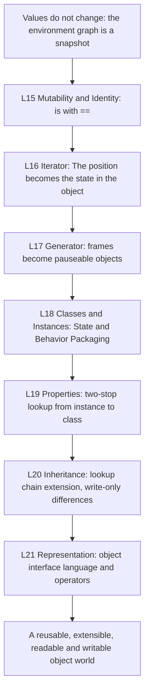

If you walk along the chain, you will find that the same action appears repeatedly: **Take what was originally hidden inside the interpreter and make it an object that can be referred to by name and passed around.**. Mutability changes the "content of the value" from a constant to an editable state; the iterator moves "what number is read" from the loop variable into the object; the generator moves the entire frame of "which line is executed and what the local variables are" into the object; the class moves the mapping of "name to value" from the frame to the object; inheritance connects this mapping table into a chain; it means that the internal matter of "how the object is turned into a string" is left to the object itself to answer.

### 0.3 Gaps and supplies for each lecture

| speak | The gap left by the previous lecture | Tools added in this lecture | new cost |
| :--- | :--- | :--- | :--- |
| 15 | Values are fixed once calculated and cannot express "things that change over time" | Mutable objects, aliases, identity criteria | Alias proliferation, variable default parameters, shared state difficult to track |
| 16 | The state can be stored in the object, but "where to read" is still managed by the caller. | Iterator: Pack positions into objects | It can only be consumed once and cannot be rolled back, indexed or traversed repeatedly. |
| 17 | Handwritten iterators flatten the algorithm into a state machine | Generator: frames that can be paused at any statement | One-time, no random access, every time  `next`  There is switching overhead |
| 18 | Data abstraction only bundles data, and behaviors are scattered in external functions. | Classes and instances, methods, `self`  implicit binding of | Attributes are completely open, and encapsulation is just a convention, not a requirement. |
| 19 | It’s not clear what happened behind the dot number, and it’s hard to distinguish between sharing and special cases. | Two-site search, binding method, writing does not search | The reading and writing directions are opposite, and an error will occur if they are mixed. |
| 20 | There is only a little difference between the two classes, so I have to copy and paste. | Inheritance: only write the differences and leave the rest to lookup | Fragile base classes, diamond structures, and parsing order |
| 21 | The object is printed as  `<__main__.Account object at 0x...>` | `repr`  with  `str`, special methods, operator overloading | The contract is kept by the person who writes the class, and the language is not checked. |

The fourth column is the true value of this table. When textbooks talk about new tools, they usually only talk about capabilities, but engineering judgment comes from "what new failure modes will this tool bring": iterators allow each element to be processed only once naturally, at the cost of not getting anything in the second traversal; inheritance makes repeated code disappear, at the cost of subclasses' behavior depending on the base class; `repr`  The cost of making objects readable is that the person who wrote the class must ensure that the semantics of the string do not lie.

### 0.4 Three things that environmental diagrams cannot explain

The entire module can be summarized in one sentence: **Things that cannot be explained by the environmental diagram will be covered one by one in the following six lectures.**.

- **time**. The environment picture shows "which box the name points to", but there is no mark on the picture as to whether the contents of the box will change. Once mutation is allowed, "Which moment is this picture from?" becomes a question that must be answered first; "Do the two names point to the same box" also changes from "just draw them together" to requiring an executable criterion, which is  `is`.
- **Execution location**. In the world of pure functions, frames are created and destroyed as they are called, and no one needs to save "which line is executed." The iterator stores the position into the object, and the generator stores the entire frame into the object: for the first time the frame's lifetime extends beyond the scope of the call.
- **namespace**. The name search in the environment graph only follows one chain of the parent frame; after having the class, `obj.attr`  You need to check it once in the attribute table of the instance, and then check it again in the class and base class chain, and **Assignment without checking at all**. There is no ready-made notation for this bifurcation of "reading along the chain, writing only looking to the left" in the environment graph.

### 0.5 Chapter Map and Duplicate Page Processing

| chapter | Covered lectures | slideshow | Questions answered in this chapter |
| :--- | :--- | :--- | :--- |
| 1 | Lecture 15 | 11 | Why is an object that can change still "the same"? |
| 2 | Lecture 16 | 12 | How to change "where to read" into the state in the object |
| 3 | Lecture 17 | 11 | How to make a function stop halfway and continue running next time |
| 4 | Lecture 18, 19 | 22 | `obj.attr`  Where did you check? `self`  Who filled it out |
| 5 | Lecture 20 pages 1–16 | 16 | Why should subclasses only write differences, and what else should they rely on? |
| 6 | Lecture 20 pp. 17–24 | 8 | When should we inherit, when should we combine, and who should look first for ambiguous names? |
| 7 | Lecture 21 | 11 | How objects are printed, evaluated, and connected with plus signs |
| 8 | Full module | 0 | Five sets of criteria, one trap, and comparison of two pictures |

| Duplicate content | Appear in | Processing of this module |
| :--- | :--- | :--- |
| Tuple literals, hashability and "division of labor with lists" | Oral presentation of Lecture 15 and Lecture 16 pp. 5–6 | §1.4 Establish the criterion table, §2.1 only supplement "the ability shared by both" |
| Iterable and iterator definitions | Lecture 16 pages 8–9 and Lecture 17 page 3 | §2.2 talks about the protocol, §3.1 only talks about the new ones on the review page  `enumerate` |
| Attribute terminology, four steps of dot expression, attribute assignment | Lecture 19 pages 6, 12, 13, 15 and Lecture 20 pages 4, 5, 10, 11 | §4.6–§4.8 Establish rules, §5.1 Only do one review stack |
| Class and instance syntax | Lecture 18 page 6 and Lecture 21 pages 3–4 | §4.2 talks about the two steps of construction, §7.1 only uses the mail system to talk about "the type determines the next paragraph" |

## 1. Mutability: why an object is not equal to its content

*(Reference time: 00:00:01 – 00:37:55｜Lecture 15)*

The first twelve minutes of Lecture 15 are spent repaying the debt from the previous lecture: objects, properties, methods, strings and coding, almost all of which are review. The real watershed moment comes after 12:44, when the first words about the new concept are "objects can change their own values". This chapter retains a quick review of the previous paragraph, because it is part of all the reasoning that follows; but the focus is on the three things that emerge after the value changes: mutation, aliasing, and identity.

### 1.1 Object: behaves like the thing it represents

The course begins with dates from the standard library. `date`  It is a class, and you get an instance by calling it; when you subtract two dates, you get not an integer, but an interval.


```python
from datetime import date

today = date(2015, 2, 20)
freedom = date(2015, 5, 12)
freedom - today        # datetime.timedelta(days=81)
today.strftime('%A, %B %d')    # 'Friday, February 20'
```

`strftime`  It is a function bound to the date object, that is, a method. Here's an easy-to-skip fact: "This day is Friday" was never entered when the date was created, and no one told the program how to spell February. **Knowing this is part of the matter of "being a date"**. The object bundles data (year, month, day) and behavior (how to format, how to subtract) together to form an abstraction.


> **Editor's note**: There is no announcement clip in this video. After the title page, it goes directly to the object review. Therefore, this page only marks the course structure and does not include any announcements that have not happened.

### 1.2 Mutation: one object, two names

All the previous content is based on an implicit premise: a value will not change after it is calculated. This section dismantles this premise——**Objects can change their values during calculations**.


The suits of playing cards changed over and over again: the card was lost on the way to Europe, and the string was deleted; the Spanish added cups, swords, and sticks, the sword was called spada in Italian, and the French replaced money and cups with hearts and diamonds. This history is exactly a string of in-place modifications:

```python
original_suits = ['coin', 'string', 'myriad']
suits = original_suits

suits.pop()                # 万贯丢失
suits.remove('string')     # 索子丢失，只剩钱
suits.append('cup')        # 西班牙牌加入杯
suits.append('sword')      # 与剑
suits.append('club')       # 与棒
suits[2] = 'spade'         # 意大利语把剑叫 spada
suits[0] = 'heart'         # 法国人用红桃替换钱
suits[1] = 'diamond'       # 用方块替换杯
```

`pop`  Delete and return the last element, `remove`  Delete the value at any position, `append`  Add an element, `extend`  Add one bunch at a time. After telling the story, the lecturer looked back at the original name:

```python
original_suits              # ['heart', 'diamond', 'spade', 'club']
original_suits == suits     # True
```

`original_suits`  It was bound at the beginning, and the changes in the middle were always  `suits`, but its current content has also changed. The reason is simple: **They are two names for the same object from the beginning**, any change is reflected on both sides at the same time. The instructor called this the first time he saw "object changing state" in this course - the same thing changed its content during the calculation process, but the binding relationship of the name was not changed once. The analogy he gave is "person": bind the name to a certain baby character. When the baby grows up, the name still points to the same person, and changes occur in this object.

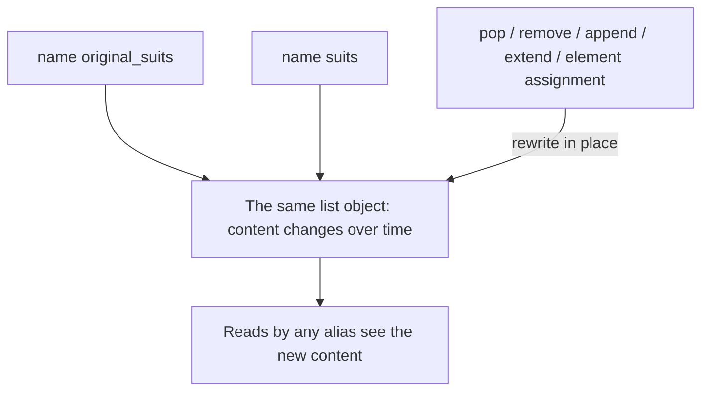

In computer science, **Any change to an object is called mutation**. Only objects of mutable type can be mutated. Lists and dictionaries are the two types we have already seen. Here we should immediately add a qualification: what mutation changes is **object**, no **name**.`suits.append('cup')`  There are no assignment statements in  `suits`, it just takes  `suits`  Use the value to call a method and let that method modify the object itself.

### 1.3 Make new ones or modify old ones?

There are four pages of videos after page 3 of the courseware that are not covered: they are in the opposite direction to this section. The previous one is to use mutation to rewrite an existing list. Here is **Keep creating new lists**, `append`  Only add the newly created ones in this call  `result`  on.


`sums(n, m)`  Requires return of all "sums" for  `n`, each number is from 1 to  `m`  A list of positive integers, and adjacent elements do not repeat. doctest writes the contract to death: `sums(5, 1)`  is  `[]`, `sums(5, 2)`  only  `[[2, 1, 2]]`, `sums(6, 3)`  There are 8 solutions.

```python
def sums(n, m):
    """Return lists that sum to n containing positive numbers up to m that
    have no adjacent repeats, for n > 0 and m > 0.
    """
    result = []
    for k in range(1, min(m + 1, n)):   # k is the first number of a list
        for rest in sums(n - k, m):
            if rest[0] != k:
                result.append([k] + rest)   # build a list out of k and rest
    if n <= m:
        result.append([n])
    return result
```

Fill in the blanks in three places  `min(m + 1, n)`, `sums(n - k, m)`  with  `[k] + rest`. first item  `k`  must not exceed  `m`  and less than  `n`, otherwise  `n - k`  No lower bound; used for splicing  `+`  instead of  `insert`, is to create a new list without touching it.  `rest`——"Construction" and "Mutation" must be separated here.


From "loading numbers in a list" to "loading branches in a list", the problem becomes an operation on the tree. `make_path(t, p)`  Request to return a tree with  `t`  Isomorphic, but contains paths  `p`  The tree has as few nodes as possible. The three sets of targets only grow new nodes after "the square where the path goes", and the rest remain unchanged. There are two recursive ideas for courseware: `make_path(b, p[1:])`  should be a branch in the return value; if there is no branch ending with  `p[1]`  At the beginning, you need to create a new label as  `p[1]`  leaves.


```python
def make_path(t, p):
    "Return a tree like t also containing path p."
    assert p[0] == label(t), 'Impossible'
    if len(p) == 1:
        return t
    new_branches = []
    found_p1 = False
    for b in branches(t):
        if label(b) == p[1]:
            new_branches.append(make_path(b, p[1:]))
            found_p1 = True
        else:
            new_branches.append(b)
    if not found_p1:
        new_branches.append(make_path(tree(p[1]), p[1:]))
    return tree(label(t), new_branches)
```

`assert`  put"`p`  Must start from the root tag "Written as an executable check; `len(p) == 1`  It is the recursive exit; the loop processes existing branches and matches  `p[1]`  recurse the branch, leaving the rest as they are; `found_p1`  Remember if there is a match, use it if not.  `tree(p[1])`  Create a leaf with only labels and complete it recursively. Use return value  `tree(label(t), new_branches)`  reassemble, therefore **The entire function has not been modified  `t`**.

| criterion | Modify in place (demo) | Construct new value (`sums`, `make_path`) |
| :--- | :--- | :--- |
| Who was moved? | an existing object | New objects are created on each layer, and old objects remain unchanged. |
| Will the alias be visible? | Yes, all aliases will change simultaneously | No, the alias still points to the old object |
| Can I go back? | No, the old content has disappeared | Yes, the old object is still there |
| space cost | one serving | One copy for each layer, at worst a multiple of the input |
| Semantics suitable for expression | "This has changed" | "Another version of this story" |

### 1.4 Maps of variability

| Type | Can it be modified on the spot? | Can it be used as a dictionary key? | Means of local modification |
| :--- | :--- | :--- | :--- |
| `list` | can | Can't | `append`, `extend`, `pop`, `remove`, element assignment, slice assignment |
| `dict` | can | Can't | key assignment, `pop`, `update` |
| `tuple` | Can't | Yes, but the tuple cannot contain a list | Only new ones can be created: `+`, slice, `tuple(...)` |
| `str` | Can't | can | Only new ones can be created: methods, `+`, slice |
| `int`, `float`, `bool` | Can't | can | You can only rebind the name |

Tuples have two pitfalls. First, it is the comma, not the parentheses, that determines whether an expression is a tuple: `3, 4, 5, 6`  It's a tuple. Second, the single-element tuple must leave a comma: `(2,)`  is "a tuple holding 2", `(2)`  Just the number 2 has parentheses added. Because they are immutable, tuples are hashable and can be used as dictionary keys; lists cannot. And this restriction goes one level further: as long as there is a list hidden in the tuple, the entire tuple is no longer hashable.

In turn, immutability is just a layer of protection, and it only protects the container layer. When a tuple contains a list, the tuple cannot be replaced, but the list inside can be changed:

```python
t = ([1, 2], 3)
t[0].append(4)
t        # ([1, 2, 4], 3)
```

So to judge "whether this thing will change", you can't just look at the outermost type. One observation that governs the entire chapter is: **The value of an expression can change from only two sources**- The name is re-bound, or the object is mutated. `x + x`  in  `x = 2`  time is 4. at  `x = 3`  Time is 6, this is a name change; `x`  was  `[1, 2]`, was changed to  `[1, 2, 3]`  Later, the same expression gives a different list, which is because the object has changed its content. The second way does not exist for immutable values, but the first way always exists.

### 1.5 Identity: Same content, different things

In the days when objects were never modified, a composite object was the sum of its parts: a rational number had nothing to say but a numerator and a denominator. Once change is allowed, this statement breaks down. In addition to "what parts it consists of", a composite data object also has a **identity**: Even if the content of the same list is replaced, it is still the "same" list; conversely, two lists with exactly the same content may also be two different things.


Left: `a = [10]`, then  `b = a`. Both names point to the same list, `a == b`  for  `True`;towards  `a`  After appending 20, both sides will be displayed.  `[10, 20]`. Right: `a = [10]`, then  `b = [10]`;The content is the same, `a == b`  At the beginning, too  `True`, but towards  `b`  After appending 20  `a`  Still  `[10]`, `a == b`  become  `False`. There is no reassignment statement in the whole process - they just once had the same content, never the same thing.


There is a special operator to judge "whether they are the same", written as  `is`, negative is  `is not`: `<exp0> is <exp1>`  Evaluating the two expressions yields **same object** time is  `True`; `<exp0> == <exp1>`  in getting **equal values** time is  `True`. This leads to an asymmetric rule: **Identical objects must be equal, but equal values may not necessarily be the same.**.

```python
a = [10]
b = [10]
a == b        # True
a is b        # False

c = b
c is b        # True
c.pop()
b             # []，c 删的就是 b 的元素
a             # [10]，与 b、c 无关
```

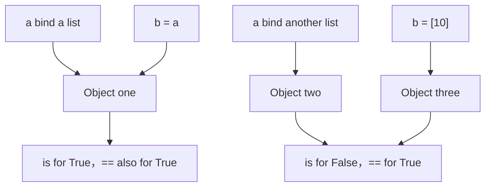

### 1.6 Three layers of aliases and variable default parameters

On the last page of the courseware, the rules are written in one sentence: **If multiple names refer (directly or indirectly) to the same mutable object, changes to the object will be reflected in the values of all those names.**, followed by a reading question.


```python
s = [2, 7, [1, 8]]
t = s[2]
t.append([2])
e = s + t
t[2].append(8)
print(e)
```

This question uses three layers of mechanisms at the same time. The first layer is **Click to select the element to generate an alias**: `t = s[2]`  let  `t`  with  `s`  The third element of becomes the same list, `t.append([2])`  Change it in place. The second layer is **Splicing is a shallow copy**: `e = s + t`  Create a new list, but the elements are still the same objects, `e`  The third element of is  `t`, while  `t`  The one at the end  `[2]`  at the same time  `e`  the last element of . The third layer is **In-place modifications to shared elements**: `t[2].append(8)`  put  `[2]`  Change to  `[2, 8]`, the two positions change together.

eventually  `e`  is  `[2, 7, [1, 8, [2, 8]], 1, 8, [2, 8]]`, print out 10 numbers: 2, 7, 1, 8, 2, 8, 1, 8, 2, 8. The lecturer did not run it on site, and all the above deductions used the rules of this lecture.

Once you learn mutation, you must also learn its risks. The first one is the variable default parameter:

```python
def f(s=[]):
    s.append(5)
    return len(s)

f()    # 1
f()    # 2
f()    # 3
```

It seems that each call should get an empty list and return 1, but it actually goes all the way up to 3. The reason is that the values of the default parameters are calculated when the function is defined, **It belongs to the function value itself, rather than being regenerated on each call**: The first call changes the empty list to  `[5]`, the second time it was tied to the same list, so it became  `[5, 5]`.

This rule can also be used positively. Imagine an account with an initial balance of 100 yuan. The withdrawal action is written as a function: the parameter is the money to be withdrawn, and the return value is the balance.

```python
def make_withdraw_list(balance):
    b = [balance]
    def withdraw(amount):
        if amount > b[0]:
            return 'Insufficient funds'
        b[0] = b[0] - amount
        return b[0]
    return withdraw
```

```python
withdraw = make_withdraw_list(100)
withdraw(25)    # 75
withdraw(25)    # 50
withdraw(60)    # 'Insufficient funds'
withdraw(15)    # 35
```

Same function, same argument 25, two calls giving 75 and 50. This is no longer a pure function: calling it will produce side effects, and this side effect changes its own behavior. The "account" here is  `withdraw`  This function itself represents a **state**.`make_withdraw_list`  Put the initial balance into a single-element list  `b`;This list is referenced in  `withdraw`  In the parent frame, because it is variable, the value in it can be changed every time it is called.

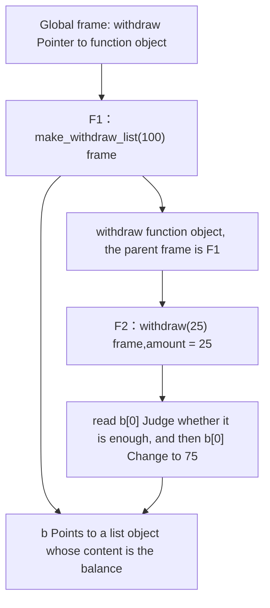

Pay attention to  `withdraw` **No** Rebind any names in the parent frame. Python's assignment statements always create bindings in the current frame; the language does have  `nonlocal`  with  `global`  It is possible to write to outer frames, but this code does nothing. It does another thing: by name  `b`  Find that list and change it **the contents of this list**.

This chapter can be summarized in one sentence: after the value changes, "the same thing" no longer equals "the same content", but just "itself"; and once the function can also have the state of surviving across calls, the timeline of the program can no longer be flattened by an environment map. This is the first failure of the environmental map, and it is also the starting point for all new notations in the next six lectures.

## 2. Iterator: Make "where to read" into an object

*(Reference time: 00:00:08 – 00:29:02｜Lecture 16)*

At the end of the previous chapter, the state was hidden in a list, so the function had a memory. But there is still one thing that has not been moved into the object: **Where does the cycle go?**.`for`  The progress is hidden in the execution location of the interpreter. Any attempt to pass "half-read" to others must rely on external variables to re-record it. Lesson 16 Make this an object too: an iterator with its own position.

### 2.1 Courseware Review Block: Three Sequences, One Common Question


The conclusion is stated in the first sentence of the opening: sequential data can be represented implicitly using iterators. Before it, the courseware reviewed the "sequence" in six pages.


Page 4 is the first question of the second session of the Spring 2023 midterm: Assign a two-line auxiliary function and four lines, and it is required to deduce the last value of the three names.

```python
def chain(s):
    return [s[0], s[1:]]

silver = [2, chain([3, 4, 5])]
gold = [silver[0], silver[1].pop()]
silver[0] = 1
platinum = chain(chain([6, 7, 8]))
```


`chain([3, 4, 5])`  Got  `[3, [4, 5]]`, so  `silver`  is  `[2, [3, [4, 5]]]`.`gold`  That row is evaluated from left to right: take first  `2`, right again  `silver[1]`  call  `pop()`  pop up  `[4, 5]`, so  `gold`  is  `[2, [4, 5]]`, while  `silver`  become  `[2, [3]]`;finally  `silver[0] = 1`.`platinum`  It is a nested call: the inner layer gets  `[6, [7, 8]]`, and then take the first term and slice from the outer layer, we get  `[6, [[7, 8]]]`.

```python
>>> silver
[1, [3]]
>>> gold
[2, [4, 5]]
>>> platinum
[6, [[7, 8]]]
```

The title of the question is a line of reminder: `s.pop()`  Remove and return the last element. `pop` **Modify in place** list, slice  `s[1:]`  only **Create a new list**; The two look similar, one changes the object and the other changes the pointing. The courseware draws it as an environment diagram, and the two label boxes point out "`silver[1]`  Find out which list "AND" is obtained `pop()`  Which list is returned".


There are only four differences between the two, and the rest are the same.

| criterion | `tuple` | `list` |
| :--- | :--- | :--- |
| Can I change the elements? | immutable | Variable, you can reassign the subscript |
| Volume and speed | Smaller and faster | Bigger and slower |
| Can it be used as a dictionary key? | OK | No |
| Number of methods | less | Many, for example  `pop()`, `append()` |
| Remove subscripts, slice, add like | Both can generate new tuples | Both can generate a new list |

Immutable tuples can be used as keys, but lists cannot. The reason lies in the way dictionaries work: dictionaries rely on "value fingerprints" to quickly locate an object that can be changed at any time. The fingerprint will change and the key will become invalid. This connection has been established in the previous chapter: **Mutability determines whether the value can be put into another structure as an identifier**.


Page 7 puts the three types of containers into three real things: the image is a sequence of pixels, each pixel is a triplet; the data that needs to be "retrieved later" is stored in a dictionary; the file is a sequence of text, and the most direct way to read a file is to read it as a line-by-line list.

```python
>>> open("textfile.txt").readlines()
['first line in text file', 'second line in file', 'etc']
```

The three forms point to the same problem: to read pixels, press the cursor, to read files, press the line number, and to read the dictionary, press the keys——**Every time you change a kind of data, you have to change the way of writing the traversal.**. Write a function that "processes each element once", if it is written hard  `s[i]`, then it can only eat lists and tuples; change to dictionary view or  `range`  It collapsed. This is what iterators are for.

### 2.2 Protocol: a location, not a copy


The definition given by the courseware is: **A container can provide an iterator that provides access to the elements of the container in some order**. There are two roles in this sentence: the container is where the data is, and the iterator is "the hand that reads the data." The container does not hand over the elements, it hands over a hand that can continuously take off one thing. The analogy given by the lecturer is position rather than copy: think of an iterator as a position in the sequence - it gives the element at this position and all the elements after this position.


`iter(iterable)`  Returns an iterator covering the iterable's values; `next(iterator)`  Returns the next element in the iterator. The parameter types are different: `iter`  What I received was **iterable value**, `next`  What is collected must be **iterator**.

```python
>>> s = [3, 4, 5]
>>> i = iter(s)
>>> next(i)
3
>>> next(i)
4
>>> u = iter(s)
>>> next(u)
3
>>> next(i)
5
```

`i`  Take it twice and stop at the position  `5`  on; `u`  yes **same list** Create a new iterator with its own position, starting from the beginning. When taking alternate values  `i`  given  `5`, `u`  given  `4`——Two iterators cover the same batch of values, and their positions are independent.

`next`  There is an agreement: **Crossing the boundary does not return null, but throws an exception.**. After taking the last element and asking again, we get  `StopIteration`; `for`  The interior ends by capturing it. There is another pitfall: `next`  It cannot be applied directly to the list, and it will report  `TypeError: 'list' object is not an iterator`, must first  `iter`  Once. After conversion:

```python
>>> t = iter([[1, 2], 3, 4, 5])
>>> next(t)
[1, 2]
>>> next(t)
3
>>> list(t)
[4, 5]
```

`list(t)`  Put it in the iterator **the rest** All elements are taken out, so we only get  `[4, 5]`. The lecturer said something here that was used again and again: **Iterators can only be consumed once**.

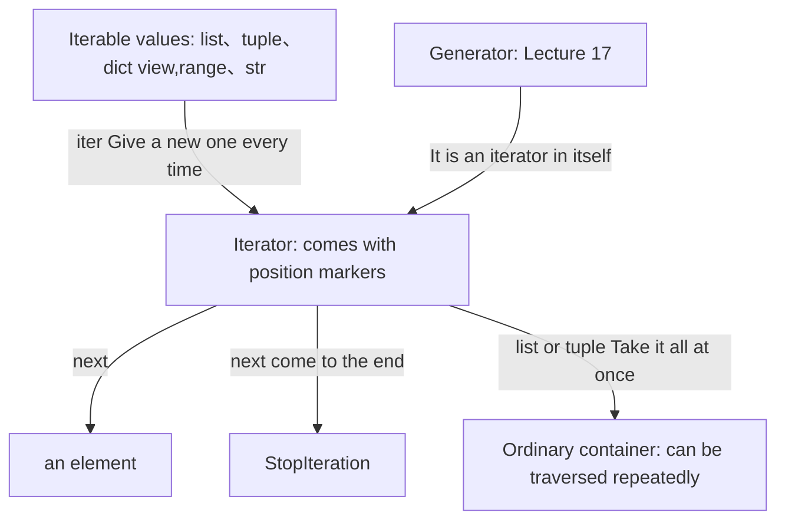

### 2.3 Locations will also be aliased

The iterator is **mutable object**: `next`  Not only does it return a value, it also changes the internal position mark. So when two names are bound to the same iterator, they share the same position.


```python
a = [1, 2, 3]
b = [a, 4]
c = iter(a)
d = c
print(next(c))
print(next(d))
print(b)
```

`b`  The first element of is  `a`  itself, `d = c`  Let the two names point to **the same iterator object**. So  `next(c)`  Print  `1`  and push the only position to  `2`  on; `next(d)`  Read the same position and print  `2`. list  `a`  Untouched from beginning to end - the traversal just moves the markers and the last line is printed  `[[1, 2, 3], 4]`.

The question contains two traps: mistaking "iterator variable" for "list variable" (`a`  actually unchanged), and the  `d = c`  Mistakenly regarded as "creating another iterator" (if you want to create another iterator, you must call it again.  `iter(a)`). The two traps combined indicate that the alias rule in the previous chapter has changed its target - what is shared is no longer the list content, but **a location**; And "changing the position" looks like a read (`next(c)`), is actually a mutation.

### 2.4 Inertia: `map`, `filter`  with short circuit

For batch processing of sequences, Python provides several built-in functions: they receive one (or several) iterable values and return an **iterator**. The courseware puts it this way: Many built-in sequence operations return iterators that compute results lazily—the results are only computed when requested.


The courseware screen is  `l = [2, 4, 6, 8]`  with  `doubler = map(double, l)`, `doubler`  The row of boxes above says 4, 8, 12, 16, and a little stick figure stands  `l`  In front, under the arrow marked  `next(doubler)`. That row of boxes is the "uncomputed result": the value exists, but it hasn't been calculated yet.

```python
def double(x):
    print(f"*** doubling {x} ***")
    return x*2

l = [2, 4, 6, 8]
doubler = map(double, l)
```

`doubler = map(double, l)`  this line **won't print anything**.`map`  Just write down the functions and lists; wait until  `next(doubler)`  When called, only take one element and adjust it once.  `double`, print a line, and return the result. The lecturer made this very clear: **The time when the function is applied, called from " `map` "It's postponed"`next`  time"**.

put  `map`  with  `filter`  Next, the benefits of inertia become visible workload:

```python
>>> m = map(double, range(3, 7))
>>> t = filter(lambda y: y >= 10, m)
>>> next(t)
*** doubling 3 ***
*** doubling 4 ***
*** doubling 5 ***
10
```

make  `filter`  The same line is not printed at all. first time  `next(t)`  Just started to pull: `3`  Get twice as much  `6`, not satisfied; `4`  Got  `8`, not satisfied; `5`  Got  `10`, satisfied, return. Three lines of printing are exactly "the amount of work you have to do to get the next element, not much at all". If you want all the results at the beginning, the way to write it is to give it to  `list`, at the cost of running the iterator dry (to exhaustion).


The last page of the courseware stacks up laziness and short circuiting:

```python
x = all(map(print, range(-3, 3)))
```

The answer is only one line  `-3`, `x`  is  `False`. The chain is: `map`  When created, not a single line is printed; `all`  To get the first element, `map`  Just call  `print(-3)`, the screen appears  `-3`, the output value is  `None`; `all`  see  `None`  If it is a false value, it will be returned immediately without asking for the next one. So the following  `-2`, `-1`, `0`, `1`, `2`  Never counted. **Lazy + short circuit is a pair of amplifiers**: If the caller takes one less step, the producer will count one less step; conversely, if the caller requires all results, laziness cannot save it.

| criterion | Immediate evaluation (list comprehension) | Lazy evaluation (`map`, `filter`, generator) |
| :--- | :--- | :--- |
| When does it count? | It's all finished the moment I write it down | every time  `next`  Count one |
| Where does the result exist? | In a new list, all landed | No landing, only "how to calculate" |
| It only takes the first few hours | What's left is for nothing | Only necessary |
| Repeatedly traverse | OK | No, it will be empty once you consume it. |

### 2.5 `for`  two faces of , and three views of a dictionary

`for`  You can iterate over iterable values, or you can iterate over the iterator itself, but the behavior is different in each case.

```python
>>> r = range(3, 6)
>>> ri = iter(r)
>>> next(ri)
3
>>> for x in ri:
...     print(x)
...
4
5
```

`ri`  Comes with its own location, `next(ri)`  Already put  `3`  used, so the loop only prints  `4`  and  `5`;At the end of the loop  `ri`  Exhausted, another cycle will print nothing. `range`  There is no position on its own, and all elements can be seen in two loops.

| criterion | iterable value  `range(3, 6)` | Iterator  `iter(range(3, 6))` |
| :--- | :--- | :--- |
| Is there a location? | No, just a range description | Yes, the mark only goes forward |
| first time  `for` | Get 3, 4, 5 in sequence | Go to the end from the current position |
| second time  `for` | Do it again 3, 4, 5 | get nothing |

`for`  It is a layer of syntactic sugar: first call it once on the object on the right  `iter`, and then repeatedly  `next`, captured  `StopIteration`  Just quit. After expansion, "Why is there nothing in the second loop" is no longer a memory question - the exit condition is exhausted.

```python
it = iter(s)
while True:
    try:
        x = next(it)
    except StopIteration:
        break
    print(x)
```

Dictionaries have three sets of contents: keys, values, and key-value pairs. Python gives three **view**——Start at three windows on the same dictionary, not three copies.

```python
>>> d = {1: 1, 2: 2, 3: 3}
>>> d[0] = 0
>>> k = iter(d.keys())
>>> next(k)
1
>>> next(k)
2
```

`d.keys()`  Not an iterator per se, but an iterable value; `d.items()`  Given one 2-tuple at a time; `iter(d)`  with  `iter(d.keys())`  The effect is the same, direct iteration of the dictionary still uses the keys. The order comes from insertion order (**Since Python 3.6** Dictionaries maintain insertion order). The view does not freeze the dictionary, and it will report when adding keys while iterating.  `RuntimeError: dictionary changed size during iteration`; But if you only change the value corresponding to a certain key, you can continue - the key collection is not moved, and the position mark is still valid.

### 2.6 Card deck: Use iterators to ensure "each card is dealt only once"

The most practical use of iterators is to turn a business rule into a type-level guarantee. The goal of blackjack is to get as close to 21 as possible without blowing; the number cards are based on face value, J, Q, K count as 10, and A can count as 1 or 11.

Where did the cards come from? Make a list of 52 cards, shuffle them, and **Returns an iterator over this list**.

```python
def make_deck():
    cards = new_deck()            # 52 张牌，构造细节略
    random.shuffle(cards)
    return iter(cards)
```

This step is the key design of the entire case. After the iterator is given by the deck, the caller can only  `next`  Take one, **It is impossible to get duplicate cards**——The list itself does not have the concept of "sent", but the iterator does.

```python
player_cards = [next(deck)]
up_card = next(deck)
player_cards.append(next(deck))
dealer_cards = [up_card, next(deck)]

while score(player_cards) <= 21 and strategy(up_card, player_cards):
    player_cards.append(next(deck))
```

The cards are dealt four times  `next`: One player, the banker's up card, another player, the banker's hole card. Each subsequent round for the player consists of  `strategy`  It is decided that the dealer's turn only requires policy: if the number of points is less than 17, cards are required.

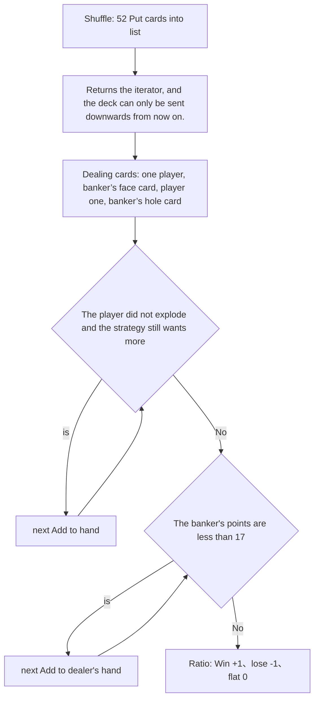

Returning to the iterator itself, the teaching value of this paragraph is twofold: `iter(cards)`  A constraint of "cannot be dealt repeatedly" was moved from the annotation to the type; and the restriction of "can only be consumed once" is a bug when used in the wrong situation, but it is a guarantee when used in the right situation.

| criterion | Use specific containers (lists) | Use iterator |
| :--- | :--- | :--- |
| Assumptions about data representation | To know if it is a list, tuple or dictionary | Only "can take down one" |
| Change means whether to change the code | want | No need |
| Who saved the location? | The caller passes the subscript himself | iterator itself |
| How many times each element is processed | possible duplicate | natural once |
| Operations that can be done | All, including in-place modifications | Just take down one |
| Can I go back, can I go through it again? | can | Can't |

The price is all in the right column: can't index, can't  `len`, can’t go back, can’t go through it again. Which one to choose depends on whether this code "just wants to go through the elements once" or "needs to read repeatedly, randomly, and change while reading." There are far more scenarios for the former than the latter; and handwritten iterators have to maintain their own positions, which is the debt to be repaid in Lecture 17.

## 3. Generator: Let the function stop halfway

*(Reference time: 00:00:24 – 00:17:10｜Lecture 17)*

There is a hidden pain in hand-written iterators: the position must be maintained by humans, and once nested loops or recursion appear in the algorithm, humans have to flatten the call stack into a bunch of fields. The generator in Lecture 17 takes over this entire burden——`yield`  Stop the function in place, the frame is saved together with the local variables, and the next time  `next`  Continue running where you left off. The main line of this chapter can therefore be written in one sentence: **Generators are new objects called "pausable frames"**.

### 3.1 Courseware review block: two pages of iterators and one page of tree exercises


The opening 23 seconds are about the deadline: Project 2 is due on Tuesday, and you can get extra points for early submission if you submit it on Monday; Homework 4 is very short, and the content is about the mutations and trees of the previous week.


The review page juxtaposes the two definitions: an iterable is "any sequence that can be traversed", and the criterion is that it can be called  `iter()`  And get back an iterator; an iterator is "something that allows traversing any iterable sequence", and the criterion is that it can be called  `next()`  and get back the next item. The two sentences are mirror images of each other: the iterable is responsible for "what is there", and the iterator is responsible for "where is it".

```python
t = (1,2,3)
i = iter(t)
next(i)

l = ["John", "Jedi", "Shm"]
e = enumerate(l)
next(e)

d = {"apples": 1, "pears": 2}
m = map(lambda x: "yummy " + x, d)
next(m)
```


`map`  The illustration for is the same as in the previous lecture: four boxes, one labeled  `doubler`  little man, arrow  `next(doubler)`. The difference is that what needs to be read this time is "the progress is stored in the object": the box is the calculated value to be retrieved, and the villain is the saved progress.


The question on page 5 asks to return a  `map`  object, add the first item of each triple  `a`, the second item plus  `b`, the third item plus  `c`:

```python
def add_to_each(p, edit):
    return map(lambda x: ( x[0] + edit[0], x[1] + edit[1], x[2] + edit[2] ), p)
```

`lambda`  of  `x`  is  `p`  A triplet in `edit`  Not written in the parameter list but taken directly from the outer layer - this is a closure: `lambda`  The parent frame is  `add_to_each`  frame, `edit`  Just lying there in that frame. Return  `map`  object instead of a list, so  `list(...)`  Must be set by the caller.


Page 7 is Question 4(a) of Spring 2023 Issue 2: Implementation  `exclude(t, x)`, retaining the root node, and all labels not equal to  `x`  non-root node; the parent node of a node in the result is its nearest, not excluded ancestor in the original tree.

```python
def exclude(t, x):
    filtered_branches = map(lambda y: exclude(y, x), branches(t))
    bs = []
    for b in filtered_branches:
        if label(b) == x:
            bs.extend(branches(b))
        else:
            bs.append(b)
    return tree(label(t), bs)
```

Fill in the blanks in three places  `exclude(y, x)`, `label(b) == x`  with  `bs.extend(branches(b))`. The last step is the key: when the candidate child himself wants to be eliminated, he cannot  `append`  it, but to  `extend`  Its children——`append`  Insert the entire list as one element, `extend`  Connect the elements one by one. The courseware keeps the score rate of that year: only 24% of the last part was written correctly.

The shape of this question is worth remembering: **`map`  produces an iterator, `for`  consume it immediately**. This is the norm in pure functional writing - the generator is responsible for "generating one by one", and the consumer is responsible for "collecting into a container". Use later  `yield`  When rewriting the same kind of recursion, `map`  with  `for`  will be  `yield`  Replace.

### 3.2 `yield`: hand over, not return


The lecturer's positioning is very simple: a generator is a special iterator, just like  `map`  Objects are also a special kind of iterator. What's special is that it consists of **generator function** produces; while the generator function looks the same as an ordinary function, the only structural difference is that  `yield`  instead of  `return`  Give value. The criteria are: **As long as there is in the function body  `yield`, which is the generator function.**


```python
>>> def plus_minus(x):
...     yield x
...     yield -x

>>> t = plus_minus(3)
>>> next(t)
3
>>> next(t)
-3
>>> t
<generator object plus_minus ...>
```

`t = plus_minus(3)`  What you get is  `<generator object plus_minus ...>`, a generator object, not a number. `next(t)`  first time get  `3`, the second time we get  `-3`——Two  `yield`  All have been executed. "Value" appears twice in a function body, which is impossible in ordinary functions. third time  `next(t)`  There is no third  `yield`  Can wait, the function body is executed, throw  `StopIteration`.

The lower part of the page breaks the definition into four sentences: the generator function is **use  `yield`  hand over the value instead of using  `return`  Return** function; ordinary functions only return once, generator functions can  `yield`  multiple times; the generator is **Automatically created when a generator function is called** an iterator; when the generator function is called, it returns a generator that iterates over each time of the function  `yield`.

| criterion | Ordinary function | generator function | generator object |
| :--- | :--- | :--- | :--- |
| What do you get when calling | return value | a generator object | Not applicable |
| When does the function body execute? | Completed immediately when called | No line is executed when called | every time  `next`  Advance a section |
| How many values can you hand over? | at most one | as many as you want | Take out one by one |
| end signal | `return`  Or carry it out to the end | Carry it out to the end | `StopIteration` |
| Is it an iterator? | No | No | Yes, it can be given directly to  `for` |

"No row is executed when called" is the most counter-intuitive box in this table.

### 3.3 Execution model: frame stops at  `yield`  on

`next`  What exactly was done? For lecturers  `evens`  To make it clear: given a starting point and an end point, return an iterator that only traverses even numbers. The first even number must be no less than  `start`.

```python
def evens(start, end):
    even = start + (start % 2)
    while even < end:
        yield even
        even += 2
```

`even = start + (start % 2)`  The calculation is "not less than  `start`  The smallest even number": `start`  When it is an even number, the remainder is 0, and adding 0 is itself; when it is an odd number, the remainder is 1, and adding 1 to the next even number. First in the loop body  `yield even`  hand it over and then  `even += 2`  Go forward.

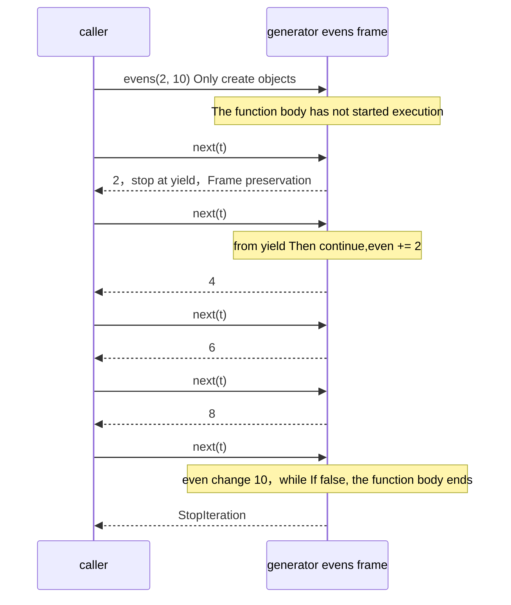

The left and right columns in the timing diagram will not be active at the same time: `next`  It was a "handover", and the generator ran to  `yield`  He handed the stick back and stopped where he was and waited for the next time. Ordinary functions are a round trip of "going in and out"; generators are a cycle of "calling once - running for a while - stopping - calling again". Execution is paused at  `yield`  on, but **The entire context of this execution is remembered**.

Why local variables survive  `yield`?`yield even`  After handing over the value, go to  `even += 2`  There is an interval between actual executions  `next`, but  `even`  The value is not lost. In the language of environment diagrams: call  `evens(2, 10)`  Created a generator frame with  `start`, `end`, `even`;This frame is not destroyed when the function body is paused, it is hung on the generator object; next time  `next`  Resume execution and still read and write in this frame  `even`.

This is essentially different from "loop + global variable". If you use global variables to remember  `even`, two  `evens`  The calls step on each other's progress; the generator frame is **One copy per generator object** of:

```python
a = evens(2, 10)
b = evens(2, 10)
next(a)      # 2
next(a)      # 4
next(b)      # 2，b 有自己的帧，不受 a 影响
```

This property is the technical prerequisite for the subsequent recursive generator to be established: each layer of recursive calls will create a new generator frame, and the local variables of each layer are naturally isolated.

### 3.4 `yield from`: Connect a stream

Generators often have to deal with other iterators during execution. This is the norm rather than the exception. Task: hand it over first  `a`  all elements of , and then hand over  `b`  all elements.

```python
def a_then_b(a, b):
    for x in a:
        yield x
    for x in b:
        yield x

def a_then_b(a, b):
    yield from a
    yield from b
```

The two ways of writing are completely equivalent. `yield from`  can be directly understood as  `for`  Short for loop; the only thing it adds is the omission of a name. The second example is the reciprocal:

```python
def countdown(k):
    if k > 0:
        yield k
        yield from countdown(k - 1)
```

`list(countdown(3))`  Got  `[3, 2, 1]`. The lecturer specifically demonstrated how to write incorrectly: put  `yield from countdown(k - 1)`  written as  `yield countdown(k - 1)`, the syntax is completely legal, but  `yield`  will convert the expression on the right **As is** Hand it over, and its value is a generator object. So  `list(countdown(3))`  get  `[3, <generator object countdown ...>]`. The way to fix it is to take out the elements of the subgenerator one by one and hand them over:

```python
def countdown(k):
    if k > 0:
        yield k
        for x in countdown(k - 1):
            yield x
```

this paragraph  `for`  add  `yield`  Exactly  `yield from`  expansion form. That is to say, `yield from`  What is assumed in the recursive structure is **flatten**: Connect the subgenerator's stream to the current generator's stream, instead of treating the subgenerator itself as an element. Remember this comparison: `yield`  It's "point", `yield from`  It's "line". give  `countdown`  add one  `else: yield 'Blast off!'`, you can also see that the generator can hand over a value at multiple exits, while the ordinary function can only return once at an exit.

### 3.5 Recursive generators and  `partitions`  four types of shells

Got it  `countdown`  The skeleton, recursive generator can be applied directly to the string. All prefixes: `s`  When non-empty, its prefix is equal to "remove all prefixes after the last character" plus  `s`  myself.

```python
def prefixes(s):
    if s:
        yield from prefixes(s[:-1])
        yield s
```

`list(prefixes('both'))`  Got  `['b', 'bo', 'bot', 'both']`——Short ones go out first, because  `yield from`  written in  `yield s`  Before; swap the two lines, and you get the long prefix first. All substrings are equal to "all prefixes" plus "`s[1:]`  All substrings of ":

```python
def substrings(s):
    if s:
        yield from prefixes(s)
        yield from substrings(s[1:])
```

`list(substrings('tops'))`  Got  `['t', 'to', 'top', 'tops', 'o', 'op', 'ops', 'p', 'ps', 's']`. This won't make the complexity better, but it will make the "just get the first few" calls end early.


Page 10 is a real question: a row  `n`  parking spaces, motorcycles occupy 1 space  `%`  Indicates that the car occupies 2 adjacent cells.  `<>`  Indicates that the empty space is represented by  `.`  Represents; requires implementation of generator function  `park(n)`, handing over all possible parking options.

```python
def park(n):
    if n == 0:
        yield ''
    if n >= 1:
        for rest in park(n - 1):
            yield '.' + rest
            yield '%' + rest
    if n >= 2:
        for rest in park(n - 2):
            yield '<>' + rest
```

The classification is based on "how to put it in the first position": empty, parked motorcycle, parked car; the first two consume 1 grid, the third consumes 2 grids, each one is used  `yield from`  Paste "Current Selection" in front of "All Solutions in Remaining Grids". next  `partitions`  Use the same skeleton for integer splitting.

`partitions`  This is the most important example in this lecture: list all the splits of an integer. The definition is: positive integer  `n`  Do not use more than  `m`  To separate the parts, that is to say  `n`  Written in a number not exceeding  `m`  The sum of positive integers, arranged in increasing order. Classic recursion has three branches: `n`  exactly equal to  `m`  It is a method of disassembly; `n < 0`  or  `m == 0`  There is no disassembly method; otherwise "including  `m`"and" does not include  `m`"Add the two categories.

```python
def partitions(n, m):
    if n == 0:
        return [[]]
    if n < 0 or m == 0:
        return []
    with_m = [p + [m] for p in partitions(n - m, m)]
    without_m = partitions(n, m - 1)
    return with_m + without_m
```

Changing to the string version, the logic remains unchanged, but the seed changes from  `[]`  become  `''`, the splicing is to be inserted  `' + '`, you also have to deal with the leading delimiter when the string is empty:

```python
    with_m = [p + ' + ' + str(m) if p else str(m)
              for p in partitions(n - m, m)]
```

```python
def partitions(n, m):
    if n > 0 and m > 0:
        if n == m:
            yield str(m)
        for p in partitions(n - m, m):
            yield p + ' + ' + str(m)
        yield from partitions(n, m - 1)
```

outermost layer  `if n > 0 and m > 0`  It is the guard of "there is still hope to go down", otherwise the function body will hand over nothing and it will end naturally - this is the "no way to dismantle" exit, no need to write anymore  `return []`.`n == m`  time  `m`  It is a split by itself, directly  `yield str(m)`, what is handed over is the string itself rather than "a list of strings". "including  `m`"That paragraph is used  `for`  add  `yield`,"excluding  `m`"Use one sentence for that paragraph  `yield from`  Pick up. Function does not  `return`, the lecturer's statement was "what do I return? Nothing at all. I'm finished."

| criterion | List version | string version | `yield`  version |
| :--- | :--- | :--- | :--- |
| What does each layer return? | list of lists | list of strings | No return, hand over the element directly |
| How to express empty result | `return []` | `return []` | Don't pay a line |
| "Post a  `m`"How to write | `p + [m]` | To check for null, to insert separator | `yield p + ' + ' + str(m)` |
| Is there any intermediate container? | A new list for each level | A new list for each level | Only generator frames |
| Can it be stopped early? | No, all must be built | Can't | Can, no longer  `next`  Just stop |

### 3.6 Infinite sequence and three costs


When the sequence itself is infinitely long, laziness is no longer an optimization, but the only possibility. The last page of the courseware  `while True`  with  `yield`  Put together:

```python
def fib_generator():
    a, b = 0, 1
    while True:
        yield a            # Yield the current Fibonacci number
        a, b = b, a + b    # Prepare the next Fibonacci numbers
```

Loop body first  `yield a`, then use  `a, b = b, a + b`  Move the window forward one space. `next(fib)`  Call four times in succession to get  `0`, `1`, `1`, `2`. This code has no termination condition because it shouldn't terminate in the first place -**No  `yield`  of  `while True`  It's an infinite loop, yes  `yield`  of  `while True`  is the definition of an infinite sequence**.

`partitions(60, 50)`  The example quantifies the benefits: there are about 966,000 splits in total, and it will take a while to list them all; but as long as  `next`  Ten times you get ten because the generator only counts up to the tenth  `yield`  Just stopped. The list version cannot do that——`return`  Nothing can be handed over beforehand, so the caller can only pay the full amount first.

There are three prices to remember. The first is **Disposable**: The generator is an iterator. There is only one progress and it will be empty after the traversal. If multiple rounds of traversal are needed, either the generator function must be called again or the generator function must be called first.  `list(...)`  Landed, and the latter erased the advantage of inertia. The second is **No random access**: No subscript, cannot be sliced, cannot  `len`. The third is **every time  `next`  There is switching overhead**:Restore generator frame, in  `yield`  Context switching on both sides is slower than running a loop directly.

Putting the benefits and costs together, the order of judgment becomes clear: **First ask "Do you only need part of the result?" Then ask "Is it infinite?" and finally ask "Is the writing method shorter?"**. The relationship between generators and handwritten iterators can be compressed into a table:

| criterion | Handwritten iterator class | generator function |
| :--- | :--- | :--- |
| Where does the progress exist? | instance attribute | Local variables in generator frames |
| Who remembers "where to execute" | The person who wrote it split the loop into a state machine | Python, save the code position in the frame together |
| How to express the end | handwriting  `raise StopIteration` | The function body is automatically thrown after completion |
| Nested loops and recursion | Each layer must be spread flat | Leave it as is |
| Can I pause at any statement? | Can't | can |

The last two lines explain why generators are not syntactic sugar for "shorter code", but the dividing line between "whether certain programs can be written or not".

## 4. Objects and attributes: from  `class`  statement to bound method

*(Reference time: 00:00:11 – 00:17:13｜Lecture 18; 00:00:00 – 00:17:45｜Lecture 19)*

Lecture 15 has proven that functions can have state, but that state is "borrowed" from a list, and the identity of the function is still a function. Lecture 18: Straighten this borrowing relationship: use a  `class`  The statement simultaneously declares "what properties each instance has" and "what these instances can do". Lecture 19 then breaks down the dots and answers a question that has been hanging since Lecture 15——`obj.attr`  Where did you go to find it, what did you find, and what happened while you were writing it. Two lectures are combined into one chapter because  `class`  The statement produces exactly two dictionaries: one is hung on the instance, and the other is hung on the class; all subsequent discussions about inheritance add a chain between these two dictionaries.

### 4.1 From data abstraction to objects

Object-oriented didn't just appear out of thin air. It's based on two ideas that have been used over and over again: data abstraction and mutation.


Complex large programs must be organized into small modular components. Each component can be written separately, tested separately, and thought through in the mind at once. The reason is that human mental capacity is limited. Data abstraction does exactly this: bundle multiple pieces of information that describe the same thing into a whole, and only expose the way to construct it and the way to retrieve it. Object-oriented takes this one step further: it not only bundles information, but also bundles information related to it. **behavior** Also bundled into the same whole.

| criterion | data abstraction | object-oriented |
| :--- | :--- | :--- |
| What is tied up is | Only information: year, month, day of date | Information plus behavior: the date also needs to be able to answer "what day of the week am I?" |
| Who will do the calculations? | The external function takes out the components and then calculates | The object uses its own method to calculate |
| where is the status | Often dispersed in global names or containers | Each object has its own local state |
| reused units | Conventions between functions and "constructors/selectors" | Classes and instances created from them |
| Scope of changes | Whoever shares that container will be modified together. | Only the named object is changed |

This leads to three settings that run through the entire lecture: **Each object has its own local state**, this state can change over time; **Mutations do not occur on a global list that records information about the entire program**, the changed part of the information belongs to a specific object; **Each object should know how to manage its own local state**. The lecturer specifically emphasized the second item because it determines whether "changing one place will affect other places."

### 4.2 one  `class`  three paragraphs of sentence


The example is a bank account. To bundle together account-related information (balance  `balance`  with the account holder  `holder`), and also bundle behaviors together (saving money  `deposit`, Withdraw money  `withdraw`). The division of labor is clear: **All bank accounts must have a balance and holder**, so the matter of "installing these two attributes on each newly created account instance" must be done by  `Account`  Class is responsible.


```python
>>> a = Account('John')
>>> a.holder
'John'
>>> a.balance
0
>>> a.deposit(15)
15
>>> a.withdraw(10)
5
>>> a.balance
5
>>> a.withdraw(10)
'Insufficient funds'
```

On this page of the courseware, two sentences of "Idea" are placed on the conversation: any account can be accessed using the dot  `holder`  with  `balance`, these two names are **Properties**;All bank accounts share one  `withdraw`  with a  `deposit`, this is called **method**. Local means: this balance is exclusive to the object  `a`, you can’t point to it without writing a dot.


```python
class Account:
    def __init__(self, account_holder):
        self.balance = 0
        self.holder = account_holder
    def deposit(self, amount):
        self.balance = self.balance + amount
        return self.balance
    def withdraw(self, amount):
        if amount > self.balance:
            return 'Insufficient funds'
        self.balance = self.balance - amount
        return self.balance
```

The first paragraph is  `__init__`, two underscores before and after, it is automatically called every time a new instance is created; the new account is called  `self`, give it attributes: `balance`  Always 0, `holder`  Assigned to the value passed in. Note **Property names can be different from parameter names**:The parameter is called  `account_holder`, the attribute is called  `holder`. The second paragraph is the method: `deposit`  Take two parameters, the first one is  `self`, that is  `a.deposit(10)`  The one to the left of the dot  `a`; Only one actual parameter is given when calling, but two are written when defining. The missing one is filled in by dot syntax. `withdraw`  Slightly more complicated: Return if the balance is not enough  `'Insufficient funds'`  Exit directly and the balance will remain unchanged. Every mention of balance must be done with a dot because it is an attribute.

The third paragraph is what a call does:

| moment | Instance properties | what happened |
| :--- | :--- | :--- |
| After creation | blank paper | The instance has been created, but the balance and account holder are not yet known. |
| enter  `__init__` | blank paper | `self`  Point to this instance, `account_holder`  is  `'Alan'` |
| execute  `self.balance = 0` | `balance = 0` | Attach a balance attribute bound to 0 to the instance |
| execute  `self.holder = account_holder` | `balance = 0`, `holder = 'Alan'` | Then attach the holder attribute |
| Return | Both attributes are complete | This instance can be used as an account |

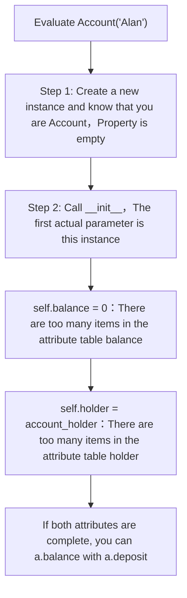

### 4.3 The property is an open ledger

```python
>>> a.balance
5
>>> a.balance = 12
>>> a.balance
12
```

No method is called, the dot assignment falls directly on the property itself; the method is just **A more convenient way to modify**, rather than the only way. Classes cannot force the outside world to change state only through methods, so "objects manage their own local state" is a design convention in this course.

More easily overlooked is the next rule: **A property can be assigned a value even if it does not originally exist**.

```python
>>> b = Account('Jack')
>>> b.balance = 20
>>> a.backup = b
>>> a.backup.balance
20
```

Two new facts: **The value of a property can be another object**, does not have to be a number; new properties can be added at any time without prior declaration in the class. So the same account has two ways of referring to it: `b`, or  `a.backup`——Two arrows pointing to the same object.

| criterion | Properties | method |
| :--- | :--- | :--- |
| What do you get after the dot? | a value: a number, a string, or even another object | A method with a receiver bound to it |
| Do you want to call again? | No need, just get the value | Add parentheses and give actual parameters |
| Where does it exist | One copy for each instance | Defined in a class and shared by all instances |
| Can it be added midway? | Yes, add new instances to any instance at any time | No, the method is fixed with the class definition |

### 4.4 Identity and  `self`

The properties of objects will change and objects will mutate, so we must be able to distinguish between the two situations: **Two objects happen to have the same properties**, or **They are originally the same object**. The rules are simple: every instance of a user-defined class has a unique identity; every call  `Account`  Both create a new instance.

```python
>>> a is a
True
>>> a is not b
True
>>> c = a
>>> c is a
True
```

`a is not b`  is true: Even if they have the same balance and the same account holder, they are still different accounts because  `Account`  was called twice. And  `c = a`  after  `c is a`  Still true - assignment binds an object to a new name and does not create a new object.

`class`  The last block in the statement is the method definition. Calling a method means calling a method defined in the class using dot notation, and **All called methods pass  `self`  The formal parameter accesses that object**.`deposit`  There are two formal parameters when defined, but the dot syntax will automatically provide the first actual parameter:

```python
t = Account('Tom')
t.deposit(20)        # 定义两个形参，调用只给一个
                     # 另一个实参是 t 本身，绑到 self
```

The dot syntax does exactly this: **It is not only responsible for "finding the method", but also "putting the receiver into the first parameter"**, that's what implicit binding is all about. The lecturer himself asked a rhetorical question: Why not simply define a  `deposit`  function? The answer lies in the type: **Different types of objects may have different storage methods**. this  `deposit`  exclusive to  `Account`; If there is an investment fund class, "depositing money" in it may behave differently, just write another one for that class  `deposit`.

> **Editor's note**: This passage points out the mechanism of "methods with the same name have different implementations in different classes", which is the starting point of dynamic dispatch and polymorphism. This lecture only lays out the mechanism, without giving terminology, and does not discuss inheritance.


> **Editor's note**: This is the signature page of the courseware (Animation Demos by Hany Farid). There is no corresponding description in the subtitles of this lecture; the place at the bottom of page 6 of the courseware  `(Demo)`  Refers to the interactive demonstration played during class. If you want to reproduce it, change §4.2  `class Account`  Paste the definition into the interpreter and enter the seven lines of conversation in sequence.

### 4.5 pieces  `class`  What does the statement leave behind?

Execute one  `class`  statement, the interpreter does three things: creates a new class; binds the class name to the first frame of the current environment (Global in an interactive session); and executes the class body. The execution method of the class body is no different from that of the ordinary suite, except that the place of the name has changed: usually  `=`  with  `def`  Names will be created in the frame, and they will all enter the class in the class body and become attributes of the class.


There is no announcement at the beginning of this video. The first sentence is "Class attributes are attributes of classes"; the announcement page on page 2 of the courseware is not included in the recording and is only reserved as a courseware structure.


```python
>>> class Clown:
...     nose = 'big and red'
...     def dance():
...         return 'No thanks'
>>> Clown.nose
'big and red'
>>> Clown.dance()
'No thanks'
>>> Clown
<class '__main__.Clown'>
```

`nose`  with  `dance`  None of them are in the Global frame: `nose`  will report that the name is undefined, while  `Clown.nose`  There is value. `Clown.dance()`  The reason why I can run is because  `dance`  It is a class attribute that "stores a function". If you use the class to get it, what you get is the function itself. print last line  `<class '__main__.Clown'>`: The class itself is also a value. It has a type, an address, can be bound, and can be passed.

> **Editor's note**: The lecturer declares that this code "has no use" and that its entire value is to let people see a  `class`  What is left after the statement is executed. In addition, `Clown().dance()`  Can throw  `TypeError: dance() takes 0 positional arguments but 1 was given`——The reason lies in §4.6 Step 4: Find with examples  `dance`  When a function in the class is hit, the binding method is returned and the instance is filled in  `self`, while  `dance`  Not a single formal parameter is declared.

The real use of class attributes is **Share**. If the interest rate is the same across all accounts, there is no need to deposit one in each instance.


```python
class Account:
    interest = 0.02   # A class attribute

    def __init__(self, account_holder):
        self.balance = 0
        self.holder = account_holder
```

`interest`  It is assigned a value in the class body, so it is a class attribute; `balance`  with  `holder`  in  `__init__`  pass  `self.`  Assignment, so they are instance properties. The first point emphasized by the lecturer is "it cannot be seen at the visit": Grammatically  `tom_account.interest`  with  `tom_account.balance`  They look exactly the same and follow the same evaluation rules. The only difference is which station was hit when the search stopped. The second point is "it's not in the instance": `interest`  is part of the class, it's just the lookup process that gets you to it. The third point is the cost: copying a shared value for each instance is a waste when there are many objects. Class attributes reduce the cost to one time.

### 4.6 Point expression: one search passes through two stations


The courseware writes the evaluation process into four rules, and the order is the priority:

1. First evaluate the left side of the dot number  `<expression>`, its value is the object of the point expression.
2. put  `<name>`  with this object **instance attribute** Compare; if an attribute with the same name exists, return its value.
3. If it does not exist, go to the object's **class** Look up this name and get the value of a class attribute.
4. This value is the value of the entire expression; unless it is a function - then return **binding method**, and the object of the dot expression has been filled in  `self`.

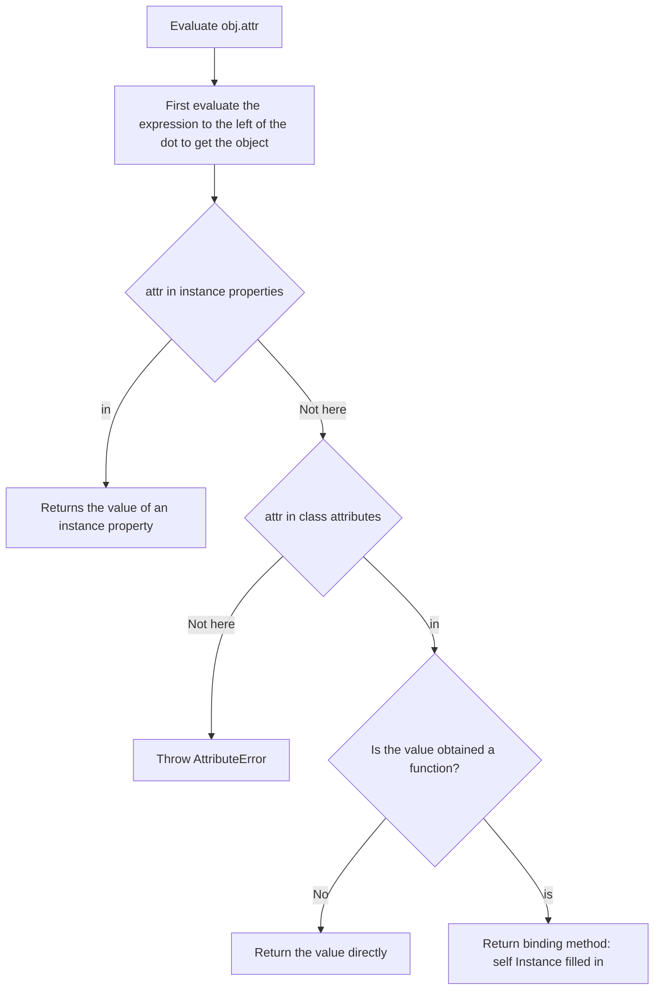

The lecturer classified this rule as a "mechanical process that needs to be memorized." The analogy is name search in the environment: to look up names, you have to go up layer by layer along the parent frame, and to look up attributes, you have to go up from instances to classes. An easily overlooked detail: the fourth step only works when "starting from an instance"; if the left side of the dot is the class itself, the second step has no instance attributes to compare with, and the third step directly hits the class, returning a function instead of a bound method.

Dot expressions are not the only entry point. `getattr(tom_account, 'balance')`  with  `tom_account.balance`  Doing the same thing; `hasattr`  Answer "Does this name exist?" The judgment scope includes the instance and its class. There is an easy mistake hidden here: since there is no difference in the return value, you cannot "guess" whether a certain attribute is shared or exclusive by reading the code.


Page 7 is a discussion question: for each of the two classes, write a word without quotation marks, without  `+`  The expression of , evaluated, we get  `'Waldo'`. They were done in groups in class and were not explained in this video. The answers were given directly in the courseware.

```python
class Town:
    def __init__(self, w, aldo):
        if aldo == 7:
            self.street = {self.f(w): 'Waldo'}

    def f(self, x):
        return x + 1
```

`Town(1, 7)`  put  `w = 1`, `aldo = 7`  hand over  `__init__`, the condition is established, then execute  `self.street = {self.f(w): 'Waldo'}`. dictionary keys  `self.f(w)`  It is just a dot expression plus a call: there is no such thing in the instance.  `f`, find the hit function in the class, return the binding method, and call it to get  `1 + 1 = 2`. So the instance gets the attributes  `street`, the value is  `{2: 'Waldo'}`, finally  `Town(1, 7).street[2]`  hit instance attribute  `street`  Press the key again to get the value. Another way  `Beach`  The problem is the same, except that it **List binding method** `sand.pop`  Save it as an instance attribute and use a closure  `self.wave`  put twice  `pop`  put together; `walk`  at the end  `return self`  Let the chain writing be established.

### 4.7 Attribute assignment: If you write it on the left, it will not be searched.

The first two sections are about "reading". The rules are completely different when writing, and much simpler: when the left side of an assignment statement is a dot expression, it is a **attribute assignment statement**, only affects the properties of the object pointed to by the dot expression.


```python
>>> tom_account.interest = 0.08
```

The left side of the dot is an instance, so this is a **Instance property assignment**. When evaluating, it will not be found in the class first.  `interest`, change the part in the category - that taken-for-granted interpretation is the source of misunderstanding. The instance originally did not  `interest`, after the endowment, you will have your own share; the share in the category will not move. In turn, `Account.interest = 0.04`  What is changed is the box in the category.

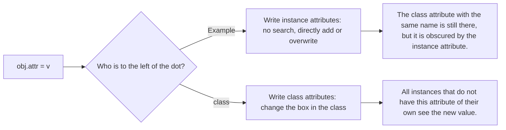


```python
>>> jim_account = Account('Jim')
>>> tom_account = Account('Tom')
>>> tom_account.interest
0.02
>>> Account.interest = 0.04
>>> tom_account.interest
0.04
>>> jim_account.interest = 0.08
>>> tom_account.interest
0.04
>>> Account.interest = 0.05
>>> tom_account.interest
0.05
>>> jim_account.interest
0.08
```

After completing the four steps, the rules will be clear: When the two instances were first created, neither instance had its own  `interest`, both searches went to the class and read 0.02; `Account.interest = 0.04`  Changed the class, both saw 0.04 - Example **No**"Lock" class attributes during creation; `jim_account.interest = 0.08`  It is instance assignment, and Jim has his own share from now on; `Account.interest = 0.05`  Change the category again, Tom reads 0.05, Jim still reads 0.08——**Assignment by class does not erase special cases**.

| criterion | read  `obj.attr` | write  `obj.attr = v` |
| :--- | :--- | :--- |
| Whether to go up the class | Yes, instance first and then class | No, only look to the left of the dot |
| Object of action | The hit (instance or class) | The object to the left of the dot |
| When attributes with the same name conflict | Instances take precedence, and the class part is covered. | Write the instance directly without touching the class |
| is it possible to fail | If you don’t have any at both stops, throw it away.  `AttributeError` | It always succeeds, and new attributes can be added to the instance at any time. |
| Impact on classes | Never change | only  `Cls.attr = v`  Just change the category |

If the same location is replaced by a mutable object, sharing will become a trap: if  `Account`  written in class body  `tags = []`, then  `a.tags.append('vip')`  after  `b.tags`  will also become  `['vip']`——`a.tags`  with  `b.tags`  What was found is **same list object**, `append`  It is modified in place and no attribute assignment occurs. To break this connection, you must really write it once  `a.tags = ['vip']`.

### 4.8 Method calling and binding methods


Calling methods on an object is the main way to interact with the object; there is only one difference between method calls and ordinary function calls - there is the point in the middle. The one to the left of the dot  `<expression>`  Can be any legal Python expression, to the right of the period  `<name>`  Must be a simple name.


What the courseware really wants to say is the next sentence: calling expressions  `tom_account.deposit(10)`  inside, **The operator position is a dot expression**. The whole thing is just a normal calling expression, except that the dot expression is evaluated first as the operator, which gives a way to "know that I am depositing money into Tom's account", and then 10 is passed in as an actual parameter. There is no special syntax for method calling. It is the result of an ordinary calling expression plus an attribute lookup rule.

```python
>>> a = Account('Alan')     # 两笔存款之后，a.balance 为 10
>>> f = a.deposit
>>> f(10)
20
>>> f(10)
30
>>> a.balance
30
```

`f`  This name does not appear in  `a`, but both calls are depositing money into Alan's account. The reason is  `a.deposit`  What is evaluated is not a tool that "requires an instance to be called", but a **Already bound** `a`  method.


The list of terms is five sentences: All objects have attributes, which are the pairing of name and value; class is the type of object; class itself is also an object, so class also has attributes; **instance attribute** Is a property of an instance; **class attribute** Is a property of the class to which the instance belongs, but is still accessible from the instance. The meaning of the diagram goes further than the list: the left circle is the class attribute, the right circle is the function, and the intersection says "method" - "method" is not a third independent thing, it meets two conditions at the same time, which also explains why the binding method does not need to save a separate copy in the class: it is the fourth step of the search process. **On-site generation** product.


```python
>>> type(Account.deposit)
<class 'function'>
>>> type(tom_account.deposit)
<class 'method'>
>>> Account.deposit(tom_account, 1001)
1011
>>> tom_account.deposit(1007)
2018
```

If you use the class to search for a method, you will get a function; if you use an instance to search for a method, you will get a bound method. Both can be called, but the actual parameters are written differently: `Account.deposit(tom_account, 1001)`  Put all actual parameters in parentheses; `tom_account.deposit(1007)`  Just write one, the other is already given to the left of the period. The two annotations on the courseware are exactly this sentence: the function is all arguments within parentheses, and the method is one object before the dot and other arguments within parentheses.

| criterion | function  `Account.deposit` | binding method  `tom_account.deposit` |
| :--- | :--- | :--- |
| `type`  The output of | `<class 'function'>` | `<class 'method'>` |
| How to get it | Check attributes using classes | Check attributes using examples |
| `self`  Has it been filled in? | Not filled in, it is a normal parameter | is bound to  `tom_account` |
| Several actual parameters need to be passed when calling | `self`  with  `amount`  two | Pass only  `amount` |
| Can it be handed over directly?  `map` | No, lack of examples | Can, `self`  Already inside |

The last line is the practical consequence of this distinction: put  `Account.deposit`  hand over  `map`, `map`  Only the elements in the sequence will be provided, the instance has nowhere to give; hand it over  `a.deposit`  is directly available, `map(a.deposit, range(10, 20))`  10, 11, 12... will be deposited into the same account in sequence. One is a "function" and the other is a "function plus an object". The latter is a complete behavior that can be transmitted independently.

Taken together, these two lectures actually answer the same question: **What does the class dictionary add to the environment graph?**. In the environment diagram, the name belongs to the frame, and the value is just the box; now there is an attribute table belonging to the object, an attribute table belonging to the class, and a rule of "reading along two stations, writing only to the left". The environment diagram can still draw this structure, but it can no longer confuse "name" with "attribute".

## 5. Inheritance: only write the differences and leave the rest to search

*(Reference time: 00:00:02 – 00:09:56｜Lecture 20)*

With classes, duplication begins to appear in a new form: the properties and methods of the two classes are almost the same, with only a few differences. The method given in Chapter 20 is inheritance, but the mechanism it gives is much simpler than the name——**Base class properties are not copied into subclasses**, inheritance is reflected in the process of "checking names". This chapter starts with the first sixteen pages of the courseware.

### 5.1 Review of stacking and two new examples


The terminology and four-step rule are reproduced as they are, with the sequence of the second and third steps being the key: **Instance properties shadow class properties with the same name**. This masking rule will appear repeatedly in this lecture: `CheckingAccount`  inside  `interest = 0.01`  covered  `Account`  0.02 in; on examples in WWPD questions  `z`  Covers the class  `z`; Fees set individually for an account obscure \$1 on the class.


The only new page in the review stack is  `Transaction`.`log`  It is a class attribute (a list). When each transaction is created, record yourself in it; the question requires filling in  `self.prior`  with  `balance`  The return formula of , and gives two sets of expected results: `ts[1].balance()`  is 17, `ts[2].balance()`  Yes 13.

```python
class Transaction:
    log = []

    def __init__(self, amount):
        self.amount = amount
        self.prior = list(self.log)
        self.log.append(self)

    def balance(self):
        return self.amount + sum([t.amount for t in self.prior])
```


Check one by one: `Transaction(20)`  When built  `log`  Still empty, the snapshot is an empty list, `balance()`  Got 20; `Transaction(-3)`  The snapshot contains 20 from the previous transaction, so -3 + 20 = 17; `Transaction(-4)`  There are 20 and -3 in the snapshot, so -4 + 17 = 13.

Two details are worth pausing to mention. First, `self.prior = list(self.log)`  What is copied is not the pointer but the content; if written as  `self.prior = self.log`, `prior`  with  `log`  It is the same list. Every subsequent transaction will be added to this list, and the history of the previous transactions will change accordingly - the first transaction  `balance()`  It will go from 20 to 17 to 13, and history will be rewritten by future events. Snapshots buy "points in time" at the cost of copying a list of length n every time they are created. A total of n transactions  $O(n^2)$  space. Second, `self.log.append(self)`  does not leave a  `log`: This is a method call rather than an assignment, check first  `self.log` (Not on the instance, but on the class), get the shared list, and then call it  `append`. If written as  `self.log = self.log + [self]`, then it becomes attribute assignment, and a new one will be created on the instance.  `log`, that part of the class has been obscured ever since.


On the next page, move the snapshot to the instance itself: First  `append`  Copy again  `self.lst`, so the snapshot contains itself, `balance`  directly to the entire  `self.lst`  Sum. The two writing methods have the same result, the only difference is "whether the snapshot contains itself".

| criterion | How to write page 7 | How to write page 8 |
| :--- | :--- | :--- |
| Which instance attribute exists in the snapshot | `self.prior` | `self.lst` |
| The order of copying and appending | Copy the class log first, then append yourself | Append yourself first, then copy the class log |
| Does the snapshot include yourself? | Not included | contains |
| How to write sum | `self.amount + sum(...)` | `sum([t.amount for t in self.lst])` |


Attribute assignment follows the same set of rules as in the previous lecture: the object is found as usual on the left side of the dot, but the **The name is not searched**, but directly add or modify attributes on that object. `tom_account.interest = 0.08`  Only affects this one instance; `Account.interest = 0.04`  What has been changed is the one in the category. Once an instance has its own copy, it cannot be accessed no matter how the class attributes are changed.


This page only has a title and a link, and the exercise code is encoded in the link:

```python
Foo = 1

class Foo:
    bar = 2

    def __init__(self, baz, qux):
        self.baz = baz
        Foo.bar = qux

    def a(self, x):
        self.bar = x

a = Foo(3, 4)
b = a.a
print(a.bar)
b(5)
print(a.bar)
Foo.bar = 6
print(a.bar)
```

The three outputs are  `4`, `5`, `5`: `Foo(3, 4)`  put  `Foo.bar`  changed to 4, so the first time  `a.bar`  Take 4 on the class; `b = a.a`  is the binding method, `b(5)`  execute  `self.bar = 5`, from then on  `a`  Have your own  `bar`; `Foo.bar = 6`  after  `a.bar`  Still 5, the instance attributes obscure the class attributes just changed.

### 5.2 Inherited syntax and "write-only differences"


Inheritance is a feature of Python's object system. The problem it solves is simple: **Classes rarely exist in isolation**. Sometimes a class is just similar to another class, and you want to express this relationship instead of writing two almost identical codes each.


The most common usage is "two similar classes with different degrees of specialization": the specialized class has all the properties of the general class, plus some special behavior. There is only one more pair of parentheses in the syntax:

```python
class <Name>(<Base Class>):
    <suite>
```

The base class is written in parentheses, and the class following the class name is the subclass that inherits it. Conceptually, subclasses share all properties with the base class; subclasses can **Cover** (override) some inherited properties to slightly change the behavior, leaving the unchanged parts unchanged. So "implementing a subclass using inheritance" means: **Just write its differences from the base class**. The shorter the class body of the subclass, the cleaner the differences are expressed - if a large section of the code of the base class is copied in the subclass, it is usually not that inheritance is used incorrectly, but that the base class should be dismantled.

### 5.3 Checking account: shared deposits, covering withdrawals

A checking account is a type of account, but it differs in three ways: it has a lower interest rate than a regular account (1% vs. 2%), deposits behave exactly the same, and there is a \$1 fee on withdrawals. So \$5 is withdrawn from the \$20 account, which actually leaves \$14.


```python
class CheckingAccount(Account):
    """A bank account that charges for withdrawals."""
    withdraw_fee = 1
    interest = 0.01
    def withdraw(self, amount):
        return Account.withdraw(self, amount + self.withdraw_fee)
```

`withdraw_fee = 1`  with  `interest = 0.01`  Is a class attribute shared by all checking accounts. write only  `withdraw_fee`  Not enough - it's just a number, it's not used anywhere; also write a  `withdraw`  Method, put "1 dollar more deduction" into logic. The name is the same as the base class, so the checking account instance finds this one.

appears repeatedly in the method body  `self`, the lecturer stopped to explain: `self`  Is "the object on which this method is called". write  `ch.withdraw(5)`  when, `self`  tied to  `ch`, `amount`  is 5, `self.withdraw_fee`  gets 1, so the amount passed to the base class is 6. `self.withdraw_fee`  I also walked through four steps: `ch`  It was not found in the instance attributes, so I looked for it in the class. written as  `self.withdraw_fee`  Instead of writing 1, it is so that you can have "accounts with different handling fees" in the future.

The real work is the withdrawal logic of the base class: `Account.withdraw(self, amount + self.withdraw_fee)`. taken from class  `withdraw`  What you get is **function** rather than the binding method, so you must put it yourself  `self`  Add it as the first parameter. If the same method is written as  `self.withdraw(...)`, will recur infinitely——`self`  It is a checking account instance, and this coverage version is still found.

```python
class Account:
    interest = 0.02

    def __init__(self, account_holder):
        self.balance = 0
        self.holder = account_holder

    def deposit(self, amount):
        self.balance = self.balance + amount
        return self.balance

    def withdraw(self, amount):
        if amount > self.balance:
            return 'Insufficient funds'
        self.balance = self.balance - amount
        return self.balance
```

Not in the class body  `deposit`, nor  `__init__`. This is not an omission: create  `CheckingAccount('Tom')`  Will look for it sometimes  `__init__`, not found in this class, found along the base class  `Account.__init__`, so  `balance`  Starting from 0, `holder`  It's Tom; the same thing happened when depositing money, what was found was  `Account.deposit`.**Inherited without writing**, which is exactly what inheritance saves.

### 5.4 Base class properties are not copied


There is only one bold conclusion on this page, but it is the crux of the entire lecture: **Base class properties are not copied into subclasses**.`CheckingAccount`  There is no such thing in the class body of  `deposit`, but  `ch.deposit`  It works, the reason is not "copy", but "search".

There are only two rules for looking up a name on a class: if the name is an attribute of the class, return its value; otherwise, if it has a base class, search it in the base class - and the base class is also a class, so the same rule goes up recursively.

```python
>>> ch = CheckingAccount('Tom')   # 调用 Account.__init__
>>> ch.interest                   # 在 CheckingAccount 里找到
0.01
>>> ch.deposit(20)                # 在 Account 里找到
20
>>> ch.withdraw(5)                # 在 CheckingAccount 里找到
14
```

This rule has three direct consequences: **Change the base class, and the subclasses will follow.**(`Account.deposit`  Once the logic is modified, everything is not covered  `deposit`  subclasses immediately use the new logic); **Overwrite without destroying the original version**(`CheckingAccount.withdraw`  Just put another attribute with the same name in the subclass, `Account.withdraw`  Still lying in the base class as is); **Report an error if it cannot be found** (The name was not hit all the way up the base class chain, so it was thrown  `AttributeError`).

### 5.5 Tracking and "Copy or Reuse"

`ch = CheckingAccount('Tom')`  The calling expression is evaluated first, `CheckingAccount`  It is a class object, call it to create a new instance, and then automatically call  `__init__`——Check using the two rules in §5.4, `CheckingAccount`  Not there, arrived  `Account`  found here. The next three expressions, three placement points: `ch.interest`  in  `CheckingAccount`  Get 0.01; `ch.deposit(20)`  Neither on instances nor subclasses, and finally on  `Account`  Find the function, wrap it into a binding method, and the balance after calling is 20; `ch.withdraw(5)`  in  `CheckingAccount`  Find the overlay version on the website and forward it to  `Account.withdraw(self, 6)`, the balance is 20 - 6 = 14.

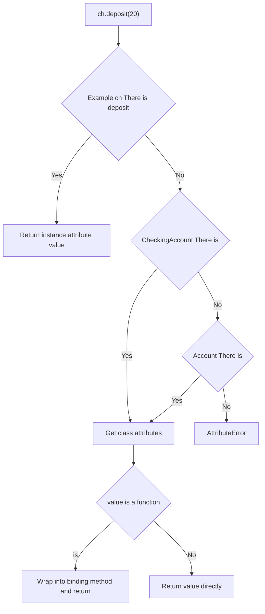

The lecturer asked a very practical question here: Since it is only "an extra \$1 deduction", how can the base class  `withdraw`  Wouldn't it be easier to copy in the subclass and change one line? The copied version "will be correct for a while." The problem lies in the timeline: if in the future the base class  `withdraw`  Changed, these changes will not flow to the copied subclass code. If two versions of the same business rule appear, they will diverge sooner or later.

```python
>>> a = Account('John')
>>> b = CheckingAccount('Jack')
>>> a.deposit(100)
100
>>> b.deposit(100)
100
>>> a.withdraw(10)
90
>>> b.withdraw(10)
89
```

The results of the two deposits are the same because they use the same  `Account.deposit`;The difference between the two withdrawal results is 1, because the checking account  `withdraw`  Too many deductions  `withdraw_fee`. One line of difference, one shared implementation, that's all inheritance buys in this example.

| criterion | Copy base class code | explicit call  `Account.withdraw` | call  `super().withdraw` |
| :--- | :--- | :--- | :--- |
| The base class was later changed, and the subclasses did not follow suit. | No, the two logics are bifurcated. | Follow, change one place to take effect | Follow, change one place to take effect |
| Whether to hard-code the base class name | Not involved | Write to death  `Account` | Don’t write it down, just follow the parsing order. |
| Who to choose during multiple inheritance? | Not involved in analysis | Fixed in the written class | Determined by parsing order |
| main cost | Logical bifurcation and regression difficulties | Changing the base class requires changing the code | Need to understand parsing order |

## 6. Design with inheritance: is-a, has-a and ambiguous names

*(Reference time: 00:10:00 – 00:31:33｜Lecture 20)*

The previous chapter proved that inheritance is "searching" rather than "copying", but correct mechanism does not mean correct usage: when should inheritance be performed, when should combination be performed, and when there are two paths for the same name under multiple inheritance, which one should be looked at first - these are not grammatical issues.

### 6.1 Three design rules


What the courseware gives is not grammar, but three judgments. **First, don’t repeat yourself, try to use existing implementations**——The judgment method is very specific: if the same statement block as the base class appears in the subclass, stop and think "should this paragraph be kept in the base class?"**Second, the overridden properties can still be accessed through the class object**——Overwriting is just "putting another attribute with the same name in the subclass". The same name does not mean replacement. `Account.withdraw`  still exist, write  `Account.withdraw`  You can get the original version. **Article 3: Try to check the attributes on the instance**, that is  `amount + self.withdraw_fee`  What should be written.


| criterion | Writing method | Can it be changed? | Is there any special case? |
| :--- | :--- | :--- | :--- |
| literal | `amount + 1` | No, you need to change the code | Can't |
| Write the class name to death | `amount + CheckingAccount.withdraw_fee` | Can change class attributes | No, subclass or single account exceptions have no effect. |
| Check the example | `amount + self.withdraw_fee` | Can change class attributes | Yes, both instance attributes and deeper subclasses take effect |

The third way of writing is the best because it leaves the "name search" to the runtime rules: `self`  First check if there is any in the instance  `withdraw_fee`, if not, search along the class chain. The second way of writing is to write the class name to death, which is equivalent to announcing "I will always be  `CheckingAccount`", once someone derives a "VIP account with free withdrawals" from it, this hard-coded place will not be able to select new values.

### 6.2 is-a and has-a


Object-oriented is useful largely because it allows you to think of objects as real things. There is only one criterion: whether there is "yes" or "there" between two categories.

| criterion | inheritance(is-a) | combination (has-a) |
| :--- | :--- | :--- |
| relationship | A subclass is a specialization of a base class | One object holds another object |
| Judgment sentence pattern | "A checking account is an account" | "A bank has a set of accounts" |
| Examples of this lecture | `CheckingAccount(Account)` | `Bank`  inside  `self.accounts` |
| What is reused | Implementation of properties and methods | The behavior of the held object |
| Impact of changes | Changing the base class will affect all subclasses | Changing the held object does not affect the owner |
| Typical misuse | Inheriting for the purpose of reusing code is not "a" semantically | Inheritance should be used to express specialization, but a layer of wrapping is used instead. |

### 6.3 Combination practice: a bank

The courseware does not give the bank a separate page, this section is a whiteboard demonstration.

```python
class Bank:
    """A bank that manages a collection of accounts."""

    def __init__(self):
        self.accounts = []

    def open_account(self, holder, amount, kind=Account):
        account = kind(holder)
        account.deposit(amount)
        self.accounts.append(account)
        return account

    def pay_interest(self):
        for account in self.accounts:
            account.deposit(account.balance * account.interest)

    def too_big_to_fail(self):
        return len(self.accounts) >= 2
```

Four key points: The structure only does one thing - remember which accounts you manage; `open_account`  of  `kind`  The parameters determine the type of new account. Pass  `Account`  It’s an ordinary account, please pass  `CheckingAccount`  It’s a checking account; `pay_interest`  Traverse all accounts and deposit one amount each  `balance * interest`; `too_big_to_fail`  It's the lecturer's joke, the criterion is just "at least two accounts".

```python
>>> bank = Bank()
>>> john = bank.open_account('John', 10)
>>> jack = bank.open_account('Jack', 5, CheckingAccount)
>>> bank.pay_interest()
>>> john.balance
10.2
>>> bank.too_big_to_fail()
True
```

The last question was a joke made by the lecturer: Do banks need "too big to fail" protection? The criterion is "at least two accounts", and it controls the money of John and Jack. The real teaching value of this paragraph is: **There is no inherited account in the bank, the program still works**.`pay_interest`  only rely on  `balance`, `interest`, `deposit`  Three names, no matter what kind of account you hold. Composition gives "diversity" to the interface of the object, rather than the lineage of the class.

### 6.4 WWPD: Three names competing for one attribute


```python
class A:
    x, y, z = 0, 1, 2

    def f(self):
        return [self.x, self.y, self.z]

class B(A):
    x = 6
    def __init__(self):
        self.z = 'A'
```

`A().f()`  Got  `[0, 1, 2]`: None of the three names exist on the instance, all come from  `A`  class. `B().f()`  Got  `[6, 1, 'A']`, three names and three origins——`self.x`  In the instance, there is no `B`  There is 6 on the class, so we stop at  `B`; `self.y`  In the instance with  `B`  None of the above, continue to  `A`  Take 1; `self.z`  There is one on the instance, it hits the target in the first step, and there is no chance to see the class at all.

The four box pictures on the right side of the screen are all the clues to this question: `A`  There are in the category  `x: 0`, `y: 1`, `z: 2`; `B`  There are only  `x: 6`; `A`  The instance is empty; `B`  In the example there are only  `z: 'A'`. The method for doing this type of problem is therefore fixed: first draw the boxes of each class and each instance, and then count the box for each name from left to right in which it falls.

### 6.5 Multiple inheritance: using two base classes at the same time


Multiple inheritance means that a subclass has multiple base classes. Start by adding a savings account: the only difference from a regular account is that there is a \$2 fee for depositing, so if you deposit \$10, you will only have \$8 more in the account.

```python
class SavingsAccount(Account):
    deposit_fee = 2
    def deposit(self, amount):
        return Account.deposit(self, amount - self.deposit_fee)
```


Then there is the bank executive’s idea compiled by the lecturer: the interest rate is only 1%, charging \$1 for withdrawals, \$2 for deposits, and getting \$1 for free when you open an account. This product is called "As Seen on TV account". Its definition is surprisingly short:

```python
class AsSeenOnTVAccount(CheckingAccount, SavingsAccount):
    def __init__(self, account_holder):
        self.holder = account_holder
        self.balance = 1                 # A free dollar!
```


```python
>>> such_a_deal = AsSeenOnTVAccount('John')
>>> such_a_deal.balance
1
>>> such_a_deal.deposit(20)     # SavingsAccount method
19
>>> such_a_deal.withdraw(5)     # CheckingAccount method
13
```

When created  `__init__`  is its own and the balance is directly 1. What I found when I deposited \$20 was  `SavingsAccount.deposit`, deducting the 2 USD handling fee, only 18 is added to the account, plus the original 1, the balance is 19. What you find when you withdraw \$5 is  `CheckingAccount.withdraw`, an extra US\$1 handling fee will be deducted, and the balance will be 13. The lecturer's comment here was "such a deal indeed" - the bank paid a complete loss. This sentence is also useful for understanding multiple inheritance: the behavior of the two base classes is inherited at the same time, the two sets of "most economical" and "most expensive" rules are superimposed on the same object, the program faithfully executes what is written, and the language does not care whether it is commercially reasonable.

Deposits come from savings accounts, withdrawals come from checking accounts, and the account opening balance comes from your own  `__init__`——Three sources are mixed into one category, which is exactly the problem to be dealt with in the next section.

### 6.6 Rhombus and parsing order


`Account`, `CheckingAccount`, `SavingsAccount`, `AsSeenOnTVAccount`  The four sides form a rhombus, and there may be two or even three ways to go to the same name. There is only one rule given by the instructor: **Look at subclasses first, then base classes**;When there are multiple base classes, the writing order is from left to right.

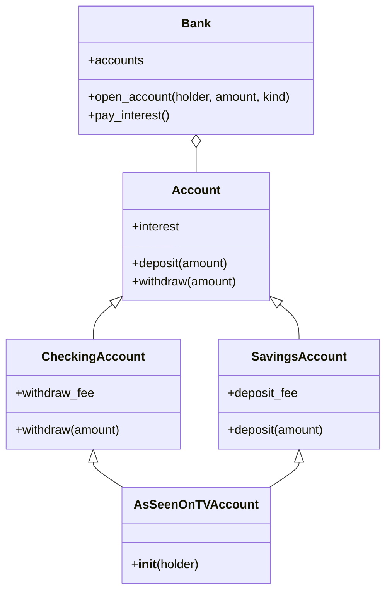

| name | parsed location | Basis | result |
| :--- | :--- | :--- | :--- |
| `withdraw` | `CheckingAccount` | It ranks first in the list of base classes | Take 5 and buckle 6, 19 → 13 |
| `deposit` | `SavingsAccount` | This category is related to  `CheckingAccount`  None, find it first | Deposit 20 and enter only 18, 1 → 19 |
| `interest` | `CheckingAccount` | It defines 0.01, `SavingsAccount`  No | 1% |
| `holder`, `balance` | instance itself | by one's own  `__init__`  Assignment | `'John'`, 1 |
| `__init__` | `AsSeenOnTVAccount` | This class is defined, no longer look up | Write holder and balance |

`deposit`  That line is the least obvious and the easiest to misunderstand: `CheckingAccount`  Not myself  `deposit`, but its base class  `Account`  Yes. If the search is "one road to black" depth first, it will hit first  `Account.deposit`, the deposit should be worth 20 instead of 19. The screen gives 19, indicating that the actual rule is not "drill in when you encounter a base class".

> **Editor's note**: The lecturer only gave one rule: "subclass first, then base class". The actual rule of Python 3 is called  **C3 linearization** (C3 linearization), it calculates the resolution order (MRO, method resolution order) of each class into a list, and searches along this list from beginning to end. Calculate  `AsSeenOnTVAccount`  When the three inputs are combined: `CheckingAccount`  The MRO is  `[CheckingAccount, Account, object]`, `SavingsAccount`  yes  `[SavingsAccount, Account, object]`, plus the writing order of direct base classes  `[CheckingAccount, SavingsAccount]`. The merging rule is "Look at the head of the first list every time, and take it as long as it does not appear in the tail of other lists": `CheckingAccount`  Qualified first; the header of the first list becomes  `Account`, and it appears in the tail of the second list, skip it and look at the head of the second list instead.  `SavingsAccount`, take away if qualified; take again  `Account`, and finally  `object`. The whole chain is then  `AsSeenOnTVAccount → CheckingAccount → SavingsAccount → Account → object`. Follow this table, `deposit`  fall on  `SavingsAccount`, `withdraw`  fall on  `CheckingAccount`, consistent with 19 and 13 on the screen. The old-style classes in early Python used "depth first, left to right", which would make  `Account`  ranked  `SavingsAccount`  front, so that the methods defined by the subclass are lost to the ancestors. If you want to verify the actual order, you can print  `AsSeenOnTVAccount.__mro__`.

## 7. Representation: Let the subject answer by himself

*(Reference time: 00:00:41 – 00:30:28｜Lecture 21)*

As of Lecture 20, objects can store state, be calculated, and be reused, but when you type an account instance in an interactive session, what appears on the screen is  `<__main__.Account object at 0x7f...>`. This string can neither be read nor used to reconstruct the object. Lecture 21 adds the last piece: Let the subject answer "What should I be displayed as?" and connect this answer to  `print`, `eval`  AND operator. The main thread of this chapter is the interface—a shared set of names plus each class's commitment to their semantics.

### 7.1 Review: Expressions, Values, and Types


The courseware first uses the second question of Lab 6 to draw attention back to "calling each other between classes": a  `Client`  put  `Email`  sent to it  `Server`, `Server`  then deliver to another  `Client` 's inbox.

```python
class Email:
    def __init__(self, msg, sender, recipient_name):
        self.msg = msg
        self.sender = sender
        self.recipient_name = recipient_name

class Server:
    def __init__(self):
        self.clients = {}

    def send(self, email):
        # Append the email to the inbox of the client it is addressed to.
        self.clients[email.recipient_name].inbox.append(email)

class Client:
    def __init__(self, server, name):
        self.inbox = []
        self.server = server
        self.name = name
```

courseware handle  `send`  The long attribute chain there is broken down piece by piece, and four boxes are arranged above the expression: `Server`, `dict`, `Client`, `list`. The boxes mark the type after each subexpression is evaluated: first we get the server, then we get the dictionary, then we get the client using the recipient's name, and finally we get its inbox. The reason why a string of dots is understandable is that each paragraph outputs an object of a certain type, and the next paragraph continues to search on this object.

| subexpression | Evaluation result | Type |
| :--- | :--- | :--- |
| `self` | Executing  `send`  that server | `Server` |
| `self.clients` | Name to client mapping | `dict` |
| `self.clients[email.recipient_name]` | The client corresponding to the recipient | `Client` |
| `self.clients[...].inbox` | This client's inbox | `list` |

This table explains one thing that has been emphasized repeatedly before: **The type determines what operations you can do on the value**.

The review ends here, and this lecture starts with this metaphor: There is a saying in object-oriented programming——**An object should behave like the type of data it represents**. Mathematicians use fraction lines when writing fractions, and accountants use two decimal places when writing amounts. They never directly show "two integers in the numerator and denominator" to others. The same goes for objects: how they are stored internally is one thing, but how they are presented to the outside is another.

### 7.2 Two string representations


In Python, this distinction is not a convention, but built into the language: **All objects produce two string representations**. one called  `str`  string, the design goal is **human readable**; the other is called  `repr`  string, the design goal is **Readable by the Python interpreter**- In other words, it should be an expression. Many times the two are exactly the same, because Python is a "human-readable" language from the beginning.


```text
>>> from fractions import Fraction
>>> half = Fraction(1, 2)
>>> str(half)
'1/2'
>>> repr(half)
'Fraction(1, 2)'
```

`repr`  is a built-in function, its convention is: return a string in the form of a Python expression, **Evaluate this string and get an object equal to the original object.**.`help(repr)`  To put it more bluntly: it returns the canonical string representation of the object, and for most object types, `eval(repr(obj))`  will give an object equivalent to the original object. `str`  then accepts any object and returns a human-readable representation of the object; **`print`  What is printed is exactly  `str`  the result**.

| criterion | `str` | `repr` |
| :--- | :--- | :--- |
| design goals | human readable | Python interpreter readable |
| Should it be a legal expression? | Not required | should (as much as possible) |
| `eval`  get after | No guarantee | an object equivalent to the original object |
| Interactive session echo | No | is |
| `print`  which one to use | is | No |
| f-string  `{x}`  which one to use | is | No, you need to write it explicitly  `repr(x)` |
| `Fraction(1, 2)`  value | `'1/2'` | `'Fraction(1, 2)'` |

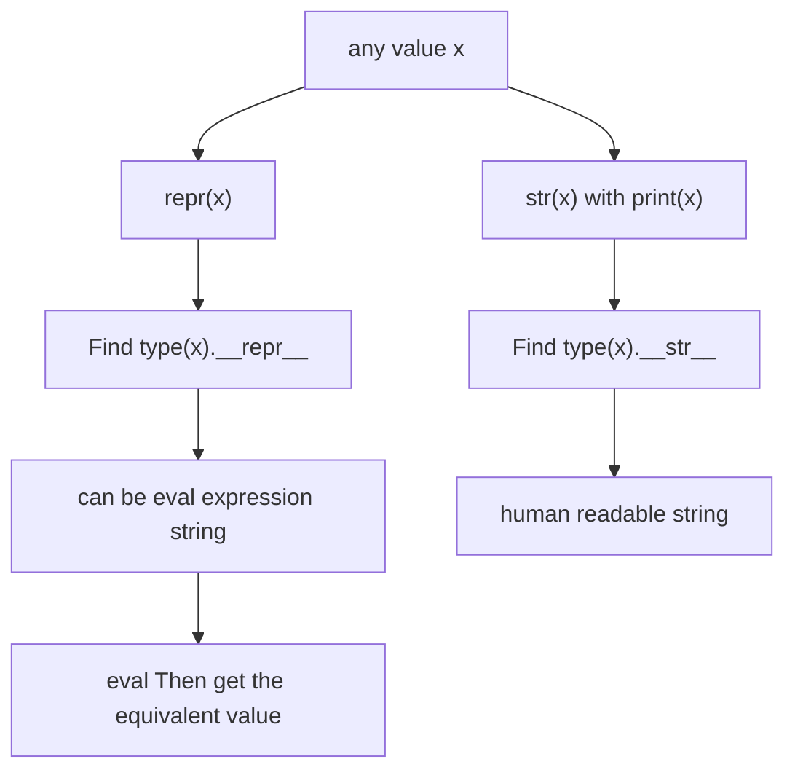

### 7.3 Evaluability, and what it looks like when it fails

`repr`  The commitment is not a hard guarantee. There is no simple Python way of writing composite objects such as functions and classes. The built-in  `min`  This is typical:

```text
>>> repr(min)
'<built-in function min>'
```

The angle brackets are the signal from this convention—**This is not a Python expression at all**, just a human-readable description. When reading the code, you can think of the angle brackets as a "repr admits failure" mark.

The string itself is the cleanest test object, because it is already a string, so "showing it" is forced to deal with an extra layer of quotes:

```text
>>> s = 'Hello, world'
>>> s
'Hello, world'
>>> print(s)
Hello, world
>>> repr(s)
'"Hello, world"'
```

Evaluate directly in the session  `s`, the screen is  `'Hello, world'`--in quotes because an interactive session displays  `repr`.`print(s)`  Make the quotes disappear. `str(s)`  The result is  `s`  itself; `repr(s)`  What is given is "quotation marks within quotation marks": the outer pair of quotation marks belong to the display, and the inner pair of quotation marks are part of the content, because  `repr`  What is to be given is a **Can be evaluated back to the original string** expression.

```text
>>> eval(repr(s)) == s
True
>>> eval(s)
SyntaxError: invalid syntax
```

`Hello, world`  is not a legal Python expression, so  `eval(s)`  Report an error, `eval(str(s))`  The same error is reported because  `str(s)`  That’s it  `s`;After adding quotes everything works fine. This set of experiments illustrates: `repr`  It's not "adding quotes to make the string look better"; it's **Add the layer of syntax necessary to turn this text into a value again**. The scores also give another comparison:

```text
>>> eval(repr(half))
Fraction(1, 2)
>>> eval(str(half))
0.5
```

`eval(repr(half))`  What you get is **equivalent new object**; `eval(str(half))`  The evaluation is successful, but the result is a floating point number——`1/2`  It can be evaluated simply because it happens to conform to Python's division syntax. **`repr`  The string is for the machine to walk back to the door, `str`  The string is a street sign for people to read.**

### 7.4 Two pages of illustrations without explanation


Page 7 is a set of squares: decrease the side lengths by 21, 13, 8, and 5 to form a golden rectangle, and then use four quarter-circle arcs to connect the spiral. Page 8 superimposes the same spiral over a photo of a bear, its outline framed in the same square.

### 7.5 f-string: Packing expressions into string literals

**f-string**  Allowing expressions to be embedded in string literals is Python's current recommended way of writing string interpolation. This can also be done using splicing:

```text
>>> from math import pi
>>> 'pi starts with ' + str(pi) + '...'
'pi starts with 3.141592653589793...'
>>> f'pi starts with {pi}...'
'pi starts with 3.141592653589793...'
```

before quotation marks  `f`  Can't save. After omitting it, it becomes an ordinary string, and the curly braces are retained as they are:

```text
>>> '2 + 2 = {2 + 2}'
'2 + 2 = {2 + 2}'
>>> f'2 + 2 = {2 + 2}'
'2 + 2 = 4'
```

The expression in curly brackets is **current environment** evaluated in , so it sees all names available at the moment:

```text
>>> f'abs(-4) = {abs(-4)}'
'abs(-4) = 4'
>>> abs = float
>>> f'abs(-4) = {abs(-4)}'
'abs(-4) = -4.0'
```

For the same line of literals, the result changes because the environment changes. The interpolation is  `str`, no  `repr`: `f'{half}'`  Got  `'1/2'`. Even more hidden is the order of evaluation: subexpressions enclosed in curly braces are evaluated in order of appearance, and can have side effects. Write the three curly braces as  `{s.pop()}`, `{s.pop()}`, `{s}`, the pop-up order is the writing order, the last one  `{s}`  What you see is the list that has been modified the previous two times. An f-string is not "pure formatting", it is an expression that executes code, with side effects occurring at the moment it is evaluated.

### 7.6 Polymorphism: `repr`  Just ask the object to show itself

**polymorphic function **are functions that can operate on many different types of data. `str`  with  `repr`  is the best example: you can pass them almost any object at hand, and they** should always do it right**. The answer is a reversal: `repr`  Don't think about it yourself, it **Request your own parameters to display yourself**.

```text
>>> half.__repr__()
'Fraction(1, 2)'
>>> half.__str__()
'1/2'
```

The real implementation is better than "on the calling parameters" `__repr__`"A little more complicated: the built-in  `repr`  Instance attributes will be ignored, special methods are searched by type, and instance attributes are naturally not involved. So the correct shape is:

```python
def repr(x):
    return type(x).__repr__(x)
```

Three steps: use first  `type(x)`  Get the class to which the parameter belongs, **This bypasses the instance properties**; Then take this class  `__repr__`  Attribute; finally, this class attribute is an ordinary function object, **Not a binding method**, so it must be explicitly  `x`  Pass it in.

`str`  A little more troublesome: instance properties  `__str__`  are also ignored; furthermore, **If the class does not exist at all  `__str__`, `str`  Just return directly  `repr`  return something**.

```python
class NoStr:
    def __repr__(self):
        return 'NoStr()'

>>> str(NoStr())
'NoStr()'
```

This fallback rule explains why most handwriting classes only need to implement  `__repr__`  That's enough: interactive sessions want it, `print`  Also want it indirectly.

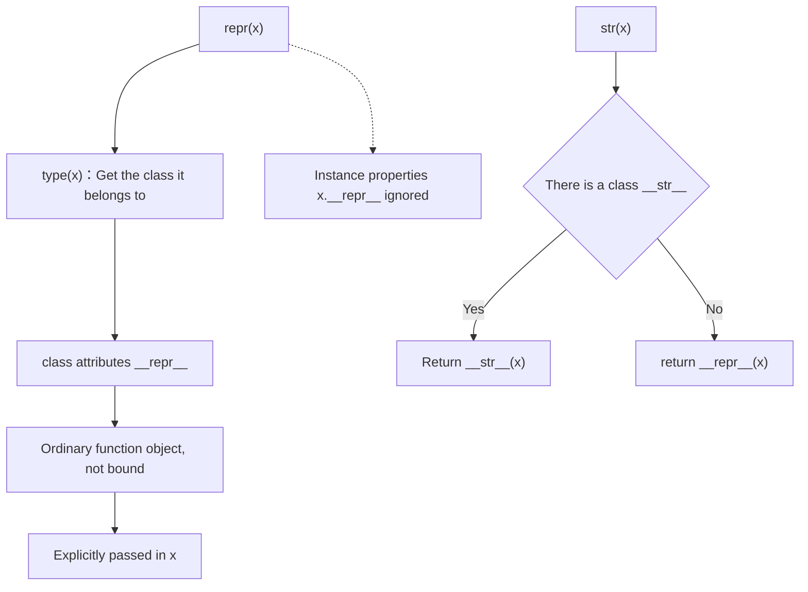

### 7.7 Interface and  `Ratio`

At this point we can give this mechanism a formal name: **interface**. Going back to the metaphor from when I first talked about object-oriented: objects pass messages to each other, that's how they interact. The language-level mechanisms are actually very simple - they just look up properties or methods, **Passing a message is a metaphor, checking attributes is an action**.

`repr`  with  `str`  It is a ready-made interface: implementation  `__repr__`  The class promises to give a Python interpretable string, implementing  `__str__`  The class promises to give a human-readable string. Interfaces do not have to be built-in to the language: any set of classes that have methods with the same name that do similar things has created an interface.

The best way to understand the interface is to implement it yourself. There is already a built-in  `Fraction`, just create one with a different name  `Ratio`:

```python
class Ratio:
    def __init__(self, numer, denom):
        self.numer = numer
        self.denom = denom

    def __repr__(self):
        return 'Ratio({0}, {1})'.format(self.numer, self.denom)

    def __str__(self):
        return '{0}/{1}'.format(self.numer, self.denom)
```

```text
>>> half = Ratio(1, 2)
>>> half
Ratio(1, 2)
>>> print(half)
1/2
>>> eval(repr(half))
Ratio(1, 2)
```

display directly  `half`, what is obtained is an expression that can reconstruct it; `print`  It,gets the way people write fractions; `eval(repr(half))`  Being able to recreate the object - this is the reward of "evaluability".

### 7.8 Special method names and operator overloading

Names that start and end with double underscores are a special type of existence in Python: they are bound to built-in behaviors and have a fixed shape. When you see the two underscores before and after, you know that the name interacts with the built-in object system. Such names are called special method names. `__init__`  Special because it is automatically called when the object is constructed; `__repr__`  Special because it is used to generate strings representing objects. What's new is  `__add__`: a two-parameter method; and two single-parameter methods: `__bool__`  Convert an object to true or false, `__float__`  Try converting the object to a real number.

```text
>>> (1).__add__(2)
3
>>> (0).__bool__()
False
>>> (1).__bool__()
True
```

| Syntax or built-in call | Special method name | parameters | function |
| :--- | :--- | :--- | :--- |
| `C(...)`  Construct instance | `__init__` | `self, ...` | Initialize the properties of the new instance |
| `repr(x)`, interactive echo | `__repr__` | `self` | Returns an evaluable, identifiable string |
| `str(x)`, `print(x)` | `__str__` | `self` | Returns a human-readable string |
| `x + y` | `__add__` | `self, other` | Addition when the left operand is an instance of this class |
| `y + x` | `__radd__` | `self, other` | Addition when the right operand is an instance of this class |
| `bool(x)`, `if x:` | `__bool__` | `self` | truth judgment |
| `float(x)` | `__float__` | `self` | Convert to real number |

give  `Ratio`  Plus addition. The formula for adding fractions is: the numerator is the numerator of the first times the denominator of the second, plus the denominator of the first times the numerator of the second; the denominator is the product of the two denominators. After the calculation, you have to make an approximation, otherwise one-third plus one-sixth will result in nine-eighteenths.

```python
def gcd(n, d):
    while n != d:
        n, d = min(n, d), abs(n - d)
    return n

class Ratio:
    def __add__(self, other):
        n = self.numer * other.denom + self.denom * other.numer
        d = self.denom * other.denom
        g = gcd(n, d)
        return Ratio(n // g, d // g)
```

```text
>>> (Ratio(1, 3) + Ratio(1, 6))
Ratio(1, 2)
```

`gcd`  Use subtraction to find the greatest common divisor: if the two numbers are not equal, replace the two numbers with the "smaller" and "the difference between the two." If they are equal, the common value is the answer. One third plus one sixth: numerator is 1 × 6 + 3 × 1 = 9, denominator is 3 × 6 = 18, `gcd(9, 18)`  Got 9, so return  `Ratio(1, 2)`.`__radd__`  with  `__add__`  The only difference is the parameter order, and commutative addition can be written directly  `__radd__ = __add__`.

### 7.9 Type assignment and type conversion

`__add__`  There is an implicit assumption: the right side of the plus sign is also a  `Ratio`. What about one third plus one? Should get three-fourths, but the code will read  `other.denom`, integers do not have this property. One way is **Check  `other`  type, and decide what to do based on that**:

```python
    def __add__(self, other):
        if isinstance(other, int):
            n = self.numer * 1 + self.denom * other
            d = self.denom
        elif isinstance(other, Ratio):
            n = self.numer * other.denom + self.denom * other.numer
            d = self.denom * other.denom
        elif isinstance(other, float):
            return float(self) + other
        g = gcd(n, d)
        return Ratio(n // g, d // g)

    __radd__ = __add__

    def __float__(self):
        return self.numer / self.denom
```

`Ratio(1, 3) + 1`  So we can calculate four-thirds; fill in one line  `__radd__ = __add__`, in the opposite direction  `1 + Ratio(1, 3)`  It also makes sense - because  `__add__`  Both int and Ratio situations are handled. The third case is floating point numbers: at this time the result should not be a fraction. Another solution is **Convert existing fractions to floating point numbers**, and then add the two floating point numbers. `__float__`  It only does one thing: divide the numerator by the denominator.

One example uses two strategies, each with its own name. **type dispatching**: Check the type of the argument to decide what to do. **Type conversion (type coercion)**: Convert an object of one type to another type so that it can be combined with another value.

| criterion | type assignment | type conversion |
| :--- | :--- | :--- |
| practice | Check  `other`  Type, choose different branches | Convert one party to the type of the other party and then perform the operation |
| result type | Usually same type as left operand (still  `Ratio`) | often become a "wider" type (here  `float`) |
| Examples of this lecture | `Ratio(1, 3) + Ratio(1, 6)`, `Ratio(1, 3) + 1` | `Ratio(1, 3) + 0.2` |
| Applicable premise | Each type has precise operation definitions | One party can embed the other party losslessly |
| cost | The number of branches increases with the number of types | Possible loss of accuracy |

### 7.10 Class Exercises: `Letter`  with  `Numbered`


The last three pages of the courseware are a set of in-class exercises taken from the second question of the 2023 spring semester midterm exam. The title just ties together the two things I’m talking about: `__repr__`  The object of decision is  `print`  What is displayed at the time, while inheritance allows a subclass to only change the presentation but not the behavior.


```python
class Letter:
    def __init__(self, contents):
        self.contents = contents
        self.sent = False

    def send(self):
        if self.sent:
            print(self, 'was already sent.')
        else:
            print(self, 'has been sent.')
            self.sent = True
            return Letter(self.contents.upper())

    def __repr__(self):
        return self.contents
```

The key is  `print(self, 'has been sent.')`  This line. `print`  used is  `str`, while  `Letter`  no definition  `__str__`, so  `str`  Find it according to the fallback rules  `repr`, `__repr__`  Return  `contents`, print out the text of the letter. **The representation method of a class also determines how it looks when printed**.

| call | `sent`  Status | Print | return value |
| :--- | :--- | :--- | :--- |
| `hi.send()` | `False`  change  `True` | `Hello, World! has been sent.` | `Letter('HELLO, WORLD!')` |
| `hi.send()` | `True` | `Hello, World! was already sent.` | `None` |
| `Letter('Hey').send().send()` | new object twice | `Hey has been sent.`  with  `HEY has been sent.` | Last message displayed  `HEY` |


```python
class Numbered(Letter):
    number = 0

    def __init__(self, contents):
        super().__init__(contents)
        self.number = Numbered.number
        Numbered.number += 1

    def __repr__(self):
        return '#' + str(self.number)
```

Two details are worth pausing for. First, `number = 0`  Written in the class body, it is **class attribute**, all instances share the same counter; `self.number = Numbered.number`  Copy the current count into the instance properties, then  `Numbered.number += 1`  Advance counter. If written as  `self.number += 1`, what is changed is the instance attribute, the class attribute will never change, and the next letter will get the same number - this is the trap at the intersection of the two rules of "attribute search first instance, then class" and "attribute assignment only look to the left". Second, the subcategory has only been changed  `__repr__`, `send`, `__init__`  The behavior is fully inherited, `super().__init__(contents)`  Ensure that the attributes of the parent class are created as usual.

The shape is the same as before: `print`  go  `str`, `str`  fallback to subclass  `__repr__`, then the screen appears  `#0 has been sent.`; while an interactive session displays  `hey`  Time goes the same way  `__repr__`, there are only  `#0`.

## 8. Cross-lecture comparison: five sets of criteria and one trap

*(Reference time: 00:25:57 – 00:37:55｜Lecture 15; 00:20:56 – 00:29:02｜Lecture 16; 00:13:29 – 00:17:10｜Lecture 17; 00:12:33 – 00:17:45｜Lecture 19)*

The content of the seven lectures is scattered in different scenes, but there are several sets of questions that are the same question in different clothes. This chapter lays them out side by side to check whether you have actually memorized the rules as a web, rather than as seven isolated conclusions.

### 8.1 `is`  with  `==`

```python
a = [10]
b = a
c = [10]

a is b        # True   同一个对象
a == c        # True   相等的值
a is c        # False  两个对象
```

| criterion | `is` | `==` |
| :--- | :--- | :--- |
| What is asked | Is it the same object? | Are the values equal? |
| What I'm looking at is | identity | Content (equality) |
| who decides | Determined by the existence of the object itself and cannot be rewritten | by class  `__eq__`  Decision, customizable |
| If one is true, can the other be derived? | Can: `is`  is true  `==`  Must be true | Cannot: `==`  when true  `is`  may be false |
| Typical uses of this module | Determine alias, `None`  sentry, `isinstance`  family | Compare lists, strings, fractions, custom values |

In the fifth line, "cannot be rewritten" and "customizable" are the key differences: `is`  It is the underlying relationship of language, `==`  Is a method that can be redefined by a class. This also explains why  `==`  When comparing two custom objects, the answer depends on whether the person who wrote the class has implemented the comparison logic.

> **Editor's note**: `==`  The behavior is determined by the class  `__eq__`  Method provided. This module has not mentioned this special method name. It is only used as a reference for "`==`  Customizable" addition; when not implemented, `==`  Fall back to identity comparison.

### 8.2 Iterators and Generators

| criterion | Handwritten iterator | generator |
| :--- | :--- | :--- |
| Where does the progress exist? | Instance properties (such as  `self.i`) | Local variables in generator frames |
| Who is responsible for maintenance | The person who writes it must flatten the algorithm into a state machine | Python, save the code position in the frame together |
| How to express the end | handwriting  `raise StopIteration` | The function body is automatically thrown after completion |
| Can I pause at any statement? | No, only at the border of "Take Next" | Can, `yield`  Can be in any location |
| Nested loops and recursion | Each layer is pressed flat by hand | Leave it as is |
| Disposable | is | is |
| Examples of this module | `map`  object with  `enumerate` (built-in) | `plus_minus`, `evens`, `partitions` |

The two are exactly the same in "can only be consumed once" because the generator **That’s it** An iterator; the only difference is "who remembers where to go". This difference will be magnified in the nested structure: the class version needs to compress the two-level loop into a single state machine, while the generator version can write the two-level loop as it is.

### 8.3 Instance attributes and class attributes

| criterion | instance attribute | class attribute |
| :--- | :--- | :--- |
| Where does it exist | Instance's own attribute dictionary | Class attribute dictionary |
| who can see | There is only one instance | All instances, the third stop found |
| When did it occur? | `__init__`  inside  `self.x = ...`  Assignments like | in class body  `=`  with  `def` |
| How to change | `instance.x = v` | `Cls.x = v` |
| storage cost | One copy per instance | Save only one copy |
| suitable for expression | different states for each object | Constants and behaviors shared by the entire class |
| Pitfalls of this module | —— | mutable class attribute (`tags = []`) is shared by all instances |

The difference between the two columns is only one sentence: **Instance attributes are each object's own account, and class attributes are shared by all.**. All the confusion about "reading and writing asymmetry" stems from forgetting that reading takes two stops and writing only stops at one.

### 8.4 Inheritance and composition

| criterion | inheritance | combination |
| :--- | :--- | :--- |
| relationship | is-a: The subclass is a type of base class | has-a: one object holds another |
| Reuse method | Share the search chain and only write the differences | Treat the held object as an attribute |
| Impact of changes | Changing the base class will affect all subclasses | Only affects the behavior of the holder |
| expressiveness | express "specialization" | Express "assembly" |
| Examples of this module | `CheckingAccount(Account)` | `Bank.self.accounts` |
| Main risks | Fragile base classes, diamond parsing | The delegation level is too deep and the interface is bloated. |

### 8.5 `__repr__`  with  `__str__`

| criterion | `__repr__` | `__str__` |
| :--- | :--- | :--- |
| Show it to whom | Interpreters and developers | end user |
| Whether to require evaluability | try your best (`eval`  loopback) | Not required |
| Is it used for interactive echo? | use | No need |
| `print`  use it? | Indirect (none  `__str__`  fallback) | Use directly |
| Default implementation | `object.__repr__`, angle bracket form | Fallback to  `__repr__` |
| Examples of this module | `'Ratio(1, 2)'` | `'1/2'` |

The fifth line explains a practical piece of advice: **write first  `__repr__`, write again when needed  `__str__`**. If you only write the former, printing and echoing will be automatically consistent; if you only write the latter, you will still see angle brackets in the interactive session.

### 8.6 Three contexts of alias traps

Chapter 1 says "an alias is two names for the same object", but the "shared object" is different things in different contexts and fails in different ways.

| context | something shared | How to generate alias | Look of failure | correct way to write |
| :--- | :--- | :--- | :--- | :--- |
| mutable container | List contents | `t = s[2]`, `b = a`, `e = s + t`  Shallow copy of | Change one and the other will change; history is rewritten by future events | Explicit copy when independent copy is required |
| iterator | a location marker | `d = c`, or pass the same iterator to both functions | After one party consumes, the "next" of the other party becomes the next one. | Each consumer  `iter`  once |
| generator | a paused frame | `b = a`  Share the same generator object | one place  `next`  Push forward and start another one from the middle | You need to call the generator function again from the beginning |
| object | attribute dictionary | `c = a`, `a.backup = b` | change  `c.balance`  equal to change  `a.balance` | Create a second instance using the constructor |
| class attribute | That space on the class (maybe a mutable object) | All instances are found and shared | `a.tags.append(...)`  influence  `b.tags` | in  `__init__`  Build instance properties |

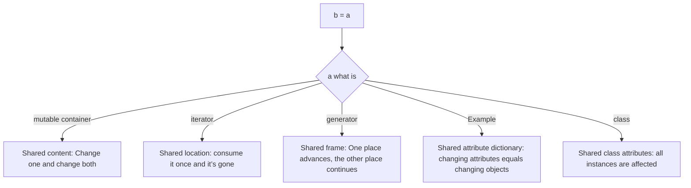

### 8.7 From environment graph to class dictionary

By placing the two pictures of the entire module side by side, you can clearly see "what has been added."

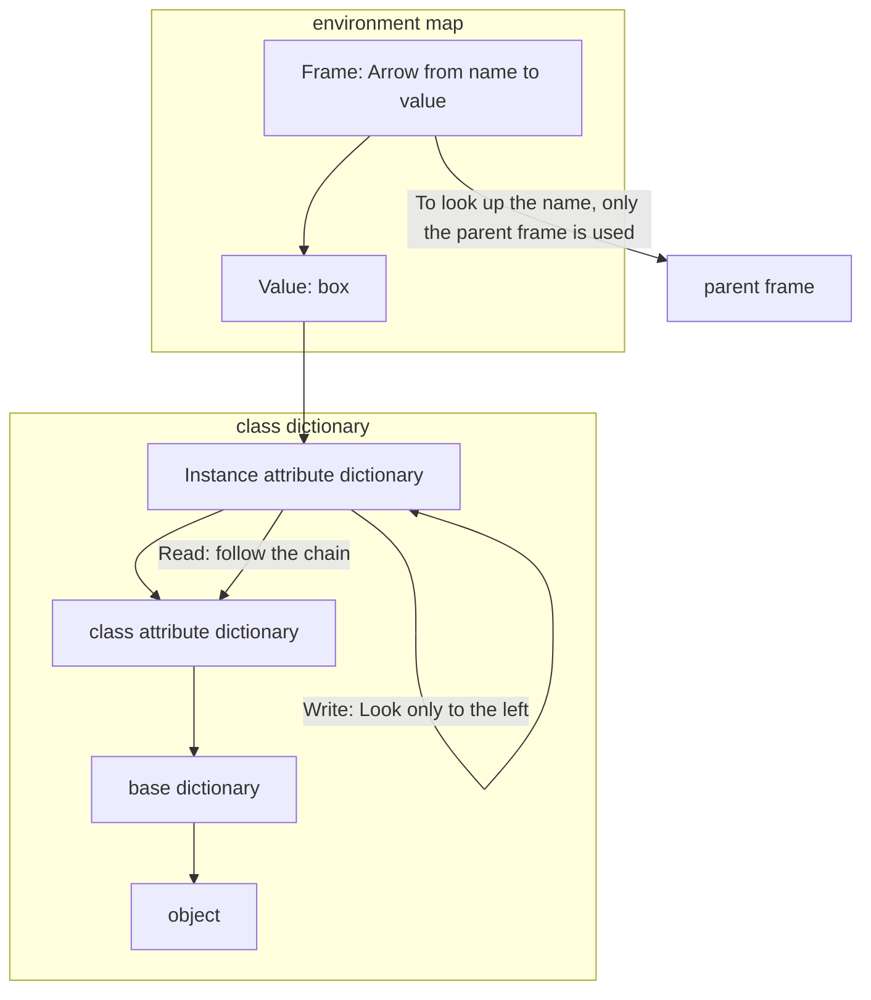

The environment graph answers "Which value does this name point to now", and the class dictionary answers "Which dictionary does this attribute end up in". The former is a chain (frame to parent frame), the latter is another chain (instance to class to base class), and the two chains meet at a value: a value that is both a box and an object with its own dictionary. **What is read is the first hit along the chain, and what is written is the one to the left of the dot.**——This sentence is the last thing left in the entire module.

## Engineering Laws and Design Checklists

*(Reference time: 00:29:39 – 00:31:41｜Lecture 15; 00:20:56 – 00:22:38｜Lecture 16; 00:15:30 – 00:17:10｜Lecture 17; 00:10:00 – 00:12:46｜Lecture 20)*

The following nine criteria are criteria that can be memorized and used directly in the examination room and code review. The sentence after each item is the reason, and the reason is more important than the conclusion.

- **First ask "Will this value change?" and then "What type is it?"**  Lists and dictionaries are mutable, but numbers, strings, and tuples are immutable; when an immutable container contains mutable elements, the whole will still change accordingly.
- **Assignment copies arrows, but does not copy objects.**  So  `b = a`  Change later  `b`  equal to change  `a`; To make an independent copy, you must copy explicitly and figure out which layer to copy to.
- **`is`  Ask about identity, `==`  Ask about the content.**  If the former is true, the latter must be true, but not vice versa; never use it to judge "whether they are the same object" `==`  instead of  `is`.
- **The default parameters and class attributes are "evaluated once and shared multiple times".**  Both are afraid of mutable objects; they need to be used every time they are created.  `None`  sentinel or  `__init__`  Assign instance attributes.
- **Iterators can only be consumed once.**  If you need to traverse it repeatedly, pass the iterable value, or first convert it into a list; passing the iterator to two consumers is equivalent to letting them grab the same position.
- **For generator  `yield`  The values handed over cannot be rolled back, but an infinite sequence can be turned into a finite amount of work.**  To determine whether you should use a generator, first ask "do you need only a part of it" and then "do you need it infinitely".
- **To read attributes, follow "Instance → Class → Base Class", and to write attributes, just look to the left of the dot.**  The two rules are in opposite directions; if you mix them, "the class was changed but it did not take effect" or "attributes were accidentally added to an instance".
- **Inherit only writes the differences and leaves the rest to search.**  If a block of statements that is repeated in the base class appears in the subclass, it means that this section should remain in the base class; the longer the subclass, the more likely it is that the base class should be split.
- **is-a uses inheritance, has-a uses combination; for ambiguous names, look at subclasses first, and multiple base classes from left to right.**  The former determines whether a class should have a base class, and the latter determines who will speak when multiple base classes conflict.

## Module knowledge overview (Mermaid mindmap)

*(Reference time: 00:12:44 – 00:37:55｜Lecture 15; 00:00:08 – 00:29:02｜Lecture 16; 00:00:24 – 00:17:10｜Lecture 17; 00:00:11 – 00:31:33｜Lecture 18)*

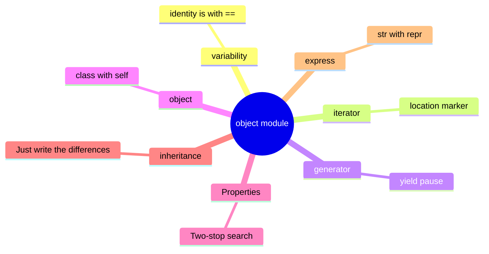

If you only have half an hour, I recommend reading it like this: read §1.5 first  `is`  with  `==`, then look at the protocol in §2.2 and the execution model in §3.3, then jump to the four-step search in §4.6, the read-write asymmetry in §4.7, the "base class attributes are not copied" in §5.4, and finally read the two representations in §7.2. These six sections together take less than thirty pages, but cover the three must-answer questions of "why objects need identities, how states are packaged, and how search works."

## Provenance and permission

*(Reference time: 00:00:01 – 00:00:04｜Lecture 15; 00:00:00 – 00:00:02｜Lecture 16; 00:00:00 – 00:00:03｜Lecture 21)*

This module is based on the classroom video of UC Berkeley CS61A (Structure and Interpretation of Computer Programs, Fall 2024) Lectures 15–21 and the original English subtitles of Station B; seven official courseware  `14-Mutability_1pp.pdf` (11 pages), `15-Iterators_1pp.pdf` (12 pages), `16-Generators_1pp.pdf` (11 pages), `17-Objects.pdf` (7 pages), `18-Attributes.pdf` (15 pages), `19-Inheritance.pdf` (24 pages), `20-Representation_1pp.pdf` (11 pages) 91 pages in total, 91 illustrations in the text are page-by-page renderings. The course homepage is  `cs61a.org`, textbook written by John DeNero  *Composing Programs*, the sample code is the same as  `ucb`  Modules are distributed with course projects.

The copyright of the course and courseware belongs to the UC Berkeley CS61A teaching team; this article is a secondary compilation for Chinese readers, used for learning and teaching discussions, and does not replace the original course. All content other than the lecturer's dictation and the courseware screen will be  `编者说明`  Marked, including: `getattr`  with  `hasattr`  equivalence, terminology of dynamic dispatch and polymorphism, C3 linearization and  `__mro__`, `__eq__`  with  `==`  relationship. If these supplements conflict with official materials, the official materials shall prevail.

In terms of layout, the time anchor at the beginning of each chapter is taken from the real start and end time of the corresponding paragraph in the subtitles; `mermaid`  The figures and tables are self-made for this article and are used to replace the hand-drawn environment diagrams and Python Tutor demonstrations in the classroom. The codes in the article are transcribed verbatim according to the courseware screen (including the original indentation and comments of the courseware). The codes typed out on the spot in the video are restored according to the subtitles and dictation. The differences have been marked in the text.

## Attached: Slide index for this module

*(Reference time: 00:00:01 – 00:37:55｜Lecture 15; 00:00:00 – 00:31:33｜Lecture 20)*

| page | Lecture times | content | Appear location |
| :--- | :--- | :--- | :--- |
| 1 | lec15 | Title page: Mutability | §1.1 |
| 2 | lec15 | Announcement page | §1.1 |
| 3 | lec15 | Sectioned pages: rewrite lists in place | §1.2 |
| 4 | lec15 | Build a list with append: sums | §1.3 |
| 5 | lec15 | Section page: Use list to install branches | §1.3 |
| 6 | lec15 | make\_path question and target tree | §1.3 |
| 7 | lec15 | Recursive implementation of make\_path | §1.3 |
| 8 | lec15 | Sectional Page: Variation and Identity | §1.5 |
| 9 | lec15 | One list vs. two lists | §1.5 |
| 10 | lec15 | `is`  with  `==`  Two sets of criteria | §1.5 |
| 11 | lec15 | Multi-level alias reading questions | §1.6 |
| 1 | lec16 | Title page: Iterators | §2.1 |
| 2 | lec16 | Announcement page | §2.1 |
| 3 | lec16 | Section page: List Practice | §2.1 |
| 4 | lec16 | Midterm question: chain environment diagram | §2.1 |
| 5 | lec16 | Section page: Tuples | §2.1 |
| 6 | lec16 | Tuple versus list | §2.1 |
| 7 | lec16 | real world sequences | §2.1 |
| 8 | lec16 | Sectioned pages: Iterators | §2.2 |
| 9 | lec16 | `iter`  with  `next` | §2.2 |
| 10 | lec16 | Discussion Question: Shared Iterator Positions | §2.3 |
| 11 | lec16 | `map`  Return iterator | §2.4 |
| 12 | lec16 | Discussion questions: `all`  with short circuit | §2.4 |
| 1 | lec17 | Title page: Generators | §3.1 |
| 2 | lec17 | Announcement Page: Projects and Assignments | §3.1 |
| 3 | lec17 | Review: Iterables vs. Iterators | §3.1 |
| 4 | lec17 | `map`  Object's progress | §3.1 |
| 5 | lec17 | `map`  Exercise: Add triples | §3.1 |
| 6 | lec17 | Section page: Tree Practice | §3.1 |
| 7 | lec17 | Midterm question: exclude | §3.1 |
| 8 | lec17 | Section page:Generators | §3.2 |
| 9 | lec17 | `plus_minus`  and four definitions | §3.2 |
| 10 | lec17 | Midterm question: park | §3.5 |
| 11 | lec17 | Infinite Fibonacci Generator | §3.6 |
| 1 | lec18 | Title page: Objects | §4.1 |
| 2 | lec18 | Announcement page | §4.1 |
| 3 | lec18 | Sectioned Pages: Reviewing Variability | §4.1 |
| 4 | lec18 | Section page: Class Statements | §4.2 |
| 5 | lec18 | Dot access to Account instance | §4.2 |
| 6 | lec18 | Account class definition and session | §4.2 |
| 7 | lec18 | Animated demo signature page | §4.4 |
| 1 | lec19 | Title page: Attributes | §4.5 |
| 2 | lec19 | Announcement page | §4.5 |
| 3 | lec19 | Section page: Method Calls | §4.8 |
| 4 | lec19 | Dot expressions embedded in calls | §4.8 |
| 5 | lec19 | Sectioned page: Attribute Lookup | §4.6 |
| 6 | lec19 | Four steps for attribute search | §4.6 |
| 7 | lec19 | Discussion Topic: Where's Waldo | §4.6 |
| 8 | lec19 | Section page: Class Attributes | §4.5 |
| 9 | lec19 | class statement and Clown | §4.5 |
| 10 | lec19 | class attribute interest sharing | §4.5 |
| 11 | lec19 | Section page: Bound Methods | §4.8 |
| 12 | lec19 | Terminology Map: Methods and Functions | §4.8 |
| 13 | lec19 | Functions and binding methods | §4.8 |
| 14 | lec19 | Sectioned page: attribute assignment | §4.7 |
| 15 | lec19 | Tom and Jim's Interest Rate Experiment | §4.7 |
| 1 | lec20 | Title page: Inheritance | §5.1 |
| 2 | lec20 | Announcement page | §5.1 |
| 3 | lec20 | Sectioned Pages: Attributes Review | §5.1 |
| 4 | lec20 | Terminology comparison | §5.1 |
| 5 | lec20 | Four-step rule for dot expressions | §5.1 |
| 6 | lec20 | Transaction to be completed | §5.1 |
| 7 | lec20 | Transaction snapshot box diagram | §5.1 |
| 8 | lec20 | Another implementation: lst log | §5.1 |
| 9 | lec20 | Sectioned page: attribute assignment | §5.1 |
| 10 | lec20 | Two options for attribute assignment | §5.1 |
| 11 | lec20 | The state after two assignments | §5.1 |
| 12 | lec20 | Sectioned Pages: Properties Exercise | §5.1 |
| 13 | lec20 | Section page: Inherit the opening | §5.2 |
| 14 | lec20 | Differences between inheritance syntax and write-only | §5.2 |
| 15 | lec20 | Checking account example | §5.3 |
| 16 | lec20 | Look up the name on the class | §5.4 |
| 17 | lec20 | Sectioned Pages: Object-Oriented Design | §6.1 |
| 18 | lec20 | Three rules for designing inheritance | §6.1 |
| 19 | lec20 | Inheritance and composition | §6.2 |
| 20 | lec20 | WWPD: three names | §6.4 |
| 21 | lec20 | Sectioned Pages: Multiple Inheritance | §6.5 |
| 22 | lec20 | Savings and TV Shopping Accounts | §6.5 |
| 23 | lec20 | The consequences of multiple inheritance | §6.5 |
| 24 | lec20 | Diamond Plot and Analysis Order | §6.6 |
| 1 | lec21 | Title page: Representation | §7.1 |
| 2 | lec21 | Announcement page | §7.1 |
| 3 | lec21 | Sectioned Pages: Expressions and Types | §7.1 |
| 4 | lec21 | Lab 6 Mail System Property Chain | §7.1 |
| 5 | lec21 | Sectioned page: string representation | §7.2 |
| 6 | lec21 | `str`  with  `repr`  division of labor | §7.2 |
| 7 | lec21 | Fibonacci squares and spirals | §7.4 |
| 8 | lec21 | Spiral overlaid on photo of bear | §7.4 |
| 9 | lec21 | Section page: Class Practice | §7.10 |
| 10 | lec21 | Letter class | §7.10 |
| 11 | lec21 | Numbered class | §7.10 |

The seven coursewares total 91 pages, and each page appears exactly once in the text; the page numbers are independently numbered according to the time of each lecture, so there are seven groups of page numbers starting from 1 in the table.
