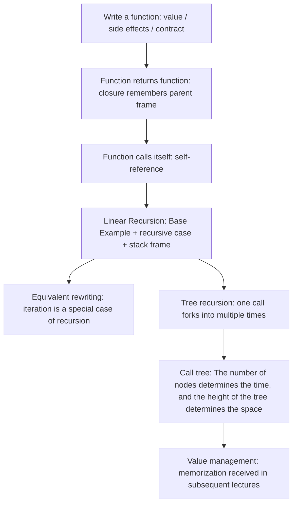
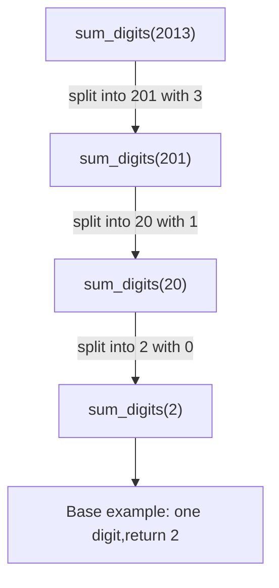
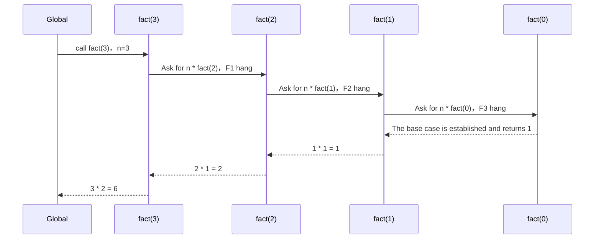
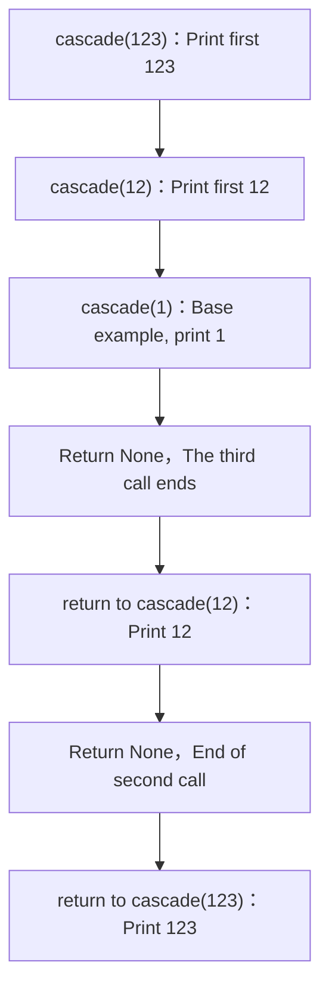
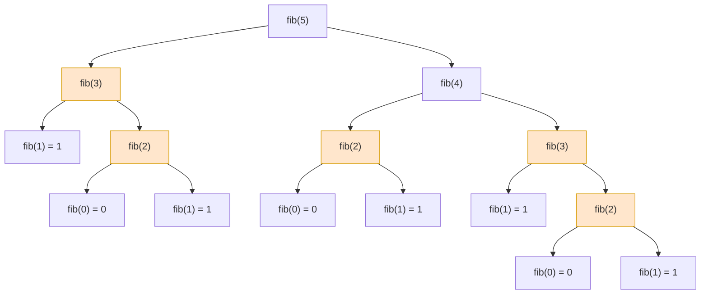
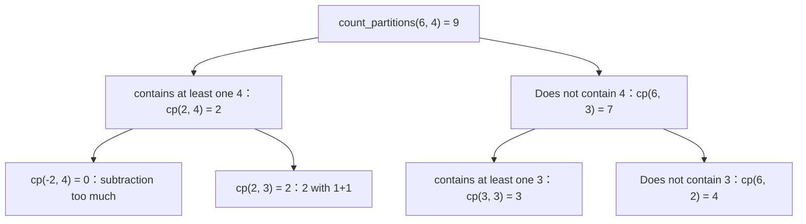
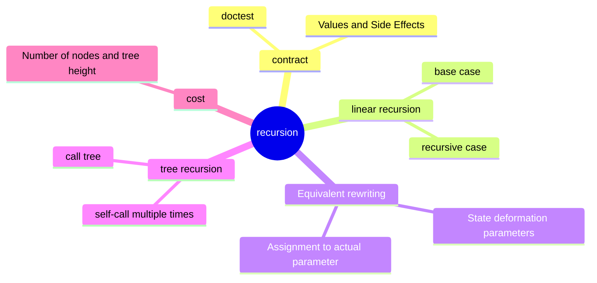

> **courses**: UC Berkeley CS61A · Structure and Interpretation of Computer Programs(Fall 2024)
> **module**: Module M2 · Recursion ｜ Lecture 8–10 ｜ Total duration 1:44:19 (Lecture 8 34:16 ｜ Lecture 9 37:49 ｜ Lecture 10 32:14)
> **video**: B station collection  [BV1sy411z7nA](https://www.bilibili.com/video/BV1sy411z7nA), this module corresponds to points P 8–10 ([P8](https://www.bilibili.com/video/BV1sy411z7nA?p=8) ｜ [P9](https://www.bilibili.com/video/BV1sy411z7nA?p=9) ｜ [P10](https://www.bilibili.com/video/BV1sy411z7nA?p=10))
> **courseware**: `07-Function_Examples_1pp.pdf` (14 pages) \| `08-Recursion_1pp.pdf` (11 pages) \| `09-Tree_Recursion_1pp.pdf` (14 pages), 39 pages in total, see text illustrations for page-by-page renderings
> **subtitles**: Original English subtitles from Station B; this note is a reconstruction of Chinese writing, not a sentence-by-sentence translation.
> **Copyright**: The copyright of the course and courseware belongs to the UC Berkeley CS61A teaching team; this article is a secondary arrangement for learning purposes

## 0. Module Navigation

*(Reference time: 00:00:01 – 00:01:53｜Lecture 8; 00:00:00 – 00:03:48｜Lecture 9; 00:00:00 – 00:01:09｜Lecture 10)*

These three lectures are a chain, not three parallel knowledge points. Lecture 8 answers "How to write a function correctly" - the output on the screen, the binding of names, and the examples in the document are all observable forms of "right". Lecture 9 answers "How does a function describe itself" - Once its own name is allowed to appear in the function body, the environment model immediately requires the answer to two new questions: why do you believe it is right, and where are the calls that have not returned yet stored.

The main line therefore only has two sentences: **The recursive trust model is "assume that the simpler situation is correct", and the recursive cost model is "time is the number of nodes, and space is the height of the tree".**  The former addresses "dare you dare to write", and the latter addresses "whether it's worth writing".

| Lecture times | Topic | duration | points P | courseware | Location of this article |
|---|---|---|---|---|---|
| Lecture 8 | Function Examples Function Design Practice | 34:16 | P8 | 14 pages | §1 |
| Lecture 9 | Recursion | 37:49 | P9 | 11 pages | §2, §3 |
| Lecture 10 | Tree Recursion tree recursion | 32:14 | P10 | 14 pages | §4, §5 |



Each of the three connections has a moment when "the tools from the previous lecture are not enough": self-reference can only be explained by the frame chain explained in the first lecture; when rewriting recursion into iteration, the "state" in the recipe is exactly the "which frame the name is tied to" practiced repeatedly in the first lecture; when discussing the cost, the decorator from the first lecture is used again - no  `trace`  In this layer of packaging, the call tree is just a picture and cannot be seen.

## 1. Function design process and contract: define "right" first, then write code

*(Reference time: 00:00:01 – 00:34:11｜Lecture 8)*

The previous module established functions as abstractions: as long as you know what it receives and what it returns, you don't have to worry about its internal calculations. But that's just the "using functions" perspective; when it's your turn to write functions, abstraction becomes a promise that you need to fulfill.

### 1.1 The lines on the screen are not the values of the expression


It started with a business announcement: Next Monday is the midterm exam, admission will be at 8:00 and the exam will start at 8:10. The reason for arranging it so early is to return the approved papers before the deadline for course selection and withdrawal; the course also has an exam recovery policy. If you do well in the final exam, you can get back up to 90% of the scores from the first midterm.


Three hard skills were named: being able to draw environment diagrams, being able to predict the behavior of Python, and being able to implement functions. The three correspond to the three clues of this chapter - frames and binding (§1.2, §1.3), output and values (this section), and writing descriptions into code (§1.5, §1.6).


Three rules to tear it down: `print`  always return  `None`, showing that the actual parameters are side effects rather than return values; multiple actual parameters are separated by spaces; the interpreter only **No** `None`  When the response is displayed, I want to see it  `None`  Can only be printed explicitly.

| expression | appears on the screen | value of expression |
|---|---|---|
| `5` | `5` | `5` |
| `print(5)` | `5` | `None` |
| `print(print(5))` | `5`  with  `None`  two lines | `None` |

`print(print(5))`  is a nested call: evaluation operand  `print(5)`  when printing 5 and get  `None`;outer layer  `print`  put this again  `None`  Show it. The value of the entire expression is still  `None`, so there is no additional echo.

> **Editor's note**:interactive interpreter "does not echo  `None`"Powered by CPython's  `sys.displayhook`  Decision, no  `print`  Features; the same expression written into the script will only appear  `print`  those rows produced.

### 1.2 Closure: The function remembers which frame it was born in

The second question only has five lines, but it is one of the most important patterns in the entire CS61A:

```python
def delay(arg):
    print('delayed')
    def g():
        return arg
    return g
```

It works based on the rules you've learned: **When a function is created, its parent frame is the first frame at that time**.`g`  The parent frame is  `delay`  frame, `g`  inside  `arg`  Found along parent frame chain  `delay`  formal parameters; etc.  `g`  when called  `delay`  has returned a long time ago, but the frame is still there, because  `g`  Keep pointing at it.

`delay(delay)()(6)()`  is a calling expression, and the operator itself is a calling expression, so the operator must be calculated first: `delay(delay)`  in  `f1`  inner handle  `arg`  tied to function  `delay`  itself and print  `delayed`; immediately followed by  `()`  call  `g`, get the function  `delay`; `delay(6)`  Print again  `delayed`;last  `()`  Return  `f3`  6 in. There are two lines on the screen  `delayed`  Add the echoed 6 - the last 6 is **echo** instead of  `print`  Printed.

For the third question, move the structure over as it is, and only change the body of the inner function:

```python
def pirate(arg):
    print('matey')
    def plunder(arg):
        return arg
    return plunder
```

The lecturer specifically emphasized: it is related to  `delay`  difference **It's not the name that's different, it's the inner layer  `def`  The sentences say different things**.`plunder`  formal parameters **also called  `arg`**, and the name search always starts from the current frame, so in  `plunder`  frame check  `arg`  Will hit the formal parameter immediately and never reach it  `pirate`  the one in the frame  `arg`.

| criterion | `delay` | `pirate` |
|---|---|---|
| What does the inner function return? | in outer frame  `arg` | own parameters  `arg` |
| Outer layer  `arg`  Is it reachable? | Reachable and the only channel | Unreachable, obscured by the parameter with the same name |
| actual semantics | Lazy-evaluated minimal model | Identity function |

thus  `add(pirate(3)(square)(4), 1)`  Print  `matey`  Then we get 17; and  `pirate(pirate(pirate))(5)(7)`  print two  `matey`  After that, the identity function returns 5, and finally  `5(7)`  trigger  `TypeError: 'int' object is not callable`. The error occurs in the last step rather than earlier - there is no type checking during evaluation, and the problem is only revealed when 5 is placed in the operator position and Python tries to call it.

### 1.3 Different frames with the same name: `horse mask`  extreme case

The fourth question was called by the lecturer "one of my favorite questions I have ever asked":

```python
def horse(mask):
    horse = mask
    def mask(horse):
        return horse
    return horse(mask)

horse(lambda horse: horse(2))
```

After the module layer is executed, there are two things in the global frame: name  `horse`  bind to function  `horse`;The one in the actual parameter  `lambda horse: horse(2)`  Created at the module level, the parent frame is also a global frame.

1. call  `horse(λ)`: New  `f1` (parent frame global), formal parameter  `mask`  bound to λ.
2. `horse = mask`: Assignment is permanently modified **current frame**, so  `f1`  inside  `horse`  Tie to λ.
3. `def mask(horse)`:Create a new function first  `mask` (parent frame  `f1`), then again  `f1`  inner handle  `mask`  By rebinding to it, the original binding pointing to λ is overwritten.
4. `return horse(mask)`: `f1`  inside  `horse`  is λ, `mask`  is an inner function, so create a new  `f2` (parent frame global) call λ; body of λ `horse(2)`  Create a new one  `f3` (parent frame  `f1`), `return horse`  Return 2, along  `f3 → f2 → f1 → 全局`  Returned layer by layer.

| frame | created by | key binding | what does it prove |
|---|---|---|---|
| `f1: horse` | `horse(λ)` | `mask → λ`, then  `horse → λ`, and then  `mask → 内层 mask` | Assignment and  `def`  Only the current frame is changed |
| `f2: λ` | `return horse(mask)`  inside  `horse` | `horse → 内层 mask` | The parent frame of λ is a global frame, regardless of who calls it |
| `f3: mask` | λ in vivo  `horse(2)` | `horse → 2` | inner layer  `mask`  The parent frame is  `f1`, but it only uses formal parameters |

The result is 2 and no error is reported. This question pushes "different frames with the same name" to the limit: in the same source code  `horse`  successively refers to three different things (global function, λ, integer 2), `mask`  Also refers to two in succession. Review only requires three actions: `def`  It is a two-step process (create function, parent frame = current frame; then bind the name to the current frame); assignment only changes the current frame; the parent frame superscripted on the function value is the one to which it is assigned **Create** time frame.


> **Editor's note**: This page is from the courseware, and there is no corresponding explanation paragraph in the video subtitles. `more_chocolate, more_cake = chocolate(), cake`  let  `more_cake`  get **function object** `cake`, so  `snake(10, 20)`  inside  `cake == more_cake`  True, return  `chocolate`;Execute  `cake = 'cake'`  Then re-evaluate, `'cake' == 函数`  For a holiday, go  `else`  Return 30.

### 1.4 Strategy as function: Twenty-One’s state enumeration

Treating functions as actual parameters has a natural use in games. There are only four rules in Twenty-One: two players take turns, and each round can add 1, 2, or 3 to the current total; the total starts from 0; the game ends when the total reaches or exceeds 21; the last person to add loses.


The state diagram is the essence of this lecture: green means "whoever's turn it is to go wins", and red means you must lose. 20 is red - when it is your turn, the total is already 20. No matter you add 1, 2 or 3, it will reach or exceed 21, and the person who adds the last number loses; 16 is also red, because you can only go from 16 to 17, 18, and 19, and these three numbers can reach 20 in one step.

> **Editor's note**: If you continue to push this picture to the left, you can see that multiples of 4 (12, 16, 20) are all must-lose positions, and the rest are must-win positions. This general rule is summarized from the two red states in the figure; since the total starts from 0 and 0 is a multiple of 4, the first player will lose if neither party makes a mistake.

```python
def play(strategy0, strategy1, goal=21):
    n, who = 0, 0
    while n < goal:
        if who == 0:
            n = n + strategy0(n)
            who = 1
        elif who == 1:
            n = n + strategy1(n)
            who = 0
    return who
```

`play`  The two parameters of are not numbers but **Strategy**——"Given the current total, return the number added in this round" function. `who`  It always means "the next person to move"; when the loop exits, the person who just added the number has pushed the total over the line, so  `who`  Just the winner.

This example extends the contract from return value to **behavior** (The contract of the strategy is "You give me the current total, and I give you a legal choice.") It also puts the "state across rounds" on the table: `n`  with  `who`  It is the only thing in the cycle that survives every round.

### 1.5 Five-step process: `remove_digit`  and position power

The other half of the real question is "implementing a function": you are given a description, a few examples, and a template that may have spaces, and you are asked to write code that can run on paper. The lecturer gave a set of processes, the value of which is to turn thinking time into **valid** Thinking time:


- **Read description**, first figure out "what to achieve" rather than "how to write a loop".
- **Check examples**, and pick the simplest one as the main example. Technical descriptions can easily be ambiguous, and examples are the only thing that can calibrate understanding.
- **Read template**. Use the template if it helps; if it makes people more confused, write your own ideas first, and then change it into the shape of the template after you write it correctly.
- **Before writing code, mark each name in the main example with a specific value**, including the intermediate variables intended to be newly introduced.
- **Write code, run the main example, and confirm that the returned things are correct**, and finally use a longer example that is more likely to miss branches for back testing.

The topic is  `remove_digit(n, digit)`: `n`  is a non-negative integer, `digit`  is a single digit; returned by  `n`  All in are not equal to  `digit`  A new integer composed of digits, the order remains unchanged. `remove_digit(231, 3)`  Got 21, `remove_digit(243132, 2)`  Got 4313. The template is roughly:

```python
def remove_digit(n, digit):
    kept, digits = 0, 0
    while n > 0:
        last = n % 10
        n = n // 10
        if last != digit:
            ...
    return kept
```

The template itself reveals the intent: `kept`  Responsible for collecting results, `digits`  Responsible for recording "how many have been saved" - the latter implies that the results should be assembled according to position. put  `n = 231`, `digit = 3`  After marking, the three rounds are: keep 1, skip 3, keep 2, `kept`  Should be 21. Next comes the most pedagogical part: four failures and one success.

| Writing method | Results from the first two rounds | Reason for failure |
|---|---|---|
| `kept = kept + last` | 1, then 3 | Adding numbers as sums loses bit weight |
| `kept = kept * 10 + last` | 1, then 12 | The low bit obtained later is put into the high bit, and the order is reversed. |
| `kept = kept + last * 10` | 10, then 30 | The position is written down as 10, and only the second position is correct. |
| `kept = kept + last * 10 ** digits` | 1, then 21 | Correct: The bit weight increases with the number of reserved bits. |

The first three times all went wrong in the same place: position and power. The second time was especially hidden, `1 * 10 + 2`  We get 12 - the numbers are taken from right to left, the 1 taken first is the low position, but it is pushed to the high position. The fourth time the right to give way follows the "reserved digits", `1 * 10 ** 0 = 1`, `2 * 10 ** 1 = 20`, which adds up to 21.

### 1.6 Executable contracts: docstring and doctest


> **Editor's note**: The example used in this video is  `remove_digit`, but what is printed on page 8 of the courseware is a variation of question 3(b) in Fall 2022 midterm one.  `nearest_prime`; The two questions test the same process. The list on the right side of the page breaks down the process dictated by the instructor in more detail.

Topic: Implementation  `nearest_prime(n)`, `n`  is an integer greater than 5, returns the distance from  `n`  The nearest prime; if two primes are equally close, return the larger one. hypothesis  `is_prime(n)`  Realized.

```python
def nearest_prime(n):
    """Return the nearest prime number to n.
    In a tie, return the larger one.

    >>> nearest_prime(8)
    7
    >>> nearest_prime(21)
    23
    """
    ___
    while True:
        if ___:
            ___
        if ___:
            k = -k
```

The page listing contains one more key instruction than the dictation: **Describe a calculation process in English** (Only simple steps), read the template again, mark the example values ​​on the names, and figure out what additional names are needed.

> **Editor's note**: `doctest`  The module will find these fragments and actually execute them, turning the "examples in the document" into "tests that will automatically fail". The running method is as follows  `python -m doctest -v 文件名.py`;It compares **text**, so the string is returned  `'7'`  and returns an integer  `7`  Neither of them can pass the other party's example - this happens to be a machine-based check of "the return type must be correct".

The value of doctest is that it forces the author to answer "what is right" first. An implementation can be completed according to the skeleton: `k`  Starting from 0, then  `n`  If it is a prime number, it will be returned in the first round; check first  `n + k`  Check again  `n - k`, so when the distances are equal, the larger one is returned; `k`  Increment at the end of the loop, otherwise neither branch will hit and you'll be stuck in the same round forever.

### 1.7 Decorator: Write "wrap one layer" at the definition

The last paragraph is outside the scope of the exam, but it is the convergence of all the tools in this chapter. First prepare two ordinary functions: `square`  with  `sum_squares_up_to` (Use  `while`  Accumulate 1 to  `n`  of square, `sum_squares_up_to(5)`  Yes 55). in class  `trace`  It is a decorator provided by the course code; write your own version that only supports single-parameter functions:

```python
def trace1(fun):
    def traced(x):
        print('calling', fun, 'on argument', x)
        return fun(x)
    return traced
```

`trace1`  Receive function  `fun`, internal definition  `traced` (Only one parameter is received, so it is called  `trace1`); `traced`  Print first, then  `x`  hand over  `fun`, and returns the result unchanged. `traced`  The parent frame is  `trace1`  frame so it remembers  `fun`  Which function - that's why it can wrap any function.

add to it  `@trace1`, thereafter  `square(12)`  Will print first  `calling <function square ...> on argument 12`, and then echo 144. this  `@trace1`  with  `square = trace1(square)` **Exactly equivalent**:Execute first  `def square`, and then rebind the same name to  `trace1(原函数)`  on the return value. From this moment on, there is no name in the global frame pointing to the original function - it only lives in  `traced`  In the parent frame of  `fun`  Hold on.

This and  `delay`, `pirate`  It's the same thing, just in the opposite direction: before it was "hide the value into the closure and wait to be retrieved", here it's "hide the function into the closure and wrap it up". Since  `square = trace1(square)`  It can also work, so why bother?  `@`? The lecturer gave three reasons: less typing; decoration information is written at the definition, so you can see at a glance who has processed this function; and there is a more realistic reason - not all Python programmers understand higher-order functions, but everyone can understand the "magic" of decorators.

> **Editor's note**: Decorators can be superimposed, multiple  `@`  from closest  `def`  Starting from the one, it is applied in order from bottom to top; the wrapped function usually also uses  `functools.wraps`  Keep the original name and docstring.

### 1.8 Currying: Multiple parameters are returned layer by layer


The courseware inserts a page of currying review after the function implementation, with only two lines of code:

```python
def make_adder(n):
    return lambda k: n + k
```

`make_adder(2)(3)`  with  `add(2, 3)`  Both get 5, but the evaluation paths are different: the former returns a function that "remains one parameter", and the second bracket is the actual addition. The page writes this correspondence into one sentence: **Currying is the process of transforming a multi-parameter function into a single-parameter higher-order function**.

This section is placed at the end of the chapter because it is the entrance to the next chapter: currying turns the return value into a function; if the return value can be **any** function, it can also be itself.

## 2. Linear recursion: base examples, recursive situations and stack frames

*(Reference time: 00:04:03 – 00:33:43｜Lecture 9)*

All functions in §1 only call "other" functions - even if that "other" is a self-defined inner function, or is wrapped in a layer  `traced`. Chapter 2 There is only one step to cross the line: **Your name appears in the function body and it is actually called.**  After crossing over, the environment model must answer two new questions: why do you believe it is correct (§2.5), and where are the calls that have not yet returned (§2.4).

### 2.1 Self-reference: mentioning oneself does not mean calling oneself


The opening is still a business announcement: the Hog project ends on Wednesday, and extensions within 24 hours will be automatically approved; the course has an exam recovery policy; there is only one piece of advice for those who decide to stay: don’t fall behind.


The technical content starts with a corollary: **The function's own name can be referenced in the function body.**  execute  `def`  Only one thing really happens: the function body is "put away", and no sentence in the body is evaluated; when the function is actually called and the body starts executing, the name already exists in the global frame and has been bound to a function object.

```python
def print_all(k):
    print(k)
    return print_all

print_all(1)(3)(5)
```


The second example is a little more difficult: printing **Cumulative sum so far**. it cannot return  `print_all`, instead returns the internal function defined in body:

```python
def print_sums(n):
    print(n)
    def next_sum(k):
        return print_sums(n+k)
    return next_sum
```

`n`  is the sum so far, `k`  is the next number; the summation occurs at  `n+k`  Li——`print_sums`  Only responsible for printing, `next_sum`  Responsible for connecting the two paragraphs. execute  `print_sums(1)(3)(5)`  Print 1, 4, 9; the courseware is provided separately  `print_sums(3)(4)(5)(6)`  Print 3, 7, 12, 18.

| criterion | `print_all` | `print_sums` |
|---|---|---|
| What to return | The function itself, the same function object | Newly defined in body  `next_sum` |
| Where does the state exist? | Nowhere to save, all calls share the global frame | Each call generates a new frame, `n`  It’s the cumulative sum |
| The parent environment of the new function | Not applicable | call  `print_sums`  that frame |

> **Editor's note**: The word the lecturer used in the subtitles is memorize, which means to record the intermediate results in the actual parameters and pass them down with the call; this is not the same thing as memoization (caching historical evaluation results to avoid repeated calculations) often said in computer science.

### 2.2 Two functions that return functions to each other


The subtitles are finishing  `print_sums`  Then I turned directly to "Recursive Functions" without explaining this page. It is a question of "what does the last line print?":

```python
def add_next(n):
    print(n)
    return lambda f: subtract_next(n + f)

def subtract_next(n):
    print(n)
    return lambda f: add_next(n - f)

add_next(2500)(500)(1000)(24)
```

The answer given in the courseware is  **2024**. Neither function calls itself, but each returns a lambda, which is then called inside the lambda. **the other party**; What really determines where the chain goes is the string of actual parameters hanging after the calling expression.

> **Editor's note**: Step by step substitution can be seen: 2500, 3000, 2000, 2024 four lines are printed in sequence. This exercise explains: **"Function returns function, function calls the other party" you can write a stateful call chain without recursion.**, recursion just puts the construction process of this chain into the function body.

### 2.3 Two components of a recursive function


There is only one definition of recursive function: **Call your own function in body**, can be called directly or indirectly. This sentence looks like a loop definition at first, but "calling a new frame each time" makes it fall into place in the environment model.

The first complete example is to find positive integers **sum of numbers**:The answer for 2013 is 2 + 0 + 1 + 3 = 6. There are two reasons why we write a function specifically for it: the integer A can be divisible by 9 if and only if the sum of its numbers can also be divisible by 9; the credit card number is very long and people will always make mistakes when inputting it manually, so each card number has one digit **Checksum digit**.

The derivation is divided into three steps. The first step is to make building blocks: split the positive integer into "parts except the last digit" and "last digit":

```python
def split(n):
    """Split positive n into all but its last digit and its last digit."""
    return n // 10, n % 10
```

`2013`  by  `split`  get  `(201, 3)`. The second step is to connect the questions: If you can already find the sum of the numbers 201, then the sum of 2013 is its result plus 3 - pay attention here **Can't** write  `sum_digits(n)`, which is equivalent to asking the same question again. The third step is to find the minimum situation: a single digit does not need to be split, `n < 10`  The sum of the time numbers is itself.

```python
def sum_digits(n):
    """Return the sum of the digits of positive integer n."""
    if n < 10:
        return n
    else:
        all_but_last, last = split(n)
        return sum_digits(all_but_last) + last
```



As the tree grows upward, the answer spreads downward: `sum_digits(2)`  return 2; `sum_digits(20)`  Got 2; `sum_digits(201)`  Got 3; `sum_digits(2013)`  Got 6. every layer  `last`  All remain in the frame of that layer and are added after the sub-call returns.

| criterion | base case | recursive case |
|---|---|---|
| when to enter | The condition hits "the simplest kind of problem" | The condition didn't hit |
| How to evaluate | Calculate and return directly without recursive calls | Contains at least one call to itself |
| Actual parameter scale | Minimum (one digit) | Strictly smaller than the current problem (201 in 2013) |
| role in the whole | Provide a known answer, terminating the recursion | Change big problems into small ones |

Recursion can be terminated when two conditions are met at the same time: **The actual parameters of each call are strictly smaller**, and the problem exists **The lower bound cannot be smaller** (One digit is the end). On the other hand, as long as the first clause is destroyed, the recursion immediately becomes an infinite loop: write the recursion situation as  `sum_digits(n)`, `n < 10`  Never true.

> **Editor's note**: Python will not really run "forever" - the interpreter has an upper limit on the call depth (CPython defaults to about 1000 levels), and it will be thrown if it exceeds  `RecursionError: maximum recursion depth exceeded`;This upper limit also explains the "space cost of recursion" discussed in §2.4.

### 2.4 Environment diagram: `fact`  Frame expansion and retraction

Another example: factorial, $n! = n \times (n-1) \times \cdots \times 1$.

```python
def fact(n):
    if n == 0:
        return 1
    else:
        return n * fact(n - 1)

fact(3)
```

`fact(3)`  should be  $3 \times 2 \times 1 = 6$. The instructor walked through this process step by step in the Python Tutor, because the entire mechanism of recursion is hidden in these steps.

1. `fact(3)`  Called in the global frame to create F1, `n`  Binding 3.
2. Calculate the left side of the multiplication sign first to get 3; then calculate the right side  `fact(n - 1)`, among which  `n - 1`  Yes 2. This step needs to be called  `fact`  itself, while F1's  `return`  The execution has not been completed yet, so F1  **hang**.
3. Create F2 (`n=2`), F3(`n=1`), each hangs and waits for the result of the sub-call.
4. Create F4, `n`  bind 0; `0 == 0`  Established, hits the base case, and returns 1 directly. This is the first real return value in the entire chain.
5. Pick up: F3 gets  `1 * 1 = 1`, F2 gets  `2 * 1 = 2`, F1 gets  `3 * 2 = 6`.

| frame | bound  `n` | Expressions that have not been completed yet |
|---|---|---|
| F1(`fact`, parent environment global) | 3 | `3 * fact(2)` |
| F2(`fact`, parent environment global) | 2 | `2 * fact(1)` |
| F3(`fact`, parent environment global) | 1 | `1 * fact(0)` |
| F4(`fact`, parent environment global) | 0 | None: base case, returns 1 directly |



The lecturer added a key observation on the screenshot that stopped at the deepest point: At this time, it is returning from the last call, but **The previous calls have not returned yet.**.

> **Editor's note**: The word "call stack" is not used in the courseware and subtitles, nor is it given.  $O(n)$  The complexity notation; the above two sentences are terms and magnitudes based on the semantic complement of the environment graph.

### 2.5 Trust Model: Leap of Faith

The base example can be verified at a glance: `fact(0)`  Return 1 directly, consistent with  $0! = 1$. But why do you believe it?  `n`  Is it also correct for other values? The lecturer included a photo here of his friend Kevin sitting on the edge of a very high cliff - that's what it feels like when writing a recursive function. Trust can be built in steps, and there are only three steps.

1. **Verification base case**. This step makes it easy later: the correctness of at least one batch of inputs has been determined.
2. **put  `fact`  Treat as functional abstraction**. see  `fact(n - 1)`  Don't deduce how it runs internally; just think about it **what to do**——for any  `n`, which returns  $(n-1)!$.
3. **Verify the current layer under this assumption**.`fact(n)`  Return  `n * fact(n-1)`;If step 2 is established, the return value is  $n \cdot (n-1)!$, and this is exactly  $n!$  definition.

Let’s go through the specific numbers: $4!$  Is it equal to  $4 \times 3!$? Yes $24 = 4 \times 6$. The generalized statement is: **First assume that the function is correct for the simpler case in the recursive call, and then verify that "if the simple case is correct, then the current problem is also correct."**.

> **Editor's note**: "If  $P(n-1)$  Establishment principle  $P(n)$  established, and  $P(0)$  is established, then for all  $n$ "Established" is the structure of mathematical induction; the inductive proof in mathematics class, the abstract barrier when writing code, and the leap of faith here all use the same set of "layered assumptions".

The actual usage of this strategy is **Use it to check your code before writing it**: Does the base case cover all minimal inputs? Do recursive calls really work on smaller problems? Assuming that the subcall returns the correct answer, do the combined operations at this level give the correct answer? After passing all three questions, the function is basically correct. §4.5 will give an alternative nomenclature for these three problems.

### 2.6 Mutual recursion: Luhn’s algorithm

\*\*Mutual recursion\*\* refers to two different functions calling each other. It is exactly used to implement the credit card verification mentioned at the beginning of this lecture. The courseware quotes Wikipedia's description of Luhn's algorithm: Start from the rightmost digit (check digit) and go to the left; double the number every other digit; if the doubling result is greater than 9, add the digits of the product; finally, sum all the numbers. Use first  `1 3 8 7 4 3`  Go through:

| Which number from the right? | original number | local operation | Numbers included in the total |
|---|---|---|---|
| 1 (rightmost, check digit) | 3 | Not doubled | 3 |
| 2 | 4 | Doubled, 4 × 2 = 8 | 8 |
| 3 | 7 | Not doubled | 7 |
| 4 | 8 | Double, 8 × 2 = 16 \> 9, then 1 + 6 | 7 |
| 5 | 3 | Not doubled | 3 |
| 6 | 1 | Doubled, 1 × 2 = 2 | 2 |

```python
def luhn_sum(n):
    if n < 10:
        return n
    else:
        all_but_last, last = split(n)
        return luhn_sum_double(all_but_last) + last

def luhn_sum_double(n):
    all_but_last, last = split(n)
    luhn_digit = sum_digits(2 * last)
    if n < 10:
        return luhn_digit
    else:
        return luhn_sum(all_but_last) + luhn_digit
```

`luhn_sum`  Deal with the "non-doubled" bits: add the last bit as it is, and leave the rest to  `luhn_sum_double`.`luhn_sum_double`  Handle the "to be doubled" bit: calculate first  `luhn_digit = sum_digits(2 * last)`——It directly reuses the building blocks of §2.3, 16 handed over to  `sum_digits`  Get 7 - add this one again and hand back the rest  `luhn_sum`. The two functions call each other to form an alternating relay; the base example can appear in both functions or only in one of them.

> **Editor's note**: The "LUN algorithm" and "Lund sum" in the subtitles mean that the speech recognition misheard Luhn, and the correct spelling is Luhn (the checksum algorithm proposed by IBM's Hans Peter Luhn); the "valid MasterCard number" mentioned in the courseware only falls within the number segment and does not take effect.

What mutual recursion looks like varies greatly from example to example. Here the two functions are relayed horizontally; §4.6 of  `unique_prime_factors`  Hide one of the recursions into the inner function. There is only one thing in common: **No function can reach the base case on its own; they must hand the problem over to each other, and then back.**

## 3. Equivalent rewriting of recursion: iteration is a special case of recursion

*(Reference time: 00:23:25 – 00:37:46｜Lecture 9)*

All of the examples in §2 can be rewritten using loops, and most of them are easier to write - but whose effort is saved? This chapter spreads out the translation in two directions: there is no universal formula for changing recursion to iteration, but it can be done mechanically by changing iteration to recursion. The reason is **Iteration is a special case of recursion**.

### 3.1 An asymmetric translation problem


Sometimes it is necessary to rewrite recursion into iteration (for example, to bypass the depth limit). This is difficult, but not unsystematic; the reverse direction can almost be copied. The clues in both directions are the same set: **Those states that are maintained across each cycle**.

```python
def sum_digits_iter(n):
    digit_sum = 0
    while n > 0:
        n, last = split(n)
        digit_sum = digit_sum + last
    return digit_sum
```

In turn, translate this iterative version into a recursive version: two states that change across rounds  `n`  with  `digit_sum`  Directly into two formal parameters; `while n > 0`  Negate to get the base case  `n == 0`;The loop body is copied, except that the two assignments are replaced by actual parameters of the recursive call.

```python
def sum_digits_rec(n, digit_sum):
    if n == 0:
        return digit_sum
    else:
        n, last = split(n)
        return sum_digits_rec(n, digit_sum + last)
```

| Iterative version of parts | The recursive counterpart |
|---|---|
| `while n > 0:` | `if n == 0: return digit_sum` (Conditional negation) |
| Initialization before loop  `digit_sum = 0` | initial call  `sum_digits_rec(n, 0)` |
| in the loop  `n, last = split(n)` | The first argument of the recursive call  `n` |
| `digit_sum = digit_sum + last` | The second argument of the recursive call  `digit_sum + last` |

Reading this table backwards is the recipe itself: **Assignment becomes the actual parameter of the recursive call**. This rule holds true for almost any iterative implementation, but there is no such mechanical rule in the opposite direction - recursion hides "progress" in the number of frames, and the number of levels is implicit.

### 3.2 Sequence: Box and Pyramid

The next three pages use the same set of transformations for "functions with side effects". These functions do not return a value, and the products are all on the screen, so **order of statements** It became the only thing to be careful about.


`boxes_iter(k)`  Count with a counter; recursive version  `boxes_r(k)`  Replace "punch a box" with "punch again" `k-1`  boxes", the base case is "do nothing when 0 boxes are ticked". `print`  of  `end=""`  Let the boxes stay on the same line, the function itself has no return value, and the side effects are the entire product.


```python
def pyramid(k):
    """ prints a pyramid of k height.
    >>> pyramid(4)
    []
    [][]
    [][][]
    [][][][]
    """
    if k == 0:      # base case
        return
    else:
        pyramid(k-1)   # print a pyramid of k-1 height
        print("")      # skip a line,
        boxes_r(k)     # print out k boxes.
    return
```

Iterative version counts from height 1 to  `k`, wrap each layer and type again.  `i`  box. The recursive version thinks in another direction: height  `k`  of pyramid = height  `k-1`  Pyramid + blank row + one row  `k`  box. So the code becomes three steps: first draw the small ones recursively, then wrap the lines, and finally draw the whole row.


The inverted pyramid (with the widest row on top) requires changing the loop direction in the iterative version: `while k > 0`, hit each layer first  `k`  box and then wrap the line, then  `k -= 1`. The recursive version only needs to swap the order of the last two statements.

> **Editor's note**: There is no corresponding explanation for these three pages in the subtitles of this video (the subtitles start at 00:25:47 and then talk about the leap of faith, Luhn algorithm and iteration/recursion translation, and there are no boxes or pyramids in the whole process); the above codes and comments are organized verbatim according to the courseware screen.

### 3.3 handfuls  `play`  rewritten as recursive


The last page of the courseware is a discussion question: put  `play`  Rewritten to not include  `while`  recursive function and answer two questions - do I need to define a new internal function? Why? What is a base case and what does a base case return? There are two states maintained across rounds: accumulated points  `n`  And who should take action now?  `who`.

```python
def play(strategy0, strategy1, goal=21):
    def f(n, who):
        if n >= goal:
            return who
        if who == 0:
            n = n + strategy0(n)
            who = 1
        elif who == 1:
            n = n + strategy1(n)
            who = 0
        return f(n, who)
    return f(0, 0)
```

Outer layer  `play`  Just do one thing: use the initial state  `0`  and  `0`  Start the inner function. The cycle becomes a pair  `f`  recursive call, the two assignments become  `f(n, who)`  The actual parameter - it is "assignment to actual parameter". It also answers "Why are intrinsic functions needed": `n`  with  `who`  It is not something that the caller should care about. The closure hides this pair of states in a place where the inner function can see it but the outer layer cannot.

### 3.4 Another face of iteration: Newton’s method

The iterations in the first three sections can all be counted: `while n > 0`, `while k <= n`, `while n < goal`  All have explicit count variables. There is another form of iteration——**I don’t know how many turns I need to make, I just know when it’s good enough**. The section of the courseware marked OPTIONAL at the end of Lecture 8 is exactly in this form: Use Newton's Method to find the roots of equations.


function  `f`  The \*\*zero\*\* is satisfying  $f(x) = 0$  input  `x`. to  $f(x) = x^2 - 2$  For example, its positive zero point is at  $x \approx 1.414213562373095$, that is  $\sqrt{2}$;Generally, $f(x) = x^2 - a$  The positive zero point is  $\sqrt{a}$. So "find the square root" is translated into "solve the equation  $x^2 = a$", and then translated as "make change".


The method itself is surprisingly simple. given function  `f`  and an initial guess  `x`, repeat three steps: calculate  `f(x)`;Calculate the slope of the tangent line at this point  `slope(f, x)`; put  `x`  Updated to the intersection of the tangent line and the x-axis  $x - f(x)/\text{slope}(f, x)$. Geometrically this is replacing the curve with a tangent, and the point of intersection is usually closer to the true zero point than the original guess.


$$
x_{k+1} = x_k - \frac{f(x_k)}{f'(x_k)}
$$


to  $f(x) = x^2 - 2$, initial value  $x = 1$  For example, four rounds reduce the error to more than ten decimal places (in the table  `f'(x)`  By analytic derivative  $2x$  Calculation is convenient for hand calculation verification; the course uses  `slope(f, x)`  This value is approximate):

| rounds | `x` | `f(x)` | next round  `x` |
|---|---|---|---|
| 0 | 1.0 | -1.0 | 1.5 |
| 1 | 1.5 | 0.25 | 1.4166666666666667 |
| 2 | 1.4166666666666667 | 0.006944444444444642 | 1.4142156862745099 |
| 3 | 1.4142156862745099 | 6.007304882871267e-06 | 1.4142135623746899 |


The last page brings the abstraction to the scene of use: `f = lambda x: x*x - 2`  call after  `find_zero(f)`, echo  `1.4142135623730951`. Functions here are pure arguments: `find_zero`  It doesn't care whether the incoming value is square, cubic or anything else, it is only responsible for pushing the guess to zero.

> **Editor's note**: Pages 11–14 belong to the courseware of Lecture 8. The page is marked OPTIONAL. There is no corresponding oral paragraph for the two lecture videos. Because "repeatedly improve until it is good enough" is in contrast to the two types of iteration discussed in this section, it is placed here to restore it according to the screen.

```python
def slope(f, x, dx=1e-8):
    return (f(x + dx) - f(x)) / dx

def find_zero(f, guess=1.0, tolerance=1e-12, limit=100):
    x, n = guess, 0
    while abs(f(x)) > tolerance and n < limit:
        x = x - f(x) / slope(f, x)
        n = n + 1
    return x
```

`slope`  Use the difference quotient to approximate the derivative: take a minimum  `dx`, using the slope of the line connecting two points to pretend to be the slope of the tangent line. This is the key to "no need for analytical derivation". it also shows  `while`  Three exit methods exist here at the same time: the conditions are not met (good enough), the  `return` (Stop work early), the counter is in full (not convergent).

## 4. Tree recursion: one call grows into a tree

*(Reference time: 00:00:00 – 00:15:45｜Lecture 10)*

The recursion of §2 and §3 has only one "next step" at a time: `sum_digits`  handed over to 201, `fact`  hand over  `n-1`, `luhn_sum`  Give it to the other party. That kind of recursion grows into a chain, with each section waiting for the next section to return. The fork in Chapter 4 occurs inside the recursive case: **There are more than one calls to itself in the body of a call**, the chain becomes a tree.

### 4.1 Why tree recursion deserves special practice


There is only one thing to explain at the beginning of class: **The recursive job will be released this Friday**. It's a big deal, and recursion is a technology that just made its official debut this week and usually requires quite a bit of practice to master, so the first piece of advice is to start early.

This is followed by a positive response to "What's the point of recursion?": Early examples often seemed like overkill - print a string of numbers, accumulate an integer, write  `while`  It can be solved in three lines, so why go around in a circle and call yourself? The lecturer acknowledges this perception and then makes a promise to be fulfilled in this lecture: **In the example presented today, it is much easier to use recursion than without it.**  The judgment criteria also emerged: what recursion is really good at is splitting a complex calculation into two or more pieces - splitting it into one piece results in linear recursion, and splitting it into two or more pieces results in tree recursion.

### 4.2 Sequence: `cascade`  The decline and rise of


Before entering tree recursion, the courseware takes a step back to review something that is often overlooked: **Understand the order of recursive calls**. The return value is just the result; explaining the behavior of a recursive function—what it prints first, what it prints last, and when it starts "going up"—must rely on the order of calls.

```python
def cascade(n):
    if n < 10:
        print(n)
    else:
        print(n)
        cascade(n // 10)
        print(n)
```

`cascade(5)`  Falling into the base case, only one appears on the screen  `5`. Change to 12345, and the output becomes a symmetrical ladder:

```text
12345
1234
123
12
1
12
123
1234
12345
```

The attribution of these nine lines is worth counting line by line. The lonely one in the middle  `1`  from the base case  `print(n)`;The remaining eight lines are from  `else`  Two in the branch  `print(n)`——Printing once for each layer when descending, and printing again for each layer when ascending. There is only one reason why a beautiful nested structure can be formed: **All downward stacking occurs before the last print.**

execute  `cascade(123)`: The original call checks the base case and it is not established, so 123 is printed. recursive call  `cascade(12)`  Will **finish first**, and then it is the original call's turn to continue - it prints itself again 12. Call again  `cascade(1)`, and 1 falls on the base case and is printed.



> **Editor's note**: The function body in Python is executed but not encountered  `return`, the return value is  `None`;This is exactly the point to be emphasized here - a recursive function does not necessarily "return" a meaningful value, it may only be responsible for producing side effects.

### 4.3 Two kinds  `cascade`  Writing methods and their choices

`cascade`  It’s not like you can only write it that way. Base case printing  `n`, the recursive case also prints  `n`, then bring this printing to the front, and the two situations will merge naturally - there is nothing to do in the base case, so  `if`  Only need to handle recursive cases.

```python
def cascade(n):
    print(n)
    if n >= 10:
        cascade(n // 10)
        print(n)
```

> **Editor's note**: In the subtitles, the lecturer stated the condition as "when  `n`  is greater than 10", but to make this writing method borderline equivalent to the original version, the condition should be  `n >= 10`;Original pair  `n = 10`  Three lines of 10, 1, and 10 will be printed. If written as  `n > 10`  It will just print a 10.

The running result is consistent with the original version, and the definition is shorter. So which of the two versions is better? One version separates base cases and recursive situations and clearly tells readers what to do in each situation; the other version finds common ground between the two and tries not to repeat itself.

| criterion | Case-by-case version (base case/recursive separation) | Combined version (print first, then judge) |
|---|---|---|
| Lines of code | 6 lines | 5 lines |
| repeated statements | `print(n)`  Appear three times | `print(n)`  appears twice |
| Handling of base cases | A separate branch, written explicitly | Implicit in "no more recursion" |
| reading comprehension | Let’s look at the base case first, then look at recursion | We must first see what the two branches have in common |
| Potential border risks | None | The condition is written as  `n > 10`  Less time to type a line |

The lecturer's judgment is conditional: **If two implementations are equally clear, usually choose the shorter one**, because others read it faster. But in this example, the longer version is clearer - it spreads out the two things in the order of "base case first, recursion later", which is the usual order for reading recursive functions.

### 4.4 `inverse_cascade`: Borrowing higher-order functions recursively

The last paragraph of the review is an exercise: write an "inverse  `cascade`". When 1234 is passed in, the expected output is 1, 12, 123, 1234, and then reduced layer by layer: 123, 12, 1. The lecturer did not ask to write it from scratch, but gave him a ready skeleton and narrowed the difficulty into one place:

```python
def inverse_cascade(n):
    grow(n)
    print(n)
    shrink(n)
```

`grow`  Responsible for printing the growth stage, the middle line prints the longest line, `shrink`  Responsible for the contraction phase. Both are related to the following higher-order function: it receives two functions  `f`, `g`  and a number  `n`, as long as  `n`  If it is not 0 (in numbers, 0 is the only false value), call it first in order  `f`, call again  `g`.

```python
def f_then_g(f, g, n):
    if n:
        f(n)
        g(n)

def grow(n):
    return f_then_g(grow, print, n // 10)

def shrink(n):
    return f_then_g(print, shrink, n // 10)
```

`grow`  Why is it "long first and then print"? Because the printing needs to be done from small to large, the smaller ones must be completed first, so for the smaller ones  `grow`  must be ranked  `print`  before - then  `f`  is  `grow`, `g`  is  `print`.

`grow(1234)`  Got it  `n // 10`  is 123, it recurses first  `grow(123)` (There are more below  `grow(12)`, `grow(1)`, `grow(0)`), then  `print(123)`;The printing order is therefore 1, 12, 123. `grow(0)`  Do nothing because  `f_then_g`  in  `n`  When it is 0, skip it directly——`if n:`  This line is the brake for the entire recursion.

One last point worth noting: `grow`  with  `shrink` **My own name does not appear in my body**, the recursion is through  `f_then_g`  happened. The definition of recursion can therefore be relaxed a bit - as long as the function is called again during the evaluation of the function body, it is still recursive.

### 4.5 How to know it’s right: tracking, induction and abstraction


The leap of faith in §2.5 is a set of "before writing" trust process; the courseware summarizes "how to verify that a recursive implementation is correct" into three methods. \*\*Tracing\*\* Drawing the entire calculation process is only feasible for very small examples——`fib(5)`  The 15 calls can still draw, `fib(20)`  More than 20,000 times cannot.

| criterion | Tracing | Induction | Abstract |
|---|---|---|---|
| what is produced | a specific execution record | a proof of correctness | A working implementation |
| Scope of application | minimal input | Any input | Any input |
| What to rely on | Environment graph and call tree patience | Base case and "The scale does get smaller" | Reliability of recursive calls |
| main cost | The combination explodes and quickly expires. | Need to write invariants | May mask errors in decomposition |
| position in course | Debugging and understanding | Argument | Design and writing |


A good example of abstract reading is the A+ question in Spring 2024 Form 1: Determine whether all the digits of a positive integer are the same.

```python
def streak(n):
    """Return True if all the digits in positive integer n are the same.

    >>> streak(22222)
    True
    >>> streak(2222322)  # 2 and 3 are different digits.
    False
    """
    return (n >= 0 and n <= 9) or (n > 9 and n % 10 == n // 10 % 10 and streak(n // 10))
```

The two spaces are  `n % 10 == n // 10 % 10`  with  `streak(n // 10)`. The reading is: If the ones digit and the tens digit are equal, and the ones digit is thrown away, the remaining number is still  `streak`, then the whole number is  `streak`;The base case is "a single number from 0 to 9", which must be true. The recursive call is placed in  `and`  on the right side of , so once the adjacent two digits are unequal, the entire  `and`  It becomes a short circuit  `False`, **No more unnecessary recursion**.

### 4.6 Mutual recursion: two functions treat each other as "simpler cases"


Luhn in §2.6 is "level alternation"; this example hides the recursion into the inner function, and the shape is closer to the real code. Task: Ask for  `n`  How many are there **different** Prime factors. 51 = 3 × 17, there are two; 27 = 3 × 3 × 3, there is only one; 120 = 2 × 2 × 2 × 3 × 5, there are three.


```python
def unique_prime_factors(n):
    """Return the number of unique prime factors of n."""
    k = smallest_factor(n)
    def no_k(n):
        "Return the number of unique prime factors of n other than k."
        if n == 1:
            return 0
        elif n % k != 0:
            return unique_prime_factors(n)
        else:
            return no_k(n // k)
    return 1 + no_k(n)
```

`smallest_factor`  Only the function header and documentation string are printed on the courseware, and the complete implementation is hidden in the source code encoded by the Python Tutor link at the bottom of the page: even numbers directly return 2, otherwise try dividing one by one starting from 3 until  `n`.

The flavor of mutual recursion is in  `no_k`  inside. it is nested in  `unique_prime_factors`  The inner function in the frame, so the outer binding is visible  `k`. The logic is divided into three situations: if it has been divided by 1, it returns 0; `n`  no longer  `k`  divisible, the problem degrades to "from  `n`  Count again with different prime factors", so call  `unique_prime_factors(n)`; can also be  `k`  Divide and remove one  `k`, continue to use the same  `k`  Check, that is  `no_k(n // k)`. outer layer  `return 1 + no_k(n)`  put  `k`  Counts itself as 1.


This page is the "before answering" state of the same code: the three underlined positions correspond to  `return unique_prime_factors(n)`, `return no_k(n // k)`  with  `return 1 + no_k(n)`. The value of filling in the blanks lies in distinguishing **Which recursion is asking which question?**——`unique_prime_factors(n)`  It's "count again by changing the prime factors", `no_k(n // k)`  It is "continue dividing by the same prime factor". The two have similar shapes but opposite semantics.


On the right side of the courseware, draw the decomposition of 120 into a tree: 120 is split into 2 and 60, 60 is split into 2 and 30, 30 is split into 2 and 15, and 15 is split into 3 and 5. The red box marks the layer 15 - it was rejected once by "Can it be divisible by 2", so the control of the entire section was returned.  `unique_prime_factors`  Start again; the small box inside the box is marked 5 again, that is the new term  `k`.

### 4.7 The definition and definition of tree recursion  `fib`  call tree


The definition is short: **Tree recursion refers to making more than one call to the function itself when executing the function body of a recursive function.**  The calculation process grown in this way is tree-shaped: there is a root, several branches under the root, and each branch has thinner branches.

```python
def fib(n):
    if n == 0:
        return 0
    elif n == 1:
        return 1
    else:
        return fib(n - 2) + fib(n - 1)
```

Two base cases are defined directly, and the rest are all "sum of the first two numbers". The reason why it is tree recursion is just to look at the recursion situation: to calculate  `fib(n)`, body facing  `fib`  Two calls were made.



Highlighted in orange are nodes that have been expanded repeatedly: `fib(3)`  Appeared twice, `fib(2)`  Appeared three times, `fib(1)`  Appeared five times. The whole tree has a total of 15 nodes, that is  `fib(5)`  Required 15 times  `fib`  Call - This number will be used repeatedly in Chapter 5.

| criterion | linear recursion (`cascade`, factorial) | tree recursion (`fib`, `count_partitions`) |
|---|---|---|
| Number of self calls in recursive situations | at most 1 time | 2 times or more |
| The shape of the calculation process | One chain, plus two sections, descending and ascending | A tree with branches spreading with depth |
| Total number of calls versus input | Linear, approx.  `n`  times | Exponentially, `fib`  approx.  $1.618^{n}$ |
| Number of simultaneously active frames (space) | approximately equal to depth  `n` | No more than tree height  `n` |
| Main difficulties | Starting and ending conditions and statement sequence | How to break a problem into disjoint parts |

## 5. Cost model: number of nodes, duplication and pruning

*(Reference time: 00:15:48 – 00:32:11｜Lecture 10)*

§2.4 The space has been calculated once: `fact(3)`  At the deepest point, there are four frames in the memory at the same time, so  `fact(n)`  The space is  $n+1$  frames. Tree recursion makes this thing invisible - its space **also** It’s only as tall as a tree, but time quickly spirals out of control with the number of nodes.

### 5.1 Time is the number of nodes

Let’s look at the values first. The results of the base case are as expected: `fib(2)`  Got 1, `fib(3)`  Got 2, `fib(5)`  Got 5.

> **Editor's note**: put each  `fib(k)`  A frame counts as one call, and the number of calls meets  $T(0) = T(1) = 1$, $T(n) = T(n-1) + T(n-2) + 1$, the solution is  $T(n) = 2F(n+1) - 1$, among which  $F$  is the Fibonacci number; the following table is calculated according to this formula.

| `n` | `fib(n)`  value | needed  `fib`  Number of calls | Intuitive feeling |
|---|---|---|---|
| 5 | 5 | 15 | Can be counted at a glance |
| 10 | 55 | 177 | `trace`  It can also fill a whole screen |
| 15 | 610 | 1973 | The output line has extended beyond the page |
| 20 | 6765 | 21891 | The value is still very small and has been called 20,000 times. |
| 25 | 75025 | 242785 | Starting to lag obviously |
| 30 | 832040 | 2692537 | need to wait a while |
| 35 | 9227465 | 29860703 | About 30 million calls |

You can see where the problem lies by looking at the last column: `n`  Every time you add 5, the number of calls is multiplied by approximately 17 times. There is no dispute in the order of magnitude——**exponential growth**. And  `fib(35)`  The value is only seven digits.

### 5.2 Space is the height of a tree

If you look at the four frames in §2.4 and the fifteen nodes in §4.7 side by side, you will find something counterintuitive: the space of tree recursion **and no** As the number of nodes increases. `fib(5)`  The fifteen calls do not occur at the same time - the left subtree is calculated, returned, the frame is released, and the right subtree is started.

> **Editor's note**: Two quantities can be read directly from the call tree - time is for the entire tree **Number of nodes** (one call per node), the space is tree **height** (The number of simultaneously active frames is at most equal to the depth).

So you can write a cost summary for each of the two types of recursion. Linear recursion: both time and space  $O(n)$, both grow simultaneously, so "deep" is its only risk. Tree recursion: time can be exponential, space is still  $O(n)$——**It exchanged time for space, but did not actively ask for it.**.

### 5.3 Make the tree visible: `@trace`

The last section calculated the final account; to see how this account was recorded, the call tree must be made visible. The lecturer provided  `trace`, from the  `ucb`  Module import, the usage is to add a line before the target function definition  `@trace`: Print one line when calling, and print one line and bring the return value when returning.

Arrive  `fib(5)`, a real tree unfolds before your eyes: first  `fib(3)` (return to 2), then  `fib(4)` (Returns 3, which is quite a bit of work in itself). `fib(10)`  is much larger - it consists of  `fib(9)`  with  `fib(8)`  composed, while  `fib(8)`  There are still  `fib(6)`, `fib(4)`, `fib(2)`.`fib(15)`  At this time, the output lines have extended beyond the page.

> **Editor's note**: `ucb.trace`  The real output is an indented nested form, with each level indented one more level to express "who is waiting for whom"; the specific character format is provided with the project.  `ucb.py`  Subject, only the shape is described here.

### 5.4 Repeated subtrees and memoization

The problem is not "the computer is slow", but the tree **Repeat**. `fib`  will be called many times with the same actual parameter, and the same value will be recalculated each time; in  `fib(5)`  inside, `fib(3)`  That calculation was completely done twice, `fib(2)`  Did it three times.

> **Editor's note**: Memorization and memorize in §2.1 are two different things. The lecturer's memorize means "passing the intermediate results down as actual parameters", which is handwritten and explicitly visible; memorization means "the function keeps a table for itself, and directly looks up the table when it encounters calculated actual parameters."

```python
def memo(f):
    cache = {}
    def wrapped(n):
        if n not in cache:
            cache[n] = f(n)
        return cache[n]
    return wrapped

fib = memo(fib)
```

`fib`  After adding it, each  `n`  It will only be actually calculated once, and the number of calls is reduced from exponential to linear. The cost is an extra card with a size of  $n$  table. The lecturer specifically added a qualification: **Don’t think that tree recursion must be slow just because of this section.**, it certainly doesn't have to be slow, it's just that this implementation is.

### 5.5 `count_partitions`: Use "use or not m" to split the set in half


This example is the most important in this module because it is a **It is difficult to write recursion without tree** tree recursive process. positive integer  `n`  use **no more than  `m`  part of** The number of partitions (partition) is the  `n`  The number of ways to write the sum of several positive integers, each part of which does not exceed  `m`.

> **Editor's note**: The definition in the courseware only says "sum of positive integer parts up to m", and the "increasing order" was added verbally by the lecturer; this agreement cannot be omitted - without it, `2 + 4`  with  `4 + 2`  will be treated as two different divisions, and the count will be doubled immediately.

`count_partitions(6, 4)`  All nine types of can be divided into two groups according to "including or without a 4":

| Group | Specific division | values |
|---|---|---|
| Contains at least one 4 | 2 + 4, 1 + 1 + 4 | 2, that is  `count_partitions(2, 4)` |
| Does not include 4 (only use parts no larger than 3) | 3 + 3, 1 + 2 + 3, 1 + 1 + 1 + 3, 2 + 2 + 2, 1 + 1 + 2 + 2, 1 + 1 + 1 + 1 + 2, 1 + 1 + 1 + 1 + 1 + 1 | 7, that is  `count_partitions(6, 3)` |


These two categories **Disjoint** (One contains 4 and one does not contain 4). Together they cover all nine types, so they can be counted separately and then added together. Note two things: there are  `2 + 4`, no  `4 + 2` (Descending order is not a new method); each part does not exceed 4, so  `1 + 5`  Not among them.

The first type is easier to calculate: since there must be a 4, what remains after removing it is "divide 2 with parts not exceeding 4", that is  `count_partitions(2, 4)`, there are two types; the second type is "dividing 6 by parts not exceeding 3", a total of seven types. 2 + 7 = 9. These two sub-problems are still the same type of problem and can be solved in the same way:




Once you have the recursive plan, all that's left is to translate it into code:

```python
def count_partitions(n, m):
    if n == 0:
        return 1
    elif n < 0:
        return 0
    elif m == 0:
        return 0
    else:
        with_m = count_partitions(n-m, m)
        without_m = count_partitions(n, m-1)
        return with_m + without_m
```

Two variable names are two groups: `with_m`  The number "uses at least one  `m`" situation (first put  `m`  Take it away, what's left  `n - m`  Still usable no more than  `m`  part); `without_m`  count "one" `m` "neither use" (some upper limits are reduced to  `m - 1`). The three basic cases each answer "when do you no longer need to ask further": `n == 0`  Returns 1 because there is one way to divide 0 - add nothing; `n < 0`  Returns 0 because division of negative numbers does not exist; `m == 0`  Returns 0 because no positive number can be made using parts of size 0.

`n < 0`  This one is especially worth stopping at: it's not a mathematical "answer"; **Pruning criteria**——When recursively decomposing, you will always find a dead end such as "trying to use too large parts to make up a too small number". `n < 0`  Make these branches return to 0 immediately, rather than continuing to expand on negative numbers.

> **Editor's note**: of these three baselines **sequence** Not casually. `n == 0`  must be ranked  `m == 0`  before otherwise  `count_partitions(0, 0)`  Will hit first  `m == 0`  Returning 0 conflicts with the convention that "0 has a division (empty sum)".

| criterion | `fib`  call tree | `count_partitions`  call tree |
|---|---|---|
| Which direction does the subcall go in? | all towards smaller  `n` | One decreases  `n`, one decreases  `m` |
| Duplicate nodes | A large amount (`fib(3)`  in  `fib(5)`  appears twice in) | Much less (parameter pairs are spread out in both directions) |
| Growth magnitude | exponential | Roughly of the same order as the number of legal parameter pairs |
| Pruning means | There are only two base cases | Three basic cases, among which  `n < 0`  Specially cut off the dead ends |

> **Editor's note**: with  `fib`  different, `count_partitions`  The two subcalls of go in two different directions, and there are far fewer cases of repeatedly unrolling the same pair of parameters, so it doesn't look like  `fib`  That explodes exponentially; its upper limit of recursion depth is  `n + m`.

### 5.6 `count_park`: Three branches and their recursive expressions


At the end of the courseware, there is a question from Spring 2023 Midterm 2, No. 5, which is just used to test the model of this lecture. Question meaning: In a row of parking spaces, a motorcycle occupies 1 parking space (recorded as  `%`), the car occupies 2 adjacent parking spaces (denoted as  `<>`), spaces are recorded as  `.`.

The point of recursion is **The leftmost square**. This square has three fates: empty, parked with a motorcycle, or as the front half of a car. The first two types only consume 1 grid, and the rest  `n - 1`  The grid continues as it is; the third type consumes 2 grids at a time, leaving  `n - 2`  Grid.

```python
def count_park(n):
    if n < 0:
        return 0
    elif n == 0:
        return 1
    else:
        return count_park(n-2) + count_park(n-1) + count_park(n-1)
```

thus  `count_park(2) = 1 + 2 + 2 = 5`; `count_park(3) = 2 + 5 + 5 = 12`, `count_park(4) = 5 + 12 + 12 = 29`, consistent with the title.

> **Editor's note**: This recursive formula  $f(n) = 2f(n-1) + f(n-2)$ (Among them  $f(0) = 1$, $f(-1) = 0$) The sequence generated is 1, 2, 5, 12, 29, 70...usually called Pell numbers; it is  `fib`  One more branch, but still of the same family.

with  `count_partitions`  By comparison, we can see two typical forms of the action of "decomposition": `count_partitions`  use **Capacity limit** Make two points (use or not  `m`), `count_park`  use **How many spaces does the leftmost end occupy?** To make three points (0 grid, 1 grid, 2 grid), it all boils down to "adding up the numbers of several disjoint types of solutions."

### 5.7 Cross-lecture comparison: linear recursion, tree recursion and iteration

Putting the writing methods that appeared in the three lectures side by side in a table, the difference in cost will be clear at a glance.

| criterion | linear recursion | tree recursion | Iterate |
|---|---|---|---|
| Number of self calls in recursive situations | 1 time | 2 times or more | 0 times (use loop instead) |
| The total number of times a call was made | approx.  `n`  times | Exponential (`fib`  approx.  $1.618^n$) | 1 function call + `n`  wheel cycle |
| Frames active simultaneously (stack depth) | `n` | No more than tree height  `n` | 1 |
| Whether it can be memorized | Usually there are no repeated sub-problems and the benefits are small | There are many repeated subtrees, and the benefits are greatest. | Not applicable (no subquestions) |
| Rewrite direction | Mechanically translatable with iteration | Changing to iteration is difficult | Recursion is a superset of it |
| Typical representative | `fact`, `sum_digits`, `streak` | `fib`, `count_partitions`, `count_park` | `fact_iter`, `sum_digits_iter` |
| Main failure modes | Actual parameters do not change, infinite recursion | Repeated subtrees, exponential explosion | Missing status update, endless loop |

### 5.8 The evolution of contracts: the position of docstring and doctest in the three lectures

The answer to "What does it mean to be right" in Lecture 3 is thickened layer by layer.

| Lecture times | carrier of contract | Representative examples | How can a contract be tested? |
|---|---|---|---|
| Lecture 8 | description, template, docstring, doctest | `remove_digit`, `nearest_prime` | Examples are compared step by step, and doctest can be executed automatically |
| Lecture 9 | Base case + structural convention for recursive cases | `fact`, `sum_digits`, `luhn_sum` | Leap of faith: Assume the subcall is correct and verify this layer |
| Lecture 10 | Disjoint decomposition + abstraction/induction | `count_partitions`, `count_park` | Coverage and mutual exclusivity of decomposition; proof by induction |

The three carriers have different strengths and different uses. Doctest can only prove "these pairs of examples written down", and its value lies in forcing the author to nail down the boundaries before taking action; Leap of Faith proves the "structural pair", which is correct for all inputs as long as the base example is correct, each call is on a smaller problem, and the combination operation is correct; while the mutex check of decomposition proves "no omissions and no duplications", and it has no machine-based substitute.

## Engineering Laws and Design Checklists

*(Reference time: 00:26:23 – 00:28:54｜Lecture 9; 00:20:14 – 00:21:02｜Lecture 10)*

The following ten items are criteria that can be memorized and used directly in the examination room. The sentence after each item is the reason, and the reason is more important than the conclusion - when the topic changes, the reason can be transferred.

- **Write the base example first, then the recursion.**  The base case is the only part that can be independently verified; without it, there would be no exit from the recursive call chain and the program would plunge into  `RecursionError`.
- **The actual parameters of the recursive call must be strictly smaller, and the problem is lower bounded.** "Getting smaller" guarantees moving towards the base case, and "having a lower bound" guarantees reaching it within a finite number of steps; if one of the two is missing, the terminability is not established.
- **Treat recursive calls as functional abstractions and don't reason about them.**  Just know  `fact(n-1)`  The return  $(n-1)!$; Deducing the internal implementation will draw attention away from "whether the combination of this layer is correct".
- **Write doctest before writing implementation.**  Examples are the only thing that can calibrate "what is right"; they also serve as regression tests, so you don't have to rethink the code when you change it.
- **Whether the statement is placed before or after the recursive call determines whether it is descending or ascending.**  This is  `cascade`  All the difficulties with the pyramid; if you want to reverse the output order, change one line in the recursive version, and change the loop in the iterative version.
- **There are recipes for changing iteration into recursion: changing state parameters, changing values into actual parameters, `while`  Take the negation as the base example.**  There is no recipe for reverse, because "progress" is hidden in the layers of frames, and making it explicit requires rethinking the invariants.
- **The two branches of the tree recursion must be disjoint and cover each other together.**  The prerequisite for the legal action of "adding" is that there are no duplicates or omissions; otherwise, what is counted is neither the number of solutions nor the upper bound.
- **Use the number of nodes to estimate time, and use trees to overestimate space.**  Called one node at a time, so time looks at the entire tree; live frames are only on one path, so space looks at depth.
- **Remember it when the same subproblem is developed over and over again.**  Duplicate subtrees are pure waste; memoization uses a table to push the exponential back to linearity at the expense of space.
- **If the two versions are equally clear, choose the shorter version, but when learning to write recursion, choose the version that explicitly breaks down situations.**  Programs are first written to be read by humans; the order of "base examples first, then recursion" is exactly the order in which others read the code.

## Module knowledge overview (Mermaid mindmap)

*(Reference time: 00:34:08 – 00:34:11｜Lecture 8; 00:37:41 – 00:37:46｜Lecture 9; 00:32:09 – 00:32:11｜Lecture 10)*



The five branches correspond to five chapters, but their status is not equal. **contract** This is the entrance: there is no "what is right", and the subsequent discussion has no point. **linear recursion** It is the backbone: two components plus two sets of explanations (stack frames and leap of faith), which form the basis of all subsequent content. **Equivalent rewriting** It is a side branch: it does not generate new capabilities and only changes the shape of the cost, but it is the best angle to understand "what is more to recursion". **tree recursion** with **cost** It is an extension of the trunk: once a fork occurs, correctness (whether the decomposition is not redundant or leaky) and cost (number of nodes, duplication, pruning) must be managed at the same time.

## Provenance and permission

*(Reference time: 00:00:01 – 00:00:04｜Lecture 8; 00:00:00 – 00:00:02｜Lecture 9; 00:00:00 – 00:00:03｜Lecture 10)*

This module is organized based on the following materials: UC Berkeley CS61A (Structure and Interpretation of Computer Programs, Fall 2024) Lectures 8–10 classroom video and original English subtitles from Station B; three official courseware  `07-Function_Examples_1pp.pdf` (14 pages), `08-Recursion_1pp.pdf` (11 pages), `09-Tree_Recursion_1pp.pdf` (14 pages), the 39 illustrations in the text are page-by-page renderings. The course homepage is  `cs61a.org`, textbook written by John DeNero  *Composing Programs*, which has sample code similar to  `ucb`  Modules are distributed with course projects.

The copyright of the course and courseware belongs to the UC Berkeley CS61A teaching team; this article is a secondary compilation for Chinese readers, used for learning and teaching discussions, and does not replace the original course. Any content that is not shown in the lecturer's dictation or in the courseware screen will be replaced by  `编者说明`  Marked, including: call stack and complexity notation, CPython's upper limit of call depth and  `sys.displayhook`  behavior, `doctest`  How the module operates, `functools.wraps`, implementation of memoization, closed-form solution of Pell number and Fibonacci call number, and  `find_zero`  Completion implementation.

In terms of layout, the time anchor at the beginning of each chapter is taken from the real start and end time of the corresponding paragraph in the subtitles; `mermaid`  The figures and tables are self-made for this article and are used to replace the hand-drawn environment diagrams and Python Tutor demonstrations in the classroom. The codes in the article are transcribed verbatim according to the courseware screen (including the original indentation and comments of the courseware). The codes typed out on the spot in the video are restored according to the subtitles and dictation. The differences have been marked in the text.

## Attached: Slide index for this module

*(Reference time: 00:00:01 – 00:34:11｜Lecture 8; 00:00:00 – 00:37:46｜Lecture 9; 00:00:00 – 00:32:11｜Lecture 10)*

| page | Lecture times | content | Appear location |
|---|---|---|---|
| 1 | lec08 | Title page: Function Examples | §1 |
| 2 | lec08 | Announcements: Midterm arrangements and three hard skills | §1.1 |
| 3 | lec08 | Section page: Call Expressions | §1.1 |
| 4 | lec08 | Lab 02 Q2: cake, pie, snake | §1.3 |
| 5 | lec08 | Section page: Twenty-One environment map | §1.4 |
| 6 | lec08 | Twenty-One Rules and Victory and Loss Status Charts | §1.4 |
| 7 | lec08 | Sectioned Pages: Function Implementation Exercises | §1.5 |
| 8 | lec08 | nearest\_prime template and process list | §1.6 |
| 9 | lec08 | Section page: Currying | §1.8 |
| 10 | lec08 | Correspondence between make\_adder and add | §1.8 |
| 11 | lec08 | Section page: Newton's Method (OPTIONAL) | §3.4 |
| 12 | lec08 | Background of Newton's method: zero point and square root | §3.4 |
| 13 | lec08 | Newton's method iteration: tangent and update formulas | §3.4 |
| 14 | lec08 | Use Newton's method to find the result of √2 | §3.4 |
| 1 | lec09 | Title page: Recursion | §2.1 |
| 2 | lec09 | Announcement Page: Projects, Midterms and Course Selection | §2.1 |
| 3 | lec09 | Section page: Self-Reference | §2.1 |
| 4 | lec09 | print\_sums and environment graph | §2.1 |
| 5 | lec09 | Exercise: add\_next and subtract\_next | §2.2 |
| 6 | lec09 | Sectioned pages: Recursive Functions | §2.3 |
| 7 | lec09 | Sectioned Pages: From Iteration to Recursion | §3.1 |
| 8 | lec09 | boxes\_iter and boxes\_r | §3.2 |
| 9 | lec09 | pyramid\_iter and recursion pyramid | §3.2 |
| 10 | lec09 | Inverted pyramid: swap two lines of statements | §3.2 |
| 11 | lec09 | Discussion question: Rewrite play as recursive | §3.3 |
| 1 | lec10 | Title page: Tree Recursion | §4.1 |
| 2 | lec10 | Transition Page: Recursive Job Scheduling | §4.1 |
| 3 | lec10 | Section page: Recursion Review | §4.2 |
| 4 | lec10 | Three ways to determine whether recursion is correct | §4.5 |
| 5 | lec10 | Real question streak: the digits are the same | §4.5 |
| 6 | lec10 | Section page: Mutual Recursion | §4.6 |
| 7 | lec10 | Mutual recursion: unique\_prime\_factors | §4.6 |
| 8 | lec10 | Fill-in-the-blank version of mutual recursion example | §4.6 |
| 9 | lec10 | Mutual recursion: prime factor tree of 120 | §4.6 |
| 10 | lec10 | Section page: Tree Recursion | §4.7 |
| 11 | lec10 | Divisions of counting: nine divisions of 6 | §5.5 |
| 12 | lec10 | Count division: with 4 and without 4 | §5.5 |
| 13 | lec10 | count\_partitions complete implementation | §5.5 |
| 14 | lec10 | Real question count\_park: parking plan count | §5.6 |

The three coursewares total 39 pages, and each page appears exactly once in the text; the page numbers are independently numbered according to the time of each lecture, so there are three sets of page numbers starting from 1 in the table.
