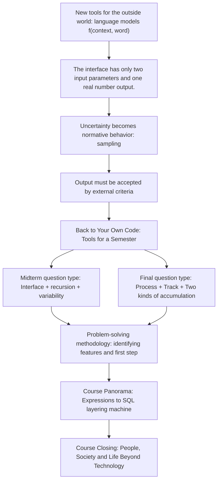
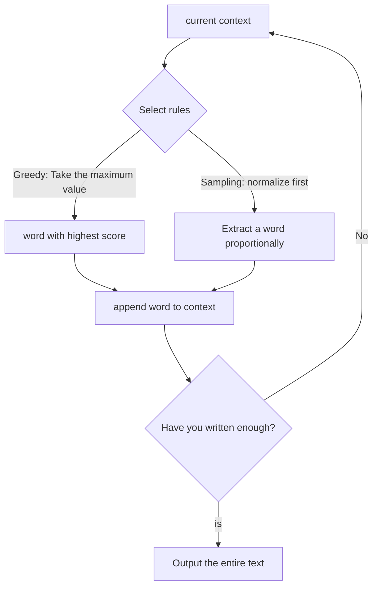
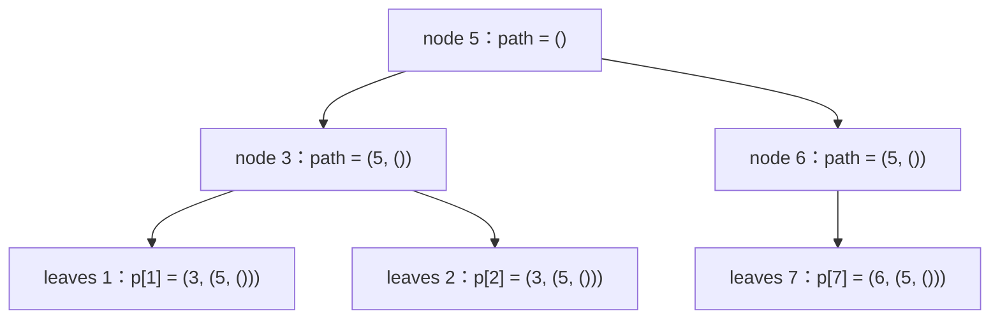
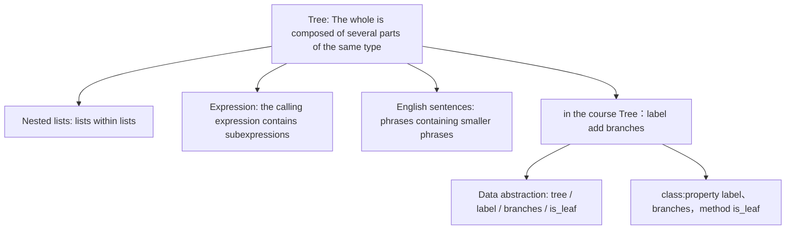
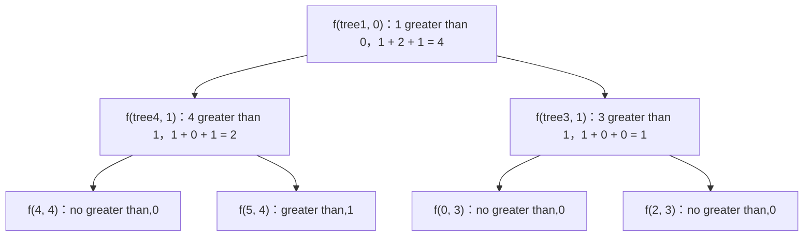
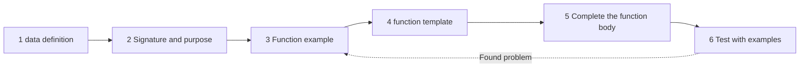
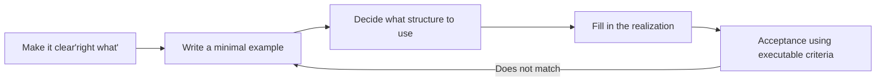
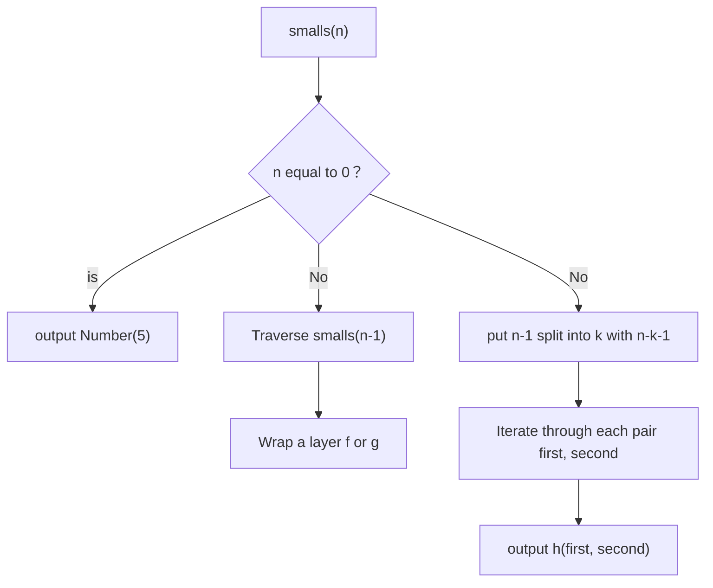
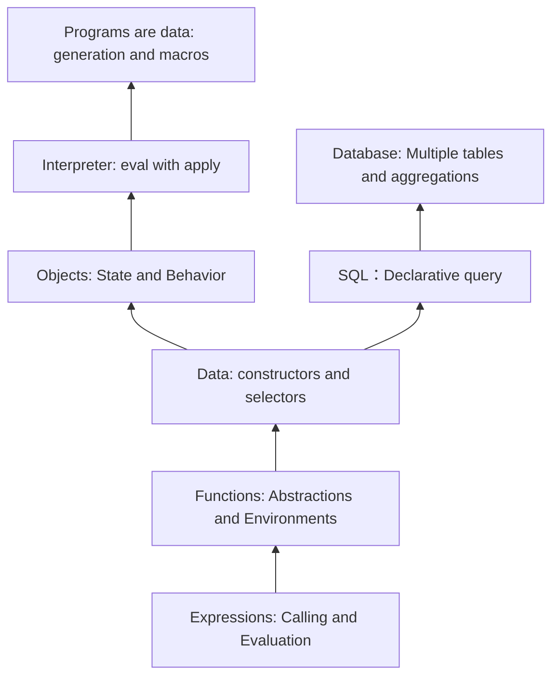
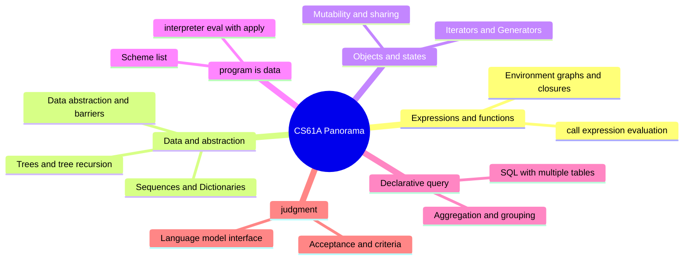

> **module**: M8 CS61A-review, including Lecture 26, 27, 39, 40 (Language Models, Midterm Examples, Final Examples, Conclusion)
> **Recording status**: Lecture 4  **3 Lectures without video** (Lecture 26, 27, and 40 do not officially provide classroom videos, and there is no corresponding score of P at Station B); only Lecture 39 has a video (38:48, and the score at Station B is P 37). **Lecture 26/27/40 has no video, so there is no time anchor in the corresponding chapter.**;The full text only contains Chapter 3 (Lecture 39) with one compliance anchor point
> **Collection**: [CS61A Fall 2024 Chinese subtitles collection](https://www.bilibili.com/video/BV1sy411z7nA), this module corresponds to P 37 (Lecture 39)
> **courseware**: `25-Language_Models_1pp.pdf` (10 pages), `26-Midterm_Examples_1pp.pdf` (12 pages), `38-Conclusion_1pp.pdf` (21 pages), 43 pages in total, each page is rendered as text illustration; Lecture 39 has no official courseware
> **Copyright**: The copyright of the course and courseware belongs to the UC Berkeley CS61A teaching team (Fall 2024); this article is a secondary compilation of Chinese for learning purposes, not a sentence-by-sentence translation

## 0. Module Navigation

The four lectures are not adjacent: lectures 26 and 27 are before and after the midterm, and lectures 39 and 40 are at the end of the semester. The reason for combining this article is not that they are continuous in time, but that they answer three aspects of the same question——**What can the set of tools learned in one semester be used for, how to use them, and what shape they finally grew into**. Lecture 26 turns the lens to the outside. Language models are functions trained by others and whose behavior is not completely certain, so "acceptance" becomes the theme for the first time. Lectures 27 and 39 turn the lens back and use previous years' real questions to go through the methods of a semester one by one. Lecture 40 goes as far as possible, folding the entire course into an expression tree, and then into a hierarchical machine.

The presence or absence of video recordings determines the strength of evidence in each chapter: the text of Lectures 26, 27, and 40 all come from the courseware screen, and any inferences beyond the screen are marked as  `编者说明`;Lecture 39 has a video and subtitles. The question stems, codes and judgments are reconstructed according to the subtitles and have been verified by running, so only this chapter has an anchor point.

### 0.1 Lecture List

| speak | Topic | Video | courseware | points P | What are you responsible for in this module? |
| :--- | :--- | :--- | :--- | :--- | :--- |
| 26 | Language Models Language Models | None | 10 pages | None | External tools: interface, uncertainty, bounds of scoring function |
| 27 | Midterm Examples | None | 12 pages | None | Put trees, recursion, variability, and higher-order functions into the same fill-in-the-blank sheet |
| 39 | Final Examples Final Examples | 38:48 | None | [P37](https://www.bilibili.com/video/BV1sy411z7nA?p=37) | Explicitly turn "reading questions - hand calculation - template - tracking" into a process |
| 40 | Conclusion | None | 21 pages | None | Looking back: Five levels of abstraction, course team and social aspects |

The easiest thing to underestimate is Lecture 39: there is no courseware and no new grammar, but it is the only place in the whole course where the problem-solving process itself is regarded as the object of explanation - the previous 38 lectures on teaching tools, this lecture teaches "What to do when the tools are not at hand".

### 0.2 Main line diagram



The three paragraphs are not parallel; **Repetition of the same thing on three scales**: The interface defines what is right, the process ensures that it is done right, and the panoramic explanation is why it is worth doing right.

### 0.3 Three seams between the four lectures

- **Interfaces occur at two scales**. Lecture 26 Pin the model into  `f(context, word) → 实数`, Lecture 27 Nail the tree into  `label`, `branches`, `is_leaf`; One is a black box, and the other is a class written by myself, but the required description method is the same.
- **"The same piece of code has different results twice" has two sources**. Lecture 26 says it comes from sampling, Lecture 27 says it comes from sharing mutable objects -`path.append(...)`  This will cause sibling branches to contaminate each other.
- **The intensity of acceptance increases step by step**. Lecture 26 only requires external criteria, Lecture 27 requires the doctest to be consistent word for word, and Lecture 39 requires manual tracing along each node.

### 0.4 Cross-course comparison table

| concept | Lecture 26 | Lecture 27 | Lecture 39 | Lecture 40 |
| :--- | :--- | :--- | :--- | :--- |
| what is function | Scoring function  `f(context, word)` | `actions`  The unary function in | Helper function  `f(a, x)`  with  `process` | `Call`  saved  `self.f` |
| What does abstraction rely on? | The interface remains unchanged, indicating that it is left to training | `Tree`  Three reading interfaces | Data abstract version and class version are the same thing | `Number`  with  `Call`  of  `value` |
| recursive shape | Position-by-position conditional probability chain | Tree recursion and counting recursion | Tree recursion plus horizontal aggregation | `Call`  set  `Call`, `smalls`  tune  `smalls` |
| Where is the variability? | Parameters (fixed after training) | `append`  tainted sibling branch | `n[0]`  Accumulate in place | None, the expression tree is immutable |
| How to calculate "right" | External criteria, once does not count | doctest word-for-word comparison | Manually trace the entire tree | Enumerate to first hit |

## 1. Language model: a scoring function and the acceptance issues it brings

The objects dealt with in the first 25 chapters have one thing in common: the programs are written by people, and the behavior can be read line by line. Lecture 26 Change this premise - the behavior of the model is trained, reading the source code is useless, all that can be read is **interface**. This change brings four words that appear repeatedly in the course to the forefront at once: interface, representation, uncertainty, and acceptance.

### 1.1 What can be recovered from the ten-page courseware?

This lecture has no video, no subtitles, and only 10 pages of courseware  `25-Language_Models_1pp.pdf`;The file name number is 1 smaller than the course number, which is the sorting number of the courseware itself. The division of labor is very clean: page 1 title, page 2 only  `Announcements`  There is a one-line announcement page, page 3 is also a one-line section page, pages 4-9 are the entire text, and page 10 is just the title plus a  `(Demo)`.


Pages 4, 5, 6, 7, and 10 each have a centered  `(Demo)`, mark "live demonstration here", and the demonstration only exists in the classroom - there is no video, what was typed in the demonstration and what the model output cannot be restored, so this article **Only make judgments where there are words in the picture**.

> **Editor's note**: The announcement page on page 2 only has a title, and the specific items of the announcement for that week (assignments, exams, deadlines) are unknown; the section page on page 3 is the same, and only means "Let's go to the topic of Large Language Models".

### 1.2 Scoring function: two input parameters, one real number


The first sentence of the text is the skeleton: Language models (including large language models such as ChatGPT, Gemini, and Claude) are **real valued function** `f(context, word)`, returns a real number, usually ranging from 0.0 to 1.0. All three qualifiers must not be missed: the output is a number rather than a string, and all "generated text" is just a layer of selection rules overlaid on this number; the two input parameters have their own responsibilities, and the missing  `word`  I don’t know which candidate to rate, it’s missing.  `context`  There is no way to judge whether it is reasonable or not; `often`  instead of  `must`, the values within the interval are easy to read as probabilities, but the definition only promises that "it is a real number".


The two examples in the courseware are both in Berkeley’s own context: `Oski the Bear (Oski) is the official ...`  after  `mascot`  Should have a high score, `Oski was suspended for two weeks in January 1990, for throwing a cake towards ...`  Then test specific facts - the same scoring function should cover both common sense collocations (the bear is the mascot) and rare facts. It will appear after the second sentence, so it will be shortened to  `... for throwing a`  and state expectations: the model should give  `cake`  is a fraction close to 1, so **The word to be predicted is  `cake`, no  `towards`**.

> **Editor's note**: Oski is the official mascot of UC Berkeley. The second sentence corresponds to an anecdote in the history of the school; the courseware only gives the original English sentence, and the background is filled in by the editor.

The last entry on page 4  `context`  Toward what it is today: Recent models have expanded context to include other data (such as images) and multiple text sources (such as system prompts).

| criterion | context in early context | The modern context mentioned in the courseware |
| :--- | :--- | :--- |
| Content type | only text | Text + other data (such as images) |
| Number of sources | a continuous text | Multiple source splicing (such as system prompt) |
| meaning to readers | "above" | "Everything the model sees this time" |

The last line is the most valuable: **context is not "what the user said", but all the input that the model can see this time**——The same sentence has different answers in different systems. What changes is not necessarily the model, but the paragraphs spelled into the context.

### 1.3 Counts as fractions: n-grams before neural networks


The courseware only summarizes the history in one sentence: before the rise of neural networks, the most effective language model was based on **The number of occurrences of a word sequence in a text** Above, this type of model is called n-grams. In the center of the page is the opening line of "Romeo and Juliet," with five blue horizontal lines underneath: the first four each cover two adjacent words (`Two households`, `households ,`, `, both`, `both alike`), the whole line is moved one space to the right; the fifth line is pulled from the beginning to the end of the line, indicating that the entire line is treated as a window. `n`  is the window length, before  `n−1`  The first word is "visible history". There is a space between each word and punctuation mark on the screen, and the comma is a separate item - the punctuation mark has the same status as the word in this count.

```text
Two households , both alike in dignity ,
```

The line of formula on the page is the only specific algorithm in the whole lecture: for context and word, the "simplest fraction" is  `(context[-1], word)`  The number of occurrences, that is,  $\mathrm{score}(c, w) = \mathrm{count}\big((c[-1], w)\big)$. It only looks at one step of history and discards the rest, so it is **binary model**(bigram).

```python
from collections import Counter

words = open("corpus.txt", encoding="utf-8").read().split()
bigrams = Counter(zip(words, words[1:]))     # 每一对相邻词的出现次数


def score(context, word):
    return bigrams[context[-1], word]        # 未出现过的组合计为 0
```

`Counter`  Returns 0 for non-existent keys without throwing an exception, which is consistent with "counting is a score". The cost is also here: there are far more legal word pairs in real language than the word pairs that appear in the corpus. When the generation reaches "the next step is all 0 points", there will be no words to choose from. This is data sparsity (sparsity); `n`  By increasing one cell, the number of possible windows increases by the power of the size of the candidate words, and the proportion of "seen windows" drops sharply.

> **Editor's note**: The standard means of dealing with sparsity in engineering are smoothing (evening out a portion of the probability to unseen combinations) and rollback (returning to the short window if the long window cannot be found); neither of these two words appear in the courseware. Cutting the text into basic units is usually called tokenization.

### 1.4 From scores to text: greedy and sampling


The simplest way to generate text is only two steps: pick the word with the highest score for this context, and then connect it back to the context; in a two-step loop, the text grows word by word. This is usually called greedy decoding, and its properties are determined by the rules themselves: the same model, the same starting context, the output **completely sure**. The failure method is also mechanical - the highest score is often the most common and general word, so the text is bland; phrases written into the context will increase their score, so the same sentence appears repeatedly; sentences will be written shorter and shorter, because the closing punctuation is often the "safest".


The next page replaces the rule of the second step: sampling from the probability distribution over words, which means **in proportion to probability** Pick each word - a word with probability 0.5 has a half chance of being picked, rather than "definitely picked". Therefore, the same context may take a different path each time, and the output changes from "a certain result" to "a family of possible results". But "sampling proportionally" requires that the numbers first form a probability distribution (non-negative and sums to 1), while page 4 only says that the scores "often" fall between 0 and 1, so they must be normalized before sampling.



| criterion | Greedy (argmax) | Sampling |
| :--- | :--- | :--- |
| word selection rules | Take the one with the highest score | Randomly selected according to probability |
| Same input and same output | Yes, absolutely sure | No, it may be different every time |
| text form | Smooth, conservative, easy to repeat | Diverse, occasionally off track |
| Verification method | Result can be reviewed once | You must sample multiple times to see the distribution |

The last line is the real engineering conclusion of this section: **Sampling turns "answering the same question differently twice" from a flaw into a normative behavior**. Since the output is uncertain, "I tried it once and it worked" does not constitute evidence; acceptance must be stable under multiple samplings, or use external criteria unrelated to the generation process.

### 1.5 Neural Language Model: Leave "representation" to training


The title of this page is followed by  `(No Math Version)`: Only the structure is given, not the formula. Three sentences summary - neural network defines a function from **Large structured input** Arrive **a fixed-size set of numbers**, the behavior is caused by **parameters** Decision; parameters can **training**;The first step in training is to let it "recognize" text in a large text collection, and this type of collection **Always prefer to include wikipedia**. The "fixed size" is important: no matter how long the context is, the output will always be a list of scores, the length of which is equal to the number of candidate words.

The training goal is embodied in the same two sentences Oski: `... is the official`  should be given later  `mascot`  A score close to 1, `... for throwing a`  should be given later  `cake`  A score close to 1——**Use the real text in the large collection as the answer, and adjust the parameters to make the answer score higher.**. Make the courseware truly useful  `amazing`  The next sentence is: the people who build these systems **don't choose**  How context is represented is invented by the training process itself; while the representation of n-grams is **candidates** of (`context[-1]`  It’s a human decision).

> **Editor's note**: This is the two ends of the same problem as the data abstraction mentioned repeatedly in the course: the representation can be changed at will, as long as the constructor and selector (interface) remain unchanged. What is replaced here is the representation, and the interface  `f(context, word)`  Not a word has been changed.

The price follows closely: it means that since it was not designed by humans, humans cannot understand it and cannot change it. If problems arise, they can only go back to the data and training targets to find the cause. The last sentence gives an operational definition of "similar": two contexts are similar if and only if they are followed by similar words - do not look at literal overlap, but look at **Distribution of subsequent words**, so even unseen combinations can get reasonable scores.

| criterion | n-gram counting model | neural language model |
| :--- | :--- | :--- |
| Where do scores come from | Count the number of occurrences in the corpus | Function value calculated from parameters |
| contextual representation | window for selection (e.g.  `context[-1]`) | Learn it by yourself during the training process |
| Unseen combination | Count is 0, there may be no words available | Can still give points |
| similarity | Just look at whether the literals are the same | Check whether the distribution of subsequent words is similar |
| Interpretability | High, raw count can be found | Low means unreadable |

### 1.6 Three-step alignment: from continuation to dialogue


At this point, the model has been able to "continue the text like that", but the courseware immediately poured cold water on it, using only half a sentence: a language model trained with a large text corpus **Not a good chatbot**. Why? Pre-training only requires "the next word is like the next word in the corpus", and most of the texts in the corpus **No** In response to a question, the default behavior is "continue writing" - you ask it a question, and its most natural reaction is to treat the question as a text to be continued. The next step of the courseware is very easy: use a batch of good prompt-response pairs to continue training **helpful**, this is instruction fine-tuning, which does not change the architecture, only changes the data.

Next comes the courseware called **key** The next step is to incorporate human ratings of answers into training, that is, alignment. The courseware also gives another name - reinforcement learning from human feedback, RLHF. There are only three steps in the process:

1. Use sampling to generate two responses for the same context.
2. Let people judge which one is better.
3. Adjust the parameters so that words with high scores tend to be those words that humans prefer given a context.

The "sampling" in the first step is the hidden thread of the whole talk: if both are generated using greed, the results will be exactly the same, and no one can compare them——**Sampling here is not to produce good-looking text, but to create differences**. The second step is to choose "choose one" rather than give an absolute score, because people's judgment of "which one is better" is more stable than "is it worth 7 points or 8 points".

| stage | Data form | What is optimized | acquired ability | Typical defects |
| :--- | :--- | :--- | :--- | :--- |
| pre-training | Continuous text in a large collection | The score of the real next word is higher. | Continuation, completion, word matching | I will only continue to write, but will not answer |
| Instruction fine-tuning | prompt-response pair | Score for each word in the answer text | Question and answer format | The quality of the answers varies, and I can edit |
| Human feedback alignment | Two answers in the same context + human preference | The score of the word in the preferred item | A more human-friendly answer | Pandering to raters, diversity decreases |

The most useful part of this table is the last row: the three stages of optimization are **three different things**, but share the same interface. Therefore, if "the model says something wrong", you must first determine which level the error lies in - whether it is because you don't know it at all, because you don't know how to answer according to the format, or because the answer is not to your liking.

### 1.7 Language model and code: one page of courseware with only title


There are only two things on page 10: the title  `Large Language Models and Code`  and centered  `(Demo)`. It is the last page of the lecture, and the topic shifts from "how the model works" to "the relationship between the model and the code"; since there is no video, the demonstration content cannot be restored.

> **Editor's note**: The following four disciplines are compiled by the editor based on the nature of this lecture and do not belong to the courseware content.

- **Specifications are written by people, and code can be written by models.**  The function name, parameters, return value, and boundary conditions are  `def`  The contract above; the order is reversed, which is equivalent to handing over the right of acceptance.
- **Use executable things for acceptance without explanation.**  The model's interpretation of its own code often doesn't match the code, and tests don't lie.
- **Treat it as an impure function.**  Two calls to the same prompt may be different, and the test must be stable in the sense of "multiple sampling".
- **When an error occurs, position it hierarchically first.**  Use the three-stage table in §1.6 to determine whether it is "don't know", "can't answer" or "not to your liking".

```python
def ways(start, end, k, actions):
    """Return the number of ways of reaching end from start by taking up to k actions.

    >>> ways(-1, 1, 5, [abs, lambda x: x + 2])
    2
    >>> ways(1, 20, 5, [lambda x: x + 1, lambda x: x + 4])
    0
    """
```

this paragraph  `docstring`  It is human work: it writes "what to do" into executable sentences, and uses the first example to nail the constraints that are easiest to read (stop when it reaches the end); the model should return a  `python -m doctest`  All green body. This function appears again in §2.7—the original topic of Lecture 27.

| criterion | functions written by humans | Model "write" function |
| :--- | :--- | :--- |
| Where do the specifications come from? | People read the question and write it down | person writes in prompt with  `docstring`  inside |
| Reproducibility | Completely reproducible | Relies on sampling and may not be reproducible |
| Typical errors | Logical omissions and missing boundaries | Seemingly reasonable but with wrong boundaries and made-up non-existent APIs |
| The part that must never be handed over | Specifications and acceptance criteria | Specifications and acceptance criteria |

## 2. Mid-term question type: fill in the blanks is the location of the test center

Lecture 27 has no video, no subtitles, and only 12 pages of courseware, but the density is the highest in the entire module. The way the questions are asked in the mid-term paper is completely different from the first 26 lectures - instead of "implementing a function", it is "filling in three to four blanks in the given skeleton", and almost every blank corresponds to a specific understanding gap.

### 2.1 The twelve-page skeleton and the "difficulty table"

The 12 pages are divided into four categories according to function: one page each for title page and announcement page; `Trees`  with  `Recursion`  Two section pages cut the courseware in half; pages 4 and 9 are each a page of interface/methodology review; the remaining six pages are five questions plus one re-do. The title page only has two words, the second page is completely blank except for the title, and the text of the announcement does not make it into the PDF. The same set of statistics hangs on the pages of the five questions:


| title | Source | average scoring rate | Completely correct proportions |
| :--- | :--- | :--- | :--- |
| Q5(a) `pile` | Fall 2017 CS 61A Midterm 2 | 49% | 26% |
| Q5(b) `Path` | Fall 2017 CS 61A Midterm 2 | 53% | 24% |
| Q4(c) `ways` | Fall 2017 CS 61A Midterm 2 | 71% | 41% |
| Q7(a) `sums` | Fall 2016 CS 61A Midterm 2 | 39% | 4% |
| Q7(b) `sums` (lambda version) | Fall 2016 CS 61A Midterm 2 | 17% | 1% |

Looking at the two columns of numbers together provides more information than looking at either column alone. Q5(a) has an average of 49% but only 26%. All correct: most people get the first few empty points, and the last unintentional empty point (the starting point  `gather(t, ())`) keeps most people out. Q7(a) has an average of 39% and a completely correct rate of 4%. Q7(b) has an average of 17% and a completely correct rate of 1% - almost a "either all right or all wrong" shape. The entire recursive chain must be figured out at once.

> **Editor's note**: These percentages are the original data for the second semester of Fall 2017 and Fall 2016, and are re-displayed as a "difficulty scale" in the review class of Fall 2024, not the grades of this semester; the courseware also adds a note on page 12 - this question would be marked as an A+ question today, worth 0 points.

### 2.2 Tree’s interface contract: what can be read and what can be changed


The title of page 4 reads "From Discussion 5 (Updated to be about the Tree class)". This half-sentence bracket is the key: these conventions originally talked about the Abstract Data Type (Abstract Data Type) version of the tree, but now they are rewritten as "the class version of the tree", so the tree is no longer a list that can be disassembled by subscripts, but an instance that only exposes a small number of operations. The six read-only conventions can be summarized in one sentence: the root tag can be any value (`t.label`); `t.branches`  Looking for one worth it **list**;No branches are leaves (`t.is_leaf()`); the same tree can be used  `Tree(t.label, t.branches)`  Construction; the tree can be passed as a parameter  `height(t)`;The last one is the center of gravity-"Tree is not a sequence": no subscripts, no iteration, and no structural equality.

> **Editor's note**: `t[0]`, `x in t`, `list(t)`  depend on respectively  `__getitem__`, `__contains__` (or iteration protocol), `__iter__`, `Tree`  None are provided, so it is  `TypeError`  Rather than "the result is wrong". Another common accident is  `t.is_leaf`  Without parentheses: get the binding method object, in  `if`  Li Heng is true.

| Criterion (what you want to do) | Writing methods allowed by courseware | How to write courseware roll call prohibition and reasons for failure |
| :--- | :--- | :--- |
| Read root tag | `t.label` | `t[0]`: The tree is not a sequence and has no subscripts. |
| Read all branches | `t.branches`, get a list | `list(t)`:Tree is not iterable |
| Determine if it is a leaf | `t.is_leaf()` | `t.is_leaf`:The method object is always true |
| Determine whether a certain label appears | Write your own recursion, or call a ready-made function | `x in t`:Tree has no member checking |
| Determine whether the contents of two trees are the same | Write your own recursive comparison | `t == x`: By default, only "the same object" is judged |
| Calculate derived quantities (such as depth) | hand over  `height(t)`  This type of function | Take the tree apart on the outside and build the structure yourself |

`height(t)`  This is not a random example, but a sample of "function consumption abstraction": the tree only provides three things, but the depth is not among these three and must be calculated recursively by the external function. Sanjo **Modify** The conventions revolve around "the object to the left of the dot": `t.label = ...`; `t.branches = ...`  or  `t.branches.append(...)`; `t.branches[0].label = ...`. Pay attention to the difference between the first two: the former is replaced with a new list, and the latter is inserted into the original list - if this list is shared elsewhere, it will also change.

### 2.3 Q5(a) `pile`: Treat "path to root" as a cumulative parameter


Fall 2017 Midterm 2, Question 5 (a) asked, with an average scoring rate of 49% and an all-correct rate of 26%. The question first gives a definition, which itself is recursive: for a tree with different leaf labels  `t`, its pile is a dictionary, each leaf label is a key, and the value is the path from that leaf to the root; and "the path from a node to the root" is either an empty tuple (the node is the root) or a tuple, the first element is the parent node label, and the second is "the path from the parent node to the root". Two counter-intuitive points: the path is **Nested** of, `(3, (5, ()))`  To be pronounced "parent node 3, the rest is the path from 3 to the root"; path **Does not include the starting point itself**, there is no 1 in the value of leaf 1, 1 only appears as a key.

```python
def pile(t):
    """Return a dict that contains every path from a leaf to the root of tree t.

    >>> pile(Tree(5, [Tree(3, [Tree(1), Tree(2)]), Tree(6, [Tree(7)])]))
    {1: (3, (5, ())), 2: (3, (5, ())), 7: (6, (5, ()))}
    """
    p = {}
    def gather(u, path):
        if u.is_leaf():
            p[u.label] = path
        for b in u.branches:
            gather(b, (u.label, path))
    gather(t, ())
    return p
```

Each of the four Kongs asked one thing. `p[u.label] = path` (Bubble "Base case: Put a leaf label in p"): It can be saved directly because the second parameter is agreed to be "**from current node  `u`  path to root**", when you walk to the leaf, the one on your hand is exactly the value required by the definition. `gather(b, (u.label, path))` (bubble "u has a label that can be added to the path"): "From  `b`  to the root "by definition" parent node label + from  `u`  path to the root", and tuple splicing is a natural "create new value". `gather(t, ())` (bubble "all paths have ()"): root to root is  `()`.`return p`: The outer variables are written to the inner layer through closures. The whole question is "**The inner layer is responsible for traversing, and the outer layer is responsible for collecting**".



`if u.is_leaf(): ...`  Follow directly  `for`, no  `else`: leafy  `branches`  It is an empty list, the loop is not executed once, and the two branches are naturally mutually exclusive. The points lost are quite concentrated: the starting point is written as  `[]`, `0`, `None`(`path`  It must be a tuple, and doctest cannot change a word); the benchmark is written as  `path + (u.label,)` (The leaves themselves are saved more); the order of the recursive parameters is reversed.  `(path, u.label)`; `u.is_leaf`  Write fewer parentheses; forget them  `return p`; put  `gather`  Change to return value style (this question relies on closure accumulation).

### 2.4 Q5(b) `Path`: Wrap a table into a printable object


Page 6 is question (b) of the same question, with an average score of 53% and a correct rate of 24%. Requirements to be realized  `Path`  class, `__init__`  receive a tree  `t`  with a  `leaf_label` (Assuming that the leaf label is unique); when printing, connect the labels from the root to the leaf with a short horizontal line, for example  `print(Path(a, 7), Path(a, 2))`  output  `5-6-7 5-3-2`. Direction is key: `pile`  The path is "from the leaves up", and the printing requirement is "from the root down", so the question (b) is not to print the dictionary directly, but to **spell in reverse**. The courseware solution is very simple: `__init__`  Just do  `self.pile, self.end = pile(t), leaf_label`, push all work to  `__str__`——"Find path" is a tree operation, and "String" is a string operation, mixed together  `while`  The loop must handle both at the same time.

```python
def __str__(self):
    path, s = self.pile[self.end], str(self.end)
    while path:
        path, s = path[1], str(path[0]) + '-' + s
    return s
```

The initial value line has two actions: taking out the path (bubble "path is a nested tuple") and turning the leaf label into a string (bubble "s is a string") - the former is guaranteed to be used later  `path[0]`, `path[1]`  Take it apart, and the latter is guaranteed to be directly put together. The loop body is a parallel assignment: new  `path`  is  `path[1]`, new  `s`  Connect the parent tag to the left of the existing string (bubble "Build s from this"); the loop condition relies on "empty tuple is false".

| rounds | `path` | `s` | Description |
| :--- | :--- | :--- | :--- |
| initial value | `(3, (5, ()))` | `'2'` | The parent of leaf is 3 |
| Round 1 | `(5, ())` | `'3-2'` | Insert 3 forward |
| Round 2 | `()` | `'5-3-2'` | Insert 5 forward and the loop ends |

`print`  Separate multiple parameters with spaces, each parameter calls its own  `__str__`, that line of output is not a space printed by an object. The easy mistakes are more detailed: write backwards on both sides (`path[0]`  is a label, `path[1]`  is the remaining path); spell it to the right to get  `2-3-5`;forgot  `str()`  direct  `TypeError`; in  `__str__`  Recall in  `pile(self.t)`;The attribute names do not match.

> **Editor's note**: `print`  go  `__str__`, evaluated directly in the interactive environment  `Path(a, 7)`  Going is  `__repr__`;This question only defines  `__str__`, so direct evaluation will see the default  `<__main__.Path object at 0x...>`.

### 2.5 List version  `pile`: A change in representation changes "what operations are safe"


Page 7 redoes the question on page 5: the key sentence in the definition is crossed out and replaced with a green sentence  **Represent the path as a list of labels.**, so the path becomes a flat list, and doctest becomes  `{1: [5, 3, 1], 2: [5, 3, 2], 7: [5, 6, 7]}`. The direction is also flipped: the tuple version "from leaves up" (parent first, tail  `()`), the list version is "from the root down" (the root is in front, and the last element is the leaf).

```python
def pile(t):
    """Return a dict that contains every path from a leaf to the root of tree t.

    >>> pile(Tree(5, [Tree(3, [Tree(1), Tree(2)]), Tree(6, [Tree(7)])]))
    {1: [5, 3, 1], 2: [5, 3, 2], 7: [5, 6, 7]}
    """
    p = {}
    def gather(u, path):
        if u.is_leaf():
            p[u.label] = path + [u.label]
        for b in u.branches:
            gather(b, path + [u.label])
    gather(t, [])
    return p
```

The above is plan A: push the label of the current node into the path when going down, and only add the leaf itself when it reaches the leaf. Plan B is the other way around——`p[u.label] = path`, `gather(b, path + [b.label])`, `gather(t, [t.label])`: The starting point carries the root label, and when going down **son** tags are added. The two sets of invariants are different and must be unified throughout the question: Option A’s  `path` **Does not contain  `u`**, Plan B’s  `path`  Contains  `u`  and starts with root; mixed together you get  `[3, 1]` (missing root) or  `[5, 3, 1, 1]` (leaves repeat).

What this page really wants to teach is the addition sign. `path + [u.label]`  with  `path + [b.label]`  All **Create a new list**;Changed to append in place, the code will be silently missed:

```python
# 错误示范：就地修改共享的 path
total = path
total.append(b.label)
gather(b, total)
```

Sibling branches at the same level share the same  `path`  After the first brother of the object is added, the path seen by the second one has one more section. All four paths are contaminated, but the program does not report any error. The tuple version doesn't have this problem because tuples are immutable. This is the reason why the courseware asks you to do the same question twice——**Changes in representation change which operations are safe**.

| criterion | Tuple version (page 5) | List version (page 7) |
| :--- | :--- | :--- |
| value shape | `(3, (5, ()))`, nested tuples | `[5, 3, 1]`, flat list |
| direction | From the leaves upward, the father is in front, and the tail is always  `()` | From the root down, the root is in front, and the last element is the leaf. |
| How to extend when going down | `(u.label, path)`, naturally create new tuples | `path + [x]`, a new list must be created |
| starting point | `gather(t, ())` | Plan A  `[]`;Plan B  `[t.label]` |
| shared risks | None, the tuple is immutable | Yes, `append`  Will pollute sibling branches |

### 2.6 Recursive methodology: first describe the recursive situation


`Recursion`  After the section pages, the courseware did not immediately introduce the questions, but inserted a page of methods. The first sentence is the most useful one: **Don’t write code right away**, first describe the recursive situation in words——`fib`  is "add the first two Fibonacci numbers", `count_partitions`  It is "divide n-m with parts that do not exceed m at most, **and** Divide n" by parts up to m-1. The common feature of both is **Two recursive calls appear in one sentence**, so the "recursive situation" is never "call yourself once", but "break the problem into several smaller similar problems and explain how to put them together."

Two specific methods: **use abstraction** (Use abstraction), pick an example and ask "What will recursive calls do for me in this example", and the answer is to  **Read in docstring**, don’t read the code - believe in the contract, not the implementation; **realize a choice** (Implement a choice), the recursive case only implements one of many choices **one**, and recursion does the rest. The benchmark situation is short: once the recursive situation is determined, look for all the simple situations it naturally leads to - the benchmark is not the "minimum example", but "the situation where the recursion cannot go on".

| question | A word about recursive situations | Base case |
| :--- | :--- | :--- |
| `ways` | Choose an action  `f`, from  `f(start)`  Let's go again  `k - 1`  step | `start == end` (Counted as 1 type); `k == 0` (Counted as 0 species) |
| `sums`(Q7a) | Put the last one  `x`, the remaining  `k - 1`  Let’s get some seats together  `n - x` | `k == 1` (There is only one left, and it can only be  `n`) |
| `sums`(Q7b) | prefix  `x`, the remaining positions continue to be used no more than  `x`  Fill in the numbers | `x == 0`  There are no candidates; `w == 0`  There is only an empty list |

The practicality of the methodology can be seen in three lines: **The number of base cases is determined by the recursive cases**——`ways`  It is also constrained by "whether the end point is reached" and "whether there are still steps left", so there are two benchmarks; `sums`  It is only constrained by "how many are left", so there is only one.

### 2.7 Three counting questions: `ways`  with  `sums`  two faces of


Fall 2017 Midterm 2, Question 4 (c), the average scoring rate was 71%, and the all-correct rate was 41%. Requirements to be realized  `ways(start, end, k, actions)`:from  `actions`  Pick a list of functions (repeatable) such that  `f1(f2(...(fj(start))))`  equal to  `end`  and  `j ≤ k`, returns the number of methods. The last sentence on the title is soul——**If an action sequence arrives  `end`, then no further action can be applied**: `abs(-1)`  Stop when you reach the end, so  `abs(abs(-1))`  Does not constitute "another way"; by missing this sentence, the answer on the first doctest will change from 2 to 4 or more.

```python
def ways(start, end, k, actions):
    """Return the number of ways of reaching end from start by taking up to k actions.

    >>> ways(-1, 1, 5, [abs, lambda x: x+2])   # abs(-1) or -1+2, but not abs(abs(-1))
    2
    >>> ways(1, 10, 5, [lambda x: x+1, lambda x: x+4])  # 1+1+4+4, 1+4+4+1, or 1+4+1+4
    3
    >>> ways(1, 20, 5, [lambda x: x+1, lambda x: x+4])
    0
    >>> ways([3], [2, 3, 2, 3], 4, [lambda x: [2]+x, lambda x: 2*x, lambda x: x[:-1]])
    3
    """
    if start == end:
        return 1
    elif k == 0:
        return 0
    return sum([ways(f(start), end, k - 1, actions) for f in actions])
```

Three empty: `start == end`  Return 1 - Reaching the end means that the sequence ends here, which in itself constitutes **a kind** way, `j = 0`  Also considered a kind of; `k == 0`  Return 0 - the number of steps has been exhausted and has not yet been reached; `sum(...)`  Add list comprehension - bubbles in  `for f in actions`  Write next to "Choose an action"**one** Select) and write "\# of ways starting with that action" next to the recursive call. The order of the two benchmarks cannot be exchanged: if judged first  `k == 0`, "The starting point is exactly equal to the end point and  `k`  Already 0" will be judged as 0——**Judge success first, then judge failure**.

The second doctest states that "numbers are sequences, not sums": from 1 to 10 add 9, each time adding 1 or 4, `x + 4y = 9`  and  `x + y ≤ 5`, the only feasible one is "once +1, twice +4", each of the three permutations counts as one, and the answer is 3. The fourth example is  `start`  with  `end`  Replace with **list**——`ways`  Doesn't care about the type of the value, just that it can be used  `==`  compare, can be  `actions`  Transform.

| way | Action sequence (from first to last) | status change |
| :--- | :--- | :--- |
| one | `[2]+x`, `2*x` | `[3] → [2, 3] → [2, 3, 2, 3]` |
| two | `2*x`, `[2]+x`, `x[:-1]`, `2*x` | `[3] → [3, 3] → [2, 3, 3] → [2, 3] → [2, 3, 2, 3]` |
| three | `2*x`, `x[:-1]`, `[2]+x`, `2*x` | `[3] → [3, 3] → [3] → [2, 3] → [2, 3, 2, 3]` |

> **Editor's note**: The above three paths are manually launched according to the doctest and code, and the courseware only gives answer 3; `[2]+x`  Add 2 to the head, `2*x`  means "repeat twice" on the list, `x[:-1]`  Cut off the last element. Article 3 is a "wasted" step, but  `k = 4`  With margin, the detour is still legal - as long as the sequence is **first time** hit  `end`  When you stop or take a few steps, it only affects "whether it's the same way."


Page 11 is Question 7 (a) of Fall 2016 Midterm 2, with an average score of 39% and an all-correct rate of 4%. Requirements to be realized  `sums(n, k)`: Returns "split n into the sum of k positive integers"**all** method (different orders count as different methods). `sums(5, 3)`  All six arrangements of are listed, and **order** It is also a test point: group by the last digit from 1 to 3, within the group in the order of recursive return, and compare word by word in the doctest.

```python
def sums(n, k):
    """Return the ways in which K positive integers can sum to N.

    >>> sums(2, 2)
    [[1, 1]]
    >>> sums(2, 3)
    []
    >>> sums(4, 2)
    [[3, 1], [2, 2], [1, 3]]
    >>> sums(5, 3)
    [[3, 1, 1], [2, 2, 1], [1, 3, 1], [2, 1, 2], [1, 2, 2], [1, 1, 3]]
    """
    if k == 1:
        return [[n]]
    y = []
    for x in range(1, n):
        y.extend([s + [x] for s in sums(n - x, k - 1)])
    return y
```

four empty is  `k == 1`, `[[n]]`, `range(1, n)`, and  `s + [x]`  with  `sums(n - x, k - 1)`. Three bubbles at the bottom of the page break this line into three sections: `s + [x]`  is "Build the list", `for s in ...`  is "Choose a way", `sums(n - x, k - 1)`  is "Ways of completing the list". The recursive case is therefore "last bit put  `x`, front  `k - 1`  Let’s get some seats together  `n - x`"; `x`  Be **Continue at the end**, so the entire table is grouped by "last digit". `x`  The value range of is determined by only two reasons: the lower bound is 1 (positive integer), and the upper bound cannot be obtained  `n` (Leave it in front  `k - 1`  a positive integer). "No solution" comes from empty  `range`  Processing: `sums(2, 3)`  Recurse to  `sums(1, 2)`  time  `range(1, 1)`  If it is empty, the loop will not advance. `y`  keep  `[]`  Return——**There is no dedicated "no solution" benchmark**.

The points lost are concentrated in shapes and names: `append`  with  `extend`  Mixed use (multiple sets and one layer); `s + [x]`  written as  `s.append(x)`; `range(1, n)`  written as  `n + 1`; miss  `k == 1`(`RecursionError`); swap two parameters ("the answer is always an empty list"); forget  `return y`.


Page 12 is question (b) of the same question, with an average score rate of 17% and a correct rate of 1%; the courseware adds a note: This question would be marked as an A+ question today, worth 0 points. What it examines is not "whether you can write recursion", but "whether you can read recursion written by others using expressions."

```python
f = lambda x, y: (x and [[x] + z for z in y] + f(x - 1, y)) or []


def sums(n, k):
    """Return the ways in which K positive integers can sum to N."""

    g = lambda w: (w and f(n, g(w - 1))) or [[]]

    return [v for v in g(k) if sum(v) == n]
```

`f(x, y)`  Receive "maximum available number" `x`  with "batch list" `y`: `[[x] + z for z in y]`  put  `x`  Add to  `y`  In front of each list, `f(x - 1, y)`  take the prefix  `x-1` The results of ,...,1 follow - the box on the left side of the page says "Put each number up to x at the front of each list in y". `g(w)`  Then the length is summarized: `g(0)`  is  `[[]]`, `g(w)`  equal to  `f(n, g(w - 1))`, so  `g(w)`  is "all lengths are  `w`, elements between 1 and  `n`  List between "; the last row filters out and is  `n`  of those. The two things are equivalent because the sum of positive integers is exactly  `n`  When each item must not exceed  `n`.

Use both lambdas  `(条件 and 结果) or 兜底`, read as three lines  `if`  That's it. There is an asymmetry in the value of the two places. This is the easiest place to misread: `f`  of  `or []`  is the real benchmark, while  `g`  of  `or [[]]`  both  `w == 0`  The benchmark is also the safety net of "the previous layer is calculated as empty"; `g`  The recursive call appears in **Actual parameter position**, must be calculated first, and then enter  `f`. The price is also worth a look: `g(k)`  Will put it first  `n^k`  All candidates are created and then screened, and Q7(a) is on the "make it up" branch at every step.

| criterion | Q7(a) Structural formula | Q7(b) Generate-filter formula |
| :--- | :--- | :--- |
| Main tools | Loops, list comprehensions, `extend` | Two lambdas with  `and/or` |
| When to prune | by  `range(1, n)`  implicit pruning | Do not prune, use last  `sum(v) == n`  sieve |
| Candidate size | Same magnitude as the number of answers | every location  `n`  a possibility, `n^k`  magnitude |
| Result order | Group by last digit starting from 1 | Sort by first place from largest to smallest |
| Readability | Can be understood at a glance | Recognize first  `and/or`  You can only read it using idioms |

Both versions are correct and both passed the doctest. The difference is only in "when to exclude the impossible": Q7(a) constructs and excludes at the same time, Q7(b) generates everything first and then excludes. When you encounter a question with a skeleton in the exam, fill in the shape of (a) according to the skeleton; only when the question clearly requires "writing with expressions", this writing method (b) is required.

## 3. Final question type: Turn "can't do it" into a set of procedures

*(Reference time: 00:02:56 – 00:38:33｜Lecture 39)*

Lecture 27 assumes that you know which tool to use and only tests whether you can fill in the blanks correctly; Lecture 39 removes this assumption and gives two unseen questions to demonstrate how to approach the answer when you have no idea at all. There is no courseware for this lecture (`pdf_pages = 0`), the content all comes from the 38:48 video and 491 subtitles, so it is the only place where anchor points can be marked in this module. In order for the example to run, a minimum copy of  `Tree`  class.

```python
class Tree:
    def __init__(self, label, branches=()):
        self.label = label
        for branch in branches:
            assert isinstance(branch, Tree)
        self.branches = list(branches)

    def is_leaf(self):
        return not self.branches
```

### 3.1 Why do trees appear in the final questions every year?

There are two representations of the same tree in the abstract sense in the course: one uses a list, equipped with a constructor, two selectors and a leaf judgment auxiliary function; the other uses a class, using attributes to record labels and branches. The two describe the same thing, but the "how to get" is replaced from function call to attribute access.

| criterion | data abstract representation | class representation |
| :--- | :--- | :--- |
| structure | `tree(label, branches)` | `Tree(label, branches)` |
| Get tags | `label(t)` | `t.label` |
| take branch | `branches(t)` | `t.branches` |
| judging leaves | `is_leaf(t)` | `t.is_leaf()` |
| Do you need a selector? | Required, all four names must be remembered | No, the attribute name just means |

Trees are neither a built-in type of Python nor a feature of the language. "Tree" in computer science is an abstract generalization: anything that "itself consists of several smaller selves" is a tree. There are two main points -**There are other trees inside the tree**, and **Can hold more than one tree**;So nested lists, calling expressions, syntactic analysis of English sentences, and HTML layout of web pages are all trees.



Shape is important because **The shape of the code that handles the tree will be determined by it**: The function gets a node and calls itself on each subtree of it. This is also the primary reason why the course puts great effort into teaching recursion - not to show off skills, but to be able to manipulate this kind of data.

### 3.2 `bigs`  The first step: understand the question before taking action

The first question has only two sentences: Realization  `bigs`, receiving a tree instance labeled as an integer  `t`, return  `t`  The number of nodes whose "labels are greater than the labels of all their ancestor nodes". The most important reminder is: **Don’t write code right away**, don't guess "what might already be in the template". The second sentence is the title of the question, and it is also the most abstract. It is difficult to grasp without specific examples; the question does not give examples, so the next step is to take notes while reading (`t`  It's a tree, `bigs`  returns a number), then **Create your own example**, and study it for a while before starting to write code.

```text
1
├── 4
│   ├── 4
│   └── 5
└── 3
    ├── 0
    └── 2
```

Then check this property position by position. The ancestor of label 5 is the parent node 4 and the parent node 1 of 4. 5 is greater than the two, so it must be counted; the answer is 4. In fact, it is not very useful. What is useful is to figure it out. **Which four?**:

| node label | ancestor tag | Whether to count | Reason |
| :--- | :--- | :--- | :--- |
| 1 (root) | None | is | There is no comparable ancestor, and the condition holds on the empty set |
| 4 (left child) | 1 | is | 4 greater than 1 |
| 4 (the first child node of the left child) | 1, 4 | No | 4 is not greater than 4 |
| 5 | 1, 4 | is | 5 is greater than 4 and greater than 1 |
| 3 (right child) | 1 | is | 3 greater than 1 |
| 0 | 1, 3 | No | 0 less than 3 |
| 2 | 1, 3 | No | 2 is greater than brother 0, but less than ancestor 3 |

There are two conclusions after this walk. The first is a warning: **You can’t just look at the parent node**, 2 is a counterexample - it wins the brothers but loses to the ancestors. The second is a fact: the root label is always larger than all its ancestors, because it has no ancestors at all; this "empty" observation may seem trivial, but it determines how to choose the initial value of the recursion.

### 3.3 Before writing: List what must appear in the solution

It's worth taking a guess at what should appear in the solution before putting pen to paper. The most natural guess is the standard routine of tree processing: if  `t`  If it is a leaf, do one thing; otherwise, aggregate the recursive calls to each branch. But this routine doesn't work here: when recursing all the way to the leaves, the function only has one leaf in hand, and **The leaves don't know what's on them**; Some of the same leaves should be counted, and some should not be counted.

The lecturer’s handling of this point is worth remembering: not being able to figure out a solution is not a problem; **Just go through it quickly, figure out what the problem is, and replace it with the next one**. After eliminating the standard routine, instead list "what must be in the solution": an incrementing counter; a judgment statement (in the form of "a node label is greater than the maximum value of all its ancestor labels"); a piece of ancestor information - either write down all the ancestors you have seen, or **Only remember the largest ancestor I have seen so far**. The latter is what the lecturer calls a "useful hook": it compresses "compare with all ancestors" into "compare with a number", at the cost of carrying this information along with you.

| criterion | Record all ancestor tags | Only record the maximum ancestor value |
| :--- | :--- | :--- |
| extra parameters | a list | a number |
| Determine how to write | `t.label > max(祖先列表)` | `t.label > x` |
| Preparation work for each recursion | Copy the list and append a label | a comparison |
| space occupied | proportional to depth | constant |
| opportunity for error | One place each for list order, copy, and empty list | Just ensure that the maximum value is transmitted correctly |

### 3.4 Reading templates: two-parameter auxiliary function  `f(a, x)`

Only here do you look at the template given in the question. There is a helper function in the template  `f`, receiving two parameters, the meaning is almost no guessing: the first one explains "which node is being looked at now", and the second one explains "what is the largest label among the ancestors of this node". It unlocks exactly where the previous section got stuck - the function can now carry that critical piece of information. This is a recurring pattern in recursive functions: the outer function does not have enough parameters, so another function is written to fill in the missing information in the parameter list.

in template  `a`  and  `x`  is the name assigned to the question. The response is **Immediately write down the meaning next to it**: `a`  is  `t`  A certain node in `x`  It is the maximum value of ancestor tags that I have seen so far; if abstract descriptions are not useful, just write specific examples——`a`  is  `4, 4, 5`  That sub-tree, `x`  Yes 1. Build the framework first and then think about the details: `bigs`  written as  `return f(t, ...)`, leaving only the initial value empty——**Putting the formatting right will bring you closer to the correct answer.**. below  `...`  It's a gap that hasn't been thought of yet, not runnable code.

```python
def bigs(t):
    def f(a, x):
        if a.label > x:
            return 1 + sum([f(b, ...) for b in a.branches])   # 传给下一层的最大值是什么？
        else:
            return sum([f(b, ...) for b in a.branches])
    return f(t, ...)                                          # 根节点的初始值取什么？
```

The count line is  `1 +`  Add "`a` "The number of hits in the subtree except the root", using the classic routine: recursively call each branch and then sum; the problem here is  `a`  instead of  `t`——`bigs`  Called on the entire tree  `f`, `f`  Then call the branch  `f`, the entire tree was visited. What is passed in the recursive call is the most troublesome step in writing a recursive function; but because of the notes, this step can be deduced: `x`  is "look  `a` "the greatest ancestor before", if  `a.label`  Than  `x`  Big, finished reading  `a`  Then the maximum value becomes  `a.label`, pass it to the next layer; if not greater than, still pass it  `x`. There is another legitimate reason that is easy to miss: even if the current node does not meet the conditions, you must continue to look into the branch - imagine that there is a 12 hidden under the tree, which is greater than all the labels above and must be counted, so  `else`  It's not a "keep in mind" but a logical necessity.

```python
def bigs(t):
    """Return the number of nodes in t whose labels are larger than
    any labels of their ancestor nodes.

    >>> t = Tree(1, [Tree(4, [Tree(4), Tree(5)]), Tree(3, [Tree(0), Tree(2)])])
    >>> bigs(t)
    4
    """
    def f(a, x):
        if a.label > x:
            return 1 + sum([f(b, a.label) for b in a.branches])
        else:
            return sum([f(b, x) for b in a.branches])
    return f(t, t.label - 1)
```

### 3.5 Closing, tracking and "checking your work"

All that remains is the fact noted at the beginning: the root label is always larger than all its ancestors, that is  `f`  when called on root  `if`  The conditions must be met. There are two ways: give  `f`  Add a third parameter to tell it "whether this is a root" (it can be used, but the parameter list contains an extra piece of information only related to the root); or let it be established naturally, the initial  `x`  Pass a comparison  `t.label`  small value. The question limits the label to an integer, `t.label - 1`  It's qualified.

> **Editor's note**: `t.label - 1`  Depends on "label is an integer". If the label can be any real number, the safe way to write it is to pass negative infinity, for example  `float("-inf")`.

The lecturer condensed the harvest into several operational suggestions: calculate an example by hand and draw it; worry about forgetting  `a`  and  `x`  Label them whatever they refer to; when calling recursively, what is passed to the next layer must be **meaningful** value; be sure to check at the end, walking along each node to see if the result is still 4. The tracking is as follows: `f(t, 0)`  The root label of 1 is greater than 0, return  `1 + 后面那些`;Left branch  `f(4节点, 1)`  If 4 is greater than 1, add one, and if the child node 4 is not greater than 4, do not add it. If 5 is greater than 4, add one, and contribute 2; right branch  `f(3节点, 1)`  Here 3 is greater than 1 plus one, child nodes 0 and 2 are both less than 3, and contribute 1 - the total  `1 + 2 + 1 = 4`.

| call | passed down  `x` | Whether this node counts | return value |
| :--- | :--- | :--- | :--- |
| `f(根1, 0)` | 0 | Yes (1 is greater than 0) | 4 |
| `f(4节点, 1)` | 1 | Yes (4 is greater than 1) | 2 |
| `f(4叶子, 4)` | 4 | No (4 is not greater than 4) | 0 |
| `f(5叶子, 4)` | 4 | Yes (5 is greater than 4) | 1 |
| `f(3节点, 1)` | 1 | Yes (3 is greater than 1) | 1 |
| `f(0叶子, 3)` | 3 | No (0 is not greater than 3) | 0 |
| `f(2叶子, 3)` | 3 | No (2 is not greater than 3) | 0 |

When walking to the leaves  `sum`  Acting on an empty branch sequence, the result is 0; this 0 is exactly the correct meaning of "no subtrees to contribute", so **The base case does not have to be written out explicitly**, the leaves are automatically processed - eating the boundary with an aggregated unit element is a very trouble-free trick in tree recursion.



At this point, the lecturer said something about the environment graph, which is worth keeping in its entirety: This is why the class repeatedly emphasized "what will this code display in Python". Some people think that since computers exist, such hand calculations are unnecessary; but **To figure out why a function isn't working as expected, you almost always have to manually trace its execution**, and the prerequisite for manual tracing is to know exactly how expressions and statements are evaluated. Checking homework is therefore not just a formality, but an integral step in the problem-solving process.

### 3.6 The second template: put the accumulated value into a variable container

There is another solution to the same problem. Faced with the same type of demand that reoccurs, there are actually only a few methods available. **Accumulate** This is such a requirement, which has two forms: uploading the result as a return value all the way; or initializing a value first and changing the value on the spot during the traversal process. The first question uses the first type; change the template and it forces the use of the second type: first create a function containing only  `0`  list of  `n`, and finally return  `n[0]`. Why does it have to be a list and not an integer? Because to change it in the internal function, there must be a variable value that can be changed. The difference lies in the way of expression: writing  `node.label > max_ancestor`  is not possible because there is nothing called these two names; you must use **Names already on hand**——Call the node  `a`, the maximum ancestor value is called  `x`, that sentence becomes  `a.label > x`.

```python
def bigs(t):
    n = [0]
    def f(a, x):
        if a.label > x:
            n[0] = n[0] + 1
        for b in a.branches:
            f(b, max(x, a.label))
    f(t, t.label - 1)
    return n[0]
```

The traversal part uses the same reasoning as the previous version: `a`  It is also a tree in itself, with  `branches`, called for each branch  `f`;The new maximum ancestor takes "the maximum value seen before" and  `a.label`  The larger of. The initial value must also be thought clearly before calling: it must be called on the root  `f`  And pass a value smaller than the root tag.

> **Editor's note**: This version cannot be written  `n = n + 1`. Writing that way would make  `n`  in  `f`  It becomes a new local variable internally and throws when executing this line.  `UnboundLocalError`;The list can be rewritten in place, precisely because there is no need to rebind the names. If you insist on counting with integers, you must write  `nonlocal n`.

| subgoal | Template 1: Return value accumulation | Template 2: Variable container accumulation |
| :--- | :--- | :--- |
| Know the maximum ancestor value | parameters  `x` | parameters  `x`, passed to the next layer  `max(x, a.label)` |
| count | Write the return value: `1 + ...` | Write to container: `n[0] = n[0] + 1` |
| Summarize subtrees | `sum([...])`  Fold it all in one go | `for`  Call one by one in a loop, no return value |
| Deliver results | `return f(t, t.label - 1)` | Call first, then  `return n[0]` |
| Return value of helper function | an integer | `None`, relying solely on side effects |
| Behavior when errors occur | The return value is too small or too large, making it easy to locate. | Forgot to call or miss to modify the container, the result is silently 0 |

The risk is here too: `f`  Nothing is returned, and correctness relies entirely on "each node is visited exactly once, and each hit adds one exactly". Missing the call at the end, the function will silently return 0;  `max(x, a.label)`  Wrongly written as  `x`, deeper nodes will compare with the expired maximum value.

### 3.7 Six-step design method: separate "thinking" and "writing"

The conversation turns to the method itself. There is a textbook called "How to Design Programs" that only discusses one thing throughout the text - how to correctly define a function; its technical content is far less than CS61A, but the author has worked hard on "how to teach the problem-solving process", and this book is free online.

| steps | things to do | The correspondence between these two questions |
| :--- | :--- | :--- |
| 1 Data definition | Find out the information that must be represented, decide how to represent it, and illustrate with examples | The tree has been given by the question, directly use  `label`  with  `branches` |
| 2 Documentation and function headers | Write a signature, explain what the function counts in one sentence, and write  `def`  head | `bigs(t)`  Eat trees and spit out integers; `smalls(t)`  Eat a tree and spit out a bunch of trees |
| 3 Function examples | Explain the purpose of the function with an example before writing any code | Determine 1, 4, 4, 5, 3, 0, 2 node by node |
| 4 function templates | Translate data definitions into skeletons: control structures, conditions, and what calls to make | `if a.label > x`  two branches of; `sum([f(b, ...) ...])` |
| 5 function definition | Fill in the blanks in the template, using a statement of purpose and examples as evidence | Recursive parameter passing  `a.label`  Still  `x`; Append  `t`  Still  `t.label` |
| 6 tests | Turn examples into tests and make sure they all pass | `bigs(t) == 4`;Trace along each node |



This process has a through-going feature: **Example driven**. Instead of deciding what function to write before writing the code, you should figure out what the data represents very early, and then focus on the calculated examples during the implementation phase. The reason for step six is also worth remembering: testing not only finds errors, but also makes the example an instruction manual for others to read the code——**Writing programs is not just for machines to execute, but also for people to read.**.

> **Editor's note**: The original text of the six steps in the book is expressed in English. The above table is the Chinese key points reproduced by subtitles; the homepage of the textbook is  `htdp.org`, free to read.

### 3.8 `smalls`:Specs are half the answer

The second question changed direction: implementation  `smalls`, receiving a tree instance labeled as an integer  `t`, return  `t`  in "The label is smaller than the labels of all its descendant nodes"**non-leaf** node. There is almost no need to do data definition, and the problem works directly on the tree. The second step is to write the document. Part of the question is given, but there is one key thing that you must confirm yourself: signature. The title of "eating into a tree" has been written; what to spit out should be read from the example - the results in the example are taken item by item.  `.label`, each item is something with a label, which means that it returns a string **tree**, not the label number. The third step is to calculate by hand and draw the picture first:

```text
1
├── 2
│   ├── 4
│   └── 5
└── 3
    └── 0
        └── 6
```

| node | Whether leaves | Descendant tags | Whether to count | Reason |
| :--- | :--- | :--- | :--- | :--- |
| 1 | No | 2, 4, 5, 3, 0, 6 | No | has descendants 0, 1 and not less than it |
| 2 | No | 4, 5 | is | 2 is less than 4 and 5 |
| 4 | is | None | No | Leaves are not candidates |
| 5 | is | None | No | Leaves are not candidates |
| 3 | No | 0, 6 | No | 3 is not less than 0 |
| 0 | No | 6 | is | 0 less than 6 |
| 6 | is | None | No | Leaves are not candidates |

There's a detail here that needs to be noted: 1 is actually smaller than 2 and 3, it's just not smaller than 0. Therefore, when judging a node, you cannot just look at the direct children, you must know **The minimum value in the entire subtree rooted at this node**. The hand calculation is not over yet: the list to be built contains trees, so the answer is a subtree rooted at 2 and a subtree rooted at 0; the example in the question only lists the root labels (0 and 2). **When reading an example, you must be able to restore it to a "string of trees"**, otherwise it is easy to write the return number later.

> **Editor's note**: In the subtitles, the lecturer's node-by-node judgment order is 1, 2, 4, 5, 3, 0, 6. Based on this, the tree in the picture above can be restored; the example gives 0 and 2 in ascending order, but when running according to this section, the result is 2 first and then 0. Both contain the same group of subtrees.

Step 4: Write a template: Create an empty list and use a file named  `process`  The recursive function fills in the list. At this point in writing, a new function appears, so the process needs to **do it again**: `process`  What should be done? The answer is: for each node in the tree, calculate the smallest label in the subtree rooted with it - to determine whether 1 meets the standard, you need to know the minimum values ​​of the left and right subtrees. This need does not appear out of thin air, but is "realized" `smalls`"Forced.

Interestingly, `process`  OK **do two things at once**: When you recursively check each branch to find the minimum value, you will get the "minimum label in the descendants". Compare it with the current node label to know whether the current node should be included in the result list; if you do not merge, you will have to traverse the tree twice. to  `2`  root subtree  `2, 4, 5`  For example: Calculate the minimum value of each branch (4 and 5), take the minimum value 4, compare it with the root label 2, 2 is smaller, so add the tree with 2 as the root to the result; the minimum label of the entire subtree is the smaller of the root label and the branch minimum value, that is, 2.

```python
def smalls(t):
    """Return the non-leaf nodes in t whose labels are smaller
    than any labels of their descendant nodes.

    >>> t = Tree(1, [Tree(2, [Tree(4), Tree(5)]),
    ...              Tree(3, [Tree(0, [Tree(6)])])])
    >>> [node.label for node in smalls(t)]
    [2, 0]
    """
    result = []
    def process(t):
        if t.is_leaf():
            return t.label
        smallest = min([process(b) for b in t.branches])
        if t.label < smallest:
            result.append(t)
        return min(t.label, smallest)
    process(t)
    return result
```

Several details correspond to the previous reasoning: What is added is  `t`  itself rather than  `t.label`; `smallest`  is the "minimum label among descendants", so  `t.label < smallest`  That is "the root is smaller than all descendants"; `min([process(b) for b in t.branches])`  with  `bigs`  inside  `sum([...])`  It's the same routine, except that the aggregation operator is changed to the minimum; the return value  `min(t.label, smallest)`  This is because the minimum value of the entire subtree is either at the root or in a branch.

`process`  It is called exactly once for each node, and the append occurs after the recursive return, that is, in the post-order position - a subtree is not added to the list until all its descendants have been processed. Therefore, the order of the list reflects the "order in which subtrees are completed", not the label size: in this example, the subtree rooted at 2 is appended first, and then the subtree rooted at 0, which is exactly the opposite of the 0 and 2 shown in the example in ascending order. Run it for real. `[node.label for node in smalls(t)]`  output  `[2, 0]`, consistent with hand calculation. The most common errors are as follows:

| Easy to make mistakes | wrong way of writing | Symptoms | Reason |
| :--- | :--- | :--- | :--- |
| Only more direct children | use  `min([b.label for b in t.branches])` | The result is  `[2, 0, 1]`, root 1 was added by mistake | 1 is smaller than children 2 and 3, but larger than offspring 0 |
| Append labels instead of trees | `result.append(t.label)` | Printing is still  `[2, 0]`, but the caller takes  `.label`  Just report an error | Signature requirements return tree |
| Missing root tag when returning | Return  `smallest` | The result is  `[2, 0, 3, 1]` | The minimum value of the entire subtree may be at the root |
| consider leaves as candidates | remove  `is_leaf`  That one | `min([])`  Throw  `ValueError` | Leaves have no branches and no candidacy |

The two questions are now closed. Their skeletons are exactly the same: they are all "make a judgment on each node, recurse on each branch, and use an aggregation to collect the results of the subtree"; the only changes are the aggregation operator (summation to get the count, minimum to get the extreme value) and delivery method (return value or append in place).

## 4. Problem-solving methodology: question types, identification features and first step

Lectures 27 and 39 together only cover seven questions, but they cover far more than seven types of questions: each question is not an isolated example, but a representative of a type of question——`pile`  Represents path class tree recursion, `ways`  Represents the selection sequence count, `bigs`  Represents tree recursion requiring ancestor information. Abstracting these representatives into "doing what actions you see when you see the features" is the most valuable material in the review stage.

### 4.1 Question type identification table

| question type | Identifying features | first step | Common points lost |
| :--- | :--- | :--- | :--- |
| path class tree recursion | Asking for information "from leaf to root" or "from root to leaf", the answer is a dictionary or a list | First determine the direction and endpoints of the path (including yourself and who is in front) | The starting point is written incorrectly; there is an extra node in the path. |
| Shape attribute class tree recursion | Universal quantifiers such as "all ancestors", "all descendants" and "greater than any" appear in the question stem | When calculating by hand, list the ancestors or descendants node by node and find an amount that must be carried | Only compare direct father and son; `else`  branch leaky recursion |
| counting recursion | Ask "How many ways are there?" The parameters include the number of remaining steps or the remaining amount. | Write a recursive situation in one sentence, and then count how many quantities it depends on. | Base order reversed; semantics of 1 and 0 confused |
| Enumeration construct | Asked to return "all" scenarios, the answer is a list of lists | Determine which choice to make at this level and how to get stuck at both ends of the value range | `append`  with  `extend`  Mix; change the list in place |
| generate-filter | Topic prohibited  `def`, or require lambda / expression to write | First  `(条件 and 结果) or 兜底`  read as  `if` | Can't recognize  `and/or`;delete  `or [[]]` |
| Mutability and sharing | List as cumulative parameter, or the same object is referenced multiple times | Mark each "potentially shared" object and ask if it can be modified in place | use  `append`  tainted sibling branch |
| Classes and Representations | Requirements to be realized  `__init__`, `__str__`, `__repr__`, or give the "printable" constraint | First decide what to cache in the constructor, and then write the printing method | `path[0]`/`path[1]`  Use reverse; `__str__`  Mileage calculation |
| Environment graphs and evaluation order | The question stem asks "What is displayed on the screen" or "Which line did the error occur?" | Drawing frames: Which frame is created at each step, which name points to which value | Treat names captured by closures as global |
| Iterators and Generators | appear  `yield`, `next`, `iter`, or require a lazy sequence | First write what the "status" is, and then let each time  `yield`  Advance one square | Traverse the generator repeatedly as a list (the second time is empty) |
| Scheme / interpreter | The question stem is S expression, `eval`/`apply`, or require writing a macro | First distinguish between "referenced" and "evaluated", and then press  `eval`  The branch goes | missing special forms; confusing  `quote`  quasi-citation |
| SQL | Given some tables and a natural language problem | First write "which columns are required, from which tables, and how to connect", and then add aggregation last | `JOIN`  Conditional missing writing leads to Cartesian product |
| Language model concept questions | "Scoring", "Sampling", "Why the output is different" and "How to accept" appear in the question stem. | Translated into interface: input, output, who is choosing | Treat scores as probabilities; use one output to prove "yes" |

The first five lines are from Lectures 27 and 39, and the last seven lines are high-frequency question types from other modules in this semester. You should put them in the same table when reviewing, because the examination room will not tell you "which lecture is the content of this".

### 4.2 Three sets of processes, one shape

If you put the processes given in the three lectures side by side, you will find that they are three instantiations of the same shape.



The version of Lecture 27 is called "Tell the recursive situation first": write down the splitting method in one sentence, the basis will then emerge, and finally there are only three places left to fill in the blanks (base, selection, combination). The version in Lecture 39 is called the six-step design method: data definition, signature and purpose, function examples, function templates, filling in the function body, and testing with examples. The version in Lecture 26 is called usage discipline: specifications are written by people, implementation can be a candidate, acceptance must be executable, and errors are located hierarchically first. The difference between the three lies in the wording, but the common ground lies in the order: **They all first determine "what is right", then write the code, and finally use executable things to accept it.**. Doing it in reverse - first writing the code, then going back to guess the meaning of the question, and finally judging whether it is correct based on your feelings - will fail in three scenarios: losing points in the exam, rework in the project, and handing over the acceptance rights when using the model.

### 4.3 Time allocation and three types of inspections

What is scarce in the examination room is not knowledge, but time for examination. Combining the inspection actions scattered in the two lectures, there are only three types, and the costs increase in sequence:

- **Shape check** (Ten seconds): Is the shape of the return value correct? `sums`  The benchmark returns  `[[n]]`  instead of  `[n]`; `smalls`  The tree is appended instead of the label; `pile`  The values are tuples not lists. If the shape is wrong, all the rest will be wrong, so do it first.
- **Boundary checking** (One minute): Substitute the baseline situations one by one——`k == 0`, `n == 0`, empty tree, single node tree, `start == end`. The accuracy of all five questions in Lecture 27 is low, and a large part of it is "whether the last space is the boundary".
- **Follow-up inspection** (Five minutes): Take a small example with three to seven nodes, walk along each node, and write the parameter values on paper. The program can tell you that the result is wrong, but it cannot tell you why it is wrong.

When time is insufficient, the choice is also very clear: first do the questions that can draw examples immediately, because drawing itself is the most effective reading question; fill in the blanks and only focus on three things - what to pass in the recursive call, how to write the benchmark, and what shape the return value is.

## 5. Course Panorama: A machine built from abstraction

Lecture 39 closed the two questions, but only covered the tree structure. The task of Lecture 40 is another kind of closure: stack up Lecture 40 according to dependencies and see what shape the whole course takes. There is also no video recording for this lecture. There are only 4 pages of technical content and 17 pages of lectures in the 21-page courseware. This ratio itself is the conclusion: what we want to talk about at the end of the course is not the knowledge points, but where this set of abilities will be used.

### 5.1 Structure of twenty-one pages

The first page has only one word: Conclusion; the second page is an announcement page, with the title in the middle and no text on the page - the courseware leaves the specific matters of the announcement to the classroom. The third page is a full-page picture: on a black background, thousands of thin lines in red, orange, yellow, green, blue, and purple colors converge from both sides to the middle, forming a very narrow "waist", and then spread out to the other side; the picture has no text and no illustrations.


> **Editor's note**: The third page has no title or description, so it is impossible to confirm the generation method and purpose of this picture. This article only describes the picture itself; reading it as "many paths traveled in one semester" is the author's association, not the explanation given by the courseware.

The order of the 21 pages is: pages 1-3 are the beginning, pages 4-7 are the only technical paragraphs, using an old question of calling expressions to review "expression-object-recursion"; pages 8-13 turn to the course team and teaching positions; pages 14-17 talk about the undergraduate experience and course selection map of the two lecturers; pages 18-21 push the topic to society, life and acknowledgments.

### 5.2 An old discussion topic: 2024 and seven calls


Page 4 is a section page. The course will not end with new syntax, but return to the earliest and most interesting expression form in the course: call expression. It contains three things at the same time - how subexpressions are evaluated, how functions are passed as values, and how recursive structures are traversed; all subsequent chapters continue to add to these three things.


The question on page 5 is from Discussion 0. Three functions: `f(x)`  put  `x`  minus one; `g(x)`  put  `x`  times two; `h(x, y)`  put  `x`  with  `y`  concatenation of decimal digits, for example  `h(8, 5)`  get  `85`. Request only use  `f`, `g`, `h`  and numbers  `5`, write the shortest expression with the value 2024. The answer given in the courseware is  `g(h(g(5),g(g(f(f(5))))))`, a total of 7 calls were made, and a verification chain was drawn:

1. `g(5)`  Got 10, which is  `h`  the first operand.
2. `f(5)`  Got 4, again  `f`  Get 3 at a time.
3. `g(3)`  Got 6, again  `g`  Once got 12, this is  `h`  the second operand.
4. `h(10, 12)`  Make "10" and "12" into "1012".
5. outermost layer  `g(1012)`  Got 2024.

Count the calls: Outermost  `g`  once, `h`  Once, the left one  `g(5)`  Once, on the right  `g`, `g`, `f`, `f`  Four times, 7 times in total. Why is 7 times the shortest? The courseware only says "has 7 calls" without giving proof; to truly confirm that "there is no solution with 6 calls", we can only list all expressions with no more than 6 calls and evaluate them one by one - which is exactly what we need to do on the next page.

### 5.3 Turn expressions into objects: `Number`  with  `Call`


On page 6, the idea is changed: instead of writing Python calls directly, two classes are used to turn the "expression" itself into an object; the left side is the complete definition, and the right side is the behavior in the REPL.

```python
def f(x):
    return x - 1
def g(x):
    return 2 * x
def h(x, y):
    return int(str(x) + str(y))

class Number:
    def __init__(self, value):
        self.value = value

    def __str__(self):
        return str(self.value)

    def calls(self):
        return 0

class Call:
    """A call expression."""
    def __init__(self, f, operands):
        self.f = f
        self.operands = operands
        self.value = f(*[e.value for e in operands])

    def __str__(self):
        return f'{self.f.__name__}({",".join(map(str, self.operands))})'

    def calls(self):
        return 1 + sum(o.calls() for o in self.operands)
```

The REPL on the right records four key behaviors:

```python
>>> n = Number(5)
>>> print(n)
5
>>> Call(f, [n]).value
4
>>> c = Call(h, [Call(g, [Call(f, [n])]), n])
>>> print(c)
h(g(f(5)),5)
>>> c.value
85
>>> c.calls()
3
```

`Number`  is a leaf: save only one  `value`, `__str__`  Returns the text of the number, `calls()`  Return 0. `Call`  Is an internal node: save function  `f`, operand list  `operands`, and recursively read out the value of each operand during construction  `value`.`c`  The three calls from  `h`, `g`, `f`, so  `c.calls()`  is 3, while  `n`  Contributes 0 as leaves.

There are three independent types of recursion in this tree: evaluate(`__init__`  that line), print(`__str__`), count (`calls()`). All three only rely on the structural fact of "leaf/node", so they can be written as independent recursive methods without interfering with each other - this is the bonus of data abstraction: once the representation is fixed, new operations can be continuously added.

| criterion | `Number` | `Call` |
| :--- | :--- | :--- |
| position in expression tree | leaves | internal node |
| Saved core data | an integer  `value` | function  `f`, operand list  `operands`, result  `value` |
| `calls()`  return value | `0` | `1 + sum(o.calls() ...)` |

`Call.__init__`  inside  `self.value = f(*[e.value for e in operands])`  It's "eager evaluation": once the object is created, the value is already calculated. The advantage is that it is simple, and the enumerations that follow can be used easily.  `e.value`  Filtering; the price is the inability to represent "expressions that have not yet been evaluated" and the inability to operate on the evaluation process itself as data.

### 5.4 `smalls`: Generate instead of search


The complete search procedure is given on page 7: add a generator on top of two classes  `smalls(n)`, the semantics is "produce all calls that have exactly n times  `Call`  with  `Number`  object".

```python
def smalls(n):
    "Yield all Calls and Numbers with n calls."
    if n == 0:
        yield Number(5)
    else:
        for operand in smalls(n-1):
            yield Call(f, [operand])
            yield Call(g, [operand])
        for k in range(n):
            for first in smalls(k):
                for second in smalls(n-k-1):
                    if first.value > 0 and second.value > 0:
                        yield Call(h, [first, second])

result = []
for i in range(8):
    result.extend([e for e in smalls(i) if e.value == 2024])
print(result[0])  # prints g(h(g(5),g(g(f(f(5))))))
```

There are three cases of recursion, which correspond to the three shapes of expression trees: `n == 0`  The only zero-calling expression is the leaf when  `Number(5)`;When calling unary, any expression called n-1 times is wrapped with a layer  `f`  or  `g`  You get n times; when calling binary, `h(first, second)`  It occupies once itself, and the remaining n-1 times are divided into two operands——`first`  Use k times, `second`  It must be used n-k-1 times, and k goes from 0 to n-1 to cover all splitting methods. The three together form a structural summary: each expression is either a leaf, or the outermost layer is a unary call, or the outermost layer is a binary call; all three situations are enumerated and are not repeated.



`if first.value > 0 and second.value > 0`  There is no comment on this line. It excludes zero and negative numbers: `h`  When splicing decimal strings, once the operand is not a positive number, the splicing result is no longer equal to "two numbers written side by side"——`h(0, 5)`  Got 5, `h(-1, 5)`  The result is -15, and the printed form does not match the evaluation result.

> **Editor's note**: The courseware only writes this judgment without explaining the reasons; the above reasons are as follows:  `h`  The definition is introduced. After adding the positive value limit, the search space becomes smaller, and it also ensures that the "string form of the expression" corresponds to the "number it calculates".

The driver part is a simple way of writing a three-layer loop: `i`  From 0 to 7, collect all expressions with a value of 2024 in this layer; `i`  From childhood to adulthood, so  `result[0]`  It is the solution with the fewest calls. The courseware annotation states that it outputs  `g(h(g(5),g(g(f(f(5))))))`, consistent with page 5 - this fills in the missing half of the sentence on page 5: 7 times is not a guess, but the number of layers enumerated layer by layer from layer 0 to the first appearance of 2024. The price is  `smalls`  no cache, `smalls(k)`  It is repeatedly regenerated in the k loop; the generator saves memory, not time.

### 5.5 Five levels of abstraction: the drive shaft of this machine

Stack up the 40 lectures according to their dependencies, and you will see a hierarchical machine: the bottom layer is expressions, `Call`  There are only three things in an object - functions, operands, and values; upwards are functions, and functions can only be used when they become values.  `Call`  as  `self.f`  Save; further up is data abstraction, `Number`  with  `Call`  They are constructors and selectors of each other; above that are objects, `Call`  Bind data and behavior to the same value; above that is the interpreter, `Call.__init__`  inside  `f(*[e.value for e in operands])`  This is the prototype of eval; finally there is SQL, which changes its direction - it does not describe how to calculate, only what is required.



> **Editor's note**: This picture and the table below are the organization of the course structure in this note, not the original pictures of the courseware. This page of the courseware does not draw a knowledge map. It only provides one clue - use  `Call`  The three kinds of recursion tie the whole course together.

| layer | Questions answered at this level | Specific objects in this lecture | What would happen if it were expressed differently? |
| :--- | :--- | :--- | :--- |
| expression | How does a piece of code become a value? | `Call.value` | Change to postfix expression, the order of evaluation changes, but the result remains unchanged. |
| function | How to find the value of name | `f`, `g`, `h`  as  `Call`  Parameters | Change to closure or object, call protocol changes |
| data | How to create and dismantle composite values | `Number`  with  `Call`  The constructor of | Change to tuple or dictionary, the interface remains unchanged |
| object | How are status and behavior tied together? | `Call.calls()`, `Call.__str__` | Change to normal function dispatch, the behavior remains unchanged |
| interpreter | How does the program explain the program? | `Call.__init__`  Recursive evaluation in | Adding the environment can explain the language with the name |
| SQL | Why only describe the results? | This lecture does not appear, it belongs to the later part of the course | Change to a procedural loop, the result is the same but longer |

The abstraction layers are connected by interfaces rather than implementation details: `smalls`  don't care  `Call`  How to store value internally, only requires it to be exposed  `.value`; `__str__`  It doesn't matter how the tree is built, it only requires that the child nodes can be  `str`  Convert. As long as the interface remains unchanged and the representation below is changed, there is no need to change a single line of the program above - this is the meaning of "a machine": a set of parts that can replace each other and support each other. Running through all the layers is recursion: `Call`  lining  `Call`, `smalls(n)`  tune  `smalls(k)`, of the interpreter  `eval`  tune  `eval`.

### 5.6 Course Team: Hidden Dependencies of a Course


Page 8 is the section page Course Staff, and pages 9–11 are acknowledgments from three groups of people: TA (teaching assistant), tutor (tutor), and academic intern (academic intern). The titles of the three pages have almost the same sentence structure: "Thank you ...!!! We couldn't have done it without you", with a heart symbol at the end of the sentence. This is no polite word - Page 13 itself lists what the course team does: student support, writing infrastructure, iterating projects.


The TA page uses more than a dozen daily life photos to form a photo wall, and there is no unified ID photo style; this detail itself is the tone of the closing page: treat people as human beings first, and then as teaching assistants.


The structure of the Tutor page is the same as that of the TA page, with more photos; the Academic intern page has no photos, only a list of twenty-four people - three groups, three ways of acknowledgment, in order from the TA with the most responsibility, to the tutor in the tutoring position, to the interns who helped in the experimental class.


The answer to "Why should I participate in teaching" on page 12 can be divided into five reasons: teaching is "magical" (the courseware itself said that there is no better word); supporting those who come after, "We're all in this together"; meeting the coolest people in Berkeley; polishing one's technical understanding of course concepts; and independent exploration - the classroom is a small laboratory. Numbers 2 and 4 are actually two sides of the same coin: explaining a concept to someone else will immediately reveal holes in the understanding.


Page 13 answers "How to start" and gives three paths: apply for Academic Intern, help in experimental classes, and be guided by TA. CS365 is a new project that tries to standardize this experience; apply directly to the course team, UCS1 (tutor) is a gentle entry, mainly polishing teaching methods through office hours and group tutoring. The courseware adds a very direct sentence here - "You are qualified."; if you want to teach in the summer faster, directly enter UCS2 (teaching) assistant) leads his own discussion class. The page finally gives a fourth path: Computer Science Mentors (CSM) is an on-campus club that also provides group tutoring.

| position | entrance | main work | Statements in the courseware |
| :--- | :--- | :--- | :--- |
| Academic Intern | Follow TA after applying | Help in lab class | Entry-level positions supervised by teaching assistants |
| UCS1 tutor | Apply directly to the course team | Office hours and group tutoring | Gentle entrance to hone pedagogy |
| UCS2 TA | summer teaching program | Lead a discussion class independently | If you want to get into the main lecture position quickly, go this way |

> **Editor's note**: The summer application time, CS365 and EECS 101 EdStem are all information on the courseware for the fall of 2024. The specific arrangements should be subject to the course announcement of that year; what is noteworthy about this page is not the information, but the tone - "You are qualified." It directly states "You can also be part of this course" as a fact rather than an invitation.

### 5.7 Undergraduate Map: Four Quadrants of Prediction and Actual


Page 14 switches the topic from lessons to people. The two lecturers, referred to as Jedi and shm in the courseware, each reviewed the undergraduate course selection.


Jedi's page is a timeline. Junior Spring, left: COMPSCI 61C (Computer Architecture), PBHLTH C160 (Environmental Health and Development), POLSCI 103 (Congress), POLSCI 171 (California Politics), and one unit reserved for CSM and URAP. Right (super senior) Fall: COMPSCI 170 (Efficient Algorithms and Hard Problems), MATH 54 (Linear Algebra and Differential Equations), PE 1 (Hip-Hop Dance), PE 3 (Intermediate Volleyball). The bottom half of the page reads "Most of my time": I spent the first three years of my undergraduate degree at ASUC, served as a committee member of the City of Berkeley, and worked as a student worker at Berkeley Law; the last two years were spent teaching (CSM, CS61B). This table breaks down the "CS degree" into three categories of time: professional courses, general knowledge and interests, and extracurricular work that takes up most of the time.


Page 16 is shm's version, drawn as a two-dimensional map: the horizontal axis is "predicted career importance" (pre-graduation assessment), and the vertical axis is "actual career importance" (post-graduation review).

| Quadrant | Prediction (Before Graduation) | Practical (after graduation) | Lessons in the courseware |
| :--- | :--- | :--- | :--- |
| upper left | just for fun | important to career | Art History, Painting, Sociology 101, Philosophy 101, Human-Computer Interaction |
| upper right | important to career | important to career | Data structures, software engineering, algorithms, discrete structures |
| lower left | just for fun | Mainly it’s fun | American Sign Language, Witches in Literature, Wind Ensemble |
| lower right | important to career | Mainly changed to networking | Computer Networks, Advanced Algorithms |

The upper right corner is the "accurate prediction" part: data structure, software engineering, algorithms, and discrete structures are all core CS courses, so it's not surprising that you guessed it correctly. The upper left corner is the "underestimated" part: art history, painting, sociology, philosophy, and human-computer interaction - the courseware puts HCI in this box, indicating that the value of such courses as "how people interact with computers" after graduation is higher than expected while studying. The lower right corner is the "overrated" part: networking and advanced algorithms are marked as later mainly used for networking or fun. This is self-deprecating and reminds readers that the value of a course is not determined only by career relevance. The lower left corner is purely for fun, and the courseware added "may come in handy one day" next to it. The position on the screen itself also expresses "This prediction is uncertain"; a new line at the bottom of the page reads: "also super valuable & fun: research, tutoring, game design club, poetry club".

> **Editor's note**: Reading the coordinate axis as "prediction error" is the interpretation of this note. The courseware only draws four grids and course names, without giving statistics or conclusions; this picture is more like a personal review than a course selection suggestion.

### 5.8 Beyond programming: the two disciplines of language and decision-making


Page 17 switches to the perspective of another lecturer, John. He first listed the "Intro courses galore": philosophy, linguistics, economics, computer science, mathematics, etc., and then gave two sets of the coolest questions in his opinion. The first group is language: Linguistics studies language and its use; Philosophy attempts to answer questions that cannot be answered by scientific methods; Computers can perform simulations of "using and understanding language". The second group is decision-making: Economics describes individual and collective decisions; Artificial Intelligence describes strategies for automated decision-making; Probability provides a language for precise statements of uncertainty; Literature describes complex people and how complex their decisions actually are.

| Subject | what it offers | Interface with computing |
| :--- | :--- | :--- |
| Linguistics | Language structure and use | Grammar, semantics, natural language processing |
| Philosophy | Questions that cannot be answered by scientific methods | logic, ethics, mind |
| Economics Economics | Individual and collective decision-making | Mechanism design, game |
| Artificial Intelligence Artificial Intelligence | Automated decision-making strategies | Search, learn, plan |
| Probability probability theory | The precise language of uncertainty | inference, risk assessment |
| Literature literature | Complex people and decisions | Narrative, value conflict |

The argument structure on this page is worth learning: first give a "coolest thing", and then use three disciplines to approach it from three angles; change a topic, and then use four disciplines to approach it. Each subject only answers one part. Computing is the link that connects "simulation" and "implementation" - this also explains why the course also teaches Scheme, interpreters and SQL after teaching Python: they are all different dialects of "describing the world with calculations".

### 5.9 Society, life and restraint


Page 18 has just one word: Society. Page 19 crystallizes it into a question—what should a self-driving car do?


On the left half of the page are two overhead schematics: the same car, the same road, the same group of pedestrians. If you go straight, you will hit the group of people in front, and if you turn, you will hit the other group of people; there is also a blue cart on the road. The title is "What should the self-driving car do?" - the courseware does not give the answer. On the right half of the page are two engineering drawings: "Self-Driving Vehicle (SDV) Overview" identifies the overhead lidar (lidar), forward-facing camera, 360° radar coverage, side and rear cameras, roof antenna and custom computing unit; "Self-Driving System Sensors" identifies the rear-facing camera, wide-angle camera, surround-view camera, forward-facing stereo camera, ultrasonic sensor, central lidar and long-range radar.

The left side is an ethical issue, the right side is an engineering issue; putting it on the same page means: the "should" of autonomous driving cannot be separated from "what can be seen". The sensor gives a representation, and the decision-making strategy makes a choice based on this representation; but the representation is never complete - the sensor has blind spots and distance limits, and pedestrians are not marked with attributes such as identity and age. Part of the reason why the trolley problem is difficult is that it compresses incommensurable values ​​into a scalar objective function, and engineering implementation must choose a goal.

> **Editor's note**: "UBER\_NTSB\_000435" and "Confidential Treatment Requested / Exempt from Disclosure under FOIA" in the lower right corner of the picture indicate that this set of sensor images comes from the investigation files of the US National Transportation Safety Board (NTSB). The courseware uses it as a teaching example and does not represent a conclusion on any accident.


Page 20 has just one word: Life. Page 21 is "That's all. Thanks!" - from Society to Life and then to Thanks. The last three pages have no technical content, but give a sequence: first look at society, then look at life, and finally say thank you.


If CS61A were compressed into one sentence, it would probably be: **Break complex problems into combinable pieces and then use recursion to put them back together**. The expression is recursive, the data is recursive, the interpreter is recursive, and even "finding the shortest expression" is recursive. This course only trains one action from beginning to end: first define the representation and interface, and then let recursion cover all situations. The course closing page does not summarize the knowledge points, but zooms out: course team, teaching positions, course selection, society, life - technical skills are only part of undergraduate education.

## Engineering Laws and Design Checklists

The following ten items are criteria that can be memorized and used directly in the examination room and debugging site. The sentence after each item is the reason, and the reason is more important than the conclusion - when the topic changes, the reason can be transferred.

- **Decide on the interface first, then talk about intelligence.**  The language model is  `f(context, word)`, the tree is  `label`, `branches`, `is_leaf`;After the interface is nailed, "what's inside it" no longer affects how to use it.
- **Fractions are not probabilities.**  Real numbers between 0 and 1 only guarantee that a single value falls within the interval and must be normalized before sampling.
- **The selection rules determine the output character.**  From the same set of scores, the maximum value can be used to obtain a certain and rigid text, and a proportional sample can be used to obtain a diverse and easily deviated text.
- **One success does not count as evidence.**  Uncontrollable outputs must be stabilized over multiple samples, or criteria unrelated to the generation process must be used instead.
- **The tree only uses three interfaces, and subscripts are out of bounds.** `t[0]`, `x in t`, `list(t)`, `t == x`  in  `Tree`  All above  `TypeError`; The out-of-bounds code will not explode until the representation is changed.
- **Recursion parameters = all states needed for the next level.**  Filling in the blanks is actually asking "what does the son need to know": the path from the father to the root, how much is left, and how many are left.
- **Base case = the situation where the recursion cannot go any further.**  Not "the smallest input", but "where the recursive situation fails"; its number is determined by how many quantities the recursive situation depends on.
- **The accumulated value must be created new.** `(u.label, path)`, `path + [x]`  They are all creating new values; replacing  `append`, the sibling branches will see each other's modifications, and the program will not report an error.
- **The baseline order of counting questions carries semantics.**  First judge "reaching the end" and then judge "running out of steps": 1 in the former means "count one way", and 0 in the latter means "no way".
- **Inspection operations require manual tracing of the entire tree.**  The program can calculate the result but cannot explain why it is wrong; walking through a small seven-node example node by node is much more useful than reading the code again.

## Module knowledge overview (Mermaid mindmap)



The six branches correspond to the six levels of content, and their status is not equal. **Expressions and functions** This is the entrance: there is no "how to evaluate expressions", and all the subsequent content has no place. **Data and abstraction** It is the first paragraph of the backbone: the abstract barrier makes "representation interchangeable, interface unchanged" from a slogan into a demonstrable property. **Objects and states** Introduce time - the object's value will change, sharing and aliasing will appear. **program is data** This is the turning point of the whole course: the interpreter turns the program into data that can be manipulated. **Declarative query** Changed the direction: don’t describe how to calculate, just describe what you want. The last branch **judgment** This is an additional layer to be emphasized in this article: the more powerful the tool, the more external criteria are needed.

If you only have one hour to review, it is recommended to read like this: first look at the recursive methodology in §2.6 and the two benchmarks in §2.7, then look at the two-parameter auxiliary function in §3.4 and the tracking table in §3.5, then jump to the question type table in §4.1, and finally use the hierarchical machine in §5.5 to string together the fragments.

## Provenance and permission

This module is organized based on the following materials: UC Berkeley CS61A (Structure and Interpretation of Computer Programs, Fall 2024) Lectures 26, 27, 39, and 40. Among them, Lecture 39 has a classroom video (38:48) and the original English subtitles of Station B. The question stem, code and classroom judgment are reconstructed according to the subtitles and verified in practice; Lecture 26, 27, and 40 have no video and no subtitles, and the text is compiled based on three official courseware: `25-Language_Models_1pp.pdf` (10 pages), `26-Midterm_Examples_1pp.pdf` (12 pages), `38-Conclusion_1pp.pdf` (21 pages), the 43 illustrations in the text are page-by-page renderings. The course homepage is  `cs61a.org`, textbook written by John DeNero  *Composing Programs*.

The copyright of the course and courseware belongs to the UC Berkeley CS61A teaching team; this article is a secondary compilation for Chinese readers, used for learning and teaching discussions, and does not replace the original course. Any content that is not included in the courseware images and subtitles will be  `编者说明`  Marked, including: word segmentation and smoothing/rollback, failure mode of greedy decoding, `__getitem__`  with  `__iter__`  Waiting for the details of the agreement, `__str__`  with  `__repr__`  the difference, `UnboundLocalError`  with  `nonlocal`, `float("-inf")`  as an initial upper bound, and the hierarchical machine graph and knowledge map of Chapter 5. If these supplements conflict with official materials, the official materials shall prevail.

In terms of layout, only Chapter 3 of the whole text has a time anchor point, which is taken from the real start and end time of the corresponding paragraph in the subtitles; the other three lectures are not video-recorded, so there is no anchor point. `mermaid`  The figures and tables are self-made for this article and are used to replace the hand-drawn environment diagrams and Python Tutor demonstrations in the classroom.

## Attached: Slide index for this module

| page | Lecture times | content | Appear location |
| :--- | :--- | :--- | :--- |
| 1 | lec26 | Title page: Large Language Models | §1.1 |
| 2 | lec26 | Announcements page Announcements (only one line of title) | §1.1 |
| 3 | lec26 | Section page: Large Language Models | §1.2 |
| 4 | lec26 | Language model definition: `f(context, word)`, two Oski examples, context expansion | §1.2 |
| 5 | lec26 | n-gram counting and window representation before neural network | §1.3 |
| 6 | lec26 | Greedy generation: take the highest score and append to context | §1.4 |
| 7 | lec26 | Sampling: Select words according to probability ratio | §1.4 |
| 8 | lec26 | Neural language model: parameters, corpus, learned representations and similarities | §1.5 |
| 9 | lec26 | Instruction fine-tuning and human feedback: three-step alignment | §1.6 |
| 10 | lec26 | Large Language Models and Code (title and demo markup only) | §1.7 |
| 1 | lec27 | Title page: Midterm Examples | §2.1 |
| 2 | lec27 | Announcements page Announcements (blank) | §2.1 |
| 3 | lec27 | Section page: Trees | §2.2 |
| 4 | lec27 | `Tree`  Six reading conventions and three modification conventions for classes | §2.2 |
| 5 | lec27 | Q5(a) `pile`: Nested tuple path with four empty | §2.3 |
| 6 | lec27 | Q5(b) `Path`: `__init__`  Caching and  `__str__`  Splicing | §2.4 |
| 7 | lec27 | Q5(a) redo: two ways of writing list representation | §2.5 |
| 8 | lec27 | Section page: Recursion | §2.6 |
| 9 | lec27 | Recursive Methods for Discussion 4: Recursive Case vs. Baseline Case | §2.6 |
| 10 | lec27 | Q4(c) `ways`:Select sequence count with two benchmarks | §2.7 |
| 11 | lec27 | Q7(a) `sums`: Loop constructs k-element decomposition | §2.7 |
| 12 | lec27 | Q7(b) `sums`:Generation filtering of two lambdas | §2.7 |
| 1 | lec40 | Title page: Conclusion | §5.1 |
| 2 | lec40 | Announcements page Announcements (no text) | §5.1 |
| 3 | lec40 | Full page black background color track transition map | §5.1 |
| 4 | lec40 | Section page: Call Expressions | §5.2 |
| 5 | lec40 | Problem Definition: Use  `f`, `g`, `h`  with  `5`  spell out 2024 | §5.2 |
| 6 | lec40 | `Number`  with  `Call`  Classes and REPL Behavior | §5.3 |
| 7 | lec40 | `smalls`  Generators and three-level driver loops | §5.4 |
| 8 | lec40 | Section page: Course Staff | §5.6 |
| 9 | lec40 | Thanks to TA: photo wall | §5.6 |
| 10 | lec40 | Acknowledgments to tutor: photo wall and thank you words | §5.6 |
| 11 | lec40 | Acknowledgments academic intern: list of twenty-four | §5.6 |
| 12 | lec40 | Why teach: five reasons | §5.6 |
| 13 | lec40 | How to Get Started: Three Paths to Teaching Jobs | §5.6 |
| 14 | lec40 | Section pages: How Did We Get Here? | §5.7 |
| 15 | lec40 | Jedi’s undergraduate course schedule and time allocation | §5.7 |
| 16 | lec40 | Shmundergrad course selection four quadrants | §5.7 |
| 17 | lec40 | Undergrad John: Two disciplines: language and decision-making | §5.8 |
| 18 | lec40 | Section page: Society | §5.9 |
| 19 | lec40 | Autonomous Driving: Trolley Problem and Sensor Suite | §5.9 |
| 20 | lec40 | Section page: Life | §5.9 |
| 21 | lec40 | Ending page: That's all. Thanks! | §5.9 |

The three coursewares total 43 pages (10 + 12 + 21), and each page appears exactly once in the text; the page numbers are independently numbered according to the time of each lecture, so there are three sets of page numbers starting from 1 in the table. Lecture 39 has no courseware, and the text does not cite any  `slide_*.png`.
