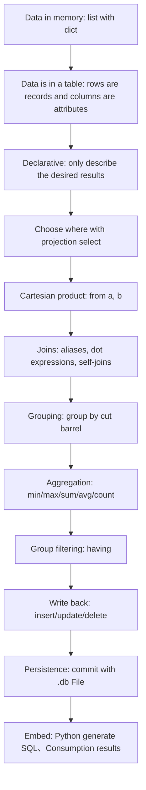
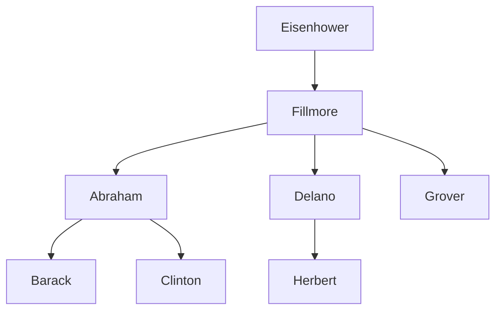
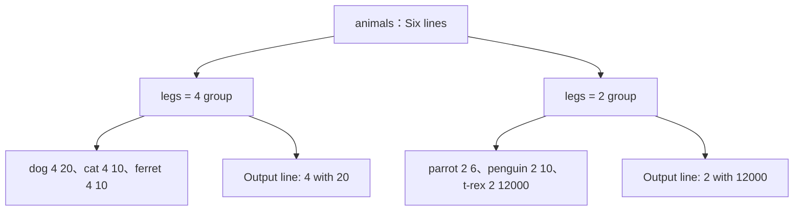
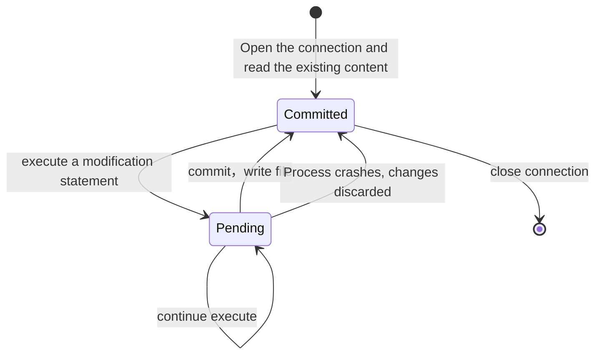
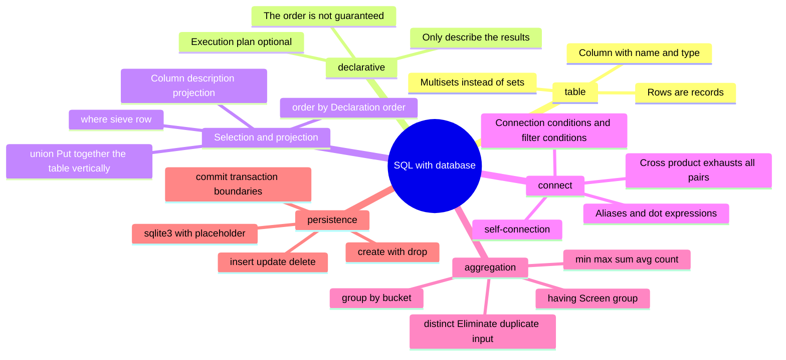

> **module**: M7 CS61A-sql, including Lecture 35–38 (SQL, Tables, Aggregation, Databases)
> **total duration**:01:34:29 (25:43 + 24:54 + 17:30 + 26:22), corresponding to station B points P 33–36
> **Collection**: [CS61A Fall 2024 Chinese subtitles collection](https://www.bilibili.com/video/BV1sy411z7nA), this module starts from P 33
> **courseware**: `33-SQL_1pp.pdf` (17 pages), `34-Tables_1pp.pdf` (22 pages), `35-Aggregation_1pp.pdf` (13 pages), `36-Databases_1pp.pdf` (13 pages), four official PDFs totaling 65 pages, all rendered page-by-page as text illustrations
> **subtitles**: Original English subtitles at Station B; the four lecture film sources are complete, but the last eight pages of the courseware of Lecture 37 and the grammar railway map page of Lecture 38 do not correspond to the oral broadcast. The text is collected according to logical positions and marked one by one.
> **Copyright**: The copyright of the course and courseware belongs to the UC Berkeley CS61A teaching team (Fall 2024); this article is a secondary compilation of Chinese for learning purposes, not a sentence-by-sentence translation

## 0. Module Navigation

*(Reference time: 00:00:01 – 00:00:16｜Lecture 35; 00:00:01 – 00:00:04｜Lecture 36; 00:00:01 – 00:00:11｜Lecture 37; 00:00:01 – 00:00:07｜Lecture 38)*

In the first six modules, the data always lives in the program's own memory: lists, dictionaries, and objects. Once the process exits, everything returns to zero. This module moves the data out into a container named by a name and managed by an independent system -**table**. There were two changes after moving out. The first is ownership: the data no longer belongs to a certain program, but to the place that can open it, so two processes can look at the same batch of rows and do things. The second is language: it is no longer Python statements that operate on this data, but a language that only describes the results, not the process.

The four lectures are arranged in a chain from "saying" to "doing" and then to "storing": Lecture 35 is about establishing grammar and world view, Lecture 36 is about increasing the number of tables from one to more, Lecture 37 is about replacing the statistical unit of "row", and Lecture 38 is about dropping all previous queries to disk. There is only one question throughout the four lectures: **The four operations in relational algebra - selection, projection, Cartesian product, and grouping - each correspond to which clause of SQL, and why the order of written statements is not the order of evaluation.**  The former determines whether you can read and understand the queries written by others, and the latter determines whether you can write queries that "look right but have wrong results".

### 0.1 List of Four Lectures

| speak | Topic | duration | courseware | points P | What are you responsible for in this module? |
| :--- | :--- | :--- | :--- | :--- | :--- |
| 35 | SQL Structured Query Language | 25:43 | 17 pages | [P33](https://www.bilibili.com/video/BV1sy411z7nA?p=33) | Table structure, declarative and imperative, `select`  Four parts, `union` |
| 36 | Tables multi-table query | 24:54 | 22 pages | [P34](https://www.bilibili.com/video/BV1sy411z7nA?p=34) | Cross products, aliases and point expressions, self-joins, multi-table joins, expressions |
| 37 | Aggregation aggregation | 17:30 | 13 pages | [P35](https://www.bilibili.com/video/BV1sy411z7nA?p=35) | Five aggregate functions, `group by`, `having`, aggregation and single value columns |
| 38 | Databases Databases | 26:22 | 13 pages | [P36](https://www.bilibili.com/video/BV1sy411z7nA?p=36) | Create table, delete table, three kinds of modifications, `sqlite3`, transactions and multiple connections |

The covers of the four courseware all have a one-line title on a white background, with no knowledge points on the page:


### 0.2 Main line diagram



This graph has two axes. Viewed vertically, yes **location**: The data goes from the process memory to the table, and then from the table to the disk file. Viewed sideways **unit**: Selection and projection take "one row" as the unit, Cartesian product combines two rows into one row, grouping and aggregation take "a set of rows" as the unit, and writing back restores the unit to one row. The further you go, the less things the programmer can control and the more things he can express.

The most easily misread part of the picture is the middle paragraph: `from a, b`  with  `where …`  It is not "check two tables first and then filter", but "create all the matches first and then judge one by one". This misunderstanding is the source of all the confusion in Lecture 36, and it is also the first brick to be removed in §3 of this article.

### 0.3 Accounts left in each lecture

| speak | the tools it gives | the questions it leaves behind | Who caught it |
| :--- | :--- | :--- | :--- |
| 35 | Tables and columns, `select`/`from`/`where`/`order by`, `create table as`, `union` | Only one table can be queried, and only one row can be viewed at a time | 36 |
| 36 | Cross products, aliases and point expressions, self-joins, multi-table joins, expressions | The output is always "line by line" and cannot answer "how many in total" | 37 |
| 37 | Five aggregate functions, `group by`, `having` | The watch only lives in one session and is gone when you close it. | 38 |
| 38 | Create table, delete table, three kinds of modifications, `sqlite3`, `commit` | Concurrency, indexing, and query optimization are left to database courses | §6 of this article and project list |

The third column is more important than the first two: every lecture is **Leave an unsettled account**, the next lecture is not a "new chapter", but "come to check out". Remembering this causal chain, you don't have to memorize the order of the four lectures - "Single table → Multiple tables → Grouping → Placement" This order was forced by the problem.

### 0.4 About this 65-page courseware

The four PDFs are not synchronized with the classroom lectures and must be explained clearly first, otherwise readers will not understand:

- Pages 3–7 of Lecture 35 are cover materials for five academic years, with only pictures and no explanation; the "UC Salary Data" section pages and funding histograms on pages 16–17 also have no oral broadcast, and the video stops at 25:41.
- The 22 pages of Lecture 36 basically cover it; the three dog exercise on page 18 is purely a demonstration, and the instructor did not read out the answers.
- Pages 6–13 of Lecture 37 are not spoken: the video is  `having`  Ending after presentation (full length 17:30), `cal`  Table cases, appropriation background pictures, and two sets of exercises can only rely on courseware images.
- Pages 4, 5, 7, 8, and 9 of Lecture 38 are the official syntax railway map of SQLite. Only the skeleton paths drawn in black are used in the lecture.

The orchestration principle is therefore **Pages follow the content, not the lectures**: Each page in the 65 pages only appears once in the section where it best explains the problem; for pages that are not mentioned, use " `编者说明`  Indicate "The pictures are taken from the courseware, and the comments are added by the editor."

### 0.5 Reading Route

- I just want to know how to write SQL: read §1 and §2, the two chapters combined are  `select`  complete syntax and semantics.
- Stuck on multi-table query: Read §3 directly, focusing on the cross product scale in §3.2 and the two conditions in §3.5.
- Be  `group by`  Surprise: read §4, focus on the rowset stage table in §4.4 and the rowset stage table in §4.5  `where`/`having`  Division of labor.
- To write a database program that actually works: Read §5, focusing on the placeholders in §5.6 and the transaction boundaries in §5.7.
- If you want to understand how the four lectures fit together at once: read the ten-step evolutionary chain in §6.

## 1. Declarative: SQL just says what you want

*(Reference time: 00:00:01 – 00:02:49｜Lecture 35)*

The first sentence of Lecture 35 is not about syntax, but about location: databases place data in structured tables. In the previous six modules, the shape of the data has been designed by the programmer, and a list or object can be created at will; in this module, the shape is designed by **table** regulations, and the table is managed by another set of software. When writing SQL, you are no longer "creating a data structure", but "making a request to an existing data structure."


The courseware then inserts five covers from previous years. They are the title materials of the same course in different academic years. They do not carry knowledge, but when put together they can show the time scale: the skeleton of this part of SQL has not changed in more than ten years, and only the song list and the name of the dog in the example have changed.


### 1.1 A table: rows are records and columns are attributes

Database Management System (DBMS) is called by the instructor as "the largest, most commonly used, and most worth studying" type of software. What it has to solve is never "calculating a number", but "how to accurately extract the desired part when there is a lot of data, a lot of users, and a long time." Institutions are willing to pay high fees for it, and there are high-quality open source implementations in this field-two things that are true at the same time, indicating that it is both difficult and important.

The courseware uses three arguments to explain why data is valuable: AI is trained by data; digital images are composed of pixel values; the most important resource for large companies is user data. All three point to the same conclusion: data itself is not the answer; **Data can only generate value if it can be stored in a structured manner and queried accurately.**.


Tables are the most common structure. A table is a collection of records; records are rows, and each row has a value for each column in the table; columns have names, and the names indicate which attributes they contain, and usually also have types, which determine what can be placed in this column and how it can be compared.


The courseware uses a city table with three rows and three columns: Latitude, Longitude, and Name. The three rows are Berkeley (38, 122), Cambridge (42, 71), and Minneapolis (45, 93). The header is not a record, it is just a column name.

The division of labor between rows and columns can be remembered in one sentence: **Rows describe "one thing" and columns describe "the same property of all things"**. Adding a city is adding a row; adding "population" is adding a column, and this column must have a value for every existing row. This constraint may seem rigid, but it is what makes the query predictable: any column in any row can be referenced.

| criterion | row(row/record) | column |
| :--- | :--- | :--- |
| what does it mean | a complete object | A property common to all objects |
| Growth method | add record | Add attributes, old rows must be filled with values |
| Function during query | Filtered, projected units | The unit being quoted or compared |

SQL, the full name of Structured Query Language, may be the most widely used programming language in the world. It is indeed a programming language: it can generate new tables from existing tables, and it can also change the contents of tables. The only special thing is that "program" looks like an English sentence, and it almost reads like a requirement. An analogy that only works in memory is to think of a table as a "list of dictionaries with the same keys"; it fails to explain the real value of a database - millions of rows on disk, with the ability to skip most of them using indexes.

### 1.2 Declarative vs. imperative: recipes vs. orders

SQL is a \*\*declarative\*\* language: a program is a description of the expected result, and the interpreter finds a way to generate this result; Prolog is another example. \*\*Imperative\*\* languages ​​are the opposite: the program describes a calculation process, and the interpreter goes through the process according to the written evaluation rules. Python and Scheme both belong to this side.

| criterion | imperative | declarative |
| :--- | :--- | :--- |
| object described by the program | Calculation process: what to do first, what to do next | Desired Result: What to Want |
| Who decides to perform the steps | The programmer writes the rules and the interpreter follows them | Interpreter or DBMS choice |
| Representatives in the course | Python, Scheme | SQL, Prolog |
| predictability | The order of evaluation is basically predictable. | Depends on data distribution and execution plan |
| The cost of writing a program | High: The steps must be written in full | Low: only write results |


The courseware uses cooking as an analogy. An imperative is a recipe with every step written down: two teaspoons of salt, two teaspoons of yeast, three cups of flour, two tablespoons of olive oil, a quarter cup of water, start mixing, and put the dough on the chopping board. The declarative order only has one sentence: "Make me a pizza." How to knead the dough, what temperature to bake, and whether to put the cheese or sauce first are all the freedom of the store.

Most of the time in this class was spent on training one thing: being able to mentally rehearse what the interpreter will do when writing a line of program. Declarative languages ​​make this difficult. There are often multiple execution methods for the same query. The DBMS will choose the one it thinks is the fastest, and "fastest" depends on how big the table is, whether there are indexes, and how the data is distributed. The trade-off is effort, and it's a clear trade: less work to write the query and more difficulty to understand the query. "The output sequence is wrong" and "the result is more rows than expected" that appear repeatedly in the next three lectures are all the bills of this transaction.

### 1.3 Execution Plan: The Calculator Behind That "One Sentence"


The courseware posted a real execution plan of SQL Server. The same query is split into an operator tree: Hash Match, Index Scan, and Compute Scalar each carry cost estimates and row number estimates. If you change the plan, the speed may differ by several orders of magnitude; which one you choose depends on how big the table is, whether there are indexes, and how the data is distributed.

The three operators correspond to three "how" decisions: which table to scan first, how to align the rows on both sides, and when to calculate the expression. This is also what the "cost model" in the title of this module means: SQL **decision-making power** In exchange for the simplicity of writing, the cost itself has not disappeared, but has been transferred to the system's temporary decision-making.

### 1.4 Standard, dialect and two skeleton sentences


SQL has a standard, defined by a widely accepted set of specifications; the only people who don't fully embrace it are the vendors who actually implement DBMS - each wants to add a few more features to their product that others don't have. So there are many dialects of SQL: the basic syntax is the same, and the peripheral functions have their own language. This course only takes the intersection, the part that all DBMSs agree on.

Two statements support the first half of the module. `select`  Create a new table, either from scratch or projecting from an existing table; `create table`  Give a table a global name so that it can be referenced by subsequent statements. `select`  When used alone, the results are only displayed and not saved; to be used repeatedly, you must  `create table ... as`. As for  `insert`, `update`, `delete`  These three statements that change the contents of the table, and  `analyze`, `explain`  These two diagnostic statements are only named in the first half of the module and will be expanded on in Chapter 5.

There are three ways to get started: install a SQLite (the simplest and free); use the online version of SQLite; or use the SQL Example program included with the textbook. The last one is not a complete DBMS, only a demonstration  `select`  explanation process, but it can run the examples in the first two lectures. course network  `code.cs61a.org`  It also has a SQL interpreter, and the two dog pedigree tables in §3 are built in there.

> **Editor's note**: `explain`  Show execution plan, `analyze`  Collect statistical information. These two items are directly related to the execution plan diagram in §1.3, but the course only names them and does not expand them.

## 2. Projection and table assembly: all components of a SELECT

*(Reference time: 00:02:50 – 00:25:41｜Lecture 35)*

The previous chapter answered "What kind of language is SQL?" and this chapter answers "What can it do?" There is a very specific action between the two: first create a table, and then project it into another table. This chapter goes through "table creation → table assembly → filtering → line-by-line arithmetic", and finally stops at two easily overlooked conclusions: projection does not remove duplicates, and the output does not preserve order.

### 2.1 create table ... as: Give a query a name

A table is usually not created out of thin air: it is written to by other applications - logs, forms, sensors, accumulated row by row. SQL also allows you to create tables from scratch. The course will first use this method to create a few very small tables so that there will be something to look up in subsequent queries.

```sql
create table cities as
  select 38 as latitude, 122 as longitude, "Berkeley" as name union
  select 42, 71, "Cambridge" union
  select 45, 93, "Minneapolis";
```

This statement does three things: `create table cities as`  Statement "Save the subsequent query results as  `cities`"Article 1  `select`  Describe one row and three columns and give column names; two  `union`  Join the other two lines. Quotes distinguish values from names -`"Berkeley"`  In quotes because it is a value, `latitude`  There are no quotes because it is a column name; without the quotes, Berkeley will be found as a column name.

> **Editor's note**: SQLite allows writing strings with double quotes; standard SQL is more strict, using single quotes for strings and leaving double quotes for identifiers. Courseware uses double quotation marks, and this article is transcribed accordingly. Later text  `ints`  With double quotes inside and outside the table  `"1"`, `"2"`  are column names, because that table does have those columns.

`union`  There are three rules: the number of columns on both sides is the same; the corresponding column types are compatible; and the column names are written in the first paragraph. The first two are hard constraints, and the third is just a naming convention. a literal paragraph  `select`  Generate one row, then connect it twice to get three rows - this is obviously not a conventional way to create a table. You would only write it like this when you really have nothing. With the table in hand, you can ask questions:

```sql
select "west coast" as region, name from cities where longitude >= 115
union
select "other", name from cities where longitude < 115;
```

There are three rows of results, but only two paragraphs are written in the query.  `select`: The second paragraph describes not one row, but all rows with a longitude less than 115.

| region | name |
| :--- | :--- |
| west coast | Berkeley |
| other | Cambridge |
| other | Minneapolis |

The output of a query is determined by the data, which is where it's useful. By the way, a detail: Cambridge is Cambridge, Massachusetts. Latitude 42 and longitude 71 indicate that it is in North America - the coordinates are not just decoration, they are the basis for judgment.

### 2.2 union: put together the table vertically and remove duplicates by the way

Change the subject to dogs. The lecturer liked dogs and the President of the United States, so his dogs were named in alphabetical order: Abraham, Barack, Clinton, Delano, Eisenhower, Fillmore, Grover, Herbert. The names are arranged from A to H so that subsequent string comparisons can be understood at a glance. These dogs form a family tree, which can be represented by a two-column table: each row is a father-son edge.

```sql
select "Abraham" as parent, "Barack" as child union
select "Abraham", "Clinton" union
select "Delano", "Herbert" union
select "Fillmore", "Abraham" union
select "Fillmore", "Delano" union
select "Fillmore", "Grover" union
select "Eisenhower", "Fillmore";
```

Seven rows and two columns. first paragraph  `as parent`, `as child`  Column names are given to the results, and only values are written in the next six paragraphs; all statements end with semicolons.

| parent | child |
| :--- | :--- |
| Abraham | Barack |
| Abraham | Clinton |
| Delano | Herbert |
| Eisenhower | Fillmore |
| Fillmore | Abraham |
| Fillmore | Delano |
| Fillmore | Grover |

Draw this table according to the relationship between father and son, which is the hand-drawn tree on the right side of the courseware:



Tables and trees are two views of the same data: a table is a flat collection of rows, and a tree is how these rows are connected according to parent-child relationships. There is only one storage format, but there are many ways to interpret it. This will become powerful in the next chapter: a table can be connected to itself, so relationships such as "brothers" and "grandchildren" can be calculated without having to save a separate table.

`create table`  Then turn the results of a query into data that can be accumulated:

```sql
create table [name] as [select statement];
```


The demonstration of the courseware is a song list: `spotify`  Record the songs that the lecturer listens to most often, one song per line, and the two columns are the song titles and singers.

```sql
create table spotify as
  select "wildflower" as track, "billie eilish" as artist union
  select "birds of a feather" , "billie eilish"          union
  select "360"                , "charli xcx"              union
  select "pasilyo"            , "sunkissed lola"          union
  select "cinderella"         , "remi wolf"               union
  select "good luck babe!"    , "chappell roan"           union
  select "meow"               , "anamanaguchi";
```

Indentation and alignment are only for human eyes. SQL is not sensitive to spaces and case, and it is completely correct to write the entire statement on one line; the courseware  `union`  Aligned with commas to make "which column corresponds to which column" visible at a glance. This table will be queried repeatedly later, and it is also an example of "the first paragraph determines the column name".

### 2.3 from, where, order by: three-piece set of projection


The meaning of projection is very straightforward: for each row of the input table, calculate an output row according to the column description.

```sql
select [columns] from [table] where [condition] order by [order];
```

Each of the four parts is responsible for one thing: `from`  Say which table to fetch rows from, `where`  Tell me which lines to leave behind, `order by`  It tells how the remaining rows are sorted, and the column description tells how each remaining row becomes an output row. The two queries in the courseware are very short:

```sql
select child from parents where parent = "Abraham";
```

first  `parents`  Find here  `parent`  equal to  `Abraham`  of rows, there are two rows; then add the rows of each row  `child`  Vote out and get Barack and Clinton.

```sql
select parent from parents where parent > child;
```

String comparison is in alphabetical order: F is after A and D, so among the three lines where Fillmore is the father, Abraham and Delano are satisfied, but Grover's line is not satisfied; the other lines are also not satisfied. The result is that the Fillmore appears twice.

| parent |
| :--- |
| Fillmore |
| Fillmore |

Two rows of identical values can exist in a table at the same time. The table is not a set, but a multiset: projection is only responsible for calculating values, not for deduplication. This is consistent with  `union`  Just the opposite: `union`  Remove weight, `select`  Don't lose weight.

> **Editor's note**: `order by`  Only the grammar appears in the courseware, and there is no demonstration. It is written as  `order by 列名`, default ascending order, add  `desc`  descending order; `limit N`  Take only the first N rows. The three often appear in pairs: sort them first, and then take the top ones. This addition is not in the video.

### 2.4 The scope of an expression is one line

`select`  Arithmetic can be done in the expression: the column name represents the value of the current row in the expression. The courseware uses the cable car at a ski resort as an example - each chair has a number, recording the number of individual passengers and the number of couples, and a couple occupies two seats.

> **Editor's note**: The cable car table does not appear in the courseware, and the column names and row numbers are restored according to the lecturer's oral instructions (No. 101 has two solo passengers and two couples, No. 102 has three couples, No. 103 is almost all solo passengers, and each row has a total of 6 people).

| chair | single | couple |
| :--- | :--- | :--- |
| 101 | 2 | 2 |
| 102 | 0 | 3 |
| 103 | 6 | 0 |

```sql
select chair, single + 2 * couple as total from chairs;
```

Count each row once: 101 is 2 + 2×2 = 6, 102 is 0 + 2×3 = 6, and 103 is 6 + 2×0 = 6. All three rows are filled with six people, but the configuration is different.

| chair | total |
| :--- | :--- |
| 101 | 6 |
| 102 | 6 |
| 103 | 6 |

The key is "no crossing lines": it counts as 101  `total`  When , the expression only reads the line 101  `single`  with  `couple`; 102, 103 each counts for its own sake. The lecturer specifically emphasized this point because it is the dividing line for subsequent aggregation - once a function that "combines multiple rows" appears in an expression, the row boundaries are broken. Column names act like local variables here: the scope is the current row, so the same column name takes a different value in each row, but the expression is only written once.

### 2.5 Discussion question: ints table and powers of 2

The material for the discussion topic is a  `ints`  Table describing how each integer is written as the sum of powers of 2. Every positive integer has one and only one way of writing it, so this table is actually enumerating binary numbers; the four powers are 1, 2, 4, and 8 respectively.

| word | 1 | 2 | 4 | 8 |
| :--- | :--- | :--- | :--- | :--- |
| one | 1 | 0 | 0 | 0 |
| two | 0 | 2 | 0 | 0 |
| three | 1 | 2 | 0 | 0 |
| four | 0 | 0 | 4 | 0 |
| five | 1 | 0 | 4 | 0 |
| six | 0 | 2 | 4 | 0 |
| seven | 1 | 2 | 4 | 0 |
| eight | 0 | 0 | 0 | 8 |

> **Editor's note**: Courseware is not given  `ints`  The table creation statement, table structure and query are restored according to the lecturer's dictation. He called the four columns "the 4 column" and "these 1, 2, 4, and 8 up here", hence the column names.  `1`, `2`, `4`, `8`  And add double quotes - the identifier cannot start with a number, and quotes must be used as a column name.

First question: Given two columns for each integer, `word`  with  `value`, the latter is the sum of four powers.

```sql
select word, "1" + "2" + "4" + "8" as value from ints;
```

The result is exactly 1 to 8. `"1"`  Looks like a number, but is a column name in the expression -`select`  Names appearing in expressions are always interpreted by column name first. This is also the reason why these column names should be enclosed when creating a table: without quotation marks, `1`  Just numeric literals, the four constants add up to 15 for each row.

Second question: Only powers of 2 are left. The judgment method is "exactly one binary bit is 1": divide each column by its own power, and all four columns will become 0 or 1. The sum of four 0/1 is equal to 1, which is satisfied.

```sql
select word from ints where "1" + "2"/2 + "4"/4 + "8"/8 = 1;
```

The result is  `one`, `two`, `four`, `eight`  Four lines. this paragraph  `where`  The division here is to normalize "whether this column is selected" into 0/1: `"2"/2`  When the value is 2, it gets 1, when the value is 0, it gets 0, and the rest are the same. What's really worth stopping at is what you see when executing: In SQLite  `select * from ints;`, the order of the rows is different from what was written when creating the table, it has changed to  `word`  alphabetical order. The reason is  `union`: It wants to remove duplicate rows, and one implementation of deduplication is to sort all rows first and then scan adjacent rows; order is a by-product of deduplication.

| Operation | Whether to remove duplicates | Is the order guaranteed? |
| :--- | :--- | :--- |
| `select`  projection | Don't remove weight | No guarantee |
| `union` | Remove duplicates | Not guaranteed, may be disrupted by sorting |
| `order by` | Don't remove weight | Sort by declared key |

This is the first real cost of declarative languages: for the same query, the system can execute it in the way it thinks is fastest, and the order of output may change depending on the data, version, and plan. By writing down the "sequence" as part of the query, the results will be reproducible.

### 2.6 From demo to real data


The video ends at "Powers of 2", and there is no explanation in the last two pages of the courseware. Page 16 is a sectioned page Example: UC Salary Data, Passwords. The footer gives two data sources - UC salary data from Transparent California and the leaked password data set on Kaggle.


Page 17 is a bar chart titled State Educational Appropriations with FY01 through FY21 on the horizontal axis and millions of dollars on the vertical axis. The graph plots the 2001 and 2008 recessions as well as COVID-19; two annotations give the conversion: \$1 in 2001 is equivalent to \$1.53 in 2021; state support for UC has fallen 46% since 2001, adjusted for inflation. California, USA, had 32,128 students in the fall of 2001, corresponding to an average student body of \$23,811, and 45,057 students in the fall of 2021, corresponding to an average student body of \$7,857.

These two pages do not teach grammar, but they illustrate the usefulness of SQL: real tables are often large and complex, and the value of the query lies in combining the columns "appropriation, number of students, and year" into results that can answer the question. The same motivation appears again in Lecture 37, when it results in a feasible query (§4.6 will give  `cal`  table case).

> **Editor's note**: These two pages do not appear in the video. The above content is recorded according to the courseware screen and does not represent classroom explanation.

## 3. Multiple tables: cross product is the starting point of everything

*(Reference time: 00:00:01 – 00:24:53｜Lecture 36)*

The query from the previous chapter has an implicit restriction: the number of output rows cannot exceed the number of input rows. `where`  Only rows will be deleted, and column descriptions will only be changed. Multi-table join is the first operation that can change the number of rows, and it does multiplication first and then subtraction——`from a, b`  Create all pairs, `where`  before deciding which pairings count. Therefore, there are only two questions left for multi-table query: whether the cross product is exhaustive, and whether the condition distinguishes the two conditions.

### 3.1 Review: A select is just projection


The tools in the previous lecture can be summarized in a one-line syntax, where each square bracket is a replaceable component:

```sql
SELECT [columns] FROM [table] WHERE [condition] ORDER BY [order];
```

`FROM`  Specify the input table; the column description determines how each row of input is projected into the output; `WHERE`  Select a subset of rows; `ORDER BY`  declaration order; `[column] AS [name]`  Only the output header is changed, the original table is not changed.


It is worth emphasizing separately: **Column descriptions work row by row**. There are as many lines of output as there are lines of input (unless  `WHERE`  Screen out some first). This property of "the number of rows does not change" is the basis for understanding the connection - the reason why the connection is special is that it changes the number of rows first. There are three engineering conventions at the bottom of the page: SQL is not case- and indent-sensitive; a semicolon marks the end of a statement; and a statement can be written on many lines.

### 3.2 The first perspective of connection: exhaustive pairing


In the video, the lecturer gives a vaccination first: If you ask anyone "what is join", the other person will probably ask "what kind of join are you talking about". The database field has been pondering this problem for too long, and has invented so many connection methods that even professionals find it complicated. This lecture only talks about the most basic one, and the other types can be regarded as adding conditions or supplementary lines to it. The definition is only one sentence: **Use commas (or keywords) between table A and table B  `JOIN`) connection to obtain all combinations of "a row of A" and "a row of B".**  The focus is not on "combination" but on "all".

The courseware uses two Moments playlists as examples:

```sql
CREATE TABLE shm_tracks AS
SELECT "360" AS track, "charli" AS artist UNION
SELECT "cinderella"     , "remi"             UNION
SELECT "wildflower"     , "billie";

CREATE TABLE anya_tracks AS
SELECT "apple" AS track, "charli" AS artist UNION
SELECT "taste"         , "sabrina"          UNION
SELECT "wildflower"    , "billie";
```


`CREATE TABLE … AS`  What follows is not literal data, but three items without  `FROM`  of  `SELECT`--They don't have an input table, they just create a row out of thin air. The structures of the two tables are exactly the same: two columns, `track`  with  `artist`. This type of "two isomorphic tables" is the most common and error-prone scenario for joining.


The challenge is: write a  `SELECT`  Find tracks that both of you own and use when there are hundreds of songs. How would you do it by hand? **Take each row of the first table and compare it with each row of the second table**- This is not an algorithmic trick, but the definition of connection itself. Three lines times three lines, nine times; the general situation is  $N \times M$  times. It is impossible to generalize nine lines of handwriting, so let SQL do the exhaustive work.


```sql
SELECT * FROM shm_tracks, anya_tracks;
```

Nine rows and four columns. The order of the columns is "first all the columns of A, then all the columns of B", and the order of the rows is "the first row of A is matched with the three rows of B, then the second row of A is matched with the three rows of B..." - the outer loop goes through A, and the inner loop goes through B. The lecturer's key comment is: Many rows here have nothing to do with each other, such as "360" being assigned to "taste". **They appear in the results not because of any connection, but because of exhaustion.**  Cross Product does not pretend to understand the business, it is only responsible for putting all possibilities on the table; which pairing counts, is  `WHERE`  work.

When I want to select a column, the problem of duplicate names is immediately exposed:

```sql
SELECT track FROM shm_tracks, anya_tracks;
```

```text
Parse error: ambiguous column name: track
```

Both tables have a column called  `track`, the parser can't tell which one you're talking about.

Worth remembering: **The number of rows is  `FROM`  It has been determined**, the back  `WHERE`  It will only decrease, not increase. The result is that the number of rows is more than expected. The problem is probably in the cross product, not in the  `WHERE`  Missed something.

There are two ways to read the same connection. This section talks about the first way:

| criterion | Perspective A: cross product first, then filtering | Perspective B: Edge matching, edge merging |
| :--- | :--- | :--- |
| Statement writing | `FROM a, b WHERE 条件` | `FROM a JOIN b ON 条件` |
| existence of middle row | Conceptually real, possibly very large | Conceptually does not exist, the algorithm directly produces legal rows |
| When is the number of rows determined? | in  `FROM`  that moment is  $N \times M$ | Accumulated row by row by matching process |
| Means of realization | Nested loop (outer A, inner B) | Nested loops, hash joins, sorting and merging, index search |
| Teaching purposes | Explain "Why the number of rows in multi-table queries explodes" | Explain "Why Real Systems Can Hold Up" |

**Use viewing angle A when checking calculations**, because the intermediate table can be listed row by row; **Use perspective B when judging performance**, because what the optimizer changes is the matching order and algorithm. This split is the specific manifestation of the sentence in §1 that "declarative takes away the decision-making power of cost" in multi-table queries.

### 3.3 Aliases and dot expressions: clarify duplicate names


The lecturer first made a temporary agreement: pretend that "the name of each column is different in all tables", and sum up the cross product  `WHERE`  Use it once you are familiar with it, and come back to deal with it when you encounter the same name. The disambiguation syntax itself is very light. The difficult thing is to think clearly "after the connection, the columns of the two tables are mixed in one row". The solution has two halves, which are complete when combined: **dot expression** `表名.列名`  Indicate which table this column comes from; **Alias** `FROM shm_tracks AS s`  Give the table a short name and use it later  `s.track`  refer to it.


```sql
SELECT shm_tracks.track AS s_track, shm_tracks.artist AS s_artist,
       anya_tracks.track AS a_track, anya_tracks.artist AS a_artist
FROM shm_tracks, anya_tracks;
```

The result is still nine rows and four columns, but the four headers are different from each other. This is the most important output of this section——**Renaming a column is not to beautify it, but to make subsequent  `WHERE`  Name available**: It turns out those two  `track`  are the same string and cannot be distinguished by SQL; after changing the name, `s_track`  with  `a_track`  They are two different identifiers, so the conditions can be written.


```sql
... WHERE s_track = a_track;
```

Only one of the nine lines satisfies: wildflower, sung by billie on both sides. Note that "common song" itself is ambiguous - does it count if the song title is the same, or does it count if both the song title and the singer are the same? In this data set, the two definitions give the same row. In real data, they will diverge and must be decided before writing a query. put  `WHERE`  Replace with  `s_track = a_track OR s_artist = a_artist`, leaving two lines out of nine (`360`  Match  `apple`  Because the singer is the same, `wildflower`  Because the music is the same). Although the change is small, it exposes the essence of the connection: `WHERE`  The conditions here are correct **every pairing** Independently evaluated Boolean expressions.

### 3.4 Self-join: Let a table appear twice at the same time


The new question requires more data: "pairs of tracks" by the same singer. Each singer only appeared once in the original playlist, so I inserted two lines first:

```sql
INSERT INTO shm_tracks VALUES ("bad guy", "billie");
INSERT INTO shm_tracks VALUES ("apple", "charli");
```

`INSERT INTO`  There are no column names in the template, only values, which means **The number and order of values must correspond to the columns of the table.**. If you write it backwards, no error will be reported, and the singer will be silently written into the song title column.


To create a table with "two columns of song names", two rows of data need to be present at the same time, and each row in the table only has one song name——**The only way is to make this table appear twice**:

```sql
SELECT a.track AS track1, b.track AS track2
FROM shm_tracks AS a, shm_tracks AS b;
```

The courseware stopped here and asked: How many rows and columns will be displayed? 25 rows, 2 columns. The cross product of the table of the five elements and itself yields  $5 \times 5 = 25$  pairings. **The self-join will not become smaller because "it is the same table", it is still a complete Cartesian product.**  Alias  `a`, `b`  It is to turn "two roles on the same table" into two distinguishable names.


```sql
SELECT a.track AS track1, b.track AS track2
FROM shm_tracks AS a, shm_tracks AS b
WHERE a.artist = b.artist AND a.track < b.track;
```

The result is two lines: `360`  with  `apple`(charli), `bad guy`  with  `wildflower`(billie).`a.artist = b.artist`  is **Connection conditions**, stitching together the lines of the same singer in two copies; `a.track < b.track`  is **Deduplication conditions**, decide to keep only one direction for a pair of songs.

Why use the less than sign instead of the inequality sign? put  `<`  Replace with  `<>`, the function can also produce results, but it will become ugly: in 25 matches  `<>`  Leaving 20 lines, and these 20 lines are written in reverse order, there are only 10 sets of real song pairs; then add "same singer", `<>`  Give 4 rows, `<`  Only give 2 lines. The fundamental reason is  `<>`  Symmetry ($(x, y)$  Establishment principle  $(y, x)$  necessarily established), and  `<`  Antisymmetric (exactly one of a pair is satisfied). The lecturer's original words were: If you use "not equal", you will say both "Barack is Clinton's brother" and "Clinton is Barack's brother", saying the same thing twice.

This experience can be generalized into a criterion: **When the answer is an unordered pair, use  `<`  or  `>`  Pick a representative; when the answer is an ordered pair, use  `<>`  Keep both directions.**

### 3.5 Two tables and a tree: connection conditions and filtering conditions


CS61A’s classic data set: one  `dogs`  Remember the name and coat color, one sheet  `parents`  Remember the parent-child relationship. The tree is drawn twice on the right side of the courseware, with the name on the left and the codes E, F, A, D, G, B, C, H on the right; the eight codes are the initials of both the courseware name and the video name (ellie/Eisenhower are both E), so the two sets of names can match each other.

The question is: Show the poodle's parents.

```sql
SELECT parent FROM parents, dogs WHERE child = name AND fur = "curly";
```

One sentence contains all the main points of this chapter: `FROM parents, dogs`  It is the cross product (seven rows multiplied by eight rows, fifty-six rows randomly paired); `child = name`  is **Connection conditions**, spanning two tables, say "`parents`  That kid is  `dogs`  That dog in there"; `fur = "curly"`  is **filter conditions**, only involves one table; `SELECT parent`  It's projection. result  `ellie`  with  `daisy` (Eisenhower and Delano in the video).

| criterion | join condition | filter condition |
| :--- | :--- | :--- |
| Several tables are involved | Columns of two (or more) tables | Usually there is only one table |
| This example | `child = name` | `fur = "curly"` |
| If you delete it | The cross product remains the same, but the pairs are all mismatches. | The number of lines increases, but the remaining ones are still correct pairs. |
| Answered questions | Do these two lines say the same thing? | Do I want these lines? |
| Consequences of wrong writing | Get the answer "Right quantity, wrong content" | Just a few more or less lines |

This is why incorrectly written connection conditions are much more dangerous than incorrectly written filter conditions: the latter allows you to see the wrong number, while the former allows you to see answers with the right number and wrong content, and when the data set is small, you often cannot tell the difference.

In the video, the lecturer did not finish writing in one go, but approached it in two steps: first write  `SELECT * FROM parents, dogs WHERE child = name`  Get seven lines (each parent-child relationship matches exactly one dog), and then append  `AND fur = "curly"`  Down to two lines, and finally change the column description to  `SELECT parent`. These three steps are exactly "cross product → filtering → projection". He said something very simple: first let’s see where we are - don’t write the multi-table query all at once. Run the connection first to see the number of rows, add conditions, and then collect the columns.

Why split into two tables? Write the coat color directly  `parents`  It also works, at the cost of storing the same dog's coat color repeatedly: `finn`  If you have three children, you have to write "curly" three times. If you write it wrong in any place, the same dog will have two coat colors. After being disassembled, the coat color of each dog is only saved once, at the cost of having to write an extra link each time. This is the basic trade-off of relational databases——**Trade connection overhead for data consistency**. There is also a practical detail during the demonstration: the table creation statement is placed in  `dogs.sql`  In, use when starting SQLite  `-init`  The flag is executed first to separate "create data" and "query data".

### 3.6 Three tables: grandparents and same coat color


The semantics of multiple tables are exactly the same: **Take one row from each table, all combinations.**  Three tables are three-dimensional triples, and the number of rows is the product of the row numbers of each table. The courseware first gave a multiple-choice question, using a table to connect oneself to find grandparents. Only the third of the five candidates was correct:

```sql
SELECT a.parent, b.child FROM parents AS a, parents AS b
WHERE b.parent = a.child;
```

Each error has its own way of doing it: Options 1 and 4 refer to non-existent  `grandparent`  Column; Option 2 Write the condition as  `a.parent = b.child`, the direction is reversed, and you get a line like "self matches itself". Number 3 reads like a tongue twister: `b.parent = a.child`  means——`a`  There is a child in this line, `b`  There is a parent in this line, and if these two names are the same person, then  `a` 's parents are  `b`  child's grandparents. Insiders call this "middleman": grandfather and grandson can only be connected through the middle generation. However, there is no "grandfather" column in the table, only a "father-son" relationship, so the table must be used twice.


```sql
CREATE TABLE grandparents AS
  SELECT a.parent AS grandog, b.child AS granpup
  FROM parents AS a, parents AS b
  WHERE b.parent = a.child;
```

List  `grandog` (ancestral dog) and  `granpup` (Sun Dog) is a word coined by the courseware, but the name is meaningful: the column name should indicate that this column is **role in results**, rather than what it was called in the original table. The results of the six lines are calculated according to Zugou: `ellie` 's three grandchildren happen to be  `finn`  of three children (`ace`, `daisy`, `ginger`). This step is worth taking because **Query errors in three tables are rarely due to syntax errors, but mostly due to miscalculations in the middle table.**.

The next question is "Grandparents and grandchildren have the same coat color", which is the only three-table connection in the whole lecture. Why do you need three? because  `grandparents`  There is only a name but no coat color. To compare the coat colors at both ends, you must go back to  `dogs`  Check twice, so two aliases are needed:

```sql
SELECT grandog FROM grandparents, dogs AS c, dogs AS d
WHERE grandog = c.name AND
      granpup = d.name AND
      c.fur = d.fur;
```

three  `AND`  Read into three sentences: `c`  This copy is responsible for the ancestor dog, `d`  For grand dogs, the coat color at both ends should be the same. Number of rows: six rows × eight rows × eight rows = 384. Cross the rows and sift into two rows (`ellie`, `finn`). Cubic table references are not a waste; **Every citation pays for a "coat color check"**. Check calculation: `ellie` Of (short)’s three grandchildren, only  `ginger` (short) same coat color, `finn` Of (curly)’s three grandchildren, only  `hank` (curly) Same coat color.


The last page is the adapted question from the 2014 autumn quiz: Select **The three are different from each other and have the same coat color.** All combinations of dogs, each group is arranged in reverse alphabetical order, and it is expected to output two lines (`daisy|charlie|ace`  with  `ginger|ellie|bella`, the vertical bar is SQLite's column separator). The difficulty is "different from each other" - the cross product will give a large number of repeated combinations. The expected output gives a hint: each group is written in reverse alphabetical order, which can be used to generalize the technique in §3.4.

> **Editor's note**: The courseware only provides questions and expected output, but does not provide answers. The video section is also a pure demonstration. The following sentence was reconstructed by the editor according to the meaning of the question. It uses cubic table references and three inequalities to express "same coat color" and "different from each other and only appear in one direction" at the same time.

```sql
SELECT a.name, b.name, c.name
FROM dogs AS a, dogs AS b, dogs AS c
WHERE a.fur = b.fur AND b.fur = c.fur
      AND a.name > b.name AND b.name > c.name;
```

The three inequalities connected equal to the requirement  $a > b > c$: It not only excludes any two that are the same, but also ensures that each group only appears in one order. The change in the number of rows is very telling: not screening at all  $8^3 = 512$  OK, only keep the remaining coat color conditions  $3^3 + 3^3 + 2^3 = 62$  OK, add three more inequalities and only two lines remain. Check coat color: `long`  three, `short`  three, `curly`  There are only two - less than three, so  `curly`  There is no row in the group, this is not an error.

### 3.7 Numerical expressions: Where you can write it is more important than what you can write


Joins bring columns together, and expressions determine what those columns can do. The numerical expressions in SQL are almost the same as those in Python. The difficulty is not in the syntax but in the **where can it appear**: In the column description, `WHERE`  Li, `ORDER BY`  Here, the three rules are the same.


The courseware divides operators into three categories: merge (`+` `-` `*` `/` `%` `and` `or`), transform (`abs` `round` `not`  one yuan  `-`), compare (`<` `<=` `>` `>=` `<>` `!=` `=`). Comparison classes differ from Python in two ways: **It doesn’t mean there are two ways to write it** `<>`  with  `!=`, completely equivalent; **There is only one equal sign  `=`**. The lecturer's reason is simple: there is no such thing as "assignment" here, so the single equal sign has no other use.

The demonstration in the video starts from a  `cities`  The list starts (Berkeley, Cambridge, Minneapolis, San Diego, Miami, plus one "not really a city but let's leave it alone" North Pole). The first demonstration is  `UNION`: `SELECT name FROM cold;`  I got Minneapolis and North Pole, but Chicago was also cold, so I added  `SELECT "Chicago"`  and come in. The second paragraph is an arithmetic expression - calculating the north-south distance between two cities:

```sql
CREATE TABLE distances AS
  SELECT a.name AS first, b.name AS second,
         60 * (b.latitude - a.latitude) AS distance
  FROM cities AS a, cities AS b;
```

Self-join again: `a`  with  `b`  There are two versions  `cities`, so the latitudes of two cities can be placed in the same row. Multiply by 60 because one degree of latitude is approximately 60 nautical miles. The reason given by the lecturer is business judgment: **Climate is mainly determined by latitude, and the difference in longitude between east and west is far less important than that between north and south.**——Think clearly "what quantity is meaningful to the problem" first, and then write SQL.

```sql
SELECT second FROM distances WHERE first = "Minneapolis" ORDER BY distance;
```

`ORDER BY distance`  The default is ascending order, so the one with the most negatives is listed first, that is, the one that goes furthest south: Miami and San Diego are at the front, and North Pole is at the end. The implicit teaching point of this example is: `ORDER BY`  You can use expressions, or even aliases just created in the column description - the sorting does not have to be based on a certain column of the input.

> **Editor's note**: The subtitle of this paragraph reads "There are 16 nautical miles in one degree of latitude", but the expression written immediately after is  `60 * …`. By definition, one degree of latitude is about 60 nautical miles (1 nautical mile = 1 minute of latitude). The expression is consistent with the definition. The number 16 in the subtitle should be a slip of the tongue or a recognition error. This article shall be based on the expression.

### 3.8 String expressions: splicing, substrings and "don't use strings to store structures"


The string combination method is splicing, and the operator is two vertical lines: `SELECT "hello," || " world";`  get  `hello, world`. The lecturer sounded decidedly relaxed here, saying that this was a very common thing, so it was "given the green light."


But then the tone changed. SQL's built-in string functions are different from Python's functions of the same name, and the instructor said directly: **The language's support for string processing is not very good.**.

```sql
CREATE TABLE phrase AS SELECT "hello, world" AS s;
SELECT substr(s, 4, 2) || substr(s, instr(s, " ")+1, 1) FROM phrase;
```

The result is  `low`: `substr(s, 4, 2)`  Take 2 from the 4th character to get  `lo`; `instr(s, " ")`  Find the space at position 7, add 1 to get 8, `substr(s, 8, 1)`  get  `w`; Putting the two sections together is  `low`. The easiest trap to step on is **Subscripts start from 1**:Written in Python  `s[3:5]`, to be written in SQL  `substr(s, 4, 2)`——The starting position is increased by one, and the second digit is the length. For people who are used to 0-based writing SQL string functions, the first bug is almost always here.

What really makes the lecturer shake his head is the use of strings to represent structured data:

```sql
CREATE TABLE lists AS SELECT "one" AS car, "two,three,four" AS cdr;
SELECT substr(cdr, 1, instr(cdr, ",")-1) AS cadr FROM lists;
```

get  `two`——Treat a row as a linked list: `car`  is the first element, `cdr`  is a string of remaining elements spelled together with commas; take  `cadr`  Just find the first comma and cut out the previous paragraph. The lecturer said that of course it can be done, but **Usually not a good idea**: The comma-separated convention has no binding force. What should I do if the element itself contains commas? How to represent an empty list? What about nesting? Each additional boundary case requires another layer of handwriting.  `instr`  Judgment, and the relational database provides a more direct option of "opening another table". **Stuffing strings into the table is equivalent to hiding structural information in the text, making the database no longer able to help.**

| Operation | SQL writing method | Python comparison | difference |
| :--- | :--- | :--- | :--- |
| Splicing | two vertical lines | `a + b` | Operators are different |
| Get substring | `substr(s, 4, 2)` | `s[3:5]` | SQL is 1-based, the second digit is the length |
| Find a location | `instr(s, " ")` | `s.find(" ")` | SQL returns 1-based, returns 0 if not found |
| equal/unequal | `=` / `<>`  or  `!=` | `==` / `!=` | SQL with a single equal sign |
| Boolean value | There is no independent type, use 0/1 | `True` / `False` | Different expression habits |

The final demonstration ties together the two lines of this chapter: **Self-joining provides combinations, and splicing utters combinations into sentences.**  one piece  `nouns`  The table (dog, cat, bird) has one noun per line. The sentence requires two positions: subject and object, so we added  `nouns`  Used it twice:

```sql
SELECT "the " || a.phrase || " chased the " || b.phrase AS sentence
FROM nouns AS a, nouns AS b
WHERE a.phrase <> b.phrase;
```

Among the nine matching pairs, three "chasing yourself" were eliminated, leaving six sentences. What is used here is  `<>`  instead of  `<`, because "dog chases cat" and "cat chases dog" are two different facts, and both should be retained - exactly the opposite of the paired tracks in §3.4. One step further, use the two nouns  `and`  Liancheng  `ands`  table and then from  `ands`  instead of  `nouns`  Taking the subject, the shape of the sentence did not change at all, so we got thirty legal sentences.

> **Editor's note**: The courseware does not contain the SQL for this paragraph. In the video, the lecturer is typing and speaking at the same time, and the subtitles do not record the complete statement. The above writing is reconstructed orally: `nouns`  Save the naked noun and add the article in the sentence template  `the`, `ands`  phrases with  `and the`, so that the output is exactly consistent with the sentence read in the video.

The lecturer's final words were: This is all the way languages can be combined. The noun list is a set, generated by self-joining **combination**, splicing handle combination **Render to string**—A grammatically infinite collection of sentences, thus growing out of a three-line table. In the words of CS61A, this is another time to "use small, composable parts to create big things."

## 4. Aggregation: compress a group of rows into one value

*(Reference time: 00:00:01 – 00:17:27｜Lecture 37)*

As of Chapter 3, all queries are still in the "one line in, one line out" world: `where`  Deleting rows, changing column descriptions, and joining two rows into one row are all operations that can make the number of output rows less than the number of input rows. This chapter replaces this statistical unit. The aggregate function no longer looks at one row, but all the values of a certain column on a set of rows; `group by`  Then determine how big the "group" is. The number of rows can be included in the query for the first time **reduce**, and the reduction rule is determined by the number of groups.

### 4.1 Reference frame for aggregation break


Every SQL expression so far has only been **within one line** Take value. Expressions appear in three places - column descriptions, `WHERE`, `ORDER BY`; What is written in these three places are column names, and the column name itself has no value. It refers to "the value of a certain row in this column." So  `WHERE latitude > 38`  The execution method is line-by-line scanning: taking out the current line  `latitude`, compare with 38, and stay if established. The expression itself is **Evaluate row by row** Yes, an expression only sees the current line.

It is this frame of reference that aggregate functions break: instead of looking at a row, it looks at an expression in **multiple lines** All values on. In other words, a scalar expression has a scope of one row, and an aggregate expression has a scope of a set of rows.

| criterion | scalar expression | aggregate expression |
| :--- | :--- | :--- |
| Evaluation unit | one line | A set of rows (default is the entire table) |
| Typical writing | `weight`, `latitude > 38`, `legs - weight` | `MAX(weight)`, `SUM(weight)`, `COUNT(*)` |
| Output granularity | How many lines are input and how many lines are output? | A group only outputs one value |
| Intuition | "How is this business?" | "How is this column overall?" |

### 4.2 animals table and five functions

In order to study aggregation, the class replaced the previous data set and introduced a small table with three columns and six rows: `kind` (type), `legs` (number of legs), `weight` (Weight in pounds).

| kind | legs | weight |
| :--- | ---: | ---: |
| dog | 4 | 20 |
| cat | 4 | 10 |
| ferret | 4 | 10 |
| parrot | 2 | 6 |
| penguin | 2 | 10 |
| t-rex | 2 | 12000 |

The origins of the six lines are told casually, but there is a foreshadowing in each line: `legs`  There are only two values ​​4 and 2, which are naturally suitable for demonstration grouping; `weight`  There are duplicate values (cats, ferrets, and penguins are all 10), which will be merged when grouping by weight; the outlier value of 12,000 (the lecturer originally wanted to lift an ostrich, but finally chose a tyrannosaurus) ensures that "maximum" and "average" give completely different answers.

```sql
SELECT MAX(legs) FROM animals;      -- 4
SELECT SUM(weight) FROM animals;    -- 12056
SELECT MAX(legs - weight) + 5 FROM animals;   -- 1
```

No in the first sentence  `WHERE`, according to past experience, six lines should be output, but only one line is output 4——**aggregation itself** Just compress multiple lines into one line, and it has nothing to do with filtering. The third sentence is worth counting by hand: line by line.  `legs - weight`  We get -16, -6, -6, -4, -8, -11998. The maximum value occurs in the parrot (-4). Add 5 to the result to get 1. Adding 5 occurs in aggregation **after**, which is arithmetic on "a number"; written as  `MAX(legs - weight + 5)`  The result is the same, but the order of evaluation is different.

```sql
SELECT MAX(legs), MIN(weight) FROM animals;        -- 4 | 6
SELECT MAX(legs) - MIN(weight) FROM animals;       -- -2
SELECT MIN(legs), MAX(weight) FROM animals WHERE kind <> 't-rex';   -- 2 | 20
```

in the second line  `4`  with  `6`  It could easily be misread as "There is an animal with four legs and weighs six pounds," but there is no such animal—a six-pound parrot has only two legs. **Both aggregations are calculated independently of each other**, the values come from different rows, SQL just spells them into the same output row. The third set of comparison instructions  `WHERE`  What changes is the "set of rows participating in aggregation": after removing Tyrannosaurus  `legs`  The minimum value of is still 2, while  `weight`  The maximum value dropped from 12000 to 20.

`AVG`  with  `COUNT`  The semantics are slightly different: `AVG(weight)`  Equal to 12056 divided by 6, approximately 2009.3; `COUNT`  It only answers "how many rows are there", regardless of which column the parameter is, so it is idiomatic  `COUNT(*)`. What really needs to be written is the coordination  `DISTINCT`:

```sql
SELECT COUNT(DISTINCT legs) FROM animals;     -- 2
SELECT COUNT(DISTINCT weight) FROM animals;   -- 4
SELECT SUM(DISTINCT weight) FROM animals;     -- 12036
```

`SUM(DISTINCT weight)`  If you first combine the repeated 10s into one and then add them, the result will be 20 less than if you didn't remove the duplicates - exactly the two 10s that were removed. This shows  `DISTINCT`  Modified is **Aggregated input**, which deduplicates before aggregation rather than on the result.

> **Editor's note**: In most SQL implementations  `COUNT(列名)`  Count only the rows in which the column is not empty, while  `COUNT(*)`  Count all rows; `AVG`  The denominator of is also the number of non-blank lines. There are no null values ​​in the data in this lecture, and all six rows are non-empty, so the results of the two writing methods are consistent. To judge the null value, use  `IS NULL`, cannot write  `= NULL`——Compared with the null value, the result is "unknown", `WHERE`  Such rows are not retained.

### 4.3 The "selected row"

The courseware allows you to mix aggregation and column names without aggregation in the same column description:

```sql
SELECT MAX(weight), kind FROM animals;   -- 12000 | t-rex
```

Output one line: maximum weight 12000, and  `kind`  of  `t-rex`. This is the phenomenon to be explained in this section——**In addition to calculating a value, the aggregate function also selects a certain row**. When taking the maximum weight, the row in the row is the tyrannosaurus, so the people traveling together  `kind`, `legs`  There are also values, so the sentence can be read as "Who has 12,000 pounds?". The same mechanism is in  `MIN(weight), kind`  gives 6 with parrot, in  `MIN(kind), kind`  Give cat and cat(`MIN`  Compare lexicographically on strings, `cat`  first in line).

But the mechanism does not guarantee that the answer is meaningful:

| Query | output | The meaning of single value column |
| :--- | :--- | :--- |
| `SELECT MAX(weight), kind` | 12000, t-rex | Meaningful: the maximum value is unique and the row is uniquely determined |
| `SELECT MIN(weight), kind` | 6, parrot | Meaningful: the minimum value is unique |
| `SELECT MAX(legs), kind` | 4, cat | Arbitrary: Three animals are tied for the largest, the result cannot be relied on |
| `SELECT AVG(weight), kind` | 2009.3, t-rex | Meaningless: the mean does not belong to any row |

There are three four-legged animals, and the maximum number of legs 4 cannot uniquely determine a row, so  `kind`  It is "legal" to take anyone - SQLite just gives  `cat`, but  `dog`  with  `ferret`  Also makes sense. The average is more thorough: 2009.3 does not correspond to any row. It can be queried and output as usual, and the name of the Tyrannosaurus is written next to it. It looks like "the animal with the average weight is the Tyrannosaurus". This is **pure misleading**. The conclusion can be written very short: `MIN`  with  `MAX`  This type of "pick a row" aggregation has the potential to give meaningful answers, `AVG`, `SUM`, `COUNT`  This kind of "create a new number" aggregation can never be done.

> **Editor's note**: As for which row is "brought out", the SQL standard does not specify, and different implementations and execution plans may give different results; SQLite returns the last row aggregated during the scanning process in this demonstration. The reliable approach is not to write this kind of query, but to explicitly use subqueries or groupings to make "which row" clear.

### 4.4 GROUP BY: bucket by expression value

By default, pass  `WHERE`  All filtered rows belong to the same group, so without  `GROUP BY`  The aggregate query result is always one row. `GROUP BY`  Change this default setting: divide the rows into multiple groups according to some rules, and aggregate each group once.

```sql
SELECT [columns] FROM [table] GROUP BY [expression] HAVING [expression];
```


Its sentence semantics is: **The number of groups is equal to the number of different values of the expression**. The expression is evaluated on each row, and rows with the same value fall into the same bucket; then the aggregation is done once in each bucket, and each bucket produces one row.

```sql
SELECT legs, MAX(weight) FROM animals GROUP BY legs;
```

`legs`  There are only two values ​​4 and 2, so the six rows are divided into two buckets: the four-legged bucket contains dogs, cats, and ferrets (maximum weight 20), and the two-legged bucket contains parrots, penguins, and tyrannosaurs (maximum weight 12,000). Output two lines.



unaggregated  `legs`  Why does it appear in the output? Because this is the grouping basis, all rows in the same group  `legs`  must be equal, "Which row should I take?" `legs`"Lost meaning. This is the opposite of the dilemma of §4.3—where juxtaposition leads to uncertainty, here grouping guarantees consistency.

> **Editor's note**: "The values within the group must be the same" is the source of standard SQL's restriction on group query projection: `SELECT`  Columns without aggregation must appear in  `GROUP BY`  in. SQLite is looser than the standard and allows  `SELECT MAX(weight), kind`  And return any row - §4.3 is stepping on the pit caused by this looseness.

| stage | line set | Number of lines |
| :--- | :--- | ---: |
| ① `FROM animals` | The six lines remain intact | 6 |
| ② `WHERE`  filter | This query does not have  `WHERE`, leave all six lines | 6 |
| ③ `GROUP BY legs` | `legs=4`: dog, cat, ferret; `legs=2`: parrot, penguin, t-rex | 2 groups |
| ④ Aggregation within a group | A four-legged bucket is worth 20, a two-legged bucket is worth 12,000 | 2 |
| ⑤ `SELECT`  output | two lines | 2 |

What this table should read is: **The number of rows jumps during the aggregation step. The jump amplitude is determined by the number of groups, not the number of rows.**. Six rows can be pressed into one row (not grouped), two rows (press  `legs`), Five Elements (press  `legs`  with  `weight`  combination). The finer the granularity, the fewer rows are merged, and the closer the output is to the number of rows in the original table.

Grouping can be based on any expression. `GROUP BY weight / legs`  First calculate the ratio line by line (integer division: 5, 2, 2, 3, 5, 6000), and then divide the ratio into buckets to get four groups; note that the group with the ratio 5 spans the number of legs - the dog is 20 divided by 4, and the penguin is 10 divided by 2. The two have different numbers of legs but fall into the same bucket because of the same ratio. This again shows that the basis for grouping is **the evaluation result of an expression**, not the original value of a column.

### 4.5 HAVING: filter by group after grouping

`HAVING`  What is filtered is the collection of groups, which determines which groups can still appear in the results; `WHERE`  What is filtered is a single input line. `HAVING`  Aggregation functions can also be written here, which is how it is related to  `WHERE`  The most crucial difference.


Courseware writing  `SELECT`  The process is compressed into three steps, which correspond to three groups of clauses: determine which existing rows are needed (`FROM`  with  `WHERE`); form groups and determine which groups should become output rows (`GROUP BY`  with  `HAVING`); format output line (`SELECT`).

| clause | Answered questions | Act on |
| :--- | :--- | :--- |
| `SELECT` | What values (and column names) does each output row contain? | Output line |
| `FROM` | where does the input line come from | table |
| `WHERE` | which input lines | OK |
| `GROUP BY` | How to group | row → group |
| `HAVING` | which groups remain | group |

The last demo is "Group by weight divided by number of legs and keep only groups with more than one row":

```sql
SELECT weight / legs, COUNT(*)
  FROM animals
 GROUP BY weight / legs
HAVING COUNT(*) > 1;
```

Evaluate row by row to get the ratios 5, 2, 2, 3, 5, 6000, and divide them into buckets to get four groups: the group with ratio 5 has two (dogs and penguins), the group with ratio 2 has two (cats and ferrets), and the ratios 3 and 6000 have one each. `HAVING COUNT(*) > 1`  Leave the first two groups and output two lines. The most important point is  `HAVING`  inside  `COUNT(*)`: It is an aggregate value and can only be calculated after the group is formed, so it cannot be written in  `WHERE`  inside.

| criterion | `WHERE` | `HAVING` |
| :--- | :--- | :--- |
| Object of action | single input line | Already formed group |
| execution timing | Before grouping | After grouping |
| Can it contain aggregate functions? | Can't | can, for example  `HAVING COUNT(*) > 1` |
| Typical questions | "Which rows participate in the calculation" | "Which groups appear in the results" |
| quoted value | columns within rows | Grouping expressions and aggregate values |

There is ready grammatical evidence for "cannot":

```sql
sqlite> SELECT * FROM animals WHERE legs = MAX(legs);
Parse error: misuse of aggregate function MAX()
```

To report an error, use  `misuse` (misuse) instead of "value not found" because  `WHERE`  The logic of is executed before the grouping, while the aggregate function requires that the grouping already exists. This ordering constraint is not an implementation detail, but a semantic structure of the query language.

### 4.6 Case: cal table and appropriation background


> **Editor's note**:Video in  `HAVING`  It ends after the demonstration (full length 17:30), and there is no corresponding explanation on pages 6 to 13 of the courseware. The following two sections are organized based on the courseware screen.

`cal`  The table records the population statistics of Berkeley over the years, listed as  `source` (employee or student), `type` (category), `role` (specific position or status) and four academic year numbers  `fa08`, `fa13`, `fa18`, `fa23`.


The requirements of the question are divided into two halves: for each **employees** Category, work out  `fa23`  with  `fa18`  The difference between the total number of people; only the categories with increased numbers of people are retained. Note the word "total number of people" - there are more than one under the same category  `role`  Rows, you must first cluster the rows by category and then subtract them.

```sql
SELECT type, SUM(fa23) - SUM(fa18) AS increase
  FROM cal
 WHERE source = "employee"
 GROUP BY type
HAVING SUM(fa23) > SUM(fa18);
```

Align clauses with the three-step method: `WHERE`  only stay  `source`  for  `employee`  row; `GROUP BY type`  Let multiple of the same category  `role`  Rows fall into the same bucket; `HAVING`  only keep  `fa23`  The total is greater than  `fa18`  Total number of buckets. Output four lines:

| type | increase |
| :--- | ---: |
| Grad Student Titles | 327 |
| Other Faculty | 352 |
| Regular Faculty | 48 |
| Staff | 454 |

`SUM`  Combine numbers in multiple rows of the same category, `GROUP BY`  Cut the rows into buckets by category, `HAVING`  Filter buckets by aggregation results - this query cannot be written without any link: just use  `WHERE`  Cannot compare "Total", just use  `GROUP BY`  It is impossible to exclude the declining categories, and without grouping, you can only get a total difference value for the whole school.


Page 8 is a background diagram explaining why it is worth analyzing this table. Berkeley is a public university funded in part by California taxpayers through state funding; thirty years ago this amount accounted for half of the school's revenue, but today it is only 14%. The title of the chart is "State Education Appropriations (Millions of U.S. Dollars)", and the horizontal axis FY01 to FY21: FY01 is 500, FY08 returns to 506, FY09 falls to 319, FY12 is only 269, and FY21 is 354; the three time points of the 2001 recession, the 2008 recession and COVID-19 are marked on the chart. Nominal amounts can be deceiving, so there are two conversions on the chart: \$1 in 2001 is equivalent to \$1.53 in 2021, which translates into a real decrease in state support of 46% at constant prices; 32,128 students in the fall of 2001 corresponded to \$23,811 per student, and 45,057 students in the fall of 2021 are only \$7,857.

The relationship between this picture and SQL is in the algorithm of "funding per student": divide the total amount of funding for a year by the number of people in the same year, and the funding and number of people are two sets of rows. Aggregation is a tool for doing just that - first group the rows by year, and then do the division within the group. §2.6 The same picture from Lecture 35 has finally waited for its query.

> **Editor's note**: This page is the background material of the courseware. The text and numbers on the screen are as mentioned above, but the video does not mention it. The specific values ​​of each year in the picture are only marked on the top of the column. The text is transcribed according to the screen, and no statistical caliber other than the courseware is introduced.

### 4.7 Exercise: Two paths of connection and grouping


Question: What is the maximum difference in the number of legs between two animals with the same weight?


The first solution is  `animals`  Connect it to itself, use equal weight as the connection condition, let each pair of animals with the same weight form a row, and then take the maximum value of the difference in the number of legs:

```sql
SELECT MAX(a.legs - b.legs) AS difference
  FROM animals AS a, animals AS b
 WHERE a.weight = b.weight;
```

The second solution is to change the angle: since the comparison is the difference "within the same weight", group them by weight, take the maximum number of legs and reduce the minimum number of legs in each group, and then sort the results to take the first one:

```sql
SELECT MAX(legs) - MIN(legs) AS difference
  FROM animals
 GROUP BY weight
 ORDER BY difference DESC
 LIMIT 1;
```

Both solutions output  `2`. Calculation check: Among the three animals weighing 10 pounds, the cat and ferret have four legs, and the penguin has two legs. The maximum difference is 4 minus 2, which equals 2; the other weight groups have only one animal, and the intra-group difference is 0.

| criterion | self-connection | Group |
| :--- | :--- | :--- |
| processing unit | pair of rows | a group |
| Connection conditions | `a.weight = b.weight` | group expression  `GROUP BY weight` |
| Calculation amount | square-level pairing of row numbers | Row level grouping |
| Do you need to sort first? | No, aggregation directly gives the maximum value | Yes `ORDER BY`  add  `LIMIT 1` |
| result | 2 | 2 |

This question can be used to compare the two languages ​​in this module. To do the same thing with Python, you must first fetch the data into memory (`fetchall()`  What comes back is  `list` of `tuple`), and then write two layers of loops to traverse all pairs, using  `if`  To determine whether the weight is the same, use  `max`  Update answer - the scale is the square of the number of rows, "same weight" needs to be remembered by the programmer, and the "grouping" action does not exist in the code at all, it is folded into  `if`.

| criterion | Python loop | SQL Aggregation |
| :--- | :--- | :--- |
| described object | Steps: initialization, traversal, comparison, update | Result: the difference between the extreme values of each group |
| Who decides the order of traversal | Written by programmers  `for` | Execution plan selected by DBMS |
| The amount of code is proportional to what | The number of judgment conditions | It has nothing to do with the number of rows, only with "how many columns do you want" |
| Data size | All must be loaded into memory | You can filter and then aggregate on disk |
| How to go wrong | Loop boundaries, initial values, missing empty groups | The group key is written incorrectly, `where`  with  `having`  Wrong layering |
| Debugging means | Print intermediate variables | Run a separate query to see the number of rows in the intermediate table |

The criterion is not the quality of the language, but the shape of the task: **When a task can be written as "do the same thing for each group", SQL must be shorter than a loop; when it needs to "process each row in order and with state", SQL is almost certainly harder to write than a loop.**

Question 2: Which animals have the most legs? The most natural way to write it is to directly treat the maximum value as a condition, but the hierarchical problem in §4.5 makes it unworkable.


The first way is to materialize the maximum value into a temporary table with only one row, and then combine it with  `animals`  Connection:

```sql
CREATE TABLE m AS SELECT MAX(legs) AS max_legs FROM animals;
SELECT kind FROM animals, m WHERE legs = max_legs;
```

The second way is to bind the same table twice, and then use grouping to turn "each animal" into a group, and then  `HAVING`  Compare here:

```sql
SELECT a.kind
  FROM animals AS a, animals AS b
 GROUP BY a.kind
HAVING a.legs = MAX(b.legs);
```

Both paths output three lines: `dog`, `cat`, `ferret`. The clever thing about the second way is that the grouping granularity is selected as "category" - each animal is in its own group, and there is only one row in the group, so  `a.legs`  is the number of legs in this group, and  `MAX(b.legs)`  because  `b`  Without grouping, the maximum value is still obtained on the entire table. "Value by group" and "Value across groups" appear simultaneously in a query, which is exactly  `HAVING`  A direct application of the feature that can access aggregate values.


The last page is the 2023 spring final question 7, which combines multi-table joins, grouping and group filtering into one question.


`finals`  Record in which exam rooms the final exam for each course is held (`hall`  with  `course`, a course uses several examination rooms and has several lines); `sizes`  Record the number of seats in each room on campus (`room`  with  `seats`, one row per room). It is required to create a table with two columns: `course`  with  `seats`, each row is the name of a course and the total number of seats in all final examination rooms for this course. Only courses that use at least two examination rooms are retained. The question data is: `finals`  RSF is equipped with 61A, Wheeler is equipped with 61A, and RSF is equipped with 61B three lines; `sizes`  There are three rows of RSF with 900 seats, Wheeler with 700 seats and 310 Soda with 40 seats.

```sql
SELECT course, SUM(seats) AS seats
  FROM finals, sizes
 WHERE hall=room
 GROUP BY course
HAVING COUNT(*) > 1;
```

Five steps to disassemble: `FROM finals, sizes`  Do the Cartesian product first; `WHERE hall=room`  Only the matching "the examination room is the room" is left, so each row of each course carries the number of seats; `GROUP BY course`  Let the two rows of 61A fall into the same bucket; `HAVING COUNT(*) > 1`  Only keep courses whose number of rows in the bucket is greater than one; `SELECT SUM(seats)`  Adding up the number of seats in the bucket gives us 900 plus 700 which equals 1600. The result line: `61A`  with  `1600`.`310 Soda`  Although it appears in  `sizes` , but there is no exam scheduled there, and there is no row for it after the connection, which naturally does not affect any total.

last line  `HAVING COUNT(*) > 1`  It matches the question "Use at least two examination rooms" because after the connection, each row exactly corresponds to "one examination room in one course": the number of rows in the bucket is the number of examination rooms. if  `finals`  If the same course is allowed to appear in multiple lines in the same examination room, this equivalence relationship will not be established. In that case, you should write  `HAVING COUNT(DISTINCT hall) > 1`.

> **Editor's note**: In the last paragraph, neither the courseware nor the subtitles are involved, and there are no duplicate rows in the question data. Its purpose is to remind: `COUNT(*)`  What counts is rows, and the question often asks "how many different things". The two are equivalent only when the data satisfies uniqueness.

## 5. Persistence: table creation, table modification, transactions and Python

*(Reference time: 00:00:01 – 00:26:20｜Lecture 38)*

The tables in the first four chapters all have a common fate: after the conversation is over, nothing is left. Lecture 38: Move the table to the disk so that it becomes a shared memory between processes and persists even after a power outage. **persistent state**. This chapter adds three pieces to the puzzle: tables can be created, modified, and deleted; tables can be written back to files; Python can generate SQL and consume results.

### 5.1 Table creation: two paths and two constraints


`CREATE TABLE`  Give a table a name, `DROP TABLE`  Let this name be forgotten. These two things together define the identity of a "table" in the database: an object referred to by a name that can be found repeatedly. The queries written in the first four chapters only exist in one session. When the query ends, the table will have no name.

The courseware splits table building into two parts: the complete syntax is taken from the railway map of the SQLite official document, and the course only retains the paths drawn in black on the map.


There are many components in the railway map: `column-def`  It consists of column name, type name and several column constraints. The type name can be omitted; `column-constraint`  It can be a name for the constraint, or it can be primary key, non-null, unique, check, default value, collation and foreign key. The lecturer handled it very simply - these details belong to the database course and will not be expanded upon in this lecture. So there are only two paths left for the course subset:

```text
CREATE TABLE [IF NOT EXISTS] table-name AS select-stmt
CREATE TABLE [IF NOT EXISTS] table-name ( column-name [column-constraint ...], ... )
```

The first one is "Create a table using the results of a query". The value is that there is no need to declare the columns first. The column names and types are determined by the query results. The second one is "Declare an empty table" and write a series of column definitions in parentheses. `IF NOT EXISTS`  It's a small switch: the table is actually created only when the name has not been occupied. Its purpose is to allow the script to be executed repeatedly.

This course is concerned with only two column constraints. `UNIQUE`  Indicates that duplicate values are not allowed in this column, and an error will be inserted when violated; `DEFAULT`  Specify a default value for a column, and use it to fill in the column if it is not given during insertion.

```sql
CREATE TABLE numbers (n, note);
CREATE TABLE numbers (n UNIQUE, note);
CREATE TABLE numbers (n UNIQUE, note DEFAULT 'no comment');
```

The second sentence  `n`  Declare it to be unique, so the rule "Each number can only have one comment" does not need to be written into any Python code, but is executed by the database itself. The third sentence goes one step further: when inserting, only give  `n`, `note`  automatically becomes  `'no comment'`, so "there is always a note for each number" is guaranteed by the database, not by the caller. **Writing the rules into the schema is more reliable than checking them repeatedly at each call point.**

> **Editor's note**: Railway map handle  `DEFAULT`  is painted gray, and the demonstration in §5.4 does use  `prime DEFAULT 1`, the reason is that the coloring criterion is "whether the course is explained", not "whether the statement is legal". In addition, `type-name`  In SQLite, it is just an affinity hint, and it is not mandatory to write it or not. This is a special feature of SQLite. Standard SQL requires columns to have types.

### 5.2 Deleting tables and emptying tables: two completely different "nothings"


```text
DROP TABLE [IF EXISTS] [schema-name .] table-name
```

`DROP TABLE`  Just do one thing: remove an existing name and the table it points to from the database. `IF EXISTS`  When creating the table  `IF NOT EXISTS`  Symmetry: Deletion is only performed if the name actually exists. Omitting it and deleting a name that doesn't exist results in an error instead of silence—an error that is actually useful because it indicates that the script's assumptions about the database state are wrong.

There is a distinction that needs to be remembered in advance: `DROP TABLE`  What was deleted was **table itself** (names, columns, and all rows disappear together), §5.5 of  `DELETE`  What was deleted was **rows in table** (The table is still there, just empty).

### 5.3 Three forms of INSERT


Any table can be modified in three ways: inserting new rows, deleting old rows, and modifying values in existing rows. `INSERT`  The complete grammar of also has a large grayed-out branch -`REPLACE`, `OR ROLLBACK`, `OR IGNORE`  Conflict handling strategies will not be discussed in this lecture.


The skeleton that remains is  `INSERT INTO`  Table name, choose one of the following three: directly follow  `VALUES` (Give values to all columns in order), list the column names to be filled in brackets, and then follow  `VALUES`, or with a  `SELECT`  statement.

| criterion | `INSERT INTO t VALUES (...)` | `INSERT INTO t (列, ...) VALUES (...)` | `INSERT INTO t SELECT ...` |
| :--- | :--- | :--- | :--- |
| source of value | literal | literal | Results from another query |
| Whether to write column names | Do not write, correspond to all columns according to position | To write, only list the columns you want to fill in | Don’t write, correspond by location |
| Column not mentioned | There is no such situation | use  `DEFAULT`  make up | There is no such situation |
| Insert multiple rows at once | brackets, commas, brackets | brackets, commas, brackets | Insert as many rows as the query returns |
| Typical uses | Enter a few lines manually | Only care about some columns | Batch copy or transform existing data |

The first form is the most error-prone: not writing column names means that all columns must be given values, and no column can be omitted; `INSERT INTO shm_tracks VALUES ("bad guy", "billie")`  The order of the values must be consistent with the order of the columns when creating the table. If you write it backwards, no error will be reported, and the singer will be silently written into the column of the song title.

### 5.4 primes: Use UPDATE to repair a rough table


The demonstration starts from the command line to create a table recording "whether a positive integer is a prime number", with two columns: `n`  with  `prime`.

```text
sqlite> CREATE TABLE primes (n, prime);
sqlite> DROP TABLE primes;
sqlite> SELECT * FROM primes;
Error: no such table: primes
sqlite> CREATE TABLE primes (n UNIQUE, prime DEFAULT 1);
```

To change to a constrained version, the fastest way is not to modify it, but to delete it and start over. `n UNIQUE`  Make sure there is only one line for each number, `prime DEFAULT 1`  Give a tendentious default value for something - the instructor's statement is "first assume it is a prime number, and then use evidence to overturn it."**The default value not only fills in data, it also encodes a position.**  There is another SQLite detail here: it does not have a boolean type, it is customary to use  `1`  means true, `0`  means false.

```text
sqlite> INSERT INTO primes VALUES (2, 1), (3, 1);
sqlite> INSERT INTO primes (n) VALUES (4), (5), (6), (7);
sqlite> INSERT INTO primes SELECT n + 6 FROM primes;
sqlite> INSERT INTO primes SELECT n + 12 FROM primes;
```

The second article only gives  `n`  Give value, `prime`  Leave it to the database to fill in, so 4, 5, 6, and 7 are all marked as prime numbers - this dirty state of "mark them all as prime numbers first" is left intentionally. The third and fourth demonstration  `INSERT ... SELECT`: The query is calculated first, the result set is formed first, and then inserted row by row, so the second operation copies the entire number 2 to 13 into 14 to 25 without causing self-proliferation out of control. The table then covers 2 to 25, for a total of 24 rows.

The syntax to modify an existing line is  `UPDATE`  Table name, `SET`  List  `=`  Expression, optional one  `WHERE`:

```sql
UPDATE primes SET prime = 0 WHERE n > 2 AND n % 2 = 0;
UPDATE primes SET prime = 0 WHERE n > 3 AND n % 3 = 0;
UPDATE primes SET prime = 0 WHERE n > 5 AND n % 5 = 0;
UPDATE primes SET prime = 0 WHERE n > 7 AND n % 7 = 0;
```

Omit  `WHERE`, what is changed is all the rows in the table; plus  `WHERE`, only rows that meet the conditions are changed. This is a convention shared by the three modification statements: **`WHERE`  Determine the scope of the spread, without which it means the whole table.**  Four sentences to finish, 2 to 25 miles to maintain  `prime = 1`  are exactly nine prime numbers: 2, 3, 5, 7, 11, 13, 17, 19, and 23.

> **Editor's note**: Just using the two sieves of "multiples of 2" and "multiples of 5" cannot match all the numbers from 2 to 25 - 9 and 21 are neither even numbers nor multiples of 5, and will be mistakenly left on the "prime number" side. The lecturer dictated "2 to 25 are all correct", provided that the two screens of multiples of 3 and multiples of 7 were also run during the demonstration.

This demonstration conveys a methodology: the table does not have to be built in one go. It is much easier to build roughly first, then fill in batches, and then correct each item one by one than trying to write the correct state in one sentence at once. The instructor made this clear: sometimes it is easier "not to build the table in one go, but to manipulate its values ​​after it is built."

### 5.5 DELETE: Deleting rows is not deleting tables


```text
DELETE FROM table-name [WHERE expression]
```

`WHERE`  The effect is the same as  `UPDATE`  Same, determine which rows are deleted; do not give  `WHERE`, all rows in the table will be deleted. Back to the demo: `DELETE FROM primes WHERE prime = 0`  After that, all that's left are prime numbers. It must be distinguished here: `DELETE`  Afterwards, the table still exists, but there are no rows - the columns are still there, the names are still there, and new rows can continue to be inserted; and  `DROP TABLE`  After that, even the table no longer exists, and the query will report again.  `no such table`. Empty tables and non-existent tables are two completely different states, and many script errors result from confusing the two.

### 5.6 Python and SQL: Handing the string to sqlite3


The real usage is not to type SQL by hand in the interactive environment of the database: the statements are usually generated by the program and then handed over to the database for execution. Python can do this because the standard library comes with a driver  `sqlite3`.


```python
import sqlite3

db = sqlite3.Connection('number.db')
db.execute('CREATE TABLE nums AS SELECT 2, 3 UNION SELECT 4, 5;')
db.execute('INSERT INTO nums VALUES (?, ?), (?, ?);', range(6, 10))
print(db.execute('SELECT * FROM nums;').fetchall())
db.commit()
```

`sqlite3.Connection('number.db')`  The parameters are **Database file name**: Points to a file on the disk. SQLite will create an empty library if the file does not exist. So "connecting to the database" in SQLite is "opening a file" - this is the understanding  `commit`  key. Article 3: Name the query results directly into tables  `nums`: `SELECT 2, 3 UNION SELECT 4, 5`  It can be executed by itself, but the table has no name and will be gone after use. `CREATE TABLE ... AS`  All it does is give it a name.

Article 4 is the most noteworthy. Four are left in the SQL string  `?`, they are **placeholder**, is not what is being executed; the real value is provided by the second parameter. Pass here  `range(6, 10)`, the four numbers are filled in the holes in order, and two rows are obtained.  `(6, 7)`  with  `(8, 9)`. It is this division of labor that the lecturer emphasizes: values ​​can be calculated in any way in Python, and as long as they can form a sequence, they can be stuffed into the holes of SQL statements.

`execute`  execute  `SELECT`  What is returned is **Cursor** rather than the result itself; calling the cursor  `fetchall()`  Then I took out all the contents of the result table. The shape is  `list` of `tuple`, each tuple is a row:

```text
[(2, 3), (4, 5), (6, 7), (8, 9)]
```

This shape is very important: it is the most common data structure in Python and can be directly  `for`  Loopable, indexable, and summable. When the results of the database query arrive on the Python side, they become tables in memory.

> **Editor's note**: In the subtitles, the lecturer said "Print out five tuples, each with only one element" and said  `nums`  The content is 2, 3, 4, 5, 6. This is different from the six lines of code in the courseware finalization: the courseware uses  `SELECT 2, 3 UNION SELECT 4, 5`  Built **two columns** table, then use  `range(6, 10)`  Fill in two two-tuples, and the result is four two-tuples; the demo session uses **single column** variant, resulting in five single-element tuples. The two versions demonstrate the same set of mechanisms. This article is based on the courseware code.

> **Editor's note**: `?`  There is another value that the lecturer did not point out: it completely separates "value" from "grammar". If it is easy to write string concatenation and format user input directly into SQL text, then just a single quote or semicolon in the input is enough to change the structure of the entire statement - this is SQL injection. When using placeholders, the driver sends the parameters into the database as data rather than as SQL text parsing, so the injection portal is closed.

### 5.7 commit: The boundary between memory table and disk table

After the above six lines of code are run, there will be output on the screen, but there may be nothing on the disk. To make the changes actually fall into the database file, you must call again  `db.commit()`. The instructor's instructions were short but crucial: after successful submission, this file contains all the content, and it is the database "constructed by executing this series of SQL statements." In other words, `commit`  Previously, those changes only belonged to the current connection; `commit`  After that, they belong to files.

The demonstration was followed by verification: use the SQLite command line to  `n.db`  Start the database, `SELECT * FROM nums`  The result is exactly the rows printed by the Python side - both the table and the rows are in the file. This step is the turning point of the whole lecture: before this, tables were used and discarded in a one-time session; now, tables become something that exists independently of any process.

| criterion | Table in the program (`list` of `tuple`) | Database table on disk |
| :--- | :--- | :--- |
| Lifetime | Disappears when the process ends | The file is still there, even after a power outage. |
| who can see | only the process holding it | Any connection that can open the file |
| Visibility of changes | immediately | `commit`  Only then visible to other connections |
| failure mode | Memory is lost and all data is lost | Uncommitted changes are discarded and submitted changes are retained. |
| What can be saved | any Python object | Column values supported by the database (integer, real, text, binary, null) |
| access cost | memory speed | There is disk and locking overhead in exchange for persistence and sharing. |

`commit`  The line drawn is called in database terminology **affairs** (transaction) boundary: once  `commit`  All previous modifications constitute a unit of work, and either all of them will take effect or none of them will take effect. The lecturer didn't use the word "business," but that line was what he was describing.



> **Editor's note**: The following three points are supplementary, and the courseware and subtitles have not been expanded. One is implicit transactions: CPython’s  `sqlite3`  By default, a transaction will be automatically started before executing the modification statement, so "forgetting to begin" will not cause an error, but "forgetting to commit" will leave the changes hanging there; before Python 3.6, DDL was not included in implicit transactions, but after 3.6 it was also included in the same transaction, and it can be used starting from 3.12  `autocommit`  Explicit control. The second is atomicity: `commit`  Before the process was killed, SQLite relied on the log to restore the file to its last committed state. The third is rollback: `db.rollback()`  Actively discard uncommitted changes, which is the other half of the transaction boundary. The same writing method can be used to connect to various databases, but SQLite happens to be in the standard library.

### 5.8 Two Connections: A Game of Blackjack


Once the database becomes a file, something that was impossible in the era of memory tables happens: multiple programs can connect to the same database at the same time, read and modify the same batch of tables together. If the table is just one in a program  `dict`, another program wants to take a look, the only way is to let the first program export the data; the database puts the "table" in a place that both can open, so the two processes have a shared, negotiable state.

The courseware uses a game of blackjack to demonstrate this: a simulator written in Python is responsible for dealing cards and rules;  `sqlite3`  The command line takes care of observing (and cheating). There isn't any direct communication between the two, the only interface is  `cards.db`  file.

> **Editor's note**: The concurrency model of SQLite is "multiple reads and single writes": there can be any number of connections reading, but writing will lock the entire database file. When the writing transaction is not completed, another connection will write  `database is locked`. The demonstration in this lecture is written by one program and read by another program, which happens to fall into the scenario that SQLite is best at.


The rules are not complicated: the player and the dealer each have two cards, and the dealer has one open card and one hidden card; the goal is to have a higher point than the dealer, but if it exceeds 21 points, he loses; the player can keep asking for cards (hit) or stop (stay). The suit does not affect the points (all spades are used in the demonstration), 2 to 10 are calculated according to face value, J, Q, K count as 10 points, A can count as 1 or 11, and the card holder chooses an algorithm that is beneficial to him.

The lecturer goes through it with a specific hand of cards. Player 7. The dealer shows J. The player takes another 9 for a total of 16. If it is not enough, he asks for a 5 for a total of 21. The dealer turns over the hidden cards and the total is 13. The casino rules require the dealer to ask for cards from 17 to 21, so he asks for an A: if it counts 11, it becomes 24, which is a bust card on the spot. It can only count 1 and stops at 14; if he wants another 10, which is a bust card of 24, the dealer loses. This "if that card is not a 10" hypothesis is important - the outcome depends not only on the cards in your hand, but also on what cards are left in the deck, and the latter thing is exactly the question that a database can answer.

The program leaves "where the cards are" entirely to the database: the only source of truth on the table is a  `cards`  table, two columns  `card`  with  `who`(`dealer`, `player`  or discard pile). The points are recorded in a dictionary, and A is first recorded as 1 point; the scoring function adds up the points of a hand of cards. If the total does not exceed 11 and there is A in the hand, add 10 more - J plus A is originally only 11, and adding 10 becomes 21.

```python
points = {'A': 1, 'J': 10, 'Q': 10, 'K': 10}
points.update({str(n): n for n in range(2, 11)})

def score(hand):
    total = sum(points[card] for card in hand)
    if total <= 11 and 'A' in hand:
        total += 10
    return total

db = sqlite3.Connection('cards.db')
sql = db.execute
sql('DROP TABLE IF EXISTS cards')
sql('CREATE TABLE cards (card, who)')
```

`sql = db.execute`  It’s an alias for less typing; `DROP TABLE IF EXISTS`  Yes §5.2 The real purpose of that little switch - the program will be run repeatedly, and the table does not exist when it is run the first time, with  `IF EXISTS`  There will be no error. Dealing and querying are just a few short statements: `deal`  use  `INSERT INTO cards VALUES (?, ?)`  Hand the cards to a certain party; `cards_of(who)`  use  `SELECT card FROM cards WHERE who = ?`  Get back a hand of cards and write it as  `[card for card, in rows.fetchall()]` ——The result is that each row is a single-element tuple, so the list comprehension should be written as  `for card, in ...`  Take it apart. The main process is to deal cards in a fixed order (the first card is given to the player, the second card is given to the dealer, the third card is given to the player, and the fourth card is the dealer's hidden card). The player stage uses  `input`  Cycle through asking if you want cards, and the dealer will deal them until the points are no less than 17; at the end of each round, move the cards still in the hands of both parties to the discard pile, and then  `commit`.

> **Editor's note**: The courseware does not give a complete picture of this program. The above code is restored in the order of the lecturer's dictation in the subtitles: Dictionary integral and  `points.update`, `score`  The "A plus 10" rule, connects with  `sql`  alias, `DROP TABLE IF EXISTS`, `WHERE who = ?`  query, bursting card criterion, four cards for each point and  `random.shuffle`  Shuffle the cards and move them to the discard pile at the end of each round. The variable names and specific writing methods may differ from the original screen code. The logical order and keywords are based on the subtitles.

After the program started running, the screen stopped at the question "Want a card or stop", and the person inside could not see what card he had in his hand. The solution is to open another terminal and create another connection with the same database file name:

```text
$ sqlite3 cards.db
sqlite> SELECT * FROM cards;
```

All cards on the table are now visible. The first player's hand is 3 and 4, and the dealer's open card is 7: The player obviously wants the card at 7 points, and comes a J, which totals 17, and stops; the dealer turns over the hidden card Q, which is also 17, and it is a draw. In the second hand, player J and 6 (16 points) face the dealer's upcard of 6, stop, the dealer reaches 18, and the player loses. The discard pile was already too thick during the third hand. `SELECT *`  There are about a dozen cards that have been played mixed in the output, so I add filter conditions to only see the cards that are still on the field: `SELECT * FROM cards WHERE who <> 'discard';`  In this hand, players 4 and A want to get 9, and if they want more, they will explode.

Players on the fourth hand start to wonder what the next card is, but the smarter way is to go back and count the cards - all the cards that have been played remain in the table, which is the group aggregation in Lecture 37:

```sql
SELECT card, COUNT(*) FROM cards GROUP BY card;
```

The statistical results are that one tens has come out, three jacks have come out, one queen has come out, and one king has not come out, which means there are still a lot of kings and tens in the deck. At this time, the player has 17 points and the dealer has 6 points. The dealer must keep playing until it is above 17, and there are mostly big cards left. The probability of the dealer busting is not low - so he stops playing, and the dealer does bust. The lecturer added an off-site comment: It is illegal to calculate the remaining cards by memorizing the discard pile in the casino, but it can indeed help you win.

The last hand demonstrated another illegal operation: changing the cards directly. Player 4 and Queen, dealer's upcard 9, just one sentence  `UPDATE cards SET card = 'A' WHERE who = 'player' AND card = '4';`, the player becomes a blackjack of A plus Q.

| bureau | Player's hand | Banker’s name | player choice | result |
| :--- | :--- | :--- | :--- | :--- |
| 1 | 3, 4, ask for a card and get J (17 points) | 7 | Stop | The dealer's 7 plus the hidden Q gets 17, a draw. |
| 2 | J, 6 (16 points) | 6 | Stop | Banker 18 points, player loses |
| 3 | 4. A, I will ask for it after 9 | — | Ask for cards continuously | If you exceed 21 points, you will lose if you bust your cards. |
| 4 | 5. Ace, another Ace (17 points) | 6 | Stop | The dealer busts the card and the player wins |
| 5 | 4. Q, use  `UPDATE`  Change 4 to A | 9 | No need anymore | Blackjack, player wins |

After five games, the role of the database has always been the same: a shared state that both processes can read and write. The Python program changes it according to the rules, `sqlite3`  The command line reads it, counts it, and even changes it by bypassing the rules - there are no function calls between the two, the only coupling is that  `cards.db`  Files and  `cards`  Table column names. `SELECT ... WHERE`  It is the observation interface, `UPDATE ... WHERE`  It is the interference interface, and both use the same language.

## 6. Evolution chain: from one table to multi-table aggregation

*(Reference time: 00:02:50 – 00:25:41｜Lecture 35; 00:00:01 – 00:24:53｜Lecture 36; 00:00:13 – 00:17:27｜Lecture 37; 00:00:01 – 00:26:20｜Lecture 38)*

The first five chapters are organized into lectures, with each chapter addressing questions left over from the previous chapter. But actually writing queries is not in this order: no one first thinks "I want to use  `group by`", and then find a watch that can use it. The real sequence is to first have a piece of data, ask the smallest question first, and get a runnable result. Then the question becomes more difficult and the query becomes one section longer. This chapter uses a data set to string together the tools of the four lectures into an executable chain.

> **Editor's note**: The following three tables are constructed by the editor and are not included in the four lecture notes. They were chosen because each column can match the facts that appeared before (students, majors, courses, examination room seats), and can cover eight types of operations: "selection, projection, connection, grouping, aggregation, group filtering, sorting, and writeback"; all statements can be executed directly in SQLite.

```sql
create table students as
  select 1 as sid, "ada" as name, "eecs" as major union
  select 2, "bob", "eecs" union
  select 3, "cy",  "math" union
  select 4, "dee", "math" union
  select 5, "eli", "cs";

create table courses as
  select "61a" as course, "Soda 1" as room, 900 as seats union
  select "61b", "Wheeler", 700 union
  select "61c", "Soda 1", 900;

create table enroll as
  select 1 as sid, "61a" as course union
  select 2, "61a" union
  select 3, "61a" union
  select 4, "61b" union
  select 5, "61c" union
  select 1, "61c";
```

There is only one goal: **Calculate the number of examination room seats occupied by each major, and only retain majors that have registered for more than two subjects.**  It sounds like a final question, but it is actually the least common multiple of all the tools in the first four lectures - it requires joining three tables, grouping, aggregation, group filtering, and sorting. Only add one clause at a time below.

| step | New things added to the sentence | questions it answers | Number of output lines |
| ---: | :--- | :--- | ---: |
| 1 | `select * from enroll` | What is the minimum granularity of data? | 6 |
| 2 | `where sid = 1` | Which courses did a student take? | 2 |
| 3 | `group by course` | Which courses have appeared? | 3 |
| 4 | `count(*) as n` | How many candidates for each course? | 3 |
| 5 | `having count(*) > 1` | Which courses can be taken by more than one person? | 2 |
| 6 | `from students s, enroll e` + `s.sid = e.sid` | Who took these classes? | 6 |
| 7 | `group by s.major` | How many people are there for each major? | 3 |
| 8 | `having count(*) >= 2` + `order by n desc` | Which majors are ranked first? | 2 |
| 9 | third table  `courses` + `sum(c.seats)` | How many seats per major? | 3 |
| 10 | `update` / `insert` / `commit` | How will the query change after the modification? | unchanged |

```sql
select * from enroll;
select course from enroll where sid = 1;
select course from enroll group by course;
select course, count(*) as n from enroll group by course;
select course, count(*) as n from enroll group by course having count(*) > 1;
```

The first five steps are all about these five elements. The output of step 1 is itself half the answer - it tells you that the minimum granularity of the data is "one course selection", not "one student" or "one course". This granularity will be used repeatedly later: **Whenever you want to count something, you must first clarify what kind of line you are counting.**  Step 2 is the skeleton of the entire query: `from`  OK, `where`  Delete rows and columns to describe the projection. Step 3 should not be used if the answer is "What are some" instead?  `where` (you don't know which door to filter), use grouping instead; it looks like  `distinct`  It’s the same, but it’s already a grouped query – one row per group, but nothing is counted in the group yet. Step 4: Count the rows in the group. Six rows become three rows. The jump amplitude is determined by the "number of different courses". Step 5 begins the sieve group, not the sieve row.

```sql
select s.name, e.course from students as s, enroll as e
 where s.sid = e.sid;

select s.major, count(*) as n from students as s, enroll as e
 where s.sid = e.sid group by s.major;

select s.major, count(*) as n from students as s, enroll as e
 where s.sid = e.sid group by s.major
having count(*) >= 2 order by n desc;
```

Step 6: Add the second table: the five-row student table and the six-row course selection table are first cross-producted (30 rows), and then  `s.sid = e.sid`  Sift into 6 rows. In the result, ada appears twice - this is not an error, because ada did select two courses: **The join does not merge duplicate people, it only merges rows in both tables that refer to the same person.**  Step 7 After connecting and grouping, we get  `cs` 1, `eecs` 3, `math`  2; here  `where`  There is only one condition, which is a connection condition rather than a filtering condition. Once it is mistakenly written as  `where s.sid = 1`, what you get is "ada the number of courses chosen by one person". Step 8 uses two knowledge points at the same time: `having`  The aggregations in are evaluated after grouping, `order by`  You can directly reference the newly created alias in the column description.  `n`.

```sql
select s.major, sum(c.seats) as seats
  from students as s, enroll as e, courses as c
 where s.sid = e.sid and e.course = c.course
 group by s.major;
```

Step 9 is the longest sentence, and it is also the "family bucket" of this module: three tables, two connection conditions, one aggregation, and one grouping. 6 × 5 × 3 = 90 row cross products are filtered back to 6 rows by two connection conditions, and then grouped into 3 groups according to majors. output  `cs` 900, `eecs` 2700, `math` 1600——**One of these three numbers is wrong**.

### 6.1 Two endings: the number of seats and write-back

`eecs 2700`  It seems reasonable, but it is actually wrong. There are three eecs students who chose courses. Among them, ada chose 61a and 61c, and the 900 seats in the two courses were added once each. The meaning of 2700 is "the sum of seats corresponding to the number of eecs students taking courses", not "the number of seats occupied by eecs students" - the latter cannot be calculated like this at all, because the seats in the same course will be counted repeatedly by every student in the same class.

This is not a SQL bug, but an inevitable consequence of the fact that aggregations treat "rows" as "counts". `sum(c.seats)`  What counts is "number of rows × number of seats per row", and the semantics of each row is "one course selection"; as long as the connected rows do not correspond one-to-one to what you want to count, aggregation will give an answer of "arithmetically correct, semantically incorrect". There are three methods of modification: first remove duplicates and then sum (in subquery  `select distinct sid, course`), just count the number of gates (`count(distinct e.course)`), or change the granularity - first group by course  `sum(seats)`, then connect with the majors. The third one is correct, and it happens to require "first calculate the intermediate results into a table, and then stack them up", which is another way of saying "If there are errors in the three tables, it is probably because the intermediate table has been calculated incorrectly" in §3.6.

Step 10 is a demonstration of writing back. The query can only be read. To modify the data, you have to use the three-step method in Chapter 5: `update courses set seats = 800 where course = "61b"`  Change one line (`61b`  seats from 700 to 800), `insert into enroll values (5, "61b")`  Add a line to select courses (eli selected 61b again), and finally  `commit`  Write the changes to the file. Rerun step 9, `math`  will become 1700, `cs`  would become 1500 - the output of the query changes with the data, which is its value as a "view".

> **Editor's note**: In SQL, this is called "aggregation granularity (grain)", also called "repeated counting problem after many-to-one connection". CS61A does not use these terms, but the discussion about "mixing single-valued columns and aggregates" in Lecture 37 and the final question  `count(*)`  with  `count(distinct hall)`  The difference is about the same thing: **Think about what a row represents first, and then decide what function to use to count it.**

### 6.2 Four operations and four clauses

In the final analysis, the fourth lecture only taught four operations. Put them in a table with the SQL clauses and their Python counterparts, and the positions are fixed:

| relational algebra | SQL clause | Object of action | Number of output lines | The equivalent in Python |
| :--- | :--- | :--- | :--- | :--- |
| Choose  $\sigma$ | `where` | OK | Only decrease but not increase | `if`  Filtering plus list comprehension |
| projection  $\pi$ | column description (`select`  expression after) | OK | unchanged | Dictionary derivation, tuple rearrangement |
| Cartesian product  $\times$ | `from a, b` (comma or  `join`) | rows of two tables | become  $N \times M$ | Two levels of nesting  `for` |
| Group aggregation  $\gamma$ | `group by`  add aggregate function add  `having` | a set of rows | equal to the number of groups | `dict`  Cumulative plus evaluation |

There is one asymmetry worth noting: the first three operations each use only one clause, while the grouped aggregation uses three. This is not grammatical redundancy, but because grouping is the only operation that "changes the number of rows and the meaning of columns at the same time" - one row of output no longer corresponds to one row of input, so it requires two additional explanations. This gives a second explanation to the sequence of the four lectures: 35 Lectures  $\sigma$  with  $\pi$, 36 Lectures  $\times$, 37 Lectures  $\gamma$, 38 talks about moving these operations from memory to disk. **Grammar is the content of Lecture 4, and relational algebra is the structure of Lecture 4.**

## Engineering Laws and Design Checklists

*(Reference time: 00:01:36 – 00:02:49｜Lecture 35; 00:15:47 – 00:17:27｜Lecture 37; 00:13:31 – 00:14:41｜Lecture 38)*

The following ten items cover all the criteria that can be memorized in this module. When you encounter a query that you don’t understand or the result is wrong, first find out which clause it violates.

| # | criterion | Reason |
| :--- | :--- | :--- |
| 1 | Count the rows first, then look at the value | `from`  The cardinality is determined at the moment, and all subsequent clauses can only be reduced but not increased; if the number of rows is wrong, the problem is almost always the cross product. |
| 2 | Connection conditions cross tables, filter conditions are single table | If the former is written incorrectly, the answer is "the number is correct, but the content is wrong." The latter is just a few lines, and the former is much harder to find. |
| 3 | For unordered pairs, use the less than sign to select the representative, and for ordered pairs, use the inequality sign to ensure the direction. | Symmetrical predicates are naturally paired, and only one oppositional predicate is left in a pair; using the inequality sign for brothers will cause duplication, and using the less than sign for chasing bites will lose half of it. |
| 4 | Self-connection must start an alias, projection must name the list | The two copies of the same table have the same column names, and dot expressions are the only means of disambiguation; the asterisk will also bring out the columns that will be added in the future. |
| 5 | Aggregation changes granularity: number of output rows equals number of groups | It is not a function of inputting the number of rows; six rows can be compressed into one row, two rows or five rows, which is only determined by the number of different values of the grouping key. |
| 6 | `where`  Guan Xing, `having`  management group | Aggregated values exist only after grouping, so  `where legs = max(legs)`  Rejected during parsing phase |
| 7 | Mixing aggregation and single-value columns, first ask "can you uniquely determine which row?" | `min`/`max`  A row can only be identified when the value is unique; `avg`, `sum`, `count`  Never, the columns in the output are just a by-product |
| 8 | Just write in order  `order by` | Sorting is a by-product of deduplication and execution plan. Without declaration, there is no guarantee. |
| 9 | The value is a placeholder, not a string | `?`  Let the driver send the parameters as data, and the splicing will cause a quotation mark to change the structure of the entire statement. |
| 10 | `commit`  Before, everything only belonged to the current connection | Uncommitted changes are not visible to other connections and will be discarded entirely when a crash occurs; they only belong to files after they are submitted. |

Four of the ten items (items 1, 2, 5, and 6) are actually the same item: **Each clause is only valid at its level. Cross-level references must first ask "Does something at this level exist?"**.`where`  Reference aggregation, `having`  Quoting the original line, `select`  References to undefined aliases are all errors of the same type.

In addition to the criteria, there are three operating habits worth remembering: **Do not write multiple table queries at once**, first run the connection to see the number of rows, add conditions, and then collect the columns; **When debugging, select multiple columns first**, `select *`  Read the intermediate table clearly before receiving the final answer; **Before changing the table, back it up into one table.**, `create table bak as select * from t`  It is the cheapest life-saving method in SQL.

## Module knowledge overview (Mermaid mindmap)

*(Reference time: 00:02:50 – 00:25:41｜Lecture 35; 00:11:38 – 00:13:30｜Lecture 37)*



The skeleton of this picture has only three layers: **structure** (table, row, column, multiset), **Operation** (selection, projection, product, grouping), **location** (memory, disk, two processes). declarative, `order by`, `commit`  These seemingly scattered items can all be hung on the third level - they all deal with the "boundary between programs and systems", and the boundary is where all the counter-intuitive phenomena of this module originate.

## Attached: Slide index for this module

*(Reference time: 00:00:01 – 00:25:41｜Lecture 35; 00:00:01 – 00:26:20｜Lecture 38)*

The 65 slides are listed by lecture, and each page appears only once, at the actual insertion point in the text.

| speak | page | content | Chapter |
| ---: | ---: | :--- | :--- |
| 35 | 1 | Title page SQL | §0.1 |
| 35 | 2 | Announcements page Announcements | §1 |
| 35 | 3 | Fall 2012–2013 title page | §1 |
| 35 | 4 | Fall 2015 title page (sphere) | §1 |
| 35 | 5 | Fall 2015 title page (portrait) | §1 |
| 35 | 6 | Fall 2018 title page | §1 |
| 35 | 7 | Fall 2023 Featherweight title page | §1 |
| 35 | 8 | Sectioned Pages Databases | §1 |
| 35 | 9 | The power of data | §1.1 |
| 35 | 10 | Anatomy of database management systems and tables | §1.1 |
| 35 | 11 | Declarative Programming and the Pizza Metaphor | §1.2 |
| 35 | 12 | SQL Server execution plan | §1.3 |
| 35 | 13 | Sectioned Page Structured Query Language | §1.4 |
| 35 | 14 | Naming Tables Naming tables | §2.2 |
| 35 | 15 | Select projection and where | §2.3 |
| 35 | 16 | Example: UC salary data and password table | §2.6 |
| 35 | 17 | California Grants Bar Chart | §2.6 |
| 36 | 1 | Title page Tables | §0.1 |
| 36 | 2 | Announcements page Announcements | §3.1 |
| 36 | 3 | Review: SELECT four components and table creation | §3.1 |
| 36 | 4 | Sectioned Pages Joining Tables | §3.2 |
| 36 | 5 | Use UNION to build shm\_tracks | §3.2 |
| 36 | 6 | The second song list anya\_tracks | §3.2 |
| 36 | 7 | Challenge: Common tracks for both playlists | §3.2 |
| 36 | 8 | Cross product of nine rows and four columns and error reporting with duplicate names | §3.2 |
| 36 | 9 | Sectioned Page Aliases and Dot Expressions | §3.3 |
| 36 | 10 | Dot expressions and AS renaming | §3.3 |
| 36 | 11 | WHERE filter common songs and common singers | §3.3 |
| 36 | 12 | INSERT line and paired track targets | §3.4 |
| 36 | 13 | Self join: 25 rows 2 columns | §3.4 |
| 36 | 14 | Pairing with singers: artist and track | §3.4 |
| 36 | 15 | Dog farm data: parents and dogs | §3.5 |
| 36 | 16 | Grandparents multiple choice questions | §3.6 |
| 36 | 17 | The grandparents table and the third table have the same coat color | §3.6 |
| 36 | 18 | Dog Triad: Adapted Questions from the 2014 Quiz | §3.6 |
| 36 | 19 | Sectioned Page Numerical Expressions | §3.7 |
| 36 | 20 | Numerical expressions: three types of operators | §3.7 |
| 36 | 21 | Sectioned Page String Expressions | §3.8 |
| 36 | 22 | String concatenation, substr and storage structure | §3.8 |
| 37 | 1 | Title page Aggregation | §0.1 |
| 37 | 2 | Announcements page Announcements | §4.1 |
| 37 | 3 | Section page Select Statements | §4.1 |
| 37 | 4 | Grouping Rows grouping instructions | §4.4 |
| 37 | 5 | Three-step method for writing SELECT | §4.5 |
| 37 | 6 | Section Page UC Berkeley Employees | §4.6 |
| 37 | 7 | Cal table query and clause division of labor | §4.6 |
| 37 | 8 | State government funding and per-student funding | §4.6 |
| 37 | 9 | Section Page Joins Practice | §4.7 |
| 37 | 10 | Two solutions to the difference in the maximum number of legs with the same weight | §4.7 |
| 37 | 11 | The animal with the most legs: two alternative ways of writing it | §4.7 |
| 37 | 12 | Section Page Group By Practice | §4.7 |
| 37 | 13 | 2023 Spring Final Question 7 | §4.7 |
| 38 | 1 | Title page Databases | §0.1 |
| 38 | 2 | Announcements page Announcements | §5.1 |
| 38 | 3 | Sectioned page Create Table and Drop Table | §5.1 |
| 38 | 4 | CREATE TABLE Railroad Maps and Examples | §5.1 |
| 38 | 5 | DROP TABLE railroad map | §5.2 |
| 38 | 6 | Sectioned Pages Modifying Tables | §5.3 |
| 38 | 7 | INSERT railway map and insert a row | §5.3 |
| 38 | 8 | UPDATE Railroad Map with SET | §5.4 |
| 38 | 9 | DELETE rail map with optional WHERE | §5.5 |
| 38 | 10 | Sectioned Pages Python and SQL | §5.6 |
| 38 | 11 | Six lines of sqlite3 code | §5.6 |
| 38 | 12 | Sectioned Pages Database Connections | §5.8 |
| 38 | 13 | Blackjack card example | §5.8 |

Finally, explain the source and permission. The course homepage is UC Berkeley’s CS61A (Structure and Interpretation of Computer Programs, Fall 2024). The official courseware corresponding to this module is  `33-SQL_1pp.pdf`, `34-Tables_1pp.pdf`, `35-Aggregation_1pp.pdf`, `36-Databases_1pp.pdf`, all published on the course website; the copyright of the videos and courseware belongs to the UC Berkeley CS61A teaching team. This article is a secondary compilation of Chinese for learning purposes. The comments, supplementary data and reconstruction codes in the text have all been used  `编者说明`  Marked and do not constitute official teaching materials. When quoting SQL syntax details, you should refer to the official documentation of the database product used - this module takes the small intersection that is accepted by each product.
