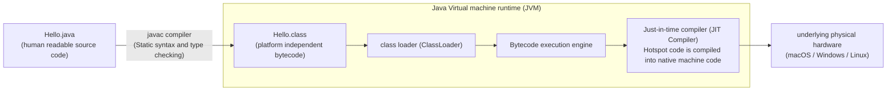

> **Course**: UC Berkeley CS61B: Data Structures (Spring 2024)  
> **Module**: Module 1: Java Fundamentals & Lists  
> **Lecturer**: Prof. Justin Yokota & Prof. Peyrin Kao (UC Berkeley)  
> **Video duration**: 48:50 ｜ **Official original version**: Lecture 1 - Introduction  
> **Direct video**: [📺Watch the original video of this lecture on Bilibili (P1)](https://www.bilibili.com/video/BV1hJ4m1M7ZA/?p=1) ｜ [📑 Official courseware Slides (Google Presentation)](https://docs.google.com/presentation/d/19NEzpJJ-a0lI-tdz9yC1kP-8Apt2oZm-918IsDiqgYQ) ｜ [📖Official textbook chapter](https://cs61b-2.gitbook.io/cs61b-textbook/1.-introduction)  
> **Quick navigation**: <span>Previous Lecture: None (Lecture 1)</span> ｜ [📚 Return to the full book catalog](/en/notes/topics/CS61B) ｜ [Next lecture (P02 Definition and use of classes and objects) →](/en/notes/cs61b/lecture-02)

---

## 1. CS 61B course vision and learning path: paradigm shift from 61A to 61B

*(Reference time: 00:01:15 · [Video jump (P01 00:01:15)](https://www.bilibili.com/video/BV1hJ4m1M7ZA/?p=1&t=75))*

UC Berkeley’s CS 61 course series forms the core cornerstone of the world’s top undergraduate computer science instruction. If CS 61A leads beginners to understand through Python and Scheme **Computational abstractions, higher-order functions, interpreters and programming paradigms** The beauty of intelligence, then CS 61B is a fundamental paradigm shift - it shifts the perspective from "how to let computers understand human intentions" to "how to organize large-scale software with tens of thousands of lines of code and ensure that it is extremely efficient in the time and space dimensions"\*\*.

The lead teachers Peyrin Kao and Justin Yokota clearly pointed out the two core pillars of the 61B teaching system at the beginning:

### Pillar 1: Writing code that runs efficiently
- **core data structures**: Starting from the most basic linear lists (single-way linked lists, doubly linked lists, dynamic arrays), and gradually deepening into non-linear and hierarchical structures (binary search trees, self-balancing 2-3 trees, red-black trees, hash tables, binary heaps and priority queues, union-find sets, directed/undirected graphs, prefix tree Tries).
- **Algorithm Design and Asymptotic Complexity Analysis**: Master the formalized progressive symbol system ($\Theta, O, \Omega$), learn to analyze the time and space complexity of the program from the worst, best, and average situations, and master divide and conquer, greedy, pruning, graph traversal (DFS/BFS/Dijkstra/A\*/Prim/Kruskal), as well as external sorting and radix sorting.
- **Space-Time Trade-off**: Deeply understand the game between memory usage, CPU cache locality (Cache Locality) and the number of operation instructions, and learn to make optimal architectural trade-offs under real engineering constraints.

### Pillar 2: Writing code efficiently (Writing code efficiently)
- **Industrial grade tool chain**: Completely break away from toy-style online editors and gain an in-depth understanding of version control tools  `git`  branching and resetting philosophy, industrial-grade IDE  `IntelliJ IDEA`  static analysis and refactoring tools, and  `JUnit 5`  Automated unit testing framework.
- **Defensive programming and modular abstraction**: Understand interfaces (Interface), abstract classes, encapsulation (Encapsulation), access control (Access Modifiers) and class invariants (Class Invariants), and have the architectural ability to design complex object-oriented systems.
- **Troubleshooting and Test Driven Development (TDD)**: Master the scientific troubleshooting methodology (Mental Model Tracing) and say goodbye to aimless blind trial and error.

> **Editor's in-depth analysis**: Many beginners will wonder: "Why does 61B have to use Java instead of continuing to use Python or moving to C++?"  
> The answer is: Java is a language that has been proven by the global industry for decades. **Strongly typed statically compiled object-oriented languages**. Compared with Python's dynamic weak constraints, Java forces explicit declaration of types and scopes, making memory pointers and stack models clearly visible; compared with C++'s extremely complicated manual memory management and pointer arithmetic, Java has a modern garbage collector (Garbage Collector), allowing students to focus on the data structure topology itself without falling into the underlying quagmire of dangling pointers or Segmentation Faults.

## 2. Computer underlying and Java execution architecture: from source code to machine instructions

*(Reference time: 00:09:40 · [Video jump (P01 00:09:40)](https://www.bilibili.com/video/BV1hJ4m1M7ZA/?p=1&t=580))*

In order to thoroughly understand the running process of Java programs, it is necessary to clarify the essential differences between interpreted languages (such as native Python), compiled languages (such as C/C++), and the \*\*Hybrid Execution Architecture\*\* used by Java.

### The Dilemma of the Traditional Model
- **Pure Interpretation**: The interpreter reads the text source code line by line, parses the syntax tree in real time and translates it into machine instructions for execution. The advantage is that it is cross-platform and does not require compilation, but because dynamic type inference and syntax parsing must be repeatedly performed during runtime, the execution efficiency is usually extremely low (10 to 100 times slower than compiled languages).
- **Pure static compilation (Ahead-Of-Time Compilation)**: The compiler directly compiles the source code into binary machine code for a specific hardware architecture (such as x86-64 or ARM64). While extremely fast, the resulting executable is not cross-platform compatible at all - binaries compiled on macOS cannot run directly on Linux or Windows.

### Java’s solution: virtual machines and bytecode
Java creatively introduces  **Java Virtual Machine (JVM, Java Virtual Machine)**  platform neutral  **Bytecode**: 



1. **Compile Time**: by executing  `javac Hello.java`, the compiler will perform extremely strict syntax checking and static type verification on the source code. If the check passes, the generated extension is  `.class`  bytecode file. Bytecode is a highly optimized set of pseudo-instructions that is completely independent of the physical CPU.
2. **Runtime**: by executing  `java Hello`, corresponding to the operating system platform-specific JVM startup, loading bytecode. The execution engine inside the JVM initially interprets and executes the bytecode; when it detects that certain loops or frequently called methods are "hotspots", the built-in  **JIT compiler (Just-In-Time Compiler)**  This part of the bytecode will be compiled in-place into the native machine instructions of the underlying processor within milliseconds, and in-depth optimizations (such as inlining, loop unrolling, and branch prediction) will be performed.

This exquisite architecture gives Java core legendary features: **“Write Once, Run Anywhere, WORA”**. As long as the target operating system has the JRE/JDK corresponding to the platform installed, the same  `.class`  Bytecode files can achieve high-speed execution close to native C++ performance.

## 3. Static Typing and Type Safety Philosophy

*(Reference time: 00:15:30 · [Video jump (P01 00:15:30)](https://www.bilibili.com/video/BV1hJ4m1M7ZA/?p=1&t=930))*

In CS 61A, Python variables are like sticky notes that can be attached to any object:
```python
x = 5        # x 此时指向整数
x = "Berkeley" # 合法！x 此时改指向字符串
```

In Java, types are not accessories to objects, but **an indivisible physical contract with the variable itself**.

### Core rules for static typing
1. **type binding prefix**: Each variable must explicitly specify its data type when it is first declared.
2. **Fixed memory size**: The compiler will pre-define the precise number of bits in stack memory or heap memory based on the declared type of the variable.
3. **Type incompatible interception**: Once the type is determined, the variable can only store values that comply with the contract of the type. Any illegal assignment will be directly intercepted at compile time:

```java
int score = 95;
// score = "Excellent"; // 编译阶段报错：incompatible types: String cannot be converted to int
```

### Why are static typing important for large software?
Many beginners are used to the freedom of Python and find type declarations cumbersome and heavy when they first come into contact with Java. But as the project scale expands from hundreds of lines to hundreds of thousands of lines, the huge value of the static type system is clearly demonstrated:

| Dimensions | Python (dynamic typing) | Java (static typing) |
| :--- | :--- | :--- |
| **Error exposure time** | Runtime (it may crash after executing a specific branch after 3 days of running in the production environment) | compile time (save the code instantly or  `javac`  An error will be reported immediately during the stage) |
| **Refactoring security** | Renaming or modifying function signatures can lead to deep hidden bugs | The IDE can automatically analyze all project type dependencies and perform automatic reconstruction with 100% safety |
| **Code self-explanatory** | Must rely on documentation or type annotations, otherwise it will be difficult to determine parameter types | Variable and method signatures themselves are the most accurate and non-expirable machine-level documents. |
| **Runtime performance** | The interpreter needs to dynamically query the object type and dispatch table for each operation | The compiler knows the exact memory offset and can directly issue efficient native jump instructions |

> **deep thinking**: Can static typing completely eliminate runtime errors?  
> No. Static typing can only guarantee the "legality of the type" (for example, you cannot divide a string by an integer), but it cannot predict all logical boundary conditions at compile time (for example, divide by zero).  `ArithmeticException`, array subscript out of bounds  `ArrayIndexOutOfBoundsException`  or null pointer call  `NullPointerException`). These exceptions belong to the scope of runtime semantics.

## 4. In-depth analysis of Hello World: the language specifications behind each line of code

*(Reference time: 00:22:15 · [Video jump (P01 00:22:15)](https://www.bilibili.com/video/BV1hJ4m1M7ZA/?p=1&t=1335))*

The classic first lesson in learning any language is Hello World. But in Java, even just five lines of code condense the lowest level rule system of object-oriented languages:

```java
public class HelloWorld {
    public static void main(String[] args) {
        System.out.println("Hello, 61B!");
    }
}
```

We dismantle each vocabulary and grammatical element one by one with an extremely rigorous attitude:

### 1. `public class HelloWorld`
- `class`: Java’s most basic code organization unit. In Java, **Absolutely no global functions or global variables outside the class are allowed**. All states and logic must be attached to a certain class.
- `HelloWorld`: Class name. The Java community agrees to use UpperCamelCase.
- **Source file naming rules**: If a class is declared as  `public`, then the source file name to save the class must be the same as the class name **exactly the same** (Strictly case sensitive). That is, it must be saved as  `HelloWorld.java`, otherwise  `javac`  The compiler will report a compilation error: `class HelloWorld is public, should be declared in a file named HelloWorld.java`.

### 2. `public static void main(String[] args)`
This is agreed by the Java virtual machine **Standard unique program startup entrance**: 
- `public`:Access control modifier. Indicates that this method is exposed to the entire system and the JVM runtime must have permission to access the method from the outside.
- `static`: Static modifier. The key! show  `main`  method depends on  `HelloWorld`  The class itself, rather than a specific instance of the class. When the JVM first starts the program, it has not created any  `HelloWorld`  object, so the entry method must be  `static`, no need  `new`  can be called directly.
- `void`:Return value type. Indicates that the method does not return any data to the caller after execution (usually returns  `int`  as a status code, while Java passes  `System.exit(status)`  handle abnormal exit).
- `String[] args`: Command line parameters. Is an array of strings that receives any additional parameters passed by the user when launching the program in the terminal. For example, execute  `java HelloWorld berkeley cs61b`  when, `args[0]`  That is  `"berkeley"`, `args[1]`  for  `"cs61b"`.

### 3. `System.out.println("Hello, 61B!");`
- `System`: Java standard class library  `java.lang`  System management classes preset in the package.
- `out`: `System`  A static member variable defined within the class, which represents the system standard output stream (Standard Output Stream)  `PrintStream`  object.
- `println`: `PrintStream`  Provides an instance method for printing the passed parameters to the terminal, automatically appending a platform-specific newline character (Newline) at the end. If you don't need line breaks, you can use  `System.out.print(...)`.
- `;`: The semicolon is the legal terminator of Java statements, and missing a semicolon is the most common compilation error among beginners.

## 5. Basic syntax and process control: variable, loop and method definition

*(Reference time: 00:30:40 · [Video jump (P01 00:30:40)](https://www.bilibili.com/video/BV1hJ4m1M7ZA/?p=1&t=1840))*

Before diving into classes and objects, we need to quickly master Java's basic control flow mechanism.

### Variable declaration and basic operations
Classic program for calculating cumulative sums  `HelloNumbers` , observe the life cycle and cyclic evolution of variables:

```java
public class HelloNumbers {
    public static void main(String[] args) {
        int x = 0;
        int total = 0;
        while (x < 10) {
            total = total + x;
            System.out.print(total + " ");
            x = x + 1;
        }
        System.out.println();
    }
}
```

Program output:
```text
0 1 3 6 10 15 21 28 36 45 
```

**Key mechanism analysis**: 
- Strong type declaration: `int x = 0;`  At the same time, the specification of the variable type and the assignment of the initial value are completed. Local variables that are not assigned an initial value will cause a compilation error when reading.
- Loop condition control: `while (x < 10)`  The expression within the brackets must be strictly of type boolean (`boolean`, the value is  `true`  or  `false`). In C/C++ or Python non-zero integers are implicitly treated as truth values, but in Java  `while (1)`  Will fail to compile!

### Extraction and abstraction of static auxiliary methods
In large projects, you should never cram all your logic in  `main`  in method. We need to encapsulate reusable logic into independent methods. Take finding the maximum of two numbers as an example:

```java
public class LargerDemo {
    /** 
     * 返回两个整数 a 和 b 中的较大者。
     * 这是一个静态工具方法，无需实例化类即可直接调用。
     */
    public static int larger(int a, int b) {
        if (a > b) {
            return a;
        }
        return b;
    }

    public static void main(String[] args) {
        int x = -5;
        int y = 12;
        int maxVal = larger(x, y);
        System.out.println("Max of " + x + " and " + y + " is: " + maxVal);
    }
}
```

### Method Signature and Overload Preview
In Java, a method is defined by its name and a list of formal parameters:
- The return type, although part of the method declaration, is not part of the signature.
- Java allows multiple methods to be defined in the same class with the same name but different parameter lists (different types, numbers, or orders). This is called **Method Overloading**. For example, we can simultaneously define  `larger(int a, int b)`  with  `larger(double a, double b)`.

## 6. Official courseware discussion questions and practical lectures on HW0 algorithm

*(Reference time: 00:38:00 · [Video jump (P01 00:38:00)](https://www.bilibili.com/video/BV1hJ4m1M7ZA/?p=1&t=2280))*

In the official courseware and homework HW0 of Lecture 1, Josh Hug and Peyrin Kao designed several classic thinking challenges to test students' mastery of basic control flow and loop boundaries.

### Challenge 1: Printing Star Right Triangles (Drawing Triangles)
**Question requirements**:Write a program that uses a loop to output a 5-row right triangle composed of asterisks:
```text
*
**
***
****
*****
```

**The evolution of problem-solving ideas**:
Beginners often try to write 5 lines  `println`, but this does not scale with input size. We need double nested loops: the outer one controls the number of rows, and the inner one controls the number of asterisks in the current row.

```java
public class TriangleDrawer {
    public static void drawTriangle(int N) {
        int row = 1;
        while (row <= N) {
            int col = 1;
            while (col <= row) {
                System.out.print("*");
                col = col + 1;
            }
            System.out.println();
            row = row + 1;
        }
    }

    public static void main(String[] args) {
        drawTriangle(5);
    }
}
```

### Challenge 2: Find the maximum value of the array (Array Max)
**Question requirements**:Write a static method  `max(int[] m)`, returns the maximum value in the passed non-empty integer array.

```java
public class ArrayOps {
    public static int max(int[] m) {
        int maxSoFar = m[0]; // 假设第一个元素最大
        for (int i = 1; i < m.length; i = i + 1) {
            if (m[i] > maxSoFar) {
                maxSoFar = m[i];
            }
        }
        return maxSoFar;
    }
}
```

### Challenge question three: HW0 core advanced questions  `windowPosSum`
**Question requirements**: Given an integer array  `a`  and an integer  `n`. For every positive number in the array  `a[i]`, replace it with the index from  `i`  Start most later  `n + 1`  The sum of elements (i.e.  `a[i] + a[i+1] + ... + a[i+n]`). If backward accumulation touches the end of the array, only the last available element will be accumulated; if  `a[i]`  If it is a negative number or zero, it will be skipped and not processed.

**test case**:
input  `a = {1, 2, -3, 4, 5, 4}`, `n = 3`  
Expected output: `{7, 8, -3, 13, 9, 4}`

**Code implementation and line-by-line analysis**: 
```java
public class BreakContinue {
    public static void windowPosSum(int[] a, int n) {
        for (int i = 0; i < a.length; i = i + 1) {
            // 条件一：如果当前数字不为正数，直接跳过本轮循环
            if (a[i] <= 0) {
                continue;
            }

            int sum = 0;
            // 条件二：从 i 开始累加 n 个后续元素
            for (int j = i; j <= i + n; j = j + 1) {
                // 防越界守护：若 j 超过数组最大索引，立即中断内层累加
                if (j >= a.length) {
                    break;
                }
                sum = sum + a[j];
            }
            // 更新原数组当前位置的值
            a[i] = sum;
        }
    }

    public static void main(String[] args) {
        int[] a = {1, 2, -3, 4, 5, 4};
        int n = 3;
        windowPosSum(a, n);
        System.out.println(java.util.Arrays.toString(a));
    }
}
```

**Trap tips**: 
1. **Timing issues for in-place modification**: If we modify it while in the outer loop  `a[i]`, will the subsequent elements in the inner loop read the new value that has been modified? A closer look at the inner loop: current location  `i`  When calculating, it only reads backward  `j = i, i+1, ...`. But the follow-up  `a[i+1]`  When processing, only read backwards  `i+1, i+2...`, and will not go back to read the modified  `a[i]`, so it is safe to modify it directly in place!
2. **Cross-border protection**: `break`  The function is to only jump out of the inner layer  `for (int j...)`  loop and then execute  `a[i] = sum;`, must not be misused  `return`.

## 7. Engineering environment construction, Git workflow and code specifications

*(Reference time: 00:42:00 · [Video jump (P01 00:42:00)](https://www.bilibili.com/video/BV1hJ4m1M7ZA/?p=1&t=2520))*

In the engineering practice of CS 61B, writing code is only part of the software life cycle, and modern software engineers must strictly follow engineering specifications.

### IntelliJ IDEA and terminal workflow
The officially recommended workflow of the course is divided into two modes:
1. **Command line native mode**: 
   ```bash
   javac -g LargerDemo.java   # 编译时携带调试符号
   java LargerDemo            # 运行编译后的类
   ```
2. **IntelliJ industrial-grade integrated development environment**: 
   - Automatically perform incremental compilation (Incremental Compilation) in the background, and mark syntax and type errors in red in real time;
   - Powerful automatic reconstruction tool (Refactor -\> Rename / Extract Method);
   - Built-in powerful visual breakpoint debugger supports conditional breakpoints and variable monitoring.

### Berkeley 61B Code Style Guide (Style Guide)
In order to cultivate engineering-level programming literacy, the course has developed a strict automatic code style checker (Style Checker):
- **Indentation standards**: Force the use of 4 spaces indentation, and the use of Tab is strictly prohibited;
- **Line width limit**: The length of a single line of code must not exceed 100 characters;
- **brace style**: Use K&R style, i.e. left brace  `{`  Do not start a new line, just follow the end of the statement;
- **Naming convention**: Class name usage  `UpperCamelCase`, use method name and variable name  `lowerCamelCase`, use all uppercase letters and underscores for constants  `UPPER_SNAKE_CASE`; 
- **Comment requirements**: All public methods and classes must write documentation comments that comply with the Javadoc specification  `/** ... */`.

## 8. Compile-time errors vs run-time errors and engineering debugging thinking

*(Reference time: 00:45:15 · [Video jump (P01 00:45:15)](https://www.bilibili.com/video/BV1hJ4m1M7ZA/?p=1&t=2715))*

Throughout the semester of 61B, you will face program crashes and errors countless times. The essential difference between excellent engineers and novices lies in their ability to establish an accurate mental model to locate and troubleshoot errors.

### Two completely different types of error worlds
1. **Compile-Time Errors**: 
   - Trigger time: `javac`  Analyzing source text.
   - Cause: Violation of Java's syntax rules, static type constraints, or symbol visibility.
   - Common cases:
     - `error: cannot find symbol` (typos, variable not declared, scope not visible).
     - `error: incompatible types` (try to put  `String`  bestow  `int`).
     - `error: missing return statement` (The method declares a return value, but some branches do not  `return`).
   - **coping strategies**: Carefully read the line number and symbol prompts of the compilation error instructions. The compiler will usually point out the cause of the error very clearly.

2. **Runtime Errors/Exceptions**: 
   - Trigger timing: The code syntax is legal and has been successfully generated  `.class`, but throws an exception and crashes when JVM interprets/executes it.
   - Common cases:
     - `NullPointerException` (try dereferencing a pointer to  `null`  object variable).
     - `ArrayIndexOutOfBoundsException` (A negative subscript was accessed or  $\ge length$  array position).
     - `StackOverflowError` (Recursion lacks baseline conditions, and the call stack expands infinitely).
   - **coping strategies**: Analyze console output **Exception Stack Trace**, locate the innermost code line number that caused the crash from the top of the stack, and use the IntelliJ breakpoint debugger to track single-step (Step Over / Step Into).

### The Golden Rule of Coding: Small Steps and Mental Tracking
The most fatal coding habit for beginners is to "write 200 lines of code in one go, and then compile and run it all at once." As a result, they encounter 30 errors and are at a loss.  
**Proper Engineering Practice**: 
- Only write 5 to 10 lines of code at a time;
- Execute compilation and simple testing immediately;
- After verification, write the next functional fragment.

## 9. Panoramic summary of the module and in-depth self-assessment after class

*(Reference time: 00:48:00 · [Video jump (P01 00:48:00)](https://www.bilibili.com/video/BV1hJ4m1M7ZA/?p=1&t=2880))*

### Panoramic comparison table of core concepts

| conceptual elements | Key technical content | Common mistakes |
| :--- | :--- | :--- |
| **Java compilation model** | Source code  `.java` $\to$  bytecode  `.class` $\to$  JVM execution | Mistakenly believe that physical machine code is generated directly, ignoring the existence of JVM |
| **Static strong typing** | The type must be locked when the variable is declared, and all type flows must be verified at compile time. | Confusing type casting with dynamic type assignment |
| **Correspondence between classes and files** | `public class Foo`  Must be stored in  `Foo.java` | Inconsistency in the case of file names and class names causes strange errors under macOS/Linux |
| **Program main entrance** | `public static void main(String[] args)`  indispensable | Omission  `static`  As a result, the runtime cannot be recognized as an entry point by the JVM. |
| **Loops and branches** | Conditional expressions must be strict  `boolean` | write  `while(1)`  or  `if(x = 5)`  Causes compilation to fail |

---

### Comprehensive self-test questions after class

#### Question 1 (Concept Analysis)
If there is no explicit definition in a class  `public static void main`  method, able to pass  `javac`  Compile? Able to pass in terminal  `java`  Does the command run?  
**Answers and analysis**:   
- **Able to compile**! In actual projects, most classes (such as data structure classes, tool libraries, and data models) are library codes for calls by other modules and do not need to be started as the main entrance. `javac`  Not allowed at all  `main`  Class compilation and generation  `.class`.  
- **cannot pass  `java`  Command to start directly**. If enforced  `java MyLib`, the JVM will throw a runtime error: `Main method not found in class MyLib, please define the main method as: public static void main(String[] args)`.

#### Question 2 (grammar trap)
Observe the following code snippet. Does it compile? If so, what is the output? If not, which line reports an error?
```java
public class Mystery {
    public static void main(String[] args) {
        int a = 5;
        int b;
        if (a > 3) {
            b = 10;
        }
        System.out.println(b);
    }
}
```
**Answers and analysis**:   
- **Failed to compile! Reported error in  `System.out.println(b);`**: `error: variable b might not have been initialized`.
- **underlying reasons**: The Java compiler has a Definite Assignment Analysis mechanism. Although from the perspective of human thinking, `a = 5`  inevitably make  `a > 3`  established, therefore  `b`  It must be assigned a value of 10; however, the branch analyzer of the Java compiler only analyzes the control flow graph (Control Flow Graph) when making judgments.  `if`  There is a possibility of not entering. Once not entered, local variables  `b`  There is no definite initial value. Java strictly prohibits reading local variables that have not been assigned an initial value! The correction method is to explicitly assign a default initial value: `int b = 0;`.

#### Question 3 (Algorithm Expansion)
write a method  `public static int[] fibonacci(int n)`, return before including  `n`  Array of Fibonacci numbers (starting from 0, 1). if  `n <= 0`, returns an empty array. 
**Answers and analysis**: 
```java
public class Fib {
    public static int[] fibonacci(int n) {
        if (n <= 0) {
            return new int[0];
        }
        int[] res = new int[n];
        res[0] = 0;
        if (n == 1) {
            return res;
        }
        res[1] = 1;
        for (int i = 2; i < n; i++) {
            res[i] = res[i - 1] + res[i - 2];
        }
        return res;
    }
}
```
This solution uses the idea of dynamic programming to solve the problem in linear time.  $O(n)$  The recursion of the sequence is completed within 10 seconds, avoiding the exponential explosion caused by simple double recursion.  $O(2^n)$.

---

## Appendix: UC Berkeley official textbook in-depth study (Official Textbook In-Depth Chapters)

> **Introduction**: The content of this section is integrated from the UC Berkeley CS61B official textbook library (GitBook Textbook). It provides original English theoretical derivation, formal code examples and supporting chapter exercises for the core data structures and algorithms of this lecture, which complements and confirms the previous video lectures.

## 1. Introduction

This section covers basic features of Java and how to run programs on the command line.

---

## 1.1 Your First Java Program

The classic first program when introducing any new language is **Hello World**, or a program that prints `Hello World` to the console. In Java, **Hello World** can be written as such:

```java

public class HelloWorld {

    public static void main(String[] args) {

        System.out.println("Hello world!");

    }

}

```

As compared to other languages like Python, this may seem needlessly verbose. However, there are several reasons for the verbosity of Java, which will be covered in the next few chapters. For now, notice some key syntatical features of the code snippet above:

* The **class declaration** `public class HelloWorld`: in Java, all code lives within classes. 

* The **`main`** function: all the code that runs must be inside of a method declared as `public static void main(String[] args)`. Future chapters will cover the exact meaning of this declaration.

* **Curly braces** `{}` enclose sections of code (functions, classes, and other types of code that will be covered in future chapters).

* All statements must end with a **semi-colon**. 

For fun, see [Hello world! in other languages](https://www.rosettacode.org/wiki/Hello_world/Text).

---

## 1.2 Java Workflow

Taking a program from a `.java` file into an executable has two main steps in Java: **compilation** and **interpretation**. 

<figure><figcaption></figcaption></figure>

To run the code in `Hello.java`, we would first **compile** the code into a `.class` file using the command `javac HelloWorld.java`. Then, to run the code, we would use the command `java HelloWorld`. 

In your terminal, the result would look like the following:

```

$ javac HelloWorld.java

$ java HelloWorld

Hello World!

```

### Class Files

There are several reasons for the usage of `.class` files, which we will only cover briefly here. First of all, `.class` files are guaranteed to have been type-checked, making the distributed code safer. They are also more efficient to execute, and protect the actual source code in cases of intellectual property. We will not go into the details of `.class` files in this textbook beyond knowing that they are created after compilation.

---

## 1.3 Basic Java Features

##### Variables and Loops 

The program below will print out the integers from 0 through 9.

```java

public class HelloNumbers {

    public static void main(String[] args) {

        int x = 0;

        while (x < 10) {

            System.out.print(x + " ");

            x = x + 1;

        }

    }

}

```

When we run this program, we see:

```

$ javac HelloNumbers.java

$ java HelloNumbers

$ 0 1 2 3 4 5 6 7 8 9 

```

Some interesting features of this program that might jump out at you:

* Our variable x must be declared before it is used, *and it must be given a type!*

* Our loop definition is contained inside of curly braces, and the boolean expression that is tested is contained inside of parentheses.

* Our print statement is just `System.out.print` instead of `System.out.println`. This means we should not include a newline (a return).

* Our print statement adds a number to a space. This makes sure the numbers don't run into each other. Try removing the space to see what happens.

* When we run it, our prompt ends up on the same line as the numbers (which you can fix in the following exercise if you'd like).

Of these features the most important one is the fact that variables have a declared type. We'll come back to this in a bit, but first, an exercise.

**Exercise 1.1.2.** Modify `HelloNumbers` so that it prints out the cumulative sum of the integers from 0 to 9. For example, your output should start with 0 1 3 6 10... and should end with 45.

Also, if you've got an aesthetic itch, modify the program so that it prints out a new line at the end.

The program below will print out the integers from 0 through 9.

```java

public class HelloNumbers {

    public static void main(String[] args) {

        int x = 0;

        while (x < 10) {

            System.out.print(x + " ");

            x = x + 1;

        }

    }

}

```

When we run this program, we see:

```

$ javac HelloNumbers.java

$ java HelloNumbers

$ 0 1 2 3 4 5 6 7 8 9 

```

Some interesting features of this program that might jump out at you:

* Our variable x must be declared before it is used, *and it must be given a type!*

* Our loop definition is contained inside of curly braces, and the boolean expression that is tested is contained inside of parentheses.

* Our print statement is just `System.out.print` instead of `System.out.println`. This means we should not include a newline (a return).

* Our print statement adds a number to a space. This makes sure the numbers don't run into each other. Try removing the space to see what happens.

* When we run it, our prompt ends up on the same line as the numbers (which you can fix in the following exercise if you'd like).

Of these features the most important one is the fact that variables have a declared type. We'll come back to this in a bit, but first, an exercise.

**Exercise 1.1.2.** Modify `HelloNumbers` so that it prints out the cumulative sum of the integers from 0 to 9. For example, your output should start with 0 1 3 6 10... and should end with 45.

Also, if you've got an aesthetic itch, modify the program so that it prints out a new line at the end.

##### Static Typing 

Java is a **statically typed language**, which means that all variables, parameters, and methods must have a declared type. After declaration, *the type can never change*. Expressions also have an implicit type; for example, the expression `3 + 5` has type `int`. 

Because all types are declared statically, the compiler checks that types are compatible before the program even runs. This means that expressions with an incompatible type will fail to compile instead of crashing the program at runtime. 

The advantages of static typing include:

* catching type errors earlier in the coding process, reducing the debugging burden on the programmer.

* avoiding type errors for end users.

* making it easier to read and reason about code.

* avoiding expensive runtime type checks, making code more efficient.

However, static typing also has several disadvantages; namely:

* more verbose code.

* less generalizable code. 

One of the most important features of Java is that all variables and expressions have a so-called `static type`. Java variables can contain values of that type, and only that type. Furthermore, the type of a variable can never change.

One of the key features of the Java compiler is that it performs a static type check. For example, suppose we have the program below:

```java

public class HelloNumbers {

    public static void main(String[] args) {

        int x = 0;

        while (x < 10) {

            System.out.print(x + " ");

            x = x + 1;

        }

        x = "horse";

    }

}

```

Compiling this program, we see:

```

$ javac HelloNumbers.java 

HelloNumbers.java:9: error: incompatible types: String cannot be converted to int

        x = "horse";

                ^

1 error

```

The compiler rejects this program out of hand before it even runs. This is a big deal, because it means that there's no chance that somebody running this program out in the world will ever run into a type error!

This is in contrast to dynamically typed languages like Python, where users can run into type errors during execution!

In addition to providing additional error checking, static types also let the programmer know exactly what sort of object he or she is working with. We'll see just how important this is in the coming weeks. This is one of my personal favorite Java features.

To summarize, static typing has the following advantages:

* The compiler ensures that all types are compatible, making it easier for the programmer to debug their code.

* Since the code is guaranteed to be free of type errors, users of your compiled programs will never run into type errors. For example, Android apps are written in Java, and are typically distributed only as .class files, i.e. in a compiled format. As a result, such applications should never crash due to a type error since they have already been checked by the compiler.

* Every variable, parameter, and function has a declared type, making it easier for a programmer to understand and reason about code.

However, static typing also has several disadvantages, which will be discussed further in later chapters. To name a few:

* More verbose code.

* Less generalizable code. 

**Extra Thought Exercise**

In Java, we can say `System.out.println(5 + " ");`. But in Python, we can't say `print(5 + "horse")`, like we saw above. Why is that so?

Consider these two Java statements:

```java

String h = 5 + "horse";

```

and

```java

int h = 5 + "horse";

```

The first one of these will succeed; the second will give a compiler error. Since Java is strongly typed, if you tell it `h` is a string, it can concatenate the elements and give you a string. But when `h` is an `int`, it can't concatenate a number and a string and give you a number.

Python doesn't constrain the type, and it can't make an assumption for what type you want. Is `x = 5 + "horse"` supposed to be a number? A string? Python doesn't know. So it errors.

In this case, `System.out.println(5 + "horse");`, Java interprets the arguments as a string concatentation, and prints out "5horse" as your result. Or, more usefully, `System.out.println(5 + " ");` will print a space after your "5".

What does `System.out.println(5 + "10");` print? 510, or 15? How about `System.out.println(5 + 10);`?

##### Defining Functions in Java 

In languages like Python, functions can be declared anywhere, even outside of functions. For example, the code below declares a function that returns the larger of two arguments, and then uses this function to compute and print the larger of the numbers 8 and 10:

```python

def larger(x, y):

    if x > y:

        return x

    return y

print(larger(8, 10))

```

Since all Java code is part of a class, we must define functions so that they belong to some class. Functions that are part of a class are commonly called "methods". We will use the terms interchangably throughout the course. The equivalent Java program to the code above is as follows:

```java

public class LargerDemo {

    public static int larger(int x, int y) {

        if (x > y) {

            return x;

        }

        return y;

    }

    public static void main(String[] args) {

        System.out.println(larger(8, 10));

    }

}

```

The new piece of syntax here is that we declared our method using the keywords `public static`, which is a very rough analog of Python's `def` keyword. We will see alternate ways to declare methods in the next chapter.

The Java code given here certainly seems much more verbose! You might think that this sort of programming language will slow you down, and indeed it will, in the short term. Think of all of this stuff as safety equipment that we don't yet understand. When we're building small programs, it all seems superfluous. However, when we get to building large programs, we'll grow to appreciate all of the added complexity.

As an analogy, programming in Python can be a bit like [Dan Osman free-soloing Lover's Leap](https://www.youtube.com/watch?v=NCByLWtM7y4). It can be very fast, but dangerous. Java, by contrast is more like using ropes, helmets, etc. as in [this video](https://www.youtube.com/watch?v=tr6UIfPEuI0).

##### Code Style, Comments, Javadoc 

Code can be beautiful in many ways. It can be concise. It can be clever. It can be efficient. One of the least appreciated aspects of code by novices is code style. When you program as a novice, you are often single mindedly intent on getting it to work, without regard to ever looking at it again or having to maintain it over a long period of time.

In this course, we'll work hard to try to keep our code readable. Some of the most important features of good coding style are:

* Consistent style (spacing, variable naming, brace style, etc)

* Size (lines that are not too wide, source files that are not too long)

* Descriptive naming (variables, functions, classes), e.g. variables or functions with names like `year` or `getUserName` instead of `x` or `f`.

* Avoidance of repetitive code: You should almost never have two significant blocks of code that are nearly identical except for a few changes.

* Comments where appropriate. Line comments in Java use the `//` delimiter. Block (a.k.a. multi-line comments) comments use `/*` and `*/`.

The golden rule is this: Write your code so that it is easy for a stranger to understand.

Here is the course's official [style guide](https://sp19.datastructur.es/materials/guides/style-guide.html). It's worth taking a look!

Often, we are willing to incur slight performance penalties, just so that our code is simpler to [grok](https://en.wikipedia.org/wiki/Grok). We will highlight examples in later chapters.

**Comments**

We encourage you to write code that is self-documenting, i.e. by picking variable names and function names that make it easy to know exactly what's going on. However, this is not always enough. For example, if you are implementing a complex algorithm, you may need to add comments to describe your code. Your use of comments should be judicious. Through experience and exposure to others' code, you will get a feeling for when comments are most appropriate.

One special note is that all of your methods and almost all of your classes should be described in a comment using the so-called [Javadoc](https://en.wikipedia.org/wiki/Javadoc) format. In a Javadoc comment, the block comment starts with an extra asterisk, e.g. `/**`, and the comment often (but not always) contains descriptive tags. We won't discuss these tags in this textbook, but see the link above for a description of how they work.

As an example without tags:

```java

public class LargerDemo {

    /** Returns the larger of x and y. */           

    public static int larger(int x, int y) {

        if (x > y) {

            return x;

        }

        return y;

    }

    public static void main(String[] args) {

        System.out.println(larger(8, 10));

    }

}

```

The widely used [javadoc tool](http://docs.oracle.com/javase/8/docs/technotes/tools/windows/javadoc.html) can be used to generate HTML descriptions of your code. We'll see examples in a later chapter.

---

## 1.4 Exercises

1. **True/False**: All variables, parameters, and methods must have a declared type in Java, and the type can never change.

2. Suppose we have a function `smaller(a, b)` that takes in two `int` arguments `a` and `b` and returns the smaller of the two. What would the expression `String x = smaller(10, 20) + 3;` output?

3. Choose all statements that are true in Java: 

   * All code must be part of a class.

   * The end and beginning of code segments are delimited using curly brackets `{}`. 

   * All statements in Java end with a semi-colon `;`.

   * Any code we want to run must be inside of a function `public static void main(String[] args)`. 

<details>

<summary>Solutions</summary>

1. True. See "Static Typing" for more information.

2. This line of code would cause a compilation error because the declared type `String` is incompatible with the type returned by `smaller` and adding `3`, which would be an `int.`

3. All the following statements are true.

</details>


---

## Course navigation and jump

| Previous lecture | Directory | Next lecture | Original video |
| :--- | :---: | :--- | :--- |
| Lecture 1 | [📚 Return to CS61B complete book list](/en/notes/topics/CS61B) | [Next lecture: Definition and use of classes and objects →](/en/notes/cs61b/lecture-02) | [🎬Watch this lecture on Bilibili (P01)](https://www.bilibili.com/video/BV1hJ4m1M7ZA/?p=1) |
