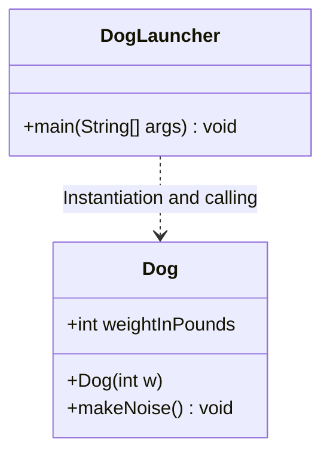

> **Course**: UC Berkeley CS61B: Data Structures (Spring 2024)  
> **Module**: Module 1: Java Fundamentals & Lists  
> **Lecturer**: Prof. Justin Yokota & Prof. Peyrin Kao (UC Berkeley)  
> **Video duration**: 51:18 ｜ **Official original version**: Lecture 2 - Defining and Using Classes  
> **Direct video**: [📺Watch the original video of this lecture on Bilibili (P2)](https://www.bilibili.com/video/BV1hJ4m1M7ZA/?p=2) ｜ [📑 Official courseware Slides (Google Presentation)](https://docs.google.com/presentation/d/1zt0yh_gzmfjCdB1y7DzTdwNSfTtepnQAtORH7PqebQM) ｜ [📖Official textbook chapter](https://cs61b-2.gitbook.io/cs61b-textbook/2.-defining-and-using-classes)  
> **Quick navigation**: [← Previous lecture (P01 course introduction and preliminary exploration of Java)](/en/notes/cs61b/lecture-01) ｜ [📚 Return to the full book catalog](/en/notes/topics/CS61B) ｜ [Next lecture (P03 Linked List I: Reference passing, memory model and recursive linked list) →](/en/notes/cs61b/lecture-03)

---

## 1. Core philosophy of object-oriented programming (OOP): from procedural to object modeling

*(Reference time: 00:02:20 · [Video jump (P02 00:02:20)](https://www.bilibili.com/video/BV1hJ4m1M7ZA/?p=2&t=140))*

In the early days of CS 61A and the previous lecture, the code we wrote was mainly \*\*procedural\*\*: operating naked data (such as integers, floating point numbers, arrays) through a series of independent static functions (Static Functions).

However, when the complexity of software systems increases hundreds or thousands of times, the disadvantages of procedural programming are exposed:
- **Separation of data and logic**: The data structure (such as an integer variable that stores the dog's weight) and the function that operates on the data (such as the function that makes the dog bark) are separated from each other, and any code can tamper with the data arbitrarily;
- **out of control**: The system is full of global variables or scattered parameters passed between various functions. Once the semantics of a certain field change, all functions of the entire system must be modified simultaneously.

Object-Oriented Programming (OOP) proposes a new model for understanding the world: **A class is a blueprint for creating an object, and an object is a self-consistent entity that encapsulates internal state (State/Attributes) and behavior (Behavior/Methods)**.

## 2. The dual identity of classes: Function module (Module) vs. Custom data type (Type Blueprint)

*(Reference time: 00:08:45 · [Video jump (P02 00:08:45)](https://www.bilibili.com/video/BV1hJ4m1M7ZA/?p=2&t=525))*

In Java language, `class`  Plays two completely different but complementary roles:

### Role 1: Module and Toolbox (Module/Library)
- A typical example is the Java standard library  `java.lang.Math`  class.
- We don't need and can't create  `Math`  instance object of (e.g. we never write  `new Math()`).
- It only serves as a namespace to organize a set of related pure mathematical tool functions: `Math.sqrt(x)`, `Math.max(a, b)`, `Math.PI`.
- In this role, all members of the class are typically  **`static` (static)**.

### Role 2: Custom Data Type Blueprint
- This is the most powerful core capability of object-oriented.
- At this point, the class defines a new data type (such as  `Dog`, `BankCustomer`, `LinkedList`).
- Each specific entity created through this blueprint is called **Object **or** Instance**.
- Each instance object has its own independent **Instance Variables**, and can respond to calls to \*\*Instance Methods\*\*.



## 3. Instance variables, constructors and object instantiation mechanism

*(Reference time: 00:14:10 · [Video jump (P02 00:14:10)](https://www.bilibili.com/video/BV1hJ4m1M7ZA/?p=2&t=850))*

Let us follow Professor Josh Hug’s classic teaching case to completely construct a class representing “dog”  `Dog`: 

```java
public class Dog {
    // 1. 实例变量（Instance Variable）：描述狗的状态
    public int weightInPounds;

    // 2. 构造器（Constructor）：初始化新创建的对象
    public Dog(int w) {
        weightInPounds = w;
    }

    // 3. 实例方法（Instance Method）：描述狗的行为
    public void makeNoise() {
        if (weightInPounds < 10) {
            System.out.println("yipyipyip!");
        } else if (weightInPounds < 30) {
            System.out.println("bark. bark.");
        } else {
            System.out.println("woof!");
        }
    }
}
```

### In-depth analysis of core elements
1. **Instance Variables**: 
   - Declared inside the class body but outside any methods;
   - **non-static**:No  `static`  Keyword modification;
   - **Exclusive memory**: Whenever we create a new  `Dog`  Object, the JVM will allocate independent storage space for the object in the heap memory to save its  `weightInPounds`. Two different dogs whose weights are unrelated to each other.

2. **Constructors**: 
   - **The name must be exactly the same as the class name** (Strictly consistent between upper and lower case);
   - **There must never be any return value type declaration** (even  `void`  Can’t write either! If written  `public void Dog(int w)`, the compiler will treat it as a normal method rather than a constructor);
   - The responsibility of the constructor is to set reasonable initial values for the instance variables of the object when it is created.

3. **use  `new`  Keyword to instantiate**: 
   ```java
   public class DogLauncher {
       public static void main(String[] args) {
           Dog d = new Dog(51); // 诞生一只 51 磅的大狗
           d.makeNoise();        // 打印 "woof!"
           
           Dog smallDog = new Dog(8); // 诞生一只 8 磅的茶杯犬
           smallDog.makeNoise();       // 打印 "yipyipyip!"
       }
   }
   ```

## 4. Stack memory analysis: What do objects look like in computer memory?

*(Reference time: 00:20:30 · [Video jump (P02 00:20:30)](https://www.bilibili.com/video/BV1hJ4m1M7ZA/?p=2&t=1230))*

The core threshold for understanding Java is to establish an accurate **Stack vs Heap Memory Model**.

when executing  `Dog d = new Dog(51);`  What exactly is happening in the underlying physical memory?

```text
栈内存 (Call Stack / Local Variables)          堆内存 (Heap / Objects)
+-----------------------+                    +-------------------------+
| DogLauncher.main      |                    | Dog 实例对象             |
|                       |                    |                         |
| d: 0x4A2F0 ----------+-------------------> | weightInPounds: 51      |
+-----------------------+                    +-------------------------+
```

### Two-stage memory teardown
1. **Stack memory (Stack) allocates reference variables**: 
   - Statement  `Dog d;`  No dog object is created!
   - The JVM only opens a fixed-size (usually 64-bit) memory slot in the stack frame of the current method, named  `d`.
   - At this time  `d`  The initial value of is uninitialized or  `null` (null pointer), which does not contain the dog's data, but a **Memory address reference (Reference)**.
2. **Heap memory (Heap) allocates specific objects**: 
   - execute  `new Dog(51)`  When, the JVM looks for a continuous free space in the global dynamic heap memory to accommodate  `Dog`  All instance variables of the class (here a 32-bit integer  `weightInPounds`) and JVM object header (Object Header);
   - Execute the constructor and write 51  `weightInPounds`  field;
   - `new`  After the expression is evaluated, the physical memory starting address of the newly created object in the heap is returned (such as  `0x4A2F0`); 
   - Finally, the assignment operator  `=`  Write the memory address to the stack variable  `d`  in the slot.

> **golden rule**: In Java, all  `new`  The object entity created by the keyword, **Always stored in heap memory (Heap)**;And the local variables and formal parameters within the method, **Always stored in stack memory (Stack)**.

## 5. Instance methods vs static methods: `static`  The nature of keywords

*(Reference time: 00:27:50 · [Video jump (P02 00:27:50)](https://www.bilibili.com/video/BV1hJ4m1M7ZA/?p=2&t=1670))*

`static`  It is the most core modifier in the Java language and the most confusing for beginners. Its essential meaning is: **"belongs to the class itself, not to the concrete instance"**.

### Static Methods
- statement with  `static`  modifier;
- **Calling method**: Directly call through the class name, for example  `Math.sqrt(16)`  or  `Dog.doSomething()`; 
- **execution context**: Since no instance object may exist at all when called, within the static method, **You must not access any non-static instance variables or instance methods**, also **absolutely does not exist  `this`  pointer**!

### Instance Methods
- in statement **No** `static`  modifier;
- **Calling method**: An object instance must be created first and called through a specific object reference, for example  `d.makeNoise()`; 
- **execution context**: When an instance method is called, it must be bound to a specific caller object. Inside the method body, you can pass the implicit keyword  `this`  Access all status of the current caller.

```java
public class StaticVsInstance {
    public int instanceVal = 10;
    public static int staticVal = 20;

    public void instanceMethod() {
        // 合法！实例方法可以自由访问实例变量和静态变量
        System.out.println(instanceVal + staticVal);
    }

    public static void staticMethod() {
        // 合法！静态方法访问静态变量
        System.out.println(staticVal);

        // 编译报错！non-static variable instanceVal cannot be referenced from a static context
        // System.out.println(instanceVal);
    }
}
```

## 6. Official research cases: `maxDog`  Comparison and trade-offs of four design patterns

*(Reference time: 00:34:15 · [Video jump (P02 00:34:15)](https://www.bilibili.com/video/BV1hJ4m1M7ZA/?p=2&t=2055))*

Professor Josh Hug raised a very inspiring object-oriented design issue in the courseware: **"How to design a method that compares the weight of two dogs and returns the larger dog?"**

### Design 1: Static method, explicitly receiving two parameters
```java
public class Dog {
    public int weightInPounds;
    public Dog(int w) { weightInPounds = w; }

    public static Dog maxDog(Dog d1, Dog d2) {
        if (d1.weightInPounds > d2.weightInPounds) {
            return d1;
        }
        return d2;
    }
}
```
- **Client call syntax**: 
  ```java
  Dog d1 = new Dog(15);
  Dog d2 = new Dog(100);
  Dog bigger = Dog.maxDog(d1, d2); // 通过类名调用
  ```
- **Semantic analysis**: Class is like an impartial third-party referee, equal treatment  `d1`  and  `d2`, logically symmetrical, and very clear semantics.

### Design 2: Instance method, implicit use  `this`
```java
public class Dog {
    public int weightInPounds;
    public Dog(int w) { weightInPounds = w; }

    public Dog maxDog(Dog d2) {
        if (this.weightInPounds > d2.weightInPounds) {
            return this;
        }
        return d2;
    }
}
```
- **Client call syntax**: 
  ```java
  Dog d1 = new Dog(15);
  Dog d2 = new Dog(100);
  Dog bigger = d1.maxDog(d2); // d1 问自己：我和 d2 谁更大？
  ```
- **Semantic analysis**: at this time  `d1`  is the subject (caller), `d2`  is an object. method internal pass  `this.weightInPounds`  Gets the caller's own weight.

### Key architectural implications
Both designs can perfectly achieve the function, but show different design tendencies:
- If the operation is logically **Symmetrical, not taking sides** (like a mathematical comparison), designed as  `static Dog.maxDog(d1, d2)`  tend to be more natural and less ambiguous;
- If the operation is logically **The inherent capabilities of the current object** (e.g. dog fights with other dogs  `d1.fight(d2)`), the design as an instance method is more in line with object-oriented thinking.

## 7. Reference type array (Arrays of Objects) and heap memory two-stage allocation trap

*(Reference time: 00:41:20 · [Video jump (P02 00:41:20)](https://www.bilibili.com/video/BV1hJ4m1M7ZA/?p=2&t=2480))*

In basic type arrays, you can directly store values by declaring and allocating the array:
```java
int[] numbers = new int[3]; // 内存中立即创建了包含 3 个 0 的整型数组
numbers[0] = 42;            // 完美执行
```

But in object-oriented programming, dealing with **object reference array**, beginners will almost 100% fall into an extremely serious trap!

### Thrilling NullPointerException scene
Observe the following seemingly obvious code:
```java
public class DogArrayTrap {
    public static void main(String[] args) {
        Dog[] dogs = new Dog[2]; // 创建一个长度为 2 的狗数组
        dogs[0].weightInPounds = 30; // 运行时瞬间崩溃！NullPointerException！
    }
}
```

### Why does it crash? Revealing the Secret of “Two-Step Allocation”
Let’s take a look at the actual state of memory at this time:
```text
栈内存 (Stack)                       堆内存 (Heap)
+--------------+                   +-------------------------------+
| dogs: 0x888  | ----------------> | 数组容器 (Dog[2])              |
+--------------+                   | index 0: null (空引用！)       |
                                   | index 1: null (空引用！)       |
                                   +-------------------------------+
```

1. **Phase One: Allocate Containers**  
   execute  `Dog[] dogs = new Dog[2];`  When the JVM creates the **Just an array container that can hold 2 reference addresses**! it **No Dog objects are automatically created**! The default value for array initialization is  `null`.
2. **dereference crash**  
   when executing  `dogs[0].weightInPounds`  when, `dogs[0]`  The value is  `null`. Try to ask a non-existent object for its weight, and the JVM can only throw it out.  `NullPointerException`.
3. **Phase 2: Instantiate objects one by one**  
   The correct approach requires two-phase explicit initialization:
   ```java
   Dog[] dogs = new Dog[2];      // 阶段 1：开辟容纳引用的数组
   dogs[0] = new Dog(30);        // 阶段 2：显式创建第 0 个 Dog 对象并关联引用
   dogs[1] = new Dog(50);        // 阶段 2：显式创建第 1 个 Dog 对象并关联引用
   dogs[0].makeNoise();          // 成功输出：bark. bark.
   ```

## 8. Static Variables and class-level shared state

*(Reference time: 00:46:10 · [Video jump (P02 00:46:10)](https://www.bilibili.com/video/BV1hJ4m1M7ZA/?p=2&t=2770))*

In addition to static methods, classes can also have **Static Variables / Class Variables**.

### Definition and characteristics of static variables
- Static variable usage  `public static String binomen = "Canis lupus familiaris";`  statement;
- **All classes share a unique copy**: Whether 0 or 10,000 were created  `Dog`  Objects and static variables are in the JVM Method Area/Metaspace **There is always only one copy of physical memory**; 
- If any instance modifies a static variable, the values read by all other instances will change simultaneously!

```java
public class Dog {
    public int weightInPounds;
    public static String binomen = "Canis lupus familiaris"; // 学名：犬

    public Dog(int w) {
        weightInPounds = w;
    }
}
```

### Calling specifications and bad code warnings
```java
Dog d1 = new Dog(10);
Dog d2 = new Dog(100);

// 推荐规范：通过类名直接访问静态变量
System.out.println(Dog.binomen);

// 极差规范（虽然编译器允许，但强烈禁止！）：通过实例引用访问静态变量
System.out.println(d1.binomen); // 误导读者以为 binomen 是 d1 独有的属性
```

> **golden rule**: When writing Java code, **Always use the class name to access static members (`ClassName.staticMember`)**, never use instance variables to access static members!

## 9. Overview of the core concepts of this lecture and advanced self-test questions

*(Reference time: 00:50:00 · [Video jump (P02 00:50:00)](https://www.bilibili.com/video/BV1hJ4m1M7ZA/?p=2&t=3000))*

### Core concept panoramic contrast matrix

| conceptual dimension | Instance member | Static members |
| :--- | :--- | :--- |
| **modifier** | None  `static` | explicit declaration  `static` |
| **Memory existence form** | Each object instance has its own copy and is created in the Heap when the object is born. | All classes share one copy, and it is loaded in the method area/metaspace along with the class loading. |
| **Access method** | `instanceName.member` | `ClassName.member` |
| **Mutual access rights** | Direct access to instance members and static members | **can only** Access static members, cannot directly access instance members |
| **`this`  pointer** | There is an implicit  `this`  Points to the current caller | **does not exist** `this` |

---

### Comprehensive self-test questions after class

#### Question 1 (Compilation Diagnosis)
Will the following code compile? If not, indicate the cause of the error; if possible, analyze its running output:
```java
public class Cat {
    public String name;
    public static int catCount = 0;

    public Cat(String n) {
        name = n;
        catCount++;
    }

    public static void printInfo() {
        System.out.println("Total cats: " + catCount);
        System.out.println("Current name: " + name);
    }
}
```
**Answers and analysis**:   
- **Failed to compile!**  The error occurred in  `printInfo()`  The second line of the method: `System.out.println("Current name: " + name);`.
- **Compiler error**: `non-static variable name cannot be referenced from a static context`.
- **Core mechanism**: `printInfo`  is a  `static`  Static method means that it can be passed  `Cat.printInfo()`  Called without creating any cat objects. At this time, there is no specific cat object in the memory, and the JVM cannot know which cat's name to print. Direct reference to instance variables is strictly prohibited in static methods.

#### Question 2 (Memory Tracking and Two-Phase Allocation)
Draw and trace the state of the stack memory when the following code is executed to the end, and find the output:
```java
public class MysteryArray {
    public static void main(String[] args) {
        Dog[] dogs = new Dog[3];
        dogs[0] = new Dog(10);
        dogs[1] = dogs[0];
        dogs[1].weightInPounds = 25;
        System.out.println(dogs[0].weightInPounds);
        System.out.println(dogs[2]);
    }
}
```
**Answers and analysis**:   
- **Output results**: 
  ```text
  25
  null
  ```
- **Memory trace analysis**: 
  1. `Dog[] dogs = new Dog[3];`  Create an array of length 3, with all elements initialized by default  `null`; 
  2. `dogs[0] = new Dog(10);`  Create a dog object with a weight of 10 in the heap and store its reference  `dogs[0]`; 
  3. `dogs[1] = dogs[0];`  When performing equal sign assignment, the  `dogs[0]`  The memory address saved in is copied to  `dogs[1]`.**At this time  `dogs[0]`  with  `dogs[1]`  Points to the exact same Dog instance in the heap (aliasing occurs)**!
  4. `dogs[1].weightInPounds = 25;`  Pass  `dogs[1]`  The reference modifies the shared dog object's weight to 25;
  5. Print  `dogs[0].weightInPounds`  Naturally observed 25;
  6. `dogs[2]`  Never assigned a value, keep the default initial value  `null`.

---

## Appendix: UC Berkeley official textbook in-depth study (Official Textbook In-Depth Chapters)

> **Introduction**: The content of this section is integrated from the UC Berkeley CS61B official textbook library (GitBook Textbook). It provides original English theoretical derivation, formal code examples and supporting chapter exercises for the core data structures and algorithms of this lecture, which complements and confirms the previous video lectures.

## 2. Defining and Using Classes

If you do not have prior Java experience, we recommend that you work through the exercises in [HW0](http://sp19.datastructur.es/materials/hw/hw0/hw0.html) before reading this chapter. It will cover various syntax issues that we will not discuss in the book.

##### Static vs. Non-Static Methods 

**Static Methods**

All code in Java must be part of a class (or something similar to a class, which we'll learn about later). Most code is written inside of methods. Let's consider an example:

```java

public class Dog {

    public static void makeNoise() {

        System.out.println("Bark!");

    }

}

```

If we try running the `Dog` class, we'll simply get an error message:

```

$ java Dog

Error: Main method not found in class Dog, please define the main method as:

       public static void main(String[] args)

```

The `Dog` class we've defined doesn't do anything. We've simply defined something that `Dog` **can** do, namely make noise. To actually run the class, we'd either need to add a main method to the `Dog` class, as we saw in chapter 1.1. Or we could create a separate [`DogLauncher`](https://www.youtube.com/watch?v=Q-LE-jJQLTM) class that runs methods from the `Dog` class. For example, consider the program below:

```java

public class DogLauncher {

    public static void main(String[] args) {

        Dog.makeNoise();

    }

}

```

```

$ java DogLauncher

Bark!

```

A class that uses another class is sometimes called a "client" of that class, i.e. `DogLauncher` is a client of `Dog`. Neither of the two techniques is better: Adding a main method to `Dog` may be better in some situations, and creating a client class like `DogLauncher` may be better in others. The relative advantages of each approach will become clear as we gain additional practice throughout the course.

**Instance Variables and Object Instantiation**

Not all dogs are alike. Some dogs like to yap incessantly, while others bellow sonorously, bringing joy to all who hear their glorious call. Often, we write programs to mimic features of the universe we inhabit, and Java's syntax was crafted to easily allow such mimicry.

One approach to allowing us to represent the spectrum of Dogdom would be to create separate classes for each type of Dog.

```java

public class TinyDog {

    public static void makeNoise() {

        System.out.println("yip yip yip yip");

    }

}

public class MalamuteDog {

    public static void makeNoise() {

        System.out.println("arooooooooooooooo!");

    }

}

```

As you should have seen in the past, classes can be instantiated, and instances can hold data. This leads to a more natural approach, where we create instances of the `Dog` class and make the behavior of the `Dog` methods contingent upon the properties of the specific `Dog`. To make this more concrete, consider the class below:

```java

public class Dog {

    public int weightInPounds;

    public void makeNoise() {

        if (weightInPounds < 10) {

            System.out.println("yipyipyip!");

        } else if (weightInPounds < 30) {

            System.out.println("bark. bark.");

        } else {

            System.out.println("woof!");

        }

    }    

}

```

As an example of using such a Dog, consider:

```java

public class DogLauncher {

    public static void main(String[] args) {

        Dog d;

        d = new Dog();

        d.weightInPounds = 20;

        d.makeNoise();

    }

}

```

When run, this program will create a `Dog` with weight 20, and that `Dog` will soon let out a nice "bark. bark.".

Some key observations and terminology:

* An `Object` in Java is an instance of any class.

* The `Dog` class has its own variables, also known as *instance variables* or *non-static variables*. These must be declared inside the class, unlike languages like Python or Matlab, where new variables can be added at runtime.

* The method that we created in the `Dog` class did not have the `static` keyword. We call such methods *instance methods* or *non-static methods*.

* To call the `makeNoise` method, we had to first *instantiate* a `Dog` using the `new` keyword, and then make a specific `Dog` bark. In other words, we called `d.makeNoise()` instead of `Dog.makeNoise()`.

* Once an object has been instantiated, it can be *assigned* to a *declared* variable of the appropriate type, e.g. `d = new Dog();`

* Variables and methods of a class are also called *members* of a class.

* Members of a class are accessed using *dot notation*.

**Constructors in Java**

As you've hopefully seen before, we usually construct objects in object oriented languages using a *constructor*:

```java

public class DogLauncher {

    public static void main(String[] args) {

        Dog d = new Dog(20);

        d.makeNoise();

    }

}

```

Here, the instantiation is parameterized, saving us the time and messiness of manually typing out potentially many instance variable assignments. To enable such syntax, we need only add a "constructor" to our Dog class, as shown below:

```java

public class Dog {

    public int weightInPounds;

    public Dog(int w) {

        weightInPounds = w;

    }

    public void makeNoise() {

        if (weightInPounds < 10) {

            System.out.println("yipyipyip!");

        } else if (weightInPounds < 30) {

            System.out.println("bark. bark.");

        } else {

            System.out.println("woof!");

        }    

    }

}

```

The constructor with signature `public Dog(int w)` will be invoked anytime that we try to create a `Dog` using the `new` keyword and a single integer parameter. For those of you coming from Python, the constructor is very similar to the `__init__` method.

**Terminology Summary**

**Array Instantiation, Arrays of Objects**

As we saw in HW0, arrays are also instantiated in Java using the new keyword. For example:

```java

public class ArrayDemo {

    public static void main(String[] args) {

        /* Create an array of five integers. */

        int[] someArray = new int[5];

        someArray[0] = 3;

        someArray[1] = 4;

    }

}

```

Similarly, we can create arrays of instantiated objects in Java, e.g.

```java

public class DogArrayDemo {

    public static void main(String[] args) {

        /* Create an array of two dogs. */

        Dog[] dogs = new Dog[2];

        dogs[0] = new Dog(8);

        dogs[1] = new Dog(20);

        /* Yipping will result, since dogs[0] has weight 8. */

        dogs[0].makeNoise();

    }

}

```

Observe that new is used in two different ways: Once to create an array that can hold two `Dog` objects, and twice to create each actual `Dog`.

##### Class Methods vs. Instance Methods 

Java allows us to define two types of methods:

* Class methods, a.k.a. static methods.

* Instance methods, a.k.a. non-static methods.

Instance methods are actions that can be taken only by a specific instance of a class. Static methods are actions that are taken by the class itself. Both are useful in different circumstances. As an example of a static method, the `Math` class provides a `sqrt` method. Because it is static, we can call it as follows:

```java

x = Math.sqrt(100);

```

If `sqrt` had been an instance method, we would have instead the awkward syntax below. Luckily `sqrt` is a static method so we don't have to do this in real programs.

```java

Math m = new Math();

x = m.sqrt(100);

```

Sometimes, it makes sense to have a class with both instance and static methods. For example, suppose want the ability to compare two dogs. One way to do this is to add a static method for comparing Dogs.

```java

public static Dog maxDog(Dog d1, Dog d2) {

    if (d1.weightInPounds > d2.weightInPounds) {

        return d1;

    }

    return d2;

}

```

This method could be invoked by, for example:

```java

Dog d = new Dog(15);

Dog d2 = new Dog(100);

Dog.maxDog(d, d2);

```

Observe that we've invoked using the class name, since this method is a static method.

We could also have implemented `maxDog` as a non-static method, e.g.

```java

public Dog maxDog(Dog d2) {

    if (this.weightInPounds > d2.weightInPounds) {

        return this;

    }

    return d2;

}

```

Above, we use the keyword `this` to refer to the current object. This method could be invoked, for example, with:

```java

Dog d = new Dog(15);

Dog d2 = new Dog(100);

d.maxDog(d2);

```

Here, we invoke the method using a specific instance variable.

**Exercise 1.2.1**: What would the following method do? If you're not sure, try it out.

```java

public static Dog maxDog(Dog d1, Dog d2) {

    if (weightInPounds > d2.weightInPounds) {

        return this;

    }

    return d2;

}

```

**Static Variables**

It is occasionally useful for classes to have static variables. These are properties inherent to the class itself, rather than the instance. For example, we might record that the scientific name (or binomen) for Dogs is "Canis familiaris":

```java

public class Dog {

    public int weightInPounds;

    public static String binomen = "Canis familiaris";

    ...

}

```

Static variables should be accessed using the name of the class rather than a specific instance, e.g. you should use `Dog.binomen`, not `d.binomen`.

While Java technically allows you to access a static variable using an instance name, it is bad style, confusing, and in my opinion an error by the Java designers.

**Exercise 1.2.2**: Complete this exercise:

* Video: [link](https://youtu.be/8Gq-8mVbyFU)

* Slide: [link](https://docs.google.com/presentation/d/10BFLHH8VaoYy7XaazwjaoTtLw3zvasX4HCssDruqw84/edit#slide=id.g6caa9a6fe_057)

* Solution Video: [link](https://youtu.be/Osuy8UEH03M)

##### public static void main(String\[] args) 

With what we've learned so far, it's time to demystify the declaration we've been using for the main method. Breaking it into pieces, we have:

* `public`: So far, all of our methods start with this keyword.

* `static`: It is a static method, not associated with any particular instance.

* `void`: It has no return type.

* `main`: This is the name of the method.

* `String[] args`: This is a parameter that is passed to the main method.

**Command Line Arguments**

Since main is called by the Java interpreter itself rather than another Java class, it is the interpreter's job to supply these arguments. They refer usually to the command line arguments. For example, consider the program `ArgsDemo` below:

```java

public class ArgsDemo {

    public static void main(String[] args) {

        System.out.println(args[0]);

    }

}

```

This program prints out the 0th command line argument, e.g.

```

$ java ArgsDemo these are command line arguments

these

```

In the example above, `args` will be an array of Strings, where the entries are {"these", "are", "command", "line", "arguments"}.

**Summing Command Line Arguments**

**Exercise 1.2.3**: Try to write a program that sums up the command line arguments, assuming they are numbers. For a solution, see the webcast or the code provided on GitHub.

##### Using Libraries 

One of the most important skills as a programmer is knowing how to find and use existing libraries. In the glorious modern era, it is often possible to save yourself tons of work and debugging by turning to the web for help.

In this course, you're welcome to do this, with the following caveats:

* Do not use libraries that we do not provide.

* Cite your sources.

* Do not search for solutions for specific homework or project problems.

For example, it's fine to search for "convert String integer Java". However, it is not OK to search for "Project 2048 Berkeley".

For more on collaboration and academic honesty policy, see the course syllabus.


---

## Course navigation and jump

| Previous lecture | Directory | Next lecture | Original video |
| :--- | :---: | :--- | :--- |
| [← Previous lecture: Introduction to the course and preliminary exploration of Java](/en/notes/cs61b/lecture-01) | [📚 Return to CS61B complete book list](/en/notes/topics/CS61B) | [Next lecture: Linked List I: Reference passing, memory model and recursive linked list →](/en/notes/cs61b/lecture-03) | [🎬Watch this lecture on Bilibili (P02)](https://www.bilibili.com/video/BV1hJ4m1M7ZA/?p=2) |
