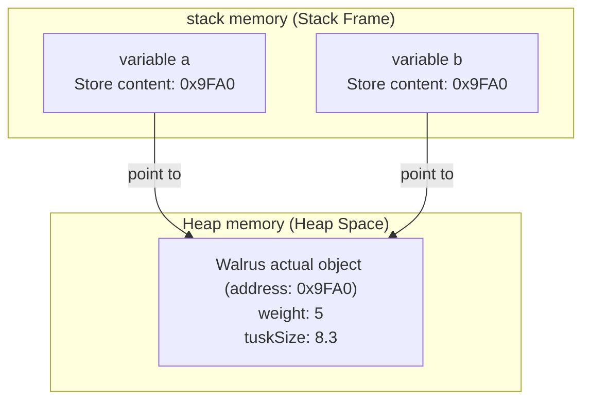
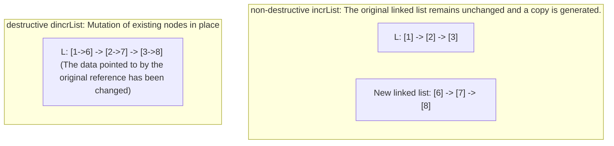

> **Course**: UC Berkeley CS61B: Data Structures (Spring 2024)  
> **Module**: Module 1: Java Fundamentals & Lists  
> **Lecturer**: Prof. Justin Yokota & Prof. Peyrin Kao (UC Berkeley)  
> **Video duration**: 46:59 ｜ **Official original version**: Lecture 3 - Lists I References Recursion and Lists  
> **Direct video**: [📺Watch the original video of this lecture (P3) on Bilibili](https://www.bilibili.com/video/BV1hJ4m1M7ZA/?p=3) ｜ [📑 Official courseware Slides (Google Presentation)](https://docs.google.com/presentation/d/1G5k4HcjJ7C2fT_9xQdvpfWjKC4xQa--5FnwXPGf0nwg) ｜ [📖Official textbook chapter](https://cs61b-2.gitbook.io/cs61b-textbook/3.-references-recursion-and-lists)  
> **Quick navigation**: [← Previous lecture (P02 Definition and use of classes and objects)](/en/notes/cs61b/lecture-02) ｜ [📚 Return to the full book catalog](/en/notes/topics/CS61B) ｜ [Next lecture (P04 Linked List II: One-way Linked List, Encapsulation and Sentinel Node) →](/en/notes/cs61b/lecture-04)

---

## 1. The nature of variables and physical memory: Bits in Memory

*(Reference time: 00:01:20 · [Video jump (P03 00:01:20)](https://www.bilibili.com/video/BV1hJ4m1M7ZA/?p=3&t=80))*

To truly master data structures and algorithms, one must penetrate the grammatical representation of high-level languages and go deep into the bottom layer of the computer's physical memory.

In modern computer architecture, all information is ultimately composed of binary electrical signals—that is, 0s and 1s—stored in physical memory (RAM) **Bit sequence (Bits)**. Each memory byte (Byte) consists of 8 bits and has a unique physical memory address at the hardware level.

### Declare the physical meaning of variables: apply for a fixed-width box
When we declare a variable in Java, the Java compiler and JVM will reserve a fixed size memory space in the current stack frame. We can vividly compare it to a "Box of Bits":

```java
int x = 42;
```
This line of code triggers three things under the hood:
1. Create a space on the stack with a length of exactly  **32 bits (4 bytes)**  memory slot;
2. Name the identifier of the memory slot as  `x`; 
3. Represents the value 42 as the 32-bit two’s complement (`00000000 00000000 00000000 00101010`) is written into the box.

### Java’s 8 basic data types (Primitive Types)
The Java language strictly specifies 8 basic primitive data types, and their memory bit widths are absolutely constant under any operating system platform and CPU architecture:

| basic type | Occupied bit width (Bits) | Bytes occupied | Value range and characteristics |
| :--- | :--- | :--- | :--- |
| `byte` | 8 | 1 | $-128 \sim 127$ |
| `short` | 16 | 2 | $-32,768 \sim 32,767$ |
| `int` | 32 | 4 | approx.  $-2.14 \times 10^9 \sim 2.14 \times 10^9$  (integer default) |
| `long` | 64 | 8 | approx.  $-9.22 \times 10^{18} \sim 9.22 \times 10^{18}$  (suffix  `L`) |
| `float` | 32 | 4 | IEEE 754 single-precision floating point number (suffix  `f`) |
| `double` | 64 | 8 | IEEE 754 double precision floating point number (floating point default) |
| `boolean` | 1 (or JVM decides) | 1 | Only available  `true`  or  `false` |
| `char` | 16 | 2 | 16-bit Unicode characters ($0 \sim 65,535$) |

> **Key knowledge**: For basic type variables, **What is stored in the variable box is the specific data value itself.**!

## 2. Reference types and The Mystery of the Walrus

*(Reference time: 00:08:40 · [Video jump (P03 00:08:40)](https://www.bilibili.com/video/BV1hJ4m1M7ZA/?p=3&t=520))*

In addition to the above 8 basic types, Java’s **All other types are reference types (Reference Types)**! Include all classes (such as  `String`, `Dog`, `IntList`) and all types of arrays.

In order to uncover the nature of citation types, Professor Josh Hug proposed the famous "The Mystery of the Walrus" in the courseware.

### Experiment 1: Walrus Puzzle Code Experiment
Consider a simple walrus class  `Walrus`: 
```java
public class Walrus {
    public int weight;
    public double tuskSize;

    public Walrus(int w, double ts) {
        weight = w;
        tuskSize = ts;
    }
}
```

After observing the execution of the following code, modify  `b`  will it affect  `a`?
```java
Walrus a = new Walrus(1000, 8.3);
Walrus b;
b = a;
b.weight = 5;
System.out.println("a.weight is: " + a.weight);
System.out.println("b.weight is: " + b.weight);
```

### Experiment 2: Basic type integer comparison experiment
Observe the following basic types of execution:
```java
int x = 5;
int y;
y = x;
x = 2;
System.out.println("x is: " + x);
System.out.println("y is: " + y);
```

### Running results and strong comparison
- Experiment 1 output: `a.weight is: 5`, `b.weight is: 5`! (Modify  `b`  unexpectedly changed  `a`  status! )
- Experiment 2 output: `x is: 2`, `y is: 5`! (Modify  `x`  Doesn't affect at all  `y`!)

Why do seemingly identical equal sign assignments behave very differently?

## 3. Golden Rule of Equals and reference memory model

*(Reference time: 00:15:50 · [Video jump (P03 00:15:50)](https://www.bilibili.com/video/BV1hJ4m1M7ZA/?p=3&t=950))*

In order to eliminate all confusion, CS 61B extracts the core iron law that governs all assignment behaviors in Java——**The Golden Rule of Equals**: 

> **golden rule of equal sign**:   
> When executing the assignment statement  `y = x;`  When, Java  **always and only do one thing**:   
> **put variable  `x`  All the bits (Bits) stored in the memory box are copied exactly intact and written into variables.  `y`  in the memory box!**

In Java, there has never been an ambiguous rule called "sometimes passing pointers, sometimes passing objects, sometimes shallow copies". There is always only one rule!

### Use the golden rule to unify the two types of experiments

#### Decryption experiment two (basic type):
1. `int x = 5;`: in  `x`  The binary encoding of the number 5 is written into the 32-bit box;
2. `int y;`: Open a space in the stack named  `y`  32-bit box;
3. `y = x;`: According to the golden rule, the  `x`  Make a copy of the 32 bits saved in the box (i.e. the number 5) and fill in the  `y`  in the box. At this time  `x`  and  `y`  Each saves an independent 5;
4. `x = 2;`: Write the number 2  `x`  in the box. `y`  The box has not been touched at all and is still 5.

#### Decryption experiment one (reference type):
1. `Walrus a = new Walrus(1000, 8.3);`: 
   - `new Walrus(...)`  A large space is opened in the heap memory to store the specific attributes of the walrus (`weight`  is 1000, `tuskSize`  for 8.3), assuming that the physical address of the object in the heap memory is  `0x9FA0`; 
   - variable  `a`  It's a reference variable! in the stack, `a`  just a  **64-bit address pointer box**.`a`  The bits stored in the box are not the flesh of the walrus; **The memory address of this walrus in the heap  `0x9FA0`**!
2. `Walrus b;`: Open a space in the stack named  `b`  64-bit address box;
3. `b = a;`: **Strictly enforce the golden rule**! JVM will  `a`  The bits in the box (i.e. the address  `0x9FA0`) make a copy and write  `b`  In the box!
4. **The birth of aliasing**: at this time  `a`  and  `b`  The box contained identical memory addresses, and they all pointed to the only actual walrus in the heap!
5. `b.weight = 5;`: dot operator  `.`  The physical meaning is \*\*"Dereference (Dereference) - according to the memory address saved in the box, follow the clues and jump to the specific object in the heap"\*\*. due to  `b`  follow  `0x9FA0`  Jump over and change the weight to 5, then pass  `a`  follow the same  `0x9FA0`  When you jump to read it, what you see is naturally 5!



## 4. Parameter passing in method calls: The ultimate truth about Pass by Value

*(Reference time: 00:23:10 · [Video jump (P03 00:23:10)](https://www.bilibili.com/video/BV1hJ4m1M7ZA/?p=3&t=1390))*

The debate over whether Java is pass-by-value or pass-by-reference is an ongoing one in the programming community. Through the 61B bitbox perspective, this debate can be brought to a perfect end:

> **ultimate conclusion**: **Java is always Strictly Pass-By-Value!**  
> Because passing actual parameters to a method is essentially a process on the formal parameters. **Equal sign assignment**. And equal sign assignment always follows the golden rule——**Copy the bits inside the box**!

### Case Diagnosis: Why do attempts to exchange references within a method necessarily fail?
```java
public class PassByValueMystery {
    public static void swap(Walrus x, Walrus y) {
        Walrus temp = x;
        x = y;
        y = temp;
    }

    public static void main(String[] args) {
        Walrus w1 = new Walrus(100, 1.0);
        Walrus w2 = new Walrus(200, 2.0);
        swap(w1, w2);
        System.out.println("w1 weight: " + w1.weight); // 依然是 100！
        System.out.println("w2 weight: " + w2.weight); // 依然是 200！
    }
}
```

### Track the birth and death process of stack frames:
1. `main`  The method has its own stack frame, which stores variables  `w1` (save address 1) and  `w2` (save address 2);
2. when calling  `swap(w1, w2)`  When , the JVM is  `swap`  Method creation **Brand new independent stack frame**, and assign the local formal parameter variable box  `x`  and  `y`; 
3. Implement the golden rule: `x`  Copied  `w1`  Address 1 in the box, `y`  Copied  `w2`  Address 2 in the box;
4. in  `swap`  internal, `temp = x; x = y; y = temp;`  indeed exchanged  `swap`  Local variables within the stack frame  `x`  and  `y`  The address in the box;
5. **Method return and stack frame destruction**: `swap`  After the method is executed, its entire stack frame is instantly popped up and destroyed by the JVM! `main`  in stack frame  `w1`  and  `w2`  Never touched, the addresses they hold remain unchanged.

> **think**: If in  `swap`  internal execution  `x.weight = 999;`  What will happen?  
> This will actually modify the walrus in the pile! because  `x`  Following address 1 the actual object was found. But this changes the state of the object, not the binding of the variable reference itself!

## 5. A preliminary study on recursive data structures: minimalist construction of IntList

*(Reference time: 00:30:15 · [Video jump (P03 00:30:15)](https://www.bilibili.com/video/BV1hJ4m1M7ZA/?p=3&t=1815))*

Now, we use the "reference and heap memory model" we just established to build the most basic and important dynamic data structure in computer science from scratch——**Linked List**.

In CS 61A, we learned about Scheme and Python’s recursive linked lists (`Link(1, Link(2, Link(3)))`). In Java, we can use an extremely streamlined class  `IntList`  To express this self-similar topology:

```java
public class IntList {
    public int first;      // 存储当前节点的数据载荷
    public IntList rest;   // 存储指向链表其余部分的引用

    public IntList(int f, IntList r) {
        first = f;
        rest = r;
    }
}
```

### Manual assembly of linked list and memory topology diagram
If we want to construct a number containing  `5 -> 10 -> 15`  How should the code be written for a linked list?

```java
IntList L = new IntList(15, null);
L = new IntList(10, L);
L = new IntList(5, L);
```

Or use nested constructs:
```java
IntList L = new IntList(5, new IntList(10, new IntList(15, null)));
```

In memory, the physical arrangement of these three nodes in the heap is completely scattered, relying on  `rest`  The memory addresses held in the reference are strung together like a necklace of pearls:

```text
栈变量 L (0x100)
    |
    v
[堆节点 1 (0x100)] --> [堆节点 2 (0x200)] --> [堆节点 3 (0x300)] --> null
| first: 5        |   | first: 10       |   | first: 15       |
| rest:  0x200    |   | rest:  0x300    |   | rest:  null     |
```

Each node consists of two parts: a box that stores an integer value (`first`), and a reference box that stores the memory address of the next node (`rest`). of the last node  `rest`  for  `null`, marking the end of the linked list.

## 6. Algorithm drill: recursive implementation vs iterative implementation  `size()`  with  `get(i)`

*(Reference time: 00:37:40 · [Video jump (P03 00:37:40)](https://www.bilibili.com/video/BV1hJ4m1M7ZA/?p=3&t=2260))*

due to  `IntList`  It is a natural recursive data structure, and the algorithms that operate it usually have two completely different thinking paths: **Recursive Paradigm**  with  **Iterative Paradigm**.

### 1. Calculate the length of the linked list: `size()`
- **recursive perspective**: If the current node's  `rest`  Yes  `null`, then the length is 1 (baseline condition); otherwise the total length is equal to  $1 + rest.size()$.
- **iterative perspective**: Use a pointer variable  `p`  Traverse from beginning to end, and the counter accumulates until  `p == null`.

```java
public class IntList {
    public int first;
    public IntList rest;

    public IntList(int f, IntList r) {
        first = f;
        rest = r;
    }

    /** 递归方式求解链表长度 */
    public int size() {
        if (this.rest == null) {
            return 1;
        }
        return 1 + this.rest.size();
    }

    /** 迭代方式求解链表长度 */
    public int iterativeSize() {
        IntList p = this;
        int totalSize = 0;
        while (p != null) {
            totalSize++;
            p = p.rest; // 步进到下一个节点
        }
        return totalSize;
    }
}
```

### 2. Get the first  $i$  elements: `get(int i)`
It is agreed that the 0th element is the current node  `first`: 

```java
    /** 递归实现获取第 i 个元素 (0-indexed) */
    public int get(int i) {
        if (i == 0) {
            return this.first;
        }
        return this.rest.get(i - 1);
    }

    /** 迭代实现获取第 i 个元素 */
    public int iterativeGet(int i) {
        IntList p = this;
        while (i > 0) {
            p = p.rest;
            i--;
        }
        return p.first;
    }
```

> **Complexity analysis**: Regardless of recursion or iteration, get the  $i$  Elements or calculated lengths need to be jumped one by one in pointer order, and the time complexity is  $\Theta(N)$. Since recursion will occupy the system call stack, when the depth of the linked list exceeds tens of thousands, the recursive version  `size()`  will cause  `StackOverflowError`!

## 7. Destructive operations vs non-destructive operations: `dincrList`  with  `incrList`  In-depth walkthrough

*(Reference time: 00:44:00 · [Video jump (P03 00:44:00)](https://www.bilibili.com/video/BV1hJ4m1M7ZA/?p=3&t=2640))*

The most critical watershed in data structure algorithms is to distinguish **Destructive Operations **with** Non-Destructive Operations**.

Professor Josh Hug gave a classic proposition in the courseware: **Implement a method that passes in  `IntList`  A constant is added to all integer elements in  `x`**.

### Mode 1: Non-destructive value-added (Non-Destructive  `incrList`)
**principles**: The original linked list must remain unchanged! The method must allocate a new memory node and return a new linked list.

```java
public static IntList incrList(IntList L, int x) {
    if (L == null) {
        return null;
    }
    // 创建全新节点，递归处理后续部分
    return new IntList(L.first + x, incrList(L.rest, x));
}
```
- **memory impact**: If the original linked list has  $N$  nodes, additional new ones will be created in the heap memory.  $N$  a brand new  `IntList`  node. The original linked list is intact.

### Mode 2: Destructive value-added (Destructive  `dincrList`)
**principles**: Use strictly prohibited  `new`  Keyword opens up any new node! Directly modify existing nodes in place  `first`  field.

```java
public static IntList dincrList(IntList L, int x) {
    IntList p = L;
    while (p != null) {
        p.first = p.first + x; // 致命就地突变！
        p = p.rest;
    }
    return L;
}
```



> **Software Engineering Warning**:   
> Although the destructive method extremely saves memory space (space complexity  $O(1)$  vs non-destructive  $O(N)$), but it will bring huge psychological burden and hidden bugs to the caller. If other modules of the system hold references to the linked list at the same time, destructive operations will tamper with the data of other modules without anyone noticing! Therefore, when naming destructive methods in 61B, it is usually strictly prefixed with  `d` (such as  `dincrList`).

## 8. Engineering flaws of Naked Recursion and motivation for object-oriented reconstruction

*(Reference time: 00:48:30 · [Video jump (P03 00:48:30)](https://www.bilibili.com/video/BV1hJ4m1M7ZA/?p=3&t=2910))*

Although  `IntList`  It has powerful functions and pure structure, but in actual industrial-level software engineering, **Almost no library directly exposes this "Naked Linked List" to external users**.

### Four fatal weaknesses of naked recursive structures
1. **The user experience is extremely obscure**:   
   Users cannot even create an empty linked list! can only write  `IntList L = null;`. If it is an empty linked list, call  `L.size()`  will encounter directly  `NullPointerException`  collapse.
2. **The operation is awkward and unintuitive**:   
   To insert an element at the head of the linked list, the user must write: `L = new IntList(0, L);`. The user must always be concerned with the tedious details of pointer reconnection.
3. **No Encapsulation**:   
   `first`  and  `rest`  must be declared as  `public`, any external code can be executed at will  `L.rest.rest = null;`  Cut the linked list in half, causing permanent loss of data.
4. **Unable to safely maintain class-level invariants**:   
   we can't  `IntList`  medium secure cache  `size`  variable, because the outside may bypass the class method and directly modify the node pointer at any time, resulting in cache failure.  `size`  Out of touch with the actual number of nodes.

In order to completely solve these defects of naked recursive linked lists, we must enter the core topic of Lecture 4-introducing **Outer packaging  `SLList`**, complete the object-oriented encapsulation transformation!

## 9. Summary of knowledge map and advanced self-test questions in this lecture

*(Reference time: 00:52:00 · [Video jump (P03 00:52:00)](https://www.bilibili.com/video/BV1hJ4m1M7ZA/?p=3&t=3120))*

### Summary and comparison of core concepts

| concept | Core technical points | Beware of cognitive biases |
| :--- | :--- | :--- |
| **bit box model** | A variable is a fixed-width storage space in a stack frame. | Mistakenly believe that variable names will be stored in the underlying physical memory |
| **golden rule of equal sign** | `b = a`  Copy only the bits in the box | Reference assignment does not copy the object itself, but only copies the 64-bit memory address. |
| **pass by value** | The essence of method calling is formal parameter assignment, strictly by value | Confusing "modifying the internal state of the object" with "modifying the parameter reference itself" |
| **Destructive vs non-destructive** | Destructively reuse old memory for in-place modification, and non-destructively develop new objects to protect old data. | Writing destructive code without documentation and destroying client data |

---

### Comprehensive self-test questions after class

#### Question 1 (Memory Tracing and Destructive Modifications)
Observe the following code snippet, draw a memory graph, and give the output:
```java
IntList A = new IntList(10, null);
IntList B = new IntList(20, A);
IntList C = B;
C.rest.first = 99;
System.out.println(A.first);
System.out.println(B.first);
System.out.println(B.rest.first);
```
**Answers and detailed analysis**:   
- **Output results**: 
  ```text
  99
  20
  99
  ```
- **Line-by-line memory analysis**: 
  1. `A`  Point to node  `[10, null]`; 
  2. `B`  Point to new node  `[20, ->A]`; 
  3. `C = B;`  copy reference, `C`  and  `B`  points to the exact same node  `[20, ->A]`; 
  4. `C.rest`  That’s it  `A`  The node pointed to! `C.rest.first = 99`  The value of this node is directly modified to 99;
  5. Passed at this time  `A.first`  or  `B.rest.first`  The rewritten nodes are all accessed, so the output is 99.

#### Topic 2 (Algorithm Programming: Non-destructive Linked List Splicing)
Write a non-destructive static method  `public static IntList catenate(IntList A, IntList B)`, convert the two linked lists  `A`  and  `B`  Connected. Request original linked list  `A`  and  `B`  Leave absolutely unaffected and return a brand new spliced linked list. 
**Reference implementation code**: 
```java
public static IntList catenate(IntList A, IntList B) {
    if (A == null) {
        // 如果 A 为空，非破坏性要求：我们需要深拷贝 B 吗？
        // 按照严格非破坏性规范，若 A 为空，也应当深拷贝 B 或返回 B 的安全拷贝
        return copy(B);
    }
    return new IntList(A.first, catenate(A.rest, B));
}

private static IntList copy(IntList L) {
    if (L == null) return null;
    return new IntList(L.first, copy(L.rest));
}
```

---

## Appendix: UC Berkeley official textbook in-depth study (Official Textbook In-Depth Chapters)

> **Introduction**: The content of this section is integrated from the UC Berkeley CS61B official textbook library (GitBook Textbook). It provides original English theoretical derivation, formal code examples and supporting chapter exercises for the core data structures and algorithms of this lecture, which complements and confirms the previous video lectures.

## 3. References, Recursion, and Lists

#### Lists 

You've no doubt used a list data structure at some point in the past. For example, in Python:

```python

L = [3, 5, 6]

L.append(7)

```

While Java does have a built-in List type, we're going to eschew using it for now. In this chapter, we'll build our own list from scratch, along the way learning some key features of Java.

##### The Mystery of the Walrus 

To begin our journey, we will first ponder the profound Mystery of the Walrus.

Try to predict what happens when we run the code below. Does the change to b affect a? Hint: If you're coming from Python, Java has the same behavior.

```java

Walrus a = new Walrus(1000, 8.3);

Walrus b;

b = a;

b.weight = 5;

System.out.println(a);

System.out.println(b);

```

Now try to predict what happens when we run the code below. Does the change to x affect y?

```java

int x = 5;

int y;

y = x;

x = 2;

System.out.println("x is: " + x);

System.out.println("y is: " + y);

```

The answer can be found [here](http://cscircles.cemc.uwaterloo.ca/java_visualize/#code=public+class+PollQuestions+%7B%0A+++public+static+void+main%28String%5B%5D+args%29+%7B%0A++++++Walrus+a+%3D+new+Walrus%281000,+8.3%29%3B%0A++++++Walrus+b%3B%0A++++++b+%3D+a%3B%0A++++++b.weight+%3D+5%3B%0A++++++System.out.println%28a%29%3B%0A++++++System.out.println%28b%29%3B++++++%0A%0A++++++int+x+%3D+5%3B%0A++++++int+y%3B%0A++++++y+%3D+x%3B%0A++++++x+%3D+2%3B%0A++++++System.out.println%28%22x+is%3A+%22+%2B+x%29%3B%0A++++++System.out.println%28%22y+is%3A+%22+%2B+y%29%3B++++++%0A+++%7D%0A+++%0A+++public+static+class+Walrus+%7B%0A++++++public+int+weight%3B%0A++++++public+double+tuskSize%3B%0A++++++%0A++++++public+Walrus%28int+w,+double+ts%29+%7B%0A+++++++++weight+%3D+w%3B%0A+++++++++tuskSize+%3D+ts%3B%0A++++++%7D%0A%0A++++++public+String+toString%28%29+%7B%0A+++++++++return+String.format%28%22weight%3A+%25d,+tusk+size%3A+%25.2f%22,+weight,+tuskSize%29%3B%0A++++++%7D%0A+++%7D%0A%7D\&mode=edit).

While subtle, the key ideas that underlie the Mystery of the Walrus will be incredibly important to the efficiency of the data structures that we'll implement in this course, and a deep understanding of this problem will also lead to safer, more reliable code.

##### Bits 

All information in your computer is stored in *memory* as a sequence of ones and zeros. Some examples:

* 72 is often stored as 01001000

* 205.75 is often stored as 01000011 01001101 11000000 00000000

* The letter H is often stored as 01001000 (same as 72)

* The true value is often stored as 00000001

In this course, we won't spend much time talking about specific binary representations, e.g. why on earth 205.75 is stored as the seemingly random string of 32 bits above. Understanding specific representations is a topic of [CS61C](http://www-inst.eecs.berkeley.edu/~cs61c/), the followup course to 61B.

Though we won't learn the language of binary, it's good to know that this is what is going on under the hood.

One interesting observation is that both 72 and H are stored as 01001000. This raises the question: how does a piece of Java code know how to interpret 01001000?

The answer is through types! For example, consider the code below:

```java

char c = 'H';

int x = c;

System.out.println(c);

System.out.println(x);

```

If we run this code, we get:

```

H

72

```

In this case, both the x and c variables contain the same bits (well, almost...), but the Java interpreter treats them differently when printed.

In Java, there are 8 primitive types: byte, short, int, long, float, double, boolean, and char. Each has different properties that we'll discuss throughout the course, with the exception of short and float, which you'll likely never use.

##### Declaring a Variable (Simplified) 

You can think of your computer as containing a vast number of memory bits for storing information, each of which has a unique address. Many billions of such bits are available to the modern computer.

When you declare a variable of a certain type, Java finds a contiguous block with exactly enough bits to hold a thing of that type. For example, if you declare an int, you get a block of 32 bits. If you declare a byte, you get a block of 8 bits. Each data type in Java holds a different number of bits. The exact number is not terribly important to us in this class.

For the sake of having a convenient metaphor, we'll call one of these blocks a "box" of bits.

In addition to setting aside memory, the Java interpreter also creates an entry in an internal table that maps each variable name to the location of the first bit in the box.

For example, if you declared `int x` and `double y`, then Java might decide to use bits 352 through 384 of your computer's memory to store x, and bits 20800 through 20864 to store y. The interpreter will then record that int x starts at bit 352 and y starts at bit 20800. For example, after executing the code:

```java

int x;

double y;

```

We'd end up with boxes of size 32 and 64 respectively, as shown in the figure below:


The Java language provides no way for you to know the location of the box, e.g. you can't somehow find out that x is in position 352. In other words, the exact memory address is below the level of abstraction accessible to us in Java. This is unlike languages like C where you can ask the language for the exact address of a piece of data. For this reason, I have omitted the addresses from the figure above.

This feature of Java is a tradeoff! Hiding memory locations from the programmer gives you less control, which prevents you from doing certain [types of optimizations](http://www.informit.com/articles/article.aspx?p=2246428\&seqNum=5). However, it also avoids a [large class of very tricky programming errors](http://www.informit.com/articles/article.aspx?p=2246428\&seqNum=1). In the modern era of very low cost computing, this tradeoff is usually well worth it. As the wise Donald Knuth once said: "We should forget about small efficiencies, say about 97% of the time: premature optimization is the root of all evil".

As an analogy, you do not have direct control over your heartbeat. While this restricts your ability to optimize for certain situations, it also avoids the possibility of making stupid errors like accidentally turning it off.

Java does not write anything into the reserved box when a variable is declared. In other words, there are no default values. As a result, the Java compiler prevents you from using a variable until after the box has been filled with bits using the `=` operator. For this reason, I have avoided showing any bits in the boxes in the figure above.

When you assign values to a memory box, it is filled with the bits you specify. For example, if we execute the lines:

```java

x = -1431195969;

y = 567213.112;

```

Then the memory boxes from above are filled as shown below, in what I call **box notation**.


The top bits represent -1431195969, and the bottom bits represent 567213.112. Why these specific sequences of bits represent these two numbers is not important, and is a topic covered in CS61C. However, if you're curious, see [integer representations](https://en.wikipedia.org/wiki/Two%27s_complement) and [double representations](https://en.wikipedia.org/wiki/IEEE_floating_point) on wikipedia.

Note: Memory allocation is actually somewhat more complicated than described here, and is a topic of CS 61C. However, this model is close enough to reality for our purposes in 61B.

**Simplified Box Notation**

While the box notation we used in the previous section is great for understanding approximately what's going on under the hood, it's not useful for practical purposes since we don't know how to interpret the binary bits.

Thus, instead of writing memory box contents in binary, we'll write them in human readable symbols. We will do this throughout the rest of the course. For example, after executing:

```java

int x;

double y;

x = -1431195969;

y = 567213.112;

```

We can represent the program environment using what I call **simplified box notation**, shown below:


##### The Golden Rule of Equals (GRoE) 

Now armed with simplified box notation, we can finally start to resolve the Mystery of the Walrus.

It turns out our Mystery has a simple solution: When you write `y = x`, you are telling the Java interpreter to copy the bits from x into y. This Golden Rule of Equals (GRoE) is the root of all truth when it comes to understanding our Walrus Mystery.

```java

int x = 5;

int y;

y = x;

x = 2;

System.out.println("x is: " + x);

System.out.println("y is: " + y);

```

This simple idea of copying the bits is true for ANY assignment using `=` in Java. To see this in action, click [this link](http://cscircles.cemc.uwaterloo.ca/java_visualize/#code=public+class+PollQuestions+%7B%0A+++public+static+void+main\(String%5B%5D+args%29+%7B%0A++++++int+x+%3D+5%3B%0A++++++int+y%3B%0A++++++y+%3D+x%3B%0A++++++x+%3D+2%3B%0A++++++System.out.println\(%22x+is%3A+%22+%2B+x%29%3B%0A++++++System.out.println\(%22y+is%3A+%22+%2B+y%29%3B++++++%0A+++%7D%0A%7D\&mode=display\&curInstr=0).

##### Reference Types 

Above, we said that there are 8 primitive types: byte, short, int, long, float, double, boolean, char. Everything else, including arrays, is not a primitive type but rather a `reference type`.

**Object Instantiation**

When we *instantiate* an Object using `new` (e.g. Dog, Walrus, Planet), Java first allocates a box for each instance variable of the class, and fills them with a default value. The constructor then usually (but not always) fills every box with some other value.

For example, if our Walrus class is:

```java

public static class Walrus {

    public int weight;

    public double tuskSize;

    public Walrus(int w, double ts) {

          weight = w;

          tuskSize = ts;

    }

}

```

And we create a Walrus using `new Walrus(1000, 8.3);`, then we end up with a Walrus consisting of two boxes of 32 and 64 bits respectively:


In real implementations of the Java programming language, there is actually some additional overhead for any object, so a Walrus takes somewhat more than 96 bits. However, for our purposes, we will ignore such overhead, since we will never interact with it directly.

The Walrus we've created is anonymous, in the sense that it has been created, but it is not stored in any variable. Let's now turn to variables that store objects.

**Reference Variable Declaration**

When we *declare* a variable of any reference type (Walrus, Dog, Planet, array, etc.), Java allocates a box of 64 bits, no matter what type of object.

At first glance, this might seem to lead to a Walrus Paradox. Our Walrus from the previous section required more than 64 bits to store. Furthermore, it may seem bizarre that no matter the type of object, we only get 64 bits to store it.

However, this problem is easily resolved with the following piece of information: the 64 bit box contains not the data about the walrus, but instead the address of the Walrus in memory.

As an example, suppose we call:

```java

Walrus someWalrus;

someWalrus = new Walrus(1000, 8.3);

```

The first line creates a box of 64 bits. The second line creates a new Walrus, and the address is returned by the `new` operator. These bits are then copied into the `someWalrus` box according to the GRoE.

If we imagine our Walrus weight is stored starting at bit `5051956592385990207` of memory, and tuskSize starts at bit `5051956592385990239`, we might store `5051956592385990207` in the Walrus variable. In binary, `5051956592385990207` is represented by the 64 bits `0100011000011100001001111100000100011101110111000001111000111111`, giving us in box notation:


We can also assign the special value `null` to a reference variable, corresponding to all zeros.


**Box and Pointer Notation**

Just as before, it's hard to interpret a bunch of bits inside a reference variable, so we'll create a simplified box notation for reference variable as follows:

* If an address is all zeros, we will represent it with null.

* A non-zero address will be represented by an **arrow** pointing at an object instantiation.

This is also sometimes called "box and pointer" notation.

For the examples from the previous section, we'd have:


**Resolving the Mystery of the Walrus**

We're now finally ready to resolve, fully and completely, the Mystery of the Walrus.

```java

Walrus a = new Walrus(1000, 8.3);

Walrus b;

b = a;

```

After the first line is executed, we have:


After the second line is executed, we have:


Note that above, b is undefined, not null.

According to the GRoE, the final line simply copies the bits in the `a` box into the `b` box. Or in terms of our visual metaphor, this means that b will copy exactly the arrow in a and now show an arrow pointing at the same object.


And that's it. There's no more complexity than this.

##### Parameter Passing 

When you pass parameters to a function, you are also simply copying the bits. In other words, the GRoE also applies to parameter passing. Copying the bits is usually called "pass by value". In Java, we **always** pass by value.

For example, consider the function below:

```java

public static double average(double a, double b) {

    return (a + b) / 2;

}

```

Suppose we invoke this function as shown below:

```java

public static void main(String[] args) {

    double x = 5.5;

    double y = 10.5;

    double avg = average(x, y);

}

```

After executing the first two lines of this function, the main method will have two boxes labeled `x` and `y` containing the values shown below:


When the function is invoked, the `average` function has its **own** scope with two new boxes labeled as `a` and `b`, and the bits are simply *copied* in. This copying of bits is what we refer to when we say "pass by value".


If the `average` function were to change `a`, then `x` in main would be unchanged, since the GRoE tells us that we'd simply be filling in the box labeled `a` with new bits.

**Test Your Understanding**

**Exercise 2.1.1**: Suppose we have the code below:

```java

public class PassByValueFigure {

    public static void main(String[] args) {

           Walrus walrus = new Walrus(3500, 10.5);

           int x = 9;

           doStuff(walrus, x);

           System.out.println(walrus);

           System.out.println(x);

    }

    public static void doStuff(Walrus W, int x) {

           W.weight = W.weight - 100;

           x = x - 5;

    }

}

```

Does the call to `doStuff` have an effect on walrus and/or x? Hint: We only need to know the GRoE to solve this problem.

##### Instantiation of Arrays 

As mentioned above, variables that store arrays are reference variables just like any other. As an example, consider the declarations below:

```java

int[] x;

Planet[] planets;

```

Both of these declarations create memory boxes of 64 bits. `x` can only hold the address of an `int` array, and `planets` can only hold the address of a `Planet` array.

Instantiating an array is very similar to instantiating an object. For example, if we create an integer array of size 5 as shown below:

```

x = new int[]{0, 1, 2, 95, 4};

```

Then the `new` keyword creates 5 boxes of 32 bits each and returns the address of the overall object for assignment to x.

Objects can be lost if you lose the bits corresponding to the address. For example if the only copy of the address of a particular Walrus is stored in `x`, then `x = null` will cause you to permanently lose this Walrus. This isn't necessarily a bad thing, since you'll often decide you're done with an object, and thus it's safe to simply throw away the reference. We'll see this when we build lists later in this chapter.

**The Law of the Broken Futon**

You might ask yourself why we spent so much time and space covering what seems like a triviality. This is probably especially true if you have prior Java experience. The reason is that it is very easy for a student to have a half-cocked understanding of this issue, allowing them to write code, but without true comprehension of what's going on.

While this might be fine in the short term, in the long term, doing problems without full understanding may doom you to failure later down the line. There's a blog post about this so-called [Law of the Broken Futon](https://mathwithbaddrawings.com/2015/04/08/the-math-ceiling-wheres-your-cognitive-breaking-point/) that you might find interesting.

##### == vs. Arrays.equals 

Similar to =, we can think of the == operator in terms of bits. Whenever we write `x==y` we are asking Jafa to compare the literal bits in memory boxes  `x` and `y`.

For example, suppose we have the code:

```java

int[] x = new int[]{0, 1, 2, 95, 4};

int[] y = new int[]{0, 1, 2, 95, 4};

System.out.println(x == y); #false

```

This code will print false, since `x` and `y` each contain the 64 bit address of two different arrays in memory, albeit two arrays which happen to contain the same information. If we want to compare the two content of the two arrays, we can use Arrays.equals instead, e.g.

```java

int[] x = new int[]{0, 1, 2, 95, 4};

int[] y = new int[]{0, 1, 2, 95, 4};

System.out.println(Arrays.equals(x, y)); #true

```

##### IntLists 

Now that we've truly understood the Mystery of the Walrus, we're ready to build our own list class.

It turns out that a very basic list is trivial to implement, as shown below:

```java

public class IntList {

    public int first;

    public IntList rest;        

    public IntList(int f, IntList r) {

        first = f;

        rest = r;

    }

}

```

You may remember something like this from 61a called a "Linked List".

Such a list is ugly to use. For example, if we want to make a list of the numbers 5, 10, and 15, we can either do:

```java

IntList L = new IntList(5, null);

L.rest = new IntList(10, null);

L.rest.rest = new IntList(15, null);

```

Alternately, we could build our list backwards, yielding slightly nicer but harder to understand code:

```java

IntList L = new IntList(15, null);

L = new IntList(10, L);

L = new IntList(5, L);

```

While you could in principle use the IntList to store any list of integers, the resulting code would be rather ugly and prone to errors. We'll adopt the usual object oriented programming strategy of adding helper methods to our class to perform basic tasks.

**size and iterativeSize**

We'd like to add a method `size` to the `IntList` class so that if you call `L.size()`, you get back the number of items in `L`.

Consider writing a `size` and `iterativeSize` method before reading the rest of this chapter. `size` should use recursion, and `iterativeSize` should not. You'll probably learn more by trying on your own before seeing how I do it. The two videos provide a live demonstration of how one might implement these methods.

My `size` method is as shown below:

```java

/** Return the size of the list using... recursion! */

public int size() {

    if (rest == null) {

        return 1;

    }

    return 1 + this.rest.size();

}

```

The key thing to remember about recursive code is that you need a base case. In this situation, the most reasonable base case is that rest is `null`, which results in a size 1 list.

Exercise: You might wonder why we don't do something like `if (this == null) return 0;`. Why wouldn't this work?

Answer: Think about what happens when you call size. You are calling it on an object, for example L.size(). If L were null, then you would get a NullPointer error!

My `iterativeSize` method is as shown below. I recommend that when you write iterative data structure code that you use the name `p` to remind yourself that the variable is holding a pointer. You need that pointer because you can't reassign "this" in Java. The followups in [this Stack Overflow Post](https://stackoverflow.com/questions/23021377/reassign-this-in-java-class) offer a brief explanation as to why.

```java

/** Return the size of the list using no recursion! */

public int iterativeSize() {

    IntList p = this;

    int totalSize = 0;

    while (p != null) {

        totalSize += 1;

        p = p.rest;

    }

    return totalSize;

}

```

**get**

While the `size` method lets us get the size of a list, we have no easy way of getting the ith element of the list.

Exercise: Write a method `get(int i)` that returns the ith item of the list. For example, if `L` is 5 -> 10 -> 15, then `L.get(0)` should return 5, `L.get(1)` should return 10, and `L.get(2)` should return 15. It doesn't matter how your code behaves for invalid `i`, either too big or too small.

For a solution, see the lecture video above or the lectureCode repository.

Note that the method we've written takes linear time! That is, if you have a list that is 1,000,000 items long, then getting the last item is going to take much longer than it would if we had a small list. We'll see an alternate way to implement a list that will avoid this problem in a future lecture.


---

## Course navigation and jump

| Previous lecture | Directory | Next lecture | Original video |
| :--- | :---: | :--- | :--- |
| [← Previous lecture: Definition and use of classes and objects](/en/notes/cs61b/lecture-02) | [📚 Return to CS61B complete book list](/en/notes/topics/CS61B) | [Next lecture: Linked List II: One-way Linked List, Encapsulation and Sentinel Node →](/en/notes/cs61b/lecture-04) | [🎬Watch this lecture on Bilibili (P03)](https://www.bilibili.com/video/BV1hJ4m1M7ZA/?p=3) |
