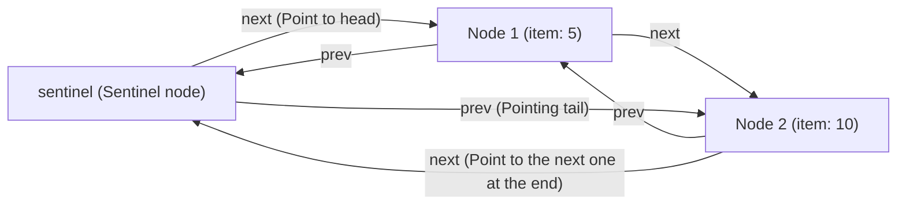

> **Course**: UC Berkeley CS61B: Data Structures (Spring 2024)  
> **Module**: Module 1: Java Fundamentals & Lists  
> **Lecturer**: Prof. Justin Yokota & Prof. Peyrin Kao (UC Berkeley)  
> **Video duration**: 50:49 ｜ **Official original version**: Lecture 5 - Lists 3 DLLists and Arrays  
> **Direct video**: [📺Watch the original video of this lecture on Bilibili (P5)](https://www.bilibili.com/video/BV1hJ4m1M7ZA/?p=5) ｜ [📑 Official courseware Slides (Google Presentation)](https://docs.google.com/presentation/d/1jjivjdvD4mx6qb4bd4rUKB6FDZbYtveJ5NKeyVeA1lk) ｜ [📖Official textbook chapter](https://cs61b-2.gitbook.io/cs61b-textbook/5.-dllists)  
> **Quick navigation**: [← Previous lecture (P04 Linked List II: One-way Linked List, Encapsulation and Sentinel Node)](/en/notes/cs61b/lecture-04) ｜ [📚 Return to the full book catalog](/en/notes/topics/CS61B) ｜ [Next lecture (P06 Cornerstone of software engineering: unit testing and test-driven development) →](/en/notes/cs61b/lecture-06)

---

## 1. The tail performance bottleneck of SLList: Why can’t the tail operation reach O(1)?

*(Reference time: 00:01:30 · [Video jump (P05 00:01:30)](https://www.bilibili.com/video/BV1hJ4m1M7ZA/?p=5&t=90))*

In the previous lecture, we introduced the  `SLList`, elegantly realizes the encapsulation and unified operation of the linked list data structure.

However, for  `SLList`  Performing an asymptotic analysis of the running time, we will find a serious structural asymmetry:
- **Head operation**: `addFirst(x)`  and  `getFirst()`  Just need to operate directly  `sentinel.next`, the time-consuming is always strictly  **$\Theta(1)$  constant time**; 
- **tail operation**: Executing  `addLast(x)`  Or when trying to get the last element, even if we have cache  `size`, since one-way pointers can only flow in one direction from front to back, the program must start from  `sentinel`  Start following  `next`  The pointer jumps backward step by step  $N$  It takes several times to reach the last node, and the time taken is  **$\Theta(N)$  linear time**!

When there are one million elements in the linked list, each time you append an element to the end, you have to traverse one million steps, which is completely unacceptable in actual engineering.

### Is it possible to add a  `last`  Tail pointer solution?
A natural intuition is: in  `SLList`  Add a private member variable in  `IntNode last;`  Points to the last node.
- In this way, `getLast()`  indeed became  $\Theta(1)$; 
- `addLast(x)`  You can also pass  `last.next = new IntNode(x, null); last = last.next;`  in  $\Theta(1)$  Done within;
- **But: if we want to implement  `removeLast()` What about (delete the last node)?**
  - To delete the last node, we must make the penultimate node  `next`  point to  `null`, and will  `last`  Move forward to the penultimate node;
  - But in a one-way linked list, **The pointer cannot turn back**! In order to find the penultimate node, we still have to traverse from the beginning  $N-1$  Step!
  - Therefore, a tail pointer alone cannot make  `removeLast()`  reaches constant time.

## 2. Core architecture design of doubly linked list (DLList): introduction  `prev`  with  `next`  Symmetric pointer

*(Reference time: 00:09:15 · [Video jump (P05 00:09:15)](https://www.bilibili.com/video/BV1hJ4m1M7ZA/?p=5&t=555))*

In order to fundamentally eliminate the physical limitation of one-way pointers that cannot be traced back in reverse, we must introduce a second pointer reference in each node——**forward pointer  `prev`**.

This is the core architecture of \*\*Doubly Linked List (DLList, Doubly Linked List)\*\*:

```java
public class DLList {
    private static class Node {
        public Node prev; // 指向前驱节点
        public int item;  // 数据载荷
        public Node next; // 指向后继节点

        public Node(Node p, int i, Node n) {
            prev = p;
            item = i;
            next = n;
        }
    }
    ...
```

Each node now records the physical memory addresses of both its predecessor and successor nodes. At this point, any node can  $\Theta(1)$  Move in both directions within a period of time.

## 3. The evolution of the sentinel architecture: double sentinel structure vs single circular sentinel (Circular Sentinel)

*(Reference time: 00:16:40 · [Video jump (P05 00:16:40)](https://www.bilibili.com/video/BV1hJ4m1M7ZA/?p=5&t=1000))*

After the introduction of bidirectional pointers, how to deal with the boundary sentinels at both ends? There are two classic architectural designs:

### Option A: Two Sentinels:  `sentinelFront` & `sentinelBack`)
Place at the head of the linked list  `sentinelFront`, placed at the end of the linked list  `sentinelBack`: 
```text
sentinelFront <--> [Node 1] <--> [Node 2] <--> sentinelBack
```
- **Advantages**: Logical and intuitive, with clear boundaries between front and back;
- **Disadvantages**: Each insertion or deletion operation requires maintaining the pointers of two sentinel nodes. The code is lengthy and occupies redundant memory objects.

### Plan B: A stroke of genius - Circular Sentinel Pattern
The ultimate design advocated by Professor Josh Hug in 61B is **single loop sentinel**: No matter how long the entire linked list is, **There is only one sentinel node  `sentinel`**!

We connect the entire linked list end to end into a ring:
- `sentinel.next`  Always points to the linked list **The first real data node**(Front); 
- `sentinel.prev`  Always points to the linked list **The last real data node**(Back)!



### The loop closed state of the empty linked list
When the linked list is empty (contains 0 real elements):
- `sentinel.next`  Point back directly  `sentinel`  itself!
- `sentinel.prev`  Also point directly back to  `sentinel`  itself!

```java
public class DLList {
    private Node sentinel;
    private int size;

    public DLList() {
        sentinel = new Node(null, 63, null);
        sentinel.prev = sentinel; // 循环闭环
        sentinel.next = sentinel; // 循环闭环
        size = 0;
    }

    public void addFirst(int x) {
        Node newNode = new Node(sentinel, x, sentinel.next);
        sentinel.next.prev = newNode;
        sentinel.next = newNode;
        size += 1;
    }

    public void addLast(int x) {
        Node newNode = new Node(sentinel.prev, x, sentinel);
        sentinel.prev.next = newNode;
        sentinel.prev = newNode;
        size += 1;
    }

    public int removeLast() {
        if (size == 0) return -1;
        Node lastNode = sentinel.prev;
        sentinel.prev = lastNode.prev;
        lastNode.prev.next = sentinel;
        size -= 1;
        return lastNode.item;
    }
}
```

Through this wonderful topological closed loop, `addFirst`, `addLast`, `removeFirst`, `removeLast`  All in strict  **$\Theta(1)$  constant time**  Completed within the code, and the **absolutely nothing  `if`  special border branch**!

## 4. Generic Lists: From specific types to universal containers

*(Reference time: 00:25:20 · [Video jump (P05 00:25:20)](https://www.bilibili.com/video/BV1hJ4m1M7ZA/?p=5&t=1520))*

So far, our linked list can only store integers  `int`. If we want to use a linked list to store strings  `String`, walrus  `Walrus`  Or any other object, do you have to copy and paste the code to write a set  `StringDLList`  and  `WalrusDLList` ?

Object-oriented languages provide a \*\*generics\*\* mechanism that allows the data type itself to be abstracted as a parameter when defining a class.

### Generic syntax and type parameter placeholders
Add angle brackets after the class name  `<Item>` (The name can be customized, Josh likes to jokingly call it in the courseware  `<BleepBlorp>`): 

```java
public class DLList<Item> {
    private class Node {
        public Node prev;
        public Item item; // 类型参数占位
        public Node next;

        public Node(Node p, Item i, Node n) {
            prev = p;
            item = i;
            next = n;
        }
    }

    private Node sentinel;
    private int size;

    public DLList() {
        sentinel = new Node(null, null, null);
        sentinel.prev = sentinel;
        sentinel.next = sentinel;
        size = 0;
    }

    public void addFirst(Item x) {
        Node newNode = new Node(sentinel, x, sentinel.next);
        sentinel.next.prev = newNode;
        sentinel.next = newNode;
        size += 1;
    }

    public Item getFirst() {
        return sentinel.next.item;
    }
}
```

### Client-side instantiation of a generic container
```java
// 存储字符串的链表
DLList<String> words = new DLList<>();
words.addFirst("Berkeley");
words.addFirst("Cal");
String s = words.getFirst(); // 自动类型检查，无需强制转型！

// 存储海象对象的链表
DLList<Walrus> pod = new DLList<>();
pod.addFirst(new Walrus(500, 2.5));
```

## 5. Performance costs of basic type wrapper classes and autoboxing

*(Reference time: 00:33:10 · [Video jump (P05 00:33:10)](https://www.bilibili.com/video/BV1hJ4m1M7ZA/?p=5&t=1990))*

When you want to create a generic linked list to store integers, if you write  `DLList<int> L = new DLList<>();`, the compiler will report an error on the spot: 
`error: unexpected type, found: int, required: reference`.

### Core iron rule: Java generic arguments must be reference types!
8 basic primitive data types (`int`, `double`, `boolean`  etc.) Since its memory box is not a pointer address, it cannot be passed directly to the JVM as a generic parameter.

To bridge this gap, Java has designed a corresponding **Object wrapper classes (Wrapper Classes)**: 
- `int` $\to$ `java.lang.Integer`
- `double` $\to$ `java.lang.Double`
- `boolean` $\to$ `java.lang.Boolean`
- `char` $\to$ `java.lang.Character`

### Autoboxing and Unboxing
The Java compiler provides automatic conversion facilities at the syntax level:
```java
DLList<Integer> L = new DLList<>();
L.addFirst(42);       // 自动装箱：编译器自动转化为 L.addFirst(Integer.valueOf(42));
int x = L.getFirst(); // 自动拆箱：编译器自动转化为 L.getFirst().intValue();
```

### Hidden engineering performance pitfalls
Although autoboxing is convenient to write, the underlying cost is heavy:
- primitive primitive type  `int`  Only occupy the space on the stack  **4 bytes**; 
- And one  `Integer`  When an object is allocated in the heap, it contains an 8-byte object tag header, a 4-byte class metadata pointer, a 4-byte data value, plus 8-byte memory alignment padding for a 64-bit JVM. **A single Integer object takes at least 16 to 24 bytes**!
- If you store ten million integers, use  `Integer`  This can cause memory to expand 4 to 6 times and generate a lot of garbage collection fragmentation.

## 6. In-depth Java native arrays (Arrays): continuous memory and physical addressing

*(Reference time: 00:40:00 · [Video jump (P05 00:40:00)](https://www.bilibili.com/video/BV1hJ4m1M7ZA/?p=5&t=2400))*

Linked lists connect data in series through scattered pointers. Although additions and deletions are flexible, they require high-frequency random access (such as accessing the first index based on subscripts).  $k$  elements) perform poorly. At this time, the most friendly structure of computer hardware architecture - \*\*Array\*\* appears.

### Core physical properties of arrays
1. **Fixed Size**: Once an array is allocated in memory, its length can never be changed;
2. **Homogeneous**: All elements within the array must have the same exact data type;
3. **Physical memory continuous allocation (Contiguous Memory Allocation)**: The JVM will allocate a continuous memory address connected end to end in the heap at one time to store the array elements.

### $O(1)$  The mathematics of random access
Why array access  `a[i]`  As fast as lightning?  
Because according to memory physical continuity, elements  `a[i]`  The memory starting address can be calculated instantly through pure hardware-level multiplication and addition formulas: 
$$\text{Address}(a[i]) = \text{BaseAddress} + i \times \text{ElementSize}$$
 The CPU does not need to traverse any intermediate nodes, and can directly locate the hardware memory slot with just one instruction!

## 7. Multidimensional array decryption: Java actually doesn’t have a true two-dimensional array!

*(Reference time: 00:46:15 · [Video jump (P05 00:46:15)](https://www.bilibili.com/video/BV1hJ4m1M7ZA/?p=5&t=2775))*

In C or Fortran, two-dimensional arrays are really large matrices tiled row-major in memory. But in Java, a clear understanding must be established: **Java does not have multi-dimensional arrays at all. Java's multi-dimensional arrays are essentially "Arrays of Arrays"**!

### Memory model perspective
Observe the following statement:
```java
int[][] matrix = new int[3][];
matrix[0] = new int[]{1, 2};
matrix[1] = new int[]{3, 4, 5, 6};
matrix[2] = new int[]{7};
```

In memory at this time:
- `matrix`  Is a reference variable pointing to an array container of length 3;
- But what is stored in this container is not an integer, but **Three reference pointers to other independent one-dimensional arrays of integers**!
- Since each subarray is allocated independently on the heap, their lengths can be completely different! this is called **Ragged Arrays**.

```text
matrix: 0x100
  |
  v
[0x100: int[][]]
| [0]: 0x200 | ------> [0x200: int[2]] {1, 2}
| [1]: 0x300 | ------> [0x300: int[4]] {3, 4, 5, 6}
| [2]: 0x400 | ------> [0x400: int[1]] {7}
```

## 8. Linked Lists vs Arrays: Space Overhead, CPU Cache Locality, and Architectural Tradeoffs

*(Reference time: 00:51:30 · [Video jump (P05 00:51:30)](https://www.bilibili.com/video/BV1hJ4m1M7ZA/?p=5&t=3090))*

### Core performance comparison matrix

| Contrast Dimensions | Doubly Linked List (DLList) | Native array (Array) |
| :--- | :--- | :--- |
| **End/head addition and deletion** | $\Theta(1)$  constant time | Insertion may trigger entire group relocation and reallocation |
| **random access  `get(i)`** | $\Theta(N)$  You must follow the clues and traverse them | $\Theta(1)$  Hardware address calculation direct |
| **memory overhead** | **extremely high** (Each data item requires two additional 64-bit pointers + object header) | **extremely low** (Only the continuous memory of the data itself, compact and no waste) |
| **CPU cache hit rate** | **Very poor** (Nodes are randomly distributed in the heap, and Cache Miss is extremely prone to occur) | **Extremely excellent** (Physical addresses are contiguous, and the entire line is loaded into the L1/L2 cache when reading sequentially) |

> **Modern computer hardware inspiration**: Under modern multi-core processor architecture, the cost of memory jumps (Pointer Chasing) is far more expensive than CPU floating point operations. In many engineering scenarios, even if the data needs to be copied when inserting a continuously stored array list, its actual running speed is often still lower than that of a linked list with excellent theoretical complexity!

## 9. Summary of the structure of this lecture and comprehensive practical self-test questions after class

*(Reference time: 00:55:00 · [Video jump (P05 00:55:00)](https://www.bilibili.com/video/BV1hJ4m1M7ZA/?p=5&t=3300))*

### Comprehensive self-test questions after class

#### Question 1 (Loop Sentinel Tracking)
In a single-loop sentinel implementation  `DLList` , when the linked list contains elements  `[A, B, C]`  When, the expression  `sentinel.next.prev.prev.item`  What is the evaluation result of ?  
**Answers and analysis**:   
- Track pointer jumps:
  1. `sentinel.next` $\to$  Node A;
  2. `(节点 A).prev` $\to$  Sentinel node  `sentinel`; 
  3. `sentinel.prev` $\to$  Node C (last node);
  4. What is finally read is the end node C  `item`, so the result is  **C**!

#### Question 2 (Code Implementation: Doubly Linked List Flip)
please for  `DLList`  Implement an in-place destructive flip method  `public void reverse()`, reverse the order of all elements in the linked list. The time complexity is required to be strict  $\Theta(N)$, and shall not be used  `new`  Apply for any new node. 
**Reference implementation code**: 
```java
public void reverse() {
    if (size <= 1) return;
    Node curr = sentinel;
    // 遍历整个环形链表（共 size + 1 个节点包含哨兵）
    for (int i = 0; i <= size; i++) {
        // 交换当前节点的 prev 和 next 指针
        Node temp = curr.next;
        curr.next = curr.prev;
        curr.prev = temp;
        // 注意：由于 next 和 prev 已经对调，沿着原来的 next 走现在必须走 prev！
        curr = curr.prev;
    }
}
```

---

## Appendix: UC Berkeley official textbook in-depth study (Official Textbook In-Depth Chapters)

> **Introduction**: The content of this section is integrated from the UC Berkeley CS61B official textbook library (GitBook Textbook). It provides original English theoretical derivation, formal code examples and supporting chapter exercises for the core data structures and algorithms of this lecture, which complements and confirms the previous video lectures.

## 5. DLLists

In Chapter 2.2, we built the `SLList` class, which was better than our earlier naked recursive `IntList` data structure. In this section, we'll wrap up our discussion of linked lists, and also start learning the foundations of arrays that we'll need for an array based list we'll call an `AList`. Along the way, we'll also reveal the secret of why we used the awkward name `SLList` in the previous chapter.

##### addLast 

Consider the `addLast(int x)` method from the previous chapter.

```java

public void addLast(int x) {

    size += 1;

    IntNode p = sentinel;

    while (p.next != null) {

        p = p.next;

    }

    p.next = new IntNode(x, null);

}

```

The issue with this method is that it is slow. For a long list, the `addLast` method has to walk through the entire list, much like we saw with the `size` method in chapter 2.2. Similarly, we can attempt to speed things up by adding a `last` variable, to speed up our code, as shown below:

```java

public class SLList {

    private IntNode sentinel;

    private IntNode last;

    private int size;    

    public void addLast(int x) {

        last.next = new IntNode(x, null);

        last = last.next;

        size += 1;

    }

    ...

}

```

**Exercise 2.3.1:** Consider the box and pointer diagram representing the `SLList` implementation above, which includes the last pointer. Suppose that we'd like to support `addLast`, `getLast`, and `removeLast` operations. Will the structure shown support rapid `addLast`, `getLast`, and `removeLast` operations? If not, which operations are slow?


**Answer 2.3.1:** `addLast` and `getLast` will be fast, but `removeLast` will be slow. That's because we have no easy way to get the second-to-last node, to update the `last` pointer, after removing the last node.

##### SecondToLast 

The issue with the structure from exercise 2.3.1 is that a method that removes the last item in the list will be inherently slow. This is because we need to first find the second to last item, and then set its next pointer to be null. Adding a `secondToLast` pointer will not help either, because then we'd need to find the third to last item in the list in order to make sure that `secondToLast` and `last` obey the appropriate invariants after removing the last item.

**Exercise 2.3.2:** Try to devise a scheme for speeding up the `removeLast` operation so that it always runs in constant time, no matter how long the list. Don't worry about actually coding up a solution, we'll leave that to project 1. Just come up with an idea about how you'd modify the structure of the list (i.e. the instance variables).

We'll describe the solution in Improvement #7.

##### Improvement #7: Looking Back 

The most natural way to tackle this issue is to add a previous pointer to each `IntNode`, i.e.

```java

public class IntNode {

    public IntNode prev;

    public int item;

    public IntNode next;

}

```

In other words, our list now has two links for every node. One common term for such lists is the "Doubly Linked List", which we'll call a `DLList` for short. This is in contrast to a single linked list from chapter 2.2, a.k.a. an `SLList`.

The addition of these extra pointers will lead to extra code complexity. Rather than walk you through it, you'll build a doubly linked list on your own in project 1. The box and pointer diagram below shows more precisely what a doubly linked list looks like for lists of size 0 and size 2, respectively.


##### Improvement #8: Sentinel Upgrade 

Back pointers allow a list to support adding, getting, and removing the front and back of a list in constant time. There is a subtle issue with this design where the `last` pointer sometimes points at the sentinel node, and sometimes at a real node. Just like the non-sentinel version of the `SLList`, this results in code with special cases that is much uglier than what we'll get after our 8th and final improvement. (Can you think of what `DLList` methods would have these special cases?)

One fix is to add a second sentinel node to the back of the list. This results in the topology shown below as a box and pointer diagram.


An alternate approach is to implement the list so that it is circular, with the front and back pointers sharing the same sentinel node.


Both the two-sentinel and circular sentinel approaches work and result in code that is free of ugly special cases, though I personally find the circular approach to be cleaner and more aesthetically beautiful. We will not discuss the details of these implementations, as you'll have a chance to explore one or both in project 1.

##### Generic DLLists 

Our DLLists suffer from a major limitation: they can only hold integer values. For example, suppose we wanted to create a list of Strings:

```java

DLList d2 = new DLList("hello");

d2.addLast("world");

```

The code above would crash, since our `DLList` constructor and `addLast` methods only take an integer argument.

Luckily, in 2004, the creators of Java added **generics** to the language, which will allow you to, among other things, create data structures that hold any reference type.

The syntax is a little strange to grasp at first. The basic idea is that right after the name of the class in your class declaration, you use an arbitrary placeholder inside angle brackets: `<>`. Then anywhere you want to use the arbitrary type, you use that placeholder instead.

For example, our `DLList` declaration before was:

```java

public class DLList {

    private IntNode sentinel;

    private int size;

    public class IntNode {

        public IntNode prev;

        public int item;

        public IntNode next;

        ...

    }

    ...

}

```

A generic `DLList` that can hold any type would look as below:

```java

public class DLList<BleepBlorp> {

    private IntNode sentinel;

    private int size;

    public class IntNode {

        public IntNode prev;

        public BleepBlorp item;

        public IntNode next;

        ...

    }

    ...

}

```

Here, `BleepBlorp` is just a name I made up, and you could use most any other name you might care to use instead, like `GloopGlop`, `Horse`, `TelbudorphMulticulus` or whatever.

Now that we've defined a generic version of the `DLList` class, we must also use a special syntax to instantiate this class. To do so, we put the desired type inside of angle brackets during declaration, and also use empty angle brackets during instantiation. For example:

```java

DLList<String> d2 = new DLList<>("hello");

d2.addLast("world");

```

Since generics only work with reference types, we cannot put primitives like `int` or `double` inside of angle brackets, e.g. `<int>`. Instead, we use the reference version of the primitive type, which in the case of `int` case is `Integer`, e.g.

```java

DLList<Integer> d1 = new DLList<>(5);

d1.insertFront(10);

```

There are additional nuances about working with generic types, but we will defer them to a later chapter of this book, when you've had more of a chance to experiment with them on your own. For now, use the following rules of thumb:

* In the .java file **implementing** a data structure, specify your generic type name only once at the very top of the file after the class name.

* In other .java files, which use your data structure, specify the specific desired type during declaration, and use the empty diamond operator during instantiation.

* If you need to instantiate a generic over a primitive type, use `Integer`, `Double`, `Character`, `Boolean`, `Long`, `Short`, `Byte`, or `Float` instead of their primitive equivalents.

Minor detail: You may also declare the type inside of angle brackets when instantiating, though this is not necessary, so long as you are also declaring a variable on the same line. In other words, the following line of code is perfectly valid, even though the `Integer` on the right hand side is redundant.

```java

DLList<Integer> d1 = new DLList<Integer>(5);

```

At this point, you know everything you need to know to implement the `LinkedListDeque` project on project 1, where you'll refine all of the knowledge you've gained in chapters 2.1, 2.2, and 2.3.


---

## Course navigation and jump

| Previous lecture | Directory | Next lecture | Original video |
| :--- | :---: | :--- | :--- |
| [← Previous lecture: Linked List II: One-way Linked List, Encapsulation and Sentinel Node](/en/notes/cs61b/lecture-04) | [📚 Return to CS61B complete book list](/en/notes/topics/CS61B) | [Next lecture: Cornerstone of software engineering: unit testing and test-driven development →](/en/notes/cs61b/lecture-06) | [🎬Watch this lecture on Bilibili (P05)](https://www.bilibili.com/video/BV1hJ4m1M7ZA/?p=5) |
