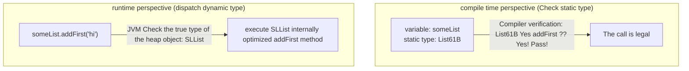

> **Course**: UC Berkeley CS61B: Data Structures (Spring 2024)  
> **Module**: Module 2: Inheritance, Interfaces & Subtyping  
> **Lecturer**: Prof. Justin Yokota & Prof. Peyrin Kao (UC Berkeley)  
> **Video duration**: 49:47 ｜ **Official original version**: Lecture 8 - Inheritance I  Interface and Implementation Inheritance  
> **Direct video**: [📺Watch the original video of this lecture on Bilibili (P8)](https://www.bilibili.com/video/BV1hJ4m1M7ZA/?p=8) ｜ [📑 Official courseware Slides (Google Presentation)](https://docs.google.com/presentation/d/1LxnOVy_k13llkePdQIdBrZ5jEpgRmbrvMilD-ppRjlc) ｜ [📖Official textbook chapter](https://cs61b-2.gitbook.io/cs61b-textbook/9.-inheritance-i-interface-and-implementation-inheritance)  
> **Quick navigation**: [← Previous lecture (P07 Linked List IV: Array List, Dynamic Expansion and Amortization Analysis)](/en/notes/cs61b/lecture-07) ｜ [📚 Return to the full book catalog](/en/notes/topics/CS61B) ｜ [Next lecture (P09 Inheritance II: Extends, type conversion and higher-order functions) →](/en/notes/cs61b/lecture-09)

---

## 1. The crisis of abstraction level: the scalability trap of duplicate code and method overloading

*(Reference time: 00:02:15 · [Video jump (P08 00:02:15)](https://www.bilibili.com/video/BV1hJ4m1M7ZA/?p=8&t=135))*

In the previous lessons, we independently implemented two linear containers with different underlying topologies:
- `SLList<Item>`: A one-way linked list based on pointers, with extremely fast additions and deletions at the head  $\Theta(1)$  performance;
- `AList<Item>`: Dynamic array based on continuous memory, with hardware-level  $\Theta(1)$  Random access performance.

Now, let's say we are developing a natural language processing module  `WordUtils`, which requires a utility method  `longest(List list)`, used to return the longest word in the list.

### Simple solution: Method Overloading
due to  `SLList`  and  `AList`  are two completely independent classes. Beginners will write the following overloaded code:

```java
public class WordUtils {
    /** 处理链表的最长词检索 */
    public static String longest(SLList<String> list) {
        int maxDex = 0;
        for (int i = 0; i < list.size(); i++) {
            String longestString = list.get(maxDex);
            String thisString = list.get(i);
            if (thisString.length() > longestString.length()) {
                maxDex = i;
            }
        }
        return list.get(maxDex);
    }

    /** 处理数组列表的最长词检索 */
    public static String longest(AList<String> list) {
        int maxDex = 0;
        for (int i = 0; i < list.size(); i++) {
            String longestString = list.get(maxDex);
            String thisString = list.get(i);
            if (thisString.length() > longestString.length()) {
                maxDex = i;
            }
        }
        return list.get(maxDex);
    }
}
```

### Why is this a catastrophic shoddy engineering practice?
1. **Pure code redundancy (Code Duplication)**: Observe the method bodies of the two methods, **The internal loop, comparison, and index logic are exactly the same.**!
2. **Extremely fragile maintenance costs**: If a boundary bug is found in the algorithm, it must be modified in two places at the same time; once one of them is missed, it will lead to inconsistent system behavior.
3. **Total loss of scalability**: In the future, if we add  `DLList` (double linked list), `CircularList` (circular linked list) or  `SortedList`, you have to keep copy-pasting the brand new reloaded version!

The fundamental reason is: **The code lacks high-level type abstraction and cannot express the essential commonality of "regardless of whether the underlying layer is a linked list or an array, they are conceptually a list with length and access by index"!**

## 2. Interface contract definition: `List61B<Item>`  abstract data type

*(Reference time: 00:11:40 · [Video jump (P08 00:11:40)](https://www.bilibili.com/video/BV1hJ4m1M7ZA/?p=8&t=700))*

In order to solve the above crisis, Java introduced the \*\*Interface\*\* mechanism.

### What is an interface?
The interface is a pure **Contract of Behaviors**: 
- The interface only defines \*\*"What to do"\*\*, that is, the name of the method, the formal parameter list and the return value type;
- interface **Absolutely no concern for "How to do it"**, it does not contain the underlying data storage fields and does not care about the specific physical memory arrangement.

Let’s define the overarching charter that all 61B linear lists must adhere to –`List61B<Item>`: 

```java
public interface List61B<Item> {
    public void addFirst(Item x);
    public void addLast(Item x);
    public Item getFirst();
    public Item getLast();
    public Item get(int i);
    public int size();
    public Item removeLast();
    public void insert(Item x, int position);
}
```

In the interface:
- All methods default to  `public abstract`  (that is, public and abstract, no need to write the entity, with a semicolon  `;`  end);
- The interface itself cannot be  `new`  Instantiate (write  `new List61B<>()`  will cause compilation errors).

## 3. Interface implementation (`implements`) and the compiler contract enforces checking

*(Reference time: 00:19:10 · [Video jump (P08 00:19:10)](https://www.bilibili.com/video/BV1hJ4m1M7ZA/?p=8&t=1150))*

Once the interface is established, concrete container classes can be used  `implements`  The keyword declares that it signed the contract:

```java
public class AList<Item> implements List61B<Item> {
    // 必须实现 List61B 接口中声明的所有方法！
    ...
}

public class SLList<Item> implements List61B<Item> {
    // 同样必须实现 List61B 接口中的全部方法！
    ...
}
```

### The Compiler’s Iron-Blooded Contract Guard
If a class declares itself  `implements List61B<Item>`, but the implementation of even one method is omitted in the class body (for example, forgetting to write  `removeLast()`):
Java compiler  `javac`  Will directly report an error during compilation and refuse to generate  `.class`: 
`error: AList is not abstract and does not override abstract method removeLast() in List61B`.

This enforcement mechanism ensures: **Any external system just needs to get a  `List61B`  type reference, you can be 100% sure that the object absolutely has all the functions promised in the interface**!

## 4. Static Type vs Dynamic Type and method dispatch rules

*(Reference time: 00:27:00 · [Video jump (P08 00:27:00)](https://www.bilibili.com/video/BV1hJ4m1M7ZA/?p=8&t=1620))*

After the introduction of interfaces, we usher in the core power of object-oriented——**Subtype Polymorphism**.

Now, we can put  `WordUtils.longest`  Methods completely refactored into a unified high-level method:

```java
public class WordUtils {
    /** 接收任何实现了 List61B 接口的实例对象！ */
    public static String longest(List61B<String> list) {
        int maxDex = 0;
        for (int i = 0; i < list.size(); i++) {
            String longestString = list.get(maxDex);
            String thisString = list.get(i);
            if (thisString.length() > longestString.length()) {
                maxDex = i;
            }
        }
        return list.get(maxDex);
    }
}
```

### Static typing vs dynamic typing
Observe the following instantiation assignment code:
```java
List61B<String> someList = new SLList<>();
```

| type dimension | Static Type / Compile-Time Type | Dynamic Type / Runtime Type |
| :--- | :--- | :--- |
| **definition** | The type specified on the left when the variable is declared (here  `List61B<String>`) | right side of equal sign  `new`  The type of object actually created in the heap (here  `SLList<String>`) |
| **Time of birth and death** | Determined during compilation, read and read the source code  `javac`  Valid during syntax check | Determined at run time, determined by the actual memory mark header of the object in the heap |
| **Compiler rules** | compiler **Only check static types** Is there a legal method to call? | Runtime JVM  **According to dynamic type** Decide which version of the method implementation is actually executed |



## 5. Implement inheritance and default methods (Default Methods): provide algorithm templates in the interface

*(Reference time: 00:35:10 · [Video jump (P08 00:35:10)](https://www.bilibili.com/video/BV1hJ4m1M7ZA/?p=8&t=2110))*

Prior to Java 8, interfaces could only define purely abstract methods and could not contain any implementation code. This leads to a question: if we want to provide a common  `print()`  method, should it be  `AList`  and  `SLList`  Do you want to write each of them again?

Starting from Java 8, the \*\*Default Methods\*\* mechanism was introduced: allowed to be used in interfaces  `default`  Write specific implementation code using keywords!

```java
public interface List61B<Item> {
    ...
    /** 默认实现的打印方法：所有子类自动免费继承！ */
    default public void print() {
        for (int i = 0; i < size(); i++) {
            System.out.print(get(i) + " ");
        }
        System.out.println();
    }
}
```

### dual form of inheritance
- **Interface Inheritance**: The subclass inherits the signature contract (What) of the method, promising "I have this ability";
- **Implementation Inheritance**: The subclass directly inherits the interface or the general implementation code (How) written by the parent class to achieve "zero redundant code reuse".

### Efficiency traps and overriding of default methods
Although the above  `default void print()`  Able to run on all subclasses, but observe its implementation: it calls in a loop  `get(i)`.
- for  `AList`, `get(i)`  Yes  $\Theta(1)$, therefore  `print()`  The overall time consumption is efficient  $\Theta(N)$; 
- **for  `SLList`, `get(i)`  Yes  $\Theta(N)$!**  Called repeatedly in a loop  `get(i)`  cause  `print()`  The total time it takes to degrade to catastrophic level: 
  $$\sum_{i=0}^{N-1} i = \Theta(N^2)$$
- Therefore, subclasses have the right to method overriding: `SLList`  Can be rewritten  `print()`, using internal efficient pointer traversal instead of the inefficient default implementation, keeping  $\Theta(N)$  performance.

## 6. Method overriding (Overriding) vs method overloading (Overloading) vs.  `@Override`  Annotate line of defense

*(Reference time: 00:43:00 · [Video jump (P08 00:43:00)](https://www.bilibili.com/video/BV1hJ4m1M7ZA/?p=8&t=2580))*

This is one of the most frequent test points in Java object-oriented interviews and must be distinguished accurately:

### core definition difference
1. **Method overloading (Overloading)**: 
   - Occurs in the same class (or inheritance system);
   - **The method names are the same, but the formal parameter lists (number, type, or order of parameters) are completely different**; 
   - It has nothing to do with the return type;
   - It belongs to compile-time static binding.
2. **Method overriding (Overriding)**: 
   - Occurs in the parent-child class or interface implementation system;
   - **The method names are the same, the formal parameter lists are exactly the same, and the return value types are compatible (covariant)**; 
   - Belongs to runtime dynamic method selection (Dynamic Method Selection).

### Fatal clerical error and  `@Override`  absolute defense
Consider the following code: We have  `SLList`  Planning to rewrite  `addLast`, but the wrong parameter type was written by hand:
```java
public class SLList<Item> implements List61B<Item> {
    // 手滑将 Item 写成了 Object！
    public void addLast(Object x) { ... }
}
```
At this time, the compiler will not report an error! It will think that you have not rewritten the interface  `addLast(Item)`, but defines a new **Overloaded methods**! And the real interface methods remain unimplemented, leading to hidden logic collapse.

### Industrial Best Practices
**Overriding a parent class or interface method at any time must be added unconditionally  `@Override`  annotation**: 
```java
@Override
public void addLast(Item x) {
    ...
}
```
`@Override`  It is a direct instruction to the compiler: "Please check strictly for me. If there is no method with this signature in the parent class or interface, report an error to me immediately!" This builds the first steel line of defense against slippery hands during the compilation period.

## 7. Official courseware interactive discussion questions: Interface polymorphic assignment and type checking and tracking

*(Reference time: 00:49:15 · [Video jump (P08 00:49:15)](https://www.bilibili.com/video/BV1hJ4m1M7ZA/?p=8&t=2955))*

Professor Josh Hug gave a classic polymorphic type inference challenge in the courseware:

```java
public class MysteryInheritance {
    public static void main(String[] args) {
        List61B<String> lst = new SLList<>();
        lst.addFirst("front");
        
        // 假设 SLList 额外自定义了一个特有的方法：public void specialMethod()
        // 下面这行代码能否通过编译？
        // lst.specialMethod(); 
    }
}
```

### in-depth analysis
- **Failed to compile!**
- **core logic**: The compiler is checking  `lst.specialMethod()`  when, **only based on variables  `lst`  The static type (Static Type) is  `List61B`  conduct review**.
- The compiler will retrieve  `List61B`  Is there any declaration in the interface?  `specialMethod()`. The search result is "none", so the compiler determines that this call is illegal and directly reports an error: `cannot find symbol: method specialMethod()`!
- The compiler does not and cannot guess whether the runtime heap is actually loaded with  `SLList`. if you are sure it is  `SLList`, type conversion (Casting, explained in detail in the next lecture) must be used explicitly.

## 8. Summary of this lecture and in-depth self-assessment after class

*(Reference time: 00:53:00 · [Video jump (P08 00:53:00)](https://www.bilibili.com/video/BV1hJ4m1M7ZA/?p=8&t=3180))*

### Panoramic review of core concepts

| concept | core mechanism | key value |
| :--- | :--- | :--- |
| **Interface** | `public interface Foo`  Define pure abstract method contract | Isolate What and How, providing high-level polymorphic abstraction |
| **static type** | The type of the variable when it is declared, the compile time determines which methods are legal | Strong type safety interception at compile time |
| **dynamic type** | The true type of the object in the runtime heap, which determines which implementation version is executed | Implement run-time flexible subtyping polymorphic behavior |
| **Default method** | `default`  Keywords for writing generic implementation templates in interfaces | Implement code reuse and reduce repetitive logic in subclasses |
| **`@Override`** | Forced verification of the correctness of the rewritten signature during compilation | Prevent accidental method overloading caused by spelling errors |

---

### Comprehensive self-test questions after class

#### Question 1 (Polymorphism and method calling)
Hypothetical class  `Dog`  Implemented the interface  `Animal`, both of which contain  `makeNoise()`  method, but  `Dog`  additionally defined  `fetch()`  method.
Observe the following three lines of code. Which one will cause an error when compiling? Which line will give an error when running?
```java
Animal a = new Dog(); // 行 1
a.makeNoise();        // 行 2
a.fetch();            // 行 3
```
**Answers and analysis**:   
- Lines 1 and 2 are both perfectly legal;  
- **Line 3 will cause an error when compiling**(`cannot find symbol method fetch() in Animal`). because  `a`  The static type is  `Animal`, while  `Animal`  The interface is not defined  `fetch()`  behavior.

#### Topic 2 (Architecture Design Thinking)
Why does Java allow a class to implement multiple interfaces like  `class Foo implements A, B, C`), but only single inheritance is allowed in class inheritance (`extends`)? What classic computer problem does this design avoid?  
**Answers and analysis**:   
This is to completely avoid the famous "Diamond Problem of Death" in languages such as C++! If a class can inherit two parent classes with the same method implementation at the same time, when the child class calls the method, the compiler cannot determine which parent class implementation should be inherited. In the early days, interfaces only had abstract declarations. Even if two interfaces have methods with the same name, subclasses only need to provide one implementation, and there will be no ambiguity.

---

## Appendix: UC Berkeley official textbook in-depth study (Official Textbook In-Depth Chapters)

> **Introduction**: The content of this section is integrated from the UC Berkeley CS61B official textbook library (GitBook Textbook). It provides original English theoretical derivation, formal code examples and supporting chapter exercises for the core data structures and algorithms of this lecture, which complements and confirms the previous video lectures.

## 9. Inheritance I: Interface and Implementation Inheritance

#### The Problem 

Recall the two list classes we created last week: SLList and AList. If you take a look at their documentation, you'll notice that they are very similar. In fact, all of their supporting methods are the same!

Suppose we want to write a class `WordUtils`that includes functions we can run on lists of words, including a method that calculates the longest string in an SLList.

**Exercise 4.1.1.** Try writing this method by yourself. The method should take in an SLList of strings and return the longest string in the list.

Here is the method that we came up with.

```java

public static String longest(SLList<String> list) {

    int maxDex = 0;

    for (int i = 0; i < list.size(); i += 1) {

        String longestString = list.get(maxDex);

        String thisString = list.get(i);

        if (thisString.length() > longestString.length()) {

            maxDex = i;

        }

    }

    return list.get(maxDex);

}

```

How do we make this method work for AList as well?

All we really have to do is change the method's signature: the parameter

```java

SLList<String> list

```

should be changed to

```java

AList<String> list

```

Now we have two methods in our `WordUtils` class with exactly the same method name.

```java

public static String longest(SLList<String> list)

```

and

```java

public static String longest(AList<String> list)

```

This is actually allowed in Java! It's something called *method overloading*. When you call WordUtils.longest, Java knows which one to run according to what kind of parameter you supply it. If you supply it with an AList, it will call the AList method. Same with an SLList.

It's nice that Java is smart enough to know how to deal with two of the same methods for different types, but overloading has several downsides:

* It's super repetitive and ugly, because you now have two virtually identical blocks of code.

* It's more code to maintain, meaning if you want to make a small change to the `longest` method such as correcting a bug, you need to change it in the method for each type of list.

* If we want to make more list types, we would have to copy the method for every new list class.

#### Hypernyms, Hyponyms, and Interface Inheritance 

In the English language and life in general, there exist logical hierarchies to words and objects.

Dog is what is called a *hypernym of* poodle, malamute, husky, etc. In the reverse direction, poodle, malamute, and husky, are *hyponyms* of dog.

These words form a hierarchy of "is-a" relationships:

* a poodle "is-a" dog

* a dog "is-a" canine

* a canine "is-a" carnivore

* a carnivore "is-an" animal


The same hierarchy goes for SLLists and ALists! SLList and AList are both hyponyms of a more general list.

We will formalize this relationship in Java: if a SLList is a hyponym of List61B, then the SLList class is a **subclass** of the List61B class and the List61B class is a **superclass** of the SLList class.

**Figure 4.1.1** 

In Java, in order to *express* this hierarchy, we need to do **two things**:

* Step 1: Define a type for the general list hypernym -- we will choose the name List61B.

* Step 2: Specify that SLList and AList are hyponyms of that type.

The new List61B is what Java calls an **interface**. It is essentially a contract that specifies what a list must be able to do, but it doesn't provide any implementation for those behaviors. Can you think of why?

Here is our List61B interface. At this point, we have satisfied the first step in establishing the relationship hierarchy: creating a hypernym.

```java

public interface List61B<Item> {

    public void addFirst(Item x);

    public void add Last(Item y);

    public Item getFirst();

    public Item getLast();

    public Item removeLast();

    public Item get(int i);

    public void insert(Item x, int position);

    public int size();

}

```

Now, to complete step 2, we need to specify that AList and SLList are hyponyms of the List61B class. In Java, we define this relationship in the class definition.

We will add to

`public class AList<Item> {...}`

a relationship-defining word: implements.

`public class AList<Item> implements List61B<Item>{...}`

`implements List61B<Item>` is essentially a promise. AList is saying "I promise I will have and define all the attributes and behaviors specified in the List61B interface"

Now we can edit our `longest` method in `WordUtils` to take in a List61B. Because AList and SLList share an "is-a" relationship.

#### Overriding 

We promised we would implement the methods specified in List61B in the AList and SLList classes, so let's go ahead and do that.

When implementing the required functions in the subclass, it's useful (and actually required in 61B) to include the `@Override` tag right on top of the method signature. Here, we have done that for just one method.

```java

@Override

public void addFirst(Item x) {

    insert(x, 0);

}

```

It is good to note that even if you don’t include this tag, you *are* still overriding the method. So technically, you don't *have* to include it. However, including the tag acts as a safeguard for you as the programmer by alerting the compiler that you intend to override this method. Why would this be helpful you ask? Well, it's kind of like having a proofreader! The compiler will tell you if something goes wrong in the process.

Say you want to override the `addLast` method. What if you make a typo and accidentally write `addLsat`? If you don't include the @Override tag, then you might not catch the mistake, which could make debugging a more difficult and painful process. Whereas if you include @Override, the compiler will stop and prompt you to fix your mistakes before your program even runs.

#### Interface Inheritance 

Interface Inheritance refers to a relationship in which a subclass inherits all the methods/behaviors of the superclass. As in the List61B class we defined in the **Hyponyms and Hypernyms** section, the interface includes all the method signatures, but not implementations. It's up to the subclass to actually provide those implementations.

This inheritance is also multi-generational. This means if we have a long lineage of superclass/subclass relationships like in **Figure 4.1.1**, AList not only inherits the methods from List61B but also every other class above it all the way to the highest superclass AKA AList inherits from Collection.

### GRoE 

Recall the Golden Rule of Equals we introduced in the first chapter. This means whenever we make an assignment `a = b` , we copy the bits from b into a, with the requirement that b is the same type as a. You can't assign `Dog b = 1` or `Dog b = new Cat()` because 1 is not a Dog and neither is Cat.

Let's try to apply this rule to the `longest` method we wrote previously in this chapter.

`public static String longest(List61B<String> list)` takes in a List61B. We said that this could take in AList and SLList as well, but how is that possible since AList and List61B are different classes? Well, recall that AList shares an "is-a" relationship with List61B, Which means an AList should be able to fit into a List61B box!

**Exercise 4.1.2** Do you think the code below will compile? If so, what happens when it runs?

```java

public static void main(String[] args) {

    List61B<String> someList = new SLList<String>();

    someList.addFirst("elk");

}

```

Here are possible answers:

* Will not compile.

* Will compile, but will cause an error on the **new** line

* When it runs, an SLList is created and its address is stored in the someList variable, but it crashes on someList.addFirst() since the List class doesn't implement addFirst;

* When it runs, and SLList is created and its address is stored in the someList variable. Then the string "elk" is inserted into the SLList referred to by addFirst.

#### Implementation Inheritance 

Previously, we had an interface List61B that only had method headers identifying **what** List61B's should do. But, now we will see that we can write methods in List61B that already have their implementation filled out. These methods identify **how** hypernyms of List61B should behave.

In order to do this, you must include the `default` keyword in the method signature.

If we define this method in List61B

```java

default public void print() {

    for (int i = 0; i < size(); i += 1) {

        System.out.print(get(i) + " ");

    }

    System.out.println();

}

```

Then everything that implements the List61B class can use the method!

However, there is one small inefficiency in this method. Can you catch it?

For an SLList, the `get` method needs to jump through the entirety of the list. during each call. It's much better to just print while jumping through!

We want SLList to print a different way than the way specified in its interface. To do this, we need to override it. In SLList, we implement this method;

```java

@Override

public void print() {

    for (Node p = sentinel.next; p != null; p = p.next) {

        System.out.print(p.item + " ");

    }

}

```

Now, whenever we call print() on an SLList, it will call this method instead of the one in List61B.

You may be wondering, how does Java know which print() to call? Good question. Java is able to do this due to something called **dynamic method selection**.

We know that variables in java have a type.

`List61B<String> lst = new SLList<String>();`

In the above declaration and instantiation, lst is of type "List61B". This is called the "static type"

However, the objects themselves have types as well. the object that lst points to is of type SLList. Although this object is intrinsically an SLList (since it was declared as such), it is also a List61B, because of the “is-a” relationship we explored earlier. But, because the object itself was instantiated using the SLList constructor, We call this its "dynamic type".

Aside: the name “dynamic type” is actually quite semantic in its origin! Should lst be reassigned to point to an object of another type, say a AList object, lst’s dynamic type would now be AList and not SLList! It’s dynamic because it changes based on the type of the object it’s currently referring to.

When Java runs a method that is overriden, it searches for the appropriate method signature in it's **dynamic type** and runs it.

**IMPORTANT: This does not work for overloaded methods!**

Say there are two methods in the same class

```java

public static void peek(List61B<String> list) {

    System.out.println(list.getLast());

}

public static void peek(SLList<String> list) {

    System.out.println(list.getFirst());

}

```

and you run this code

```java

SLList<String> SP = new SLList<String>();

List61B<String> LP = SP;

SP.addLast("elk");

SP.addLast("are");

SP.addLast("cool");

peek(SP);

peek(LP);

```

The first call to peek() will use the second peek method that takes in an SLList. The second call to peek() will use the first peek method which takes in a List61B. This is because the only distinction between two overloaded methods is the types of the parameters. When Java checks to see which method to call, it checks the **static type** and calls the method with the parameter of the same type.

#### Interface Inheritance vs Implementation Inheritance 

How do we differentiate between "interface inheritance" and "implementation inheritance"? Well, you can use this simple distinction:

* Interface inheritance (what): Simply tells what the subclasses should be able to do.

  * EX) all lists should be able to print themselves, how they do it is up to them.

* Implementation inheritance (how): Tells the subclasses how they should behave.

  * EX) Lists should print themselves exactly this way: by getting each element in order and then printing them.

When you are creating these hierarchies, remember that the relationship between a subclass and a superclass should be an "is-a" relationship. AKA Cat should only implement Animal Cat **is an** Animal. You should not be defining them using a "has-a" relationship. Cat **has-a** Claw, but Cat definitely should not be implementing Claw.

Finally, Implementation inheritance may sound nice and all but there are some drawbacks:

* We are fallible humans, and we can't keep track of everything, so it's possible that you overrode a method but forgot you did.

* It may be hard to resolve conflicts in case two interfaces give conflicting default methods.

* It encourages overly complex code.


---

## Course navigation and jump

| Previous lecture | Directory | Next lecture | Original video |
| :--- | :---: | :--- | :--- |
| [← Previous Lecture: Linked List IV: Array List, Dynamic Expansion and Amortization Analysis](/en/notes/cs61b/lecture-07) | [📚 Return to CS61B complete book list](/en/notes/topics/CS61B) | [Next lecture: Inheritance II: Extends, type conversion and higher-order functions →](/en/notes/cs61b/lecture-09) | [🎬Watch this lecture on Bilibili (P08)](https://www.bilibili.com/video/BV1hJ4m1M7ZA/?p=8) |
