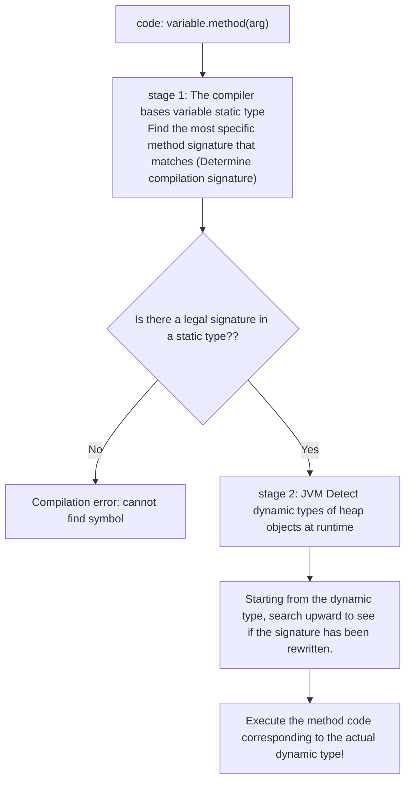

> **Course**: UC Berkeley CS61B: Data Structures (Spring 2024)  
> **Module**: Module 2: Inheritance, Interfaces & Subtyping  
> **Lecturer**: Prof. Justin Yokota & Prof. Peyrin Kao (UC Berkeley)  
> **Video duration**: 50:35 ｜ **Official original version**: Lecture 9 - Inheritance II Extends Casting Higher Order Functions  
> **Direct video**: [📺Watch the original video of this lecture on Bilibili (P9)](https://www.bilibili.com/video/BV1hJ4m1M7ZA/?p=9) ｜ [📑 Official courseware Slides (Google Presentation)](https://docs.google.com/presentation/d/1jVqC44HVViVtajnF18KsZ6MdIfseTfOSerfvxH4pzP0) ｜ [📖Official textbook chapter](https://cs61b-2.gitbook.io/cs61b-textbook/10.-inheritance-ii-extends-casting-higher-order-functions)  
> **Quick navigation**: [← Previous lecture (P08 Inheritance I: Interface inheritance and default methods)](/en/notes/cs61b/lecture-08) ｜ [📚 Return to the full book catalog](/en/notes/topics/CS61B) ｜ [Next lecture (P10 Inheritance III: Subtype polymorphism, Comparable and Comparator) →](/en/notes/cs61b/lecture-10)

---

## 1. Class inheritance (`extends`) mechanism: code reuse and subclassing philosophy

*(Reference time: 00:01:30 · [Video jump (P09 00:01:30)](https://www.bilibili.com/video/BV1hJ4m1M7ZA/?p=9&t=90))*

In the previous lecture, we learned about the inheritance of "behavior contract" through interfaces. But in actual projects, we often hope that subclasses not only inherit the interface, but also directly inherit the parent class's **Instance variables and ready-made implementation logic**.

Java provides  `extends`  Keywords to achieve **Class Inheritance/Subclassing**.

### Core Laws: A Rigorous Test of the IS-A Relationship
When designing the inheritance system, you must follow object-oriented  **Liskov Substitution Principle (LSP)**  with  **IS-A Test**: 
- Inheritance is only allowed when "the subclass is indeed a special form of the parent class (Subclass IS A Superclass)"!
  - `Dog IS-A Animal` (A dog is an animal  $\to$  reasonable inheritance);
  - `SLList IS-A List61B` (A one-way linked list is a list  $\to$  reasonably realized).
- If there is only an "ownership/subordination relationship (HAS-A)" between two classes, Composition must be used instead of inheritance!
  - For example  `Car HAS-A Engine` (A car has an engine), it is strictly prohibited to write  `class Car extends Engine`! should be in  `Car`  Contains an internal  `private Engine engine;`  field.

## 2. Constructor Chaining and  `super`  Keywords

*(Reference time: 00:09:40 · [Video jump (P09 00:09:40)](https://www.bilibili.com/video/BV1hJ4m1M7ZA/?p=9&t=580))*

When a subclass inherits a parent class and the subclass object is born in the heap, **Not only contains the subclass's own instance variables, but also must accommodate all instance variables of the parent class**. Therefore, the state of the parent class must be properly initialized first!

### The iron law of constructor calling
> **iron law**: **Any constructor of a subclass must first call the constructor of the parent class before executing its own code!**

If not specified explicitly, the Java compiler will **automatic implicit insertion  `super();`**  To call the parent class’s no-argument constructor:

```java
public class Animal {
    public String name;
    public Animal(String n) {
        name = n;
    }
}

public class Dog extends Animal {
    public int weight;

    public Dog(String n, int w) {
        super(n); // 显式调用父类带参构造器！必须放在构造器的第一行！
        weight = w;
    }
}
```

### Compilation pitfall scene
If parent class  `Animal`  Only constructors with parameters are defined  `Animal(String n)`, without a parameterless constructor; and subclasses  `Dog`  Not written in the constructor  `super(n)`:   
The compiler will silently error: `error: constructor Animal in class Animal cannot be applied to given types; required: String; found: no arguments`.  
Because the compiler automatically inserts  `super()`  Trying to find a parameterless constructor that does not exist in the parent class!

## 3. The essence of casting and type safety boundaries

*(Reference time: 00:17:15 · [Video jump (P09 00:17:15)](https://www.bilibili.com/video/BV1hJ4m1M7ZA/?p=9&t=1035))*

Review the challenge questions from the previous lecture:
```java
List61B<String> lst = new SLList<>();
// lst.specialMethod(); // 编译报错！因为静态类型是 List61B
```

If we, as programmers, knew with absolute human certainty that at this point  `lst`  The dynamic type of a variable at runtime is indeed a  `SLList`, how do we tell the compiler to let go?  
The answer is: **Casting**.

### Type conversion syntax
```java
SLList<String> realSLList = (SLList<String>) lst;
realSLList.specialMethod(); // 完美通过编译并运行！
```

### Compiler logic behind type conversion
- forced transformation  `(TargetType)`  Instead of modifying the object itself in the heap, **Temporarily put a new "static type glasses" on the object**; 
- After the compiler sees the forced syntax, it will compromise and perform syntax checking according to the target type;
- **Runtime backlash: ClassCastException**:   
  If the programmer fools the compiler (for example, the heap is actually  `AList`, but forced to convert into  `SLList`): 
  ```java
  List61B<String> lst = new AList<>();
  SLList<String> bad = (SLList<String>) lst; // 运行时瞬间抛出 ClassCastException 崩溃！
  ```

### Security defense: `instanceof`  operator
Before performing downcasting, the industry standard practice is to first use  `instanceof`  Perform dynamic type detection:
```java
if (lst instanceof SLList) {
    SLList<String> safe = (SLList<String>) lst;
    safe.specialMethod();
}
```

## 4. Complete execution algorithm of Dynamic Method Selection

*(Reference time: 00:26:00 · [Video jump (P09 00:26:00)](https://www.bilibili.com/video/BV1hJ4m1M7ZA/?p=9&t=1560))*

When the program executes a line of the form  `variable.method(param)`  When calling, how does the JVM decide which machine instruction to execute?  
Please keep this strict set of rules in mind **Two-Stage Dispatch Algorithm**: 

### Phase 1: Compile-Time Static Matching (Compile-Time Resolution)
1. Compiler review  `variable`  of **Static Type**; 
2. Retrieve methods with matching names and compatible parameter lists in this static type and all its parent classes;
3. Select the \*\*most specific\*\* method signature as the "candidate signature" for this call;
4. If no matching signature is found, a compilation error will be reported directly!

### Phase 2: Runtime Dynamic Selection
1. Only non-static methods will enter dynamic dispatch;
2. JVM view  `variable`  of the heap object pointed to **True dynamic type (Dynamic Type)**; 
3. Starting from the dynamic type, search upwards along the inheritance tree to find the method implementation that is completely accurate and overrides the "candidate signature" determined in stage 1;
4. The first implementation found is the final code that is executed!



## 5. The mystery of encapsulation destruction: Fragile Base Class Problem

*(Reference time: 00:34:20 · [Video jump (P09 00:34:20)](https://www.bilibili.com/video/BV1hJ4m1M7ZA/?p=9&t=2060))*

Although  `extends`  Provides powerful code reuse, but in modern software engineering, there is a principle that is regarded as a classic: **“Favor Composition over Inheritance”**.

Misuse of class inheritance leads to the notorious **Fragile Base Class Problem**.

### Classic negative case: counting counter collection
Assume that the parent class has a list  `List`, contains two methods:
```java
public class BaseList {
    public void add(int x) { ... }
    public void addAll(int[] items) {
        for (int x : items) {
            add(x); // 父类内部调用了自己的 add
        }
    }
}
```

In order to count the total number of times elements are inserted into a list, a programmer uses  `extends`  Created a subclass:
```java
public class CountingList extends BaseList {
    private int count = 0;

    @Override
    public void add(int x) {
        count++;
        super.add(x);
    }

    @Override
    public void addAll(int[] items) {
        count += items.length; // 统计加入总数
        super.addAll(items);
    }
}
```

### Disaster strikes: Double Counting
Client execution:
```java
CountingList list = new CountingList();
list.addAll(new int[]{1, 2, 3});
System.out.println(list.getCount()); // 期望是 3，实际输出竟然是 6！
```

**Why does it become 6?**
1. subclass  `addAll`  execute, `count += 3` (At this time count = 3);
2. subclass call  `super.addAll(items)`; 
3. parent class  `addAll`  inner loop call  `add(x)`; 
4. Due to dynamic method selection, the parent class calls  `add(x)`  will be assigned to **subclass  `add(x)`**!
5. subclass  `add(x)`  again  `count`  That’s added up to 3 times! causing the total to explode to 6!

The logic of the subclass completely depends on the undisclosed internal implementation details of the parent class. Once the parent class is refactored (such as optimization  `addAll`  no longer called  `add`), the subclass will collapse on the spot. This is the risk of high coupling caused by inheritance.

## 6. Implementation of Higher Order Functions in Java: Interface Function Object

*(Reference time: 00:42:00 · [Video jump (P09 00:42:00)](https://www.bilibili.com/video/BV1hJ4m1M7ZA/?p=9&t=2520))*

In CS 61A, Python treats functions as **First-Class Citizens**: A function can be passed as a parameter to another function like an ordinary integer, or returned as a return value:

```python
def do_twice(f, x):
    return f(f(x))
```

Early in Java's history, methods were not objects and could not be passed directly as parameters. So how to implement higher order functions in Java?  
**The answer is: use interfaces and object polymorphism to simulate higher-order functions (Function Objects)!**

### Define functional interface contract
```java
public interface IntUnaryFunction {
    int apply(int x);
}
```

### Write a specific function object class
```java
/** 一个实现平方操作的函数对象 */
public class Square implements IntUnaryFunction {
    @Override
    public int apply(int x) {
        return x * x;
    }
}
```

### Writing higher-order methods
```java
public class HigherOrderDemo {
    public static int doTwice(IntUnaryFunction f, int x) {
        return f.apply(f.apply(x));
    }

    public static void main(String[] args) {
        IntUnaryFunction sq = new Square();
        System.out.println(doTwice(sq, 2)); // (2^2)^2 = 16
    }
}
```

Modern Java (Java 8+) builds on this foundation by introducing  **lambda expression**, the above call can be simplified to one line: 
`doTwice(x -> x * x, 2);`, the bottom layer is still dynamically constructing an anonymous instance of the function interface.

## 7. Classic trap questions in official courseware: polymorphic calling and coverage puzzles

*(Reference time: 00:49:00 · [Video jump (P09 00:49:00)](https://www.bilibili.com/video/BV1hJ4m1M7ZA/?p=9&t=2940))*

Josh Hug presented a polymorphic multiple-choice question in the Lecture 9 courseware that made the whole class exclaim:

```java
class Dog {
    public void bark(Dog d) { System.out.println("Dog barks at Dog"); }
}

class ShowDog extends Dog {
    // 注意形参类型！
    public void bark(ShowDog sd) { System.out.println("ShowDog barks at ShowDog"); }
    @Override
    public void bark(Dog d) { System.out.println("ShowDog barks at Dog"); }
}

public class TestMystery {
    public static void main(String[] args) {
        Dog d = new ShowDog();
        ShowDog sd = new ShowDog();
        d.bark(sd);
    }
}
```

### Rigorous deduction stage by stage  `d.bark(sd)`  The execution result:
1. **Compilation period (Phase 1)**: 
   - View caller  `d`  of **static type**: Yes  `Dog`; 
   - Review arguments  `sd`  static type: yes  `ShowDog`; 
   - in  `Dog`  Classes looking for acceptable  `ShowDog`  The best matching method for:
     - `Dog`  The only method in the class is  `bark(Dog d)` (Since ShowDog is a subclass of Dog, it is fully compatible);
   - **The method signature that the compiler locks the call to is: `bark(Dog)`**!
2. **Running period (Phase 2)**: 
   - JVM view  `d`  of **dynamic type**: The actual value in the heap is  `ShowDog`; 
   - JVM check  `ShowDog`  Whether the signature is overridden in the class  `bark(Dog)`; 
   - Found it! `ShowDog`  explicitly included  `@Override public void bark(Dog d)`; 
   - **final execution  `ShowDog`  of  `bark(Dog d)`  version!**
3. **Output results**: `ShowDog barks at Dog`!

> **Review and reflection**: Many students mistakenly think they can print  `ShowDog barks at ShowDog`, but they ignored the first stage of compilation: at compile time, variables  `d`  The static type is  `Dog`, while  `Dog`  None in the class  `bark(ShowDog)`  This signature, therefore the compiler can never bind to this method!

## 8. Summary of the structure of this lecture and advanced self-test questions

*(Reference time: 00:54:10 · [Video jump (P09 00:54:10)](https://www.bilibili.com/video/BV1hJ4m1M7ZA/?p=9&t=3250))*

### Comprehensive self-test questions after class

#### Question 1 (Type conversion risk judgment)
Assume there is a class inheritance relationship  `class C extends B`  and  `class B extends A`.
Observe the following code. Which line can compile? Which line will throw an exception at runtime?
```java
A a = new B();
B b = (B) a;       // 操作 1
C c = (C) a;       // 操作 2
```
**Answers and analysis**:   
- Operation 1 and Operation 2  **can be compiled**! Because of static type  `A`  It is possible that at runtime it is  `B`  or  `C`  Instances where the compiler allows legal downward casts.  
- **Operation 2 will throw at runtime  `ClassCastException`**! because  `a`  The real type of the heap object pointed to is  `B`. one  `B`  The object is not  `C` (Subclass) instance, forced transfer will inevitably fail.

#### Question 2 (Engineering Architecture Decision)
A certain game requires the design of various types of monsters (Goblin, Dragon, Skeleton). All monsters have health points (hp), and their health points are deducted when they receive damage, but different monsters have completely different attack methods.  
Please suggest the best architectural pattern: should you use abstract classes or pure interfaces?  
**Answers and analysis**:   
Recommended **Abstract Class**: 
- Extract public status: will  `int hp`  with  `takeDamage(int dmg)`  General logic is placed in the abstract base class  `Monster`  middle;
- Abstract undecided behavior: will  `abstract void attack(Player p);`  Declared as a purely abstract method, forcing each specific monster subclass to implement its own unique attack effects.

---

## Appendix: UC Berkeley official textbook in-depth study (Official Textbook In-Depth Chapters)

> **Introduction**: The content of this section is integrated from the UC Berkeley CS61B official textbook library (GitBook Textbook). It provides original English theoretical derivation, formal code examples and supporting chapter exercises for the core data structures and algorithms of this lecture, which complements and confirms the previous video lectures.

## 10. Inheritance II: Extends, Casting, Higher Order Functions

By Vanessa Teo

This section covers inheritance through extends, along with encapsulation, casting, and higher order functions. Its contents correspond to Lecture 9.

#### Video Playlist

---

## 10.1 Implementation Inheritance: Extends

#### **Getting Started**

#### **The Extends Keyword**

Up to now we have been writing classes and interfaces, and you may have noticed places where we have to write redundant code for different or similar classes. So, we have the idea of **inheritance**: the idea that a class/object does not need to redefine all its methods, and instead can use properties of a parent class.

When a class is a hyponym of an interface, we used implements. **Example below:**

```java

SLList<Blorp> implements List61B<Blorp>

```

If you want one class to be a hyponym of another class (instead of an interface), you use extends. 

#### Rotating SLList

We’d like to build RotatingSLList that can perform any SLList operation as well as: rotateRight(): Moves back item to the front. 

```java

public class RotatingSLList<Blorp> extends SLList<Blorp>{

       public void rotateRight() {

              Blorp oldBack = removeLast();

              addFirst(oldBack);

	}

}

```

Because of extends, RotatingSLList inherits all members of SLList:

* All instance and static variables.

* All methods.

* All nested classes.

* Constructors are **not** inherited!

**Example:** Suppose we have \[5, 9, 15, 22]. After rotateRight: \[22, 5, 9, 15].

#### Video Example

#### Another Example: VengefulSLList

Suppose we want to build an SLList that:

* Remembers all Items that have been destroyed by removeLast.

* Has an additional method printLostItems(), which prints all deleted items.

```java

public class VengefulSLList<Item> extends SLList<Item> {

	private SLList<Item> deletedItems;

	public VengefulSLList() {

       deletedItems = new SLList<Item>();

	}

	@Override

	public Item removeLast() {

    		Item oldBack = super.removeLast(); /*calls Superclass’s 

version of removeLast() */

    		deletedItems.addLast(oldBack);

    		return oldBack;

	}

	public void printLostItems() {

    		deletedItems.print();

	}

}

public static void main(String[] args) {

    	VengefulSLList<Integer> vs1 = new VengefulSLList<Integer>();

    	vs1.addLast(1);

    	vs1.addLast(5);

    	vs1.addLast(10);

    	vs1.addLast(13);      /* [1, 5, 10, 13] */

    	vs1.removeLast();     /* 13 gets deleted. */

    	vs1.removeLast();     /* 10 gets deleted. */

    	System.out.print("The fallen are: ");

    	vs1.printLostItems(); /* Should print 10 and 13. */

}

```

#### Constructor Behavior

Constructors are **not** inherited. However, the rules of Java say that all constructors must start with a call to one of the super class’s constructors \[[Link](https://docs.oracle.com/javase/tutorial/java/IandI/super.html)].

* Idea: If every VengefulSLList is-an SLList, every VengefulSLList must be set up like an SLList.

  * If you didn’t call SLList constructor, sentinel would be null. Very bad.

* You can explicitly call the constructor with the keyword super (no dot).

If you don’t explicitly call the constructor, Java will automatically do it for you.

These constructors below are exactly equivalent:

```java

public VengefulSLList() {

   deletedItems = new SLList<Item>();

}

public VengefulSLList() {

   super();

   deletedItems = new SLList<Item>();

}

```

On the other hand, if you want to use a super constructor other than the no-argument constructor, can give parameters to super.

These constructors below are **not** equivalent! The code to below makes implicit call to super(), not super(x). This is because only the empty argument super() is called.

```java

public VengefulSLList(Item x) {

   super(x);

   deletedItems = new SLList<Item>();

}

public VengefulSLList(Item x) {

   deletedItems = new SLList<Item>();

}

```

#### Is-a vs Has-a

Important Note: **extends** should only be used for **is-a** (hypernymic) relationships!

Common mistake is to use it for “has-a” relationships. (a.k.a. meronymic).

* Possible to subclass SLList to build a Set, but conceptually weird, e.g. get(i) doesn’t make sense, because sets are not ordered.

#### The Object Class

As it happens, every type in Java is a descendant of the Object class.

* VengefulSLList extends SLList.

* SLList extends Object (implicitly).

Documentation for Object class: [Object (Java SE 9 & JDK 9 )](https://docs.oracle.com/javase/9/docs/api/java/lang/Object.html)

**Abstraction:** As you’ll learn later in this class, programs can get a tad confusing when they are really large. A way to make programs easier to handle is to use abstraction. Abstraction is hiding components of programs that people do not need to see. The user of the hidden methods should be able to use them without knowing how they work.<br>

---

## 10.2 Encapsulation

#### Complexity

When building large programs, our enemy is complexity.

Some tools for managing complexity:

* Hierarchical abstraction.

  * Create layers of abstraction, with clear abstraction barriers!

* “Design for change” (D. Parnas)

  * Organize program around objects.

  * Let objects decide how things are done.

  * Hide information others don’t need.

Managing complexity is super important for large projects!

#### Modules and Encapsulation

**Module:** A set of methods that work together as a whole to perform some task or set of related tasks. A module is said to be **encapsulated** if its implementation is completely hidden, and it can be accessed only through a documented interface.

---

## 10.3 Casting

#### Dynamic Method Selection and Type Checking Puzzle

**Static vs. Dynamic Type Reminder:** Every variable in Java has a static type. This is the type specified when the variable is declared, and is checked at compile time. Every variable also has a dynamic type; this type is specified when the variable is instantiated, and is checked at runtime.

#### Compile-Time Type Checking and Expressions

Compiler allows method calls based on compile-time type of variable. The compiler also allows assignments based on compile-time types.

Expressions have compile-time types:

* An expression using the new keyword has the specified compile-time type. Example:

```java

SLList<Integer> sl = new VengefulSLList<Integer>();

```

* Compile-time type of right hand side (RHS) expression is VengefulSLList.

* A VengefulSLList is-an SLList, so assignment is allowed.

```java

VengefulSLList<Integer> vsl = new SLList<Integer>();

```

* Compile-time type of RHS expression is SLList. 

* An SLList is not necessarily a VengefulSLList, so compilation error results.

Expressions have compile-time types:

* Method calls have compile-time type equal to their declared type.

```java

public static Dog maxDog(Dog d1, Dog d2) { … }

```

* Any call to maxDog will have compile-time type Dog!

Example:

```java

Poodle frank  = new Poodle("Frank", 5);

Poodle frankJr = new Poodle("Frank Jr.", 15);

Dog largerDog = maxDog(frank, frankJr);

Poodle largerPoodle = maxDog(frank, frankJr);

```

* Compilation error! RHS has compile-time type Dog

### Casting

Java has a special syntax for specifying the compile-time type of any expression.

* Put desired type in parenthesis before the expression.

* Tells compiler to pretend it sees a particular type.

Casting is a powerful but dangerous tool.

* Tells Java to treat an expression as having a different compile-time type.

* In example below, effectively tells the compiler to ignore its type checking duties.

* Does not actually change anything: sunglasses don’t make the world dark.

---

## 10.4 Higher Order Functions in Java

**Higher Order Function:** A function that treats another function as data.

* e.g. takes a function as input.

* Example in Python: 

```python

def tenX(x):

   return 10*x

def do_twice(f, x):

   return f(f(x))

print(do_twice(tenX, 2))

```

#### Higher Order Functions in Java 7

Old School (Java 7 and earlier)

* Fundamental issue: Memory boxes (variables) cannot contain pointers to functions.

  * use an interface instead:

```java

public interface IntUnaryFunction {

	int apply(int x);

}

public class TenX implements IntUnaryFunction {

	public int apply(int x) {

   		return 10 * x;

	}

}

```

This code above is the same as the Python code:

```python

def tenX(x):

    return 10*x

```

Now, to finish the rest of the Python code in Java:

<pre class="language-java"><code class="lang-java">public interface IntUnaryFunction {

	int apply(int x);

}

public class TenX implements IntUnaryFunction {

	public int apply(int x) {

   		return 10 * x;

	}

}

<strong>public class HoFDemo {

</strong>	public static int do_twice(IntUnaryFunction f, int x) {

   		return f.apply(f.apply(x));

	}

	public static void main(String[] args) {

   		System.out.println(do_twice(new TenX(), 2));

	}

}

</code></pre>

This code above is equivalent to the Python code provided earlier.

---

## 10.5 Exercises

### Factual

Recall that the `maxDog` method has the following signature: 

```java

public static Dog maxDog(Dog d1, Dog d2) { … }

```

1. What is the static type of `Dog.maxDog(dogC, dogD)`?

```java

ShowDog dogC = new ShowDog("Franklin", "Malamute", 180, 6);

ShowDog dogD = new ShowDog("Gargamel", "Corgi", 44, 12);

Dog.maxDog(dogC, dogD);

```

2. Which (if any), will compile: 

```java

Dog md = Dog.maxDog(dogC, dogD);

ShowDog msd = Dog.maxDog(dogC, dogD);

```

3. In the code below, what are the dynamic types of `o`, `d`, `stuff[0]`, and `stuff[1]`?

```java

Object o = new Dog("Hammy", "Beagle", 15);

Dog d = new ShowDog("Ammo", "Labrador", 54);

Object stuff[] = new Object[5];

stuff[0] = o;

stuff[1] = d;

studd[2] = null;

```

<details>

<summary>Problem 1</summary>

The static type is `Dog`, the declared return type of the `maxDog` method.

</details>

<details>

<summary>Problem 2</summary>

Only the first line compiles. The static return type of `maxDog` is `Dog`, a superclass of `ShowDog`, so the compiler assumes that this method call return value is too broad for our declared variable `msd`. 

```java

Dog md = Dog.maxDog(dogC, dogD);

// ShowDog msd = Dog.maxDog(dogC, dogD);

```

</details>

<details>

<summary>Problem 3</summary>

* `o`: `Dog`, since it is instantiated as a `Dog`.

* `d`: `ShowDog`, since it is instantiated as a `ShowDog`.

* `stuff[0]`: `Dog`, since it points to the same object as `o`, which has dynamic type `Dog`. 

* `stuff[1]`: `ShowDog`, since it points to the same object as `d`, which has dynamic type `ShowDog`.

</details>

### Conceptual

1. Is it possible for an interface to extend a class? Provide an argument as to why or why not.

2. What are the differences between `extends` and `implements` inheritance? Is there a particular time when you would want to use one over the other?

<details>

<summary>Problem 1</summary>

This is not possible in Java. Conceptually, the reasoning is that classes have implementation details for each method, whereas interfaces do not implement methods. Thus, there is no way for an interface to "inherit" implementations from a superclass.

</details>

<details>

<summary>Problem 2</summary>

The primary difference is that `extends` inherits implementations, allowing a subclass to reuse code from the superclass, while `implements` only serves as a "contract" that a class will implement certain methods.

Use `extends` when you want a subclass to have the same behavior as a superclass in certain methods. Use `implements` when subclasses have different implementations of the same conceptual methods, or when you need to inherit from multiple supertypes.

</details>

### Procedural

1. Say there is a class `Poodle` that inherits from `Dog`. The Dog class looks like this:

```java

public class Dog {

  int weight;

  public Dog(int weight_in_pounds) {

    weight = weight_in_pounds;

  }

}

```

And the Poodle class looks like this:

```java

public class Poodle extends Dog {

 public Poodle() {}

}

```

Is this valid? If so, explain why. If it is not valid, then explain how we can make it valid.

2. The `Monkey` class is a subclass of the `Animal` class and the `Dog` class is a subclass of the `Animal` class. However, a Dog is not a Monkey nor is a Monkey a Dog. What will happen for the following code? Assume that the constructors are all formatted properly.

```java

Monkey jimmy = new Monkey("Jimmy");

Dog limmy = (Dog) jimmy;

```

3. How about for this code? Provide brief explanation as to why you believe your answers to be correct.

```java

Monkey orangutan = new Monkey("fruitful");

Dog mangotan = ((Dog) ((Animal) orangutan));

```

<details>

<summary>Problem 1</summary>

This will not compile because the `Poodle` constructor implicitly calls the `Dog` constructor (through `super`), but the `Dog` class has no zero-argument constructor. 

To make this valid, we could add a zero-argument `Dog` constructor, or make the `Poodle` constructor take in an `int` argument and call `super(weight_in_pounds)`.

</details>

<details>

<summary>Problem 2</summary>

This will not compile, since casting to a "sibling" class (same parent class, but unrelated), will error during compile.

</details>

<details>

<summary>Problem 3</summary>

This compiles, since the static types match up: `mangotan` is declared as a `Dog` and cast to a `Dog` on the right-hand side. However, the dynamic type of `orangutan` is a monkey, and we will run into a casting error since the `Monkey` class is unrelated to the `Dog` class.

</details>

### Metacognitive

1. [Problem 1](https://drive.google.com/file/d/14yQDPQVcsWAG-QBPxlrX3N-YDRyR2c_C/view) from the Spring 2018 Midterm 1

2. [Problem 1](https://drive.google.com/file/d/12KqULT9XIb3KHQqOdGQprsKELYTrAXN5/view?usp=sharing) from the Spring 2017 Midterm 1

<details>

<summary>Problem 1</summary>

[Solutions](https://drive.google.com/file/d/1hnRfUh2ImLGqwOSS28hFUxnpZ_cjMaQT/view) and [walkthrough](https://www.youtube.com/playlist?list=PLnp31xXvnfRqAfvA4R9Oh09PstFymwCif) are linked here and on the course website.

</details>

<details>

<summary>Problem 2</summary>

[Solutions](https://drive.google.com/file/d/15Vnd9z34Wlp-D9boc4ZezgpyH_ul65qZ/view?usp=sharing) and [walkthrough](https://www.youtube.com/playlist?list=PLnp31xXvnfRr58vXF7T9I2HZ1LrVlxCtG) are linked here and on the course website.

</details>


---

## Course navigation and jump

| Previous lecture | Directory | Next lecture | Original video |
| :--- | :---: | :--- | :--- |
| [← Previous lecture: Inheritance I: Interface inheritance and default methods](/en/notes/cs61b/lecture-08) | [📚 Return to CS61B complete book list](/en/notes/topics/CS61B) | [Next lecture: Inheritance III: Subtype polymorphism, Comparable and Comparator →](/en/notes/cs61b/lecture-10) | [🎬Watch this lecture on Bilibili (P09)](https://www.bilibili.com/video/BV1hJ4m1M7ZA/?p=9) |
