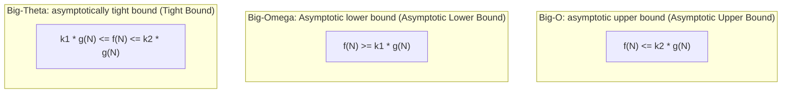

> **Course**: UC Berkeley CS61B: Data Structures (Spring 2024)  
> **Module**: Module 3: Asymptotics & Disjoint Sets  
> **Lecturer**: Prof. Justin Yokota & Prof. Peyrin Kao (UC Berkeley)  
> **Video duration**: 51:12 ｜ **Official original version**: Lecture 12 - Asymptotics I  
> **Direct video**: [📺Watch the original video of this lecture on Bilibili (P12)](https://www.bilibili.com/video/BV1hJ4m1M7ZA/?p=12) ｜ [📑 Official courseware Slides (Google Presentation)](https://docs.google.com/presentation/d/1CH4rsIIvu5pbmoWUNl9QdkPQYYkJc-ptX85CBhytlzM) ｜ [📖Official textbook chapter](https://cs61b-2.gitbook.io/cs61b-textbook/13.-asymptotics-i)  
> **Quick navigation**: [← Previous lecture (P11 Inheritance IV: Iterator and Object basic methods)](/en/notes/cs61b/lecture-11) ｜ [📚 Return to the full book catalog](/en/notes/topics/CS61B) ｜ [Next lecture (P13 midterm review: Midterm 1 core test points sand table and analysis of big questions) →](/en/notes/cs61b/lecture-13)

---

## 1. Algorithm efficiency measurement philosophy: Why can’t we use a physical stopwatch to measure time?

*(Reference time: 00:01:25 · [Video jump (P12 00:01:25)](https://www.bilibili.com/video/BV1hJ4m1M7ZA/?p=12&t=85))*

When designing data structures and algorithms, how can we objectively judge whether program A is better than program B?

A beginner’s first instinct is often: **Write a test script and use a physical stopwatch to measure how many milliseconds it takes to run the code** (i.e. Benchmark):
```java
long start = System.currentTimeMillis();
// 执行算法
long end = System.currentTimeMillis();
System.out.println("Elapsed: " + (end - start) + " ms");
```

### Why does the physical stopwatch completely fail in algorithmic theory?
1. **Hardware environment is highly heterogeneous**: Code running on a top-tier server CPU like AMD EPYC or Apple M3 Max is bound to be hundreds of times faster than on an older Raspberry Pi. The physical time consumption reflects the machine's computing power, not the merits of the algorithm itself;
2. **System concurrent load fluctuations**: The background scheduling of the operating system, garbage collection (GC) pauses, dynamic CPU frequency reduction, and cache competition will all cause the same milliseconds to run the same piece of code to be very different;
3. **Sensitivity to Scale of Input**: Certain algorithms are processing  $N = 10$  is extremely fast, but when the data size expands to  $N = 10,000,000$  But it takes tens of thousands of years to run!

Computer science pioneers such as Knuth and Tarjan established the cornerstone philosophy of incremental analysis:
> **core principles**: **Detached from specific physical hardware and clocks, algorithm efficiency is abstracted as "the number of executions of basic computing operations relative to the input size  $N$  The mathematical growth function of  $f(N)$”!**

## 2. Calculate the number of basic operations: input scale  $N$  Decomposition with machine operation

*(Reference time: 00:09:10 · [Video jump (P12 00:09:10)](https://www.bilibili.com/video/BV1hJ4m1M7ZA/?p=12&t=550))*

Consider a simple array search algorithm:
```java
public static boolean dup1(int[] A) {
    for (int i = 0; i < A.length; i += 1) {
        for (int j = i + 1; j < A.length; j += 1) {
            if (A[i] == A[j]) {
                return true;
            }
        }
    }
    return false;
}
```

In order to measure its execution cost, we count its most time-consuming core basic operations——**comparison operation  `A[i] == A[j]`  The total number of executions**.

Assume that the array length is  $N$: 
- when  $i = 0$  When, the inner loop executes  $N - 1$  times;
- when  $i = 1$  When, the inner loop executes  $N - 2$  times;
- ...
- when  $i = N - 2$  When , the inner loop is executed once;
- when  $i = N - 1$  When , the inner loop is executed 0 times.

In the worst case (no duplicate elements in the array), the total number of comparison operations is the classic arithmetic summation: 
$$C(N) = (N - 1) + (N - 2) + \dots + 2 + 1 + 0 = \frac{N(N - 1)}{2} = \frac{1}{2}N^2 - \frac{1}{2}N$$

when  $N$  When growing to astronomical numbers (such as billions):
- constant coefficient  $\frac{1}{2}$  and lower order terms  $-\frac{1}{2}N$  Compared to the dominant term  $N^2$  become insignificant; become insignificant;
- Determines the time-consuming explosion speed of the algorithm, **purely  $N^2$  The quadratic growth pattern of**!

## 3. Formal mathematical definition of the Three Musketeers of Asymptotic Symbols: Big-Theta, Big-O, Big-Omega

*(Reference time: 00:18:00 · [Video jump (P12 00:18:00)](https://www.bilibili.com/video/BV1hJ4m1M7ZA/?p=12&t=1080))*

In order to rigorously express the order of function growth, computer science has established three sets of formal mathematical asymptotic symbols:



### 1. $\operatorname{Big-Theta} (\Theta)$: Tight Bound
- **mathematical definition**: $f(N) \in \Theta(g(N))$  If and only if there exists a positive constant  $k_1, k_2$  and  $N_0$, so that for all  $N > N_0$, both have: 
  $$k_1 \cdot g(N) \le f(N) \le k_2 \cdot g(N)$$
- **Intuitive understanding**: $f(N)$  growth rate and  $g(N)$ **Completely in the same magnitude (same order)**.
- **Example**: $\frac{1}{2}N^2 - 3N \in \Theta(N^2)$.

### 2. $\operatorname{Big-O} (O)$:Asymptotic upper bound (Upper Bound)
- **mathematical definition**: $f(N) \in O(g(N))$  If and only if there exists a positive constant  $k_2$  and  $N_0$, so that for all  $N > N_0$, both have: 
  $$f(N) \le k_2 \cdot g(N)$$
- **Intuitive understanding**: $f(N)$  growth rate **no more than** $g(N)$ (similar to mathematical  $\le$).
- **Example**: $N \in O(N^2)$  It is completely established! $N^2 \in O(N^2)$  The same holds true.

### 3. $\operatorname{Big-Omega} (\Omega)$: Asymptotic lower bound (Lower Bound)
- **mathematical definition**: $f(N) \in \Omega(g(N))$  If and only if there exists a positive constant  $k_1$  and  $N_0$, so that for all  $N > N_0$, both have: 
  $$f(N) \ge k_1 \cdot g(N)$$
- **Intuitive understanding**: $f(N)$  growth rate **no less than** $g(N)$ (similar to mathematical  $\ge$).

> **The axiom of the golden relationship among the three**:   
> $$f(N) \in \Theta(g(N)) \iff f(N) \in O(g(N)) \text{ 且 } f(N) \in \Omega(g(N))$$

## 4. Intuitive comparison between common time complexity ladder and big O growth explosion

*(Reference time: 00:27:30 · [Video jump (P12 00:27:30)](https://www.bilibili.com/video/BV1hJ4m1M7ZA/?p=12&t=1650))*

In algorithm design, there is a chasm-like performance gap between different growth orders:

$$\Theta(1) < \Theta(\log N) < \Theta(N) < \Theta(N \log N) < \Theta(N^2) < \Theta(N^3) < \Theta(2^N) < \Theta(N!)$$

### when  $N = 1,000,000$  A cosmic comparison of time
Assume that the CPU can execute per second  $10^9$ (1 billion) basic operations:

| complexity order | Common representative algorithms | $N = 10^6$  times of operations | Physics Time Estimation |
| :--- | :--- | :--- | :--- |
| **$\Theta(1)$** | Array random access, hash search | 1 time | 1 nanosecond (instantaneous) |
| **$\Theta(\log N)$** | Binary search, balanced tree search | $\approx 20$  times | 20 nanoseconds (instantaneous) |
| **$\Theta(N)$** | Linear scan, unordered linked list traversal | $10^6$  times | 1 millisecond |
| **$\Theta(N \log N)$** | Merge sort, quick sort | $\approx 2 \times 10^7$  times | 20 milliseconds |
| **$\Theta(N^2)$** | Double nested loop, selection sort | $10^{12}$  times | **Approx. 16.7 minutes** |
| **$\Theta(2^N)$** | Violently exhaust all subsets | $2^{1000000}$  times | **Exceeding the lifespan of the universe hundreds of millions of times!** |

from  $\Theta(N^2)$  Optimized to  $\Theta(N \log N)$, is to directly compress a program that takes more than ten minutes to run into 20 milliseconds that is imperceptible to the human eye! This is the ultimate charm of algorithms.

## 5. Mathematical summation derivation of nested loops: geometric series and logarithmic loops

*(Reference time: 00:36:00 · [Video jump (P12 00:36:00)](https://www.bilibili.com/video/BV1hJ4m1M7ZA/?p=12&t=2160))*

When analyzing the cycle time complexity, you must not count the number of nested loops based on your intuition. You must establish a strict **mathematical series summation model**.

### Case 1: Bisection division/multiplication loop (logarithmic order  $\Theta(\log N)$)
```java
for (int i = 1; i <= N; i = i * 2) {
    System.out.println("hello");
}
```
- loop variable  $i$  The value sequence of is: $1, 2, 4, 8, 16, \dots, 2^k$; 
- Loop termination condition: $2^k > N \implies k > \log_2 N$; 
- The total number of print operations performed is: $k \approx \lfloor\log_2 N\rfloor + 1 = \Theta(\log N)$.

### Case 2: Nested outer stepping and inner doubling loops ($\Theta(N \log N)$)
```java
for (int i = 0; i < N; i++) {
    for (int j = 1; j <= N; j *= 2) {
        System.out.println("hi");
    }
}
```
- The outer loop executes independently  $N$  times;
- No matter  $i$  What is the value? The inner loop is always executed independently.  $\log_2 N$  times;
- The total number of operations is: $\sum_{i=0}^{N-1} \Theta(\log N) = N \times \Theta(\log N) = \Theta(N \log N)$.

## 6. Worst Case vs Best Case Analysis

*(Reference time: 00:44:00 · [Video jump (P12 00:44:00)](https://www.bilibili.com/video/BV1hJ4m1M7ZA/?p=12&t=2640))*

Many beginners often  $O$  To equate "worst case scenario", equate  $\Omega$  Equivalent to "best case scenario".  
**This is an extremely serious confusion of academic concepts!**

### Concept rectification
- **Best Case and Worst Case**: describes **Form of input data (Input Distribution)**!
  - Best case input: at all scales is  $N$  Among the legal inputs, the input form that allows the algorithm to execute the least number of steps;
  - Worst case input: at all scales  $N$  Among the legal inputs, the input form allows the algorithm to execute the most steps.
- **$O, \Theta, \Omega$**: describes **The upper and lower bounds of the mathematical function itself (Bounding Curves)**!

### Classic practical analysis: array deduplication  `dup1`
- **best case input**: The repeated element is located exactly at the first two digits at the beginning of the array (`A[0] == A[1]`).  
  The algorithm immediately enters the inner loop for the first time  `return true`, the time-consuming is  $\Theta(1)$!
- **Worst case input**: There are no duplicate elements in the array.  
  The algorithm must traverse all two levels of loops, and the number of comparison operations is  $\frac{N(N-1)}{2}$, the time-consuming is  $\Theta(N^2)$!

> **The correct way to describe Big O**:   
> - `dup1`  of **best case running time** Yes  $\Theta(1)$;   
> - `dup1`  of **Worst case running time** Yes  $\Theta(N^2)$;   
> - For any unknown input, `dup1`  The running time is always  $O(N^2)$  Within the scope, also  $\Omega(1)$  Within range!

## 7. Official courseware interactive seminar questions: in-depth troubleshooting of common progressive misunderstandings

*(Reference time: 00:50:20 · [Video jump (P12 00:50:20)](https://www.bilibili.com/video/BV1hJ4m1M7ZA/?p=12&t=3020))*

Josh Hug presents a selection of true-false questions in Lecture 12:

### True or False: If the worst-case running time of algorithm A is  $O(N^2)$, the worst case of algorithm B is  $O(N)$, then for any size  $N$  With input, is algorithm B necessarily faster than algorithm A?

**Deep reflections and answers**:   
- **Not necessarily!**
- **Reason 1: Uncertainty of input form**. The worst case scenario for algorithm A is  $O(N^2)$, but in the best case it may only require  $\Theta(1)$  It will exit, and algorithm B may run honestly no matter what the input is.  $N$  step;
- **Reason 2: Hidden Constants**. Asymptotic analysis ignores constant terms. If the exact time cost of algorithm A is  $0.0001 N^2$  seconds, and the exact time taken by algorithm B is  $1,000,000 N$  seconds; when  $N < 10,000,000$  When , algorithm A is much faster than algorithm B!
- The significance of incremental analysis is to predict when  $N \to \infty$  The inevitable dominance of current growth trends, rather than micro-benchmark calculations on a tiny scale.

## 8. Summary of this lecture and in-depth self-assessment after class

*(Reference time: 00:54:00 · [Video jump (P12 00:54:00)](https://www.bilibili.com/video/BV1hJ4m1M7ZA/?p=12&t=3240))*

### Comprehensive self-test questions after class

#### Question 1 (Loop summation derivation)
Analyze the asymptotic time complexity (in Big-Theta) of the following methods:
```java
public static void mystery(int N) {
    for (int i = 1; i <= N; i = i * 2) {
        for (int j = 0; j < i; j++) {
            System.out.println("cal");
        }
    }
}
```
**Answer and detailed mathematical proof**:   
- **answer**: $\Theta(N)$!
- **Proof and deduction**:   
  outer loop variable  $i$  The value is  $1, 2, 4, 8, \dots, 2^k$ (Among them  $2^k \le N$).  
  The number of executions of the inner loop is exactly equal to the current  $i$  size.  
  Therefore, the total number of executions is geometric: 
  $$\text{Total} = 1 + 2 + 4 + 8 + \dots + 2^k = 2 \times 2^k - 1$$
   due to  $2^k$  is no more than  $N$  The largest power of 2 satisfies  $\frac{N}{2} < 2^k \le N$.  
  Therefore  $2 \times 2^k - 1 = \Theta(N)$! Many beginners mistakenly think that  $\Theta(N \log N)$, ignoring the summation characteristic that the number of inner layer steps increases exponentially with the outer layer.

---

## Appendix: UC Berkeley official textbook in-depth study (Official Textbook In-Depth Chapters)

> **Introduction**: The content of this section is integrated from the UC Berkeley CS61B official textbook library (GitBook Textbook). It provides original English theoretical derivation, formal code examples and supporting chapter exercises for the core data structures and algorithms of this lecture, which complements and confirms the previous video lectures.

## 13. Asymptotics I

By: Thomas Lee

---

## 13.1 An Introduction to Asymptotic Analysis

We always have to start somewhere.

Previously, we have focused on how to save time *writing* the program. Now, we will learn how to make the best use of our computer's time and memory. 

We can consider the process of writing efficient programs from two different perspectives:

1. Programming Cost *(everything in the course up to this date)*

   1. How long does it take for you to develop your programs?

   2. How easy is it to read or modify your code?

   3. How maintainable is your code? (very important — much of the cost comes from maintenance and scalability, not development!)

2. Execution Cost *(everything in the course from this point on)*

   1. **Time complexity**: How much time does it take for your program to execute?

   2. **Space complexity**: How much memory does your program require?

To give a sense of what is coming up, consider a **sorted** array. Our goal is to determine if there is a duplicate element in the list.

```java

List<Integer> example = [-3, -1, 2, 4, 4, 8, 10, 12];

```

A **naive algorithm** would be to compare every pair of elements. In the above example, we would compare -3 with every element in the list, then -1, then 2, etc. 

A **better algorithm** would be to take advantage of the sorted nature of the list! Instead of comparing every pair of elements, we can compare each element with just the element next to it.

We can see that the **naive algorithm** seems like it’s doing a lot more unnecessary, redundant work than the **better algorithm**. But how much more work is it doing? How do we quantify how efficient a program is? This chapter will provide you the formal techniques and tools to compare the efficiency of various algorithms!

---

## 13.10 Exercises

### Factual

1. Analyze the runtime of the following code in terms of `N`:

```java

for (int i = 0; i < N; i++) {

    int j = 0;

    while (j < N) {

        j = N;

    }

}

```

2. Let $$f(N) = 2N$$. Which of the following statements is true?

   * [ ] $$f(N) \in \Theta(1)$$

   * [ ] $$f(N) \in \Theta(N)$$

   * [ ] $$f(N) \in \Theta(N^2)$$

   * [ ] $$f(N) \in O(1)$$

   * [ ] $$f(N) \in O(N)$$

   * [ ] $$f(N) \in O(N^2)$$

<details>

<summary>Problem 1</summary>

Note that the inner loop only runs once, since it immediately sets `j = N` in the first iteration. As such, the runtime is just the runtime of the outer loop, which iterates `N` times. The overall runtime, then, is linear.

</details>

<details>

<summary>Problem 2</summary>

Remember that $$\Theta$$ means the same order of growth (linear), while $$O$$ can be roughly thought of as "less than or equal to" some order of growth.

* [ ] $$f(N) \in \Theta(1)$$

* [x] $$f(N) \in \Theta(N)$$

* [ ] $$f(N) \in \Theta(N^2)$$

* [ ] $$f(N) \in O(1)$$

* [x] $$f(N) \in O(N)$$

* [x] $$f(N) \in O(N^2)$$

</details>

### Procedural

1. **True or false.** Suppose we have a function $$f$$, and we are told $$f(N) \in \Theta(N^2)$$. If we run $$f$$on an input of size $$N$$, then an input of size $$2N$$, it will take roughly 4 times as long.

2. **True or false.** Suppose we have a function $$f$$, and we are told $$f(N) \in \Theta(N^2)$$. If we run $$f$$on an input of size 100, then an input of size 200, it will take roughly 4 times as long.

<details>

<summary>Problem 1</summary>

**True**. This is the definition of asymptotics.

</details>

<details>

<summary>Problem 2</summary>

**False**. 100 may be too small of an input for asymptotic behavior to start displaying. Remember that asymptotics only apply to very large inputs!

</details>

### Metacognitive

1. Why do use asymptotics instead of empirical timing (for example, like the `Stopwatch` class from Lab 3)?

<details>

<summary>Problem 1</summary>

There are several advantages to using asymptotics over empirical timing. See if you can come up with more beyond the list below!

* Different computers run at different speeds. Depending on architecture, hardware components, even room temperature, the same code can execute with vastly different empirical times.

* It may not be feasible to test code on extremely large inputs. 

* Asymptotics are language-agnostic. The same algorithm may have different empirical runtime depending on which language it's written in (for example, C is usually around 10-400x faster than Python), but will have the same asymptotic runtime.

* The worst-case runtime may only occur in certain cases that are hard to measure empirically. 

</details>

---

## 13.2 Runtime Characterization

Techniques for Measuring Computational Cost.

We want to be able to *characterize* the runtime of the two algorithms we previously saw. In other words, we want to come up with some proxy that communicates the overall performance of each algorithm. 

When characterizing runtimes, we have two goals in mind:

* They should be simple but mathematically rigorous.

* They should clearly demonstrate the superiority of one algorithm over another if one algorithm is better than the other. 

We have converted both the naïve algorithm and the better algorithm into Java code. The function dup1 corresponds to the naïve algorithm and dup2 corresponds to the better algorithm.

```java

// Naïve algorithm: compare everything

public static boolean dup1(int[] A) {  

  for (int i = 0; i < A.length; i += 1) {

    for (int j = i + 1; j < A.length; j += 1) {

      if (A[i] == A[j]) {

         return true;

      }

    }

  }

  return false;

}

```

```java

// Better algorithm: compare only neighbors

public static boolean dup2(int[] A) {

  for (int i = 0; i < A.length - 1; i += 1) {

    if (A[i] == A[i + 1]) { 

      return true; 

    }

  }

  return false;

}

```

#### Technique 1

The first technique we will consider using for runtime characterization is directly measuring execution time in seconds using a client program. 

There are a few ways we could do this:

* Use a physical stopwatch (not recommended).

* Use Unix's built in `time` command.

* Use the Princeton Standard library which has a `stopwatch` class.

Using any of these methods will show (with varying levels of accuracy, depending on whether the physical stopwatch path was chosen) that as input size increases, `dup1` takes a longer time to complete, whereas `dup2` completes at relatively around the same rate.

It seems like technique 1 works perfectly fine for characterizing our runtimes! It is very easy to understand the results of the experiment, and it is easy to implement. However, there are some serious cons associated it that dissuades us from using it for everything:

* It could take a *long* time to finish running. 

* Running times can vary by machine, compiler, input data, etc. 

For these reasons, technique 1 does not meet our goals in characterizing runtimes. It's simple, but it's not mathematically rigorous. Moreover, the differences based on machine, compiler, input, etc. mean that the results may not clearly demonstrate the relationship between `dup1` and `dup2`.

#### Technique 2A

Rather than physically timing the amount of time it takes for the algorithm to run, we can instead count the total number of operations completed by each algorithm! Intuitively, the algorithm that runs the fewer number of operations would be superior to the other. We can fix the input size `N` to be the same for both algorithms and compare the number of operations run. 

Let us apply this to the `dup1` algorithm with an input size of `N=10000`:

```java

for (int i = 0; i < A.length; i += 1) {

  for (int j = i+1; j < A.length; j += 1) {

    if (A[i] == A[j]) {

       return true;

    }

  }

}

return false;

```

| Operation      | Count (for N=10000)                               |

| -------------- | ------------------------------------------------- |

| i = 0          | 1                                                 |

| j = i+1        | 1 (in the best case) to 10000 (in the worst case) |

| <              | 2 to 50,015,001                                   |

| += 1           | 0 to 50,005,000                                   |

| ==             | 1 to 49,995,000                                   |

| array accesses | 2 to 99,990,000                                   |

The operation `i = 0` is only run a single time at the very start of the function call. `j = i+1` is more complicated--in the best case when `A[0] == A[1]`, it only runs a single time (convince yourself of this fact!). In the worst case, `j` is initialized once for each value that `i` takes on in the outer loop, so it is initialized a total of 10000 times. 

As we dive further into the loop, it gets progressively less feasible to calculate the exact counts. We will show later on that the exact numbers do not matter that much. 

To summarize technique 2A, we have solved the issue of *machine independence*. Differences in machines do not affect the total of operations run (usually). However, it is tedious to compute all the counts for each operation. In addition, our chosen input size is arbitrary, and we do not know how much time it actually takes to run. 

#### Technique 2B

We can resolve the issue of choosing input size by calculating the *symbolic count* instead, which means that we calculate our counts in terms of the input `N`. Using this technique, we can update our table to include the symbolic counts:

| Operation      | Symbolic Count       | Count (for N=10000)                               |

| -------------- | -------------------- | ------------------------------------------------- |

| i = 0          | 1                    | 1                                                 |

| j = i+1        | 1 to N               | 1 (in the best case) to 10000 (in the worst case) |

| <              | 2 to (N² + 3N + 2)/2 | 2 to 50,015,001                                   |

| += 1           | 0 to (N² + N)/2      | 0 to 50,005,000                                   |

| ==             | 1 to (N² - N)/2      | 1 to 49,995,000                                   |

| array accesses | 2 to N²-N            | 2 to 99,990,000                                   |

Using symbolic counts allows us to see how the algorithms *scales* with input size. However, it is now even more tedious to calculate! It also still does not tell the actual time.

---

## 13.3 Checkpoint: An Exercise

Some much needed practice.

Exercise: Apply techniques 2A and 2B to `dup2`.

* Calculate the counts of each operation for the following code with respect to N.

* Predict the ***rough*** magnitudes of each one.

```java

for (int i = 0; i < A.length - 1; i += 1){

  if (A[i] == A[i + 1]) { 

    return true; 

  }

}

return false;

```

##### Solution:

Note: It's okay if you were slightly off—as mentioned earlier, you want ***rough*** estimates.

| Operation      | Symbolic Count | Count (for N=10000) |

| -------------- | -------------- | ------------------- |

| i = 0          | 1              | 1                   |

| j = i+1        | 0 to $$N$$     | 0 to 10,000         |

| <              | 0 to $$N-1$$   | 0 to 9,999          |

| ==             | 1 to $$N-1$$   | 1 to 9,999          |

| array accesses | 2 to $$2N-2$$  | 2 to 19998          |

"I have another problem for you to solve ( ͡° ͜ʖ ͡°)..." - Josh Hug


Let us compare the `dup1` table with the `dup2` table:

`dup1` table:

| Operation      | Symbolic Count           | Count (for N=10000)                               |

| -------------- | ------------------------ | ------------------------------------------------- |

| i = 0          | 1                        | 1                                                 |

| j = i+1        | 1 to $$N$$               | 1 (in the best case) to 10000 (in the worst case) |

| <              | 2 to $$(N² + 3N + 2)/2$$ | 2 to 50,015,001                                   |

| += 1           | 0 to $$(N² + N)/2$$      | 0 to 50,005,000                                   |

| ==             | 1 to $$(N² - N)/2$$      | 1 to 49,995,000                                   |

| array accesses | 2 to $$N²-N$$            | 2 to 99,990,000                                   |

`dup2` table:

| Operation      | Symbolic Count | Count (for N=10000) |

| -------------- | -------------- | ------------------- |

| i = 0          | 1              | 1                   |

| j = i+1        | 0 to $$N$$     | 0 to 10,000         |

| <              | 0 to $$N-1$$   | 0 to 9,999          |

| ==             | 1 to $$N-1$$   | 1 to 9,999          |

| array accesses | 2 to $$2N-2$$  | 2 to 19998          |

We can see that `dup2` performs significantly better than `dup1` in the worst case! 

One way to rationalize this is that it takes fewer operations for `dup2` to accomplish the same goal as `dup1`. 

A better realization is that the algorithm for `dup2` scales much better in the worst case (e.g. ($$N² + 3N + 2)/2$$ vs $$N$$)

An even **better** realization is that parabolas ($$N²$$) always grow faster than lines ($$N$$).

---

## 13.4 Asymptotic Behavior

Be on your best behavior!

In most applications, we are most concerned about what happens for very large values of $$N$$.  This is known as the *asymptotic behavior*. We want to learn what types of algorithms are able to handle large amounts of data. Some examples of applications that require highly efficient algorithms are:

* Simulating the interactions of billions of particles

* Maintaining a social network with billions of users

* Encoding billions of bytes of video data

Algorithms that scale well have better *asymptotic* runtime behavior than algorithms that scale poorly.

Let us return to the original problem of characterizing the runtimes of our `dup` functions. Recall that we desire characterizations that have the following features:

* Simple and mathematically rigorous.

* Clearly demonstrate the superiority of dup2 over dup1.

We’ve accomplished the second task! We are able to clearly see that `dup2` performed better than `dup1`. However, we didn’t do it in a very simple or mathematically rigorous way. Luckily, we can apply a series of simplifications to solve these issues.

#### Simplification 1: Consider Only the Worst Case

When comparing algorithms, we often only care about the worst case. The worst case is often where we see the most interesting effects, so we can usually ignore all other cases but the worst case. 

##### Example:

Consider the operation counts of some algorithm below. What do you expect will be the order of growth of the runtime for the algorithm?

* $$N$$ (linear)

* $$N^2$$ (quadratic)

* $$N^3$$ (cubic)

* $$N^6$$ (sextic)

| Operation        | Count           |

| ---------------- | --------------- |

| less than (<)    | $$100N^2 + 3N$$ |

| greater than (>) | $$N^3+1$$       |

| and (&&)         | $$5000$$        |

**Answer:** $$N^3$$ (cubic)

Intuitively, $$N^3$$ grows faster than $$N^2$$, so it would "dominate." To help further convince you that this is the case, consider the following argument:

* Suppose the < operator takes $$\alpha$$ nanoseconds, the > operator takes $$\beta$$ nanoseconds, and the && takes $$\gamma$$ nanoseconds.

* The total time is $$\alpha (100N^2 + 3)+\beta (2N^3+1)+5000\gamma$$ nanoseconds.

* For very large $$N$$, the $$2\beta N^3$$ term is much larger than others.

* It can help to think of it in terms of calculus. What happens as $$N$$ approaches infinity? Which term ends up dominating?

#### Simplification 2: Restrict Attention to One Operation

Pick some representative operation to act as a proxy for overall runtime. From our `dup` example:

* Good choice: `increment`, or **less than** or **equals** or **array accesses.**

* Bad choice: **assignment of** `j = i + 1`, or `i = 0.`

The operation we choose is called the “**cost model**.”

#### Simplification 3: Eliminate Low Order Terms

Ignore lower order terms.

**Sanity check**: Why does this make sense? (Related to the checkpoint above!)

#### **Simplification 4: Eliminate Multiplicative Constants**

Ignore multiplicative constants.

* Why? No real meaning!

* By choosing a single representative operation, we already “threw away” some information.

* Some operations had counts of $$3N^2$$, ​​$$N^2/2$$, etc. In general, they are all in the family/shape of $$N^2$$.

#### Checkpoint Exercise:

Apply our four simplification rules to the `dup2` table. 

| Operation      | Symbolic Count |

| -------------- | -------------- |

| i = 0          | 1              |

| j = i+1        | 0 to $$N$$     |

| <              | 0 to $$N-1$$   |

| ==             | 1 to $$N-1$$   |

| array accesses | 2 to $$2N-2$$  |

**Example answer**: array accesses with order of growth $$N$$.

<, ==, and j=i+1 would be fine answers as well.

#### Simplification Summary

* Only consider the worst case.

* Pick a representative operation (aka: cost model)

* Ignore lower order terms

* Ignore multiplicative constants.

---

## 13.6 Simplified Analysis Process

It's not that simple.

**Summary of our (Painful) Analysis Process**

* Construct a table of exact counts of all possible operations (takes lots of effort!)

* Convert table into worst case order of growth using 4 simplifications.

We will now propose an alternative method that avoids building a table altogether!

Our simplified analysis process will consist of:

* Choosing our cost model, which is the representative operation we want to count.

* Figuring out the order of growth for the count of our representative operation by either:

  * Making an exact count and discarding unnecessary pieces or...

  * Using intuition/inspection to determine orders of growth. This is something that comes with practice.

##### Example: Analysis of Nested For Loops - Exact Counts

Find the order of growth of the worst case runtime of `dup1`.

```java

int N = A.length;

for (int i = 0; i < N; i += 1)

   for (int j = i + 1; j < N; j += 1)

      if (A[i] == A[j])

         return true;

return false;

```

We will choose our cost model to be the *number of == operations*. 

Looking at the structure of the loops, the inner loop first gets run j=N-1 times. At the second iteration, i=1, so the inner loop runs an additional j=N-2 times. At the third iteration, i=2, so the inner loop runs an additional j=N-3 times. The total number of times the loop is run is thus:

$$\text{cost} = 1 + 2 + 3 + \ldots + (N-2) + (N-1)$$

This cost can be simplified to $$\frac{N(N-1)}{2}$$ ([how?](https://en.wikipedia.org/wiki/1_%2B_2_%2B_3_%2B_4_%2B_%E2%8B%AF)). We can use simplification to throw away all lower order terms and constants to get the worst case order of growth $$N^2$$.

##### Example: Analysis of Nested For Loops - Geometric Argument

* We can see that the number of equals can be given by the area of a right triangle, which has a side length of $$N- 1$$.

* Therefore, the order of growth of area is $$N^2$$.​​

* This is definitely not something that is immediately obvious. It takes time and practice to see these patterns!

---

## 13.7 Big-Theta

Not to be confused with Big-O.

#### Formalizing Order of Growth

Given some function $$Q(N)$$, we can apply our last two simplifications to get the order of growth of $$Q(N)$$. 

For example, if $$Q(N)=3N^3+N^2$$, the order of growth is $$N^3$$.

From now onward, we will refer to order of growth as $$\Theta$$ (pronounced "big theta"). 

#### Order of Growth Examples

The following functions have these corresponding order of growths:

| Function          | Order of Growth |

| ----------------- | --------------- |

| $$N^3+3N^4$$      | $$N^4$$         |

| $$1/N + N^3$$     | $$N^3$$         |

| $$1/N + 5$$       | $$1$$           |

| $$Ne^N+N$$        | $$Ne^N$$        |

| $$40sin(N)+4N^2$$ | $$N^2$$         |

Instead of saying a function has *order of growth* \_\_\_, we say that the function *belongs to* $$\Theta (\text{\_\_})$$. In other words, it belongs to the family of functions that have that same order of growth.

#### Formal Definition

For some function $$R(N)$$ with order of growth $$f(N)$$, we write that:

$$R(N) \in \Theta(f(N))$$ and there exists some positive constants $$k\_1$$, $$k\_2$$ such that...

$$k\_1 \cdot f(N) \leq R(N) \leq k\_2\cdot f(N)$$ for all values $$N$$ greater than some $$N\_0$$ (a very large $$N$$).

---

## 13.8 Big-O

Not to be confused with Big-Theta.

O (pronounced "Big-Oh") is similar to $$\Theta$$. Instead of being an "equality" on the order of growth, it can be though of as "less than or equal."

For example, the following statements are all true:

* $$N^3  + 3N^4 \in \Theta (N^4)$$

* $$N^3 + 3N^4 \in \text{O}(N^4)$$

* $$N^3 + 3N^4 \in \text{O}(N^6)$$

* $$N^3 + 3N^4 \in \text{O}(N^{N!})$$

#### **Formal Definition**

$$R(N) \in \text{O}(f(N))$$ means that there exists positive constant $$k\_2$$ such that:\

$$R(N) \leq k\_2 \cdot f(N)$$ for all values of $$N$$ greater than some $$N\_0$$ (a very large $$N$$).

Observe that this is a looser condition than $$\Theta$$ since O does not care about the lower bound. 

---

## 13.9 Summary

To summarize this chapter:

* Given a piece of code, we can express its runtime as a function $$R(N)$$

  * $$N$$ is a **property** of the input of the function often representing the **size** of the input

* Rather than finding the exact value of $$R(N)$$, we only worry about finding the **order of growth** of $$R(N)$$.

* One approach (not universal):

  * Choose a representative operation

  * Let $$C(N)$$ be the count of how many times that operation occurs as a function of $$N$$.

  * Determine order of growth $$f(N)$$ for $$C(N)$$, i.e. $$C(N)\in \Theta(f(N))$$

  * Often (but not always) we consider the worst case count.

  * If operation takes constant time, then $$R(N)\in \Theta(f(N))$$.


---

## Course navigation and jump

| Previous lecture | Directory | Next lecture | Original video |
| :--- | :---: | :--- | :--- |
| [← Previous lecture: Inheritance IV: Iterator and Object basic methods](/en/notes/cs61b/lecture-11) | [📚 Return to CS61B complete book list](/en/notes/topics/CS61B) | [Next lecture: Midterm review: Midterm 1 core test points sand table and analysis of major questions →](/en/notes/cs61b/lecture-13) | [🎬Watch this lecture on Bilibili (P12)](https://www.bilibili.com/video/BV1hJ4m1M7ZA/?p=12) |
