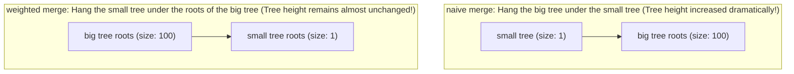
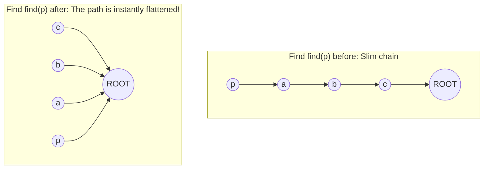

> **Course**: UC Berkeley CS61B: Data Structures (Spring 2024)  
> **Module**: Module 3: Asymptotics & Disjoint Sets  
> **Lecturer**: Prof. Justin Yokota & Prof. Peyrin Kao (UC Berkeley)  
> **Video duration**: 53:18 ｜ **Official original version**: Lecture 15 - Disjoint Sets + Asymptotics 2  
> **Direct video**: [📺Watch the original video of this lecture on Bilibili (P15)](https://www.bilibili.com/video/BV1hJ4m1M7ZA/?p=15) ｜ [📑 Official courseware Slides (Google Presentation)](https://docs.google.com/presentation/d/1zlmNjzu42WAEmyJFG2tYRZJIguExSFq5B__equ3-GaM) ｜ [📖Official textbook chapter](https://cs61b-2.gitbook.io/cs61b-textbook/15.-asymptotics-ii)  
> **Quick navigation**: [← Previous lecture (P14 Union search I: Dynamic connectivity and tree structure evolution)](/en/notes/cs61b/lecture-14) ｜ [📚 Return to the full book catalog](/en/notes/topics/CS61B) ｜ [Next lecture (P16 Tree Structure I: Binary search tree, operation implementation and Hibbard deletion) →](/en/notes/cs61b/lecture-16)

---

## 1. Tree height control philosophy: Why can weighting by element size (Weighting by Size) suppress tree height?

*(Reference time: 00:01:35 · [Video jump (P15 00:01:35)](https://www.bilibili.com/video/BV1hJ4m1M7ZA/?p=15&t=95))*

At the end of the previous lecture, we saw the Achilles heel of Quick Union: blind merging causes the tree to degenerate into a slender bamboo pole, and the tree height swells to  $N$.

To ensure the speed of search and merge, **The height of the tree (Tree Height) must be strictly suppressed to a minimum**!

### Intelligent weighting rule (Weighting Rule)
When merging two trees, don't arbitrarily decide who is the parent of whom:
> **core principles**: **Always record the total number of nodes (Size) contained in each tree. When merging, always hang the smaller tree under the root node of the larger tree!**


An increase in overall tree height by 1 is only possible when two trees of similar size are merged. By merging small trees under large trees, the depth of most nodes will not increase at all!

## 2. Architectural design and clever implementation of Weighted Quick Union (WQU)

*(Reference time: 00:10:00 · [Video jump (P15 00:10:00)](https://www.bilibili.com/video/BV1hJ4m1M7ZA/?p=15&t=600))*

How do we record the size of each tree? Should I create a new one?  `int[] size`  Array?

Algorithm guru Robert Sedgewick proposed a "spatial reuse minimalist technique" that shocked the industry:  
**Use only a single  `parent`  Array, expressing both parent pointer and tree size!**

### Negative number coding rules
- if  `parent[i] >= 0`: represents node  $i$  is an ordinary child node, and its value is the index of the parent node;
- **if  `parent[i] < 0`**: represents node  $i$  It's a tree itself **root node**!  
  and, **the absolute value of its value  $|parent[i]|$, exactly equal to the total number of nodes contained in this tree**!
  - For example  `parent[3] == -5`, indicating that 3 is the root node and this tree has a total of 5 nodes.

```java
public class WeightedQuickUnionDS implements DisjointSets {
    private int[] parent;

    public WeightedQuickUnionDS(int N) {
        parent = new int[N];
        for (int i = 0; i < N; i++) {
            parent[i] = -1; // 每个节点都是根节点，且初始大小为 1
        }
    }

    private int find(int p) {
        while (parent[p] >= 0) {
            p = parent[p];
        }
        return p;
    }

    @Override
    public boolean isConnected(int p, int q) {
        return find(p) == find(q);
    }

    @Override
    public void connect(int p, int q) {
        int rootP = find(p);
        int rootQ = find(q);
        if (rootP == rootQ) return;

        // parent 保存的是负数，因此数值越小，绝对值越大，规模越大！
        if (parent[rootP] <= parent[rootQ]) {
            // rootP 所在的树更大或相等：将 rootQ 挂到 rootP 下
            parent[rootP] += parent[rootQ]; // 累加树的规模
            parent[rootQ] = rootP;          // rootQ 认 rootP 为父
        } else {
            // rootQ 所在的树更大：将 rootP 挂到 rootQ 下
            parent[rootQ] += parent[rootP];
            parent[rootP] = rootQ;
        }
    }
}
```

## 3. A strict mathematical proof of the logarithmic binding of tree height: why the height never exceeds  $\lfloor\log_2 N\rfloor + 1$?

*(Reference time: 00:19:15 · [Video jump (P15 00:19:15)](https://www.bilibili.com/video/BV1hJ4m1M7ZA/?p=15&t=1155))*

To what extent do the weighting rules suppress tree height? We give the extremely classic in computer science **Proof of logarithmic height theorem**.

### Theorem:
> contains  $N$  Weighted Quick Union of elements, the maximum height of any tree generated by it  $H$  Satisfy: 
> $$H \le \lfloor\log_2 N\rfloor + 1 = O(\log N)$$

### Rigorous mathematical proof (disproof through multiplication):
1. Thinking: For any node  $x$, its **Under what circumstances does Depth increase by 1?**?
2. There is only one possibility: when it contains  $x$  tree  $T_1$, was hung as a small tree to another tree  $T_2$  When below, the node  $x$  The depth of is increased by 1;
3. According to the iron law of weighted merging, it can be accommodated  $T_1$  tree  $T_2$, its scale must satisfy: 
   $$\text{Size}(T_2) \ge \text{Size}(T_1)$$
4. Therefore, the new tree formed after the merger  $T_{\text{new}}$  The size is at least: 
   $$\text{Size}(T_{\text{new}}) = \text{Size}(T_1) + \text{Size}(T_2) \ge 2 \times \text{Size}(T_1)$$
5. **Core conclusion**: **Every time the depth of a node increases by 1, the total number of nodes in the set containing it at least doubles (Multiply by 2)!**
6. The total number of nodes in the collection is at most  $N$ . Starting from size 1 and doubling continuously, how many times can it be doubled at most? 
   $$1 \times 2 \times 2 \times \dots \times 2 \le N \implies 2^{\text{Depth}} \le N \implies \text{Depth} \le \log_2 N$$

**Certificate completed**: Weighted merging completely breaks the curse of slender bamboo trees and locks the tree height firmly in logarithm.  $O(\log N)$  Within the range! A single operation takes only tens of nanoseconds at worst.

## 4. The ultimate acceleration skill: Path Compression mechanism

*(Reference time: 00:28:30 · [Video jump (P15 00:28:30)](https://www.bilibili.com/video/BV1hJ4m1M7ZA/?p=15&t=1710))*

Logarithmic complexity  $O(\log N)$  Already extremely good, but the computer pioneers didn't stop there. They proposed an astonishing in-place optimization technique——**Path Compression**.

### Core Insight: Flattening the Goat
When we are calling  `find(p)`  When looking upwards to the root node, many ancestor nodes are visited along the way:
```text
p -> a -> b -> c -> ROOT
```
Now that we have gone through all the hardships and finally know what the real root node of the universe is  `ROOT`, **Why not just hook all the nodes passing along the way directly to  `ROOT`  What about below?**



### Extremely elegant two-line recursive implementation
```java
private int find(int p) {
    if (parent[p] < 0) {
        return p; // 到达根节点
    }
    // 递归查找根节点，并在回溯时直接将父指针重写为根节点！
    parent[p] = find(parent[p]);
    return parent[p];
}
```
passed through once  `find(p)`  After the call, all nodes on the entire query path are instantly "squashed"! Subsequent queries on these nodes will directly hit the root node and only take  $\Theta(1)$!

## 5. Inverse Ackermann Function  $\alpha(N)$): almost miraculous amortized constant time

*(Reference time: 00:37:10 · [Video jump (P15 00:37:10)](https://www.bilibili.com/video/BV1hJ4m1M7ZA/?p=15&t=2230))*

When weighted rules (WQU) and path compression (Path Compression) are combined, the amortized complexity of a single operation reaches one of the peaks in the history of computer science.

Turing Award winner Robert Tarjan published a proof that shocked the world in 1975:
> **Tarjan's theorem**:   
> For contains  $N$  Weighted path compression and search set of elements, any continuous  $M$  The total time complexity of these operations is: 
> $$O(M \cdot \alpha(N))$$
 Among them  $\alpha(N)$  is famous **Inverse Ackermann Function**.

### How slowly does the inverse Ackermann function grow?
Ackerman function  $A(x, y)$  It is a super recursive function that grows extremely violently in mathematics. And its inverse function  $\alpha(N)$  It is the slowest growing function in human mathematics:
- when  $N = 3$  when, $\alpha(N) = 1$; 
- when  $N = 7$  when, $\alpha(N) = 2$; 
- when  $N = 2047$  when, $\alpha(N) = 3$; 
- when  $N = 2^{2048}$ (one that far exceeds the total number of atoms in the entire known universe  $10^{80}$  astronomical numbers), **$\alpha(N)$  Still less than 5**!

**Engineering conclusion**: At any scale of physical data that humans can encounter in the universe, $\alpha(N) \le 4$. Therefore, the amortized single time consumption of weighted path compression and search is **In physics, it is completely equivalent to absolute constant time.  $O(1)$**!

## 6. Also check the fourth generation evolution panoramic ladder list

*(Reference time: 00:44:30 · [Video jump (P15 00:44:30)](https://www.bilibili.com/video/BV1hJ4m1M7ZA/?p=15&t=2670))*

### Panoramic matrix of space-time complexity of the fourth generation algorithm

| Evolutionary generations | Core Data Topology | `isConnected`  worst complexity | `connect`  worst complexity | Amortized time performance |
| :--- | :--- | :--- | :--- | :--- |
| **First generation: Quick Find** | Tile array records Set ID | $\Theta(1)$ | $\Theta(N)$ | Poor, write operation bottleneck is serious |
| **Second generation: Quick Union** | Arbitrary tree forest | $O(N)$  (Worst degraded bamboo pole) | $O(N)$  (Worst degraded bamboo pole) | Extremely unstable and easily degraded |
| **Third Generation: Weighted QU** | Weighted tree forest (small and large) | $O(\log N)$  (strictly guaranteed) | $O(\log N)$  (strictly guaranteed) | Extremely excellent, stable logarithm |
| **Fourth generation: WQU + path compression** | weighted extremely flat forest | $O(\alpha(N))$ | $O(\alpha(N))$ | **almost an absolute constant  $O(1)$** |

### Classic industrial applications
- **network dynamic connectivity**: Determine the on-off status of the Internet backbone router cluster;
- **Minimum Spanning Tree Kruskal's Algorithm**: Greedily select edges and use union lookup for instantaneous cycle detection (Cycle Detection);
- **Computer Vision and Image Segmentation**: Quickly find connected domains of adjacent pixels (Blob Detection).

## 7. Summary of this lecture and comprehensive practical self-test questions after class

*(Reference time: 00:51:00 · [Video jump (P15 00:51:00)](https://www.bilibili.com/video/BV1hJ4m1M7ZA/?p=15&t=3060))*

### Comprehensive self-test questions after class

#### Question 1 (Negative parent pointer tracking)
For WQU structures encoded with negative numbers, if the current  `parent`  The array status is: 
`parent[0] = -4`, `parent[1] = 0`, `parent[2] = 0`, `parent[3] = 0`, `parent[4] = -2`, `parent[5] = 4`.
call now  `connect(1, 5)`, please analyze:
1. Who will be the final merge root node?
2. `parent[0]`  with  `parent[4]`  What are the values of respectively? 
**Answers and detailed analysis**:   
1. `find(1)`  Follow the pointer to find the root node which is 0 (scale is  $|-4| = 4$);   
2. `find(5)`  Find the root node as 4 (scale of  $|-2| = 2$);   
3. Compare the scales: The scale of root node 0 is 4, which is greater than the scale of root node 4, which is 2. Therefore **Small tree root 4 will hang under large tree root 0**, the final merged root node is  **0**!  
4. Status update:  
   - `parent[0] += parent[4]` $\implies$ `-4 + (-2) = -6` (After the merger, the total size of the big tree is expanded to 6);  
   - `parent[4] = 0` (Node 4 recognizes 0 as its parent).

---

## Appendix: UC Berkeley official textbook in-depth study (Official Textbook In-Depth Chapters)

> **Introduction**: The content of this section is integrated from the UC Berkeley CS61B official textbook library (GitBook Textbook). It provides original English theoretical derivation, formal code examples and supporting chapter exercises for the core data structures and algorithms of this lecture, which complements and confirms the previous video lectures.

## 15. Asymptotics II

There's no magic shortcut.

This chapter covers various asymptotic analysis examples, which provide useful insights on how to analyze the efficiency of algorithms.

---

## 15.1 For Loops

Count, count, count...

Now that we've seen some runtime analysis, let's work through some more difficult examples. Our goal is to get some practice with the patterns and methods involved in runtime analysis. This can be a tricky idea to get a handle on, so the more practice the better.

### Example One: 

Last time, we saw the function dup1, that checks for the first time any entry is duplicated in a list:

```java

int N = A.length;

for (int i = 0; i < N; i += 1)

   for (int j = i + 1; j < N; j += 1)

      if (A[i] == A[j])

         return true;

return false;

```

We have two ways of approaching our runtime analysis:

1. Counting number of operations

2. Geometric visualization

#### Method 1: Count Number of Operations

Since the main repeating operation is the comparator, we will count the number of **"=="** operations that must occur. 

The first time through the outer loop, the inner loop will run $$N-1$$times. The second time, it will run $$N-2$$ times. Then $$N-3$$, $$N-4$$, .... all the way till running the inner loop exactly $$1$$ time when i = $$N - 1$$. In the worst case, we have to go through every entry, and the outer loop runs $$N$$ times. 

Then, let $$C$$ =  total number of "==" operations that have occurred. The number of comparisons is: 

$$
C = 1 + 2 + 3 + ... + (N - 3) + (N - 2) + (N - 1) = N(N-1)/2
$$

where $$N(N-1)/2$$ is part of the $$N^2$$ family. 

Since "==" is a constant time operation, the overall runtime in the worst case is $$\theta(N^2)$$.

#### Method 2: Geometric Visualization

We can also approach this from a geometric view. 

Let's draw out when we use == operations in the grid of $$i,j$$combinations:


We see that the number of == operations is the same as the *area* of a right triangle with a side length of $$N - 1$$. Since area is in the $$N^2$$​​ family, we see again that the overall runtime is $$\theta(N^2)$$.

### Example 2: 

Let's look at a more involved example next. Consider the following function, with similar nested for loops:

```java

public static void printParty(int N) {

   for (int i = 1; i <= N; i = i * 2) {

      for (int j = 0; j < i; j += 1) {

         System.out.println("hello");   

         int ZUG = 1 + 1;

      }

   }

}

```

The outer loop advances by *multiplying* `i` by 2 each time. The inner loop runs from 0 to the current value of `i`. The two operations inside the loop are both constant time, so let's approach this by asking **"how many times does this print out "hello" for a given value of N?"**

Our visualization tool from above helped us see dup1's runtime, so let's use a similar approach here. We'll lay out the grid for the nested for loops, and then track the total number of print statements needed for a given N below.

If N is 1, then `i` only reaches 1, and `j` is only 0, since 0 < 1. So there is only one print statement:

<figure><figcaption><p>Visualizations when N = 1</p></figcaption></figure>

If N is 2, the next time through the loop `i` will be $$1\cdot 2 = 2,$$ and `j` can reach 1. The total number of print statements will be 3 = 1 (from first loop) + 2 (from second loop).

<figure><figcaption><p>Visualizations when N = 2</p></figcaption></figure>

<details>

<summary>Conceptual Check: What happens when N = 3? </summary>

After the second loop, $$i = 2 \cdot  2 = 4$$, which is greater than $$N$$, so the outer loop does not continue, and ends after `i = 2`, just like N = 2 did. 

N = 3 will have the same number of print statements as N = 2.

The next change is at N=4, where there will be 4 prints when i = 4, 3 prints when i = 2, and 1 print when i = 1 (remember `i` never equals 3). So a total of 7.


</details>

 We can keep filling out our diagram to get a fuller picture. Here it is up to N = 18:

<figure><figcaption><p>Visualizations for N = 18</p></figcaption></figure>

What we see, if we add up all the counts at each stage of the loops, is that the number of print statements is:

$$
C(N) = 1 + 2 + 4 + ... + N
$$

(if N is a power of 2).

Again, we can think of this in two ways. Since we're already on a graphical roll, let's start there. 

#### Method 1: Finding the Bound Visually 

If we graph the trajectory of 0.5 N (lower dashed line), and 4N (upper dashed line), and $$C(N)$$ itself (the red staircase line), we see that C(N) is fully bounded between those two dashed lines.

<figure><figcaption></figcaption></figure>

Therefore, the runtime (by definition) must also be linear: $$\theta(N)$$.

#### Method 2: Finding the Bound Mathematically

We can obtain the same result by solving our equation from above with the power of mathematics:

$$
C(N) = 1 + 2 + 4 + ... + N = 2N - 1
$$

 Again if N is a power of 2. 

For example, if $$N = 8$$ : 

$$
C(N) = 1 + 2 + 4 + 8 = 15 = 2\cdot 8 - 1
$$

And by removing lesser terms and multiplicative constants, we know that $$2N - 1$$ is in the linear family, so the runtime is $$\theta(N)$$.

We now get a more exact value to the red-staircase line plotted below, which is $$2N$$.

<figure><figcaption><p>Graph of 2N, bounded by 0.5N and 4N</p></figcaption></figure>

### Techniques: No Magic Shortcuts

It would be really nice if there were some magic way to look at an algorithm and just *know* its runtime. And it would be even nicer if all nested for loops have a runtime of $$N^2$$ .

Unfortunately, they're not. And we know this because we just did two nested for loop examples above, each with *different* runtimes.

In the end, there is **no shortcut** to doing runtime analysis. It requires careful thought. But there are a few useful techniques and things to know:

* **Find exact sum**

* **Write out examples**

* **Draw pictures**

We used each of these techniques above.

Also used in the examples above are two important sums you'll see very often: 

* **Sum of First Natural Numbers**: $$1+2+3+...+Q=Q(Q+1)/2=Θ(Q ​2 ​​ )$$

* **Sum of First Powers of 2**: $$1+2+4+8+...+Q=2Q−1=Θ(Q)$$

You saw both of these above, and they'll return again and again in runtime analysis.

---

## 15.2 Recursion

Here we go again...

Now that we've done a couple of nested for loops, let's take a look at our favorite problem: recursion. 

Consider the recursive function `f3` below:

```java

public static int f3(int n) {

   if (n <= 1) 

      return 1;

   return f3(n-1) + f3(n-1);

}

```

##### What does this function do?

Let's think of an example of calling `f3(4)`:

* The first call will return  `f3(4-1) + f3(4-1)` 

* Each `f3(3-1)` call will branch out to `f3(2-1) + f3(2-1)`

* Then for each  `f3(2-1)` call, the condition `if (n <= 1)` will be true, which will return 1.

* What we observe at the end is that 1 will be returned 8 times, meaning we have `f3(2-1)` summed 8 times.

* Therefore,`f3(4)`will return 8.

We can visualize this as a tree, where each level represents a recursive call and each node value represents the argument to the function :

<figure><figcaption><p>Visualization of f3's recursive calls</p></figcaption></figure>

You can do a couple more examples, and see that this function returns $$2^N-1$$​ . Visualizing the recursive calls is extremely useful for getting a sense of what the function is doing, and we will discuss a few methods of determining runtime in recursive functions.

#### Method 1: Intuition

Based on the visualization below, we can notice that every time we add one to `n` we double the amount of work that has to be done:

<figure><figcaption></figcaption></figure>

Then, adding one to `n` N times means doubling the amount of work N times, which results in the intuitive answer for runtime to be $$2^N$$.

#### Method 2: Algebra

Another way to approach this problem is to count the number of calls to `f3` involved. Utilizing the same tree visualization above, we can see that the number of calls to f3 at each recursive level is equivalent to *the number of nodes at each recursive level* of the tree. For instance, the number of calls we made to `f3` at the top level is 1, at the second level is 2, at the third level is 4, etc. 

The total number of calls to f3 then is the **sum** of the number of nodes at each recursive level, which can be expressed as the equation below: 

$$
C(N)=1+2+4+...+2^{N-1}
$$

Applying the formula we saw earlier for the sum of the first powers of 2: 

$$
1+2+4+8+...+Q=2Q−1
$$

Substituting $$Q$$ with $$2^{N-1}$$, we get:

$$
C(N)=2Q−1=2(2^{N-1})-1=2^N-1

​

​​
$$

The work during *each call* is constant , so the overall runtime for `f3` is $$\theta(2^N)$$.

#### Method 3: Recurrence Relation (Out of Scope)

This method is not required reading and is outside of the course scope, but worth mentioning for interest's sake.

We can use a "recurrence relation" to count the number of calls, instead of an algebraic approach. This looks like:

$$
C(1)=1 C(N) = 2C(N-1) + 1
$$

Expanding this out with a method we will not go over but you can read about in the slides or online, we reach a similar sum to the one above. We can then again reduce it to $$2^N - 1$$ , reaching the same result of $$\theta(2^N)$$.

---

## 15.3 Binary Search

hi-lo!

Binary Search Introduction

Getting Familiar with Binary Search


Binary search is a nice way of searching a list for a particular item. It requires the list to be in sorted order and uses that fact to find an element quickly.

To do a binary search, we start in the middle of the list, and check if that's our desired element. If not, we ask: is this element bigger or smaller than our element?

If it's bigger, then we know we only have to look at the half of the list with smaller elements. If it's too small, then we only look at the half with bigger elements. In this way, we can cut in half the number of options we have left at each step, until we find our target element.

What's the worst possible case? When the element we want isn't in the list at all. Then we will make comparisons until we've eliminated all regions of the list, and there are no more bigger or smaller halves left.

For an animation of binary search, see [these slides.](https://docs.google.com/presentation/d/1P4HKmsO3Aaugv7_U16jJN0UbfTEJi1uZUdi_WbIIGe0/edit#slide=id.g463de7561_042)

What's the intuitive runtime of binary search? Take a minute and use the tools you know to consider this.

We start with $$N$$ options, then $$N/2$$, then $$N/4$$ ... until we have just 1. Each time, we cut the array in half, so in the end we must perform a total of $$log\_{2}(N)$$operations. Each of the $$log\_{2}(N)$$ operations, eg. finding the middle element and comparing with it, takes constant time. So the overall runtime then is order $$log\_{2}(N)$$.

It's important to note, however that each step doesn't cut it *exactly* in half. If the array is of even length, and there is no 'middle', we have to take either a smaller or a larger portion. But this is a good intuitive approach.

We'll do a precise way next.

A more precise analysis of Binary Search runtime


To precisely calculate the runtime of binary search, we'll count the number of operations, just as we've done previously.

First, we define our cost model: let's use the number of recursive binary search calls. Since the number of operations inside each call is constant, the number of calls will be the only thing varying based on the size of the input, so it's a good cost model.

Like we've seen before, let's do some example counts for specific $$N$$. As an exercise, try to fill this table in before continuing:

<table><thead><tr><th width="97">N</th><th width="100">1</th><th width="100">2</th><th>3</th><th>4</th><th>5</th><th>6</th><th>7</th><th>8</th><th>9</th><th>10</th><th>11</th><th>12</th><th>13</th></tr></thead><tbody><tr><td><strong>Count</strong></td><td></td><td></td><td></td><td></td><td></td><td></td><td></td><td></td><td></td><td></td><td></td><td></td><td></td></tr></tbody></table>

Alright, here's the result:

<table><thead><tr><th>N</th><th width="100">1</th><th>2</th><th>3</th><th>4</th><th>5</th><th>6</th><th>7</th><th>8</th><th>9</th><th>10</th><th>11</th><th>12</th><th>13</th></tr></thead><tbody><tr><td><strong>Count</strong></td><td>1</td><td>2</td><td>2</td><td>3</td><td>3</td><td>3</td><td>3</td><td>4</td><td>4</td><td>4</td><td>4</td><td>4</td><td>4</td></tr></tbody></table>

These seems to support our intuition above of $$log\_{2}(N)$$. We can see that the count seems to increase by one only when $$N$$ hits a power of 2.

...but we can be even more precise: $$C(N)=\lfloor log\_{2}(N)\rfloor +1$$ (These L-shaped bars are the "floor" function, which is the result of the expression rounded down to the nearest integer.)

A couple properties worth knowing (see below for proofs): 

* $$\lfloor f(N) \rfloor=\Theta(f(N))$$

* $$\lceil f(N) \rceil=\Theta(f(N))$$

* $$log\_{p}(N) = \Theta(log\_{q}(N))$$

The last one essentially states that for logarithmic runtimes, the base of the logarithm doesn't matter at all, because they are all equivalent in terms of Big-O (this can be seen by applying the logarithm change of base). Applying these simplifications, we see that $$\Theta(\lfloor log\_{2}(N)\rfloor=\Theta(log(N))$$ just as we expected from our intuition.

**Example Proof:** Prove $$\lfloor f(N) \rfloor=\Theta(f(N))$$

**Solution:** 

We start with the following inequality:

$$
f(N) - \frac{1}{2}\<f(N)\le \lfloor f(N) + \frac{1}{2} \rfloor \le f(N) + \frac{1}{2}
$$

Simplifying $$f(N)-\frac{1}{2}$$ and $$f(N)+\frac{1}{2}$$ according to our big theta rules by dropping the constants, we see that they are of order $$f(N)$$. Therefore $$\lfloor f(N) + \frac{1}{2} \rfloor$$ is bounded by two expressions of order $$f(N)$$, and is therefore also $$\Theta(f(N))$$.

**Exercise:** 

* Prove $$\lceil f(N) \rceil=\Theta(f(N))$$

* Prove $$log\_{p}(N) = \Theta(log\_{q}(N))$$

**One cool fact to wrap up with:** Log time is super good! It's almost as fast as constant time, and way better than linear time. This is why we like binary search, rather than stepping one by one through our list and looking for the right thing.

To show this concretely:

| $$N$$               | $$log\_{2}(N)$$ | Typical runtime (nanoseconds) |

| ------------------- | --------------- | ----------------------------- |

| 100                 | 6.6             | 1                             |

| 100,000             | 16.6            | 2.5                           |

| 100,000,000         | 26.5            | 4                             |

| 100,000,000,000     | 36.5            | 5.5                           |

| 100,000,000,000,000 | 46.5            | 7                             |

The input size increase by a factor of 1 trillion but the runtime only inceased by a factor of about 7! This shows how remarkable $$log(N)$$ runtime is especially for large size inputs.

<br>

---

## 15.4 Mergesort

In our last example, we'll analyze merge sort, another cool sorting algorithm.

Mergesort basics: merging two sorted lists.


First, let's remind ourselves of selection sort, which we will initially use as a building block for merge sort.

Selection sort works off two basic steps:

* Find the smallest item among the unsorted items, move it to the front, and ‘fix’ it in place.

* Sort the remaining unsorted/unfixed items using selection sort.

If we analyze selection sort, we see that its runtime is $$\Theta(N^2)$$.

**Exercise:** To convince yourself that selection sort has $$\Theta(N^2)$$ runtime, work through the geometric approach (try drawing out the state of the list at every sort call), or count the operations.

Let's introduce one other idea here: **arbitrary units of time**. While the exact time something will take will depend on the machine, on the particular operations, etc., we can get a general sense of time through our arbitrary units (AU).

If we run an $$N=6$$ selection sort, and the runtime is of order $$N^2$$​​, it will take \~36 AU to run. If $$N=64$$, it'll take \~2048 AU to run. Now we don't know if that's 2048 nanoseconds, or seconds, or years, but we can get a relative sense of the time needed for each size of $$N$$.

Hold onto this thought for later analysis.

Now that we have selection sort, let's talk about **merging.**

Say we have two **sorted** arrays that we want to combine into a single big sorted array. We could append one to the other, and then re-sort it, but that doesn't make use of the fact that each individual array is already sorted. How can we use this to our advantage?

It turns out, we can merge them more quickly using the sorted property. The smallest element must be at the start of one of the two lists. So let's compare those, and put the smallest element at the start of our new list.

Now, the next smallest element has to be at the new start of one of the two lists. We can continue comparing the first two elements and moving the smallest into place until one list is empty, then copy the rest of the other list over into the end of the new list.

To see an animation of this idea, [go here](https://docs.google.com/presentation/d/1mdCppuWQfKG5JUBHAMHPgbSv326JtCi5mvjH1-6XcMw/edit#slide=id.g463de7561_042).

What is the runtime of the merge operation? We can use the number of "write" operations to the new list as our cost model, and count the operations. Since we have to write each element of each list only once, the runtime is $$\Theta(N)$$.

Selection sort is slow, and merging is fast. How do we combine these to make sorting faster?

A closer look at Mergesort


We noticed earlier that doing selection sort on an $$N=64$$ list will take \~2048 AU. But if we sort a list half that big, $$N=32$$, it only takes \~512 AU. That's more than twice as fast! So making the arrays we sort smaller has big time savings.

Having two sorted arrays is a good step, but we need to put them together. Luckily, we have merge. Merge, being of linear runtime, only takes \~64 AU. So in total, splitting it in half, sorting, then merging, only takes 512 + 512 + 64 = 1088 AU. Faster than selection sorting the whole array. But how much faster?

Now, AUs aren't real units, but they're sometimes easier and more intuitive than looking at the runtime. The runtime for our split-in-half-then-merge-them sort is $$N+2(\frac{N}{2})^2$$​​, which is about half of $$N^2$$ for selection sort. However, they are still both $$\Theta(N^2)$$.

What if we halved the arrays again? Will it get better? Yes! If we do two layers of merges, starting with lists of size $$\frac{N}{4}$$, the total time will be \~640 AU.

**Exercise:** Show why the time is \~640AU by calculating the time to sort each sub-list and then merge them into one array.

What if we halved it again? And again? And again?

Eventually we'll reach lists of size 1. At that point, we don't even have to use selection sort, because a list with one element is already sorted.

This is the essence of **merge sort:**

* If the list is size 1, return. Otherwise:

* Mergesort the left half

* Mergesort the right half

* Merge the results

So what's the running time of **merge sort**?

We know merge itself is order $$N$$, so we can start by looking at each layer of merging:

* To get the top layer: merge \~64 elements = 64 AU

* Second layer: merge \~32 elements, twice = 64 AU

* Third layer: \~16\*4 = 64 AU

* ...

Overall runtime in AU is \~64\*k, where $$k$$ is the number of layers. Here,  $$k=log\_{2}(64)=6$$, so the overall cost of mergesort is \~384 AU.

Now, we saw earlier that splitting up more layers was faster, but still order $$N^2$$​​. Is merge sort faster than $$N^2$$​​?

Yes!\

Mergesort has worst case runtime $$\Theta(N\cdot log(N))$$.

* The top level takes \~N AU.

* Next level takes \~N/2 + \~N/2 = \~N.

* One more level down: \~N/4 + \~N/4 + \~N/4 + \~N/4 = \~N.

Thus, total runtime is \~Nk, where $$k$$ is the number of levels.

How many levels are there? We split the array until it is length 1, so $$k=log\_{2}(N)$$. Thus the overall runtime is $$\Theta(N\cdot log(N))$$.

**Exercise:** Use exact counts to argue for $$\Theta(N\cdot log(N))$$. Account for cases where we cannot divide the list perfectly in half.

So is $$\Theta(N*log(N))$$ actually better than $$\Theta(N^2)$$? Yes! It turns out $$\Theta(N*log(N))$$ is not much slower than linear time.


---

## 15.5 Summary

Wrapping up our asymptotics adventures.

#### **Takeaways**

* There are no magic shortcuts for analyzing code runtime.

* In our course, it’s OK to do exact counting or intuitive analysis.

* Know how to sum 1 + 2 + 3 + ... + N and 1 + 2 + 4 + ... + N.

* We won’t be writing mathematical proofs in this class.

* Many runtime problems you’ll do in this class resemble one of the five problems from today. 

* This topic has one of the highest skill ceilings of all topics in the course. All the tools are here, but **practice** is your friend!

* Different solutions to the same problem, e.g. sorting, may have different runtimes (with big enough differences for the runtime to go from impractical to practical!).

* $$N^2$$​​ vs. $$Nlog(N)$$ is an enormous difference.

* Going from $$Nlog(N)$$ to $$N$$ is nice, but not a radical change.

Hopefully, this set of examples has provided some good practice with the techniques and patterns of runtime analysis. You can also find extra practice problems in the next section. Remember, there are no magic shortcuts, but you have to tools to approach the problems. Go forth and analyze!!

---

## 15.6 Exercises

Doing more practices is the best way to gain intuition when it comes to asymptotics!

### Factual

1. Prove that $$\Theta(\log \_{2} n) = \Theta(\log \_{3} n)$$.

2. What is the runtime of the following function?

```java

public static int f(int n) {

    if (n <= 1) {

        return 0;

    }

    return f(n - 1) + f(n - 1) + f(n - 1);

}

```

<details>

<summary>Problem 1</summary>

Using the properties of logs, we see that $$\log\_2 n = \frac{\log n}{\log 2} = \Theta(\log n)$$. Similarly, $$\log\_3 n = \frac{\log n}{\log 3} = \Theta(\log n)$$. So when consiering asymptotics relating to logarithms, the base does not matter (as long as it is some constant).

</details>

<details>

<summary>Problem 2</summary>

This is essentially `fib` with 3 recursive calls instead of 2. The runtime is $$\Theta(3^n)$$.

</details>

### Procedural

1. Find the runtime of running `print_fib` with for arbitrarily large n.

```java

public void print_fib(int n) {

   for (int i = 0; i < n; i++) {

       System.out.println(fib(i));

   }

}

public int fib(int n){

   if (n <= 0) {

     return 0;

   } else if (n == 1) {

     return 1;

   } else {

     return fib(n-1) + fib(n-2);

   }

}

```

2. Do the above problem again, but change the body of the for loop in `print_fib` to be:

```java

 System.out.println(fib(n));

```

3. Find the runtime of the function `f` on an input of size `n`, given the `createArray` function as described below:

```java

public static void f(int n) {

    if (n == 1) {

        return;

    }

    f(n / 2);

    f(n / 2);

    createArray(n);

}

public int[] createArray(int Q) {

    int[] x = new int[Q];

    for (int i = 0; i < x.length; i++) {

        x[i] = i;

    }

    return x;

}

```

4. [Problem 8](https://drive.google.com/file/d/1Vo8p4vbOGt7eY5TtalvAEnk4ignpTVvm/view?usp=sharing) from the Spring 2018 Midterm 2

5. [Problem 4](https://drive.google.com/file/d/1yWyRp7QTizspTp9dsKz5yxE6bSf9YUIi/view?usp=sharing) from the Spring 2017 Midterm 2

<details>

<summary>Problem 1</summary>

From lecture, we know that `fib(i)` runs in roughly $$2^i$$ time. If we run `fib` for each `i` from `1` to `n`, we get a total work of $$2^0 + 2^1 + ... 2^n$$. Note that this is a geometric sum with last term $$2^n$$, so the overall runtime is actually still $$\Theta(2^n)$$.

</details>

<details>

<summary>Problem 2</summary>

Again, we know that `fib(i)` takes about $$2^i$$ time. However, this time we call `fib(n)` each time in the loop `n` total times. This gives a runtime of $$\Theta(n2^n)$$.

</details>

<details>

<summary>Problem 3</summary>

This function creates two recursive branches of half the size per call, with each node taking linear work. As such, each level has $$n$$ total work, and since we halve the input each time, there are $$\log n$$ total levels, for a runtime of $$\Theta(n \log n)$$.

</details>

<details>

<summary>Problem 4</summary>

[Solutions](https://drive.google.com/file/d/1LIyFXwHYCWXNqIgKTsTyKiOYnB79_ykk/view?usp=sharing) and [walkthrough](https://www.youtube.com/watch?v=nMZn4EV0gGw) are linked here and on the course website.

</details>

<details>

<summary>Problem 5</summary>

[Solutions](https://drive.google.com/file/d/1b99XARlZxg3NMfeSAVt2yzDzwSEcASq3/view?usp=sharing) are linked here and on the course website.

</details>

### Metacognitive

1. What would the runtime of `modified_fib` be? Assume that values is an array of size n. If a value in an int array is not initialized to a number, it is automatically set to 0.

```java

public void modified_fib(int n, int[] values) {

   if (n <= 1) {

     values[n] = n;

     return n;

   } else {

     int val = values[n];

     if (val == 0) {

       val = modified_fib(n-1, values) + modified_fib(n-2, values);

       values[n] = val;

     }

     return val;

   }

}  

```

<details>

<summary>Problem 1</summary>

This is an example of dynamic programming, a topic covered in more depth in CS170. Note that since `values` is saved across calls, we only recompute each value of `n` once. Computing a single value of `n` only takes constant time, since we just add two already-computed values or do an array access. As such, the overall runtime is linear: $$\Theta(n)$$.

</details>


---

## Course navigation and jump

| Previous lecture | Directory | Next lecture | Original video |
| :--- | :---: | :--- | :--- |
| [← Previous lecture: Union search I: Dynamic connectivity and tree structure evolution](/en/notes/cs61b/lecture-14) | [📚 Return to CS61B complete book list](/en/notes/topics/CS61B) | [Next lecture: Tree structure I: Binary search tree, operation implementation and Hibbard deletion →](/en/notes/cs61b/lecture-16) | [🎬Watch this lecture on Bilibili (P15)](https://www.bilibili.com/video/BV1hJ4m1M7ZA/?p=15) |
