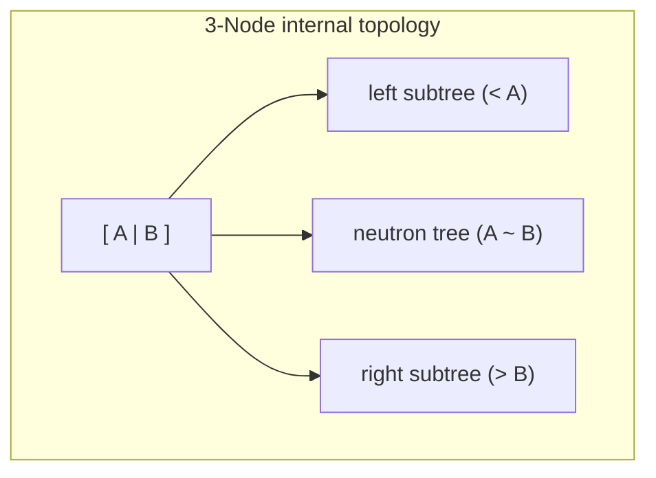
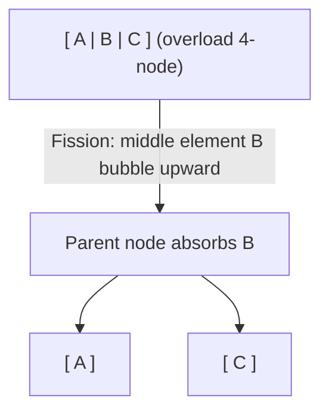

> **Course**: UC Berkeley CS61B: Data Structures (Spring 2024)  
> **Module**: Module 4: Tree Structure and Hash Table (Search Trees & Hashing)  
> **Lecturer**: Prof. Justin Yokota & Prof. Peyrin Kao (UC Berkeley)  
> **Video duration**: 51:27 ｜ **Official original version**: Lecture 17 - B-Trees (2-3 2-3-4 Trees)  
> **Direct video**: [📺Watch the original video of this lecture on Bilibili (P17)](https://www.bilibili.com/video/BV1hJ4m1M7ZA/?p=17) ｜ [📑 Official courseware Slides (Google Presentation)](https://docs.google.com/presentation/d/1uQYk0Hxhf0jhnp-aXxoIGNGM2w_yILMyukRctRPc9Uo) ｜ [📖Official textbook chapter](https://cs61b-2.gitbook.io/cs61b-textbook/17.-b-trees)  
> **Quick navigation**: [← Previous lecture (P16 Tree Structure I: Binary Search Tree, Operation Implementation and Hibbard Deletion)](/en/notes/cs61b/lecture-16) ｜ [📚 Return to the full book catalog](/en/notes/topics/CS61B) ｜ [Next lecture (P18 Tree structure III: Left-leaning red-black tree (LLRB) and equivalent isomorphic mapping) →](/en/notes/cs61b/lecture-18)

---

## 1. The solution to self-balancing: Never allow trees to grow downward!

*(Reference time: 00:01:30 · [Video jump (P17 00:01:30)](https://www.bilibili.com/video/BV1hJ4m1M7ZA/?p=17&t=90))*

In the previous lecture, we saw that the fundamental reasons for the degradation of naive BST are: **New nodes are always used as leaf nodes and are appended blindly downward.**. Once the input data is sorted, the branches will hang longer and longer, eventually becoming a linear chain.

Computer science guru Rudolf Bayer proposed a reverse subversion thinking:
> **Self-balancing tree ultimate philosophy**:   
> **When inserting new data, never open new leaf nodes downward! New data must be inserted directly into existing leaf nodes!**  
> **Trees can only and must "Grow Upwards"!**

## 2. Formal specification and node structure of 2-3 Trees

*(Reference time: 00:10:15 · [Video jump (P17 00:10:15)](https://www.bilibili.com/video/BV1hJ4m1M7ZA/?p=17&t=615))*

In order to accommodate multiple data items, the 2-3 tree breaks the shackles of "one node can only store one value" and allows two legal node forms:

### 1. 2-Node (2-Node)
- internal accommodation  **1 key**; 
- own  **2 kids branch** (The value of the left child  $<$  key value  $<$  the value of the right child). The essence is completely consistent with the standard BST node.

### 2. 3-Node (3-Node)
- internal accommodation  **2 key values** (Recorded in ascending order as  $A$  and  $B$); 
- own  **3 kids branch**: 
  - All values in the left subtree  $< A$; 
  - All values of the neutron tree are between  $A$  and  $B$  between ($A < \text{Middle} < B$); 
  - All values in the right subtree  $> B$.

## 3. 2-3 Deduction of the whole process of tree insertion: Overstuffing & Splitting

*(Reference time: 00:19:00 · [Video jump (P17 00:19:00)](https://www.bilibili.com/video/BV1hJ4m1M7ZA/?p=17&t=1140))*

Let's go through a complete case to observe how the 2-3 tree always maintains perfect balance during the insertion process:

### Step 1: Insert into 2-node
- If the new element falls into an existing 2-node, it is absorbed directly and the node is upgraded to a  **3-node**!
- The height of the tree has not changed at all.

### Step 2: Insert into 3-node (trigger temporary 4-node)
- If the new element falls into an existing 3-node, the node temporarily holds 3 key values and becomes an illegal  **4-node  `[A, B, C]`**; 
- **Splitting Rule**: 
  1. middle sized elements  $B$ **Bubble up and push into the parent node**; 
  2. smaller elements  $A$  independently as a 2-node (as  $B$  the left child);
  3. larger element  $C$  independently as a 2-node (as  $B$  the right child).

### Step 3: Root node fission - the only moment when the tree grows upward
If fission propagates all the way up the tree, it will eventually lead to **The root node also becomes a 4-node**: 
- The root node undergoes fission, and the middle element becomes a brand new root alone!
- **All branches of the entire tree have a height synchronization uniformly increased by 1**!

## 4. The Absolute Perfect Balance Theorem: Why are the leaf depths of 2-3 trees always exactly equal?

*(Reference time: 00:28:40 · [Video jump (P17 00:28:40)](https://www.bilibili.com/video/BV1hJ4m1M7ZA/?p=17&t=1720))*

> **2-3 Tree Perfect Balance Theorem**:   
> **In a legal 2-3 tree, the path lengths from the root node to any leaf node are absolutely strictly equal!**

### Proof points:
1. When inserting a new element, it is either absorbed directly at the leaf node and the tree height remains unchanged;
2. Either the leaf node is split, the middle element is pushed to the parent node, and the absolute depth of the leaf itself remains unchanged;
3. The only possibility for the tree height to change is that the fission of the root node creates a new global ancestor root node;
4. When the root node splits upward, all existing subtrees are simultaneously mounted downward as child nodes of the new root. **The depth of all leaf nodes is increased by 1 simultaneously at the same time.**!

Therefore, a 2-3 tree can never suffer from skew degeneration with one side long and one side short! Its tree height in the worst case (all 2-nodes) is  $\log_2 N$, in the best case (all 3-nodes) is  $\log_3 N$. The time required for a single search and insertion is strictly  **$\Theta(\log N)$**!

## 5. The great application of B-tree in modern industrial databases and file systems

*(Reference time: 00:36:20 · [Video jump (P17 00:36:20)](https://www.bilibili.com/video/BV1hJ4m1M7ZA/?p=17&t=2180))*

2-3 trees are  **B-Tree**  Special case of theory at minimum branching factor (order  $M = 3$).

In modern industrial databases (MySQL InnoDB, Oracle, PostgreSQL) and operating system file systems (Linux ext4, macOS APFS), persistent storage of data is based on disks or solid-state drives (SSD).
- Accessing physical sectors on a disk is hundreds of thousands of times slower than accessing memory;
- To reduce the number of disk I/Os, industrial-grade B-trees often employ huge branching factors (e.g.  $M = 1024$  or higher, a node contains hundreds of key values);
- The height of the tree is extremely compressed to 3 to 4 levels, and billions of pieces of data can be stored in only 3 disk I/Os!

## 6. Summary of this lecture and post-class self-assessment

*(Reference time: 00:44:00 · [Video jump (P17 00:44:00)](https://www.bilibili.com/video/BV1hJ4m1M7ZA/?p=17&t=2640))*

### After-class self-assessment questions
Why in industrial-strength programming languages such as Java  `java.util.TreeSet`  or C++ `std::set`), do you not directly use object-oriented code to implement the 2-3 tree?  
**Core pain points**: Implementing 2-3 trees is extremely painful! Different types of node classes need to be defined, which involves extremely complex parent-child pointer disconnection, temporary node creation and multi-branch type conversion during insertion and deletion. The next lecture on red-black trees will show how to use a minimalist binary tree to simulate a 2-3 tree!

---

## Appendix: UC Berkeley official textbook in-depth study (Official Textbook In-Depth Chapters)

> **Introduction**: The content of this section is integrated from the UC Berkeley CS61B official textbook library (GitBook Textbook). It provides original English theoretical derivation, formal code examples and supporting chapter exercises for the core data structures and algorithms of this lecture, which complements and confirms the previous video lectures.

## 17. B-Trees

In this section, we build off our knowledge of binary search trees to understand a new self-balancing search tree structure: B-Trees.

---

## 17.1 BST Performance

### Tree Height

One unforunate feature of BSTs is that they range from a best-case "bushy" tree to a worst-case "spindly" tree. 

In the best case, our tree will have height $$\Theta(log N)$$, whereas in the worst case our tree has a height of $$\Theta(N)$$, at which point it basically becomes a linked list. For example, `contains` on a "spindly" BST would take linear time.

Both trees below have a height H = 3, yet the left tree is able to hold many more items than the left.

<figure><figcaption></figcaption></figure>

---

## 17.2 Big O vs. Worst Case

A short digression on asymptotics

Consider the following statements about BSTs. Which of the following are true?

1. The worst-case height of a BST is $$\Theta(N)$$.

2. BST height is $$O(N)$$.

3. BST height is $$O(N^2)$$.

The answer is that all three statements are true. BSTs always have a height that is linear or better, and a linear height is obviously "less than" the quadratic upper bound in the last point.

However, a more tricky question is which of the three statements is *the most informative*. 

The answer here is the first statement: it gives an *exact* upper and lower bound unlike the other statements. $$O(N)$$ could mean linear, logarithmic, square-root, or constant, but $$\Theta(N)$$ can only mean linear.

For an analogy, consider the following statements about the worst-case cost of a hotel room:

1. The most expensive room is $639/night.

2. The most expensive room is less than or equal to $2000/night. 

Here, we see that the first statement gives us exact information, whereas the second statement does not. In the second statement, the most expensive room could be $2000, $10, or anywhere in between. 

However, *both are statements about the worst case*. Applying this to asymptotic notation,  this means that we can refer to the worst case with $$\Theta$$, $$O$$, or even $$\Omega$$. **Big O is not the same as the worst case!**

### Using Big O

If $$\Theta$$ is always more informative than $$O$$, then why do we bother using Big O notation at all? There are several reasons:

* We can make broader statements. For example, saying "binary search is $$O(\log N)$$ is correct, but saying "binary search tree is $$\Theta(log N)$$" would not be correct, since it can be constant in certain scenarios.

* Sometimes, it is not possible or extremely difficult to determine the exact runtime. In such cases, we would still like to provide a generalized upper bound.

---

## 17.3 B-Tree Operations

### Height and Depth

The average height and depth of a BST are important properties in determining performance. **Height** refers to the depth of the deepest leaf and is a tree-wide property, whereas **depth** refers to the distance from the root of a particular node and is node-specific.

The **average depth** of a tree is the mean of the depth of every node.

<figure><figcaption>
Heights and depths of a binary tree
</figcaption></figure>

#### BSTs in Practice

Height and average depth determine the runtime of BST operations. The height determines the worst-case runtime to fine a node, while the average depth determines the average-case runtime of search operations.

The order in which we insert nodes has a major impact on the height and average depth of a BST. For example, consider inserting nodes `1, 2, 3, 4, 5, 6, 7`. This results in a spindly BST with height 6 and average depth 3. If we insert the same nodes in the order  `4, 2, 1, 3, 6, 5, 7`, we get a much better height of 2 and an average depth of 1.43.

<figure><figcaption>
Height and depth variations based on insertion order
</figcaption></figure>

#### Real-World BSTs

In considering how BSTs operate in real-life applications, we may want to start by considering randomized BSTs. 

Luckily, on average, randomly generated insertion orders have $$\log N$$ height and average depth. In fact, you can prove that $$E\[d] = 2 \ln N$$ and $$E\[h] = 4.311 \ln N$$ (such a proof is beyond the scope of this course). Such properties hold even when considering both insertion and deletion.

However, it is not always possible to randomize the order of insertions. For example, if we have real-time data that comes in sequentially, there is no way to shuffle the data since we do not have all the points at once. 

As such, we need a different way to maintain "bushiness" in our search trees.

### B-Trees

#### Avoiding Imbalance

If we could simply avoid adding new leaves in our BST, the height would never increase. Such an idea, however, would be infeasible, since we do need to insert values at some point.

One idea that we might approach is that of "overstuffing" the leaf nodes. Instead of adding a new node upon insertion, we simply stack the new value into an existing leaf node at the appropriate location. 

<figure><figcaption>
Overstuffing a node upon <code>insert(17)</code>
</figcaption></figure>

However, a clear problem with this approach is that it results in large leaf nodes that basically become a list of values, going back to the problem of linear search.

#### Moving Items Up

To ameliorate the issue of overly stuffed leaf nodes, we may consider "moving up" a value when a leaf node reaches a certain number of values. 

<figure><figcaption>
Moving <code>17</code> from a leaf node to its parent
</figcaption></figure>

However, this runs into the issue that our binary search property is no longer preserved--`16` is to the right of `17`. As such, we need a second fix: 

<figure><figcaption>
Splitting the children of an overstuffed node
</figcaption></figure>

Above, we split the children of an overstuffed node into ranges: $$(-\infty, 15)$$, $$\[15, 17]$$, and $$(18, \infty)$$. A search on this structure would operate exactly the same as a BST, except for a value between 15 and 17, we go to the middle child instead of the left or right.

If we set some constant $$L$$ as a limit on our node size, our search time only increases by a constant factor (in other words, there is no asymptotic change).

Adding to a node may cause a cascading chain reaction, as shown in the image below where we add `25` and `26`. 

<figure><figcaption>
Adding <code>25</code> and <code>26</code> causes multiple node splittings
</figcaption></figure>

In the case when our root is above the limit, we are forced to increase the tree height.

<figure><figcaption>
Root has four items
</figcaption></figure>

<figure><figcaption>
Splitting the root
</figcaption></figure>

#### Perfect Balance

Observe that our new splitting-tree data structure has perfect balance. 

If we split the root, every node is pushed down by one level. If we split a leaf or internal node, the height does not change. There is never a change that results in imbalance.

The real name for this data structure is a **B-Tree**. B-Trees with a limit of 3 items per node are also called **2-3-4 trees** or **2-4** trees (a node can have 2, 3, or 4 children). Setting a limit of 2 items per node results in a **2-3 tree.**

#### B-Tree Usage

B-Trees are used mostly in two specific contexts: first, with a small L for conceptually balancing search trees, or secondly, with L in the thousands for databases and filesystems with large records.

---

## 17.4 B-Tree Invariants

### B-Tree Invariants

Because of the way B-Trees are constructed, they have two invariants:

1. All leaves are the same distance from the root.

2. A non-leaf node with k items must have exactly k + 1 children.

These two invariants guarantee a "bushy" tree with $$\log N$$ height.

---

## 17.5 B-Tree Performance

### B-Tree Runtime Analysis

To consider the runtime of B-Trees, let $$L$$ be the maximum items per node. Based on our invariants, the maximum height must be somewhere between $$\log\_{L + 1} N$$ (best case, when all nodes have $$L$$ items) and $$\log\_2 N$$ (worst case, when each node has 1 item). 

The overall height, then, is always on the order of $$\Theta(\log N)$$

<figure><figcaption>
Worst-case B-Tree height
</figcaption></figure>

<figure><figcaption>
Best-case B-Tree height
</figcaption></figure>

#### Runtime for `contains`

In the worst case, we have to examine up to $$L$$ items per node. We know that height is logarithmic, so the runtime of `contains` is bounded by $$O(L \log N)$$. Since $$L$$ is a constant, we can drop the multiplicative factor, resulting in a runtime of $$O(\log N)$$.

#### Runtime for `add`

A similar analysis can be done for `add`, except we have to consider the case in which we must split a leaf node. Since the height of the tree is $$O(\log N)$$, at worst, we do $$\log N$$ split operations (cascading from the leaf to the root). This simply adds an additive factor of $$\log N$$ to our runtime, which still results in an overall runtime of $$O(\log N)$$.

---

## 17.6 Summary

* BSTs have best-case height $$\Theta(\log N)$$, and worst-case height $$\Theta(N)$$.

* Big O is *not* the same as worst-case!

* B-Trees are a modification of the BST that maintain $$\Theta(\log N)$$ runtime for `add` and `contains` in the worst case. They maintain perfect balance during insertion.

* A B-Tree has a limit $$L$$ on the number of values a node can hold, instead of having one item per node like a BST.

* Upon `add` in a B-Tree, we simply append the value to an existing leaf node in the correct location instead of creating a new leaf node. If the node is too full, it splits and pushes a value up.

---

## 17.7 Exercises

### Factual

1. Which of the following are valid 2-3 trees?

<figure><figcaption></figcaption></figure>

Problem 1

Only (a).

A 2-3 tree only allows up to 3 children, which means a node can only have at most 2 values. (b) has an extra value in the rightmost node.

A 2-3 tree must also be perfectly balanced. (c) is imbalanced.

A B-Tree node always has one more child than the number of values. So in a 2-3 tree, a node with 1 value has 2 children, and a node with 2 values has 3 children. (d) violates this with the node `21`, which has one value but 3 children.

### Procedural

1. Draw the 2-3 tree that results from inserting `1, 2, 3, 4, 5, 6, 7` in order.

2. [Problem 1](https://drive.google.com/file/d/1Vo8p4vbOGt7eY5TtalvAEnk4ignpTVvm/view?usp=sharing) of the Spring 2018 Midterm 2

Problem 1

Check your answers using this [interactive visualizer.](https://www.cs.usfca.edu/~galles/visualization/BTree.html)

Problem 2

[Solutions](https://drive.google.com/file/d/1LIyFXwHYCWXNqIgKTsTyKiOYnB79_ykk/view?usp=sharing) and [walkthrough](https://www.youtube.com/watch?v=nMZn4EV0gGw) are linked here and on the course website.

---

## Course navigation and jump

| Previous lecture | Directory | Next lecture | Original video |
| :--- | :---: | :--- | :--- |
| [← Previous lecture: Tree structure I: Binary search tree, operation implementation and Hibbard deletion](/en/notes/cs61b/lecture-16) | [📚 Return to CS61B complete book list](/en/notes/topics/CS61B) | [Next lecture: Tree structure III: Left-leaning red-black tree (LLRB) and equivalent isomorphic mapping →](/en/notes/cs61b/lecture-18) | [🎬Watch this lecture on Bilibili (P17)](https://www.bilibili.com/video/BV1hJ4m1M7ZA/?p=17) |
