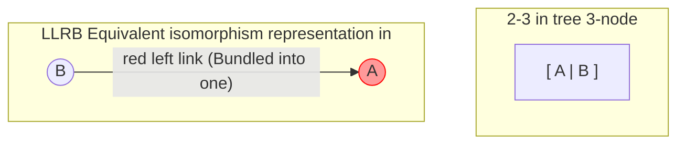

> **Course**: UC Berkeley CS61B: Data Structures (Spring 2024)  
> **Module**: Module 4: Tree Structure and Hash Table (Search Trees & Hashing)  
> **Lecturer**: Prof. Justin Yokota & Prof. Peyrin Kao (UC Berkeley)  
> **Video duration**: 51:25 ｜ **Official original version**: Lecture 18 - Red Black Trees  
> **Direct video**: [📺Watch the original video of this lecture on Bilibili (P18)](https://www.bilibili.com/video/BV1hJ4m1M7ZA/?p=18) ｜ [📑 Official courseware Slides (Google Presentation)](https://docs.google.com/presentation/d/1WJze5Odoy4ZR1vqPM8X6duaZ5GGm_D7SaYrtOa5RnsA) ｜ [📖Official textbook chapter](https://cs61b-2.gitbook.io/cs61b-textbook/18.-red-black-trees)  
> **Quick navigation**: [← Previous lecture (P17 Tree Structure II: The absolute self-balancing philosophy of B-tree and 2-3 tree)](/en/notes/cs61b/lecture-17) ｜ [📚 Return to the full book catalog](/en/notes/topics/CS61B) ｜ [Next lecture (P19 Hashing I: Hash table principle, hash function and collision resolution) →](/en/notes/cs61b/lecture-19)

---

## 1. 2-3 The engineering dilemma of trees and the birth of isomorphism of red-black trees

*(Reference time: 00:01:25 · [Video jump (P18 00:01:25)](https://www.bilibili.com/video/BV1hJ4m1M7ZA/?p=18&t=85))*

In the previous lecture, the 2-3 tree demonstrated perfect logarithmic balance. But if you try to write a 2-3 tree in Java, you will encounter a code implementation nightmare: you need to design different classes for 2-nodes and 3-nodes, and pointer reassembly during fission is extremely cumbersome.

Computer pioneer Robert Sedgewick came up with an idea that shocked the world:
> **core proposition**:   
> **Can we use the most common and simple standard binary search tree (BST) to perfectly simulate all the topological logic of the 2-3 tree at 1:1?**

**The answer is Left-Leaning Red-Black Trees (LLRB)!**

## 2. Red Links and Equivalent Isomorphism Mapping of 2-3 Trees (Isometry)

*(Reference time: 00:10:00 · [Video jump (P18 00:10:00)](https://www.bilibili.com/video/BV1hJ4m1M7ZA/?p=18&t=600))*

How to represent a 3-node in a 2-3 tree using a normal binary node  `[ A | B ]`?
- We split the 3-node into two ordinary binary tree nodes: $A$  and  $B$; 
- Let smaller nodes  $A$  as a larger node  $B$  of **left child**; 
- Tie them together tightly with a \*\*Red Link\*\*!



### Three Sacred Rules of Left-Leaning Red-Black Trees (LLRB)
1. **Red links must and can only tilt to the left (Left-Leaning)**; 
2. **No node can have two red links at the same time** (That is, continuous red links are strictly prohibited, and 4-nodes cannot appear in the simulation);
3. **Black Balance Axiom (Black Balance)**: From the root node to any external empty link (`null`) on the path, **The number of black links passed through is absolutely the same** (Direct inheritance from the perfect balance of the 2-3 tree)!

## 3. Maintain the three core principles of isomorphism: left-hand rotation, right-hand rotation and color flipping

*(Reference time: 00:19:30 · [Video jump (P18 00:19:30)](https://www.bilibili.com/video/BV1hJ4m1M7ZA/?p=18&t=1170))*

When inserting a new node, the rules of the red-black tree may be temporarily broken. We can complete topology repair instantly by relying on only three minimalist primitive operations:

### Primitive 1: Rotate Left
- **trigger scene**:An item appears **right leaning red link**; 
- **Operation**: Promote the right child to the parent node, and the original parent node becomes the left child.

```java
private Node rotateLeft(Node h) {
    Node x = h.right;
    h.right = x.left;
    x.left = h;
    x.color = h.color;
    h.color = RED;
    return x;
}
```

### Primitive 2: Rotate Right
- **trigger scene**: appear **Two consecutive red links leaning to the left**; 
- **Operation**: Promote the left child to the root, and the original parent node becomes the right child.

```java
private Node rotateRight(Node h) {
    Node x = h.left;
    h.left = x.right;
    x.right = h;
    x.color = h.color;
    h.color = RED;
    return x;
}
```

### Primitive 3: Flip Colors
- **trigger scene**: The left and right children of a node **Both are red links** (Equivalent to a temporary 4-node in a 2-3 tree);
- **Operation**: Turn the links of the left and right children into black, and turn the links of the current node itself into red (bubbling up)!

```java
private void flipColors(Node h) {
    h.color = RED;
    h.left.color = BLACK;
    h.right.color = BLACK;
}
```

## 4. Extremely compact LLRB insertion algorithm and cascade repair code

*(Reference time: 00:29:40 · [Video jump (P18 00:29:40)](https://www.bilibili.com/video/BV1hJ4m1M7ZA/?p=18&t=1780))*

With the help of the above three primitives, Sedgewick inserted the self-balancing tree that originally required hundreds of lines of complex branches into code and refined it into just three elegant lines.  `if`  Guard statement:

```java
public class LLRB<Key extends Comparable<Key>, Value> {
    private static final boolean RED = true;
    private static final boolean BLACK = false;

    private class Node {
        Key key;
        Value val;
        Node left, right;
        boolean color; // 其父链接指向它的颜色
        public Node(Key k, Value v, boolean c) { key = k; val = v; color = c; }
    }

    private Node root;

    private boolean isRed(Node x) {
        if (x == null) return false;
        return x.color == RED;
    }

    public void put(Key key, Value val) {
        root = put(root, key, val);
        root.color = BLACK; // 根节点链接永远是黑色
    }

    private Node put(Node h, Key key, Value val) {
        // 1. 标准 BST 递归插入：新诞生节点默认赋予红色链接！
        if (h == null) return new Node(key, val, RED);
        int cmp = key.compareTo(h.key);
        if (cmp < 0)      h.left = put(h.left, key, val);
        else if (cmp > 0) h.right = put(h.right, key, val);
        else              h.val = val;

        // 2. 递归回溯时的三道守卫级联修复！
        // 守卫 1：右红左黑 -> 左旋修复
        if (isRed(h.right) && !isRed(h.left))      h = rotateLeft(h);
        // 守卫 2：连续两代左红 -> 右旋修复
        if (isRed(h.left) && isRed(h.left.left))   h = rotateRight(h);
        // 守卫 3：左右双红 -> 颜色翻转 (分裂冒泡)
        if (isRed(h.left) && isRed(h.right))       flipColors(h);

        return h;
    }
}
```

These dozen lines of code completely implement the highest industrial standard self-balancing binary search tree! No matter how messy the insertion order is, the tree height is always locked at  $O(\log N)$, running extremely fast.

## 5. Summary of this lecture and self-test after class

*(Reference time: 00:38:00 · [Video jump (P18 00:38:00)](https://www.bilibili.com/video/BV1hJ4m1M7ZA/?p=18&t=2280))*

### Comprehensive self-test questions after class

#### Question 1 (Derivation of properties of red-black trees)
A tree contains  $N$  What is the maximum possible height of a legal left-leaning red-black tree (LLRB) with keys?  
**Answers and analysis**:   
- **The maximum height is approx.  $2 \log_2 N$**!  
- **Reason**: In the most extreme case, the longest search path alternates between black links and red links (that is, each 3-node contributes 2 layers of depth), while the shortest path is all black links. According to the black balance property, the number of black nodes of the two must be exactly equal. Therefore, the length of the longest path will not exceed 2 times the shortest path, and the asymptotic logarithmic order is still strictly maintained.  $\Theta(\log N)$!

---

## Appendix: UC Berkeley official textbook in-depth study (Official Textbook In-Depth Chapters)

> **Introduction**: The content of this section is integrated from the UC Berkeley CS61B official textbook library (GitBook Textbook). It provides original English theoretical derivation, formal code examples and supporting chapter exercises for the core data structures and algorithms of this lecture, which complements and confirms the previous video lectures.

## 18. Red Black Trees

Time for some colors.

This chapter will continue our discussion on self-balancing trees through a more colorful lens.

---

## 18.1 Rotating Trees

Just like Ferris Wheels.

Wonderfully balanced as they are, B-Trees are really difficult to implement. We need to keep track of the different nodes and the splitting process is pretty complicated. As computer scientists who appreciate clean code and a good challenge, let's find another way to create a balanced tree.

### Multiple Structures of BST

For any BST, there are multiple ways to structure it so that you maintain the BST invariants. Earlier, we talked about how **inserting** elements in different orders will result in a different BST. The sequence in which one inserts into a BST will affect its structure. The BSTs below all consist of the elements 1, 2, and 3, yet all have different structures. 

<figure><figcaption></figcaption></figure>

<details>

<summary>Exercise:  For each tree shown above, provide an order of insertion that yields the structure.</summary>

1. insert(1), insert(2), insert(3)

2. insert(1), insert(3), insert(2)

3. insert(2), insert(1), insert(3) or insert(2), insert(3), insert(1)

4. insert(3), insert(1), insert(2)

5. insert(3), insert(2), insert(1)

</details>

### Tree Rotation

The formal definition of rotation is:

```

rotateLeft(G): Let x be the right child of G. Make G the new left child of x.

```

```

rotateRight(G): Let x be the left child of G. Make G the new right child of x.

```

We will slowly demystify this process in the next few paragraphs.

Below is a graphical description of what happens in a left rotation on the node G:

<figure><figcaption><p>rotateLeft(G)</p></figcaption></figure>

The written description of what happened above is this:

* G's right child, P, merges with G, bringing its children along.

* P then passes its left child to G and G goes down to the left to become P's left child.

You can see that the structure of the tree changes as well as its height. We can also rotate on a non-root node. We just disconnect the node from the parent temporarily, rotate the subtree at the node, then reconnect the new root.

#### Implementation

Here are the implementations of `rotateRight` and `rotateLeft:`

```

private Node rotateRight(Node h) {

    // assert (h != null) && isRed(h.left);

    Node x = h.left;

    h.left = x.right;

    x.right = h;

    return x;

}

// make a right-leaning link lean to the left

private Node rotateLeft(Node h) {

    // assert (h != null) && isRed(h.right);

    Node x = h.right;

    h.right = x.left;

    x.left = h;

    return x;

}

```

You may be wondering how does the parent node know about which node to point to after we rotate? That's why we are returning x, and other parts of our code will make use of this information to correctly update the parent node's pointer.

### Balancing BSTs with Tree Rotation

With rotations, we can actually balance a tree. 

Consider the example below:

<figure><figcaption></figcaption></figure>

We can do balance the given BST on the left by calling:

1. `rotateRight(3)`

2. `rotateLeft(1)`

The main observation to make for tree rotation is that it is possible to **shorten** or **lengthen** a tree, while maintaining the search tree's property.

For more examples, see the demo in [these slides](https://docs.google.com/presentation/d/1pfkQENfIBwiThGGFVO5xvlVp7XAUONI2BwBqYxib0A4/edit#slide=id.g465b5392c_00).

---

## 18.2 Creating LLRB Trees

Software Engineers? More like Tree Engineers

We said in the previous section that we really like 2-3 trees because they always remain balanced, but they are very hard to implement. On the other hand, BSTs can be unbalanced, but we like how simple and intuitive they are. Is there a way to combine the best of two worlds? Why not create a tree that is implemented using a BST, but is structurally identical to a 2-3 tree and thus stays balanced? 

(Note that in this chapter we will be honing in on 2-3 Trees specifically, not 2-3-4 trees)

### Entering Red Black Trees

#### From 2-3 Tree to What?

We are going to create this tree by looking at a 2-3 tree and asking ourselves what kind of modifications we can make in order to convert it into a BST.

For a 2-3 tree that only has 2-nodes (nodes with 2 children), we already have a BST, so we don't need to make any modifications!

However, what happens when we get a 3-node?

One thing we could do is create a "glue" node that doesn't hold any information and only serves to show that its 2 children are actually a part of one node.

<figure><figcaption><p>Naive Solution: Dummy "glue" node </p></figcaption></figure>

However, this is not an elegant solution because we are taking up more space and the code will be ugly. So, instead of using glue nodes we will use **glue links** instead!

#### To LLRB Tree

To transform dummy glue nodes to glue links, we choose arbitrarily to make the left element a child of the right one. This results in a **left-leaning** tree. 

<figure><figcaption><p>Left Leaning Red-Black Tree</p></figcaption></figure>

We show that a link is a glue link by making it red. Normal links are black. Because of this, we call these structures **left-leaning red-black trees (LLRB)**. We will be using left-leaning trees in this course.

#### One-to-One Correspondence:

Left-Leaning Red-Black trees have a **1-1 correspondence with 2-3 trees.** Every 2-3 tree has a **unique** LLRB red-black tree associated with it. 

As for 2-3-4 trees, they maintain correspondence with standard Red-Black trees.

### Properties of LLRBs

Below is a summary of the properties/invariants of LLRB Trees: 

* 1-1 correspondence with 2-3 trees.

* No node has 2 red links.

* There are no red right-links.

* Every path from root to leaf has the same number of black links (because 2-3 trees have the same number of links to every leaf).

* Height is no more than 2x height + 1 of the corresponding 2-3 tree. 

* The height of a red-black tree is proportional to the log of the number of entries.

---

## 18.3 Inserting LLRB Trees

Some Tree Maintenance.

We can always insert into an LLRB tree by inserting into a 2-3 tree and converting it as we've done before. However, this would be contrary to our original purpose of creating LLRBs, which was to avoid the complicated implementation of a 2-3 tree! 

Instead, we **insert into the LLRB as we would with a normal BST.** However, this could break its 1-1 mapping to a 2-3 tree, so we will use **rotations** to massage the tree back into a proper structure.

### Maintaining Proper Structure

When inserting into an LLRB tree, we always insert the new node with a **red link** to its parent node. This is because in a 2-3 tree, we are always inserting by adding to a leaf node, the color of the link we add should always be red.

But sometimes, inserting red links at certain places might lead to cases where we break one of the invariants of LLRBs. 

Below are three such cases where we need to perform certain tasks address in order to maintain the LLRB tree's proper structure:

* Case 1: **Insertion results in a right leaning "3-node -> Left Leaning Violation**

  * **Task 1: rotateLeft(node)**

  * Recall, we are using *left-leaning* red black trees, which means we can never have a right red link. 

  * To address this, we will need to use a **rotation** in order to maintain the LLRB invariant: "There are no right red links". 

  * If the left child is *also* a red link, then we will temporarily allow it for purposes that will become clearer in case 2.

  <figure><figcaption><p>Case 1: Inserting a Right Red Link</p></figcaption></figure>

* Case 2: **Double Insertion on the Left -> Incorrect 4 Node Violation**

  * **Task 2: rotateRight(node)**

  * If there are 2 left red links, then we have a 4-node which is illegal. 

  * To address this, we will first **rotate** to create the same tree seen in case 1 above.  Then, in both situations, we will address the temporary issue of having an illegal 4-node in case 3. 

  <figure><figcaption><p>Case 2: Double Insertion on the Left</p></figcaption></figure>

* Case 3: **Node has Two Red Children -> Temporary 4 Node**

  * **Task 3: Color Flip**

  * Finally, to address the issue of having illegal 4-node by **flipping the colors** of all edges touching "S" above. 

  * This is equivalent to pushing up the middle node in a 2-3 tree.

  <figure><figcaption><p>Case 3: Two Red Links</p></figcaption></figure>

Note: You may need to go through a series of rotations in order to complete the transformation. It's possible that one operation will result in additional LLRB rule violations, which we can fix with the corresponding operation.

The process is: while the LLRB tree does not satisfy the 1-1 correspondence with a 2-3 tree or breaks the LLRB invariants, perform task 1, 2, or 3 depending on the condition of the tree until you get a legal LLRB.

#### Summary of Maintenance Operations

* When inserting: Use a **red link**. Insert in the same way as inserting into a BST.

* If there is a right-leaning “3-node”, we have a **Left Leaning Violation**.

  * **Rotate left** the appropriate node to fix.

* If there are two consecutive left links, we have an **Incorrect 4 Node Violation**.

  * **Rotate right** the appropriate node to fix.

* If there are any nodes with two red children, we have a **Temporary 4 Node**.

  * **Color flip** the node to emulate the split operation.

---

## 18.4 Runtime Analysis

Short and Sweet.

Because a left-leaning red-black tree has a 1-1 correspondence with a 2-3 tree and will always remain within 2x the height of its 2-3 tree, the runtimes of the operations will take $$log(N)$$time.

Here's the abstracted code for insertion into a LLRB:

```

private Node put(Node h, Key key, Value val) {

    if (h == null) { return new Node(key, val, RED); }

    int cmp = key.compareTo(h.key);

    if (cmp < 0)      { h.left  = put(h.left,  key, val); }

    else if (cmp > 0) { h.right = put(h.right, key, val); }

    else              { h.val   = val;                    }

    if (isRed(h.right) && !isRed(h.left))      { h = rotateLeft(h);  }

    if (isRed(h.left)  &&  isRed(h.left.left)) { h = rotateRight(h); }

    if (isRed(h.left)  &&  isRed(h.right))     { flipColors(h);      } 

    return h;

}

```

---

## 18.5 Summary

* Binary search trees are simple, but they are subject to imbalance which leads to crappy runtime. 2-3 Trees (B Trees) are balanced, but painful to implement.

* LLRB insertion is simple to implement (deletion is a bit harder to implement, we won't go over the specifics in this course).

  * Use three basic operations to maintain the balanced structure, namely rotateLeft, rotateRight, and color flip.

* LLRBs maintain correspondence with 2-3 trees, Standard Red-Black trees maintain correspondence with 2-3-4 trees.

  * Java’s [TreeMap](https://github.com/AdoptOpenJDK/openjdk-jdk11/blob/999dbd4192d0f819cb5224f26e9e7fa75ca6f289/src/java.base/share/classes/java/util/TreeMap.java) is a red-black tree that corresponds to 2-3-4 trees.

  * 2-3-4 trees allow glue links on either side (see [Red-Black Tree](http://en.wikipedia.org/wiki/Red%E2%80%93black_tree)).

  * More complex implementation, but faster.

---

## 18.6 Exercises

### Factual

1. Consider the tree below. If we call `rotateLeft(C)`, which operation reverts the tree back to its original form?


2. When you rotate a nodes in a tree, which of the following can happen?

   * [ ] If the tree was previously a valid search tree, it can become invalid.

   * [ ] The height can stay the same.

   * [ ] The height can increase.

   * [ ] The height can decrease.

   * [ ] The number of nodes can change.

   * [ ] The root of the tree can change.

<details>

<summary>Problem 1</summary>

`rotateRight(D)`. The inverse of any `rotateLeft` operation is a `rotateRight` on the node's left child.

</details>

<details>

<summary>Problem 2</summary>

* [ ] **If the tree was previously a valid search tree, it can become invalid.** Rotation always preserves search tree properties.

* [x] **The height can stay the same.** If the rotation does not affect any leaf nodes on the bottommost level, the height will stay the same.  

* [x] **The height can increase.** If the rotation affects a leaf on the bottommost level, the height can increase.

* [x] **The height can decrease.** If the rotation affects a leaf on the bottommost level, the height can increase.

* [ ] **The number of nodes can change.** Rotation only changes the structure of the tree, not the nodes.

* [x] **The root of the tree can change.** For example, rotating the root.

</details>

### Procedural

1. Consider the following LLRB. What is the height of the corresponding 2-3 tree and how many 3-nodes does it have?


2. Suppose we insert `15` in the LLRB above. What is the first operation that must be applied to maintain the LLRB invariants?

3. Suppose in the process of insertion, we end up with the following temporary 4-node. What is the corresponding LLRB representation of this node?


<details>

<summary>Problem 1</summary>


The corresponding 2-3 tree has height 1 and has two 3-nodes (`17 25` and `39 43`).

</details>

<details>

<summary>Problem 2</summary>

`15` is inserted to the right of `13`. Since we cannot have a right-leaning red link, we must `rotateLeft(13)`.

</details>

<details>

<summary>Problem 3</summary>


</details>

### Metacognitive

1. Give a range of values, when inserted into the LLRB below, results in a `rotateRight` operation as the first balancing operation. Assume that values are distinct, but not necessarily integers.


<details>

<summary>Problem 1</summary>

`rotateRight` occurs when we have two red links in a row. This occurs when we insert to the left of `39`. This value must be larger than `25` (since it is in its right branch) but less than `39` (since it is the left child of 39). So our final range is $$(25, 39)$$.

</details>


---

## Course navigation and jump

| Previous lecture | Directory | Next lecture | Original video |
| :--- | :---: | :--- | :--- |
| [← Previous lecture: Tree Structure II: The absolute self-balancing philosophy of B-trees and 2-3 trees](/en/notes/cs61b/lecture-17) | [📚 Return to CS61B complete book list](/en/notes/topics/CS61B) | [Next lecture: Hashing I: Principles of hash tables, hash functions and collision resolution →](/en/notes/cs61b/lecture-19) | [🎬Watch this lecture on Bilibili (P18)](https://www.bilibili.com/video/BV1hJ4m1M7ZA/?p=18) |
