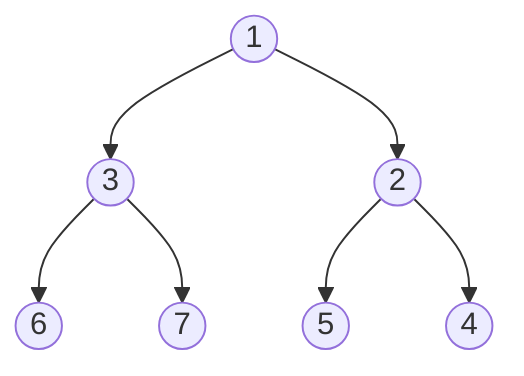

> **Course**: UC Berkeley CS61B: Data Structures (Spring 2024)  
> **Module**: Module 5: Priority Queues & Graph Algorithms  
> **Lecturer**: Prof. Justin Yokota & Prof. Peyrin Kao (UC Berkeley)  
> **Video duration**: 52:37 ｜ **Official original version**: Lecture 21 - Heaps and Priority Queues  
> **Direct video**: [📺Watch the original video of this lecture on Bilibili (P21)](https://www.bilibili.com/video/BV1hJ4m1M7ZA/?p=21) ｜ [📑 Official courseware Slides (Google Presentation)](https://docs.google.com/presentation/d/1XVJfoSYH2ItiD1rz9yvyEf_HelejbfkYxQgukbgclSY) ｜ [📖Official textbook chapter](https://cs61b-2.gitbook.io/cs61b-textbook/21.-heaps-and-priority-queues)  
> **Quick navigation**: [← Previous Lecture (P20 Hashing II: Load Factor, Dynamic Scaling and Java HashMap Kernel)](/en/notes/cs61b/lecture-20) ｜ [📚 Return to the full book catalog](/en/notes/topics/CS61B) ｜ [Next lecture (P22 Tree and graph traversal theory) →](/en/notes/cs61b/lecture-22)

---

## 1. Priority Queue Abstract Data Type (Priority Queue ADT)

*(Reference time: 00:01:25 · [Video jump (P21 00:01:25)](https://www.bilibili.com/video/BV1hJ4m1M7ZA/?p=21&t=85))*

In a normal queue (Queue), elements follow the first-in-first-out (FIFO) rule. In the real world, events often have priorities:
- Hospital emergency rooms: The most critical patients must be treated first, not those first in line;
- The operating system's process scheduler: high-priority processes seize the CPU;
- The shortest path algorithm for graphs (Dijkstra): The next closest vertex must be selected each time.

### Priority Queue Contract
```java
public interface PriorityQueue<Item> {
    void add(Item x);      // 插入元素
    Item getSmallest();    // 查看优先级最高（键值最小）的元素
    Item removeSmallest(); // 弹出优先级最高的元素
    int size();
}
```

### Simple implementation contrast
- **Unordered array/linked list**: `add`  Yes  $O(1)$, but  `removeSmallest`  The entire table must be scanned, which is time-consuming  $O(N)$; 
- **Ordered array/linked list**: `removeSmallest`  Yes  $O(1)$, but  `add`  The order must be maintained during insertion, which is time-consuming  $O(N)$; 
- **Self-balancing Binary Search Tree (BST/LLRB)**: `add`  and  `removeSmallest`  All  $O(\log N)$, but the tree structure is complex, the pointer overhead is large, and we do not need the world to be completely ordered.

Can we have a dedicated structure that is more lightweight and physically more compact than a balanced tree?  
**The answer is Binary Heap!**

## 2. Formal definition and structural invariants of Binary Heap

*(Reference time: 00:10:15 · [Video jump (P21 00:10:15)](https://www.bilibili.com/video/BV1hJ4m1M7ZA/?p=21&t=615))*

A Binary Min-Heap is a binary tree that satisfies two strict physical constraints:

### Constraint 1: Completeness Property
The tree must be **Complete Binary Tree**: 
- Nodes in all but the bottom layer must be completely filled;
- The leaf nodes at the bottom level must **Arrange strictly from left to right**, absolutely no gaps are allowed in the middle!

### Constraint 2: Minimum Heap Ordering (Min-Heap Property)
The value of each node in the tree must be **Less than or equal to the value of any of its child nodes**($Parent \le Children$): 
- The root node is always the global absolute minimum!
- Note: There is no size order requirement between the left and right child nodes!



## 3. Binary heap core operation algorithm: Swim and Sink

*(Reference time: 00:19:30 · [Video jump (P21 00:19:30)](https://www.bilibili.com/video/BV1hJ4m1M7ZA/?p=21&t=1170))*

### 1. Insertion operation: append and float at the end (Swim / Sift Up)
1. Place new elements in a complete binary tree **available space at the end** (Satisfies the properties of a complete binary tree);
2. Check the size of the new node and its parent node: if the new node is smaller than the parent node, heap order is violated!
3. **Floating repair (Swim)**: Swap the position of the node with its parent node, and repeat the upward comparison until it is greater than or equal to the parent node or reaches the root node.

### 2. Delete the minimum operation: head-to-tail replacement and sinking (Sink / Sift Down)
1. The root node is the minimum value, which is temporarily stored for return;
2. **Move the last leaf node of the complete binary tree to the root node position**; 
3. **Sink repair (Sink)**: 
   - Add the current node to its **younger of two children** make comparisons;
   - If the current node is larger than the smaller child, heap ordering is violated and its position is swapped with the child;
   - Continue descending along smaller branches until they have less than or equal to two children or become leaf nodes.

Since the height of a complete binary tree is strictly equal to  $\lfloor\log_2 N\rfloor$, therefore  `add`  and  `removeSmallest`  The worst time complexity of is strictly  **$O(\log N)$**!

## 4. Ultimate array compact representation of heap: pointer elimination and hardware-level addressing

*(Reference time: 00:29:00 · [Video jump (P21 00:29:00)](https://www.bilibili.com/video/BV1hJ4m1M7ZA/?p=21&t=1740))*

Because a binary heap is an absolutely strict complete binary tree, **We don't need any pointer object references to the left and right children at all**! It can be directly stored tiled in an ordinary native array!

### 1-Based Index Addressing Formula
Using the specification of storing the root node starting from index 1 (index 0 is empty):

```text
数组索引:  [0]  [1]  [2]  [3]  [4]  [5]  [6]  [7]
存储元素:  --    1    3    2    6    7    5    4
```

For the index is  $k$  Any node of:
- **Parent index**: `k / 2` (integer division truncation);
- **Left Child index**: `2 * k`; 
- **Right Child index**: `2 * k + 1`!

```java
public class MinHeap<Item extends Comparable<Item>> {
    private Item[] pq;
    private int size;

    public MinHeap(int capacity) {
        pq = (Item[]) new Comparable[capacity + 1];
        size = 0;
    }

    private void swim(int k) {
        while (k > 1 && greater(k / 2, k)) {
            swap(k / 2, k);
            k = k / 2;
        }
    }

    private void sink(int k) {
        while (2 * k <= size) {
            int j = 2 * k;
            if (j < size && greater(j, j + 1)) j++; // 挑出左右孩子中的较小者
            if (!greater(k, j)) break;
            swap(k, j);
            k = j;
        }
    }
}
```

There is no unnecessary pointer memory overhead, the physical addresses are continuous, and the CPU cache hit rate is extremely high!

## 5. Summary of this lecture and post-class self-assessment

*(Reference time: 00:38:00 · [Video jump (P21 00:38:00)](https://www.bilibili.com/video/BV1hJ4m1M7ZA/?p=21&t=2280))*

### Comprehensive self-test questions after class
Given containing elements  `[1, 3, 2, 6, 7, 5, 4]`  min-heap (1-indexed). call now  `removeSmallest()`, writes the heap array state after removal.  
**Answers and analysis**:   
1. Pop up root node 1;  
2. Move the last element 4 to the root node position (at this time the root is 4 and the size becomes 6);  
3. Sinking root node 4: compare children 3 and 2, the smaller one is 2 (index 3); 4 \> 2, swap 4 and 2;  
4. Node 4 sinks to index 3, its left child is 5 (index 6), and the right child does not exist; 4 \< 5, sinking terminates;  
5. Final array state (starting at index 1): `[2, 3, 4, 6, 7, 5]`.

---

## Appendix: UC Berkeley official textbook in-depth study (Official Textbook In-Depth Chapters)

> **Introduction**: The content of this section is integrated from the UC Berkeley CS61B official textbook library (GitBook Textbook). It provides original English theoretical derivation, formal code examples and supporting chapter exercises for the core data structures and algorithms of this lecture, which complements and confirms the previous video lectures.

## 21. Heaps and Priority Queues

By Dhruti Pandya and Angel Aldaco

---

## 21.1 Priority Queues

Binary Search Trees allowed us to efficiently search trees, only taking $$log(N)$$ time. This was because we could eliminate half of the elements of the tree at every step of our search. What if we cared more about quickly finding the *smallest* or *largest* element instead of quickly searching?

Introducing the Priority Queue


Now we come to the Abstract Data Type of a *Priority Queue*. To understand this ADT, consider a bag of items. You can add items to this bag, you can remove items from this bag, etc. The one caveat is that you can only interact with the smallest items of this bag.

```java

/** (Min) Priority Queue: Allowing tracking and removal of 

  * the smallest item in a priority queue. */

public interface MinPQ<Item> {

    /** Adds the item to the priority queue. */

    public void add(Item x);

    /** Returns the smallest item in the priority queue. */

    public Item getSmallest();

    /** Removes the smallest item from the priority queue. */

    public Item removeSmallest();

    /** Returns the size of the priority queue. */

    public int size();

}

```

#### Using Priority 

Where would we actually use this structure or need it?

* Consider the scenario where we are monitoring text messages between citizens and want to keep track of unharmonious conversations.

* Each day, you prepare a report of $$M$$ messages that are the most unharmonious using a `HarmoniousnessComparator`.

Let's take this approach: Collect all of the messages that we receive throughout the day into a single list. Sort this list and return the first $$M$$ messages.

```java

public List<String> unharmoniousTexts(Sniffer sniffer, int M) {

    ArrayList<String>allMessages = new ArrayList<String>();

    for (Timer timer = new Timer(); timer.hours() < 24; ) {

        allMessages.add(sniffer.getNextMessage());

    }

    Comparator<String> cmptr = new HarmoniousnessComparator();

    Collections.sort(allMessages, cmptr, Collections.reverseOrder());

    return allMessages.sublist(0, M);

```

Potential downsides? This approach will use $$Θ(N)$$ space when actuality we only really need to use $$Θ(M)$$ space.

**Exercise 13.1.1.** Complete the method listed above, `unharmoniousTexts` with the same functionality as described using only Θ(M) space.

#### Priority Queue Implementation 

We solved the same problem using the Priority Queue ADT, making memory more efficient. We can observe that the code is slightly more complicated, but this is not always the case.

Remember that ADT are similar interfaces and the implementation is still to be defined. Let's consider possible implementations using the data structure implementations we already know, analyzing the **worst case** runtimes of our desired operations:

* Ordered Array

  * `add`: $$Θ(N)$$

  * `getSmallest`: $$Θ(1)$$

  * `removeSmallest`: $$Θ(1)$$

* Bushy BST

  * `add`: $$Θ(logN)$$

  * `getSmallest`: $$Θ(logN)$$

  * `removeSmallest`: $$Θ(logN)$$

* HashTable

  * `add`: $$Θ(1)$$

  * `getSmallest`: $$Θ(N)$$

  * `removeSmallest`: $$Θ(N)$$

**Exercise 13.1.2.** Explain each of the runtimes above. What are the downfalls of each data structure? Describe a way of modifying one of these data structures to improve performance.

Can we do better than these suggested data structures?

#### Summary 

* Priority Queue is an Abstract Data Type that optimizes for handling minimum or maximum elements.

* There can be space/memory benefits to using this specialized data structure.

* Implementations for ADTs that we currently know don't give us efficient runtimes for PQ operations.

  * A binary search tree is the most efficient among the other structures

---

## 21.2 Heaps

Introducing the Heap


We previously saw that our known data structures with the best runtime for our PQ operations was the *binary search tree*. Modifying its structure and the constraints, we can further improve the runtime and efficiency of these operations.

We will define our binary min-heap as being **complete** and obeying **min-heap** property:

* Min-heap: Every node is less than or equal to both of its children

* Complete: Missing items only at the bottom level (if any), all nodes are as far left as possible.


As we can see in the figures above, the green colored heaps are valid and the red ones aren't. The last two aren't because they violate at least one of the properties that we defined above.

Now let's consider how this structure lends itself to the abstract data type we described in the previous chapter. We will do this through analyzing our desired operations.

**Exercise 13.2.1.** Determine how each method of our Priority Queue interface will be implemented given this heap structure. Don't write actual code, just pseudocode!

#### Heap Operations 

Heap Operations


The three methods we care about for the PriorityQueue ADT are `add`, `getSmallest`, and `removeSmallest`. We will start by conceptually describing how these methods can be implemented given our given schema of a heap.

* `add`: Add to the end of heap temporarily. Swim up the hierarchy to the proper place.

  * Swimming involves swapping nodes if child < parent

* `getSmallest`: Return the root of the heap (This is guaranteed to be the minimum by our *min-heap* property

* `removeSmallest`: Swap the last item in the heap into the root. Sink down the hierarchy to the proper place.

  * Sinking involves swapping nodes if parent > child. Swap with the smallest child to preserve *min-heap* property.

Great! We have determined how we will approach the operations specified by the PriorityQueue interface in an efficient way. But how do we actually code this?

**Exercise 13.2.2.** Give the runtime for each of the methods specified above. Worst cases and best cases.

#### Tree Representation 

Tree representation


There are many approaches we can take to representing trees.

##### Approach 1a, 1b, and 1c 

Let us consider the most intuitive and previously used representation for trees. We will create mappings between nodes and their children. There are several ways to do this which we will explore right now.

* In approach **Tree1A**, we consider creating pointers to our children and storing the value inside of the node object. These are hardwired links that give us fixed-width nodes. We can observe the code:

```java

public class Tree1A<Key> {

  Key k;

  Tree1A left;

  Tree1A middle;

  Tree1A right;

  ...

}

```

The visualization of this type of structure is shown below.

<figure><figcaption><p>1a: Fixed-Width Nodes (BSTMap used this approach)</p></figcaption></figure>

* Alternatively, in **Tree1B**, we explore the use of arrays as representing the mapping between children and nodes. This would give us variable-width nodes, but also awkward traversals and performance will be worse.

```java

public class Tree1B<Key> {

  Key k;

  Tree1B[] children;

  ...

```

<figure><figcaption><p>1b: Variable-Width Nodes</p></figcaption></figure>

* Lastly, we can use the approach for **Tree1C**. This will be slightly different from the usual approaches that we've seen. Instead of only representing a node's children, we say that nodes can also maintain a reference to their siblings.

```java

public class Tree1C<Key> {

  Key k;

  Tree1C favoredChild;

  Tree1C sibling;

  ...

}

```

<figure><figcaption><p>1c: Sibling Tree</p></figcaption></figure>

In all of these approaches, we store explicit references to who is below us. These explicit references take the form of pointers to the actual Tree objects that are our children. Let's think of more exotic approaches that don't store explicit references to children.

##### Approach 2 

Recall the Disjoint Sets ADT. The way that we represented this Weighted Quick Union structure was through arrays. For representing a tree, we can store the *keys* array as well as a *parents* array. The keys array represent which index maps to which key, and the parents array represents which key is a child of another key.

```java

public class Tree2<Key> {

  Key[] keys;

  int[] parents;

  ...

}

```

Take some time to ensure that the tree on the left corresponds to the representation in the arrays on the right.

It's time to make a very important observation! Based on the structure of the tree and the relationship between the array representations and the diagram of the tree, we can see:

1. The tree is **complete**. This is a property we have defined earlier.

2. The parents array has a sort of redundant pattern where elements are just doubled.

3. Reading the level-order of the tree, we see that it matches exactly the order of the keys in the *keys* array.

<figure><figcaption><p>Approach 2</p></figcaption></figure>

What does this all mean? We know the parents array is redundant so we can ignore it and we know that a tree can be represented by level order in an array.

##### Approach 3 

In this approach, we assume that our tree is complete. This is to ensure that there are no "gaps" inside of our array representation. Thus, we will take this complex 2D structure of the tree and flatten it into an array.

```java

public class TreeC<Key> {

  Key[] keys;

  ...

}

```

<figure><figcaption></figcaption></figure>

##### Swim 

Given this implementation, we define the following code for the "swim" described in the Heap Operations section.

```java

public void swim(int k) {

    if (keys[parent(k)] > keys[k]) {

       swap(k, parent(k));

       swim(parent(k));              

    }

}

```

What does the parent method do? It returns the parent of the given k using the representation in Approach 3.

**Exercise 13.2.3.** Write the parent method. For extra challenge, try to write the methods for finding the left child and right child of a given item.

---

## 21.3 PQ Implementation

PQ Implementation Considerations


The actual implementation, which we will use and the book uses, is quite similar to the representation we discussed at the end of the previous chapter. The one difference is that we will leave one empty spot at the beginning of the array to simplify computation.

* `leftChild(k)`= $$k \cdot  2$$

* `rightChild(k)`= $$k \cdot  2 + 1$$

* `parent(k)`= $$k / 2$$

#### Comparing to alternative implementations 

| Methods          | Ordered Array | Bushy BST   | Hash Table | Heap        |

| ---------------- | ------------- | ----------- | ---------- | ----------- |

| `add`            | $$Θ(N)$$      | $$Θ(logN)$$ | $$Θ(1)$$   | $$Θ(logN)$$ |

| `getSmallest`    | $$Θ(1)$$      | $$Θ(logN)$$ | $$Θ(N)$$   | $$Θ(1)$$    |

| `removeSmallest` | $$Θ(N)$$      | $$Θ(logN)$$ | $$Θ(N)$$   | $$Θ(logN)$$ |

Awesome! We can see that we have improved our runtime and we have also solved the problem of duplicate elements. Couple notes:

* Heap operations are **amortized** analysis, since the array will have to resize (not a big deal)

* BST's can have constant time `getSmallest` if pointer is stored to smallest element

* Array-based heaps take around 1/3rd the memory it takes to represent a heap using approach 1A (direct pointers to children)

**Exercise 13.3.1** Some lingering implementation questions:

1. How will the PQ know how to order the items? Say we had a PQ of dogs, would it order by weight or breed?

2. Is there a way to allow for a flexibility of orderings?

3. What could we do to make a MinPQ into a MaxPQ?

---

## 21.4 Summary

**Priority Queue.** A Max Priority Queue (or PQ for short) is an ADT that supports at least the insert and delete-max operations. A MinPQ supposert insert and delete-min.

**Heaps.** A max (min) heap is an array representation of a binary tree such that every node is larger (smaller) than all of its children. This definition naturally applies recursively, i.e. a heap of height 5 is composed of two heaps of height 4 plus a parent.

**Tree Representations.** Know that there are many ways to represent a tree, and that we use Approach 3b (see lecture slides) for representing heaps, since we know they are complete.

**Running times of various PQ implementations.** Know the running time of the three primary PQ operations for an unordered array, ordered array, and heap implementation.

---

## 21.5 Exercises

### Procedural

1. Represent the following heap as an array.


2. Consider the above heap. What range of values, when inserted, will cause the maximum number of swaps?

<details>

<summary>Problem 1</summary>

To convert a heap into an array, we simply read the values top-to-bottom and left-to-right. As such, the correct representation is `[0, 5, 1, 8, 8, 6, 2]`.

</details>

<details>

<summary>Problem 2</summary>

Since `0` is currently the root, any value `< 0` when inserted will have to swapped to from the bottom of the tree to the top, resulting in the maximum number of swaps. Thus, the range is $$\[-\infty, 0)$$.

</details>

### Metacognitive

1. Consider an externally-chained hashmap. If there are many hash collisions, what data structure would be most efficient in storing the key-value pairs at each bucket?

2. Consider an array sorted in descending order. Is this a valid heap? If so, which type: min-heap, or max-heap?

3. Suppose that we store the root of a heap at the `0`th index in our array. For an arbitrary index `k`, compute the indices of its children and parent.

4. Explain how you would implement a stack using a priority queue.

<details>

<summary>Problem 1</summary>

An LLRB would be the best choice. Even if all items end up in same bucket, the LLRB will be balanced, resulting in a $$O(\log n)$$ search time where $$n$$ is the number of items in the bucket. Any other choice of data structure (linked list, array, binary search tree) could have linear search time in the word case within the bucket.

Note: Using an LLRB to store buckets requires that the keys be comparable.

</details>

<details>

<summary>Problem 2</summary>

An array sorted in descending order is a max-heap (the root is the maximum value, and values decrease in level order).

</details>

<details>

<summary>Problem 3</summary>

The children would be `2k + 1` and `2k + 2`. The parent would be `(k - 1) / 2` (note that this assumes integer division).

</details>

<details>

<summary>Problem 4</summary>

To implement a stack using a priority queue, keep a counter that increments each time you insert an item. Recently inserted items will always have higher priority, so they will be removed first.

</details>


---

## Course navigation and jump

| Previous lecture | Directory | Next lecture | Original video |
| :--- | :---: | :--- | :--- |
| [← Previous Lecture: Hashing II: Load Factor, Dynamic Scaling and the Java HashMap Kernel](/en/notes/cs61b/lecture-20) | [📚 Return to CS61B complete book list](/en/notes/topics/CS61B) | [Next lecture: Traversal theory of trees and graphs →](/en/notes/cs61b/lecture-22) | [🎬Watch this lecture on Bilibili (P21)](https://www.bilibili.com/video/BV1hJ4m1M7ZA/?p=21) |
