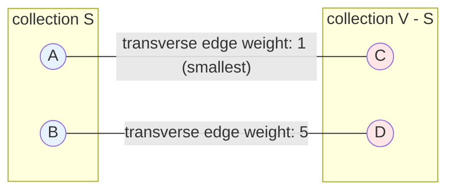
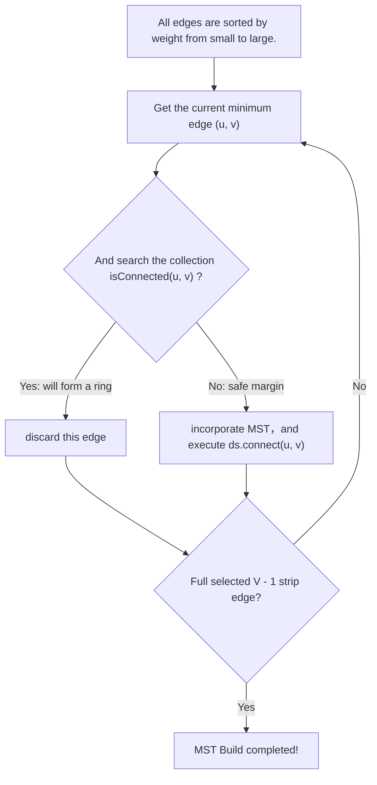

> **Course**: UC Berkeley CS61B: Data Structures (Spring 2024)  
> **Module**: Module 5: Priority Queues & Graph Algorithms  
> **Lecturer**: Prof. Justin Yokota & Prof. Peyrin Kao (UC Berkeley)  
> **Video duration**: 52:03 ｜ **Official original version**: Lecture 25 - Minimum Spanning Trees  
> **Direct video**: [📺Watch the original video of this lecture on Bilibili (P25)](https://www.bilibili.com/video/BV1hJ4m1M7ZA/?p=25) ｜ [📑 Official courseware Slides (Google Presentation)](https://docs.google.com/presentation/d/13pPWHDLRUX2TAUUUK5ucEQ6dF3vUjzkj_C_iXDGaTPU) ｜ [📖Official textbook chapter](https://cs61b-2.gitbook.io/cs61b-textbook/25.-minimum-spanning-trees)  
> **Quick navigation**: [← Previous lecture (P24 Shortest path algorithm: Dijkstra and A\* heuristic search)](/en/notes/cs61b/lecture-24) ｜ [📚 Return to the full book catalog](/en/notes/topics/CS61B) ｜ [Next lecture (P26 Summary of graph theory and DAG shortest path) →](/en/notes/cs61b/lecture-26)

---

## 1. Formal definition of Minimum Spanning Tree (MST)

*(Reference time: 00:01:20 · [Video jump (P25 00:01:20)](https://www.bilibili.com/video/BV1hJ4m1M7ZA/?p=25&t=80))*

Suppose we need to lay out a fiber optic internet backbone for all major cities in California. Laying fiber optic cable between two cities has different construction costs.

We hope to design a network solution that satisfies:
1. **Connected**: Any two cities can communicate through optical fiber;
2. **Acyclic**: A construction loop without excess waste (that is, forming a tree);
3. **Minimal weight**: The sum of all selected optical fiber laying costs reaches the global minimum.

This is the \*\*Minimal Spanning Tree (MST)\*\* problem in graph theory.

## 2. The Cut Property: the cornerstone axiom for finding safe edges

*(Reference time: 00:09:40 · [Video jump (P25 00:09:40)](https://www.bilibili.com/video/BV1hJ4m1M7ZA/?p=25&t=580))*

How to determine whether a specific edge must belong to the global minimum spanning tree? It all depends on the greatest axiom in graph theory——**The Cut Property**.

### Concept definition:
- **Cut**: Randomly divide all vertices in the graph into two non-empty sets that do not intersect with each other.  $S$  with  $V - S$; 
- **Crossing Edge**: One end connection set  $S$, the other end connects the collection  $V - S$  any side of .

> **cut theorem axiom**:   
> **For any kind of division of the graph, among all the cross-cutting edges connecting the two sets, the one with the absolute smallest weight (Minimal Crossing Edge) must belong to a certain minimum spanning tree of the graph!**

## 3. Prim’s algorithm: a growing greedy strategy starting from a single point

*(Reference time: 00:19:15 · [Video jump (P25 00:19:15)](https://www.bilibili.com/video/BV1hJ4m1M7ZA/?p=25&t=1155))*

Prim's algorithm is a minimalist and direct application of the cut theorem:
1. from any starting vertex  $s$  start, will  $s$  Put into the visited tree collection  $S$  middle;
2. Examine all ends in the set  $S$  Inside, the other end is gathering  $S$  outer transverse edge;
3. According to the cut theorem, **Greedily pick out the transverse edge with the smallest weight**, incorporate it into the MST, and absorb the new vertices at the opposite end into the set  $S$; 
4. Repeat the above steps until all  $V$  All vertices are absorbed into the tree.

When using index priority queue optimization, the time complexity of Prim's algorithm is  **$O(E \log V)$**.

## 4. Kruskal algorithm: edge-based global sorting and union search to prevent loop detection

*(Reference time: 00:28:30 · [Video jump (P25 00:28:30)](https://www.bilibili.com/video/BV1hJ4m1M7ZA/?p=25&t=1710))*

Different from Prim's single-point growth, Kruskal's algorithm adopts **Global Macro Greedy Strategy**: 

1. Put all the items in the whole picture  $E$  edge, **Sort globally in ascending order according to weight from small to large.**; 
2. Prepare an empty forest (each vertex is its own set, use **Disjoint Sets**  maintenance);
3. Examine each edge in sequence starting from the smallest edge  $e = (u, v)$: 
   - Use union query  `ds.isConnected(u, v)`; 
   - **If connected**: Indicates that adding this edge will produce a loop, so discard it decisively!
   - **If not connected**: Jiangbian  $e$  Incorporate MST and execute  `ds.connect(u, v)`!
4. when successfully selected  $V - 1$  When there is an edge, the algorithm terminates early and the MST is constructed!

### Complexity:
Sorting cost  $O(E \log E)$, and find the operation cost  $O(E \alpha(V))$, the total time is strictly  **$O(E \log E) = O(E \log V)$**!

## 5. Summary of this lecture and post-class self-assessment

*(Reference time: 00:37:00 · [Video jump (P25 00:37:00)](https://www.bilibili.com/video/BV1hJ4m1M7ZA/?p=25&t=2220))*

### Comprehensive self-test questions after class
Are MST (minimum spanning tree) and SPT (shortest path tree) the same thing?  
**Answers and analysis**:   
**Completely different!**  
- MST focuses on **The total weight sum of all edges is minimum**, which has the lowest construction cost in the entire network;  
- SPT focuses on **The shortest path distance from a specific starting point to a specific vertex**. An MST does not guarantee that the path between two points is the shortest. The sum of all edge weights of an SPT is often greater than the MST.

---

## Appendix: UC Berkeley official textbook in-depth study (Official Textbook In-Depth Chapters)

> **Introduction**: The content of this section is integrated from the UC Berkeley CS61B official textbook library (GitBook Textbook). It provides original English theoretical derivation, formal code examples and supporting chapter exercises for the core data structures and algorithms of this lecture, which complements and confirms the previous video lectures.

## 25. Minimum Spanning Trees

By Teresa Luo and Mihir Mirchandani

---

## 25.1 MSTs and Cut Property

Before we dive into the chapter, let's hear a couple words from Professor Hug on MSTs

Let's do a quick warmup!

Spanning Tree Definition

Spanning Tree Usefulness

MSTs vs SPTs

### Minimum Spanning Trees 

\

A minimum spanning tree (MST) is the lightest set of edges in a graph possible such that all the vertices are connected. Because it is a tree, it must be connected and acyclic. And it is called "spanning" since all vertices are included.

In this chapter, we will look at two algorithms that will help us find a MST from a graph.

Before we do that, let's introduce ourselves to the Cut Property, which is a tool that is useful for finding MSTs.

#### Cut Property 

\

We can define a **cut** as an assignment of a graph’s nodes to two non-empty sets (i.e. we assign every node to either set number one or set number two).

We can define a **crossing edge** as an edge which connects a node from one set to a node from the other set.

With these two definitions, we can understand the **Cut Property**; given any cut, the minimum weight crossing edge is in the MST.

*The link to the picture in the original textbook is no longer valid, please refer to [Minimum spanning tree and cut property description](https://cs61b-2.gitbook.io/cs61b-textbook/25.-minimum-spanning-trees).*

The proof for the cut property is as follows: Suppose (for the sake of contradiction) that the minimum crossing edge *e* were not in the MST. Since it is not a part of the MST, if we add that edge, a cycle will be created. Because there is a cycle, this implies that some other edge f must also be a crossing edge (for a cycle, if *e* crosses from one set to another, there must be another edge that crosses back over to the first set). Thus, we can remove *f* and keep *e*, and this will give us a lower weight spanning tree. But this is a contradiction because we supposedly started with a MST, but now we have a collection of edges which is a spanning tree but that weighs less, thus the original MST was not actually minimal. As a result, the cut property must hold.

---

## 25.2 Prim's Algorithm

Finding MST.

One way to find the MST of a graph is the Prim's Algorithm. In this section, we will discuss both the conceptual and concrete implementation of this algorithm, as well as its runtime analysis. 

### Conceptual Visualization

Prim's Algorithm is one way to find a MST from a graph. It is as follows:

1. Start from some arbitrary node.

2. Repeatedly add the shortest edge that has **one node inside the MST in construction.**

3. Repeat until there are V - 1 edges.

#### Why does it work?

Prim's algorithm works because at all stages of the algorithm, we can reason as follows: 

* Consider dividing all the nodes in the graph into two sets:

  * Set 1: nodes that are part of the existing MST that's under construction

  * Set 2: all other nodes

* According to the algorithm, we always add the **lightest, or minimally weighted, edge** that crosses this cut.

* By **the Cut Property**, the added edge is necessarily part of the final MST.

### Implementation

Essentially, this algorithm runs via the same mechanism as [Dijkstra's algorithm](https://cs61b-2.gitbook.io/cs61b-textbook/24.-shortest-paths/24.2-dijkstras-algorithm). 

The only difference is that while Dijkstra's considers candidate nodes by their distance from the source node, Prim's looks at each candidate node's **distance from the MST under construction.**

### Runtime Analysis 

Because this algorithm runs through the same mechanism as Dijkstra's algorithm, its runtime is also identical to Dijkstra's:

$$
O((|V| + |E| )log(|V|))
$$

Remember, this is because we need to add to a priority queue fringe once for every edge we have, and we need to dequeue from it once for every vertex we have.

---

## 25.3 Kruskal's Algorithm

Finding MST.

Another algorithm that finds the MST of a graph is Kruskal's Algorithm. Instead of constructing the MST by traversing through the **nodes** like Prim's Algorithm, Kruskal's Algorithm finds the MST by traversing through the **edges**. 

### Conceptual Visualization and Implementation

The algorithm is as follows:

1. Sort all the edges from lightest to heaviest.

2. Taking one edge at a time (in sorted order), add it to the MST under construction if doing so **does not introduce a cycle.**

3. Repeat until there are V - 1 edges.

#### Why does it work?

Kruskal's algorithm works because of the following reasons:

* Recall the two "sets" introduced in last section. Any edge we add to the MST will be connecting one node from "set one" (nodes that are in the MST under construction), and another node from "set two" (all other nodes).

* The added edge is not part of cycle because we are only adding an edge if it does not introduce a cycle.

* By looking at edge candidates in order from lightest to heaviest, the added edge must be the lightest edge across this cut. (if there was a lighter edge that would be across this cut, it would have been added before this, and adding this one would cause a cycle to appear). 

Hence, this algorithm works also by **the Cut Property.**

### Kruskal's vs Prim's

It's important to note that the MST returned by Kruskal's might not be the same one returned by Prim's, but both algorithms will always return a MST.  

Since both are minimal (optimal), they will both give valid optimal answers (they are tied as equally minimal / same total weight, and this is as low as it can be).

### Runtime Analysis

#### Runtime with Unsorted Edges

Since the underlying data structures of implementing Kruskal's Algorithm are a Priority Queue (to sort the edges), and a Disjoined Set (to connect the edges), the runtime of Kruskal's Algorithm is in tandem with the runtime analysis of [Heaps](https://cs61b-2.gitbook.io/cs61b-textbook/21.-heaps-and-priority-queues) and [WQU](https://cs61b-2.gitbook.io/cs61b-textbook/14.-disjoint-sets/14.4-weighted-quick-union-wqu). 

Specifically, we are using  [Weighted Quick Union with Path Compression](https://cs61b-2.gitbook.io/cs61b-textbook/14.-disjoint-sets/14.5-weighted-quick-union-with-path-compression) to check whether or not an added edge will introduce a cycle. 

The operations that this algorithm utilizes and their corresponding runtime are:

* Insert: $$O(|E| log|E|)$$

* Delete minimum: $$O(|E| log|E|)$$

* Union: $$O(|V| log\cdot  |V|)$$

* isConnected: $$O(|E|log\cdot |V|)$$

The bottleneck of the algorithm is sorting all of the edges to start (insert and delete minimum. Hence, the runtime of Kruskal's Algorithm is:

$$
O(|E| log |E|)
$$

#### Runtime with Sorted Edges

Since there are no need to sort the edges, the "Insert" and "Delete minimum" operations of a heap are not called, where only WQU operations are called.

Therefore, if we are given pre-sorted edges and don't have to pay for that, then the runtime is:

$$
O(|E| log\cdot  |V|)
$$

Where $$log\cdot $$is the Ackermann function.

---

## 25.4 Chapter Summary

In this chapter, we learned about Minimum Spanning Trees and the Cut Property:

* **MST:** the lightest set of edges in a graph possible such that all the vertices are connected and acyclic. 

* **The Cut Property**: given any cut, the minimum weight crossing edge is in the MST.

  * *Cut*:  an assignment of a graph’s nodes to two non-empty sets 

  * *Crossing Edge:* an edge which connects a node from one set to a node from the other set.

We also learned about how to find MSTs of a graph with two algorithms: 

* **Prim's Algorithm**: Construct MST through a mechanism similar to Dijkstra's Algorithm, with the only difference of inserting vertices into the fringe not based on distance to goal vertex but distance to the MST under construction. 

  * *Runtime*: $$O((|V| + |E| )log(|V|))$$

* **Kruskal's Algorithm**: Construct MST by first sorting edges from lightest to heaviest, then add edges sequentially if no cycles are formed until there are V - 1 edges.

  * Runtime: 

    * $$O(|E| log |E|)$$ (unsorted edges)

    * $$O(|E| log\cdot  |V|)$$ (sorted edges) 

---

## 25.5 MST Exercises

### Factual

1. Select all valid MSTs in the diagram below.

<figure><figcaption></figcaption></figure>

2. **True/False**: It is possible that the only Shortest Path Tree is the only Minimum Spanning Tree.

Problem 1

Only B. C and D have cycles; A does not span all vertices.

Problem 2

True. In a tree, there is only one SPT and MST.

### Procedural

1. Run Prim's from `A` in the graph below. In what order are vertices visited? Break ties alphabetically.

2. Run Kruskal's in the graph below. In what order are edges added to the tree? Break ties alphabetically.

<figure><figcaption></figcaption></figure>

3. Design an algorithm to find the min-product spanning tree; ie the spanning tree with the minimum product of its edges. You may assume all edge weights are > 1.

Problem 1

Order: `A B D C F G E`. Prim's repeatedly picks the lightest edge between the current tree and any node not in the tree.

Problem 2

`AB, BD, CF, FG, AC, EG`. Kruskal's keeps adding the next lightest edge as long as it doesn't form a cycle.

Problem 3

Simply take the logarithm of each edge weight, then run any MST algorithm on it. This is guaranteed to work since $$\log a + \log b = \log ab$$, and minimizing the logarithm of the product is the same as minimizing the product for positive weight edges.

### Metacognitive

1. If we add 1 to the weight of each edge in an arbitrary graph, will the MST created by Kruskal’s change?

2. **True/False**: Prim’s Algorithm and Kruskal’s algorithm will always return the same result. If this is true, explain why. If this is false, provide a counterexample, breaking ties alphabetically.

3. Prove the following, known as the cycle property: Given any cycle in an edge weighted graph (all edge weights distinct), the edge of maximum weight in the cycle does not belong to the MST of the graph.

Problem 1

Adding 1 to each number will not change the order of the edges when we sort them, therefore we will get the same MST.

Problem 2

False. A counterexample is the following graph:

Prim’s starting from A will select AD, BD, and CD, whereas Kruskals will select AD, BC, and BD.

Problem 3

Suppose, for contradiction, the maximum-weight edge `f` in a cycle is present in the MST. 

Removing `f` disconnects our MST `T`. Form a cut with the two sides of the MST after `f` is removed.

Since `f` is part of a cycle, there must be also some edge `e` crossing that same cut. However, if we replace `f` with `e`, we now have a spanning tree that has less weight than our MST `T`.

This is a contradiction, so the maximum weight edge in a cycle cannot be part of the MST.

---

## Course navigation and jump

| Previous lecture | Directory | Next lecture | Original video |
| :--- | :---: | :--- | :--- |
| [← Previous lecture: Shortest path algorithm: Dijkstra and A\* heuristic search](/en/notes/cs61b/lecture-24) | [📚 Return to CS61B complete book list](/en/notes/topics/CS61B) | [Next lecture: Summary of graph theory and DAG shortest path →](/en/notes/cs61b/lecture-26) | [🎬Watch this lecture on Bilibili (P25)](https://www.bilibili.com/video/BV1hJ4m1M7ZA/?p=25) |
