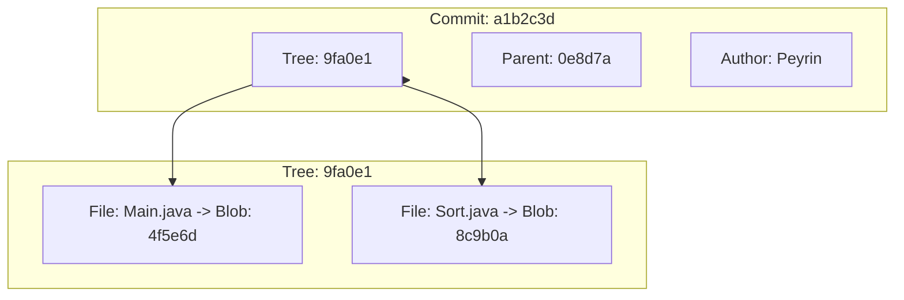
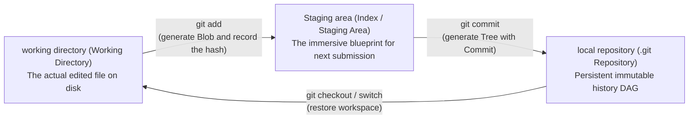

> **Course**: UC Berkeley CS61B: Data Structures (Spring 2024)  
> **Module**: Module 6: Advanced Data Structures and Classic Sorting (Tries & Sorting Algorithms)  
> **Lecturer**: Prof. Justin Yokota & Prof. Peyrin Kao (UC Berkeley)  
> **Video duration**: 50:43 ｜ **Official original version**: Lecture 27 - Software Engineering I  
> **Direct video**: [📺Watch the original video of this lecture on Bilibili (P27)](https://www.bilibili.com/video/BV1hJ4m1M7ZA/?p=27) ｜ [📑 Official courseware Slides (Google Presentation)](https://docs.google.com/presentation/d/15afX6n25MybwUmm58M2xn8KqjQbMYHTQcTJ7u3h_I2M) ｜ [📖Official textbook chapter](https://cs61b-2.gitbook.io/cs61b-textbook/27.-software-engineering-i)  
> **Quick navigation**: [← Previous lecture (P26 Summary of graph theory and DAG shortest path)](/en/notes/cs61b/lecture-26) ｜ [📚 Return to the full book catalog](/en/notes/topics/CS61B) ｜ [Next lecture (P28 Dictionary tree: Tries and prefix search) →](/en/notes/cs61b/lecture-28)

---

## 1. The ultimate moat of software engineering: the evolution of version control systems (VCS)

*(Reference time: 00:01:25 · [Video jump (P27 00:01:25)](https://www.bilibili.com/video/BV1hJ4m1M7ZA/?p=27&t=85))*

When developing personal toy projects, many people have used copying folders to manage versions: `proj_v1`, `proj_v1_final`, `proj_v1_final_really_final`.

When the project evolves into a team of hundreds of people working together and millions of lines of code, this original approach will collapse instantly:
- It is impossible to trace who wrote each line of code, when, and for what purpose (`git blame`); 
- Unable to safely try new features without breaking the stable branch;
- When an online emergency failure occurs, it cannot be rolled back to the previous stable version without loss within a few seconds.

### The miracle of Git’s birth
Handcrafted by Linus Torvalds in two weeks  **Git**, completely subverting the previous centralized version control (such as SVN) architecture and creating **Decentralized, content-addressed directed acyclic graph (Content-Addressed DAG) system**.

## 2. Content-Addressable Storage and SHA-1 Hash

*(Reference time: 00:10:40 · [Video jump (P27 00:10:40)](https://www.bilibili.com/video/BV1hJ4m1M7ZA/?p=27&t=640))*

In a traditional file system, files are stored via file paths such as  `/home/user/file.txt`) addressing. And in the world of Git:
> **core principles**: **All data are Objects, and all objects are addressed through the cryptographic hash value (SHA-1 Hash) of their content!**

### 40-digit hexadecimal absolute uniqueness
The SHA-1 algorithm maps the contents of a file of any size to a 160-bit hash value (presented as 40 hexadecimal characters, e.g.  `3b18e512...`): 
- **Content determines name**: As long as the file content changes by even one bit, the calculated hash value will be completely changed;
- **Cryptographic Integrity**: Historical commits cannot be forged or covertly tampered with because the hashes of all commits downstream are tightly intertwined with the upstream content.

## 3. The three underlying object models of Git: Blob, Tree and Commit

*(Reference time: 00:19:15 · [Video jump (P27 00:19:15)](https://www.bilibili.com/video/BV1hJ4m1M7ZA/?p=27&t=1155))*

Git's underlying physical storage is assembled from three types of objects:

1. **Blob(Binary Large Object)**: Purely stores the original byte data of the file, without saving the file name or permission information at all;
2. **Tree**: A directory equivalent to the file system, which contains a series of entries. Each entry records the file name, file permissions, and the SHA-1 hash value of the corresponding Blob or sub-Tree;
3. **Commit (submit object)**: Record the metadata of a snapshot:
   - A hash reference pointing to the top-level root Tree (representing a complete snapshot of the entire project at that moment);
   - A hash reference pointing to one or more \*\*Parent Commits\*\*;
   - Commit author, timestamp and commit log information.



## 4. The essence of commit history: immutable directed acyclic graph (Commit DAG)

*(Reference time: 00:28:30 · [Video jump (P27 00:28:30)](https://www.bilibili.com/video/BV1hJ4m1M7ZA/?p=27&t=1710))*

Each commit saves a hash pointer to its parent commit. Therefore, the history of the entire repository is topologically **A backward-directed directed acyclic graph (Commit DAG)**: 
- **Branch**: just one **Movable lightweight pointer (40-byte file)**, holds the hash value of a certain Commit! The cost of creating a branch is instantaneous  $O(1)$!
- **HEAD pointer**: Record which branch or specific commit the current workspace is on.

## 5. Summary of this lecture and post-class self-assessment

*(Reference time: 00:36:00 · [Video jump (P27 00:36:00)](https://www.bilibili.com/video/BV1hJ4m1M7ZA/?p=27&t=2160))*

### Comprehensive self-test questions after class
Execute in Git  `git branch feature`  When creating a new branch, will all the files of the project be copied completely under the hood?  
**Answers and analysis**:   
**Absolutely not!**  Git creates a new branch just after  `.git/refs/heads/`  Create a directory named  `feature`  An ordinary small text file, in which the 40-character Commit hash value pointed to by the current HEAD is written. The space overhead is only 40 bytes and takes less than 1 millisecond!

## 6. Three-party game between Staging Area/Index and work area

*(Reference time: 00:41:00 · [Video jump (P27 00:41:00)](https://www.bilibili.com/video/BV1hJ4m1M7ZA/?p=27&t=2460))*

The core reason why Git's architecture is much more flexible than early version control systems such as SVN is the introduction of the intermediate buffer layer \*\*Staging Area/Index\*\*.

### Status flow of the three major work areas


1. **Working Directory**: Code files edited directly by the user using the IDE;
2. **Temporary storage area (Index)**: Prepare a list of file snapshots that will be permanently archived with the next submission. It decouples "disk modification" and "commit division", allowing engineers to finely package atomic commits (Atomic Commits);
3. **Repository**: `.git`  The world of all immutable objects (Blobs, Trees, Commits) and reference pointers in the directory.

## 7. Gitlet project kernel verification challenge: using Java to implement init, add and commit from scratch

*(Reference time: 00:48:00 · [Video jump (P27 00:48:00)](https://www.bilibili.com/video/BV1hJ4m1M7ZA/?p=27&t=2880))*

The signature final assignment in CS 61B  **Gitlet** , students need to handwrite a mini Git implementation from scratch.

### The underlying implementation pseudocode of the core command:
```java
public class Repository {
    public static final File CWD = new File(System.getProperty("user.dir"));
    public static final File GITLET_DIR = new File(CWD, ".gitlet");
    public static final File OBJECTS_DIR = new File(GITLET_DIR, "objects");
    public static final File INDEX_FILE = new File(GITLET_DIR, "index");
    public static final File HEAD_FILE = new File(GITLET_DIR, "HEAD");

    /** 初始化全新版本库 */
    public static void init() {
        if (GITLET_DIR.exists()) {
            System.out.println("A Gitlet version-control system already exists in the current directory.");
            return;
        }
        GITLET_DIR.mkdirs();
        OBJECTS_DIR.mkdirs();
        // 创建初始根提交（空提交）
        Commit initial = new Commit("initial commit", null, new Date(0));
        String commitHash = saveObject(initial);
        // 初始化 master 分支与 HEAD
        writeContents(new File(GITLET_DIR, "refs/heads/master"), commitHash);
        writeContents(HEAD_FILE, "ref: refs/heads/master");
    }

    /** 暂存文件 */
    public static void add(String fileName) {
        File file = new File(CWD, fileName);
        if (!file.exists()) return;
        byte[] content = readContents(file);
        String blobHash = sha1(content);
        // 将内容存入 .gitlet/objects/
        saveBlob(blobHash, content);
        // 更新 Index 映射：fileName -> blobHash
        updateIndex(fileName, blobHash);
    }
}
```
Through object-oriented design and Java serialization technology, complex version control is broken down into clear file reading and writing and SHA-1 hash mapping.

## 8. Merkle Tree and cryptographic integrity of distributed systems

*(Reference time: 00:54:00 · [Video jump (P27 00:54:00)](https://www.bilibili.com/video/BV1hJ4m1M7ZA/?p=27&t=3240))*

The underlying Tree and Commit structures of Git are called **Merkle Tree**.

### Core security features:
- The hash value of each parent node of the tree is formed by concatenating the hash values of all its child nodes and hashing it again;
- **Avalanche Tamper Resistant**: If a hacker secretly modified a character in a file 5 years ago in a historical submission:
  - The file's blob hash changes;
  - Causes the hash of the directory Tree containing it to change;
  - Causes the Commit hash to change at that time;
  - This causes all subsequent downstream Commit hashes to be avalanche broken!
- This mechanism makes Git an immutable distributed ledger and lays the core ideological foundation of modern blockchain (Bitcoin/Ethereum) and distributed file system (IPFS).

---

## Appendix: UC Berkeley official textbook in-depth study (Official Textbook In-Depth Chapters)

> **Introduction**: The content of this section is integrated from the UC Berkeley CS61B official textbook library (GitBook Textbook). It provides original English theoretical derivation, formal code examples and supporting chapter exercises for the core data structures and algorithms of this lecture, which complements and confirms the previous video lectures.

## 27. Software Engineering I

By Aniruth Narayanan

Prior to the Fall 2023 semester, Professor Hug had a lecture about software code complexity.

For the Fall 2023 semester, this lecture was adjusted to have a similar form of content with different examples and real-world experiences that I (Aniruth) have been through on my gap year from Berkeley.

The content in this GitBook has been adjusted to the newest information. Both video recordings are linked below.

Full Lecture on Software Engineering I by Aniruth Narayanan, Fall 2023


Lecture Slides for Software Engineering I, Fall 2023


Full Lecture on Software Engineering I by Professor Hug, Fall 2022


---

## 27.1 Introduction to Software Engineering

#### Scale

CS 61A is an introductory course that focuses on the correctness of a program. CS 61B, however, focuses on *engineering* software projects. These projects are larger but now require decisions between valid options by considering tradeoffs. The choice between using a LinkedList and an ArrayList, for example, is a tradeoff of runtime and implementation decisions.

Working on smaller scale projects isn't the same as larger scale projects that place more emphasis on design. These tasks are often ambiguous. In the real world, there are no specs, no hints to guide you through your project; there's also no end date where you can submit your code and be done with it.

This lecture features some light theory and then some real-world examples to illustrate these concepts. Project 3 (Build Your Own World) will allow you to embrace the challenge of large scale projects yourself.

#### Further Reading

Please read **A Philosophy of Software Design Paperback by John Ousterhout** if you are very interested in this topic.

---

## 27.2 Complexity

#### Restrictions of Engineering

In other engineering disciplines, we are subject to the laws of nature. Objects have limits on how fast they can move, on how dense they can be, on how much of it there is.

* Chemical engineers worry about temperature

* Material scientists worry about how brittle material is

* Civil engineers worry about the strength of concrete

However, in computer science, we've solved most of these constraints already - the sum power of Apollo missions to get us to the moon is less than the computing power of your phone.

#### The Power of Software

Computers have evolved over time from being large calculators to fine-tuned machines to being multi-purpose and powerful. Video games, for example, used to be customized for the limitations of operating systems but now can be built in frameworks and abstractions.

From this, the limitation is no longer the limit of computing power; it is from the ways that we plan and design what we build. Further:

* An individual programmer is no longer able to effectively manage the entire software system for a large project

  * Spotify, for example, [has over a billion lines of code and 60 million used in production](https://engineering.atspotify.com/2023/04/spotifys-shift-to-a-fleet-first-mindset-part-1/)

* Any one programmer should only need to understand a fraction of the codebase

#### A Definition of Complexity

“*Anything related to the structure of a software system that makes it hard to understand and modify it*” - John Ousterhout, “A Philosophy of Software Design”

As programs have more features and functionality, their complexity increases exponentially. Consider Spotify adding a queue feature; it has to work, but it also needs to work with everything already implemented such as play/pause, search, skip, etc. 

Complex systems are not a goal; our goal is to keep software simple. Complex systems:

* Take longer to understand how code works

* Are more difficult to fix bugs with confidence

* Harder to find what needs to change

  * Unknown unknowns: unclear what needs to be known to make modifications

  * Very common in large codebases

#### Managing Complexity

There are two kinds of complexity:

* Unavoidable (Essential) Complexity

  * To implement certain features, that feature carries some level of inherent complexity with it

* Avoidable Complexity

  * Complexity that we can address with our choices

In response to avoidable complexity, we can:

* Make code simpler and more obvious

  * Using sentinel nodes in Project 1 made life significantly easier to avoid dealing with edge cases

* Modules as a means of abstraction: the ability to use a piece without understanding how it works based on some specification

  * Interfaces are an example - HashMap, BSTMap from lab are both Maps and can be used with `get` and `put` for some key-value pairs without understanding the underlying implementation

---

## 27.3 Strategic vs Tactical Programming

#### Tactical Programming

The goal is to get something working quickly, often using workarounds. Consider code that has many if statements to handle many separate cases to pass autograder tests that is challenging to update and explain.

Prototypes, proof-of-concepts often leverage tactical programming, to show that something could theoretically work.

However:

* There’s no time spent on overall design

* Code is complicated

* Refactoring takes time and potentially means restarting

  * If you didn't plan for Project 2 runtime requirements, you would have to redo the constructor and the entire project

* Proof of concepts are sometimes deployed in the real world due to lack of time

#### Strategic Programming

The goal is to write code that works elegantly - at the cost of planning time, to reduce coding time. This emphasizes long term strategy.

Code should be:

* Maintainable to fix bugs

* Simple to understand

* Future-proof to add new functionality

  * 61B projects have deadlines; afterwards, you can throw it away

If the strategy is insufficient, go back to the drawing board before continuing work.

Helper method strategy is key to leverage throughout projects, especially when we have written comprehensive tests to ensure that these methods are correct.

---

## 27.4 Real World Examples

For this section, it's *highly* recommended to watch the lecture video sections. What follows are summaries of the content; following the visuals are more insightful.

#### Retool

Building a system to implement many different kinds of things in a repeatable manner lends itself to designing general specifications for information, and then generating pages as needed.

This concept extends towards testing - particularly important as the real world has no autograder and no definition of correctness beyond tests that you write.

#### Commit History Traversal

Using what you already know in 61B - representing graphs, doing a BFS - you can solve real-world industry problems! This was an example of finding what deployments contain a certain change, by adjusting how we might represent a graph and then doing a BFS while choosing specific data structures for runtime and ease of use.

---

## 27.5 Summary, Exercises

#### Summary

Good code is more than just working code.

Code (and complexity) scales with functionality.

Practice good design principles in your classes!

The real world is ambiguous; you must define the problem and select the solution given tradeoffs of options.

#### Exercises

Note that since this chapter is more about design principles than actual content, the exercises merely check factual understanding of lecture material. We encourage you to reflect on the software engineering principles discussed as you work on your own projects.

1. What are two ways to manage complexity?

2. What is the difference between strategic and tactical programming? Which is better for managing complexity?

<details>

<summary>Problem 1</summary>

**Make code simpler and more obvious**. Eliminate special cases and avoid repetition. Make code as general and parsimonious as possible.

**Encapsulate code into modules.** Every module should have a specific purpose. Programmers and users can subsequently use other modules in their design, without having to understand how these modules work.

</details>

<details>

<summary>Problem 2</summary>

Tactical programming focuses on getting something to work, instead of focusing on overall design. 

In contrast, strategic programming involves planning ahead and selecting from multiple possible implmentations for the cleanest possible solution. Strategic programming requires thinking about possible future changes and emphasizing code quality.

For managing complexity, strategic programming is more effective. Tactical programming introduces complexity with small fixes and patches over time, whereas strategic programming aims to eliminate these complexities by changing the underlying design.

</details>


---

## Course navigation and jump

| Previous lecture | Directory | Next lecture | Original video |
| :--- | :---: | :--- | :--- |
| [← Previous lecture: Summary of graph theory and DAG shortest path](/en/notes/cs61b/lecture-26) | [📚 Return to CS61B complete book list](/en/notes/topics/CS61B) | [Next lecture: Dictionary tree: Tries and prefix search →](/en/notes/cs61b/lecture-28) | [🎬Watch this lecture on Bilibili (P27)](https://www.bilibili.com/video/BV1hJ4m1M7ZA/?p=27) |
