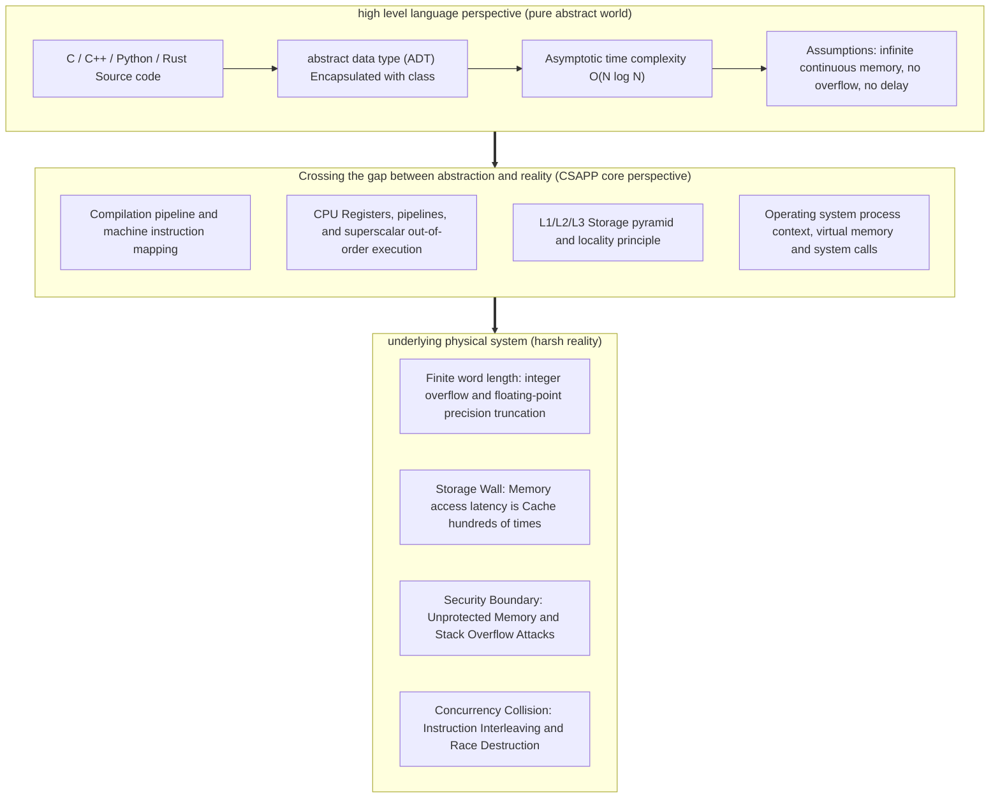
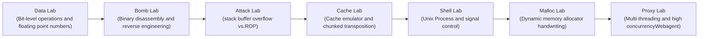

> **Lecturer**: Randal E. Bryant & David R. O'Hallaron ｜ **Original video**: Bilibili points P1 \| **duration**: 01:15:09  
> **Module**: Module 0: Course Overview (L01 · Core concepts of computer systems, hardware and program interaction perspective)  
> **Original video address**: [https://www.bilibili.com/video/BV1iW411d7hd/?p=1](https://www.bilibili.com/video/BV1iW411d7hd/?p=1)  
> **Course official ownership**: Carnegie Mellon University (CMU) 15-213 / 18-213 / 15-513: Introduction to Computer Systems (CSAPP Fall 2015)  
> **Corresponding teaching materials**: *Computer Systems: A Programmer's Perspective (3rd Edition)* by R. Bryant & D. O'Hallaron  
> **Source of subtitles and handouts**: The subtitles were translated and edited by the EugeneLiu/translationCSAPP team (CC BY-NC 4.0 open source license), and the copyright of the slides belongs to the CMU course group.  

---

## 1. From the abstract world to physical reality: Theme: Systems Knowledge is Power

*(Reference time: 00:01:15 · [Video jump (P1 00:01:15)](https://www.bilibili.com/video/BV1iW411d7hd/?p=1&t=75))*


In most prerequisite computer courses (such as introduction to programming, object-oriented design, discrete mathematics, data structures and algorithms), the teaching focus is without exception **Abstract**.
* In the abstract world of high-level languages:
  * Integers have arbitrary precision, and the rules of mathematical operations hold true everywhere;
  * Floating point numbers are equivalent to real numbers and satisfy the associative and distributive laws;
  * Memory is an infinitely continuous flat array that can be accessed at any time;
  * The performance of a program is determined by its asymptotic time complexity (large  $O$  mark, such as  $O(N \log N)$ vs $O(N^2)$) sole decision;
  * The execution process is a pure logical deduction that is monotonous and completed instantly.

However, computers are ultimately composed of silicon chips, transistor arrays, micro-nano metal wires, caches and external physical buses **physical entity**.
The core purpose of CMU 15-213 / CSAPP is to help programmers **Peeling away the protective filter of pure theoretical abstraction**, establishing awe and a thorough understanding of the underlying physical reality:
1. **You don’t need to be a chip hardware architect**: You don’t need to draw the addition circuit in Verilog yourself, nor do you need to manually arrange the transistors on the wiring layer;
2. **You don’t need to write pure assembly by hand all day long.**: The optimization capabilities of modern compilers have far exceeded the level of patience and local trade-offs of ordinary humans;
3. **But you must deeply understand the physical laws of the system from the "Programmer's Perspective"**: 
   * Why the same  $O(N^2)$  Double loop, can traversing by rows be dozens of times faster than traversing by columns?
   * Why is it that if the accumulation order of two seemingly identical floating-point numbers is exchanged, huge errors will appear in the calculation results or even cause a disaster in the aerospace system?
   * Why can a seemingly ordinary line of string copy be used by hackers to gain root control of a remote server in one fell swoop?

**Systems Knowledge is Power!**: Only by deeply understanding the underlying layer can you write industrial-grade programs with higher performance, extreme robustness, and rock-solid performance in the face of high concurrency and boundary exceptions.



## 2. One of the system realities: Integers are not mathematical integers, and operations do not satisfy the infinite range (Ints are not Integers)

*(Reference time: 00:09:30 · [Video jump (P1 00:09:30)](https://www.bilibili.com/video/BV1iW411d7hd/?p=1&t=570))*


In mathematical set theory, the set of integers  $\mathbb{Z}$  is infinite and closed, for any real number  $x$, there are always squares that are non-negative: 
$$x^2 \ge 0 \quad (\forall x \in \mathbb{R})$$
 Furthermore, addition is always monotonic: $x + 1 > x$.

However, inside the computer, all integer variables must be stored in **Fixed bit width** (such as 8-bit, 16-bit, 32-bit, or 64-bit) in physical registers and memory units. Modern computers generally use Two's Complement encoding:
* 32-bit signed integer  `int`  The representation range of is strictly limited to  $[-2^{31}, 2^{31}-1]$, that is  $[-2147483648, 2147483647]$; 
* Once the calculation result exceeds this physical boundary, the highest bit (sign bit) occurs **Overflow**!

In class, Professor Bryant gave shocking experimental evidence:
```c
int x = 50000;
printf("x * x = %d\n", x * x);
```
In calculations consistent with mathematical intuition, $50000 \times 50000 = 2,500,000,000$.
But on a 32-bit machine, the output of running the above code is:
```text
x * x = -1794967296
```
This is because  $2.5 \times 10^9$  The binary representation of is  `0x9502F900`, the highest bit is  `1`. Computer hardware strictly interprets this as a negative number! At this time, **$x^2 \ge 0$  mathematical axioms come crashing down in computers**.

Another classic pitfall is additive monotonicity:
```c
int max_val = 2147483647;
printf("max_val + 1 = %d\n", max_val + 1); // 输出 -2147483648 (TMin)!
```
> **Editor's in-depth analysis**:
Although computer integer arithmetic is not infinite, it **It's not randomly generated**! Two's complement arithmetic strictly algebraically constitutes a **Abelian Ring modulo  $2^w$)**. It satisfies the associative and commutative laws, and all arithmetic overflow behaviors are completely deterministic and predictable. Understanding this mathematical essence is a prerequisite for conquering the subsequent Data Lab.

## 3. System reality one (continued): Floats are not Reals and do not satisfy the associative and distributive laws.

*(Reference time: 00:15:40 · [Video jump (P1 00:15:40)](https://www.bilibili.com/video/BV1iW411d7hd/?p=1&t=940))*


Many beginners mistakenly believe that floating point numbers (`float`, `double`) Since it can take decimals, it can perfectly simulate mathematical real numbers. The opposite is true, floating point numbers are **Discrete non-uniform sampling of the real axis with finite binary bits**: 
* Floating point numbers use the IEEE 754 standard: numeric values are expressed as  $(-1)^s \times M \times 2^E$; 
* A 32-bit single-precision floating point number has only 23 mantissa significand digits (accuracy of about 7 decimal digits), and a 64-bit double-precision floating point number has only a 52-bit mantissa (accuracy of about 15-17 decimal digits).

Because the mantissa bit width is limited, floating point operations must be performed at the bottom layer. **Alignment code and precision rounding (Rounding)**. This directly destroys the most basic associative law of real numbers: 
$$(1e20 + -1e20) + 3.14 = 0.0 + 3.14 = 3.14$$
$$1e20 + (-1e20 + 3.14) = 1e20 + -1e20 = 0.0$$

Calculating  `-1e20 + 3.14`  When, since the difference in the exponents of the two addends is up to dozens of orders of magnitude, small numbers  $3.14$  In order to align the large order code, the valid bits are shifted to the right by the hardware. **All are moved out of the valid bit register and forced truncation and rounding are lost.**!
* Result: What should have existed  $3.14$  Evaporate completely like it never happened.
* **disaster case**: During the 1991 Gulf War, the U.S. Patriot air defense missile system accumulated a rounding error of about 0.34 seconds due to the internal floating point count of the system clock, causing the radar tracking window to deviate by more than 500 meters, and ultimately failed to intercept the Scud missile, causing heavy casualties.

## 4. System Reality 2: You've Got to Know Assembly

*(Reference time: 00:22:15 · [Video jump (P1 00:22:15)](https://www.bilibili.com/video/BV1iW411d7hd/?p=1&t=1335))*


Modern high-level languages (C, C++, Rust, Go) have extremely elegant syntactic abstractions, but why do top engineers have to learn to read x86-64 machine assembly directly?
Professor Bryant pointed out three irreplaceable practical needs:

1. **Understand the behavioral boundaries and optimization limits of compilers**:
Compilers are not omniscient or omnipotent prophets. Faced with seemingly simple two lines of code, compilers are often forced to give up radical optimization because it is difficult to exclude pointer aliasing (Pointer Aliasing) or function side effects (Side Effects). If you know how to read assembly, you can see at a glance whether the compiler generates the SIMD vectorized instructions or inline expansion you expect, and accurately guide code refactoring.

2. **The only truth when faced with live crashes and deadlocks**:
In a real online production environment, when a Segmentation Fault crash occurs in the core service and a Core Dump core dump file is generated, the code has already taken off the gorgeous coat of high-level language, and there are only cold register states in the call stack (`%rsp`, `%rbp`, `%rip`) and the disassembled instruction stream. Only by being proficient in assembly can you reverse the register overwriting process at the accident scene in a single step.

3. **The underlying foundation of network security and offensive and defensive confrontation**:
Almost all serious underlying system security vulnerabilities (such as stack overflow, ROP return-oriented programming, format string vulnerabilities, UAF reference after free) are initiated at the assembly instruction and register parameter passing levels. If you don't understand assembly, you will always be stuck at the application layer.

## 5. System Reality Three: Memory Matters and Cross-border Trampling Ghost Bug (Memory Matters)

*(Reference time: 00:30:20 · [Video jump (P1 00:30:20)](https://www.bilibili.com/video/BV1iW411d7hd/?p=1&t=1820))*


High-level language programmers are used to imagining memory as a safe and comfortable nanny-style sandbox: exceptions are thrown when arrays go out of bounds, and garbage collection occurs when objects fail.
However, in system-level languages ​​such as C/C++, **The hardware and runtime do not provide any automatic bounds checking at all**! A pointer is essentially an unconstrained physical absolute address in memory.

The most classic "Memory Referencing Bug" experiment in CSAPP history was demonstrated in class:
```c
typedef struct {
    int a[2];
    double d;
} struct_t;

double fun(int i) {
    volatile struct_t s;
    s.d = 3.14;
    s.a[i] = 1073741824; /* 故意越界写入！ */
    return s.d;
}
```
Explicitly declare the array in the structure  `a`  There are only two elements (indexed only 0 and 1). When the programmer mischievously passes in  `i = 0, 1, 2, 3, 4`  time, observe  `fun(i)`  returned  `s.d`: 

| Index  `i` | Access location analytics | returned  `s.d`  value | Phenomenon and essential cause |
|:---:|:---|:---:|:---|
| `i = 0` | Normal write  `s.a[0]` | `3.140000` | Normal operation, not affected  `d` |
| `i = 1` | Normal write  `s.a[1]` | `3.140000` | Normal operation, not affected  `d` |
| `i = 2` | **Out of bounds write  `s.a[2]`** | **`3.1399998664856`** | `s.d`  The value has been bizarrely tampered with! |
| `i = 3` | **Out of bounds write  `s.a[3]`** | **`2.00000061035156`** | `s.d`  Serious distortion occurred! |
| `i = 4` | **Out of bounds write  `s.a[4]`** | `3.140000`  (or crash) | Out of bounds and stepped on the adjacent save register or stack return address! |

> **The truth about memory layout**:
Under 64-bit architecture, the compiler converts the 8-byte  `double d`  followed by an 8-byte array  `a[2]`  Then they are arranged continuously in the stack frame.
> * `s.a[0]`  Occupies the lower 4 bytes, `s.a[1]`  Occupy the next 4 bytes;
> * when visiting  `s.a[2]`  when , the pointer offset happens to cross into  `double d`  of **Lower 32-bit binary range**!
> * write integer  `1073741824` (i.e. hexadecimal  `0x40000000`), silently overwriting the low-order bits of the mantissa of the IEEE 754 floating-point number, resulting in  `s.d`  Minor drift occurs;
> * when visiting  `s.a[3]`  when, directly overwriting  `double d`  of **High 32 bits** (including the sign bit and high-order exponent), causing its value to undergo earth-shaking changes!

## 6. System Reality Four: Hardware Architecture’s Decisive Dominance on Performance (Memory Hierarchy Dominates)

*(Reference time: 00:41:45 · [Video jump (P1 00:41:45)](https://www.bilibili.com/video/BV1iW411d7hd/?p=1&t=2505))*


Traditional algorithm theory tells you: as long as the size of the two algorithms is  $O$  If the complexity is the same, they are asymptotically equivalent of the same order.
But systems engineers must know: **Big  $O$  The hidden constant factors may not only vary greatly, but also be severely restricted by the pyramid of the underlying storage system.**!

Consider the following two extremely trivial two-dimensional matrix summation functions:
```c
void copyji(int src[2048][2048], int dst[2048][2048]) {
    int i, j;
    for (j = 0; j < 2048; j++)
        for (i = 0; i < 2048; i++)
            dst[i][j] = src[i][j]; /* 列优先遍历 (Column-major) */
}

void copyij(int src[2048][2048], int dst[2048][2048]) {
    int i, j;
    for (i = 0; i < 2048; i++)
        for (j = 0; j < 2048; j++)
            dst[i][j] = src[i][j]; /* 行优先遍历 (Row-major) */
}
```
In mathematical logic, the two functions perform exactly the same number of assignment operations (both are  $2048 \times 2048 = 4,194,304$  times).
But the actual measurement time on real hardware is:
* `copyij` (row first): takes approx.  **4.3 milliseconds**
* `copyji` (column priority): takes up to  **81.8 milliseconds**!
**The performance difference between the two is nearly 20 times!**

Why? Because the C language two-dimensional array in memory is **row-major contiguous storage** of.
* in  `copyij` , the inner loop accesses adjacent addresses. Each time the CPU loads a 64-byte cache block (Cache Line) from the main memory, and the subsequent 15 integer memory accesses **All L1 cache hits without latency** (Excellent spatial locality);
* in  `copyji` , the inner loop jumps by 2048 integers (8KB) each step, which not only completely destroys the L1/L2 Cache, but also causes cache misses again and again, forcing the CPU to repeatedly stop and wait for a long main memory bus read!

## 7. System Reality 5: Computers are not just for executing programs, they are also the core media of network and concurrency.

*(Reference time: 00:54:10 · [Video jump (P1 00:54:10)](https://www.bilibili.com/video/BV1iW411d7hd/?p=1&t=3250))*


The early computer was probably just a high-speed numerical batch processor that input paper tape punch cards and output calculation tables.
In today's era, the era of single machine and single process has long ended:
1. **Data flows across the network**: The computer sends and receives network messages through the network card. The arrival of the network data packet is essentially an asynchronous external hardware interrupt; through the abstract Sockets API, the local process can communicate seamlessly with the remote server thousands of kilometers apart.
2. **The operating system schedules multiple concurrent logical flows**: In order to serve thousands of user requests at the same time, the operating system uses time-sharing rotation, process multiplexing and kernel-level threads to build a huge concurrent world on a single physical hardware.
3. **The abyss of concurrency and synchronization**: When multiple threads concurrently read and write the same piece of data in shared memory, the non-deterministic interleaving of instruction microsteps will cause bizarre and bizarre "Race Conditions" and "Deadlock".

## 8. In-depth panoramic analysis of 7 classic experiments (Labs) in the entire course

*(Reference time: 01:05:00 · [Video jump (P1 01:05:00)](https://www.bilibili.com/video/BV1iW411d7hd/?p=1&t=3900))*


The reason why 15-213 can be regarded as a standard by dozens of top university computer departments around the world is that its soul lies in 7 hard-core hands-on experiments. These experiments progress layer by layer and run through the theory of the whole book:



1. **L1: Data Lab (bit level magic)**: 
   * Strict rules: disable any control flow (`if`, `while`), multiplication and division are disabled, large constants greater than 255 are disabled, and only a limited number of bitwise operators can be used (`~`, `&`, `^`, `|`, `+`, `<<`, `>>`).
   * Goal: Use bit-level bit transformation to implement complement absolute value, sign judgment, two-number ratio and IEEE 754 floating-point conversion, and engrav bit-level intuition into the bone marrow.

2. **L2: Bomb Lab (binary bomb disposal expert)**: 
   * Format: You receive an executable file without any source code, just x86-64 machine binaries (a program bomb).
   * Goal: Use GDB debugger breakpoints, single-step tracing of disassembly code, check register and runtime stack memory status, and reversely deduce the logical password of the 6 stages of demolition. Once the input is wrong, the bomb will explode and points will be deducted!

3. **L3: Attack Lab (practical hacker attack and defense)**: 
   * Goal: Take advantage of the fact that the input length is not checked in the target program.  `gets()`  Vulnerability, manually constructed hexadecimal payload overwrites the stack frame return address.
   * Advanced challenge: In the advanced stage with NX/DEP (stack non-executable) protection turned on, search for legal  `gadget`  The instruction sequence assembles the ROP chain to complete a wonderful hijacking of the control flow.

4. **L4: Cache Lab (cache tuning master)**: 
   * Part A: Hand-write a software cache simulator that accurately simulates the LRU replacement strategy;
   * Part B: Yes  $32 \times 32$, $64 \times 64$, $61 \times 67$  The matrix transposition algorithm performs multi-layer blocking (Blocking/Tiling) and register temporary storage optimization to suppress the number of Cache Misses to the theoretical lower limit.

5. **L5: Shell Lab (Micro Unix shell development)**: 
   * Goal: Implement a system from scratch that supports foreground/background job scheduling (Job Control), pipeline and I/O redirection, and correct capture processing  `SIGINT` (`Ctrl+C`), `SIGTSTP` (`Ctrl+Z`) and  `SIGCHLD`  A full-featured Linux shell.

6. **L6: Malloc Lab (industrial grade memory allocator)**: 
   * Goal: Write your own  `mm_malloc`, `mm_free`, `mm_realloc`  Dynamic memory manager.
   * Challenge: While ensuring a throughput of hundreds of thousands of allocations per second, achieve a space utilization of more than 85% through high-order data structures such as free linked lists, boundary mark merging, and separation adaptation.

7. **L7: Proxy Lab (high concurrency multi-thread proxy gateway)**: 
   * Goal: Build an industrial-grade proxy server by integrating network programming, Sockets API, HTTP protocol parsing, POSIX multi-thread concurrency and readers-writers read-write lock cache synchronization.


---

### Summary and core thoughts of this lecture (Takeaways)

1. **Essential changes in systems perspective**: This lecture analyzes the core implementation principles of "Course Overview: In-depth understanding of the core worldview and five realities of computer systems" from the underlying mechanism.
2. **Software and hardware co-design**: Understanding the underlying rules can not only eliminate potential hidden bugs that are difficult to debug, but is also a prerequisite for writing industrial-grade code with ultimate performance.
3. **Hands-on verification**: It is recommended to cooperate with the after-school exercises and official experiments (Lab) of the corresponding chapters of CSAPP, and use GDB and performance analysis tools in the Linux terminal environment to personally verify the theory.
