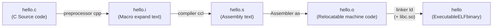

> **Lecturer**: Randal E. Bryant ｜ **Original video**: Bilibili points P5 \| **duration**: 01:13:29  
> **Module**: Module 2: Machine-Level Representation of Programs (L05 - L09 · x86-64 assembly, control flow, procedure calls and data structures)  
> **Original video address**: [https://www.bilibili.com/video/BV1iW411d7hd/?p=5](https://www.bilibili.com/video/BV1iW411d7hd/?p=5)  
> **Course official ownership**: Carnegie Mellon University (CMU) 15-213 / 18-213 / 15-513: Introduction to Computer Systems (CSAPP Fall 2015)  
> **Corresponding teaching materials**: *Computer Systems: A Programmer's Perspective (3rd Edition)* by R. Bryant & D. O'Hallaron  
> **Source of subtitles and handouts**: The subtitles were translated and edited by the EugeneLiu/translationCSAPP team (CC BY-NC 4.0 open source license), and the copyright of the slides belongs to the CMU course group.  

---

## 1. From high-level languages to pure machine instructions: a four-level jump in compilation systems

*(Reference time: 00:03:00 · [Video jump (P5 00:03:00)](https://www.bilibili.com/video/BV1iW411d7hd/?p=5&t=180))*


High-level language code (such as C/C++) is an abstract text written for human reading, while the instruction decoder inside the CPU can only recognize cold hexadecimal bytecode (Opcode).
will  `hello.c`  It becomes a process that runs on the CPU and has completely gone through four major links:



1. **preprocessor (cpp)**: parsing  `#include`, `#define`, `#ifdef`, expand and insert the full source code of the header file;
2. **compiler(ccl)**:Core brain! Perform lexical analysis, syntax analysis, and optimization on the advanced syntax tree, and finally generate an assembly file of pure ASCII text.  `hello.s`; 
3. **assembler(as)**: Translate the assembly mnemonic into a 1:1 corresponding binary machine instruction byte stream line by line to generate  `.o`  target file;
4. **linker(ld)**: Solve external symbol resolution and address relocation, and stitch together with the C runtime library to generate the final executable file.

## 2. Forty-year evolution history of x86 architecture: from 8086 to x86-64

*(Reference time: 00:14:20 · [Video jump (P5 00:14:20)](https://www.bilibili.com/video/BV1iW411d7hd/?p=5&t=860))*


To understand the various weird names of x86-64 assembly, you must understand its more than 40 years of backward compatibility historical baggage:
* **1978 (8086, 16 bits)**: Intel, the originator of personal computers. The word length (Word) is permanently defined as 16 bits (2 bytes); the register is named  `AX, BX, CX, DX`, the addressing space is only 1MB.
* **1985 (80386, 32-bit / IA32)**:A groundbreaking 32-bit extension. Register extended to 32 bits, plus prefix  `E` (Extended), such as  `EAX, EBX, ECX, EDX`, supports flat 4GB memory virtual addressing.
* **2003 (AMD64 / x86-64)**: The most dramatic scene in history! Intel originally tried to completely abandon x86 with the new IA-64 (Itanium) architecture, but Itanium was unable to run 32-bit old code efficiently. Rival AMD keenly seized the opportunity and designed a 100% downward hardware compatible  **AMD64**  norm. Intel was eventually forced to make backward compatibility and launch the Intel 64.
* The register is extended to 64 bits and the prefix becomes  `R` (Register), such as  `RAX, RBX`, the number of general-purpose registers doubled from 8 to 16!

## 3. Panorama of the 16 64-bit general-purpose registers of x86-64

*(Reference time: 00:24:50 · [Video jump (P5 00:24:50)](https://www.bilibili.com/video/BV1iW411d7hd/?p=5&t=1490))*


The modern x86-64 architecture provides 16 extremely powerful general-purpose registers, whose backward-compatible byte splitting rules must be memorized proficiently:

| 64-bit full name | Lower 32-bit slice | Low 16-bit slice | Low 8-bit slice | Traditional usage and the iron law of ABI call specifications |
|:---|:---:|:---:|:---:|:---|
| `%rax` | `%eax` | `%ax` | `%al` | **function return value register** / Main accumulator for multiplication and division |
| `%rdi` | `%edi` | `%di` | `%dil` | **The first parameter passed in function call** |
| `%rsi` | `%esi` | `%si` | `%sil` | **The second parameter passed in the function call** |
| `%rdx` | `%edx` | `%dx` | `%dl` | **The third parameter passed in function call** |
| `%rcx` | `%ecx` | `%cx` | `%cl` | **The fourth parameter passed in function call** |
| `%r8`  | `%r8d` | `%r8w` | `%r8b` | **The fifth parameter passed in function call** |
| `%r9`  | `%r9d` | `%r9w` | `%r9b` | **The sixth parameter passed in function call** |
| `%rsp` | `%esp` | `%sp`  | `%spl` | **Stack Pointer Register (Stack Pointer)**, pointing to the top of the current stack |
| `%rbp` | `%ebp` | `%bp`  | `%bpl` | Stack Frame Pointer/Called Save Register |
| `%rbx` | `%ebx` | `%bx`  | `%bl`  | Callee-saved register (Callee-saved) |
| `%r10` | `%r10d`| `%r10w`| `%r10b`| Caller-saved temporary registers |
| `%r11` | `%r11d`| `%r11w`| `%r11b`| Caller-saved temporary registers |
| `%r12`~`%r15` | `...d` | `...w` | `...b` | Callee-saved register (Callee-saved) |

> **Extremely critical 32-bit zero-extension rule (Zero-Extension Rule)**:
In x86-64, any operation that targets a 32-bit register (e.g.  `movl $1, %eax`  or  `addl %ecx, %edx`), **The hardware will automatically and forcibly clear all the high 32 bits of this register to zero!**
 This is an extremely unique hardware mechanism in 64-bit systems that is used to maximize instruction pipeline efficiency.

## 4. Operand types and the most common compound memory addressing formula

*(Reference time: 00:36:10 · [Video jump (P5 00:36:10)](https://www.bilibili.com/video/BV1iW411d7hd/?p=5&t=2170))*


The operands of machine instructions are divided into three categories:
1. **Immediate**: with  `$`  The beginning indicates a constant value (e.g.  `$42`, `$-0x1F`); 
2. **Register**: Directly reference the value in the register (such as  `%rax`); 
3. **Memory Reference**: Access memory based on effective address.

x86-64 supports the most powerful and flexible instruction set in the world **Full-featured composite memory addressing formula**: 
$$Address = Imm(R_b, R_i, s) = Imm + R_b + R_i \times s$$
* $Imm$: Immediate byte offset (default is 0);
* $R_b$: Base address register (can be any one of the 16 general-purpose registers);
* $R_i$: Index register (can be anything other than  `%rsp`  any register other than);
* $s$: Scale Factor, **The value can only be  $1, 2, 4, 8$** (The hardware directly aligns the byte sizes of the C language's basic types!).

```assembly
# 实战寻址解析：假设 %rdx = 0xF000, %rcx = 0x0100
8(%rdx)               # Address = 0xF000 + 8 = 0xF008
(%rdx, %rcx)          # Address = 0xF000 + 0x0100 = 0xF100
(%rdx, %rcx, 4)       # Address = 0xF000 + 0x0100 * 4 = 0xF400
0x80(, %rcx, 8)       # Address = 0x80 + 0x0100 * 8 = 0x0880
```

## 5. Data transfer instruction mov and memory to memory disabling iron law

*(Reference time: 00:47:30 · [Video jump (P5 00:47:30)](https://www.bilibili.com/video/BV1iW411d7hd/?p=5&t=2850))*


`mov`  Instructions are used to move data between registers and memory:
* `movb`  (1 byte),  `movw`  (2 bytes),  `movl`  (4 bytes),  `movq`  (8 bytes)
* Extended delivery:
  * `movz...` (Zero extension transmission, high bits filled with 0, such as  `movzbq`  From byte zero to four words);
  * `movs...` (Sign extension transfer, high-order copy of the sign bit, such as  `movsbq`).

> **Memory-to-memory absolute disable ban**:
Under the x86-64 CISC architecture, **No single instruction can have both the source and destination operands be memory addresses.**!
> ```assembly
> movq (%rax), (%rdx)  # 致命语法错误！CPU 无法在单条指令周期内完成两次总线寻址访存
> ```
> Data copies between memories must be transferred through registers:
> ```assembly
> movq (%rax), %rcx    # 先读入寄存器
> movq %rcx, (%rdx)    # 再写回目标内存
> ```

## 6. Load effective address instruction leaq’s magical use of divine arithmetic

*(Reference time: 00:59:15 · [Video jump (P5 00:59:15)](https://www.bilibili.com/video/BV1iW411d7hd/?p=5&t=3555))*


`leaq`  The full name of the command is  **Load Effective Address**.
It was originally designed to pass a memory address to a pointer (similar to the  `&x`  operation). For example:
```assembly
leaq 8(%rsp), %rdi   # 将栈上地址计算出来赋给指针参数 %rdi
```
But the compiler genius discovered: **`leaq`  It is essentially a compound high-speed arithmetic calculation unit mounted inside the ALU that does not access any memory at all!**
 take advantage of it  `Imm + R_b + R_i * s`  A hardware addressing calculator that can complete in a single cycle the form  $x \times 2, 3, 4, 5, 8, 9$  calculation, and **Does not destroy condition code flags at all**!

```c
/* C 语言源码 */
long scale_compute(long x, long y) {
    long t = x + 4 * y;
    return t * 3;
}
```
The minimalist assembly generated by compilation:
```assembly
scale_compute:
    leaq (%rdi, %rsi, 4), %rax  # %rax = x + 4*y
    leaq (%rax, %rax, 2), %rax  # %rax = %rax + %rax*2 = 3 * %rax!
    ret
```
Compound algebra calculations that originally required performing multiple multiplications and additions were elegantly replaced by two lines of  `leaq`  Fast harvest!


---

### Summary and core thoughts of this lecture (Takeaways)

1. **Essential changes in systems perspective**: This lecture analyzes the core implementation principles of "Machine Level Programming I: Basics: x86-64 Architecture Evolution and Register Addressing" from the underlying mechanism.
2. **Software and hardware co-design**: Understanding the underlying rules can not only eliminate potential hidden bugs that are difficult to debug, but is also a prerequisite for writing industrial-grade code with ultimate performance.
3. **Hands-on verification**: It is recommended to cooperate with the after-school exercises and official experiments (Lab) of the corresponding chapters of CSAPP, and use GDB and performance analysis tools in the Linux terminal environment to personally verify the theory.
