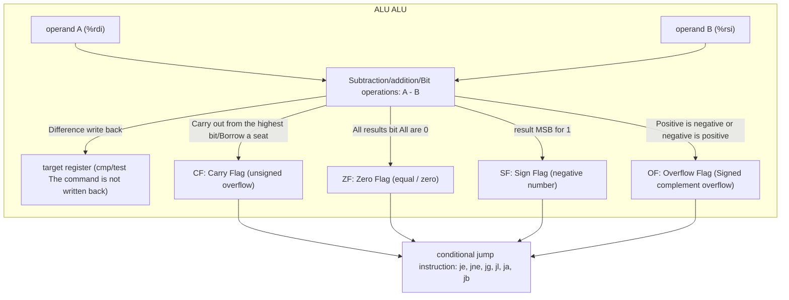

> **Lecturer**: Randal E. Bryant & David R. O'Hallaron ｜ **Original video**: Bilibili points P6 \| **duration**: 01:13:50  
> **Module**: Module 2: Machine-Level Representation of Programs (L05 - L09 · x86-64 assembly, control flow, procedure calls and data structures)  
> **Original video address**: [https://www.bilibili.com/video/BV1iW411d7hd/?p=6](https://www.bilibili.com/video/BV1iW411d7hd/?p=6)  
> **Course official ownership**: Carnegie Mellon University (CMU) 15-213 / 18-213 / 15-513: Introduction to Computer Systems (CSAPP Fall 2015)  
> **Corresponding teaching materials**: *Computer Systems: A Programmer's Perspective (3rd Edition)* by R. Bryant & D. O'Hallaron  
> **Source of subtitles and handouts**: The subtitles were translated and edited by the EugeneLiu/translationCSAPP team (CC BY-NC 4.0 open source license), and the copyright of the slides belongs to the CMU course group.  

---

## 1. The core cornerstone of control flow: CPU condition code register (Condition Codes)

*(Reference time: 00:02:12 · [Video jump (P6 00:02:12)](https://www.bilibili.com/video/BV1iW411d7hd/?p=6&t=132))*


In high-level programming languages (such as C, Java, Python), the control flow of a program is determined by  `if-else`, `while`, `for`  and  `switch`  and other high-level structure driven.
However, at the lowest level, the CPU hardware is essentially a pipeline that fetches instructions from memory one by one and executes them sequentially (the Program Counter points to the next instruction).
In order to implement "selecting different execution paths based on calculation results" on hardware, the x86-64 CPU introduces a set of single-bit status registers maintained by the hardware, collectively called **Condition Code Registers**.

### Four core condition code registers

| condition code | full name | Set condition (when is 1) | Typical application scenarios |
| :--- | :--- | :--- | :--- |
| **CF** | Carry Flag | The most recent operation resulted in an outcarry or borrow from the highest bit (unsigned overflow) | Detect unsigned integer addition and subtraction overflow, multi-precision large integer addition |
| **ZF** | Zero Flag | The most recent operation evaluated exactly equal to 0 | Check whether two numbers are equal (`a == b`), the loop counter decreases to 0 |
| **SF** | Sign Flag | The result of the most recent operation is negative (MSB is 1) | Sign detection for signed numbers (`t < 0`) |
| **OF** | Overflow Flag | A recent operation resulted in a signed two's complement overflow (positive plus is negative or negative is positive) | Detecting signed integer arithmetic overflow (`t < Min`  or  `t > Max`) |

### Implicit and explicit settings of condition codes
1. **Implicit side effects of arithmetic and logic instructions**:
Most integer arithmetic instructions (such as  `addq`, `subq`, `imulq`, `andq`, `orq`, `xorq`, `shlq`, `sarq`) while completing the calculation and writing the result to the destination register, all **implicit modification** condition code.
   * Special cases: `leaq` (Load Effective Address Instruction) is specially designed for address calculation, **Never change any condition codes**! This allows the compiler to use  `leaq`  Cleverly perform multiplication and addition operations without destroying the conditional state.
   * During a shift operation, the carry flag CF will be set to the value of the last bit shifted out, and the overflow flag OF will be set according to the sign change during a single-step shift.
   * Logical operation (`andq`, `orq`, `xorq`) will force CF and OF to zero and only set ZF and SF based on the result.

2. **Explicit comparison and test instructions (only set condition codes, do not change registers)**:
In order to be specifically used for conditional judgment without destroying the original operands, x86-64 provides two sets of special non-writeback instructions:
   * `cmpq Src2, Src1`: Calculation  `Src1 - Src2`, and set the condition code based on the difference, but **Do not save calculation results**.
     * If  `Src1 == Src2`, then the difference is 0, **ZF = 1**.
     * If calculated  `Src1 - Src2`  produces a signed negative number, then  **SF = 1**.
     * Pay special attention to the operand order of AT&T syntax: the logic of comparison is "source operand 1" minus "source operand 2", that is  `cmpq %rax, %rdx`  actually calculating  `%rdx - %rax`.
   * `testq Src2, Src1`: Calculation  `Src1 & Src2` (bitwise AND), sets ZF and SF based on the result of the AND, **CF and OF are forced to 0**.
     * Typical usage: `testq %rax, %rax`. when  `%rax`  When itself is 0, set ZF=1; when  `%rax`  Set SF=1 when it is a negative number. Commonly used to check whether a pointer is NULL or the number is positive or negative.



## 2. Condition code reading and judgment logic: setX instruction family and symbol comparison derivation

*(Reference time: 00:15:30 · [Video jump (P6 00:15:30)](https://www.bilibili.com/video/BV1iW411d7hd/?p=6&t=930))*


Condition codes are usually not read directly as data, but are used indirectly through the following three mechanisms:
1. Pass  `setX`  The instruction sets a single byte register to 0 or 1 depending on the condition;
2. Conditional jump instructions  `jX`  change program counter  `%rip`; 
3. Passing instructions conditionally  `cmovX`  Selectively move data.

### `setX`  How instructions work
`setX Dest`  The instruction converts a single-byte target (such as  `%al`, `%bl`, `%cl`  and other lower 8-bit registers) are set to  `0x01`  or  `0x00`. The compiler then usually matches  `movzbl`  The instruction clears its high-order bits and extends it to a 32/64-bit integer.

### Mathematical derivation of signed comparison (why  $SF \oplus OF$?)
Many students are confused when they come into contact with assembly: why judge  `a < b`(`jl`  instruction) conditions are not simple  `SF = 1`, but  `SF ^ OF` (XOR)?
Let us derive it rigorously through mathematics:
execute  `cmpq %rsi, %rdi`  i.e. calculation  $t = a - b$.
* **Case 1: No overflow occurs ($OF = 0$)**
  * If the calculation does not overflow, the true mathematical difference has exactly the same sign as its complement representation.
  * If  $a < b$, then  $t < 0$, the highest bit must be 1, so  $SF = 1$.
  * At this time  $SF \oplus OF = 1 \oplus 0 = 1$.
* **Case 2: Positive overflow occurs ($OF = 1, t < 0$  and practical  $a - b > 0$)**
  * when  $a > 0$  and  $b < 0$  When , the difference is too large, causing the positive number to overflow and become a negative number, so  $SF = 1$.
  * But actually mathematically  $a > b$, so not satisfied  $a < b$.
  * At this time  $SF \oplus OF = 1 \oplus 1 = 0$ (Correctly judged as false!).
* **Case 3: Negative overflow occurs ($OF = 1, t \ge 0$  and practical  $a - b < 0$)**
  * when  $a < 0$  and  $b > 0$  When , the difference is too small, causing the negative number to underflow into a positive number, so  $SF = 0$.
  * But actually mathematically  $a < b$  It is indeed established!
  * At this time  $SF \oplus OF = 0 \oplus 1 = 1$ (Correctly determined to be true!).

To sum up, regardless of overflow or not, **$SF \oplus OF$  Always be able to accurately determine signed numbers  $a < b$**!

| instructions | Mnemonic meaning | Determination condition (Boolean algebraic expression) | Applicable scenarios |
| :--- | :--- | :--- | :--- |
| `sete` / `setz` | Equal / Zero | $ZF$ | equal ($a == b$) |
| `setne` / `setnz` | Not Equal / Not Zero | $\sim ZF$ | Not equal ($a \ne b$) |
| `sets` | Negative | $SF$ | Negative ($t < 0$) |
| `setns` | Non-negative | $\sim SF$ | non-negative ($t \ge 0$) |
| `setg` / `setnle` | Greater (Signed) | $\sim (SF \oplus OF) \,\&\, \sim ZF$ | Signed greater than ($a > b$) |
| `setge` / `setnl` | Greater or Equal (Signed) | $\sim (SF \oplus OF)$ | Signed greater than or equal to ($a \ge b$) |
| `setl` / `setnge` | Less (Signed) | $SF \oplus OF$ | Signed less than ($a < b$) |
| `setle` / `setng` | Less or Equal (Signed) | $(SF \oplus OF) \mid ZF$ | Signed less than or equal to ($a \le b$) |
| `seta` / `setnbe` | Above (Unsigned) | $\sim CF \,\&\, \sim ZF$ | Unsigned greater than ($a >_u b$) |
| `setb` / `setnae` | Below (Unsigned) | $CF$ | Unsigned less than ($a <_u b$) |

## 3. Conditional branches and jump instructions: PC relative addressing mechanism

*(Reference time: 00:26:40 · [Video jump (P6 00:26:40)](https://www.bilibili.com/video/BV1iW411d7hd/?p=6&t=1600))*


Jumps in assembly language are divided into **Unconditional jump (`jmp`)**and** conditional jump (`jX`)**.
* `jmp Label`: Jump directly to the target label;
* `jmp *Operand`: **indirect jump**, the jump target address is stored in a register or memory (e.g.  `jmp *%rax`  or  `jmp *(%rax, %rdx, 8)`), which is the implementation of function pointer and  `switch`  The core of jump tables.
* `jX Label`: Conditional jump, jump if and only if a specific condition is true, otherwise execute the next instruction.

### In-depth analysis of PC-Relative Addressing
How is the destination address encoded in machine code?
The vast majority of code in modern operating systems is Position-Independent Code (PIC). To achieve this, jump instructions in x86-64 typically use  **PC relative addressing**: 
* What is encoded in the instruction is not the absolute memory physical/virtual address of the target code, but **The offset of the target address relative to the address of the next instruction immediately following the jump instruction (Displacement)**!
* Offsets are typically stored as 1 byte (-128 to +127), 2 bytes, or 4 bytes complement.

```assembly
# 汇编反汇编实例 (objdump 提取)
4004d0:   48 83 f8 05             cmp    $0x5,%rax
4004d4:   7e 08                   jle    4004de <loop+0xe>
4004d6:   48 83 c0 01             add    $0x1,%rax
4004da:   eb f4                   jmp    4004d0 <loop>
4004de:   f3 c3                   repz retq
```
* analysis  `4004d4: 7e 08`: 
  * `7e`  Yes  `jle`  The operation code of the instruction;
  * `08`  is a 1-byte relative offset;
  * The address of the next instruction is  `4004d6`; 
  * Calculate the destination address: `0x4004d6 + 0x08 = 0x4004de`! Corresponds exactly  `repz retq`.
* analysis  `4004da: eb f4`: 
  * `eb`  Yes  `jmp`  The 1-byte relative addressing opcode;
  * `f4`  is the hexadecimal one-byte complement number, $-12$; 
  * The next instruction address is  `4004dc`; 
  * Calculate the destination address: `0x4004dc - 0x0c = 0x4004d0`! Perfect jump back to the beginning of the loop.

**Huge Engineering Advantages of PC Relative Addressing**: No matter which virtual address segment of the memory the code is loaded into, the instruction bytecode remains completely constant, without the need for the linker to patch it line by line when loading!

## 4. Conditional Move: Use data transfer to replace branch jumps

*(Reference time: 00:36:10 · [Video jump (P6 00:36:10)](https://www.bilibili.com/video/BV1iW411d7hd/?p=6&t=2170))*


Traditional conditional jump instructions (`jX`) has the most fatal performance hazard in modern superscalar processors: **Branch Misprediction Penalty**!

### Modern CPU Pipelines and the Branch Prediction Crisis
Modern CPUs commonly have a pipeline depth of 14 to 20 stages. In order to keep the pipeline running at full capacity, when the CPU encounters a conditional jump instruction, **Unable to wait for the arithmetic results to be calculated before deciding where to go.**, but must use the hardware branch predictor (Branch Predictor) to guess the most likely jump direction and speculatively execute subsequent instructions.
* **Prediction successful**: The pipeline has zero pauses and the throughput rate is full;
* **Prediction failed**: The CPU must flush out all pipeline instructions that have been speculatively executed (Pipeline Flush), and re-fetch instructions from the correct path. This usually results in  **Huge performance penalty of 15 to 30 clock cycles**!

### conditional transfer instructions  `cmovX`  salvation
To address this bottleneck, modern instruction sets introduce **Conditional Move instructions (Conditional Move, such as  `cmovle`, `cmovne`, `cmovge`)**: 
* Thoughts: **Simultaneously calculate the two possible branch results of the condition, and finally use a hardware conditional transfer instruction to select which one to store in the target register based on the condition code.**!
* At this time, the program execution path is **completely linear**, there are no jump instructions, the branch predictor will never be frustrated, and the pipeline is constant without stalls!

```c
/* 经典绝对值差值函数 */
long absdiff(long x, long y) {
    long result;
    if (x < y)
        result = y - x;
    else
        result = x - y;
    return result;
}
```

```assembly
# 优化编译生成的条件传送汇编 (gcc -O2)
# %rdi = x, %rsi = y
absdiff:
    movq    %rsi, %rax
    subq    %rdi, %rax          # rval = y - x
    movq    %rdi, %rdx
    subq    %rsi, %rdx          # eval = x - y
    cmpq    %rsi, %rdi          # 比较 x : y
    cmovge  %rdx, %rax          # 如果 x >= y，将 %rdx 传送给 %rax
    ret                         # 返回 %rax
```

> \[!CAUTION\] Conditional teleportation is not a panacea: three dangerous scenarios where it is prohibited!
Although conditional delivery eliminates branch overhead, in the following three scenarios **Never use conditional delivery**, the compiler will fall back to the traditional jump:
> 1. **Illegal memory access such as null pointer dereference**: 
>    ```c
>    long val = (p != NULL) ? *p : 0;
>    ```
>    If used  `cmov`, even if  `p == NULL`, the CPU will also execute unconditionally in advance  `*p`  The memory is loaded, causing an immediate trigger  **Segmentation Fault**!
> 2. **Expressions with side effects (Side Effects)**: 
>    ```c
>    long val = test ? count++ : error_handler();
>    ```
>    Both branches will be evaluated, causing the counter to be incremented twice by mistake, or the exception handler to be triggered incorrectly.
> 3. **Expressions that are extremely computationally expensive**:
If one of the branches requires calling an expensive complex function or floating-point matrix multiplication, the cost of blindly computing both branches far exceeds the pipeline penalty.

## 5. The underlying assembly structure of loop statements: Do-While, Jump-to-Middle and Guarded-Do

*(Reference time: 00:48:20 · [Video jump (P6 00:48:20)](https://www.bilibili.com/video/BV1iW411d7hd/?p=6&t=2900))*


C language provides three basic loop structures: `do-while`, `while`  and  `for`. But in the x86-64 machine instruction set, **No special loop instructions**! All loops are constructed from a combination of condition codes, test comparison instructions, and jump instructions.

### 1. `do-while`  Loop: the most direct underlying form
`do-while`  The loop body is executed first, and then the loop condition is judged at the end. If it is true, it jumps back to the beginning of the loop. This is naturally consistent with the single conditional jump semantics of assembly.

```c
long pcount_do(unsigned long x) {
    long result = 0;
    do {
        result += x & 0x1;
        x >>= 1;
    } while (x);
    return result;
}
```

```assembly
# pcount_do 汇编翻译
# %rdi = x
    movl    $0, %eax            # result = 0
.L2:
    movq    %rdi, %rdx
    andl    $1, %edx            # %rdx = x & 1
    addq    %rdx, %rax          # result += %rdx
    shrq    $1, %rdi            # x >>= 1
    jne     .L2                 # if (x != 0) goto .L2
    rep; ret
```

### 2. `while`  Loop translation mode 1: Jump-to-Middle (middle jump)
`while`  Loops must check conditions before entering the loop body. Unoptimized code (`-O0`  or  `-O1`) commonly used  **Jump-to-Middle**  Strategy: Jump directly and unconditionally to the test code at the end at the function entry.

```assembly
# while (Test) { Body } -> Jump-to-Middle
    jmp     .L_TEST
.L_LOOP:
    # 循环体 (Loop Body)
.L_TEST:
    cmpq    ...
    jle     .L_LOOP
```

### 3. `while`  Loop translation mode 2: Guarded-Do (Do-While with guard)
Modern high-performance optimizing compilers (`-O2`  and above) general preference  **Guarded-Do**  Mode:
Before entering the loop, use a guard condition to judge: if the initial condition is not satisfied, skip the entire loop directly; if it is satisfied, fall directly into a **Efficient do-while core loop body**!

```c
/* Guarded-Do 模式的 C 等价变换 */
if (!Test)
    goto done;
do {
    Body;
} while (Test);
done:
```
* **Performance advantages**: In many common scenarios (such as processing non-empty strings or non-empty arrays), the success rate of guard branch prediction is extremely high, and each iteration inside the loop body has only one conditional jump at the end, eliminating the overhead of entry jumps.

## 6. Switch statements and jump tables: The ultimate art of O(1) multi-way branching

*(Reference time: 01:02:15 · [Video jump (P6 01:02:15)](https://www.bilibili.com/video/BV1iW411d7hd/?p=6&t=3735))*


When programmers need to deal with up to a dozen or even dozens of branch options (such as lexical analyzers, instruction simulators, state machine transitions), if a series of  `if-else if-else`, the time complexity will degenerate to  $O(N)$, that is, do it in sequence  $N$  Comparisons and conditional branches.
And C language  `switch`  statement will be translated by the compiler under certain conditions as **Jump Table**, the implementation time consumption is constant as  **$O(1)$**  Multiple jumps!

### The core construction principle of jump table
A jump table is essentially a **A contiguous array that stores code addresses** (located in the read-only data segment  `.rodata`  middle). Each entry in the array is an 8-byte virtual address pointer to a specific code label.

```c
/* 典型 switch 源码 */
void switch_eg(long x, long n, long *dest) {
    long val = x;
    switch (n) {
        case 100: val *= 13; break;
        case 102: val += 10; /* 穿透 Fall-through */
        case 103: val += 11; break;
        case 104:
        case 106: val *= val; break;
        default:  val = 0;
    }
    *dest = val;
}
```

```assembly
# switch_eg 汇编核心解析
# %rdi = x, %rsi = n, %rdx = dest
switch_eg:
    subq    $100, %rsi          # index = n - 100 (归一化偏移至从 0 开始)
    cmpq    $6, %rsi            # 比较 index : 6 (检测是否在合法范围内 [0, 6])
    ja      .L_DEFAULT          # 若为无符号大于（处理负数和超出上限），直接跳 default

    jmp     *.L_JUMP_TABLE(,%rsi,8)  # 间接跳转！读取 Table[index] 并跳转！

.section .rodata
    .align 8
.L_JUMP_TABLE:
    .quad   .L_CASE_100         # index 0 (n=100)
    .quad   .L_DEFAULT          # index 1 (n=101 缺失，填 default)
    .quad   .L_CASE_102         # index 2 (n=102)
    .quad   .L_CASE_103         # index 3 (n=103)
    .quad   .L_CASE_104_106     # index 4 (n=104)
    .quad   .L_DEFAULT          # index 5 (n=105 缺失，填 default)
    .quad   .L_CASE_104_106     # index 6 (n=106)
```

### System-level exquisite design of jump tables
1. **Single judgment skills for negative numbers and out-of-bounds**:
The compiler executes first  `subq $100, %rsi`  Move the value range to  $[0, 6]$, then use  **unsigned comparison instructions  `ja`(Jump if Above)**!
If the original  $n < 100$, the subtraction result is a negative number; when regarded as an unsigned number, the highest bit is 1 and becomes an extremely huge positive integer, which must  $> 6$, one  `ja`  The command handles both the "too small" and "too big" boundary conditions at the same time!
2. **Missing elegant handling of Case and Fall-through**: 
   * for missing  `case 101`  and  `case 105`, directly fill in the corresponding index of the jump table  `.L_DEFAULT`  address;
   * for  `case 102`  No  `break`  The resulting fall-through, in assembly code  `.L_CASE_102`  Don’t let go after that  `jmp`  instructions, allowing the execution flow to fall directly into  `.L_CASE_103`!
3. **Tradeoffs for Sparse Cases**:
If the Case label is extremely scattered (e.g.  `case 1:`, `case 1000000:`), generating a jump table will cause huge memory waste. At this point, the compiler will automatically downgrade to a binary search decision tree (Binary Search Tree) or cascade  `if-else`.

> \[!TIP\] Bomb Lab debugging tips
Classic experiments at CSAPP  **Bomb Lab Phase 3** , the core is a paragraph containing  `switch`  Disassembly code of jump table!
master  `jmp *Offset(,%reg,8)`  syntax, used in GDB  `x/8gx 0x...`  By printing the jump table address array, you can reversely restore all the legal input options for the bomb in a few seconds!


---

### Summary and core thoughts of this lecture (Takeaways)

1. **Essential changes in systems perspective**: This lecture analyzes the core implementation principles of "Machine-Level Programming II: Control (condition code, branch jump, loop translation and conditional transfer)" from the underlying mechanism.
2. **Software and hardware co-design**: Understanding the underlying rules can not only eliminate potential hidden bugs that are difficult to debug, but is also a prerequisite for writing industrial-grade code with ultimate performance.
3. **Hands-on verification**: It is recommended to cooperate with the after-school exercises and official experiments (Lab) of the corresponding chapters of CSAPP, and use GDB and performance analysis tools in the Linux terminal environment to personally verify the theory.
