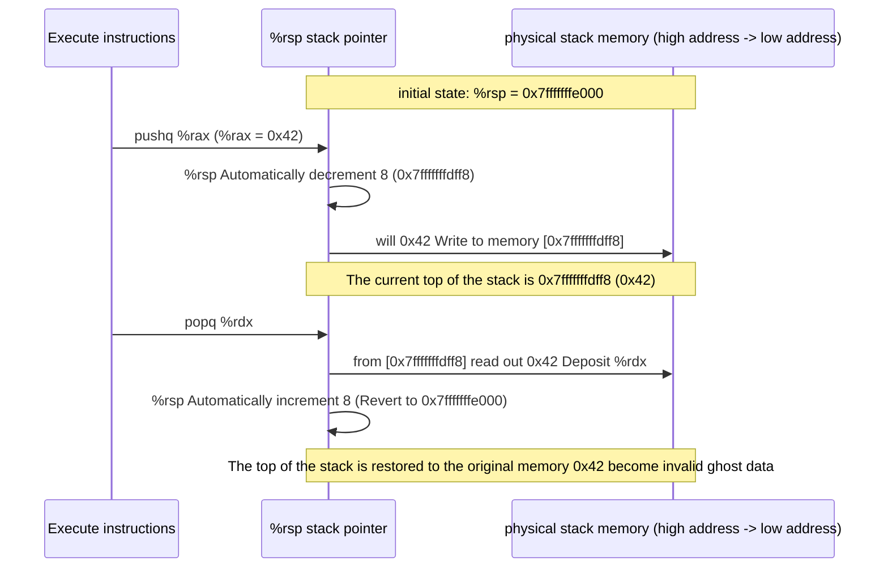

> **Lecturer**: Randal E. Bryant & David R. O'Hallaron ｜ **Original video**: Bilibili points P7 \| **duration**: 01:06:45  
> **Module**: Module 2: Machine-Level Representation of Programs (L05 - L09 · x86-64 assembly, control flow, procedure calls and data structures)  
> **Original video address**: [https://www.bilibili.com/video/BV1iW411d7hd/?p=7](https://www.bilibili.com/video/BV1iW411d7hd/?p=7)  
> **Course official ownership**: Carnegie Mellon University (CMU) 15-213 / 18-213 / 15-513: Introduction to Computer Systems (CSAPP Fall 2015)  
> **Corresponding teaching materials**: *Computer Systems: A Programmer's Perspective (3rd Edition)* by R. Bryant & D. O'Hallaron  
> **Source of subtitles and handouts**: The subtitles were translated and edited by the EugeneLiu/translationCSAPP team (CC BY-NC 4.0 open source license), and the copyright of the slides belongs to the CMU course group.  

---

## 1. Three major machine-level mechanisms for process calls: control, data and memory management

*(Reference time: 00:01:10 · [Video jump (P7 00:01:10)](https://www.bilibili.com/video/BV1iW411d7hd/?p=7&t=70))*


In software engineering, procedures (called Functions in C language and Methods in object-oriented languages) are the core mechanism to achieve code modularization, abstraction and reuse.
when function  $P$  call function  $Q$  At this time, the underlying hardware and operating system must cooperate to complete three basic mechanisms:
1. **Passing Control**: 
   * Entering the function  $Q$  when, the program counter  `%rip`  must be set to  $Q$  The code starting address;
   * in function  $Q$  When returning after execution, `%rip`  Must be restored exactly to the function  $P$  The address of the next instruction immediately following the calling instruction.
2. **Passing Data**: 
   * process  $P$  must be able to contribute to the process  $Q$  Provide one or more parameters;
   * process  $Q$  must be able to contribute to the process  $P$  Returns an execution result.
3. **Allocating & Deallocating Memory**: 
   * function  $Q$  Before starting execution, you may need to allocate space for your own local variables;
   * This local storage must be fully reclaimed before returning;
   * When a function has nested calls or even self-recursive calls, it must support the independent coexistence of local data called multiple times without interfering with each other.

All three major mechanisms are highly optimized and implemented around the Program Stack under the x86-64 system.

## 2. The physical structure of the program stack and instruction-level atomic operations: pushq and popq

*(Reference time: 00:08:45 · [Video jump (P7 00:08:45)](https://www.bilibili.com/video/BV1iW411d7hd/?p=7&t=525))*


### The stack’s growth characteristics towards lower addresses
In the x86-64 architecture and most Unix-like operating systems, the organization of the stack follows the following absolute physical rules:
* **The stack grows downward from high addresses to low addresses (Grows Downward)**; 
* register  `%rsp` (Stack Pointer, stack pointer) stored forever **The memory physical/virtual address of the current top element of the stack**!
* The bottom of the stack is at the high address end, and the top of the stack is at the low address end.

### `pushq`  with  `popq`  microarchitectural decomposition
Pushing and popping data onto the stack has hardware-level atomic instruction support:
1. **push instruction  `pushq Src`**: 
   * Step 1: Change the stack pointer  `%rsp`  Subtract 8 bytes (move down to open up space);
   * Step 2: Convert the source operands  `Src`  The 8-byte value is written  `%rsp`  The new memory address pointed to.
   * Equivalent micro-operation:
     ```assembly
     subq    $8, %rsp
     movq    Src, (%rsp)
     ```
2. **Pop instruction  `popq Dest`**: 
   * Step 1: From the current  `%rsp`  The memory address pointed to reads 8 bytes of data and stores it in the target operand  `Dest`; 
   * Step 2: Change the stack pointer  `%rsp`  Add 8 bytes (move up, free up space).
   * Equivalent micro-operation:
     ```assembly
     movq    (%rsp), Dest
     addq    $8, %rsp
     ```

Note: The pop operation does not physically clear the memory data! The original data still remains in the old memory, just because  `%rsp`  Movements of pointers, they are logically marked as "invalid". This mechanism is also the physical source of "garbage values" left behind in uninitialized local variables.



## 3. Control transfer mechanism: underlying hardware details of call and ret

*(Reference time: 00:19:15 · [Video jump (P7 00:19:15)](https://www.bilibili.com/video/BV1iW411d7hd/?p=7&t=1155))*


The core of control transfer is instructions  `call`  with  `ret`  Exact pairing of:
1. **`call Target`  instructions**: 
   * will be followed by  `call`  The address of the instruction following the instruction (i.e. **Return Address Return Address**) is pushed into the current stack;
   * set program counter  `%rip`  The value of is modified into the objective function  `Target`  entrance address.
2. **`ret`  instructions**: 
   * From the top of the current stack (`%rsp`  The pointed position) pops up an 8-byte address value;
   * Forcibly assign the pop-up address to the program counter  `%rip`, resume execution of the original caller function.

```assembly
# 调用函数的一瞬间栈的精确变化
400540 <multstore>:
400540: 53                      push   %rbx
...
400560 <main>:
...
400563: e8 d8 ff ff ff          callq  400540 <multstore>
400568: 48 8b 54 24 08          mov    0x8(%rsp),%rdx  <-- 返回地址！
```
When the CPU executes  `400563`  of  `callq`  When:
* The CPU finds that the next instruction address is  `0x400568`; 
* The hardware automatically  `0x400568`  Push on the stack, `%rsp`  Decremented by 8;
* `%rip`  Transition to  `0x400540`; 
* when  `multstore`  Internal execution completed encountered  `ret`  instruction, the CPU pops the top of the stack  `0x400568`  Deposit  `%rip`, the command flow is seamlessly  `400568`  Keep pushing forward!

## 4. x86-64 data transfer convention: register parameter matrix and overflow stack parameter

*(Reference time: 00:28:40 · [Video jump (P7 00:28:40)](https://www.bilibili.com/video/BV1iW411d7hd/?p=7&t=1720))*


In the early 32-bit x86 system (IA-32), all function parameters, no matter how many, were passed through stack memory, causing each function call to be accompanied by expensive memory reads and writes.
And in the 64-bit x86-64 ABI (System V AMD64 ABI, Linux/macOS default standard), **The first 6 integer or pointer type parameters are always passed in registers**, a qualitative leap in speed!

### The first 6 parameter register mapping tables (must be familiar with them)

| Parameter number | 64-bit register | 32-bit register | 16-bit register | 8-bit register |
| :--- | :--- | :--- | :--- | :--- |
| **1st parameter** | `%rdi` | `%edi` | `%di` | `%dil` |
| **2nd parameter** | `%rsi` | `%esi` | `%si` | `%sil` |
| **3rd parameter** | `%rdx` | `%edx` | `%dx` | `%dl` |
| **4th parameter** | `%rcx` | `%ecx` | `%cx` | `%cl` |
| **5th parameter** | `%r8` | `%r8d` | `%r8w` | `%r8b` |
| **6th parameter** | `%r9` | `%r9d` | `%r9w` | `%r9b` |
| **Return Val** | `%rax` | `%eax` | `%ax` | `%al` |

*Memory formula*: **D-S-D-C-8-9**(`rDi`, `rSi`, `rDx`, `rCx`, `r8`, `r9`).

### Processing rules for more than 6 parameters
If the function has more than 6 parameters (e.g. 8 parameters are defined):
* The first 6 parameters are still put into the above 6 registers in order;
* 7th to 7th  $N$  parameters must **Passed through the caller's stack frame**!
* Passing order: Parameters must be **Push in reverse order**, the 7th parameter is located on the top of the stack (i.e., the address is immediately adjacent to the return address of the call), and the 8th parameter is located at a higher address above it.
* All parameters passed through the stack must be 8-byte (64-bit) aligned on the stack.

## 5. Register protection convention: Caller-Saved vs Callee-Saved

*(Reference time: 00:41:30 · [Video jump (P7 00:41:30)](https://www.bilibili.com/video/BV1iW411d7hd/?p=7&t=2490))*


Registers are globally unique scarce computing resources shared by all functions. if function  $P$  A register is being used to save key temporary variables, and then a subfunction is called  $Q$, $Q$  Is it possible to overwrite this register at will?
In order to prevent program data from being stepped on and destroyed by each other, x86-64 strictly establishes two types of register protection conventions:

### 1. Callee-Saved Registers
Includes: **`%rbx`, `%rbp`, `%r12`, `%r13`, `%r14`, `%r15`**.
* **rules**: When the process  $P$  Calling process  $Q$  when, $Q$  It must be ensured that before returning, the values of these registers are the same as when they were called. **completely consistent**!
* **Implementation method**: if function  $Q$  want to use  `%rbx`, it must first put  `%rbx`  original value  `pushq %rbx`  Save on the stack; before the function returns after execution, it must pass  `popq %rbx`  Restore original value.
* **for the caller  $P$  meaning**: $P$  Variables that need to survive multiple function calls can be safely stored in Callee-Saved registers, and these values will never be lost after calling any sub-function!

### 2. Caller-Saved Registers
Includes: **`%rax` (return value), parameter register (`%rdi`, `%rsi`, `%rdx`, `%rcx`, `%r8`, `%r9`) and  `%r10`, `%r11`**.
* **rules**: Any function can unconditionally modify the contents of these registers without any need to restore before exiting!
* **for the caller  $P$  meaning**: if  $P$  before calling the subfunction in  `%r10`  Important data is stored in the  `call`  After that, `%r10`  The content may have been completely tampered with by sub-functions. Therefore  $P$  You must be responsible for pushing it onto the stack before calling it!

## 6. Modern stack frame panoramic model and natural support for recursion

*(Reference time: 00:54:10 · [Video jump (P7 00:54:10)](https://www.bilibili.com/video/BV1iW411d7hd/?p=7&t=3250))*


### Panorama of modern x86-64 stack frame structure
In the x86-64 compilation system, not every function will create a complex stack frame:
* **Leaf Functions**: A short function that does not call any other sub-functions, often only requires register parameters and calculations, and does not even need to allocate any space on the stack!
* **Complex function stack frame**: When the register is insufficient, the address of the local variable needs to be obtained (`&`  operator), allocate a local structure/array, or call a function with more than 6 parameters, the stack frame from high to low usually contains:
  1. Pass in parameters (caller-assigned parameters 7 to  $N$); 
  2. return address (`call`  Automatically press in);
  3. Callee-saved registers;
  4. Local variable allocation area;
  5. Construct the parameter area (Argument build area) passed to the sub-function;
  6. **16-byte alignment padding (Padding)**:x86-64 ABI mandatory requirement, when executing  `call`  Before the instruction, the stack pointer  `%rsp`  Must meet 16-byte boundary alignment (facilitates high-speed access by SIMD vector instructions).

### Machine-level natural implementation of recursive calls
Many beginners are curious: How does hardware support self-recursive functions (such as factorial, Fibonacci sequence, depth-first search)? 
**The answer is the privacy of stack frames**!
Each recursive call will trigger a new  `call`  instructions, advance down in memory  `%rsp`  And open up a new, independent stack frame.
Each recursion level has its own local variables, saved registers, and return addresses. When the recursion reaches the Base Case and returns layer by layer, the  `ret`  The status belonging to that layer will automatically pop up, and the data is naturally insulated, without any special "recursive hardware"!


---

### Summary and core thoughts of this lecture (Takeaways)

1. **Essential changes in systems perspective**: This lecture analyzes the core implementation principles of "Machine-Level Programming III: Procedures (Procedure Call, Stack Frame Model and Register Protection Convention)" from the underlying mechanism.
2. **Software and hardware co-design**: Understanding the underlying rules can not only eliminate potential hidden bugs that are difficult to debug, but is also a prerequisite for writing industrial-grade code with ultimate performance.
3. **Hands-on verification**: It is recommended to cooperate with the after-school exercises and official experiments (Lab) of the corresponding chapters of CSAPP, and use GDB and performance analysis tools in the Linux terminal environment to personally verify the theory.
