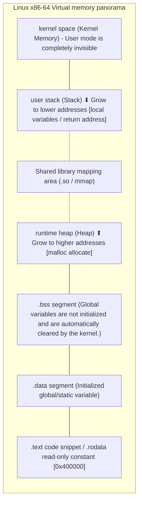

> **Lecturer**: Randal E. Bryant & David R. O'Hallaron ｜ **Original video**: Bilibili points P9 \| **duration**: 01:18:49  
> **Module**: Module 2: Machine-Level Representation of Programs (L05 - L09 · x86-64 assembly, control flow, procedure calls and data structures)  
> **Original video address**: [https://www.bilibili.com/video/BV1iW411d7hd/?p=9](https://www.bilibili.com/video/BV1iW411d7hd/?p=9)  
> **Course official ownership**: Carnegie Mellon University (CMU) 15-213 / 18-213 / 15-513: Introduction to Computer Systems (CSAPP Fall 2015)  
> **Corresponding teaching materials**: *Computer Systems: A Programmer's Perspective (3rd Edition)* by R. Bryant & D. O'Hallaron  
> **Source of subtitles and handouts**: The subtitles were translated and edited by the EugeneLiu/translationCSAPP team (CC BY-NC 4.0 open source license), and the copyright of the slides belongs to the CMU course group.  

---

## 1. Linux 64-bit process memory layout (Memory Layout)

*(Reference time: 00:02:15 · [Video jump (P9 00:02:15)](https://www.bilibili.com/video/BV1iW411d7hd/?p=9&t=135))*


In 64-bit Linux operating systems, despite a 64-bit pointer width (theoretical addressability up to 16 EB), modern x86-64 CPUs and Linux kernels currently only enable the lower 47 bits (approximately 128 TB) as user-mode virtual address space.
A running Linux process has its memory space divided into clear levels from low addresses to high addresses:

1. **Program code and constant sections (.text / .rodata)**: 
   * from address  `0x00400000`  The neighborhood begins to line up upward;
   * Contains compiled machine instructions with attributes **Read-only, executable (r-x)**, to prevent the program from accidentally modifying itself.
2. **Initialized and uninitialized global data sections (.data / .bss)**: 
   * `.data`: Store global variables and static variables that have been explicitly assigned initial values (readable and writable rw-);
   * `.bss`: Store global variables that are not initialized or initialized to 0. It does not occupy disk physical space in the executable file and is cleared by the operating system when loading.
3. **Runtime Heap**: 
   * Immediately after the data segment, pass  `malloc()` / `free()` / `brk()` / `sbrk()`  dynamic allocation;
   * **Grow upward toward higher addresses**.
4. **Shared Libraries**: 
   * Located in the upper middle of the address space, used for dynamic loading  `libc.so`, dynamic linker and via  `mmap()`  mapped file.
5. **User Stack**: 
   * From the highest available address in user space (approx.  `0x7fffffffffff`) start, **Grow downward toward lower addresses**; 
   * Used to store function call frames, return addresses, local variables, and Callee-saved registers.
6. **Kernel Virtual Memory (Kernel Space)**: 
   * Occupying the highest-end address space, user-mode code cannot be read or written, and is only used when an interrupt occurs or a system call is trapped in the kernel.



## 2. Buffer Overflow vulnerability: How do hackers hijack program control flow?

*(Reference time: 00:15:40 · [Video jump (P9 00:15:40)](https://www.bilibili.com/video/BV1iW411d7hd/?p=9&t=940))*


C language is a high-performance language without "Array Bounds Checking". When the programmer allocates a fixed-size character array on the stack but uses an unsafe library function that does not limit the input length (such as  `gets()`, `strcpy()`, `sprintf()`, `scanf("%s")`), disaster struck.

### Classic anatomy of stack overflow attack
Suppose there is the following extremely dangerous code:
```c
void echo() {
    char buf[24]; // 在栈上分配 24 字节
    gets(buf);    // 恶名昭彰：从标准输入无限制读取字符直至遇到换行符！
    puts(buf);
}
```

```
栈帧物理空间示意 (从低地址到高地址):
  %rsp -> [ buf[0] ... buf[23] ]   (24 字节局部缓冲区)
          [ 保存的 %rbx 等寄存器 ]   (8 字节)
          [ 保存的返回地址 %rip ]   (8 字节！原指向 main 函数)
```
* **Normal execution**: The user inputs 10 characters and saves  `buf`, the function is executed and encountered  `ret`, the CPU pops the correct return address from the top of the stack, and the program continues to execute normally.
* **Malicious attack (Exploit)**: 
  * The attacker carefully constructs a malicious binary input with a length of 40 bytes;
  * The first 24 bytes are filled  `buf`; 
  * The next 8 bytes overwrite the old saved register;
  * **The last 8 bytes accurately cover the "saved return address (Return Address)"**!
  * when  `echo`  The function is executed to  `ret`  When the CPU pops up a malicious address forged by the attacker, the program counter  `%rip`  Instantly jump to the execution of malicious code specified by the attacker!

**Historical lessons**: In 1988, the famous Morris Worm paralyzed one tenth of the world's Internet hosts. Its core lethality was the use of Unix.  `fingerd`  in daemon process  `gets()`  Stack overflow vulnerability!

## 3. The first line of system defense: Canary stack protection mechanism (Stack Canaries)

*(Reference time: 00:32:10 · [Video jump (P9 00:32:10)](https://www.bilibili.com/video/BV1iW411d7hd/?p=9&t=1930))*


In order to fundamentally resist stack overflow attacks that destroy return addresses, modern compilers (GCC) enable **Canary protection mechanism (Stack Canaries / Stack Protector)**.

### Canary in the Coal Mine: Origin of the Name
Coal miners in the 19th century carried a canary with them when they went down the mine. Canaries are extremely sensitive to poisonous gases, and if a canary dies from poisoning, the miners know there is a gas leak and must retreat immediately.
In the program stack, **Canary **is inserted by the compiler at the function entry** between local buffer and return address** A random 8-byte special guard value!

### Assembly-level canary implantation and verification
```assembly
# 开启 -fstack-protector 后的函数汇编
echo:
    subq    $40, %rsp
    movq    %fs:40, %rax        # 从线程段寄存器 %fs 获取随机 Guard 守卫值
    movq    %rax, 24(%rsp)      # 将金丝雀紧贴在返回地址之前写入栈中！
    xorl    %eax, %eax          # 清空 %rax，抹去金丝雀在寄存器中的痕迹

    leaq    (%rsp), %rdi
    callq   gets                # 执行危险的 gets

    # 校验流程
    movq    24(%rsp), %rax      # 从栈中重新读取金丝雀值
    xorq    %fs:40, %rax        # 与内核原始守卫值做异或比对
    jne     .L_STACK_CHK_FAIL   # 如果不为 0，说明金丝雀被篡改！立即跳转
    addq    $40, %rsp
    ret

.L_STACK_CHK_FAIL:
    callq   __stack_chk_fail    # 强行 abort 进程，输出 "*** stack smashing detected ***"
```
* **defensive logic**: Since the stack grows toward lower addresses, if an attacker wants to overflow  `buf`  thus overwriting the return address of a higher address, **must span and overwrite the canary in the middle**!
* The guard value is randomly generated by the operating system kernel when the process starts, and its lowest byte usually contains  `0x00` (Block  `strcpy`  Wait for the string function to copy backwards). The attacker cannot guess the content of the canary. Once the XOR verification fails after tampering, the program will directly self-destruct and the vulnerability attack will be resolved.

## 4. Modern system three-dimensional defense system: NX/DEP protection and ASLR address space randomization

*(Reference time: 00:46:30 · [Video jump (P9 00:46:30)](https://www.bilibili.com/video/BV1iW411d7hd/?p=9&t=2790))*


In addition to canaries, modern operating systems and hardware architectures have also built two indestructible three-dimensional protective barriers:

### 1. Stack and data segment non-executable protection (NX Bit / DEP)
* **Principle**: In early von Neumann computers, there was no strict physical distinction between data and code in memory. Attackers often put a piece of malicious machine instruction (Shellcode, such as calling  `execve("/bin/sh")`) directly writes to the stack buffer, and then points the return address to the shellcode in the stack for execution.
* **NX flag (No-Execute/Data Execution Prevention)**: Modern CPUs introduce dedicated hardware into page table entries  **NX bits**. The operating system strictly marks permissions for stack and heap memory as **Readable and writable, but absolutely not executable (rw-, satisfies  $W \oplus X$  principle)**!
* **Effect**: Even if the attacker successfully injects malicious shellcode into the stack buffer and jumps there, the CPU hardware will trigger a hardware protection fault and throw an instruction when it attempts to fetch instructions from the stack address.  `SIGSEGV`  Forcefully terminate the program.

### 2. Address Space Layout Randomization (ASLR: Address Space Layout Randomization)
* **Principle**: To hijack the control flow, an attacker must know in advance the exact virtual address of the injected code or libc library function in memory.
* **ASLR mechanism**: Every time the Linux kernel starts and runs a program, it will introduce random-sized offsets into the stack base address, heap starting address, and shared dynamic library loading address!
* **Effect**: Every time the program is run, the physical virtual addresses of stack variables and library functions are all drifting violently. The address calculated by the attacker on the local computer will 100% fail on the remote target machine, greatly increasing the threshold for attack.

## 5. Advanced Penetration Attack and Defense: Return-Oriented Programming (ROP - Return-Oriented Programming)

*(Reference time: 01:03:15 · [Video jump (P9 01:03:15)](https://www.bilibili.com/video/BV1iW411d7hd/?p=9&t=3795))*


When modern systems have both NX (stack non-executable) and canaries enabled, are hackers at their wits end?
\*\*Return-Oriented Programming (ROP)\*\* emerged as the times require and has become the most dazzling hacker art in modern software security attack and defense.

### The core philosophy of ROP: don’t inject code, kill with a borrowed knife
The core idea of ROP is: since the shellcode injected by yourself cannot run on a non-executable stack, then **Borrow directly from the target program itself  `.text`  code snippet or  `libc.so`  An inherently legal executable code snippet**!

### What is a ROP widget (Gadget)?
* **Gadget**  is found in an existing snippet and starts with  `ret` (machine code  `0xc3`) A very short sequence of instructions (usually 2 to 3 instructions) at the end of the instruction.
* Typical Gadget example:
  ```assembly
  popq %rdi; ret
  ```
  The function of this widget is to pop a value from the top of the current stack and store it in  `%rdi` (It happens to be the register where the first parameter is passed!), and then execute  `ret`!

### ROP attack chain (ROP Chain) splicing art
The attacker no longer stores instruction code on the stack, but **Stores a long carefully planned call chain with cross-arranged code addresses and data**: 
1. The attacker overwrites the return address to point to Gadget 1 (`popq %rdi; ret`); 
2. The next unit of the stack stores parameters (such as pointing to  `"/bin/sh"`  string address);
3. The next unit on the stack stores Gadget 2 or  `system()`  The entry address of the function;
4. When the function returns, the CPU executes Gadget 1:  `"/bin/sh"`  pop up and load  `%rdi`; 
5. Gadget 1 at the end of  `ret`  Automatically pop the next address from the top of the stack and jump in seamlessly  `system()`  Execute!
6. A system shell with root privileges was successfully activated by hackers!

> \[!NOTE\] CSAPP experiment association: Attack Lab
The third major experiment at CSAPP  **Attack Lab**  Medium:
> * Experience classic stack overflow and code injection in the first few levels (Phase 1-3) with protection disabled;
> * In the next few levels (Phase 4-5), NX non-executable protection is turned on, and students must search for various other types of errors in the disassembled machine code library.  `c3`  At the end of the byte, create your own ROP Gadget attack chain!


---

### Summary and core thoughts of this lecture (Takeaways)

1. **Essential changes in systems perspective**: This lecture analyzes the core implementation principles of "Machine-Level Programming V: Advanced Topics (buffer overflow, stack protection mechanism, ASLR and ROP attacks)" from the underlying mechanism.
2. **Software and hardware co-design**: Understanding the underlying rules can not only eliminate potential hidden bugs that are difficult to debug, but is also a prerequisite for writing industrial-grade code with ultimate performance.
3. **Hands-on verification**: It is recommended to cooperate with the after-school exercises and official experiments (Lab) of the corresponding chapters of CSAPP, and use GDB and performance analysis tools in the Linux terminal environment to personally verify the theory.
