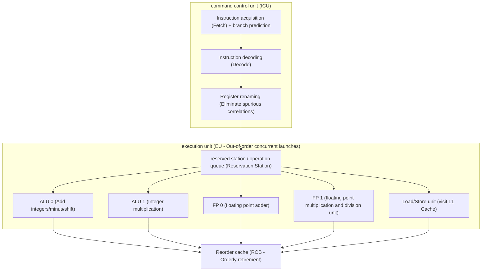

> **Lecturer**: David R. O'Hallaron ｜ **Original video**: Bilibili points P10 \| **duration**: 01:13:38  
> **Module**: Module 3: Optimizing Program Performance (L10 · Compiler capabilities and limitations, loop optimization, instruction-level parallelism)  
> **Original video address**: [https://www.bilibili.com/video/BV1iW411d7hd/?p=10](https://www.bilibili.com/video/BV1iW411d7hd/?p=10)  
> **Course official ownership**: Carnegie Mellon University (CMU) 15-213 / 18-213 / 15-513: Introduction to Computer Systems (CSAPP Fall 2015)  
> **Corresponding teaching materials**: *Computer Systems: A Programmer's Perspective (3rd Edition)* by R. Bryant & D. O'Hallaron  
> **Source of subtitles and handouts**: The subtitles were translated and edited by the EugeneLiu/translationCSAPP team (CC BY-NC 4.0 open source license), and the copyright of the slides belongs to the CMU course group.  

---

## 1. The philosophy of optimization and the conservative boundaries of the compiler

*(Reference time: 00:02:50 · [Video jump (P10 00:02:50)](https://www.bilibili.com/video/BV1iW411d7hd/?p=10&t=170))*


Modern optimizing compilers (if enabled  `gcc -O2`  or  `-O3`) is an amazing engineering marvel. They can automatically rearrange instructions, unroll small loops, register allocations, eliminate dead code, and convert multiplications into shifts.
However, in daily development, many codes still run extremely slowly even after compiler optimization. Why can't the compiler do everything for us?

### The golden commandment of compilers: Safety First
The compiler's primary responsibility is **correctness**. Optimized machine code must behave exactly like the original source code **Strict consistency in all possible extreme situations (Behavioral Equivalence)**.
Whenever there is any rare condition that could cause an optimization to change the observable behavior of the program, the compiler must **Give up optimization and choose to generate code conservatively**!

### Two core obstacles hindering compiler optimization
1. **Memory Aliasing**: 
   ```c
   void twiddle1(long *xp, long *yp) {
       *xp += *yp;
       *xp += *yp;
   }
   void twiddle2(long *xp, long *yp) {
       *xp += 2 * *yp;
   }
   ```
   Intuitively  `twiddle1`  4 memory accesses (2 reads, 2 writes), while  `twiddle2`  Only 2 reads and 1 write are required. Why doesn't the compiler dare to  `twiddle1`  Optimized into  `twiddle2`?
   * Consider the extreme case: if the caller passes in the same pointer  `xp == yp`!
   * `twiddle1`: first time  `*xp += *xp`  Double the value, second time  `*xp += *xp`  Doubled again, the final result is the original value  **4 times**!
   * `twiddle2`: `*xp += 2 * *xp`  The calculated result is the original value  **3 times**!
   * The result is completely different! Because the compiler cannot prove at compile time  `xp`  with  `yp`  Whether it points to the same memory, only 4 memory accesses can be faithfully retained for safety.

2. **Side Effects of Function Calls**: 
   ```c
   long counter = 0;
   long f() { return counter++; }
   long func1() { return f() + f() + f() + f(); }
   long func2() { return 4 * f(); }
   ```
   `func1`  make  `counter`  increased by 4, while  `func2`  Only called once  `f()`  cause  `counter`  Only increases by 1. Therefore, when a loop condition contains a function call, the compiler does not dare to easily move the function out of the loop!

## 2. Eliminate progressive inefficiency: the disaster of strlen in code movement and loop conditions

*(Reference time: 00:15:30 · [Video jump (P10 00:15:30)](https://www.bilibili.com/video/BV1iW411d7hd/?p=10&t=930))*


### Code Motion
Code movement refers to identifying those expressions that are repeatedly calculated in the loop body, but the calculation results of each iteration are actually exactly the same, and extract them from the loop body to be calculated only once outside the loop.

### Classic negative textbook: Big O complexity collapses to  $O(N^2)$  tragedy
Many senior programmers have inadvertently written the following seemingly elegant code:
```c
/* 将字符串全部字符转为小写 */
void lower(char *s) {
    long i;
    for (i = 0; i < strlen(s); i++) {
        if (s[i] >= 'A' && s[i] <= 'Z')
            s[i] -= ('A' - 'a');
    }
}
```
* **disaster analysis**: 
  * in C language  `strlen(s)`  Instead of reading a field directly like Java or Go, you must scan from the pointer head all the way to  `\0`  Terminator, time-consuming is strict  **$O(N)$**!
  * Loop execution  $N$  times, each loop is called again when judging the exit condition.  `strlen(s)`; 
  * The actual running time of the entire code becomes huge  **$O(N^2)$**!
  * When the string is only a few dozen bytes, there is no awareness; when processing large text of several megabytes, the program will instantly fall into a state of suspended animation!
* **Why doesn't the compiler come to the rescue?**
  * because  `lower`  Internally modified  `s[i]`  memory! The compiler doesn't know if modifying a character will accidentally write a  `\0`  thus changing the string length so it cannot be safely retrieved  `strlen`!
* **Programmer’s manual salvation**: 
  ```c
  void lower_opt(char *s) {
      long i;
      long len = strlen(s); // 手动代码移动！仅计算一次
      for (i = 0; i < len; i++) {
          if (s[i] >= 'A' && s[i] <= 'Z')
              s[i] -= ('A' - 'a');
      }
  }
  ```
  Time consuming moment by  $O(N^2)$  reduced to standard  $O(N)$, for a string of 1 million characters, the performance improvement is up to  **100,000 times**!

## 3. System-level performance benchmark: Clock Cycles Per Element (CPE - Cycles Per Element)

*(Reference time: 00:26:15 · [Video jump (P10 00:26:15)](https://www.bilibili.com/video/BV1iW411d7hd/?p=10&t=1575))*


In system-level performance optimization, the traditional "seconds" is not an ideal measurement because it is seriously affected by the CPU frequency, operating system background load and clock jitter.
CSAPP introduces golden performance indicators: **Cycles Per Element (CPE: Cycles Per Element)**.

### linear time model
Most processing lengths are  $n$  A loop over an array or collection that runs in total CPU clock cycles  $T$  Can be modeled by a linear equation: 
$$T(n) = CPE \times n + Overhead$$
* **Overhead (startup overhead)**: Including one-time fixed overhead such as function calls, stack frame establishment, variable initialization, etc.;
* **CPE (slope)**: The number of marginal cycles required to process each element. The lower the CPE, the higher the throughput efficiency of the algorithm on the pipeline!
* By running different scales  $n$  test cases and perform least squares linear fitting, the slope is the accurate CPE.

## 4. In-depth dismantling of modern superscalar processor microarchitecture: out-of-order execution and critical path

*(Reference time: 00:36:40 · [Video jump (P10 00:36:40)](https://www.bilibili.com/video/BV1iW411d7hd/?p=10&t=2200))*


To break through the compiler's optimization ceiling, programmers must build a real physical image of modern CPU microarchitecture in their minds:
Modern processors are no longer the traditional "fetch one, execute one, write back one" serial machine, but a superscalar, highly pipelined and out-of-order execution (Out-of-Order Execution) parallel behemoth!

### Core physical unit division
1. **Instruction Control Unit (ICU - Instruction Control Unit)**: 
   * Responsible for fetching instructions from the L1 instruction Cache;
   * **Branch Prediction and Speculative Instruction Fetching**: Fetch backward instructions in advance before the result of the conditional branch is obtained;
   * **instruction decoder**: Decompose complex x86 macros into a series of simpler low-level, RISC-like **micro-operation ($\mu$-ops)**; 
   * **Retirement Unit and Register Renaming**: Maintain dozens of physical register aliases, eliminate pseudo-data correlation (WAR/WAW conflicts), and ensure that although instructions are executed out of order, the external state changes displayed are completely consistent with the order of exit.
2. **Execution Unit (EU - Execution Unit)**: 
   * Has multiple concurrent function execution units: such as 2 integer addition and subtraction units, 2 floating point multiplication and division units, multiple memory loading and storage units;
   * **Data-Driven Execution**: As long as the input operands it relies on are ready and the corresponding functional unit is idle, a micro-operation can be launched and executed immediately, regardless of whether the instruction in front of it in the program code is stuck!

### Critical Path and Data Flow Diagram
The actual execution speed of a loop of code, formed by the **The longest dependency chain in the data flow dependency graph—Critical Path **The only decision.
If the calculation of the subsequent instruction must wait for the output result of the previous instruction, a hard connection is formed between them.** Data Hazard**, no matter how many free ALU hardware you have, they can only wait serially!



## 5. Breaking the critical path: loop unrolling and multi-way parallel accumulators

*(Reference time: 00:48:30 · [Video jump (P10 00:48:30)](https://www.bilibili.com/video/BV1iW411d7hd/?p=10&t=2910))*


Take an array cumulative sum/product core loop as an example:
```c
/* 基准实现 combine4 */
void combine4(vec_ptr v, data_t *dest) {
    long i;
    long length = vec_length(v);
    data_t *d = get_vec_start(v);
    data_t acc = IDENT;
    for (i = 0; i < length; i++) {
        acc = acc OP d[i]; // 致命瓶颈：数据依赖链！
    }
    *dest = acc;
}
```

### 1. simple  $k \times 1$  Loop unrolling: Why do you hit a performance wall?
We can unroll the loop (Loop Unrolling), such as  $2 \times 1$  Unfold: Compute 2 elements per iteration.
```c
for (i = 0; i < limit; i += 2) {
    acc = (acc OP d[i]) OP d[i+1];
}
```
* **Effect**:Reduce the loop variable  `i`  The number of auto-increments and branch jumps has slightly improved performance;
* **bottleneck**: However, calculation  `(acc OP d[i]) OP d[i+1]` , all calculations are still serially arranged on a single-plank bridge  `acc`  On! The next addition must strictly wait for the output of the previous addition, **The critical path length has not been shortened at all**! Its CPE is directly stuck by the latency (Latency Bound, about 3.0 cycles) of the floating-point adder.

### 2. Break through physical limits: $k \times k$  Multiple independent accumulators
In order to break the data dependency, we can introduce **Multiple independent accumulator variables** (e.g.  `acc0`  Accumulate even-numbered terms, `acc1`  Accumulating odd terms):
```c
/* 2 x 2 多路累加器循环展开 */
void combine6(vec_ptr v, data_t *dest) {
    long i;
    long length = vec_length(v);
    long limit = length - 1;
    data_t *d = get_vec_start(v);
    data_t acc0 = IDENT;
    data_t acc1 = IDENT;

    /* 每次迭代利用两条独立的数据流并发执行 */
    for (i = 0; i < limit; i += 2) {
        acc0 = acc0 OP d[i];
        acc1 = acc1 OP d[i+1];
    }
    /* 处理末尾剩余元素 */
    for (; i < length; i++) {
        acc0 = acc0 OP d[i];
    }
    *dest = acc0 OP acc1;
}
```
* **God-level microarchitecture effect**: 
  * `acc0`  with  `acc1`  Completely unrelated to each other logically!
  * The CPU's two floating-point units are capable of **Issue and execute simultaneously within the same clock cycle  `acc0`  and  `acc1`  The accumulation of**!
  * The critical path was abruptly cut in half, the throughput doubled, and the CPE directly approached the hardware pipeline. **Throughput Bound (about 0.5 cycles)**!

> \[!WARNING\] Mathematically restricted areas of floating-point arithmetic optimization
Why doesn't the compiler dare to automatically convert  `combine4`  Optimized to  `combine6`?
Because in real number mathematics addition satisfies the associative law  $(a+b)+c = a+(b+c)$, but **In IEEE 754 floating-point calculations, addition does not satisfy the associative law.**!
Changing the order of floating point accumulation can result in different rounding errors, so multi-way accumulation optimization must be done explicitly and manually by programmers who understand the underlying architecture!

## 6. Write branch prediction-friendly code and performance summary

*(Reference time: 01:04:20 · [Video jump (P10 01:04:20)](https://www.bilibili.com/video/BV1iW411d7hd/?p=10&t=3860))*


### Hierarchy of Optimization
1. **Highest priority: Advanced algorithms and data structures**:
Reduce algorithm complexity from  $O(N^2)$  reduced to  $O(N \log N)$, no low-level microarchitectural tricks can make up for the disadvantages at the algorithm level.
2. **Priority 2: Writing basic compiler-friendly code**: 
   * Eliminate unnecessary redundant function calls inside loops (external code);
   * Eliminate the memory alias obstruction, use local variables to inherit the loop accumulation results, and finally write back the pointer in one go;
   * Make the boundaries of the memory area referenced by the pointer as clear as possible.
3. **Third Priority: Squeezing the Processor Hardware Instruction-Level Parallelism (ILP)**: 
   * For computationally intensive hotspot loops, use  $k \times k$  Loop unrolling with multi-channel parallel accumulators;
   * Use parentheses to recombine the order of operations (e.g.  `x = x * (a * b)`), split critical path dependencies.
4. **Priority 4: Avoid microarchitectural pitfalls**: 
   * Try to keep branch jump directions as predictable as possible (avoid highly random data-driven branches);
   * Make good use of conditional transfer instructions  `cmov`; 
   * Adhere to the principle of locality (the core focus of the next module: memory hierarchy and cache-friendly access).


---

### Summary and core thoughts of this lecture (Takeaways)

1. **Essential changes in systems perspective**: This lecture analyzes the core implementation principles of "Program Optimization (program performance optimization: compiler boundaries, CPE and superscalar pipeline critical path)" from the underlying mechanism.
2. **Software and hardware co-design**: Understanding the underlying rules can not only eliminate potential hidden bugs that are difficult to debug, but is also a prerequisite for writing industrial-grade code with ultimate performance.
3. **Hands-on verification**: It is recommended to cooperate with the after-school exercises and official experiments (Lab) of the corresponding chapters of CSAPP, and use GDB and performance analysis tools in the Linux terminal environment to personally verify the theory.
