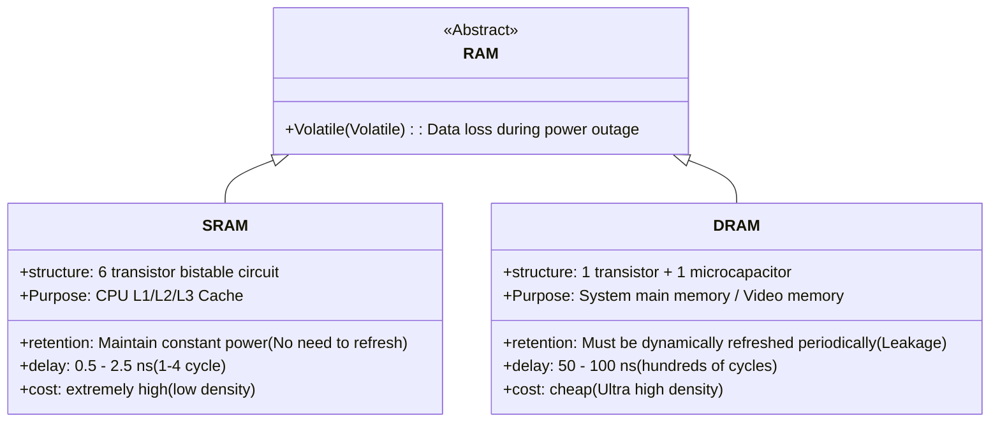

> **Lecturer**: David R. O'Hallaron ｜ **Original video**: Bilibili points P11 \| **duration**: 01:15:47  
> **Module**: Module 4: The Memory Hierarchy & Cache (L11 - L12 · Locality principle, storage pyramid, Cache organization and cache-friendly code)  
> **Original video address**: [https://www.bilibili.com/video/BV1iW411d7hd/?p=11](https://www.bilibili.com/video/BV1iW411d7hd/?p=11)  
> **Course official ownership**: Carnegie Mellon University (CMU) 15-213 / 18-213 / 15-513: Introduction to Computer Systems (CSAPP Fall 2015)  
> **Corresponding teaching materials**: *Computer Systems: A Programmer's Perspective (3rd Edition)* by R. Bryant & D. O'Hallaron  
> **Source of subtitles and handouts**: The subtitles were translated and edited by the EugeneLiu/translationCSAPP team (CC BY-NC 4.0 open source license), and the copyright of the slides belongs to the CMU course group.  

---

## 1. Two pillars of computer storage technology: Comparison of physical properties of SRAM and DRAM

*(Reference time: 00:02:15 · [Video jump (P11 00:02:15)](https://www.bilibili.com/video/BV1iW411d7hd/?p=11&t=135))*


In modern computer systems, main memory (Main Memory) and cache (Cache) are constructed from two types of semiconductor random access memories (RAM) based on completely different physical mechanisms: **SRAM (Static Random Access Memory)**  with  **DRAM (Dynamic Random Access Memory)**.

### 1. SRAM (Static RAM) core mechanism
* **memory cell structure**: Each bit consists of a  **6-Transistor Circuit**  The bistable latch is implemented.
* **physical properties**: 
  * SRAM will stably maintain its state (0 or 1) indefinitely as long as power is continuously applied, **No dynamic refresh operations are required**; 
  * Extremely high anti-interference resilience to external voltage jitter and noise;
  * **Very low access latency**: The access time is only  **0.5 to 2.5 nanoseconds (1 to several CPU clock cycles)**!
* **cost**: Each unit requires 6 transistors, has low integration, large silicon area, extremely expensive manufacturing costs and high power consumption.
* **Application scenarios**: L1, L2, L3 cache inside the CPU chip.

### 2. DRAM (Dynamic RAM) core mechanism
* **memory cell structure**: Each bit is only composed of  **1 transistor and 1 tiny microcapacitor (1T-1C)**  Composition!
* **physical properties**: 
  * The tiny amount of charge stored in the capacitor leaks rapidly through the silicon substrate over time (leakage), typically only lasting 10 to 100 milliseconds at room temperature;
  * **Force dynamic refresh (Refresh)**: The memory controller must periodically read and recharge all rows every tens of milliseconds, otherwise the data will be permanently lost;
  * Destructive Read: Write-back charging must be performed immediately after each capacitor charge is read;
  * **Higher access latency**: The access time is approx.  **50 to 100 nanoseconds (hundreds of CPU clock cycles)**.
* **Advantages**: The minimalist 1T-1C structure enables extremely high chip integration and very low cost per unit capacity.
* **Application scenarios**: The main memory of the computer and the video memory of the graphics card.



## 2. Non-volatile storage and solid-state drive (SSD) internal microarchitecture

*(Reference time: 00:18:40 · [Video jump (P11 00:18:40)](https://www.bilibili.com/video/BV1iW411d7hd/?p=11&t=1120))*


Semiconductor memories that retain data even after power is turned off are collectively called **Nonvolatile Memory**: 
* **ROM (Read-Only Memory)**: Early used to solidify firmware;
* **Flash Memory**: Modern mainstream technology, divided into NOR Flash (supports XIP execution within the chip) and NAND Flash (high density, large capacity).

### Solid-State Drive (SSD: Solid-State Drive) Architecture and Wear Leveling
A solid-state drive consists of an embedded controller (SSD Controller) and one or more NAND Flash memory chip arrays.
* **Asymmetric physical laws of Page and Block**: 
  * The basic read and write units of flash memory are **Page (Page, typical size 4KB to 8KB)**; 
  * The erase unit of flash memory is **Block (Block, typically composed of 32 to 128 Pages, size 512KB to 4MB)**!
  * **Can only write to empty pages, cannot overwrite in place (No In-Place Overwrite)**: A Page must be completely erased (all set to 1) before data can be written. Once it is full, if you want to modify a Page, you must copy the remaining valid Pages to the new Block, and then erase the old Block entirely!
* **Write Amplification**: Modifying a small amount of data causes a large amount of underlying data to be moved and erased in its entirety.
* **Wear Leveling**: Each flash block typically has a lifespan of only 1,000 to 100,000 cycles. An extremely complex firmware algorithm runs inside the SSD controller, which evenly distributes write operations to all physical blocks to prevent premature destruction of local blocks.

## 3. Mechanical hard disk (HDD) physical geometry and three-dimensional access latency calculation

*(Reference time: 00:32:15 · [Video jump (P11 00:32:15)](https://www.bilibili.com/video/BV1iW411d7hd/?p=11&t=1935))*


Although SSDs have become popular, mechanical hard disks (Hard Disk Drives) still play an irreplaceable role in massive cold data storage centers.
A mechanical hard drive is a precision electromechanical device composed of rotating platters (Platters) coated with magnetic media.

### Disk physical geometry
* **Spindle**: Drive the platter to rotate at a constant high speed (common 5400 RPM, 7200 RPM or enterprise-level 15000 RPM);
* **Tracks**: concentric rings on the disc surface;
* **Sectors**: Each track is divided into several sectors (standard size is 512 bytes or 4096 bytes), and the sectors are separated by gaps (Gaps) where no data is stored;
* **Cylinder**: A virtual cylinder composed of a set of tracks with the same radius on all disks;
* **Head arm and read/write heads (Read/Write Heads)**: Suspended on an air cushion only tens of nanometers away from the disc surface, it swings synchronously in the radial direction.

### Mathematical derivation of disk access time consumption (three major delay stages)
Total time to read a disk sector  $T_{\text{access}}$  Determined by three key stages: 
$$T_{\text{access}} = T_{\text{seek}} + T_{\text{rotation}} + T_{\text{transfer}}$$

1. **Seek Time,  $T_{\text{seek}}$)**: 
   * The time it takes for the magnetic head arm to mechanically swing to accurately align the magnetic head with the target cylinder (track);
   * The average seek time of a modern disk is approximately  **3 to 9 milliseconds (ms)**.
2. **Rotational Latency,  $T_{\text{rotation}}$)**: 
   * After the magnetic head reaches the target track, the time it takes to wait for the disk to rotate and rotate the target sector to be directly under the magnetic head;
   * The average rotational delay is equal to the time it takes for the platter to rotate half a revolution: 
     $$T_{\text{avg rotation}} = \frac{1}{2} \times \left( \frac{60 \text{ 秒}}{\text{RPM}} \right)$$
     * For example a 7200 RPM hard drive: $T_{\text{avg rotation}} = \frac{1}{2} \times \frac{60}{7200} \approx 4.17 \text{ ms}$.
3. **Data transfer time (Transfer Time,  $T_{\text{transfer}}$)**: 
   * The time it takes for the target sector to sweep directly under the magnetic head and the magnetic signal to be converted into an electrical signal;
   * It takes very little time, usually within  **0.02 ms**  order of magnitude.

### Shocking Contrast: The Cruel Reality of Storage Walls
* **Access CPU registers**: $\approx 0.3 \text{ ns}$ (If converted to human body perception time of 1 second);
* **Access L1 Cache**: $\approx 1 \text{ ns}$ (equivalent to 3 seconds);
* **Access DRAM main memory**: $\approx 100 \text{ ns}$ (equivalent to 5 minutes);
* **Access mechanical disk**: $\approx 10 \text{ ms} = 10,000,000 \text{ ns}$(**That’s a full 12 months! A whole year!**).
This huge physical gap spanning 7 orders of magnitude is the fundamental reason why the design of modern computer architecture must entirely revolve around "cache"!

## 4. The soul law of computer systems: Principle of Locality

*(Reference time: 00:46:10 · [Video jump (P11 00:46:10)](https://www.bilibili.com/video/BV1iW411d7hd/?p=11&t=2770))*


The reason why the computer architecture can maintain high efficiency under such a huge speed gap is completely based on a powerful empirical physical phenomenon——**Principle of Locality**.
A well-written computer program tends to access only a small local area of the entire memory address space at any time.

### Two major manifestations of locality
1. **Temporal Locality**: 
   * If a memory location is accessed once, there is a high probability that it will be accessed in the near future. **Repeated visits**; 
   * Typical example: loop control variable  `i`, local variables accumulated repeatedly in the loop body  `sum`, the code instructions of the loop body itself.
2. **Spatial Locality**: 
   * If a memory location is accessed once, then in the near future, instead of **Physically adjacent memory locations** Highly likely to be accessed;
   * Typical example: a linear assembly instruction stream that continuously traverses one-dimensional array elements in order and executes them in order.

### Step size analysis and the Achilles heel of multidimensional array traversal
The stride (Stride) used to access continuous vectors has a decisive impact on spatial locality:
* **The step size is 1 (Stride-1)**: Read elements one by one in memory order, with perfect spatial locality;
* **The step size is  $k$ (Stride-$k$)**: every  $k$  elements are read once, $k$  The larger the value, the worse the spatial locality.

```c
#define M 2048
#define N 2048
int a[M][N];

/* 函数 1：行优先遍历 (Row-Major) -> Stride-1 访问 */
int sum_array_rows() {
    int i, j, sum = 0;
    for (i = 0; i < M; i++)
        for (j = 0; j < N; j++)
            sum += a[i][j]; // 完美的连续地址访问！
    return sum;
}

/* 函数 2：列优先遍历 (Column-Major) -> Stride-N 访问 */
int sum_array_cols() {
    int i, j, sum = 0;
    for (j = 0; j < N; j++)
        for (i = 0; i < M; i++)
            sum += a[i][j]; // 灾难性的跳跃访问！步长为 2048*4 = 8192 字节！
    return sum;
}
```
* **actual test gap**: For large matrices, `sum_array_rows`  typically runs faster than  `sum_array_cols` **10x to 25x faster**! Although the asymptotic complexity of both is  $O(M \times N)$.
* **Reason**: Each time the CPU loads data from the memory to the Cache, it is transferred in units of 64-byte blocks (Cache Line). Row-major traversal single load 16  `int`, all subsequent 15 times hit the Cache at high speed; and each access in the column-first traversal spans an entire row, wasting all the useful data just loaded into the Cache, causing an extremely tragic Cache Miss!

## 5. The Memory Hierarchy

*(Reference time: 01:02:15 · [Video jump (P11 01:02:15)](https://www.bilibili.com/video/BV1iW411d7hd/?p=11&t=3735))*


Taking into account the speed, cost and capacity trade-offs of all the above-mentioned storage devices, modern computer systems build a hierarchical **Memory Hierarchy**: 

```
       [ L0: CPU 寄存器 ]         (几百字节，0.3ns)
          [ L1 Cache ]            (数十 KB，1ns)
            [ L2 Cache ]          (数百 KB - 几 MB，3-10ns)
              [ L3 Cache ]        (几十 MB，10-20ns)
                [ L4: 主存 DRAM ] (数十 GB，50-100ns)
                  [ L5: 本地 SSD / HDD ] (TB 级别，微秒至毫秒级)
                    [ L6: 远程分布式存储 / Web 服务器 ] (EB 级别，数十毫秒以上)
```

### Core Caching Principles: Chapter  $k$  layer as the first  $k+1$  layer hardware cache
The central operating logic of the entire pyramid is: **Each tier of storage devices acts as a cache for the larger, slower storage device immediately below it.**!
* Data is always transferred between two adjacent layers in units of fixed-size blocks;
* **Cache Hit**: When the program is in the  $k$  The layer finds the required data block and returns it directly at high speed;
* **Cache Miss**: When the required data is in the  $k$  When the layer does not exist, you must access the  $k+1$  layer retrieves it and puts it into the  $k$  layer.

### Three classic Cache Miss types (3C model)
1. **Cold / Compulsory Miss (Cold / Compulsory Miss)**: 
   * When the Cache is initially empty, any data block accessed for the first time must be forced to be loaded from the next layer.
2. **Conflict Miss**: 
   * Most hardware caches use a restricted mapping placement strategy (multiple memory blocks mapped to the same cache group);
   * Even if there is a lot of remaining space in the cache, if the program frequently accesses multiple different data blocks mapped to the same group, they will squeeze and replace each other (called thrashing).
3. **Capacity Miss**: 
   * The total size of the program's working set exceeds the total physical capacity of the Cache, and data blocks are inevitably swapped out frequently.


---

### Summary and core thoughts of this lecture (Takeaways)

1. **Essential changes in systems perspective**: This lecture analyzes the core implementation principles of "The Memory Hierarchy (storage technology, disk and SSD physical characteristics, locality principle and storage pyramid)" from the underlying mechanism.
2. **Software and hardware co-design**: Understanding the underlying rules can not only eliminate potential hidden bugs that are difficult to debug, but is also a prerequisite for writing industrial-grade code with ultimate performance.
3. **Hands-on verification**: It is recommended to cooperate with the after-school exercises and official experiments (Lab) of the corresponding chapters of CSAPP, and use GDB and performance analysis tools in the Linux terminal environment to personally verify the theory.
