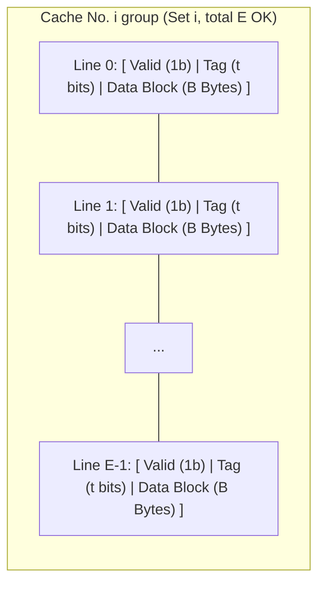

> **Lecturer**: David R. O'Hallaron ｜ **Original video**: Bilibili points P12 \| **duration**: 01:18:43  
> **Module**: Module 4: The Memory Hierarchy & Cache (L11 - L12 · Locality principle, storage pyramid, Cache organization and cache-friendly code)  
> **Original video address**: [https://www.bilibili.com/video/BV1iW411d7hd/?p=12](https://www.bilibili.com/video/BV1iW411d7hd/?p=12)  
> **Course official ownership**: Carnegie Mellon University (CMU) 15-213 / 18-213 / 15-513: Introduction to Computer Systems (CSAPP Fall 2015)  
> **Corresponding teaching materials**: *Computer Systems: A Programmer's Perspective (3rd Edition)* by R. Bryant & D. O'Hallaron  
> **Source of subtitles and handouts**: The subtitles were translated and edited by the EugeneLiu/translationCSAPP team (CC BY-NC 4.0 open source license), and the copyright of the slides belongs to the CMU course group.  

---

## 1. General cache physical parameter quadruple (S, E, B, m)

*(Reference time: 00:02:30 · [Video jump (P12 00:02:30)](https://www.bilibili.com/video/BV1iW411d7hd/?p=12&t=150))*


Cache is the component with the highest hardware complexity and the most direct impact on performance in the entire modern processor architecture.
In order to uniformly analyze all levels of Cache, computer scientists formally define its structure as a quadruple  **$(S, E, B, m)$**: 

* $m$: Systematic **Number of physical address bits** (Usually on 64-bit systems  $m=48$  or  $m=64$); 
* $S = 2^s$: The number of \*\*sets\*\* contained in the Cache;
* $E$: The number of \*\*cache lines (Cache Lines)\*\* contained in each group (ie, associativity);
* $B = 2^b$: Valid data stored in each cache line **Block Size (in bytes)**, which is generally constant in modern Intel/AMD CPUs  **$B = 64$  Bytes**; 
* **Cache total data capacity  $C$** (Excluding mark bit and valid bit overhead): 
  $$C = S \times E \times B$$

### The precise internal physical structure of a single Cache Line
Each cache line contains three closely connected fields on the chip circuit:
1. **Valid Bit**: 1 bit, marking whether the data stored in this row is currently valid (initialized to 0 after power-on);
2. **Tag Bits**: $t = m - (s + b)$  Bits are used to compare with the Tag in the address to confirm whether the current line is the required target block;
3. **Data Block**: $B = 2^b$  Bytes of physical storage media, storing real program data.



## 2. Three-stage deconstruction of CPU physical address: Tag, Set Index and Block Offset

*(Reference time: 00:15:20 · [Video jump (P12 00:15:20)](https://www.bilibili.com/video/BV1iW411d7hd/?p=12&t=920))*


When the CPU executes a load instruction such as  `movq (%rax), %rdx`) generates a  $m$  bits of physical memory address, the Cache hardware will automatically  $m$  Each bit is delicately cut from high to low into three fields with distinct functions:

```
       [   Tag 标记位 (t 位)   |   Set Index 组索引 (s 位)   |   Block Offset 块偏移 (b 位)   ]
MSB                                                                                     LSB
```

### Why does the hardware use "Middle Bits for Set Index"?
This is an extremely wonderful classic test point in system design! Why is the most significant bit of the address not used as the group index, but the middle bits must be used?
* **If you use high bits for indexing**: 
  * A string of data continuously arranged in the memory (with excellent spatial locality), its high-order addresses are almost identical!
  * This will cause this entire block of continuous data to be **All mapped to the same Cache group**, causing the group to be extremely congested and have frequent conflicts and misses, while other groups are all idle!
* **Use the middle bit as an index**: 
  * Continuous memory blocks will be destroyed due to the rapid increment of the intermediate address bits. **Evenly distribute the mapping into different groups in the Cache**!
  * All hardware rows of the entire Cache are fully utilized, and the space utilization is fully utilized.

### Three-step pipeline for Cache hit determination
1. **Set Selection**: Use the middle  $s$  bit unsigned integer used as an index to locate the target group directly on the hardware multiplexer;
2. **Line Matching**: Traverse all the items in the group  $E$  row, check whether there is a certain row  `Valid == 1`  and its stored  `Tag`  with the high in the address  $t$  Exactly the same!
   * If a matching row is found, trigger  **Cache Hit**; 
   * If not found or the valid bit is 0, trigger  **Cache Miss**.
3. **Word Extraction**: After hitting, use the one with the lowest address  $b$  bits as block offset, from  $B$  The required 1, 2, 4 or 8 bytes of target data are intercepted from the byte data block and sent to the CPU register.

## 3. Cache architecture taxonomy: direct mapping, set associative and fully associative Cache

*(Reference time: 00:29:40 · [Video jump (P12 00:29:40)](https://www.bilibili.com/video/BV1iW411d7hd/?p=12&t=1780))*


Based on the number of rows each group contains  $E$ (Associativity), Cache is divided into three classic architectures in the industry:

### 1. Direct-Mapped Cache:  $E = 1$)
* Each group contains only one row;
* **Advantages**: The hardware structure is extremely simple and the search speed is extremely fast (no parallel Tag comparator circuit is required);
* **Achilles heel: Thrashing**:
If your program frequently accesses two arrays that alternately map to the same group (for example, adding two vectors of size 4096 bytes  `c[i] = a[i] + b[i]`), since each group has only 1 row, read  `a[i]`  Just loaded the data into the group, then read it  `b[i]`  will put  `a[i]`  Kicked out by force! Then the next iteration reads  `a[i+1]`  again  `b[i]`  Kicked out, causing the hit rate to plummet to nearly 0%!

### 2. Set-Associative Cache:  $1 < E < C/B$)
* Mainstream adoption of modern CPUs (such as the common 8-way set-associative L1 Cache, $E = 8$); 
* Within each group there are  $E$  parallel lines. Hardware utilization  $E$  Parallel comparators complete all at the same instant  $E$  Comparison of tags;
* Greatly eliminates the bump risk of conflict misses. When the group is full and replacement occurs, use  **LRU (Least Recently Used, least recently used)**  The policy evicts rows that have not been accessed for the longest time.

### 3. Fully-Associative Cache:  $S = 1$)
* The entire Cache has only a single large group containing all  $E = C/B$  OK;
* There is no Set Index field at all in the address ($s = 0$), all address bits except block offset are all Tag!
* Any data block can be stored in any row of the Cache, **Conflict miss rate 0**!
* **cost**: Requires extremely large and expensive parallel comparator hardware circuits, consumes huge amounts of power, and is usually only used in very small critical components (such as the TLB page table cache of the CPU).

## 4. Write strategy showdown: Write-Through vs Write-Back vs Write-Allocate

*(Reference time: 00:43:50 · [Video jump (P12 00:43:50)](https://www.bilibili.com/video/BV1iW411d7hd/?p=12&t=2630))*


The process of reading the Cache is very intuitive, but when the CPU performs a write operation (such as  `movq %rax, (%rdx)`), the design of memory consistency and write strategy becomes extremely subtle.

### 1. Write-Hit Policy
When the memory address to be written is already hit in the Cache:
* **Write-Through**: 
  * Immediately write data to the current Cache block, **And at the same time, it is immediately and synchronously written back to the next level of main memory.**!
  * **Advantages and Disadvantages**: The logic is simple, and the main memory is kept up-to-date at all times; but each write operation will trigger a slow external bus write cycle, and the throughput rate is terrible.
* **Write-Back (Write-Back, absolutely mainstream in modern times)**: 
  * data **Write only the current Cache block**, without notifying the next-level main memory at all!
  * Introduce an additional  **Dirty Bit**, and mark  `Dirty = 1`; 
  * Only when the row will be replaced and evicted by other blocks due to a miss in the future, the hardware will detect the dirty bit and flush the entire block of data back to the next-level main memory at once.
  * **Advantages**: Greatly filters out the bus overhead of high-frequency repeated write operations, resulting in extremely high performance.

### 2. Write-Miss Policy
When the address to be written is not in the current Cache:
* **Write-Allocate**: 
  * First load the data block from the next-level main memory into the current Cache, and then perform update writing;
  * Make full use of possible subsequent spatial locality;
  * **golden partner**: Modern processors almost constantly adopt  **Write-Back + Write-Allocate**  Combination punch!
* **No-Write-Allocate**: 
  * Directly bypass the Cache and write the data directly to the next level of main memory without loading the Cache.

## 5. Cache-friendly code design and matrix multiplication blocking (Blocking/Tiling) algorithm

*(Reference time: 00:58:30 · [Video jump (P12 00:58:30)](https://www.bilibili.com/video/BV1iW411d7hd/?p=12&t=3510))*


Programmers writing high-performance industrial-grade software must closely tune code structure and cache geometry.

### Three-level loop sequence and CPE evaluation of matrix multiplication
Calculate  $C = A \times B$ (The matrix dimensions are  $N \times N$):
Classic triple loop contains  `i, j, k`  three variables. Different traversal nesting orders will bring completely different dimensions of spatial locality:
1. **`ijk`  with  `jik`  loop**: 
   * Inner loop fixed  `i`  and  `j`, with  `k`  Simultaneous scan for index  $A[i][k]$  and  $B[k][j]$; 
   * $A$  It is a line scan (Stride-1, excellent hit rate); but  $B$  Is column scan (Stride-N, Miss every time!);
   * On average, about 1.25 misses occur per multiplication and addition.
2. **`kij`  with  `ikj`  Loop (fast sequence)**: 
   * The inner loop index is  `j`; 
   * In the innermost loop, what is accumulated is  $A[i][k] \times B[k][j]$  write  $C[i][j]$; 
   * at this moment  $B$  and  $C$  are all visited continuously along the row (all are perfect Stride-1!), and  $A[i][k]$  It is an inner constant scalar!
   * Miss rate plummeted to 0.25 times, **Running speed ratio  `ijk`  Several times faster**!

### Breaking through capacity bottlenecks: matrix blocking technology (Blocking / Tiling)
When the matrix size is extremely large (e.g.  $N = 2048$), the entire row of data has far exceeded the total capacity of the L1 Cache. Even if accessed by row, the data at the beginning of the row will have been completely replaced when the end of the row is read. 
**Blocking algorithm (Blocking)**  The core idea is to divide the large matrix into  $B \times B$  Tiny submatrix tiles (Tiles) of size:

```c
/* 矩阵乘法分块优化核心源码 */
void bijk(array A, array B, array C, int n, int bsize) {
    int i, j, k, kk, jj;
    for (jj = 0; jj < n; jj += bsize) {
        for (kk = 0; kk < n; kk += bsize) {
            for (i = 0; i < n; i++) {
                for (j = jj; j < jj + bsize; j++) {
                    int sum = 0;
                    for (k = kk; k < kk + bsize; k++) {
                        sum += A[i][k] * B[k][j];
                    }
                    C[i][j] += sum;
                }
            }
        }
    }
}
```
* **Principle analysis**: Carefully selected chunk size  $B$, making a  $B \times B$  The data block can **Completely resident in high-speed L1 Cache**!
* During the calculation of the inner loop, this sub-block is read and reused repeatedly, squeezing out all possible temporal locality before the data is swapped out, reducing the main memory bus bandwidth pressure by dozens of times!

> \[!TIP\] Tips for clearing Cache Lab
CSAPP classic experiment  **Cache Lab Part B**  Request for  $32 \times 32$, $64 \times 64$  and  $61 \times 67$  Matrix transposition is a transposition algorithm designed to strictly limit the number of Misses.
Its magic weapon is to conduct matrix analysis  $8 \times 8$  or  $4 \times 4$  Blocking, and clever use of local registers to temporarily undertake data, completely eliminating self-conflict misses caused when diagonal elements are accessed!


---

### Summary and core thoughts of this lecture (Takeaways)

1. **Essential changes in systems perspective**: This lecture analyzes the core implementation principles of "Cache Memories (cache microarchitecture, address deconstruction, write strategy and matrix partitioning optimization)" from the underlying mechanism.
2. **Software and hardware co-design**: Understanding the underlying rules can not only eliminate potential hidden bugs that are difficult to debug, but is also a prerequisite for writing industrial-grade code with ultimate performance.
3. **Hands-on verification**: It is recommended to cooperate with the after-school exercises and official experiments (Lab) of the corresponding chapters of CSAPP, and use GDB and performance analysis tools in the Linux terminal environment to personally verify the theory.
