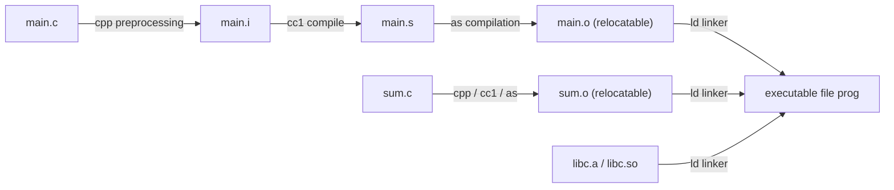

> **Lecturer**: Randal E. Bryant & David R. O'Hallaron ｜ **Original video**: Bilibili points P13 \| **duration**: 01:21:33  
> **Module**: Module 5: Linking (L13 · Static linking, relocation, symbol resolution, shared libraries and dynamic linking)  
> **Original video address**: [https://www.bilibili.com/video/BV1iW411d7hd/?p=13](https://www.bilibili.com/video/BV1iW411d7hd/?p=13)  
> **Course official ownership**: Carnegie Mellon University (CMU) 15-213 / 18-213 / 15-513: Introduction to Computer Systems (CSAPP Fall 2015)  
> **Corresponding teaching materials**: *Computer Systems: A Programmer's Perspective (3rd Edition)* by R. Bryant & D. O'Hallaron  
> **Source of subtitles and handouts**: The subtitles were translated and edited by the EugeneLiu/translationCSAPP team (CC BY-NC 4.0 open source license), and the copyright of the slides belongs to the CMU course group.  

---

## 1. Panorama of the compilation pipeline and the core mission of the linker

*(Reference time: 00:02:10 · [Video jump (P13 00:02:10)](https://www.bilibili.com/video/BV1iW411d7hd/?p=13&t=130))*


In modern software development, no large system is compiled in a single giant source file. Programmers divide the system into smaller, better-managed modules, each of which can be modified and compiled independently.
The key system tool that seamlessly splices these discrete modules into a unified executable program is **Linker**.

### A complete four-stage evolution of the GCC compilation system
when we execute  `gcc -O2 -v -o prog main.c sum.c`  At the same time, the build system actually calls four independent professional tools under the hood:
1. **Preprocessor (C Preprocessor, cpp)**: 
   * Process all with  `#`  The macro at the beginning (`#include`, `#define`, `#ifdef`); 
   * Expand and merge header files to generate pure C text files  `main.i`.
2. **Compiler (C Compiler, cc1)**: 
   * Carry out lexical, syntactic analysis, semantic analysis and optimization;
   * Translate high-level C code into platform-specific assembly language text files  `main.s`.
3. **Assembler (Assembler, as)**: 
   * Translate assembly instructions into corresponding binary machine code instructions one by one;
   * generate **Relocatable Object File** `main.o`.
4. **Linker (ld)**: 
   * collect  `main.o`, `sum.o`  and standard C runtime library files;
   * Resolve all cross-file symbol references, complete address relocation, and finally generate a single binary **Fully executable file (Executable Object File)** `prog`!



## 2. Target file format industry standard: ELF (Executable and Linkable Format)

*(Reference time: 00:15:45 · [Video jump (P13 00:15:45)](https://www.bilibili.com/video/BV1iW411d7hd/?p=13&t=945))*


In modern Linux systems, all object files (whether  `.o`, `.a`, `.so`  or the final suffix-free executable file) all follow a unified  **ELF(Executable and Linkable Format)**  standard.

### A typical ELF relocatable target file internal sections (Sections)
* **ELF Header**: With a 16-byte Magic Number:  `0x7f 'E' 'L' 'F'`), record the machine word length (64 bits), byte order (little endian), file type, offset and size of the Section Header Table.
* **`.text`  Festival**: The completed machine instruction code of the compiled program.
* **`.rodata`  Festival**: Read-only data, such as  `printf`  Format string in `switch`  Statement jump table.
* **`.data`  Festival**: **Explicitly initialized global and static C variables**.
* **`.bss`  Festival**: **Global and static C variables that are not initialized or initialized to 0**.
  * *Key optimization*: `.bss`  In disk ELF file **Doesn't take up any actual physical space at all**, it is just a placeholder metadata, only recording the total size! The moment the program is loaded and run by the operating system, the kernel will automatically allocate memory and store the entire  `.bss`  Fill in all zeros.
* **`.symtab`  Festival**: **Symbol Table**, stores the metadata information of all functions and global variables defined and referenced in the program.
* **`.rel.text`  Festival**: Relocation entry for the code segment. Record all function call instruction positions that are temporarily left blank during the compilation phase because the absolute address is not known.
* **`.rel.data`  Festival**: The relocation entry of the data segment. Record the locations of all initialized global pointer variables.

## 3. Symbols and symbol parsing rules: strong symbols vs weak symbols and global pollution hazards

*(Reference time: 00:29:10 · [Video jump (P13 00:29:10)](https://www.bilibili.com/video/BV1iW411d7hd/?p=13&t=1750))*


The first core task of the linker is **Symbol Resolution**: Reference each symbol in the code (such as calling  `sum()`  or read  `val`) is accurately bound to the symbol definition of a certain target module.

### Three types of symbols in modules
1. **Global Symbols**: Symbols defined by this module and can be publicly referenced by other modules (non-static C functions and non-static global variables);
2. **External Symbols**: Global symbols referenced by this module but defined in other modules (via  `extern`  statement);
3. **Local Symbols**:with  `static`  Properties of C functions and global variables. They are only visible within the current module, **Linker is completely blind to local symbols**.
   * Note: Local non-static variables inside functions are not local symbols! They are allocated on the stack at runtime and are not in the symbol table at all.

### Three iron rules for ruling strong and weak symbols
During the compilation phase, the compiler divides global symbols into two poles:
* **strong sign**: function definition and **Global variables explicitly assigned initial values**; 
* **weak symbol**: **uninitialized global variable**.

Based on the strong and weak attributes, the linker strictly enforces the following three ruling rules:
* **Rule 1: Strong symbols with the same name are absolutely mutually exclusive**:
If multiple strong symbols with the same name are defined in different modules, the linker will immediately terminate with an error: `multiple definition of ...`!
* **Rule 2: Strong symbols crush weak symbols**:
If a strong symbol encounters one or more weak symbols with the same name, the linker silently chooses **Definition of strong symbols**!
* **Rule 3: Random grabs from groups of weak symbols**:
If there are multiple weak symbols with the same name and no strong symbols, the linker will **Pick one of them at random**!

### Horror Case: Supernatural Memory Trampling Caused by Weak Symbols
```c
/* 文件 p1.c */
#include <stdio.h>
int x = 15213; // 强符号 (4 字节 int)
int y = 15212; // 强符号 (4 字节 int)
void p2(void);

int main() {
    p2();
    printf("x = %d, y = %d\n", x, y);
    return 0;
}
```

```c
/* 文件 p2.c */
double x; // 弱符号！且在 p2 中认为 x 是 8 字节的 double！
void p2() {
    x = 0.0; // 写入 8 个字节的 0.0！
}
```
* **Disaster occurs**: 
  * There is no error when linking because  `p1.c`  strong sign of  `x`  covered  `p2.c`  weak symbol;
  * But when  `p2()`  execute  `x = 0.0`  when, it  `x`  The addresses are written continuously  **8 bytes**!
  * This will not only  `x`  Set to 0, still on the way **Ruthlessly overwrites the global variables that follow  `y`  4 bytes of memory**!
  * Running results: `x = 0, y = 0`! Troubleshooting this kind of bug often drives the team crazy for days.
* **defensive means**: Always add compilation parameters in GCC  `-fno-common` (enabled by default in modern GCC) or  `-Werror`, forcibly prohibiting multiple definitions of weak symbols.

## 4. Anatomy of the entire relocation process: the art of repairing PC relative addressing and absolute addressing

*(Reference time: 00:44:30 · [Video jump (P13 00:44:30)](https://www.bilibili.com/video/BV1iW411d7hd/?p=13&t=2670))*


After completing symbol resolution, the linker enters the second core step -**Relocation**.
At this stage, the linker merges similar sections of all modules (i.e. all  `.o`  of  `.text`  merge into one large  `.text`), and assign each symbol a system-wide unique final runtime virtual address.

### Relocation Entries
generated in assembler  `.o`  file, when encountering a cross-module function call, the assembler cannot know which memory address the target function is ultimately located at. So the assembler fills in all zeros as placeholders at the instruction, and  `.rel.text`  generate one in **relocation entry**.

ELF defines the two most critical types of x86-64 relocations:
1. **`R_X86_64_PC32`  (relocating a reference using a 32-bit PC relative address)**: 
   * In assembly instructions, offset addressing relative to the current instruction is used (such as  `callq`); 
   * Linker calculation formula: 
     $$\text{refaddr} = \text{ADDR}(.text) + r.\text{offset}$$
     $$\text{refvalue} = \text{ADDR}(\text{symbol}) - \text{refaddr} - 4$$
   * Write the calculated 4-byte complement directly back to the machine instruction placeholder.
2. **`R_X86_64_32`  (relocating a reference to a 32-bit absolute address)**: 
   * Fill the target location directly with the symbol's absolute runtime virtual address.

## 5. Static library (.a) linking mechanism and command line sequence dependency trap

*(Reference time: 00:56:15 · [Video jump (P13 00:56:15)](https://www.bilibili.com/video/BV1iW411d7hd/?p=13&t=3375))*


### Packaging and on-demand extraction of static libraries
Static library (with  `.a`  as suffix, such as  `libc.a`) is essentially powered by Linux  `ar` (Archive) archive tools combine a large number of independent  `.o`  A collection container made of files packaged and compressed.
* **Why not compile all the standard library functions into one giant  `libc.o`?**
   If placed in a single  `.o` , any call that only  `printf`  All small programs must hard-link all useless codes such as massive math libraries and graphics libraries, causing the size of the executable file to increase by dozens of megabytes.
* **Parse on demand**: When the linker scans the static library, **Extract only those specific  `.o`  member file**, the rest are not referenced  `.o`  Completely ignored!

### Strict order dependency rules for command line static libraries
Many engineers have experienced such an error: even though the library was added to the compilation command, the linker still reported  `undefined reference`!
This is because  **The Linux linker scans command line parameters in one direction strictly from left to right.**!

The linker maintains three key collections internally:
* $E$: A collection of target files that will eventually be merged into the executable file;
* $U$: The collection of symbols that have not yet been resolved and bound (pending symbols);
* $D$: A collection of all symbols that have been defined in the previous input file.

```bash
# 错误示范：链接器瞬间报错退出！
gcc -static -lvector p.o
```
* **Analyze the reasons**: 
  * The linker sees first  `-lvector`: Gather at this time  $U$  is still empty (no symbols pending!), the linker sees no need to start from  `libvector.a`  Extract any files and skip directly;
  * Then scan to  `p.o`: Found the right  `addvec`  of pending references, add them to  $U$; 
  * End of command line! $U$  The collection is not empty, and the linker reports an error: `undefined reference to 'addvec'`!
* **iron law**: **Always place the dependent library files at the right end of the command line (the caller is on the left, the callee is on the right)**!
  ```bash
  gcc -static p.o -lvector # 正确！
  ```

## 6. Modern dynamic linking and shared libraries (.so): PIC, GOT and PLT delayed binding

*(Reference time: 01:09:40 · [Video jump (P13 01:09:40)](https://www.bilibili.com/video/BV1iW411d7hd/?p=13&t=4180))*


Although static libraries are efficient, they have disadvantages that cannot be ignored in modern multi-tasking operating systems:
1. **Serious waste of disk and memory**: If there are 100 processes running in the system at the same time, each process copies an identical copy in its own memory space.  `printf`  Code, hundreds of megabytes of physical memory are consumed in vain;
2. **Software hot updates are extremely difficult**: if  `libc.a`  A serious security vulnerability has been fixed. Thousands of applications across the system must be recompiled and linked to take effect.

### Shared Libraries:  `.so` / DLL)
A shared library is an object module that can be dynamically loaded at any memory address at runtime and used by multiple running processes to share a single copy of instruction code in physical memory.

### Core black technology: position-independent code (PIC) and delayed binding (Lazy Binding)
In order to allow the same piece of code to be loaded into different virtual addresses in different processes without relocation and patching, the compiler uses  **PIC(Position-Independent Code)**  Technology:
1. **Global Offset Table (GOT - Global Offset Table)**: 
   * No matter where the code is loaded, the relative distance between the data segment and the code segment is constant at link time!
   * The compiler opens an array of pointers (GOT) at the beginning of the data segment. When accessing any global variable in the code, the entries in the GOT must be read through PC relative addressing, and then the target data must be addressed indirectly.
2. **Procedure Linkage Table (PLT) and delayed binding**: 
   * A large dynamic library may contain tens of thousands of functions, but a program often calls only a few of them in a certain run. If all tens of thousands of functions are dynamically relocated and analyzed at startup, the program startup will be extremely laggy!
   * **Delayed binding mechanism**: Defer resolution of function addresses until **The moment the function is actually called for the first time** Just go and execute it!
   * The first call triggers the dynamic linker to run, parses out the real address and fills it into the GOT; all subsequent calls jump directly through the GOT, and the overhead is only one indirect memory access!


---

### Summary and core thoughts of this lecture (Takeaways)

1. **Essential changes in systems perspective**: This lecture analyzes the core implementation principles of "Linking (compilation pipeline, ELF object file, symbol resolution and static/dynamic linking)" from the underlying mechanism.
2. **Software and hardware co-design**: Understanding the underlying rules can not only eliminate potential hidden bugs that are difficult to debug, but is also a prerequisite for writing industrial-grade code with ultimate performance.
3. **Hands-on verification**: It is recommended to cooperate with the after-school exercises and official experiments (Lab) of the corresponding chapters of CSAPP, and use GDB and performance analysis tools in the Linux terminal environment to personally verify the theory.
