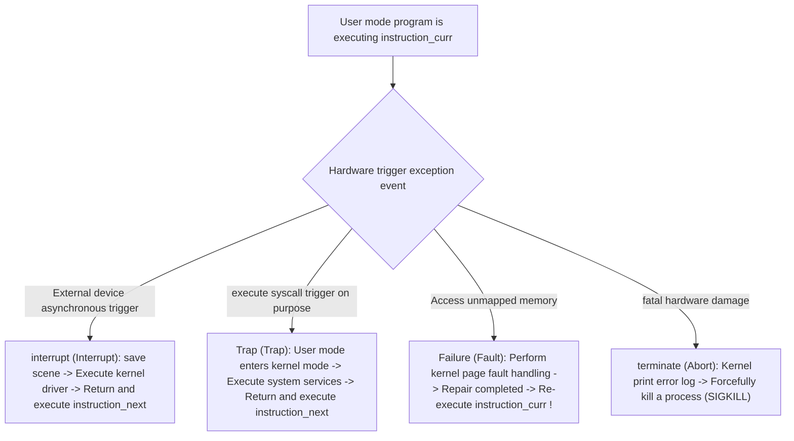

> **Lecturer**: David R. O'Hallaron ｜ **Original video**: Bilibili points P14 \| **duration**: 01:12:09  
> **Module**: Module 6: Exceptional Control Flow (L14 - L15 · Hardware exceptions, system calls, process context switching, signals and non-local jumps)  
> **Original video address**: [https://www.bilibili.com/video/BV1iW411d7hd/?p=14](https://www.bilibili.com/video/BV1iW411d7hd/?p=14)  
> **Course official ownership**: Carnegie Mellon University (CMU) 15-213 / 18-213 / 15-513: Introduction to Computer Systems (CSAPP Fall 2015)  
> **Corresponding teaching materials**: *Computer Systems: A Programmer's Perspective (3rd Edition)* by R. Bryant & D. O'Hallaron  
> **Source of subtitles and handouts**: The subtitles were translated and edited by the EugeneLiu/translationCSAPP team (CC BY-NC 4.0 open source license), and the copyright of the slides belongs to the CMU course group.  

---

## 1. From Smooth Control Flow to Mutation: A Panorama of Exceptional Control Flow (ECF)

*(Reference time: 00:01:25 · [Video jump (P14 00:01:25)](https://www.bilibili.com/video/BV1iW411d7hd/?p=14&t=85))*


From the simplest perspective, the control flow of a CPU is usually extremely smooth and monotonous: the program counter advances from one instruction to the next, occasionally being  `jmp`, `call`, `ret`  Change direction.
But this kind of control flow driven purely by the internal logic of the program, **Total inability to cope with the physical realities of computer systems**: 
* When is the hard disk sector data read?
* When did the network card receive the external incoming data packet?
* When does the user press a key on the keyboard?
* What should I do if the denominator is 0 when the program performs division?
* What should I do if a program accesses a virtual page that has not been allocated physical memory?

The system must have the ability to: **Make emergency responses to sudden changes in system status and instantly interrupt the current normal execution path**.
This mutation mechanism jointly built at all levels of hardware, operating system kernel, and application programs is collectively referred to as **Exceptional Control Flow (ECF)**.

## 2. Hardware exception taxonomy: interrupts, traps, failures and terminations

*(Reference time: 00:10:40 · [Video jump (P14 00:10:40)](https://www.bilibili.com/video/BV1iW411d7hd/?p=14&t=640))*


Exceptions are essentially **A sudden transfer of control from currently executing user code to the operating system kernel**.
Inside the CPU, a database initialized by the kernel is maintained **Exception Table**. Each exception is assigned a unique number  $k$. When an exception occurs, the hardware pushes the current state onto the stack and calculates the number of jumps to the kernel through the exception table base register.  $k$  No. Exception Handler.

### Strict physical definition of the four major categories of anomalies

| Category | inducement | synchronous/asynchronous | return behavior | Classic example |
| :--- | :--- | :--- | :--- | :--- |
| **Interrupt** | Signals from CPU chip external I/O devices | **Asynchronous** | always return to **next instruction** | The timer chip is interrupted, the network card data packet arrives, and the disk completes reading and writing. |
| **Trap** | Intentional, actively triggered by software instructions | **Synchronous** | always return to **next instruction** | **System Call**, breakpoint debugging trap |
| **Fault** | Potentially recoverable errors or hardware events | **Synchronous** | **Possibly re-execute the current command**, or terminate | **Page Fault**, Floating point divide by zero exception |
| **Abort** | Unrecoverable fatal hardware error | **Synchronous** | **never return** (Kill the process directly) | Parity error, DRAM hardware power loss or failure |

### Comparison of key mechanisms: traps (system calls) and faults (page faults)
1. **Traps and system calls**: User-mode programs are restricted by the sandbox and cannot directly operate the underlying hardware (such as reading and writing disks or sending network card data). User program must be executed  `syscall`  instruction to actively fall into the kernel state (Trap). The kernel verifies the permissions and executes it for you. After completion, it returns to the user program for the next instruction.
2. **Magical recovery from Page Fault**: The hardware MMU triggers a page fault when a program accesses a legal virtual address, but the page has not yet been loaded from disk into physical memory. The kernel intercepts the fault, pauses the current program, reads the page from disk, writes it to physical memory and updates the page table, and finally **Let the CPU re-execute the instruction that just caused the fault**! The program doesn't feel anything strange and continues to run seamlessly.



## 3. Process abstraction core: logical control flow, private address space and context switching

*(Reference time: 00:24:15 · [Video jump (P14 00:24:15)](https://www.bilibili.com/video/BV1iW411d7hd/?p=14&t=1455))*


**Process**  It is the most successful and greatest software abstraction in modern operating systems.
Processes provide two key "ultimate illusions" to applications:
1. **Independent logical control flow (Logical Control Flow)**: Make the program feel like it monopolizes the entire CPU core;
2. **Private virtual address space (Private Address Space)**: Let the program feel that it exclusively occupies the entire continuous huge memory space without any interference from other processes.

### Concurrency and Time Slicing
When multiple processes execute alternately on a single-core CPU, each process executes its control flow for a small portion (time slice, typically 10 to 100 milliseconds), and then the CPU quickly switches to the other process. Due to the extremely high switching frequency, from a macro human perspective, multiple programs are executed concurrently at the same time.

### In-depth Microarchitecture: Context Switch (Context Switch)
The operating system kernel uses a **context switch** Advanced ECF mechanism to implement multi-process concurrent scheduling.
* **What is context (Context)**?
The context is the set of all physical states that the kernel must maintain in order to restart a suspended process, including:
  * Values of general-purpose registers and floating-point registers;
  * program counter  `%rip`  with stack pointer  `%rsp`; 
  * page table base register  `CR3`; 
  * Open file descriptor table and process status flags.
* **The three-step cost of context switching**: 
  1. Save the currently running process  $A$  context into the kernel data structure;
  2. Resume the process to be run  $B$  Previously saved context;
  3. transfer control to process  $B$ (Switch address space and pipeline).
  * *Hidden huge performance loss*: The context switch itself only takes a few microseconds, but the address space switch will **Causes all TLB (Translation Lookaside Buffer) and caches at all levels inside the CPU to fail (cold start miss)**!

## 4. System-level process control: The twin secrets of fork and process graph topology analysis

*(Reference time: 00:38:50 · [Video jump (P14 00:38:50)](https://www.bilibili.com/video/BV1iW411d7hd/?p=14&t=2330))*


In Unix/Linux architecture, the core system call to create a new process is  `fork()`.

### `fork()`  The three classic characteristics of
1. **Called Once, Returns Twice**: 
   * In the parent process, `fork()`  Returns the process ID (PID) of the newly created child process;
   * In the child process, `fork()`  Return  `0`!
   * It is by judging whether the return value is 0 that the programmer allows the parent and child processes to move to completely different execution branches in the same source code.
2. **Completely independent but highly similar copies**: 
   * The child process obtains a completely consistent (but physically isolated) copy of the parent process's user-level virtual address space (including code segments, data segments, heaps, shared libraries, and call stacks);
   * The child process obtains a copy of all open file descriptors of the parent process;
   * *Modern black technology Copy-on-Write (COW)*: Physically, the kernel does not blindly copy the entire dozens of GB of memory in an instant, but allows the parent and child processes to share the same read-only physical page. Only when one party attempts to modify a certain page of data, a page fault is triggered to perform a physical copy!
3. **Concurrent out-of-order execution**: The parent process and the child process are two independently scheduled entities. Who executes first and which executes later completely depends on the kernel scheduling algorithm. Programmers must not assume timing.

### Process Graphs topology deduction model
Include nesting for rigorous analysis  `fork`  For the execution path of the code, CSAPP proposes a powerful analysis tool - process graph (directed acyclic graph):
```c
void fork_eg() {
    printf("L0\n");
    fork();
    printf("L1\n");
    fork();
    printf("Bye\n");
}
```
* Initial state: process 1 print  `L0`; 
* first time  `fork()`: Split into process 1 and process 2, both of which execute printing downwards  `L1` (Print 2 times in total  `L1`); 
* second time  `fork()`: Process 1 and process 2 each split once, resulting in a total of 4 active processes, each process prints  `Bye` (Print 4 times in total  `Bye`)!

## 5. Zombie process collection, waitpid synchronization and execve’s nirvana reshaping

*(Reference time: 00:54:10 · [Video jump (P14 00:54:10)](https://www.bilibili.com/video/BV1iW411d7hd/?p=14&t=3250))*


### Process Death and Zombies
When a process explicitly calls  `exit()`  Or it does not completely evaporate from the system immediately when a fatal signal is received and terminated.
* The kernel will keep it in a state called a zombie, retaining its exit status code (Exit Status) and a small amount of kernel metadata;
* **Reaping**: The parent process must explicitly call  `wait()`  or  `waitpid()`  The system call reads the exit status of the child process, and then the kernel completely erases the zombie process;
* **Hazards and Orphaned Processes**: If the parent process keeps running but never collects the dead child processes, the PID resources in the system will be exhausted by the massive zombie processes! If the parent process dies unexpectedly before the child process, the surviving child process will become **Orphan process (Orphan)**, Linux will adopt it to the system ancestor process No. 1 (`init`  or  `systemd`), Process No. 1 is responsible for collecting its corpse for life.

### Process reshaping: `execve()`  system call
`fork()`  Responsible for splitting a twin, and to run a completely new program, you must use  `execve()`: 
```c
int execve(const char *filename, char *const argv[], char *const envp[]);
```
* **Core philosophy: Called Once, Never Returns**!
* `execve()`  It will completely clear the original code segment, data segment, heap and stack of the current process, load and run the specified executable binary file, and restart it from  `main()`  Start execution;
* The process's PID remains unchanged, and all open file descriptors remain reserved by default. Only if an error occurs (such as the file does not exist), `execve()`  will return  `-1`.


---

### Summary and core thoughts of this lecture (Takeaways)

1. **Essential changes in systems perspective**: This lecture analyzes the core implementation principles of "Exceptional Control Flow: Exceptions and Processes (Exception architecture, system calls, process abstraction and concurrency control)" from the underlying mechanism.
2. **Software and hardware co-design**: Understanding the underlying rules can not only eliminate potential hidden bugs that are difficult to debug, but is also a prerequisite for writing industrial-grade code with ultimate performance.
3. **Hands-on verification**: It is recommended to cooperate with the after-school exercises and official experiments (Lab) of the corresponding chapters of CSAPP, and use GDB and performance analysis tools in the Linux terminal environment to personally verify the theory.
