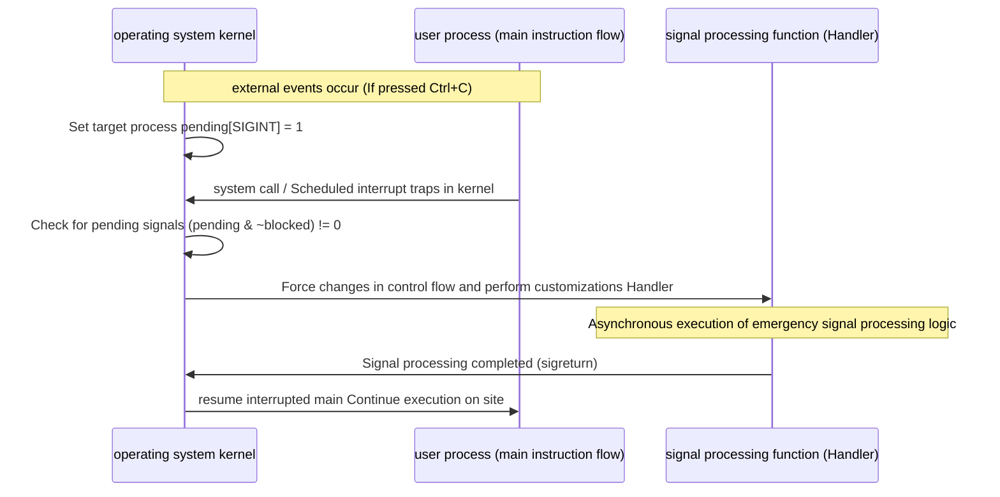

> **Lecturer**: Randal E. Bryant & David R. O'Hallaron ｜ **Original video**: Bilibili points P15 \| **duration**: 01:19:27  
> **Module**: Module 6: Exceptional Control Flow (L14 - L15 · Hardware exceptions, system calls, process context switching, signals and non-local jumps)  
> **Original video address**: [https://www.bilibili.com/video/BV1iW411d7hd/?p=15](https://www.bilibili.com/video/BV1iW411d7hd/?p=15)  
> **Course official ownership**: Carnegie Mellon University (CMU) 15-213 / 18-213 / 15-513: Introduction to Computer Systems (CSAPP Fall 2015)  
> **Corresponding teaching materials**: *Computer Systems: A Programmer's Perspective (3rd Edition)* by R. Bryant & D. O'Hallaron  
> **Source of subtitles and handouts**: The subtitles were translated and edited by the EugeneLiu/translationCSAPP team (CC BY-NC 4.0 open source license), and the copyright of the slides belongs to the CMU course group.  

---

## 1. The essence of soft interrupts: Linux signal (Signals) architecture and common signal types

*(Reference time: 00:02:15 · [Video jump (P15 00:02:15)](https://www.bilibili.com/video/BV1iW411d7hd/?p=15&t=135))*


Hardware exceptions allow the kernel to take over hardware events, but how does the operating system kernel proactively notify running user-mode applications? 
**Signal**  It is a pure software form of advanced exception control flow (soft interrupt). It allows the kernel or a process to forcibly interrupt the normal execution flow of another process and notify it that a certain type of asynchronous event has occurred.

### List of classic Linux core signal types

| No. | Signal macro definition | Default processing action | Trigger event source |
| :--- | :--- | :--- | :--- |
| **2** | `SIGINT` | Terminate process | The user types in the terminal  **Ctrl + C**  Key combination |
| **9** | `SIGKILL` | Terminate process (unconditionally) | **Privileged kill signal: can neither be caught nor ignored!** |
| **11** | `SIGSEGV` | Kill the process and Core Dump | **segfault**: Illegal memory dereference, out-of-bounds write to read-only memory |
| **14** | `SIGALRM` | Terminate process | The timer countdown is reset to zero (by  `alarm()`  settings) |
| **17** | `SIGCHLD` | Ignore by default | When a child process terminates or stops, the kernel sends |
| **19** | `SIGSTOP` | Pause process execution | **Pending signal: can neither be caught nor ignored!**  (Ctrl + Z triggers  `SIGTSTP`) |

## 2. Signal life cycle trilogy: sending, pending and delivering (Sending, Pending, Receiving)

*(Reference time: 00:16:40 · [Video jump (P15 00:16:40)](https://www.bilibili.com/video/BV1iW411d7hd/?p=15&t=1000))*


A signal strictly goes through three physical stages from birth to processing:
1. **Sending a Signal**: 
   * The kernel updates internal status bits in the target process context;
   * Reason for sending: The kernel detects a hardware event (such as dividing by 0)  `SIGFPE`), or another process explicitly calls  `kill(pid, sig)`  System calls.
2. **Pending Signal**: 
   * An intermediate state in which the signal has been sent but the target process has not yet responded to it;
   * **Extremely critical hardware feature: Signals are Not Queued (Signals are Not Queued)**!
In the kernel, each process maintains only one  `pending`  BitVector (BitMask, Bit-Vector)!
The same type of signal at any time **There can only be one in Pending status**. if a  `SIGCHLD`  Pending, at this time, 10 child processes terminated and issued at the same time.  `SIGCHLD`, the following signals will be kernel **Discard directly**!
3. **Receiving a Signal**: 
   * When the kernel completes a system call or interrupt processing and is ready to return control to the user-mode process, the kernel will calculate: 
     $$\text{pnb} = \text{pending} \,\&\, \sim \text{blocked}$$
   * if  $\text{pnb} \ne 0$, the kernel forcibly suspends the current instruction and instead executes the user-registered signal processing function (Signal Handler);
   * After the processing function is executed, execute  `sigreturn`  trap before control is restored to the interrupted user code.



## 3. Industrial-grade safety guidelines for writing signal processing functions (Async-Signal-Safety)

*(Reference time: 00:32:20 · [Video jump (P15 00:32:20)](https://www.bilibili.com/video/BV1iW411d7hd/?p=15&t=1940))*


Writing signal handlers is the most dangerous area in the entire system programming, and the most prone to extremely hidden race conditions (Race Conditions).
Because the signal handler is **Completely asynchronous**, it can be inserted and executed suddenly between the execution of user code and any assembly instruction!

### Async-Signal-Safe Guidelines
* **G0: Keep it Simple**:
Handler functions should be as short and concise as possible. The most robust design is to just set a global flag in the processing function and then return immediately, allowing the main program to poll for processing in the main loop.
* **G1: Call only asynchronous signal-safe functions (Async-Signal-Safe Functions)**: 
  * The operating system defines a number of system functions that are reentrant and will not be interrupted by signals to destroy the state (such as  `_exit`, `write`, `waitpid`); 
  * **Absolute no-no: never call within a signal handling function  `printf`, `sprintf`, `malloc`  or  `free`**!
    * *Why?* `printf`  Internally holds a global I/O buffer lock, `malloc`  A global heap linked list lock is held internally. If the main program is executing  `malloc`  and holds the heap lock. At this time, the signal suddenly arrives, and the processing function is called again.  `malloc`, the processing function will wait forever for the main program to release the lock, triggering **Deadlock (Deadlock) forced stuck**!
* **G2: Save and restore  `errno`**:
Many system calls modify global  `errno`. It may change if the handler function is called internally  `errno`  The system function must be temporarily stored at the entrance  `errno`, and restore the original value exactly before exiting!
* **G3: Declare the flag variable as  `volatile sig_atomic_t`**: 
  ```c
  volatile sig_atomic_t flag = 0;
  ```
  * `sig_atomic_t`: The hardware guarantees that a single read and write is an atomic integer type (the tearing phenomenon of reading half of the data will not occur);
  * `volatile`: Tell the optimizing compiler not to cache the variable in the CPU register. Each read and write must be forced to penetrate the memory to prevent the main loop from falling into an infinite loop because it cannot see the modification of the processing function.

## 4. Concurrency trap of SIGCHLD: Why must we use while loop waitpid?

*(Reference time: 00:48:15 · [Video jump (P15 00:48:15)](https://www.bilibili.com/video/BV1iW411d7hd/?p=15&t=2895))*


Famous at CSAPP  **Shell Lab**  90% of students will fail when processing background tasks and exiting.
Classic fatal error writing:
```c
/* 致命错误实现：一次信号只收一个子进程 */
void handler_bad(int sig) {
    int olderrno = errno;
    pid_t pid = waitpid(-1, NULL, 0); // 以为一个子进程死掉就触发一次
    errno = olderrno;
}
```

### Why does the above code necessarily lead to the accumulation of zombie processes?
* Assume that the parent process concurrently spawns 5 child processes running in the background;
* At a certain moment, the three sub-processes were executed and terminated at the same time almost in the same microsecond;
* All three child processes will send messages to the parent process  `SIGCHLD`; 
* Signal 1 arrives, the kernel transfers the parent process's  `pending[SIGCHLD]`  Set to 1;
* Signals 2 and 3 arrive shortly after: but due to nonqueuing, the kernel finds  `pending[SIGCHLD]`  It's already 1, **Directly discard the subsequent two signals ruthlessly**!
* The parent process enters the processing function and is only called once  `waitpid`, exit after harvesting the first child process;
* Result: **The remaining two child processes have become zombie processes that will never be converged! System resources are seriously leaked!**

### The only way to write the truth about salvation: non-blocking loop harvesting
```c
/* 完美的工业级 SIGCHLD 处理函数 */
void handler_good(int sig) {
    int olderrno = errno;
    pid_t pid;
    int status;
    /* 使用 WNOHANG：若无子进程退出立即返回 0，绝不挂起当前主进程 */
    while ((pid = waitpid(-1, &status, WNOHANG | WUNTRACED)) > 0) {
        // 在此处妥善处理子进程状态更新
    }
    errno = olderrno;
}
```
Pass  `while`  circular fit  `WNOHANG`, even if the kernel merges 100 signals into a single notification, one loop will tirelessly and continuously harvest all currently dead child processes, completely eliminating the hidden danger of zombies!

## 5. Nonlocal Jumps: control flow jumps of setjmp and longjmp

*(Reference time: 01:05:40 · [Video jump (P15 01:05:40)](https://www.bilibili.com/video/BV1iW411d7hd/?p=15&t=3940))*


In C language, regular  `goto`  There is an iron limit to statements: they can only make local jumps within the same function, and they absolutely cannot cross function boundaries.
To cope with severe error recovery in deeply nested calls, the C standard library provides powerful **Nonlocal Jumps mechanism**: `setjmp`  with  `longjmp`.

### Core function signature and mechanism
```c
#include <setjmp.h>
int setjmp(jmp_buf env);
void longjmp(jmp_buf env, int retval);
```
1. **`setjmp(env)`**: 
   * All register environments and stack pointers of the current CPU  `%rsp`  and program counter  `%rip`  Full package snapshot, saved in  `env`  in the buffer;
   * When called directly for the first time, the return value is always  **`0`**.
2. **`longjmp(env, retval)`**: 
   * Can be executed at any depth in the call chain (even in sub-functions spanning dozens of levels of recursion);
   * from  `env`  Forcefully restore all register states and stack pointers, **Directly teleport the control flow back to the original call  `setjmp`  location**!
   * At this time  `setjmp`  As if a miraculous "second return" occurred, and the return value is exactly  `longjmp`  The non-zero value passed in  `retval`!

### Modern applications and the beginnings of C++ exception handling
`setjmp/longjmp`  Bypassing conventional layers  `ret`  Function unstack is a C language implementation of lightweight user-mode coroutine scheduler (Coroutines) and implementation similar to C++/Java.  `try-catch-throw`  The underlying physical cornerstone of the exception handling system.


---

### Summary and core thoughts of this lecture (Takeaways)

1. **Essential changes in systems perspective**: This lecture analyzes the core implementation principles of "Exceptional Control Flow: Signals and Nonlocal Jumps (Signal Life Cycle, Asynchronous Safety and Nonlocal Jumps)" from the underlying mechanism.
2. **Software and hardware co-design**: Understanding the underlying rules can not only eliminate potential hidden bugs that are difficult to debug, but is also a prerequisite for writing industrial-grade code with ultimate performance.
3. **Hands-on verification**: It is recommended to cooperate with the after-school exercises and official experiments (Lab) of the corresponding chapters of CSAPP, and use GDB and performance analysis tools in the Linux terminal environment to personally verify the theory.
