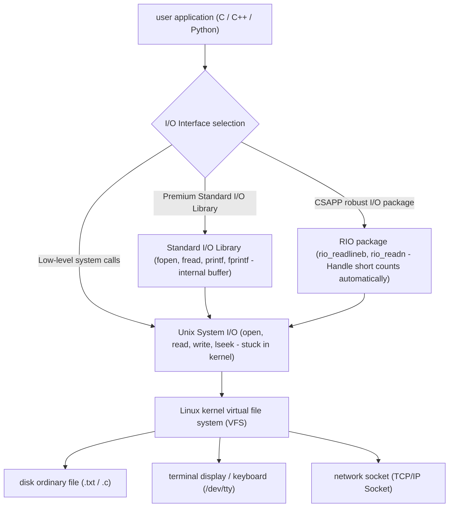
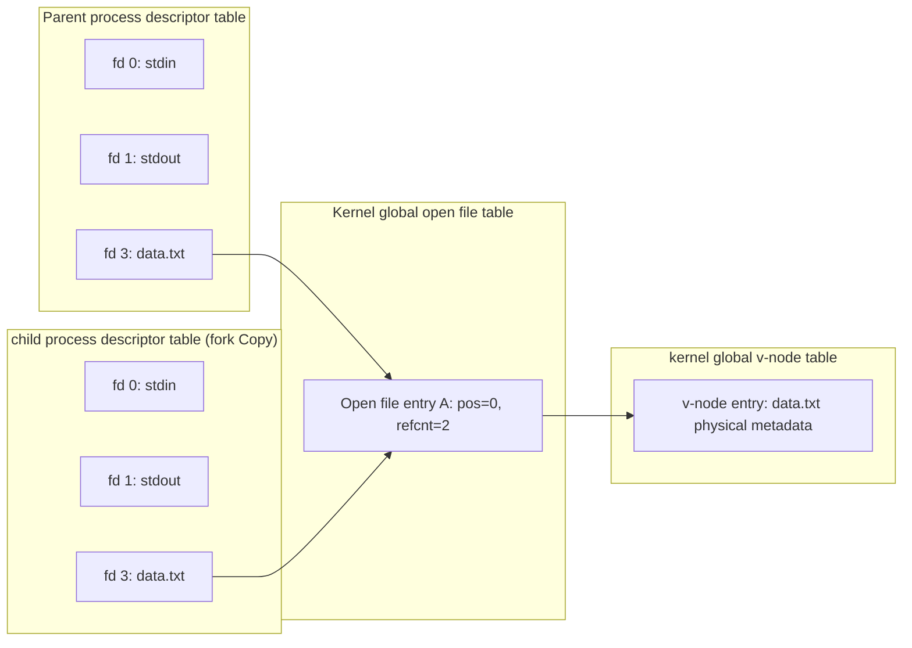

> **Lecturer**: David R. O'Hallaron ｜ **Original video**: Bilibili points P16 \| **duration**: 01:11:01  
> **Module**: Module 7: System-Level I/O & Virtual Memory (L16 - L18 · Unix I/O, virtual memory address translation, page table and multi-level cache protection)  
> **Original video address**: [https://www.bilibili.com/video/BV1iW411d7hd/?p=16](https://www.bilibili.com/video/BV1iW411d7hd/?p=16)  
> **Course official ownership**: Carnegie Mellon University (CMU) 15-213 / 18-213 / 15-513: Introduction to Computer Systems (CSAPP Fall 2015)  
> **Corresponding teaching materials**: *Computer Systems: A Programmer's Perspective (3rd Edition)* by R. Bryant & D. O'Hallaron  
> **Source of subtitles and handouts**: The subtitles were translated and edited by the EugeneLiu/translationCSAPP team (CC BY-NC 4.0 open source license), and the copyright of the slides belongs to the CMU course group.  

---

## 1. The ultimate philosophy of Unix I/O: Everything is a File

*(Reference time: 00:02:10 · [Video jump (P16 00:02:10)](https://www.bilibili.com/video/BV1iW411d7hd/?p=16&t=130))*


In the Unix/Linux operating system design philosophy, the most elegant and shocking concepts are: **All I/O devices are modeled as files (Everything is a File)**!
* Regular data on mechanical disks and SSDs are files;
* Keyboard and monitor terminals are files (`/dev/tty`); 
* Physical memory is a file (`/dev/mem`); 
* Even the Internet TCP/IP network connection across thousands of mountains and rivers is viewed by the operating system as a file (network socket Socket) that can be read and written!

### The four cornerstone system calls of Unix I/O
By abstracting all devices into a unified file stream, all input and output can be completed through a set of extremely concise system interfaces:
1. **open file (`open`)**: Announces to the kernel that it is ready to access a file, and the kernel returns a very small non-negative integer——**File Descriptor (fd)**.
   * The system automatically opens three standard streams for each process by default:
     * `0`: standard input (`STDIN_FILENO`); 
     * `1`: stdout (`STDOUT_FILENO`); 
     * `2`: standard error (`STDERR_FILENO`).
2. **Change current file location (`lseek`)**: Maintain a byte offset from the beginning of the file  $k$.
3. **Read and write files (`read` & `write`)**: 
   * `read(fd, buf, n)`: From the current location to the memory  `buf`  copy at most  $n$  bytes;
   * `write(fd, buf, n)`: from memory  `buf`  Write to current location  $n$  bytes.
4. **Close file (`close`)**: Notify the kernel to release the resources occupied by this descriptor.



## 2. The deep water area of system-level I/O: the inevitability and countermeasures of short counts (Short Counts)

*(Reference time: 00:15:30 · [Video jump (P16 00:15:30)](https://www.bilibili.com/video/BV1iW411d7hd/?p=16&t=930))*


Calling underlying system functions  `read(fd, buf, count)`  When doing this, beginners often take it for granted: since I ask to read  `count`  Bytes, the function will definitely return to me  `count`  bytes. 
**This is the most serious misunderstanding in system-level programming that is most likely to lead to fatal bugs!**

### What is Short Count?
when  `read`  or  `write`  Number of bytes actually transferred **Strictly less than** when the number of bytes requested by the programmer (that is, the return value is greater than 0 but less than  `count`), it happened **short count**.

### Why are short counts physically inevitable?
1. **EOF (End of File) encountered when reading a normal disk file**:
Suppose you request to read 4096 bytes, but the current position of the file is only 30 bytes from the end, `read`  Will return 30, or 0 (indicating EOF) the next time it is called.
2. **Reading and writing from terminal devices (keyboard input)**:
each  `read`  The call encountered a newline character  `\n`  It will return immediately, and only the number of bytes of one line of text will be returned at a time.
3. **Read and write Network Sockets**: 
   * Internet data packets are subject to multiple factors such as MTU fragmentation, network congestion, and routing delays;
   * Even if the other party sends 1MB of data, the network card and kernel TCP receive buffer may only receive 200 bytes at this time. `read`  It will never wait stupidly, but immediately deliver these 200 bytes to user mode and return a short count of 200!
4. **Process Pipes (Pipes)**: The limited capacity of the pipe's internal buffer causes reads and writes to be sliced.

> \[!IMPORTANT\] Golden Rule: Industrial Grade Code Must Handle Short Counts
When doing network programming (e.g. web servers, RPC frameworks), short counts are not the exception; **Absolute normality**!
any blind assumptions  `read`  The network code that reads all the data at once will 100% cause protocol truncation and crash in a real weak network and high concurrency environment!

## 3. CSAPP Robust I/O Package (RIO Package) in-depth implementation analysis

*(Reference time: 00:28:45 · [Video jump (P16 00:28:45)](https://www.bilibili.com/video/BV1iW411d7hd/?p=16&t=1725))*


In order to completely solve the short counting problem and provide  `fgets`  With the same convenient and efficient cached text line reading function, the CSAPP course team designed the world-renowned  **RIO (Robust I/O) package**.

### 1. Unbuffered robust read and write functions: `rio_readn`  with  `rio_writen`
The underlying system call is continuously initiated through a spin loop and does not return until all requested bytes have been transmitted or a hard error is encountered:

```c
/* 保证读出 n 字节或遇到 EOF 才退出的健壮读函数 */
ssize_t rio_readn(int fd, void *usrbuf, size_t n) {
    size_t nleft = n;
    ssize_t nread;
    char *bufp = usrbuf;

    while (nleft > 0) {
        if ((nread = read(fd, bufp, nleft)) < 0) {
            if (errno == EINTR) /* 被突发信号中断唤醒，不算错误 */
                nread = 0;      /* 重新发起读调用 */
            else
                return -1;      /* 真实硬错误 */
        } else if (nread == 0)
            break;              /* 遭遇真正的 EOF */
        nleft -= nread;
        bufp += nread;
    }
    return (n - nleft);         /* 返回实际读取的总字节数 */
}
```

### 2. Efficient text reading with buffering: `rio_readlineb`  Internal double buffering mechanism
If the bottom layer is called byte by byte  `read(fd, &c, 1)`  To scan for newlines, an expensive user-to-kernel context trap is executed every time a byte is read (costing thousands of clock cycles)!
RIO designed a special buffer structure  `rio_t`: 
* every pass  `read`  One-time throughput from the core  **8192 bytes (`RIO_BUFSIZE`)**  Fill the application layer buffer;
* subsequent  `rio_readlineb`  Just need to scan at high speed on the memory pointer and only access the kernel again when the internal buffer is exhausted.
* It not only avoids frequent system calls, but also perfectly circumvents the fatal cache flaw of the standard I/O library's read-write crossover in socket full-duplex mode!

## 4. Internal panorama of the kernel opening file: three-level linkage of descriptor table, file table and v-node table

*(Reference time: 00:43:10 · [Video jump (P16 00:43:10)](https://www.bilibili.com/video/BV1iW411d7hd/?p=16&t=2590))*


How exactly does the operating system kernel keep track of files opened by all processes?
Within the Linux kernel, it is implemented through three closely related core data structures:

1. **Process-level descriptor table (Descriptor Table)**: 
   * Each running process has an independent table;
   * Table entries are indexed by file descriptors (0, 1, 2, ...);
   * Each table entry stores only one pointer, pointing to the entry in the global file table.
2. **System-level Open File Table**: 
   * A global table that is unique to the entire kernel and shared by all processes;
   * Record the current file position (File Position / Offset) of the "open instance", **Reference Count**  And a pointer to the corresponding v-node table entry.
3. **System-level v-node table (v-node / i-node Table)**: 
   * Record the metadata information of the physical file on the disk (file size, access permissions, and the arrangement position of the physical data blocks on the disk).

### In-depth deduction of classic file sharing scenarios
* **Scenario 1: Two independent processes open the same file**: 
  * fd 3 of process A and fd 4 of process B each point to **Open two different independent entries in the file table**; 
  * These two table entries each have independent current file locations (reading and writing do not affect each other!);
  * But in the end they all point to **The same v-node table entry**.
* **Scene two: `fork()`  File sharing caused by forking a child process**: 
  * The child process makes an exact copy of the descriptor table of the parent process;
  * fd 3 of the child process and fd 3 of the parent process  **Points to the same and identical entry in the open file table**!
  * **shocking consequences**:Father-child process **Share the same file location pointer**! The parent process reads 10 bytes, causing the offset to advance, and the child process reads directly from the 11th byte!



## 5. The machine-level nature of I/O redirection: dup2 magic

*(Reference time: 00:56:40 · [Video jump (P16 00:56:40)](https://www.bilibili.com/video/BV1iW411d7hd/?p=16&t=3400))*


In Linux shell we use redirection symbols every day like  `./prog > output.txt`). How does the Shell forcibly redirect the output originally printed on the terminal and write it to a disk file without modifying the program source code?
At the heart of it all is the system call  **`dup2`**: 
```c
int dup2(int oldfd, int newfd);
```

### `dup2(oldfd, newfd)`  micro execution steps
1. if  `newfd`  has been opened before, the kernel first implicitly  `close`  release;
2. add descriptor table  `oldfd`  The contents of the table entry (i.e. pointer to the open file table) **Exact copy covers  `newfd`  in table entry**!
3. After execution, `oldfd`  with  `newfd`  Point to the same open file table entry at the same time.

```c
/* 实现 ./prog > output.txt 的核心代码 */
int fd = open("output.txt", O_WRONLY | O_CREAT | O_TRUNC, 0644);
dup2(fd, STDOUT_FILENO); // 关键！将标准输出 1 号重定向至 fd
close(fd);               // 关闭多余的原描述符
execve("./prog", argv, envp);
```
when called  `./prog`  cheerfully executed internally  `printf("Hello World\n")`  When, it is still writing data to standard output descriptor No. 1; but because the pointer inside the descriptor table position No. 1 has been  `dup2`  The packet swap points to  `output.txt`, the data flows into the disk file silently!


---

### Summary and core thoughts of this lecture (Takeaways)

1. **Essential changes in systems perspective**: This lecture analyzes the core implementation principles of "System-Level I/O (Unix I/O philosophy, short count traps, robust RIO packages and file sharing)" from the underlying mechanism.
2. **Software and hardware co-design**: Understanding the underlying rules can not only eliminate potential hidden bugs that are difficult to debug, but is also a prerequisite for writing industrial-grade code with ultimate performance.
3. **Hands-on verification**: It is recommended to cooperate with the after-school exercises and official experiments (Lab) of the corresponding chapters of CSAPP, and use GDB and performance analysis tools in the Linux terminal environment to personally verify the theory.
