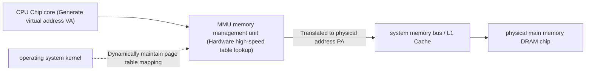

> **Lecturer**: Randal E. Bryant & David R. O'Hallaron ｜ **Original video**: Bilibili points P17 \| **duration**: 01:11:14  
> **Module**: Module 7: System-Level I/O & Virtual Memory (L16 - L18 · Unix I/O, virtual memory address translation, page table and multi-level cache protection)  
> **Original video address**: [https://www.bilibili.com/video/BV1iW411d7hd/?p=17](https://www.bilibili.com/video/BV1iW411d7hd/?p=17)  
> **Course official ownership**: Carnegie Mellon University (CMU) 15-213 / 18-213 / 15-513: Introduction to Computer Systems (CSAPP Fall 2015)  
> **Corresponding teaching materials**: *Computer Systems: A Programmer's Perspective (3rd Edition)* by R. Bryant & D. O'Hallaron  
> **Source of subtitles and handouts**: The subtitles were translated and edited by the EugeneLiu/translationCSAPP team (CC BY-NC 4.0 open source license), and the copyright of the slides belongs to the CMU course group.  

---

## 1. Physical addressing vs virtual addressing: Breaking the physical memory cage

*(Reference time: 00:02:15 · [Video jump (P17 00:02:15)](https://www.bilibili.com/video/BV1iW411d7hd/?p=17&t=135))*

Early computers (and the simplest modern microcontrollers) used **Physical Addressing**: The address generated by the CPU executing instructions is the real electrical signal on the pin of the physical main memory chip.
However, in modern general-purpose multi-tasking operating systems, physical addressing has fatal flaws:
* There is no security isolation between processes, and malicious programs can modify the operating system kernel or the memory of other programs at will;
* The memory occupied by the program must be continuous physical space. When multiple programs run concurrently, it can easily cause serious fragmentation;
* Programmers must always be wary of whether their program address will conflict with others when writing code.

### Virtual Addressing and MMU
All modern computers use **virtual addressing**: 
* The CPU chip integrates a specialized hardware module——**Memory Management Unit (MMU - Memory Management Unit)**; 
* The CPU core pipeline only generates **VA - Virtual Address**; 
* The MMU hardware uses the operating system kernel to establish in memory **Page Tables**, dynamically translate virtual addresses into **Physical Address (PA - Physical Address)**, and then sent to the memory bus!

## 2. Triple incarnations of virtual memory: caching tools, management tools and protection tools

*(Reference time: 00:14:20 · [Video jump (P17 00:14:20)](https://www.bilibili.com/video/BV1iW411d7hd/?p=17&t=860))*

Virtual Memory (VM) is one of the greatest abstractions in the history of computer science. It plays a fusion of three indispensable roles in the system:

### 1. VM as a Tool for Caching
* Conceptually, virtual memory is organized as a  $N$  A unit array of contiguous byte sizes;
* Memory is divided into fixed-size chunks called **Virtual Pages (VPs)**, usually  **4 KB($2^{12}$  bytes)**; 
* Physical memory DRAM is also divided into equally sized blocks called **Physical Pages / Page Frames (PPs)**; 
* **The physical characteristics of DRAM as a disk cache**: 
  * Since accessing disk is over 100,000 times more expensive than accessing DRAM, page faults are extremely costly!
  * Therefore, the virtual page size is very large (starting at 4KB, modern systems can support 2MB/1GB huge pages);
  * DRAM cache adoption **Fully Associative**: Any virtual page can be placed in any physical page frame;
  * Extremely sophisticated page replacement algorithms must be used (such as LRU variants, clock algorithm Clock);
  * Always use the \*\*Write-Back\*\* strategy and never write to disk easily.

### 2. VM as a Tool for Memory Management
* **Simplify links**: Each process has a consistent, private virtual memory space (such as code segments always start from  `0x400000`  Start), the compiler and linker don't have to worry about which physical chip the code will eventually be loaded on;
* **Simplify loading**:Pass  `mmap`  Map sections of the executable file to virtual pages, and demand paging (Demand Paging) only occurs when actual access causes a page fault;
* **Simplify sharing**: Multiple processes can map their own private virtual pages to the same read-only physical page (such as  `libc.so`  code), greatly saving memory;
* **Simplify memory allocation**: when calling  `malloc`  When it is necessary to allocate a continuous 100MB virtual memory, the operating system only needs to grab scattered physical page frames from the physical memory and assemble them into continuous virtual addresses through the page table!

### 3. VM as a Tool for Memory Protection
In addition to the physical address, the page table entry also embeds sophisticated **permission control bit**: 
* `SUP`: Whether it must be accessed in kernel mode (Supervisor Mode);
* `READ` / `WRITE`:Whether reading and writing is allowed;
* `EXEC` (NX bit): Whether to allow code execution.
Once the user mode code attempts to write data to the read-only code section, the MMU hardware immediately blocks it and triggers a protection fault, throwing  `SIGSEGV`  segfault.

## 3. The internal structure of the page table and the magical self-healing process of page fault exceptions (Page Fault)

*(Reference time: 00:27:50 · [Video jump (P17 00:27:50)](https://www.bilibili.com/video/BV1iW411d7hd/?p=17&t=1670))*

### Data structure of Page Table
The page table is a table that resides in physical memory. **Page Table Entry (PTE - Page Table Entry) array**.
Each virtual page has a corresponding PTE in the page table:
* **Valid Bit**: 
  * If  `Valid == 1`: Indicates that the virtual page has been cached and loaded into physical memory, and the PTE stores the corresponding **Physical page number (PPN)**; 
  * If  `Valid == 0`  And the address is not empty: it means that the virtual page has not been loaded into the memory, and the PTE stores the page in **Physical storage address on disk**; 
  * If  `Valid == 0`  And the address is empty: it means that the virtual page has not been allocated, and access will directly cause a segmentation fault.

### Page Fault full link deduction
When the CPU attempts to access a  `Valid == 0`  When the virtual page is:
1. The MMU hardware detects that the valid bit is 0 and triggers immediately **Page Fault Exception (Page Fault Exception)**; 
2. The CPU control flow suspends the current user program and instantly falls into the page fault exception handler of the operating system kernel;
3. The kernel looks for a free physical page in the physical memory DRAM; if the physical memory is full, it uses the replacement algorithm to select a \*\*sacrifice page (Victim Page)\*\* and swaps it out to the disk swap space (Swap Space);
4. The kernel issues an I/O request to the disk controller to read the target virtual page from the disk into the selected physical page frame by sector;
5. The kernel updates the page table: writes the effective position 1 corresponding to the PTE into the physical page number PPN;
6. The page fault handler returns——**Let the CPU re-execute the original load instruction that caused the page fault.**!
7. At this time, the MMU looks up the table again, hits the physical memory, and the data is read into the CPU at high speed. The program has no idea that a feat spanning the kernel and the disk has occurred!

## 4. Address translation hardware pipeline and TLB (fast table) hardware acceleration

*(Reference time: 00:41:30 · [Video jump (P17 00:41:30)](https://www.bilibili.com/video/BV1iW411d7hd/?p=17&t=2490))*

### Mathematical mapping of virtual addresses to physical addresses
Assume that the virtual address is  $n$  bit, the physical address is  $m$  bits, the page size is  $P = 2^p$  Bytes ($p=12$  (i.e. 4KB):
* **virtual address (VA)**  Divided into:
  * **VPN (Virtual Page Number)**: high  $n - p$  bit, used as an index to look up the PTE in the page table;
  * **VPO (Virtual Page Offset)**: low  $p$  bit, byte offset within the page.
* **Physical address (PA)**  Divided into:
  * **PPN (Physical Page Number)**: The physical page frame number comes from the PTE obtained by looking up the table;
  * **PPO (Physical Page Offset)**: Byte offset within the physical page.
* **immutable laws of physics**: **$\text{VPO} \equiv \text{PPO}$**! Because the page size is the same, the intra-page offset remains completely constant before and after translation!

### Translation Lookaside Buffer (TLB - Translation Lookaside Buffer)
The page table itself is stored in physical DRAM memory. This means: **Every time the CPU wants to access a piece of memory data, it must first access the memory to read the page table, and then access the memory to read the real data.**! This can cause system performance to plummet by 50%!
In order to break through this bottleneck, the MMU chip integrates a very small but extremely fast hardware cache——**TLB (fast table)**: 
* TLB is a chip-level SRAM Cache that specifically caches PTE;
* **TLB Hit**: CPU generates VA, MMU first compares VPN in TLB in parallel. A direct hit 99% of the time, **Address translation is completed instantly in zero cycles**!
* **TLB Miss**: In rare cases of miss, the MMU initiates a memory read (Page Walk) to the multi-level page table and loads the result into the TLB.

## 5. Multi-Level Page Tables: Mathematical magic to solve the 512GB page table disaster

*(Reference time: 00:55:10 · [Video jump (P17 00:55:10)](https://www.bilibili.com/video/BV1iW411d7hd/?p=17&t=3310))*

### Why is a single-level flat page table physically impossible to implement in a 64-bit system?
Consider a 64-bit system (currently mainstream uses 48-bit virtual address space):
* The virtual space size is  $2^{48} = 256 \text{ TB}$; 
* The page size is  $4 \text{ KB} = 2^{12}$  Bytes;
* The entire system has  $2^{48 - 12} = 2^{36}$ (approximately 68 billion) virtual pages!
* Each page table entry PTE occupies 8 bytes;
* **If a single-level tiled page table is used, a single process will consume the page table itself.**: 
  $$2^{36} \times 8 \text{ 字节} = 512 \text{ GB 物理内存}！$$
 A computer with only 16GB of memory cannot even fit the page table of a process!

### Dimensionality reduction of multi-level page tables (hierarchical tree structure)
Adopted with x86-64  **Level 4 page table mechanism**  For example:
The 48-bit virtual address is divided into: 
`[ PML4 (9位) | PDPT (9位) | PD (9位) | PT (9位) | VPO (12位) ]`
* **The No. 1 Secret of Memory Savings**:
If an entry in the first-level page table is empty (meaning that the entire 512GB virtual address range is not used by the process at all), **Then the corresponding second-level, third-level, and fourth-level page tables do not need to be physically created and allocated at all.**!
* Although the vast majority of typical user programs have a virtual horizon of 256TB, the actual data used is often only a few tens of megabytes;
* The multi-level page table compresses the tiled array that originally required 512GB into a sparse prefix tree (Trie) with only a few leaf nodes. The actual memory consumption is only tens of KB!

---

### Summary and core thoughts of this lecture (Takeaways)

1. **Essential changes in systems perspective**: This lecture analyzes the core implementation principles of "Virtual Memory: Concepts (virtual memory concepts, paging mechanism, TLB hardware acceleration and multi-level page tables)" from the underlying mechanism.
2. **Software and hardware co-design**: Understanding the underlying rules can not only eliminate potential hidden bugs that are difficult to debug, but is also a prerequisite for writing industrial-grade code with ultimate performance.
3. **Hands-on verification**: It is recommended to cooperate with the after-school exercises and official experiments (Lab) of the corresponding chapters of CSAPP, and use GDB and performance analysis tools in the Linux terminal environment to personally verify the theory.
