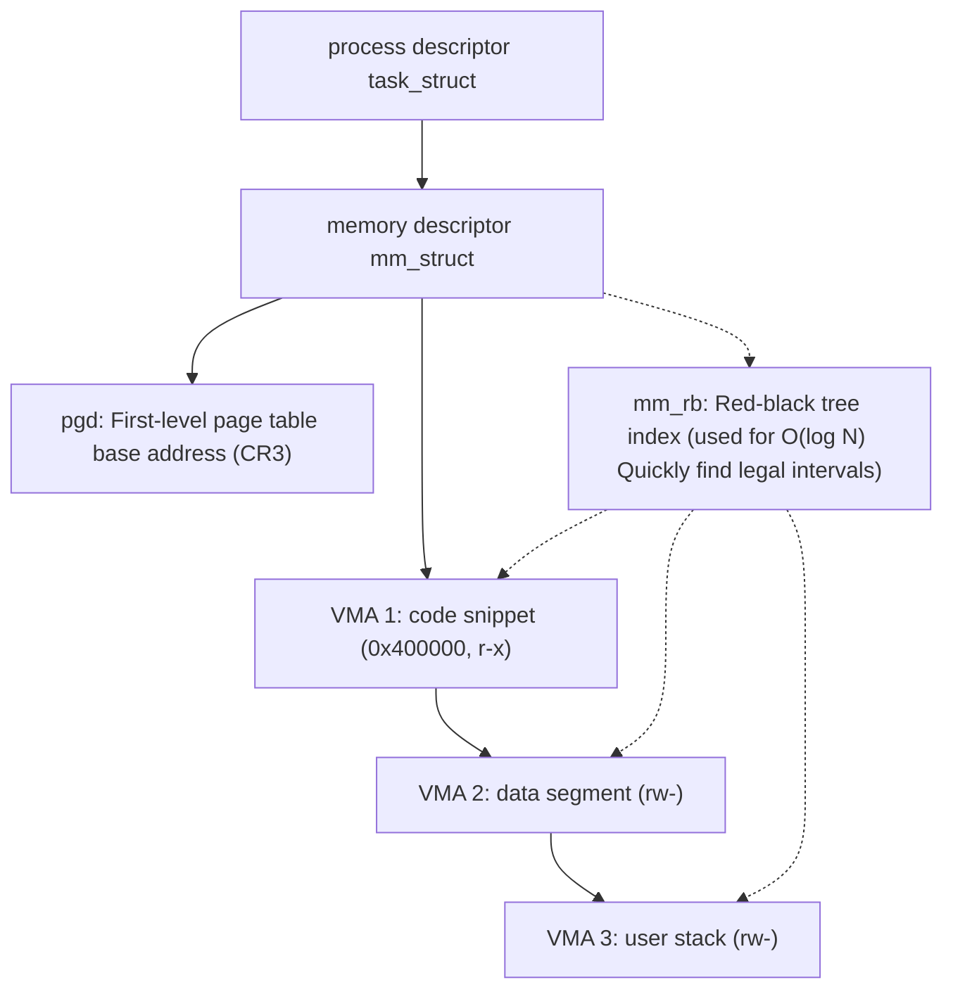

> **Lecturer**: David R. O'Hallaron ｜ **Original video**: Bilibili points P18 \| **duration**: 01:17:48  
> **Module**: Module 7: System-Level I/O & Virtual Memory (L16 - L18 · Unix I/O, virtual memory address translation, page table and multi-level cache protection)  
> **Original video address**: [https://www.bilibili.com/video/BV1iW411d7hd/?p=18](https://www.bilibili.com/video/BV1iW411d7hd/?p=18)  
> **Course official ownership**: Carnegie Mellon University (CMU) 15-213 / 18-213 / 15-513: Introduction to Computer Systems (CSAPP Fall 2015)  
> **Corresponding teaching materials**: *Computer Systems: A Programmer's Perspective (3rd Edition)* by R. Bryant & D. O'Hallaron  
> **Source of subtitles and handouts**: The subtitles were translated and edited by the EugeneLiu/translationCSAPP team (CC BY-NC 4.0 open source license), and the copyright of the slides belongs to the CMU course group.  

---

## 1. Linux process virtual memory kernel data structure: mm\_struct and VMA red-black tree

*(Reference time: 00:02:15 · [Video jump (P18 00:02:15)](https://www.bilibili.com/video/BV1iW411d7hd/?p=18&t=135))*


Within the Linux kernel, virtual memory is not an irregular fragment, but is structured and maintained through a series of exquisite kernel objects.
The kernel maintains a  `task_struct`  process descriptor, which contains a pointer  `mm`, pointing to a description of the entire memory state of the process  **`mm_struct`**: 

### `mm_struct`  core members of
* **`pgd`**: Pointer to the physical base address of the process's first-level page table (PML4). When a context switch occurs, the kernel writes this pointer to the CPU-specific  `CR3`  control register;
* **`mmap`**: Points to a  **`vm_area_struct` (Virtual Memory Area, VMA for short)**  The head of the one-way linked list;
* **`mm_rb`**: A \*\*Red-Black Tree\*\* root node that manages all VMAs.

### What is a virtual memory area (VMA - Virtual Memory Area)?
A VMA describes a contiguous collection of virtual pages with the same protection rights and attributes:
* The code segment is a VMA (read-only, executable);
* The data segment and BSS are a VMA (readable and writable);
* The runtime heap (Heap) is a VMA that grows toward higher addresses;
* The shared library mapping area is one or more VMAs;
* The User Stack is a VMA that grows toward lower addresses.
* **Why use linked lists and red-black trees at the same time?**
  * When the kernel needs to traverse all memory regions sequentially (e.g.  `fork`  Copy or export  `/proc/pid/maps`), directly traverse the one-way linked list;
  * When a page fault occurs in a process, the kernel needs to instantly determine a virtual address.  $A$  Whether it falls within the legal memory area, the red-black tree provides  **$O(\log N)$**  Extremely fast binary search!



## 2. Linux page fault exception handling trilogy: legality, permissions and paging

*(Reference time: 00:16:30 · [Video jump (P18 00:16:30)](https://www.bilibili.com/video/BV1iW411d7hd/?p=18&t=990))*


When the MMU generates a page fault exception and traps it in the kernel, the Linux kernel's exception handling function performs a strict three-step review process:

1. **Step One: Address Legality Review (Is Virtual Address Legal?)**: 
   * The kernel searches the red-black tree of the process for the virtual address where the page fault occurred.  $A$; 
   * if  $A$  It does not fall within the range of any VMA currently defined by the process, indicating that the program is trying to access completely illegal wild pointer memory!
   * **judgment**: kernel generation  `SIGSEGV`  Signal (Segment Fault), the program will be executed immediately.
2. **Step 2: Review of memory protection permissions (Is Memory Access Valid?)**: 
   * Found the containing address  $A$  Legitimate VMAs;
   * Check whether the operation type (read, write, execute) that caused the exception matches the read, write, and execute permissions specified by the VMA;
   * For example: trying to write to a read-only code segment VMA!
   * **judgment**: The kernel also throws  `SIGSEGV`  Protect the exception and terminate the program.
3. **Step 3: Normal Page Fault Handling**: 
   * After passing the above two rigorous reviews, the kernel confirmed that this was a completely legal on-demand paging;
   * The kernel allocates a physical page frame and reads the target data block from the disk file (or swap space) into the physical page;
   * Update the hardware page table entry PTE, and finally let the CPU re-execute the instruction just now.

## 3. Memory mapping technology (mmap) and file I/O zero-copy performance miracle

*(Reference time: 00:32:10 · [Video jump (P18 00:32:10)](https://www.bilibili.com/video/BV1iW411d7hd/?p=18&t=1930))*


Linux provides an extremely powerful system call——**`mmap()`**: 
```c
void *mmap(void *start, size_t length, int prot, int flags, int fd, off_t offset);
```
`mmap`  Allows an application to map a disk file directly into the process's virtual memory space, or allocate an anonymous segment of clean memory.

### Two types of core objects for memory mapping
1. **Mapping regular files (Regular Files)**: 
   * Map a contiguous area of a disk file into a VMA;
   * adopt **Demand Paging**: call  `mmap`  moment, the kernel actually **Not a single byte is read from disk at all**! The kernel only creates a new VMA structure in the process;
   * When the program actually accesses this memory through a pointer later, the page fault exception drives the hardware to automatically transfer the corresponding page from the disk into the memory.
2. **Mapping anonymous files (Anonymous Files / Demand-Zero Pages)**: 
   * The mapping object is not a physical file on the disk, but an all-0 virtual file maintained by the kernel;
   * Specifically used to allocate large contiguous heap memory (`.bss`  Section and  `malloc`  Automatically called at the bottom when a large memory is requested).

### `mmap`  Contrast tradition  `read`/`write`  Zero-Copy Advantages
Traditional reading and writing file process: 
`磁盘 -> 内核页缓存 -> 复制到用户态 buf -> 用户修改 -> 复制回内核 -> 刷盘` (With multiple expensive memory copies and context switches). 
`mmap`  Process:
Map files directly to user virtual pages! Users read and write it through pointers, which is as simple as operating a memory array, completely bypassing the redundant copy of the user-mode intermediate buffer, and the throughput rate increases explosively!

## 4. Copy-on-Write (COW: Copy-on-Write): The underlying secret of fork completing instantly

*(Reference time: 00:46:40 · [Video jump (P18 00:46:40)](https://www.bilibili.com/video/BV1iW411d7hd/?p=18&t=2800))*


In the previous lecture we mentioned: `fork()`  A private copy of the child process's virtual memory that is identical to the parent process's will be created.
What if the parent process was running a large in-memory database that took up 32 GB of memory?  `fork`  Will it instantly apply for another 32 GB of space in physical memory and copy it all byte by byte?
If that's the case, `fork`  It will take several seconds or even cause the physical memory to be directly exploded by OOM!

### God-level implementation of Copy-on-Write (COW)
Modern operating systems use virtual memory and MMU protection bits to implement a seamless deception:
1. **Create a read-only replica**:
in  `fork()`  When called, the kernel copies the parent process's data exactly for the child process.  `mm_struct`  and page tables, so that the virtual pages of the parent and child processes **All point to the same batch of existing physical page frames**!
2. **Take away write permission**:
The kernel changes the PTE permission bits of all private pages that can be read and written by the parent and child processes. **Force all changes to read-only (Read-Only)**!
3. **Delayed splitting (triggered on write)**: 
   * As long as both father and son are performing read-only access, everyone shares the same physical memory without incident;
   * Once either the parent process or the child process attempts to perform a write operation (such as modifying a variable  `x = 1`): 
     * The CPU hardware MMU detects an attempt to write to a read-only page and immediately triggers a protective page fault!
     * The kernel page fault handler intervenes and discovers that the page belongs to a COW shared area;
     * At this time, the kernel actually applies for a new physical page frame from the physical memory, copies the data of the old page to the process that initiated the write, and points the process's page table to the new physical page to restore writable permissions;
     * The other process's page table remains unchanged.

**income**: If the child process is in  `fork`  and then call  `execve` (A common idiom in 99% of Unix), all previously unmodified physical memory is exempted from copying, and the overhead is reduced to almost 0!

## 5. Dynamic memory allocator outpost: heap boundaries and brk / sbrk mechanism

*(Reference time: 01:03:20 · [Video jump (P18 01:03:20)](https://www.bilibili.com/video/BV1iW411d7hd/?p=18&t=3800))*


Above the data segment of the program, it is used to dynamically apply for space during runtime. **Runtime Heap**.
* **Pointer to the top of the heap: `brk` (Break pointer)**:
kernel in process  `mm_struct`  The center maintains a database called  `brk`  The address pointer, which accurately marks the highest physical virtual boundary of the current heap.
* **Low-level system calls  `brk()`  with  `sbrk()`**: 
  * `int brk(void *addr)`:Modify the kernel's  `brk`  The pointer is directly set to the specified absolute address  `addr`; 
  * `void *sbrk(intptr_t incr)`: will  `brk`  The pointer advances up or down  `incr`  bytes; return  `brk`  The old address pointer before the move.
  * If  `incr > 0`, expand the heap to high addresses and open up new memory; if  `incr == 0`, returns the current address of the current top of the heap.

### Why is the application not called directly in the business code?  `sbrk()`?
call directly  `sbrk`  Extremely inefficient and unmanageable:
* `sbrk`  Each time, it advances or retreats in one direction at the top of the heap, which cannot meet the complex requirements of releasing a small piece of memory anywhere in the middle of the heap;
* The overhead of frequently falling into kernel mode to execute system calls is unbearable.
Therefore, the C standard library encapsulates specialized **Dynamic Memory Allocator (Dynamic Memory Allocator, namely  `malloc`  and  `free`)**, taking over the large block memory management and slice recycling of the heap in user mode.


---

### Summary and core thoughts of this lecture (Takeaways)

1. **Essential changes in systems perspective**: This lecture analyzes the core implementation principles of "Virtual Memory: Systems (Linux virtual memory implementation, mm\_struct, VMA, mmap and copy-on-write COW)" from the underlying mechanism.
2. **Software and hardware co-design**: Understanding the underlying rules can not only eliminate potential hidden bugs that are difficult to debug, but is also a prerequisite for writing industrial-grade code with ultimate performance.
3. **Hands-on verification**: It is recommended to cooperate with the after-school exercises and official experiments (Lab) of the corresponding chapters of CSAPP, and use GDB and performance analysis tools in the Linux terminal environment to personally verify the theory.
