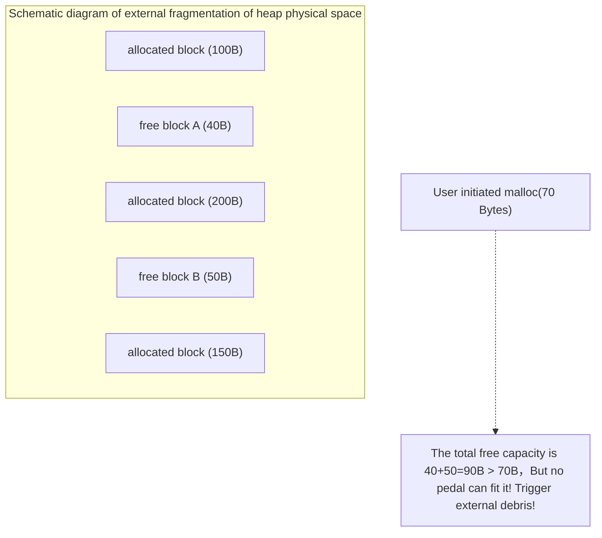

> **Lecturer**: Randal E. Bryant & David R. O'Hallaron ｜ **Original video**: Bilibili points P19 \| **duration**: 01:06:28  
> **Module**: Module 8: Dynamic Memory Allocation (L19 - L20 · Malloc mechanism, implicit/explicit free list, separated free list and garbage collection)  
> **Original video address**: [https://www.bilibili.com/video/BV1iW411d7hd/?p=19](https://www.bilibili.com/video/BV1iW411d7hd/?p=19)  
> **Course official ownership**: Carnegie Mellon University (CMU) 15-213 / 18-213 / 15-513: Introduction to Computer Systems (CSAPP Fall 2015)  
> **Corresponding teaching materials**: *Computer Systems: A Programmer's Perspective (3rd Edition)* by R. Bryant & D. O'Hallaron  
> **Source of subtitles and handouts**: The subtitles were translated and edited by the EugeneLiu/translationCSAPP team (CC BY-NC 4.0 open source license), and the copyright of the slides belongs to the CMU course group.  

---

## 1. Why is dynamic memory allocation needed? Explicit vs implicit allocator

*(Reference time: 00:02:10 · [Video jump (P19 00:02:10)](https://www.bilibili.com/video/BV1iW411d7hd/?p=19&t=130))*

When writing a C program, if we use hard-coded static arrays at compile time (such as  `int arr[1000]`) to define the data structure, you must face a dilemma:
* If the preset value is too small, once the actual input data exceeds the upper limit, the program will immediately go out of bounds and crash;
* If the default value is too large, memory will be wasted most of the time.
Only when the program is actually running (runtime) can we determine how much storage space is needed based on specific network requests, database queries, or file sizes. This is the fundamental value of \*\*Dynamic Memory Allocation\*\*.

### Explicit allocator vs implicit allocator
* **Explicit Allocator**: 
  * The application is required not only to explicitly apply for memory, but also to explicitly manually release (Free) memory that is no longer in use;
  * Classic representative: C language  `malloc()` / `free()`, C++ `new` / `delete`.
* **Implicit Allocator / Garbage Collector**: 
  * Programmers are only responsible for applying for memory and never manually releasing it; the allocator automatically detects which memory is no longer referenced through the garbage collection (Garbage Collection, GC) algorithm and reclaims it on its behalf;
  * Classic representatives: Java, Python, Go, JavaScript, Lisp.

## 2. The core performance game of the allocator: Throughput vs. Memory Utilization

*(Reference time: 00:15:30 · [Video jump (P19 00:15:30)](https://www.bilibili.com/video/BV1iW411d7hd/?p=19&t=930))*

Designing an industrial-grade dynamic memory allocator is essentially solving a very challenging multi-objective optimization trade-off problem.

### Stringent design constraints
1. **Unable to control the arrival sequence and size of requests**: The program can be called at any time  `malloc`  and  `free`, the allocator cannot predict the future;
2. **Requests must be responded to immediately**: `malloc`  It must return immediately at the moment it is called, and it is never allowed to delay and suspend the caller in order to wait for a better time;
3. **The allocated memory must be located in the heap area**; 
4. **Alignment constraints must be met**: On 64-bit Linux, the returned pointer address must strictly satisfy  **16-byte alignment (multiples of 8 bytes)**; 
5. **Already allocated blocks must not be moved**: Once the pointer is returned  `p`  To the user, the physical virtual address of the memory block must be fixed, and the allocator **Already allocated blocks must not be compressed or moved in the background.**!

### Core performance indicators
* **Throughput**: What the allocator can complete per second  `malloc`  and  `free`  The total number of requests (for example, 10 million times/second);
* **Peak Memory Utilization**: The ratio between the total amount of payload and the high-water mark (High-Water Mark) that the heap actually asks from the operating system: 
  $$U_k = \frac{\max_{i \le k} P_i}{H_k}$$
  * These two goals are often in violent conflict: the pursuit of extreme utilization requires traversing the entire heap to find the most perfect matching block (the throughput rate plummets); the pursuit of extreme throughput often involves rough slicing (causing serious memory waste).

## 3. The Pain of Memory Fragmentation: Internal Fragmentation vs. External Fragmentation

*(Reference time: 00:26:40 · [Video jump (P19 00:26:40)](https://www.bilibili.com/video/BV1iW411d7hd/?p=19&t=1600))*

The fundamental culprit leading to low heap memory utilization is **Fragmentation**: 

### 1. Internal Fragmentation
* Occurs on an allocated block **The payload is strictly smaller than the total size of the block itself** time;
* **generate root cause**: 
  * The header and footer introduced by the allocator to maintain block metadata;
  * Padding that is forced to be inserted in order to meet the 16-byte alignment rule;
  * The minimum block size limit set by the allocator.
* The size of internal fragmentation is entirely determined by the current allocation state and is very easy to quantify and control.

### 2. External Fragmentation
* Occurs although there is enough free physical memory in the heap to satisfy the request, but **No single contiguous free block is large enough to accommodate the request** time!
* **fatal consequences**: At this point the allocator is forced to call  `sbrk`  Further expansion of the heap to the operating system causes the virtual memory space to expand dramatically.
* External fragmentation is the most difficult of dynamic memory allocations to prevent and measure because it relies heavily on a random release sequence in the future.

## 4. Data structure and bit compression black technology of Implicit Free List

*(Reference time: 00:39:10 · [Video jump (P19 00:39:10)](https://www.bilibili.com/video/BV1iW411d7hd/?p=19&t=2350))*

In order to distinguish allocated blocks from free blocks, the allocator must save metadata in each memory block.

### Standard structure of a single memory block (Block Format)
A standard memory block consists of three parts:
1. **Block header (Header)**: 1 machine word length (8 bytes under 64-bit systems);
2. **Payload**: The area that users actually read and write;
3. **Padding**: Optional padding bytes.

### The miracle of bit-packing in the 8-byte header
A block needs to record two key pieces of information: **The total size of the block (Size)**, and **Whether the block is currently free or allocated (Allocated Bit, 0 or 1)**.
If you specifically use 8 bytes to store the size, and then use 8 bytes to store the flags, each block will consume 16 bytes for metadata alone! 
**Design master’s bit compression ideas**: 
* In a 64-bit architecture, since all blocks must be 16-byte aligned (even the minimum 8-byte alignment);
* This means that the total size of any legal block is numerically  $S$, its binary representation **The lowest 3 bits (Bits 0, 1, 2) are always 0**!
* Since the lowest bit is always 0, why not use it as a flag bit?
  * **Lowest bit Bit 0**: `0`  Indicates free (Free), `1`  Indicates Allocated;
  * **High bits (mask the lower 3 bits)**:Record the true total block size!
* Example: If the total size of a block is 24 bytes and has been allocated, the value stored in the header is  $24 \mid 1 = 25$ (hex  `0x19`). Pass  `header & ~0x7`  You can extract the true size 24 in an instant!

### Why is it called an "implicit" linked list?
Because the allocator **does not actually maintain an explicit pointer list in memory**!
The allocator simply relies on the block size recorded in the header of each block, just like checkers: the current block pointer plus the current block size can directly calculate the physical starting address of the next adjacent block! All the blocks are linked together invisibly in the pile like beads on a string.

## 5. Free block placement strategy and Knuth Boundary Tags two-way merging

*(Reference time: 00:52:40 · [Video jump (P19 00:52:40)](https://www.bilibili.com/video/BV1iW411d7hd/?p=19&t=3160))*

### Placement Policies
When the user calls  `malloc(size)`  When, how does the allocator traverse the implicit linked list to find suitable free blocks?
1. **First Fit**: 
   * Start a linear scan from the head of the heap and find the first free block that can accommodate the size and use it immediately;
   * **Advantages and Disadvantages**: Faster; but tends to produce a lot of tiny debris at the beginning of the heap.
2. **Next Fit**: 
   * Continue searching backwards from where the last search ended;
   * **Advantages and Disadvantages**: Faster than first fit; but memory utilization is usually significantly worse.
3. **Best Fit**: 
   * Thoroughly scan all free blocks in the entire heap and select those that meet the requirements **The block with the smallest size**; 
   * **Advantages and Disadvantages**: The highest memory utilization and very little external fragmentation; however, full traversal is required and the throughput rate is dismal.

### The Redemption of Fake Shards: Knuth's Boundary Tags
When two adjacent blocks are successively  `free` , they are obviously physically connected together, but if they are not combined into one, they will form a structure that cannot accommodate large objects. **False Fragmentation**.
* **Backward merging (Next Block) is extremely easy**: Add the current block pointer to the size of this block, and you can read the header of the next block to check whether it is free;
* **The eternal problem of forward merging (Previous Block)**: How to do it in constant time  $O(1)$  Find the previous block that is physically ahead of the current block?
  * If you rescan from the beginning of the heap, the time consuming is extremely fatal.  $O(N)$!

### The genius of computer guru Donald Knuth: Foot Marker (Footer)
Knuth introduced a **Feet exactly the same as the head (Footer / Boundary Tag)**: 
* Both the head and the foot record the size and allocation bits of the block;
* When we want to check the previous block: **Directly subtract 8 bytes from the current block head pointer, and what is read is exactly the foot of the previous block!**
* The size of the previous block can be directly read from the foot, and the starting head of the previous block can be calculated back in an instant!
* **Four merger situations** (The front is empty and the back is full, the front is full and the back is empty, the front and back are both full, and the front and back are both empty) All in  **$O(1)$  constant time**  Solved elegantly within!

---

### Summary and core thoughts of this lecture (Takeaways)

1. **Essential changes in systems perspective**: This lecture analyzes the core implementation principles of "Dynamic Memory Allocation: Basic Concepts (Dynamic Memory Allocation: Basic Concepts, Throughput vs Utilization, and Implicit Free List)" from the underlying mechanism.
2. **Software and hardware co-design**: Understanding the underlying rules can not only eliminate potential hidden bugs that are difficult to debug, but is also a prerequisite for writing industrial-grade code with ultimate performance.
3. **Hands-on verification**: It is recommended to cooperate with the after-school exercises and official experiments (Lab) of the corresponding chapters of CSAPP, and use GDB and performance analysis tools in the Linux terminal environment to personally verify the theory.
