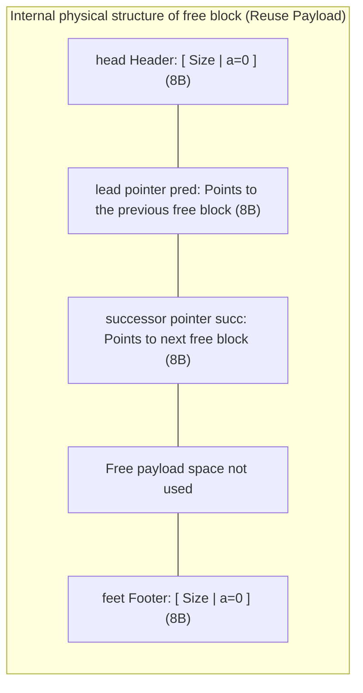

> **Lecturer**: David R. O'Hallaron ｜ **Original video**: Bilibili points P20｜ **duration**: 01:22:43  
> **Module**: Module 8: Dynamic Memory Allocation (L19 - L20 · Malloc mechanism, implicit/explicit free list, separated free list and garbage collection)  
> **Original video address**: [https://www.bilibili.com/video/BV1iW411d7hd/?p=20](https://www.bilibili.com/video/BV1iW411d7hd/?p=20)  
> **Course official ownership**: Carnegie Mellon University (CMU) 15-213 / 18-213 / 15-513: Introduction to Computer Systems (CSAPP Fall 2015)  
> **Corresponding teaching materials**: *Computer Systems: A Programmer's Perspective (3rd Edition)* by R. Bryant & D. O'Hallaron  
> **Source of subtitles and handouts**: The subtitles were translated and edited by the EugeneLiu/translationCSAPP team (CC BY-NC 4.0 open source license), and the copyright of the slides belongs to the CMU course group.  

---

## 1. Explicit Free Lists: completely get rid of the burden of allocated blocks

*(Reference time: 00:02:15 · [Video jump (P20 00:02:15)](https://www.bilibili.com/video/BV1iW411d7hd/?p=20&t=135))*

In the implicit free linked list, a fatal performance bottleneck is: when the allocator traverses and searches for free blocks, **Have to skip all allocated blocks one by one**. If tens of thousands of objects are allocated in a heap, the time complexity of searching for a free block is directly limited by **Total number of all blocks in the heap**!

### The core revolution of explicit free lists: zero space overhead pointer injection
The core idea of explicit free linked list is: **Only the real free blocks are linked into a doubly linked list using pointers**! Allocated blocks do not participate in linked list traversal at all.
However, additional  `pred` (precursor) and  `succ` Do (successor) pointers add additional space overhead? 
**The answer is: absolutely zero additional overhead!**

* Observe the internal structure of the free block: When a block is in the free state, what is originally reserved for the user **The payload area is completely idle and useless**!
* The allocator directly borrows the Payload area of the free block and stores two 8-byte pointers:
  * `pred`: Points to the previous free block in the linked list;
  * `succ`: Points to the next free block in the linked list.
* When the block will be  `malloc`  When assigned to a user, the user data directly overwrites these two pointers, seamlessly!
* **performance jump**: The search time for free blocks plummets from depending on the "total number of blocks" to just **The current number of free blocks**!

## 2. Linked list maintenance order decision: last in first out (LIFO) vs address-ordered (Address-Ordered)

*(Reference time: 00:15:40 · [Video jump (P20 00:15:40)](https://www.bilibili.com/video/BV1iW411d7hd/?p=20&t=940))*

When maintaining an explicit two-way free list, there are two distinct strategies when a freed block is ready to be inserted into the list:

### 1. LIFO: Last-In-First-Out
* **rules**: Unconditionally insert the newly released block directly into **The head of the free list**; 
* **Advantages**: `free()`  The release operation has the ultimate performance, and the time consumption is strictly constant  **$O(1)$**;If combined with boundary mark merging, both release and merging are completed instantaneously within microseconds;
* **Weakness**: The address distribution of fragments is messy, and research shows that the memory utilization of LIFO is usually lower than address sorting.

### 2. Address-Ordered Policy
* **rules**: Requires that the linking order of all free blocks in the linked list must be consistent with their order in the heap memory. **The physical starting address keeps monotonically increasing.**!
* **Advantages**: The degree of memory fragmentation is significantly reduced, making it less likely to produce tiny holes that are difficult to exploit, and the utilization rate approaches the theoretical upper limit;
* **Weakness**: Executed every time  `free()`  When , the linked list must be scanned from the beginning to find the correct physical insertion position before and after it, and the overhead of the release operation degrades to  **$O(N)$**.

## 3. The ultimate form of industrial grade distributor: Segregated Fits and partner systems

*(Reference time: 00:29:30 · [Video jump (P20 00:29:30)](https://www.bilibili.com/video/BV1iW411d7hd/?p=20&t=1770))*

Modern industrial-grade high-performance allocators (such as Google TCMalloc, FreeBSD/Facebook's jemalloc, and Linux glibc's default ptmalloc), without exception, have the underlying core engines **Segregated Storage Allocator**.

### Segregated Free Lists architecture
The core idea of separation adaptation is: **Maintain an array composed of multiple independent free linked lists, each linked list is dedicated to storing free blocks belonging to a specific size class (Size Class)**!
* Typical size classification (usually in logarithmic increments to powers of 2):
  * Class 0: $16 \sim 31$  Bytes;
  * Category 1: $32 \sim 63$  Bytes;
  * Category 2: $64 \sim 127$  Bytes;
  * ...
  * class  $k$: $1024 \sim 2047$  Bytes;
  * Large object class: $\ge 4096$  Bytes.

### High-speed three-step process for separation, adaptation and distribution
1. Determine the Size Class index where the requested size is located;
2. Directly locate the free linked list of the corresponding category and perform a fast First-Fit search within it;
3. If the linked list is not empty and a matching block is found, slice and allocate it directly; if it is empty, search the upper linked list with a larger size and perform binary slicing!
* **God-level industrial effect**: 
  * **Search time is approaching  $O(1)$** (Because the linked list is extremely short or even only has a single block);
  * **Memory utilization approaches Best-Fit** (Because the block sizes within similar linked lists match almost exactly, external fragmentation is almost completely eliminated)!

### Buddy System classic mechanism
The buddy system is a highly mathematical special variant of split adaptation (the core algorithm for physical page frame allocation in the Linux kernel):
* The size of all blocks must be  **Integer powers of 2 ($2^k$)**; 
* Each block has a unique "buddy";
* **Magical Binary Bit Operations Searching for Companions**:
Given a size of  $2^k$, the address is  $A$  block, the memory address of its partner block can be directly calculated through an extremely simple XOR bit operation: 
  $$\text{Buddy Address} = A \oplus 2^k$$
* When the partner block is also free, the two blocks are instantly merged into a block with a size of  $2^{k+1}$  of large chunks, and the computational overhead is almost zero!

## 4. Garbage Collection and Mark-and-Sweep algorithm

*(Reference time: 00:44:15 · [Video jump (P20 00:44:15)](https://www.bilibili.com/video/BV1iW411d7hd/?p=20&t=2655))*

In high-level languages such as Java, Python, Go, etc., dynamic memory is automatically managed by implicit allocators. One of the most classic and basic algorithms was invented by Turing Award winner John McCarthy.  **Mark-and-Sweep algorithm**.

### Reachability Graph
GC models the memory of the entire system into a directed graph:
* **Root Set**: Pointers in the program that can be accessed directly without dereferencing, including CPU registers, local pointer variables on the stack, and global variables;
* **Reachable Nodes**: Starting from the root node, any heap memory block that can be traversed along the pointer reference chain;
* **Garbage**: Any set starting from the root **Unreachable island node**. These node programs no longer have any legal way to access them and must be recycled.

### Mark-and-Sweep executes two phases
1. **Mark Phase**: 
   * Starting from the Root Set, traverse the entire graph using breadth-first or depth-first;
   * For each surviving block traversed, set the Marked Bit in its header to 1;
2. **Sweep Phase**: 
   * Linearly scan each block in the heap;
   * If a block  `Marked == 0`, indicating that it is unreachable garbage, and the underlying mechanism is called to recycle it into the free linked list;
   * If a block  `Marked == 1`, the flag bit will be reset to zero and wait for the next GC cycle check.

> \[!NOTE\] C language conservative garbage collector (Conservative GC)
Tools like Boehm GC provide garbage collection for C/C++. But because the C language allows pointers to be cast to integers, pointer arithmetic, and unions, the allocator cannot determine whether an 8-byte value is a real pointer or a pure integer. Therefore it uses **Conservative strategy (Conservative)**: As long as the value of a certain memory unit looks like a legal address falling within the heap area, it will always be regarded as a living pointer and will never be accidentally killed!

## 5. A Guide to Avoiding Pitfalls of Blood and Tears: Top Ten Classic Memory Mysteries in C Language and Debugging Tips

*(Reference time: 00:58:30 · [Video jump (P20 00:58:30)](https://www.bilibili.com/video/BV1iW411d7hd/?p=20&t=3510))*

The C language gives programmers absolute freedom to face physical memory, but the price of this freedom is eternal vigilance. CSAPP summarizes the top ten classic memory errors that lead to online disasters in system programming:

1. **Dereferencing Bad Pointers**: 
   * Typical mistakes: `scanf("%d", val)`  Missed the address character  `&`, resulting in  `val`  The value is written as a memory address!
2. **Reading Uninitialized Memory**: 
   * misunderstood  `malloc`  Will clear the memory (clearing must be done explicitly  `calloc`  or  `memset`).
3. **Buffer Overflow destroys the stack/heap (Buffer Overflow)**: 
   * The string is copied out of bounds, trampling adjacent metadata.
4. **Assuming Pointer and Object Size Equivalence**: 
   * `int **p = malloc(N * sizeof(int))` (should be multiplied by  `sizeof(int *)`! Under 64-bit, half the space is directly allocated).
5. **Off-by-One Errors**: 
   * The loop condition is written as  `i <= n`, out-of-bounds reading and writing to the end of the array.
6. **Referencing Nonexistent Variables**: 
   * The function returns a pointer to a local variable inside its own stack frame. This pointer becomes a time bomb after the function is unstacked.
7. **Use-After-Free (UAF)**: 
   * pointer released  `p`  After that, continue reading or writing  `*p`, half of modern high-risk security vulnerabilities.
8. **Repeated release of Double Collapse (Double Free)**: 
   * to the same pointer  `free(p)`  Twice, the closed-loop metadata of the free linked list was completely destroyed, causing SIGSEGV or being exploited to escalate privileges.
9. **Memory Leaks**: 
   * Continuously allocate but forget to release, eventually exhausting the virtual address space and causing system OOM crash.
10. **Dereference dangling structure pointer**.

> \[!TIP\] Malloc Lab ultimate pass secrets
CSAPP Crown Experiment  **Malloc Lab**  Students are required to use C language to create a high-performance dynamic memory allocator (implementation  `mm_init`, `mm_malloc`, `mm_free`, `mm_realloc`): 
> * Reached 80 segments: implicit free list + boundary mark merge;
> * Breaking through 90 segments: explicit two-way free linked list + LIFO / best fit;
> * Get 100 full points: **Explicitly separated free lists (Segregated Fits) + extreme alignment compression + elimination of foot markers for allocated blocks**!

---

### Summary and core thoughts of this lecture (Takeaways)

1. **Essential changes in systems perspective**: This lecture analyzes the core implementation principles of "Dynamic Memory Allocation: Advanced Concepts (explicit free linked list, separated storage, GC garbage collection and top ten memory problems in C language)" from the underlying mechanism.
2. **Software and hardware co-design**: Understanding the underlying rules can not only eliminate potential hidden bugs that are difficult to debug, but is also a prerequisite for writing industrial-grade code with ultimate performance.
3. **Hands-on verification**: It is recommended to cooperate with the after-school exercises and official experiments (Lab) of the corresponding chapters of CSAPP, and use GDB and performance analysis tools in the Linux terminal environment to personally verify the theory.
