> **Lecturer**: David R. O'Hallaron ｜ **Original video**: Bilibili points P21 \| **duration**: 01:17:03  
> **Module**: Module 9: Network Programming (L21 - L22 · Client-server model, Sockets API, Web server construction)  
> **Original video address**: [https://www.bilibili.com/video/BV1iW411d7hd/?p=21](https://www.bilibili.com/video/BV1iW411d7hd/?p=21)  
> **Course official ownership**: Carnegie Mellon University (CMU) 15-213 / 18-213 / 15-513: Introduction to Computer Systems (CSAPP Fall 2015)  
> **Corresponding teaching materials**: *Computer Systems: A Programmer's Perspective (3rd Edition)* by R. Bryant & D. O'Hallaron  
> **Source of subtitles and handouts**: The subtitles were translated and edited by the EugeneLiu/translationCSAPP team (CC BY-NC 4.0 open source license), and the copyright of the slides belongs to the CMU course group.  

---

## 1. Client-server transaction model and network topology evolution

*(Reference time: 00:02:15 · [Video jump (P21 00:02:15)](https://www.bilibili.com/video/BV1iW411d7hd/?p=21&t=135))*


All network applications, from a system-level perspective, are built on **Client-Server Transaction Model**  above:
* A network application consists of a server process (Server Process) **and one or more** Client Processes\*\* composition;
* Basic affairs trilogy:
  1. Client initiated: sends a **Request**; 
  2. Server response: The server receives the request, interprets its semantics and operates its own resources, and generates a \*\*Response\*\* to pass back;
  3. Client-side processing: The client receives the response and presents it to the user on the screen.

### Hardware level interconnection from LAN to Internet
* **LAN - Local Area Network**: Take \*\*Ethernet\*\* as a typical representative.
  * The host is connected to the network hub (Hub) or high-speed switch (Switch) through a twisted pair;
  * Data is transmitted in units of \*\*Ethernet Frames (Frame)\*\*, which contain a preamble, source and destination physical MAC addresses (48 bits), payload (46 to 1500 bytes), and CRC cyclic redundancy check code.
* **WAN - Wide Area Network**  with  **Internetwork / Internet**: 
  * Through a dedicated communication computer——**Routers**, seamlessly bridge heterogeneous networks (Ethernet, WiFi, satellite links, submarine optical cables) with completely different physical characteristics and electrical standards into a unified network covering the world!

```mermaid
flowchart LR
    subgraph ClientHost["client host"]
        CApp["Web Browser / App"] --> CSocket["socket interface (Socket)"]
        CSocket --> CTCP["TCP / IP protocol stack"]
        CTCP --> CAdapter["Ethernet card (NIC)"]
    end
    subgraph ServerHost["Server host"]
        SAdapter["Ethernet card (NIC)"] --> STCP["TCP / IP protocol stack"]
        STCP --> SSocket["socket interface (Socket)"]
        SSocket --> SApp["Web server (Nginx / Tiny)"]
    end
    CAdapter <==>|"Physical network interconnection: switch / router / Optical fiber network"| SAdapter
```



## 2. Global IP Internet Protocol Stack: System Boundaries of IP, TCP, and UDP

*(Reference time: 00:16:30 · [Video jump (P21 00:16:30)](https://www.bilibili.com/video/BV1iW411d7hd/?p=21&t=990))*


The reason why the Global Internet (Global IP Internet) can connect billions of heterogeneous devices around the world depends on a set of extremely elegant software protocol layering:

1. **Network layer: IP Protocol (Internet Protocol)**: 
   * provide **Unreliable, connectionless datagram delivery service (Best-Effort Datagram Service)**; 
   * The IP protocol simply does its best to route packets from the source host to the destination host, but **There is no guarantee whether data packets are lost, duplicated, or the order in which they arrive.**!
2. **Transport layer: UDP Protocol (User Datagram Protocol)**: 
   * Only minor "Port" addressing and data verification capabilities are added to the IP protocol;
   * It is still connectionless and unreliable, and is suitable for live video broadcasts and online voice games that are extremely sensitive to delays and allow a small amount of packet loss.
3. **Transport layer: TCP protocol (Transmission Control Protocol)**: 
   * An industrial-strength miracle built on unreliable IP protocols!
   * provide **Full-Duplex, reliable, connection-oriented byte stream communication channel**; 
   * Internally, through sequence number acknowledgment (ACK), timeout retransmission, sliding window flow control and superb congestion control algorithm (slow start, congestion avoidance), a perfect data conveyor belt with no errors is created on a physical network full of packet losses!

## 3. The debate over network byte order: Why must network transmission be forced to use Big-Endian?

*(Reference time: 00:31:10 · [Video jump (P21 00:31:10)](https://www.bilibili.com/video/BV1iW411d7hd/?p=21&t=1870))*


In the preface course, we know that x86-64 architecture chips are stored in \*\*Little-Endian\*\* order in memory (the low-significant bits are stored at low addresses).
However, at the beginning of the formulation of network protocol standards (RFC), computer scientists established an iron law: **All multi-byte integer fields in network protocols (such as IP addresses and TCP port numbers) must be transmitted strictly in big-endian order (Big-Endian) when transmitted over the network, that is, the most significant bit is stored in the header for transmission**!

### Four major functions for byte order conversion
If an x86 computer directly stores the port number in its own memory  `0x1234`  Send it naked to the network, and the receiving end of the big-endian architecture will interpret it as  `0x3412`, the communication is completely messed up!
Therefore, when doing network programming, programmers must explicitly call the conversion function:
```c
#include <arpa/inet.h>
uint32_t htonl(uint32_t hostlong);  /* Host to Network Long (用于 32 位 IP 地址) */
uint16_t htons(uint16_t hostshort); /* Host to Network Short (用于 16 位端口号) */
uint32_t ntohl(uint32_t netlong);   /* Network to Host Long */
uint16_t ntohs(uint16_t netshort);  /* Network to Host Short */
```
*memory rules*: `h`  Represents Host (host local order), `to`  represents conversion, `n`  Represents Network (network big endian), `s`  Represents 16-bit short, `l`  Represents a 32-bit long.
On an x86 machine, `htons`  will be translated into a very fast byte flip instruction  `rorw $8, %ax`  or  `bswap`.

## 4. IP address expression and conversion: dotted decimal and inet\_pton / inet\_ntop

*(Reference time: 00:44:20 · [Video jump (P21 00:44:20)](https://www.bilibili.com/video/BV1iW411d7hd/?p=21&t=2660))*


An IPv4 address is essentially a  **32-bit unsigned integer** (4 bytes).
* **Dotted-Decimal Notation**:
For ease of reading, humans write these 4 bytes as decimal integers (range 0 to 255), separated by small dots. For example  `128.2.203.179`  The corresponding hexadecimal big-endian number is  `0x8002cbb3`.

### Modern protocol-agnostic conversion API
Early use  `inet_aton`  and  `inet_ntoa`  It is neither reentrant nor supports IPv6. Modern system programming must use protocol family conversion functions that adhere to the POSIX standard:
* **`inet_pton(af, src, dst)`**: Presentation to Network (convert a human-readable string into dotted decimal and convert it into a binary network byte order integer);
* **`inet_ntop(af, src, dst, size)`**: Network to Presentation (reverse the binary network byte order integer into a human-readable string).
```c
struct in_addr inaddr; // 存放 32 位 IP 的内核结构体
inet_pton(AF_INET, "128.2.203.179", &inaddr); // 字符串转网络字节序
char buf[INET_ADDRSTRLEN];
inet_ntop(AF_INET, &inaddr, buf, sizeof(buf)); // 还原为字符串
```

## 5. Domain Name System (DNS): the bridge between human memory and machine addressing

*(Reference time: 00:58:30 · [Video jump (P21 00:58:30)](https://www.bilibili.com/video/BV1iW411d7hd/?p=21&t=3510))*


It is extremely difficult for humans to memorize a long list of cold, numeric IP addresses. Humans are more accustomed to using meaningful names (such as  `www.cmu.edu`).
**Domain Name System (DNS)**  It is a globally distributed, hierarchical database responsible for establishing dynamic bidirectional mapping between domain names and IP addresses.

### DNS tree hierarchical space
* **Root Domain**: Top-level tree root, managed by globally distributed root domain name server clusters (Root Servers);
* **TLD - Top-Level Domains**: Divided into generic top-level domains (`.com`, `.edu`, `.gov`, `.org`) and the country code top-level domain (`.cn`, `.us`, `.jp`); 
* **Second-level and subdomain names**: Domains that each institution independently applies for management, such as  `cmu.edu`; 
* **Hostname**: Corresponds to a specific server, such as  `cs.cmu.edu`.

### Diversity of mapping relationships and load balancing
* **One-to-many mapping (round-robin load balancing Round-Robin DNS)**: A domain name can be mapped to a different set of physical IP addresses (such as access  `google.com`  When, DNS rotates and returns the IP of different computer rooms each time, realizing global traffic diversion);
* **Many-to-one mapping (Virtual Hosting)**: Hundreds or thousands of different website domain names can be resolved to the same physical server IP. The server determines the IP address based on the HTTP request header.  `Host`  Fields are accurately distributed.


---

### Summary and core thoughts of this lecture (Takeaways)

1. **Essential changes in systems perspective**: This lecture analyzes the core implementation principles of "Network Programming: Part I (network architecture, Ethernet, IP protocol, big and small endianness and DNS)" from the underlying mechanism.
2. **Software and hardware co-design**: Understanding the underlying rules can not only eliminate potential hidden bugs that are difficult to debug, but is also a prerequisite for writing industrial-grade code with ultimate performance.
3. **Hands-on verification**: It is recommended to cooperate with the after-school exercises and official experiments (Lab) of the corresponding chapters of CSAPP, and use GDB and performance analysis tools in the Linux terminal environment to personally verify the theory.
