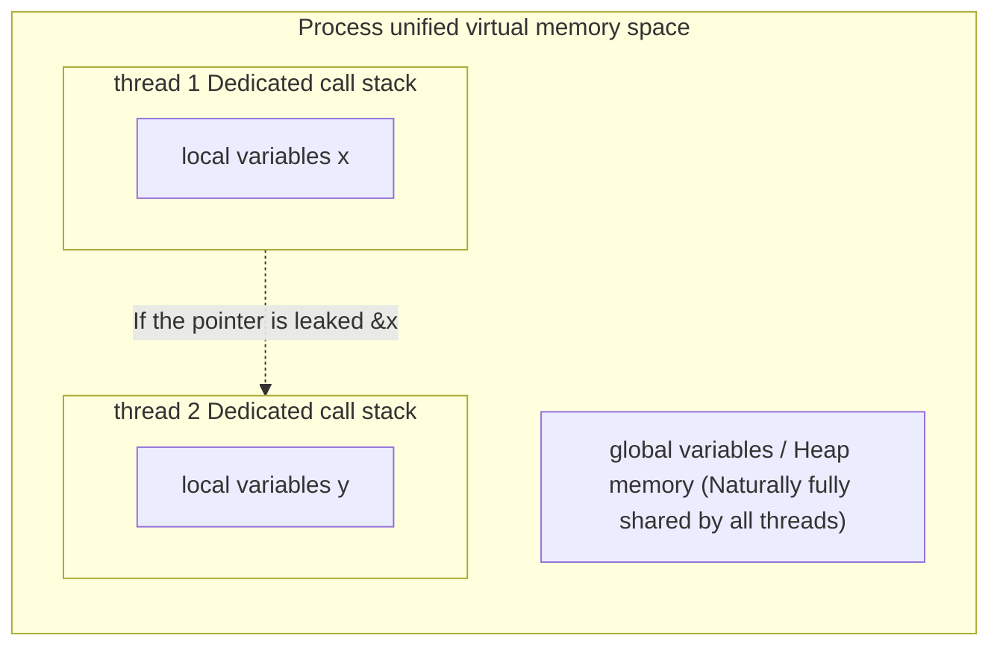
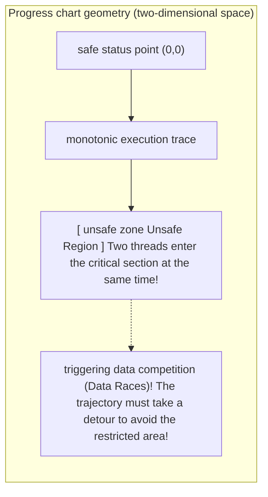

> **Lecturer**: David R. O'Hallaron ｜ **Original video**: Bilibili points P24 \| **duration**: 56:31  
> **Module**: Module 10: Concurrent Programming (L23 - L26 · Multi-process, I/O multiplexing, multi-threading, semaphore synchronization and parallel acceleration ratio)  
> **Original video address**: [https://www.bilibili.com/video/BV1iW411d7hd/?p=24](https://www.bilibili.com/video/BV1iW411d7hd/?p=24)  
> **Course official ownership**: Carnegie Mellon University (CMU) 15-213 / 18-213 / 15-513: Introduction to Computer Systems (CSAPP Fall 2015)  
> **Corresponding teaching materials**: *Computer Systems: A Programmer's Perspective (3rd Edition)* by R. Bryant & D. O'Hallaron  
> **Source of subtitles and handouts**: The subtitles were translated and edited by the EugeneLiu/translationCSAPP team (CC BY-NC 4.0 open source license), and the copyright of the slides belongs to the CMU course group.  

---

## 1. Multi-threaded memory model and shared variables (Shared Variables) precise determination rules

*(Reference time: 00:02:15 · [Video jump (P24 00:02:15)](https://www.bilibili.com/video/BV1iW411d7hd/?p=24&t=135))*


The most powerful feature of multi-threaded programming is that they share the memory of the entire process, but this is also a breeding ground for nightmares.
When multiple threads concurrently read and write memory, how do we accurately determine whether a variable is physically **Shared**?

### The gold standard for shared variable determination
* **definition**: a variable  $v$  is said to be shared if and only if **There are two or more logical flows in different threads that reference the same physical storage instance of the variable in memory.**!
* **The decisive rule for the physical storage location of variables**: 
  1. **Global variables vs. static C variables**: Always stored in  `.data`  or  `.bss`  segment, throughout the process **Globally unique**, access to it is 100% shared by all threads!
  2. **Local automatic variables (local variables within functions without adding static)**: allocated in the private stack frame of the respective thread.
     * *Shocking vulnerability*: If thread A intentionally passes the memory address pointer of its local variable to thread B, **Thread B can legally read and write thread A's private stack by following the pointer! Stack memory is not protected across threads by the hardware MMU!**



## 2. Data race (Race Conditions) live reenactment: assembly-level tearing of cnt++

*(Reference time: 00:15:30 · [Video jump (P24 00:15:30)](https://www.bilibili.com/video/BV1iW411d7hd/?p=24&t=930))*


Examine a piece of classic counter code that must be covered in all concurrency textbooks:
```c
#define NITERS 100000000
volatile long cnt = 0; // 全局计数器

void *thread(void *vargp) {
    long i;
    for (i = 0; i < NITERS; i++)
        cnt++; // 致命的一行代码！
    return NULL;
}
```
Two threads execute this function concurrently, and intuitively the final result should be  $2 \times \text{NITERS}$.
However, running on a real computer, the result may be only 134,821,902, and **The output of each run is all randomly different**!

### Peeling away the C language illusion: `cnt++`  Assembly-level three-step micro-operation
At the x86-64 assembly level, `cnt++`  It is not an atomic operation at all, but is split by the compiler into three completely independent discrete instructions:
1. **loading phase ($H_i$)**: `movq cnt(%rip), %rax` (retrieve from memory  `cnt`  The current value of is read into the thread's private register  `%rax`); 
2. **update phase ($U_i$)**: `addq $1, %rax` (increment value in ALU register by 1);
3. **writeback phase ($S_i$)**: `movq %rax, cnt(%rip)` (Write the self-incremented register value back to physical memory).

### Disaster sequence deduction (Lost Update)
* Initial state: in memory  `cnt = 0`; 
* Clock 1: Thread A executes  $H_A$, read out  `cnt = 0`  put in  `%rax_A`; 
* **Sudden clock interrupt! Kernel triggers context switch!**
* Clock 2: Thread B obtains the CPU and completes execution in one go  $H_B, U_B, S_B$! in memory  `cnt`  becomes 1;
* Clock 3: Thread A resumes execution, in its private view  `%rax_A`  Still 0! it executes  $U_A$  Add the register to 1 and then execute  $S_A$ **Forcibly write 1 to memory**!
* **Tragic results**: The two threads each performed an auto-increment iteration, and finally the  `cnt`  It’s only 1! The calculations that thread B worked so hard to complete are completely obliterated by thread A's writeback!

## 3. Progress Graphs Geometric Theory and Determination of Critical Zones and Unsafe Zones

*(Reference time: 00:28:40 · [Video jump (P24 00:28:40)](https://www.bilibili.com/video/BV1iW411d7hd/?p=24&t=1720))*


In order to model concurrent states highly accurately from mathematical theory, Turing Award winner Edsger Dijkstra proposed the \*\*Progress Graphs\*\* model:
* will  $n$  The execution progress of concurrent threads is modeled as a  $n$  dimensional discrete Cartesian coordinate space;
* For two threads, the horizontal axis  $X$  Indicates the thread 1 instruction advancement point, the vertical axis  $Y$  Represents the thread 2 instruction advancement point;
* Every execution of the program is the origin of the coordinates  $(0,0)$  A monotonous line extending upward and to the right to the end **Trajectory**.

### Critical Section and Unsafe Region
* **critical section**: Access the range composed of shared variable code snippets (that is, include instructions  $H_i, U_i, S_i$  range);
* **unsafe zone**: When two threads are in the critical section at the same time, the corresponding two-dimensional rectangular closed area on the progress chart!
* **Correct mathematical theorem for concurrency**: **A legal execution track must not cross or step into any point in the unsafe zone!**  As long as the trajectory intersects with the unsafe area, data trampling will inevitably occur in the system!



## 4. The Redemption of Computer Master Dijkstra: Semaphores P and V Operations

*(Reference time: 00:41:50 · [Video jump (P24 00:41:50)](https://www.bilibili.com/video/BV1iW411d7hd/?p=24&t=2510))*


In 1965, computer pioneer Edsger Dijkstra formally proposed the classic \*\*Semaphore\*\* mechanism, using elegant mathematical axioms to end the chaos of concurrency and synchronization.

### Axiomatic definition of semaphore
semaphore  $s$  Is a global special variable with a non-negative integer value protected by the system kernel. operations on it **Only possible through two indivisible hardware-level atomic operations** Complete:
1. **$P(s)$  Operation (Dutch Proberen, meaning test/wait/lock)**: 
   * if  $s > 0$, then  $s$  Subtract 1 and return immediately to continue execution;
   * if  $s == 0$, the current calling thread will be placed in the blocking sleep queue (suspended) until it is executed somewhere.  $V$  Operation wake-up.
2. **$V(s)$  Operation (Dutch Verhogen, meaning add/signal/release lock)**: 
   * will  $s$  add 1;
   * If any threads are blocked and waiting at this time  $s$  of  $P$  In the operation queue, the system **Randomly wake up one of the threads**, to complete  $P$  Operation resumes execution.
* **Semaphore Invariant**: The value of the semaphore at any physical instant **can never be less than 0 ($s \ge 0$)**!

### Binary Semaphore implements Mutex
When the initial value of the semaphore is set to  **`1`**  when it is called **binary semaphore** or **Mutex**: 
* Status  `1`: The lock is in idle state;
* Status  `0`: The lock is already held by a thread.
* **Mutual Exclusion Protection Paradigm**: 
  ```c
  P(&mutex);
  /* --- 临界区 (同一瞬间绝对只有唯一一个线程能够进入) --- */
  cnt++;
  /* ------------------------------------------------ */
  V(&mutex);
  ```
On the progress map, the semaphore operation established an indestructible "high-voltage power grid" around the unsafe zone: any trajectory must be destroyed before trying to rush into the unsafe zone.  $P$  The operation forces a halt until another thread executes  $V$  Get out of the box!


---

### Summary and core thoughts of this lecture (Takeaways)

1. **Essential changes in systems perspective**: This lecture analyzes the core implementation principles of "Synchronization: Basics (shared variable determination, data competition, progress chart and Dijkstra semaphore)" from the underlying mechanism.
2. **Software and hardware co-design**: Understanding the underlying rules can not only eliminate potential hidden bugs that are difficult to debug, but is also a prerequisite for writing industrial-grade code with ultimate performance.
3. **Hands-on verification**: It is recommended to cooperate with the after-school exercises and official experiments (Lab) of the corresponding chapters of CSAPP, and use GDB and performance analysis tools in the Linux terminal environment to personally verify the theory.
