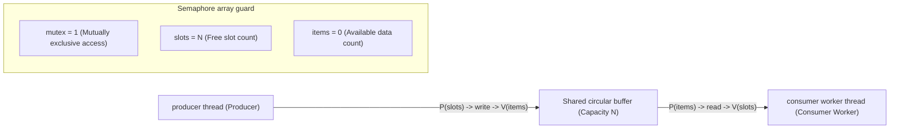

> **Lecturer**: David R. O'Hallaron ｜ **Original video**: Bilibili points P25 \| **duration**: 01:20:43  
> **Module**: Module 10: Concurrent Programming (L23 - L26 · Multi-process, I/O multiplexing, multi-threading, semaphore synchronization and parallel acceleration ratio)  
> **Original video address**: [https://www.bilibili.com/video/BV1iW411d7hd/?p=25](https://www.bilibili.com/video/BV1iW411d7hd/?p=25)  
> **Course official ownership**: Carnegie Mellon University (CMU) 15-213 / 18-213 / 15-513: Introduction to Computer Systems (CSAPP Fall 2015)  
> **Corresponding teaching materials**: *Computer Systems: A Programmer's Perspective (3rd Edition)* by R. Bryant & D. O'Hallaron  
> **Source of subtitles and handouts**: The subtitles were translated and edited by the EugeneLiu/translationCSAPP team (CC BY-NC 4.0 open source license), and the copyright of the slides belongs to the CMU course group.  

---

## 1. Classic synchronization model 1: producer-consumer problem and limited buffer (sbuf package design)

*(Reference time: 00:02:15 · [Video jump (P25 00:02:15)](https://www.bilibili.com/video/BV1iW411d7hd/?p=25&t=135))*


In modern high-performance server architecture, the producer-consumer model is the most basic and widely used model:
* **producer thread**: Continuously generate data items (such as the main listening thread of the web server accepting new client request sockets);
* **consumer thread**: Take out data items from the buffer and perform heavy calculations (such as Worker Threads pool reading sockets from the queue and parsing HTTP requests);
* **Shared Bounded Buffer**: Capacity is  $n$  Fixed queue for slots.

### Three Synchronization Constraints and Semaphore Three Musketeers
1. **Mutually exclusive access constraints**: Modifications to the enqueue and dequeue pointers of the buffer queue itself must be mutually exclusive (use a mutex lock  `mutex`, the initial value is 1);
2. **Buffer cannot overflow**: When the buffer is all  $n$  When all slots are filled, the producer must be suspended and wait (using a counting semaphore  `slots`, **The initial value is set to  $n$**); 
3. **Buffer cannot underflow**: When the buffer is empty (0 data items), the consumer must be suspended and waiting (using a counting semaphore  `items`, **The initial value is set to 0**).

```c
/* CSAPP sbuf 包核心实现 */
typedef struct {
    int *buf;          /* 动态数组指针 */
    int n;             /* 最大插槽数 */
    int front;         /* 队头索引 */
    int rear;          /* 队尾索引 */
    sem_t mutex;       /* 二值信号量：保护共享队列指针 */
    sem_t slots;       /* 计数信号量：可用空槽数 (初值 n) */
    sem_t items;       /* 计数信号量：可用数据项数 (初值 0) */
} sbuf_t;

/* 生产者插入操作 */
void sbuf_insert(sbuf_t *sp, int item) {
    P(&sp->slots);     /* 等待有空槽位 (slots--) */
    P(&sp->mutex);     /* 加互斥锁 */
    sp->buf[(++sp->rear) % (sp->n)] = item; /* 写入数据项 */
    V(&sp->mutex);     /* 释放互斥锁 */
    V(&sp->items);     /* 宣布有新数据可用 (items++) */
}

/* 消费者读取操作 */
int sbuf_remove(sbuf_t *sp) {
    int item;
    P(&sp->items);     /* 等待有数据项 (items--) */
    P(&sp->mutex);     /* 加互斥锁 */
    item = sp->buf[(++sp->front) % (sp->n)]; /* 取出数据项 */
    V(&sp->mutex);     /* 释放互斥锁 */
    V(&sp->slots);     /* 宣布腾出一个空槽位 (slots++) */
    return item;
}
```



## 2. Classic Synchronization Model 2: Reader-Writer Problem and Reading-Writing Hunger Game

*(Reference time: 00:18:40 · [Video jump (P25 00:18:40)](https://www.bilibili.com/video/BV1iW411d7hd/?p=25&t=1120))*


In many real-world scenarios (such as database management systems, online flight booking systems, DNS caching), access to shared resources is asymmetric:
* **Read operations (Readers)**: Only view the data, do not modify the data;
* **Writers**: Modify data content.

### Core Concurrency Principles
* Allow multiple readers **Read concurrently**; 
* The writer must have **Absolute exclusivity (exclusive lock)**: As long as one writer is writing, neither any other writer is allowed to write, nor any reader is allowed to read!

### Readers-Preference algorithm derivation
If there is already a reader currently holding the resource, all subsequent arriving readers can be directly merged into the read, and the writer must wait for all readers to leave.
```c
int readcnt = 0;   /* 当前正在读取的读者总数 */
sem_t mutex = 1;   /* 保护 readcnt 变量的互斥锁 */
sem_t w = 1;       /* 控制对共享资源独占访问的排他锁 */

void reader() {
    while (1) {
        P(&mutex);
        readcnt++;
        if (readcnt == 1) /* 进门的第一个读者负责加排他锁锁死写者！ */
            P(&w);
        V(&mutex);

        /* 正在并发临界区进行安全读取 ... */

        P(&mutex);
        readcnt--;
        if (readcnt == 0) /* 出门的最后一个读者负责释放排他锁，交还写者！ */
            V(&w);
        V(&mutex);
    }
}

void writer() {
    while (1) {
        P(&w); /* 获取绝对独占排他锁 */
        /* 正在执行写入修改 ... */
        V(&w);
    }
}
```
* **Potential risk: writer starvation (Starvation)**:
If there is a steady influx of new readers, `readcnt`  It will never drop to 0, and the writer will be delayed indefinitely or even starved to death! In the pursuit of high-availability industrial systems, usually **Writers first** or **Fair Read-Write Lock**.

## 3. Thread Safety and Reentrancy are strictly defined

*(Reference time: 00:36:15 · [Video jump (P25 00:36:15)](https://www.bilibili.com/video/BV1iW411d7hd/?p=25&t=2175))*


If a function can always produce correct results when called repeatedly by multiple concurrent threads, we call the function Thread-Safe.

### Four notorious types of thread-unsafe functions in systems programming
1. **Category 1: Functions that do not protect shared variables**:
The function directly reads and writes global variables or static variables without locking.
2. **Category 2: Functions that maintain static internal state across successive calls**: 
   * Classic representative: standard library functions  `strtok()`, `rand()`; 
   * `strtok`  A static global pointer is maintained internally to record the position of the last scan; two threads call it at the same time  `strtok`, the scan pointer will be completely beaten to pieces!
3. **Category 3: Functions that return pointers to static global buffers**: 
   * Classic representatives: `ctime()`, `gethostbyname()`, `inet_ntoa()`; 
   * After the function evaluates, it writes the result to a static private buffer and returns its pointer. When thread A just gets the pointer and is ready to read, thread B then calls this function. **Directly forcibly overwrite the memory data pointed to by the pointer in thread A's hand**!
4. **Category 4: Functions that call other thread-unsafe functions**.

### Reentrant Functions: The highest temple of thread safety
* **definition**: a function if **No shared data is referenced at all (all variables are purely allocated in separate registers and local stacks)**, then the function is said to be **reentrant**; 
* **relationship**: **Reentrant functions are a strictly proper subset of thread-safe functions!**  All reentrant functions are thread-safe without any expensive lock contention!
* **POSIX industry standard security replacement library**:
To eliminate historical baggage, the standard library provides libraries for all unsafe functions.  `_r`  A modernized reentrant version of the suffix, such as  `rand_r(&seed)`, `strtok_r()`, `asctime_r()`.

## 4. Cancer of concurrency: Sufficient conditions for the occurrence of deadlocks and lock sequence prevention rules

*(Reference time: 00:54:30 · [Video jump (P25 00:54:30)](https://www.bilibili.com/video/BV1iW411d7hd/?p=25&t=3270))*


### What is a deadlock?
Deadlock refers to such a dead state: **Each thread in a group of threads is waiting for a resource held by another thread in the group, causing all threads in the group to hang indefinitely.**.

```c
/* 经典的死锁交叉加锁反面教材 */
/* 线程 1 流程 */               /* 线程 2 流程 */
P(&mutex_A);                   P(&mutex_B);
P(&mutex_B);                   P(&mutex_A);
// 做操作...                    // 做操作...
V(&mutex_B);                   V(&mutex_A);
V(&mutex_A);                   V(&mutex_B);
```
* **disaster sequence**: 
  * Thread 1 executes  `P(&mutex_A)`  Successfully hold A;
  * Thread 2 executes  `P(&mutex_B)`  Successfully holds B;
  * Next, thread 1 attempts to execute  `P(&mutex_B)`  to be suspended;
  * Thread 2 attempts to execute  `P(&mutex_A)`  Also hung!
  * **The two sides were grabbing each other's necks, and the entire server was completely brain-dead!**

### The ultimate solution: global strict lock ordering rule (Lock Ordering Rule)
The occurrence of deadlock must satisfy the circular wait chain. The most powerful and practical software engineering rule for breaking deadlocks is: 
**Define a total order relationship (Total Order) for all mutex locks in the system. When any thread needs to acquire multiple locks at the same time, it must acquire the locks one by one in strict accordance with the predefined ascending order!**
* Rule: Always get first  `mutex_A`, and then obtain  `mutex_B`; 
* At this time thread 2 is never allowed to write  `P(&mutex_B); P(&mutex_A);`!
* On the progress chart, global lock sorting completely eliminates deadlock restricted areas, and it is mathematically impossible for the system to produce closed-loop waiting!


---

### Summary and core thoughts of this lecture (Takeaways)

1. **Essential changes in systems perspective**: This lecture analyzes the core implementation principles of "Synchronization: Advanced (producer-consumer, reader-writer model, thread safety and deadlock prevention)" from the underlying mechanism.
2. **Software and hardware co-design**: Understanding the underlying rules can not only eliminate potential hidden bugs that are difficult to debug, but is also a prerequisite for writing industrial-grade code with ultimate performance.
3. **Hands-on verification**: It is recommended to cooperate with the after-school exercises and official experiments (Lab) of the corresponding chapters of CSAPP, and use GDB and performance analysis tools in the Linux terminal environment to personally verify the theory.
