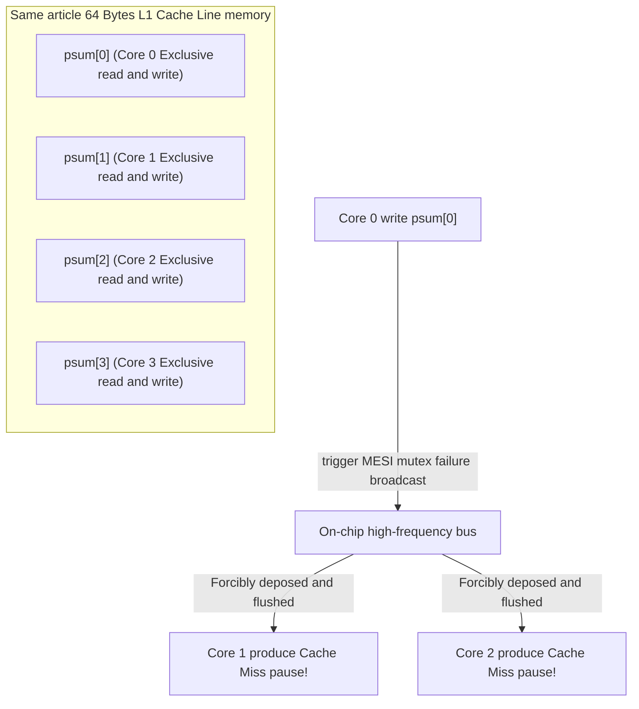

> **Lecturer**: Randal E. Bryant & David R. O'Hallaron ｜ **Original video**: Bilibili points P26 \| **duration**: 01:05:36  
> **Module**: Module 10: Concurrent Programming (L23 - L26 · Multi-process, I/O multiplexing, multi-threading, semaphore synchronization and parallel acceleration ratio)  
> **Original video address**: [https://www.bilibili.com/video/BV1iW411d7hd/?p=26](https://www.bilibili.com/video/BV1iW411d7hd/?p=26)  
> **Course official ownership**: Carnegie Mellon University (CMU) 15-213 / 18-213 / 15-513: Introduction to Computer Systems (CSAPP Fall 2015)  
> **Corresponding teaching materials**: *Computer Systems: A Programmer's Perspective (3rd Edition)* by R. Bryant & D. O'Hallaron  
> **Source of subtitles and handouts**: The subtitles were translated and edited by the EugeneLiu/translationCSAPP team (CC BY-NC 4.0 open source license), and the copyright of the slides belongs to the CMU course group.  

---

## 1. Hard-core indicators of parallel computing: speedup (Speedup) and parallel efficiency

*(Reference time: 00:02:15 · [Video jump (P26 00:02:15)](https://www.bilibili.com/video/BV1iW411d7hd/?p=26&t=135))*


As the main frequency of single-core processors encounters the physical "Power Wall", the slowdown of Moore's Law in the scaling dimension of physical transistors has forced modern semiconductor manufacturers to shift to multi-core processor (Multi-Core Processors) architecture.
The highest pursuit of writing multi-threaded programs is to use multiple CPU cores to cooperate simultaneously to greatly reduce the physical time required to solve a single huge scientific computing problem.

### Core Parallel Metrics
* **Speedup,  $S_p$)**:
Optimal pure serial execution time of the same algorithm running on a single-core processor  $T_1$, and contains  $p$  Parallel execution time of the algorithm running on cores of hardware  $T_p$  The ratio between: 
  $$S_p = \frac{T_1}{T_p}$$
  * **Linear Speedup**: $S_p = p$. If 8 cores can be 8 times faster, that's a perfect theoretical ceiling.
  * **Superlinear Speedup**: In extremely rare cases  $S_p > p$, usually because the combined sum of the L1/L2 Cache capacities held by multiple cores happens to accommodate the entire working set.
* **Parallel Efficiency,  $E_p$)**: 
  $$E_p = \frac{S_p}{p} = \frac{T_1}{p \times T_p}$$
   Typically between 0 and 1 (i.e. 0% to 100%).

## 2. Amdahl's Law: The Eternal Physics Tragedy of Parallel Speedup

*(Reference time: 00:15:40 · [Video jump (P26 00:15:40)](https://www.bilibili.com/video/BV1iW411d7hd/?p=26&t=940))*


Many non-professional engineers mistakenly believe that as long as I stack enough cores (such as buying a 1000-core supercomputer), my program can be 1000 times faster.
Computer pioneer Gene Amdahl revealed a ruthless iron law of mathematics -**Amdahl's Law**!

### Derivation of the mathematical form of Amdahl's law
Assume that in a program, there is a part of code due to inherent data dependencies or global locks. **Strictly serial parts that absolutely cannot be parallelized (proportional to  $s$, among which  $0 \le s \le 1$)**;The remaining part can be split infinitely in parallel (the ratio is  $1 - s$).
when using  $p$  When using parallel cores, the total time taken is: 
$$T_p = T_1 \times \left( s + \frac{1 - s}{p} \right)$$
 The acceleration ratio formula is derived from this: 
$$S_p = \frac{T_1}{T_p} = \frac{1}{s + \frac{1 - s}{p}}$$

### Extreme conclusion: the ceiling under the infinite core
When the number of cores  $p \to \infty$  When approaching infinity: 
$$S_\infty = \lim_{p \to \infty} S_p = \frac{1}{s}$$

### Shocking industrial real-life calculation examples
* Assume that in a large program, **Only a paltry 5% of code is strictly serial ($s = 0.05$)**, the remaining 95% are perfectly parallel;
* Even if you use a galactic battleship with 1 million CPU cores, **The maximum theoretical limit acceleration ratio can never be exceeded**: 
  $$S_\infty = \frac{1}{0.05} = 20 \times ！$$
* **System Enlightenment**: The bottleneck of parallelism is never how fast you can make the parallel part, but **How do you do everything possible to compress and eliminate that little bit of serial bottleneck?**!

## 3. Microarchitectural hidden arrows: False Sharing and Cache thrashing disaster

*(Reference time: 00:29:20 · [Video jump (P26 00:29:20)](https://www.bilibili.com/video/BV1iW411d7hd/?p=26&t=1760))*


When designing multi-threaded parallel summation programs, many senior programmers wrote the following seemingly perfect parallel code:
```c
/* 并行累加求和测试 */
long psum[MAXTHREADS]; // 全局数组，每个线程独立累加自己的槽位

void *sum_thread(void *vargp) {
    long myid = *((long *)vargp);
    long start = myid * nelems_per_thread;
    long end = start + nelems_per_thread;
    psum[myid] = 0; // 专属槽位！完全没有锁竞争！
    for (long i = start; i < end; i++)
        psum[myid] += a[i]; // 致命灾难！
    return NULL;
}
```
* **Abnormal experimental results**: Running 4 threads on a 4-core machine, the running time is actually faster than the single-core serial version **A full 10 times slower**!
* **Code logic review**: Each thread only reads and writes its own  `psum[myid]`, no two threads are accessing the same variable, there is no lock at all, how can it be slowed down?

### Misfortunes come from nowhere: Cache coherence protocols and 64-byte cache lines
The underlying hardware architecture reveals the secret:
* The CPU cache is not cached individually  `long` (8 bytes), instead of  **64-byte block (Cache Line)**  It is an absolute physical handling unit!
* `psum`  adjacent elements of an array  `psum[0]`, `psum[1]`, `psum[2]`, `psum[3]` **They happen to be all squeezed into the same 64-byte physical Cache Line.**!
* **The Ping Pong Tragedy of the MESI Agreement**: 
  * Thread 0 on Core 0 performs addition and marks this line of Cache Line as modified (Modified);
  * The hardware Cache consistency bus snooping mechanism (Bus Snooping) takes effect immediately: **Force all corresponding Cache Lines on Core 1, Core 2, and Core 3 to be invalid (Invalid)**!
  * Then Core 1 tries to increment itself  `psum[1]`, encountered Cache Miss, and was forced to issue a synchronization request to the bus to snatch this row of data from Core 0;
  * This Cache Line is like a ping pong ball, violently bumping and pulling back and forth between multiple cores at the speed of light (Cache Bouncing), and the memory bus is completely paralyzed!

### Programmer’s scalpel-level salvation
1. **Option 1: Accumulation of local variables (perfect elimination)**:
Using private local register variables on the stack inside a loop  `acc`  Accumulate, after the loop ends, only  `psum[myid]`  Write once!
2. **Solution 2: Cache line filling alignment (Padding)**:
Force the structure of each thread to fill up to 64 bytes with padding bytes to ensure that the variables of each thread never fall in the same Cache Line.



## 4. CSAPP panoramic final chapter and programmers’ system worldview

*(Reference time: 00:46:10 · [Video jump (P26 00:46:10)](https://www.bilibili.com/video/BV1iW411d7hd/?p=26&t=2770))*


After 26 lectures of magnificent system exploration, we have spanned the entire grand pyramid of computer software and hardware design:
1. **bit representation of information**: From truncation overflow in two's complement, to rounding cracks in IEEE 754 floating point numbers;
2. **Machine-level code perspective**: From x86-64 registers, control flow condition codes, procedure call stack frames, to buffer overflow and ROP attack and defense;
3. **Program performance extreme squeeze**: From modern superscalar out-of-order microarchitecture to instruction-level parallelism, loop unrolling and critical path elimination;
4. **memory hierarchy**: From the physical latency of disks and SSDs, to the principle of locality, Cache group associative mapping and block optimization;
5. **Links and system operation**: From static library ELF symbol relocation to dynamic shared library PIC and delayed binding ingenuity;
6. **Exception control flow and process**: From hardware interrupts, system calls, to  `fork`, `execve`, copy-on-write COW and signal asynchronous safety;
7. **virtual memory temple**: From MMU hardware paging, multi-level page table compression, TLB extremely fast translation, to dynamic memory allocation and separation adaptation of the heap;
8. **Network interconnection and concurrency**: From socket programming interfaces and HTTP protocols to multi-thread synchronization mutexes, semaphores and parallel microarchitecture pitfalls.

### Conclusion: The ultimate power of systems thinking
From today on, you are no longer an ordinary programmer who only stays in the world of high-level abstractions.
When you press the keyboard to type the next line of code, you can clearly picture it in your mind:
* Charge leakage in DRAM capacitors;
* The transistor pipeline fires micro-ops out of sequence;
* Cache lines bounce across multi-core chip buses;
* The operating system kernel gracefully schedules contexts and page tables in milliseconds.

**Standing on the shoulders of giants and deeply understanding the bottom layer, you will have the ultimate power to control the entire digital physical world!**


---

### Summary and core thoughts of this lecture (Takeaways)

1. **Essential changes in systems perspective**: This lecture analyzes the core implementation principles of "Thread-Level Parallelism (Thread-Level Parallelism, Amdahl's Law, Pseudo-Shared Cache Bumping and Course Summary)" from the underlying mechanism.
2. **Software and hardware co-design**: Understanding the underlying rules can not only eliminate potential hidden bugs that are difficult to debug, but is also a prerequisite for writing industrial-grade code with ultimate performance.
3. **Hands-on verification**: It is recommended to cooperate with the after-school exercises and official experiments (Lab) of the corresponding chapters of CSAPP, and use GDB and performance analysis tools in the Linux terminal environment to personally verify the theory.
